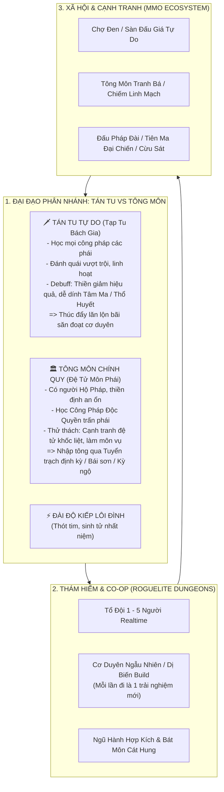
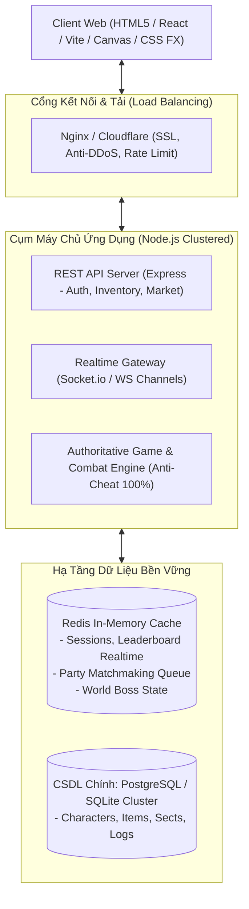

# [00] BẠCH BÌ THƯ: THIÊN ĐẠO KỶ NGUYÊN (TU CHÂN GIỚI ONLINE)
### *Đại Hệ Thống Web Game Tu Tiên Nhập Vai Trực Tuyến Đa Người Chơi (Massive Multiplayer Xianxia Web Game)*

> 🏁 **[Khởi Đầu Hệ Thống]** | 📖 **[Mục Lục Toàn Cảnh](file:///c:/Users/newre/OneDrive/Máy%20tính/code%20tutien/README.md)** | ➡️ **[Bài Kế: Doc 01 - Ma Trận Lộ Trình & Workflow Master](file:///c:/Users/newre/OneDrive/Máy%20tính/code%20tutien/docs/01_LO_TRINH_VA_WORKFLOW.md)**

> *"Đại đạo ba ngàn, vạn giới tranh phong. Con đường tu tiên không còn là góc nhỏ độc hành hay vài ba bằng hữu luận đạo, mà là một cõi Hồng Hoang khốc liệt nơi vạn vạn tu sĩ cùng đoạt thiên địa tạo hóa, tranh đoạt linh mạch, lập tông khai phái, sinh tử nhất niệm!"*

---

## 🏛️ 1. TẦM NHÌN & ĐỊNH VỊ DỰ ÁN

* **Tên dự án**: **Tu Chân Giới Online** *(Thiên Đạo Kỷ Nguyên)*.
* **Thể loại**: **MMORPG Tiên Hiệp Dạng Web (Web-based Xianxia MMO)** kết hợp **Idle Tu Luyện + Roguelite Co-op + Open-Economy Sandbox + Faction War**.
* **Định vị & Nền tảng**:
  * **Đa nền tảng tuyệt đối**: Chơi mượt mà tức thì trên mọi trình duyệt (PC, Mobile iOS/Android, Tablet) mà **không cần cài đặt app**.
  * **Cộng đồng đại chúng**: Thiết kế kiến trúc sẵn sàng phục vụ từ hàng trăm đến hàng ngàn người chơi đồng thời (CCU cao).
  * **Phong cách thẩm mỹ**: Cổ phong thần bí phương Đông, Dark Daoist hiện đại, giao diện kính mờ huyền ảo, hiệu ứng sấm sét và kiếm khí bùng nổ dopamine.

---

## ⚡ 2. TAM ĐẠI TRỤ CỘT GAMEPLAY ĐỘT PHÁ (CORE GAMEPLAY PILLARS)

Để tạo nên sức hút gây nghiện lâu dài (Retention cao) và không đi vào vết xe đổ nhàm chán của các webgame "mì ăn liền", Tu Chân Giới Online được xây dựng trên **3 Trụ Cột**:

### 2.1. Trụ Cột 1: Đại Đạo Phân Nhánh: Tán Tu Nghịch Thiên vs Tông Môn Truyền Thừa

Con đường tu tiên không rập khuôn mà phân hóa sâu sắc thành 2 lối sống mang triết lý đối lập hoàn toàn:

#### 🗡️ 1. TÁN TU (Rogue Cultivator - Bách Gia Tạp Tu)
* **Bản chất**: Không nương nhờ thế lực, tự thân vùng vẫy giữa cõi hồng trần hiểm ác.
* **Đặc quyền & Ưu thế**:
  * **Vạn Pháp Tự Do**: Tán tu có thể học **bất kỳ công pháp bí tịch nào** thu thập được từ cổ mộ, bãi săn hay chợ đen (kết hợp Kiếm Quyết chính đạo, Ma Công thôn phệ, Phật môn hộ thể...).
  * **Chiến Lực Biến Hóa & Săn Quái Vượt Trội**: Nhờ kết hợp nhiều hệ công pháp, Tán tu có bộ chiêu thức cực kỳ cơ động và sát thương đột biến, giúp việc đi săn quái vật đơn độc trở nên nhàn nhã và hiệu quả hơn hẳn.
* **Cái giá phải trả (Nghịch Cảnh & Rủi Ro Tâm Ma)**:
  * **Xung Đột Kinh Mạch & Thiền Định Suy Giảm**: Tạp tu nhiều nguồn chân khí khác nhau khiến hiệu suất Tọa Thiền bị giảm sút nghiêm trọng. Muốn mạnh lên, Tán tu **bắt buộc phải lăn xả ra bãi săn, cắn nuốt yêu đan và đoạt bảo vật**.
  * **Tâm Ma Phản Phệ & Thổ Huyết**: Khi chiến đấu hoặc khi tu vi tích tụ đầy, Tán tu có xác suất phát tác **Tâm Ma Phản Phệ** $\rightarrow$ bị gián đoạn xuất chiêu, nôn ra máu tươi, mất một phần sinh lực tức thì. Đây là rủi ro chí mạng nếu đánh Boss vượt cấp!

#### 🏛️ 2. TÔNG MÔN ĐỆ TỬ (Sect Disciple - Chính Quy Truyền Thừa)
* **Bản chất**: Bái nhập đại phái (Thanh Vân Kiếm Tông, Vạn Ma Uyên, Đan Hà Cốc, U Minh Quỷ Điện, Thái Hư Thần Môn, Hợp Hoan Tông...), trở thành một mắt xích trong cây thế lực.
* **Đặc quyền & Ưu thế**:
  * **Hộ Pháp An Toàn**: Khi Tọa Thiền được Đại Trận Tông Môn và Trưởng Lão hộ pháp che chở $\rightarrow$ Tốc độ hấp thu linh khí cực kỳ ổn định, tuyệt đối không lo tẩu hỏa nhập ma hay thổ huyết.
  * **Công Pháp Độc Quyền Trấn Phái**: Được chân truyền các bộ Tuyệt Kỹ tối thượng thuần nhất, chỉ đệ tử trong môn mới học được, các chiêu thức bổ trợ tương hỗ nhau $100\%$.
* **Thử thách & Trách nhiệm**:
  * **Cạnh tranh nội môn khốc liệt**: Phải liên tục tỷ thí, cống hiến môn phái để thăng tiến qua **Lục Đẳng Đồ Đệ**:
    $$\textbf{Tạp Dịch} \;\longrightarrow\; \textbf{Ngoại Môn} \;\longrightarrow\; \textbf{Nội Môn} \;\longrightarrow\; \textbf{Chân Truyền} \;\longrightarrow\; \textbf{Thủ Tịch} \;\longrightarrow\; \textbf{Thánh Tử / Thánh Nữ}$$
    *(Xem chi tiết tại [`12_TONG_MON_VA_LUC_DANG_DE_TU.md`](file:///c:/Users/newre/OneDrive/Máy%20tính/code%20tutien/docs/12_TONG_MON_VA_LUC_DANG_DE_TU.md))*
  * Bị ràng buộc môn quy, phải tham gia nhiệm vụ tông môn và chiến trường bảo vệ tông môn khi bị tuyên chiến.

#### 📜 3. Cơ Chế Khảo Hạch & Cơ Duyên Bái Nhập Tông Môn
Việc gia nhập tông môn không phải là bấm một nút là xong, mà phản ánh đúng chất Tiên hiệp với nhiều con đường cơ duyên phong phú:
1. **Đại Hội Tuyển Trạch Định Kỳ (Sect Recruitment Fair)**:
   * Cách một khoảng thời gian nhất định (theo chu kỳ server), các Tông Môn sẽ cử Trưởng Lão / Sứ Giả giáng lâm xuống các Thôn Làng, Trấn, Huyện, Thành Trì mở đài đo lường Căn Cốt, Tuyển Chọn Đệ Tử. Người chơi có mặt tại các địa điểm này có thể đăng ký tham gia khảo hạch.
2. **Tự Thân Bái Sơn (Direct Mount Challenge)**:
   * Người chơi tự mình lặn lội đến tận Cổng Tông Môn để xin gia nhập.
   * Yêu cầu: Phải sở hữu **Tư Chất / Thể Chất ưu tú** mà Tông Môn đó đang tìm kiếm (ví dụ: Tông Môn Hỏa chỉ nhận Linh Căn Hỏa hoặc Thể chất Thuần Dương; Kiếm Tông chỉ nhận người có Thân Pháp và Căn Cốt cao) và vượt qua Ải Thí Luyện Sơn Môn (Leo Thiên Thê, phá Mê Trận).
3. **Kỳ Ngộ Đặc Thù (Fateful Encounters)**:
   * Xuất hiện ngẫu nhiên trong quá trình phiêu lưu giang hồ:
     * Được Trưởng Lão ngao du ẩn thế nhìn trúng thu làm đệ tử ký danh.
     * Cứu giúp một đệ tử tông môn trọng thương ngoài hoang dã nhận được **Thư Giới Thiệu / Tín Vật Nhập Tông**.
     * Rơi xuống vực thẳm / hang động nhặt được **Lệnh Bài Trưởng Lão Thất Lạc** $\rightarrow$ cầm về tông môn nhận cơ duyên bái sư.
     * Thắng giải cao trong Đấu Pháp Đài được đại phái gửi thư mời gia nhập.

#### ⚡ 4. Đài Độ Kiếp Sinh Tử (Tribulation Platform)
* Thiên lôi giáng từng đợt thực sự. Người chơi phải căn nhịp tung pháp bảo hộ thể, kích hoạt phù chú hoặc nhờ cậy hộ pháp.
* Thất bại có thể bị phế tu vi, nứt đạo cơ; Thành công thì sinh thiên địa dị tượng vang vọng toàn server!

### 2.2. Trụ Cột 2: Bí Cảnh Roguelite & Phối Hợp Realtime (Active Team Action)
* **Tổ Đội Thần Tốc (Instant Matchmaking)**: Hệ thống ghép đội ngẫu nhiên hoặc lập party cùng bang hội.
* **Cơ Chế Roguelite Cơ Duyên**: Mỗi tầng bí cảnh cho chọn 1 trong 3 cơ duyên biến dị ngẫu nhiên (Build vô hạn trường phái: *Độc Sát Hút Máu, Kiếm Khí Trảm Hồn, Phản Đòn Kim Thân, Né Tránh Hư Ảnh...*).
* **Ngũ Hành Tương Sinh Tương Khắc QTE**:
  * Đạo hữu hệ Thủy dập biển lửa của Boss, đạo hữu hệ Kim phá khiên giáp, đạo hữu hệ Mộc kết dây leo hồi phục đồng đội.
  * Hợp kích tức thì tạo combo nổ sát thương diện rộng.

### 2.3. Trụ Cột 3: Xã Hội Mở, Kinh Tế Tự Do & Chiến Tranh Lãnh Địa (MMO Sandbox)
* **Nền Kinh Tế Mở (Player-Driven Free Market)**:
  * Toàn bộ tài nguyên (Đan dược, Linh thảo, Bí kíp, Yêu đan, Trang bị) đều có thể đem lên **Sàn Giao Dịch Tự Do** hoặc **Chợ Đen** trao đổi bằng Linh Thạch.
  * Chuyên môn hóa nghề nghiệp: Kẻ chuyên cày thảo dược thành "Đại Dược Nông", kẻ chuyên đúc kiếm thành "Thần Khí Sư", kẻ chuyên buôn bán gom hàng kiếm lời.
* **Hệ Thống Tông Môn Tranh Bá (Sect Wars)**:
  * Bang chúng góp công xây dựng Tàng Kinh Các, dựng Hộ Tông Đại Trận.
  * Chiến trường chiếm đoạt **Cực Phẩm Linh Mạch**: Nơi các đại bang hội tuyên chiến, tranh giành quyền khai thác tài nguyên độc quyền.
* **Hệ Thống Tiên - Ma / Thiện - Ác & Cừu Sát (PvP Open-World & Bounty)**:
  * Phân chia trận doanh: **Tiên Đạo Minh** vs **Vạn Ma Minh**.
  * Khu vực hoang dã nguy hiểm: Cho phép cướp bãi săn, đồ sát đoạt bảo.
  * Kẻ giết người tích tụ Sát Khí $\rightarrow$ Thiên Đạo phát lệnh **Truy Nã Toàn Cõi**, toàn bộ tu sĩ trong server đều có thể săn kẻ đó để nhận thưởng lớn; khi chết kẻ sát nhân bị sét đánh văng sạch trang bị!

---

## 🛠️ 3. KIẾN TRÚC CÔNG NGHỆ CHUẨN QUY MÔ CAO (TECH STACK & ARCHITECTURE)

Để đáp ứng hàng nghìn người chơi đồng thời, hạn chế tối đa hack/cheat và đảm bảo không gián đoạn, kiến trúc kỹ thuật được chuẩn hóa:

### 3.1. Ngăn Xếp Kỹ Thuật (Tech Stack)
* **Backend**:
  * **Runtime**: Node.js (v22+) tối ưu I/O phi đồng bộ.
  * **Giao thức**:
    * REST API cho các tác vụ lưu trữ, đăng nhập, chợ búa, nông trại.
    * Socket.io / WebSocket chia theo **Rooms/Channels** cho Chat, Đánh Boss, Tổ đội Bí cảnh, PvP.
  * **Database & Cache**:
    * **Redis**: Quản lý hàng đợi ghép đội, cache chỉ số realtime, DPS Boss, thông báo thế giới.
    * **PostgreSQL / Distributed SQLite (Turso)**: Lưu trữ nhân vật, túi đồ, lịch sử giao dịch và dữ liệu tông môn.
  * **Nguyên tắc Server-Authoritative (Chống Hack Tuyệt Đối)**:
    * Mọi logic cộng exp, tỷ lệ rơi đồ, kết quả combat, sát thương nhận vào đều tính toán $100\%$ tại Server. Client chỉ gửi intent hành động và nhận state kết quả về render.

* **Frontend**:
  * **Single Page Application**: Tải 1 lần chơi mượt mà không load lại trang.
  * **Thẩm mỹ**: Dark Daoist Cổ Phong, hiệu ứng Particle Lôi Kiếp, Neon Glow Tiên Khí.
  * **Responsive Adaptive Layout**: Giao diện co giãn thông minh giữa PC Widescreen (`1650px`) và Mobile (`Vertical Dock`).

---

## 🗺️ 4. BẢNG DANH MỤC MODULE TOÀN DIỆN (SYSTEM DIRECTORY)

Hệ thống được cấu trúc thành các tài liệu module chi tiết:

| Mã Doc | Tên Phân Hệ | Nội Dung Trọng Tâm Trong Mô Hình MMO |
| :---: | :--- | :--- |
| [`00_TONG_QUAN.md`](file:///c:/Users/newre/OneDrive/Máy%20tính/code%20tutien/docs/00_TONG_QUAN.md) | **[Doc 00] Bạch Bì Thư & Tầm Nhìn Dự Án** | Tổng quan dự án, mục tiêu, kiến trúc công nghệ và 3 trụ cột gameplay MMO. |
| [`01_LO_TRINH_VA_WORKFLOW.md`](file:///c:/Users/newre/OneDrive/Máy%20tính/code%20tutien/docs/01_LO_TRINH_VA_WORKFLOW.md) | **[Doc 01] Ma Trận Lộ Trình & Workflow Master** | Ma trận tiến trình 2 Master Flows: Mạch trải nghiệm người chơi (10 bước) & Thứ tự kỹ thuật (6 giai đoạn). |
| [`02_CANH_GIOI_NGU_TOC_VA_THE_CHAT.md`](file:///c:/Users/newre/OneDrive/Máy%20tính/code%20tutien/docs/02_CANH_GIOI_NGU_TOC_VA_THE_CHAT.md) | **[Doc 02] Hệ Thống Cảnh Giới, Ngũ Tộc & Lôi Kiếp** | Danh phả 36 cảnh giới, Ngũ Đại Tộc, 3 giai đoạn thức tỉnh Huyết mạch, suy giảm thiền định & Đài Độ Kiếp. |
| [`03_CAN_CO_TU_CHAT_VA_DAO_DAI.md`](file:///c:/Users/newre/OneDrive/Máy%20tính/code%20tutien/docs/03_CAN_CO_TU_CHAT_VA_DAO_DAI.md) | **[Doc 03] Căn Cơ, Ẩn Mạch & 6 Hình Thái Đạo Đài** | Linh căn, Ẩn Mạch phong ấn, 6 Hình thái Đạo Đài Trúc Cơ, Kim Đan Cửu Chuyển & Dị Tượng, Trảm Đạo Trọng Tu. |
| [`04_THUOC_TINH_MENH_VA_TIEN_HOA_LINH_CAN.md`](file:///c:/Users/newre/OneDrive/Máy%20tính/code%20tutien/docs/04_THUOC_TINH_MENH_VA_TIEN_HOA_LINH_CAN.md) | **[Doc 04] Thuộc Tính Mệnh & Tiến Hóa Linh Căn** | 9 Thuộc tính Mệnh bản nguyên, Ma trận Tương Sinh Tương Khắc, Khai mở Song Căn (Trúc Cơ) & Tam Căn (Kim Đan). |
| [`05_TOAN_THU_VAT_PHAM_PHAP_BAO_VA_CO_DUYEN.md`](file:///c:/Users/newre/OneDrive/Máy%20tính/code%20tutien/docs/05_TOAN_THU_VAT_PHAM_PHAP_BAO_VA_CO_DUYEN.md) | **[Doc 05] Bách Khoa Toàn Thư 400 Vật Phẩm & Bảo Vật** | Phân loại độ hiếm (Dễ, Khó, Ẩn tàng, Cơ duyên, Đặc biệt), đồ độc quyền 6 phái & 4 phân khu sinh tồn. |
| [`06_DATABASE_SCHEMA_VA_API.md`](file:///c:/Users/newre/OneDrive/Máy%20tính/code%20tutien/docs/06_DATABASE_SCHEMA_VA_API.md) | **[Doc 06] Kiến Trúc CSDL SQLite & Đặc Tả API** | Sơ đồ ERD, cấu trúc bảng CHARACTERS toàn diện, đặc tả REST API & Socket.io events. |
| [`07_THIET_KE_HE_THONG_GIAO_DIEN_UI_UX.md`](file:///c:/Users/newre/OneDrive/Máy%20tính/code%20tutien/docs/07_THIET_KE_HE_THONG_GIAO_DIEN_UI_UX.md) | **[Doc 07] Bạch Thư Thiết Kế Đại Hệ Thống Giao Diện (UI/UX)** | Thẩm mỹ Thủy Mặc & Dark Daoist, Zero Page Scroll 100vh, Tứ Đại Giới Vực, Master-Detail Chống Bể Layout, Typewriter/Skip & Khí Linh Chatbot. |
| [`08_DONG_PHU_NONG_TRAI_LUYEN_DAN.md`](file:///c:/Users/newre/OneDrive/Máy%20tính/code%20tutien/docs/08_DONG_PHU_NONG_TRAI_LUYEN_DAN.md) | **[Doc 08] Nơi Trú Ngụ, Dược Điền & Đan Đạo** | Động Phủ Tông Môn vs Tán Tu, Dược điền 3 vườn, Mini-game khống hỏa, Độ thành thạo Auto-craft & 9 Bậc Danh hiệu Đan Đạo. |
| [`09_THIEN_THOI_THAP_NHI_THOI_THAN_VA_KHI_TUONG.md`](file:///c:/Users/newre/OneDrive/Máy%20tính/code%20tutien/docs/09_THIEN_THOI_THAP_NHI_THOI_THAN_VA_KHI_TUONG.md) | **[Doc 09] Thiên Thời, Thập Nhị Thời Thần & Khí Tượng** | Chu kỳ Thiên Đạo 48 phút/ngày thực (4 phút/Canh Giờ), 12 Thời Thần gia trì ngũ hành, Huyết Nguyệt & Thời tiết. |
| [`10_CHIEN_DAU_VA_BAI_SAN.md`](file:///c:/Users/newre/OneDrive/Máy%20tính/code%20tutien/docs/10_CHIEN_DAU_VA_BAI_SAN.md) | **[Doc 10] Chiến Đấu & 2 Phân Khu Bãi Săn** | Combat turn-based, 2 phân khu lịch luyện (Bãi Cảnh Giới & Hỗn Độn Hoang Dã), rơi Yêu Đan/Bí Tịch/Huyết Thú. |
| [`11_COT_TRUYEN_LUC_PHAI_VA_KY_NGO.md`](file:///c:/Users/newre/OneDrive/Máy%20tính/code%20tutien/docs/11_COT_TRUYEN_LUC_PHAI_VA_KY_NGO.md) | **[Doc 11] Cốt Truyện Phân Nhánh Ngũ Tộc & Lục Phái** | Khởi nguyên độc lập 5 Tộc, Tử chiến đầu tiên, 35 Đại cơ duyên kết duyên môn phái & Nghi thức khắc Đạo Hiệu. |
| [`12_TONG_MON_VA_LUC_DANG_DE_TU.md`](file:///c:/Users/newre/OneDrive/Máy%20tính/code%20tutien/docs/12_TONG_MON_VA_LUC_DANG_DE_TU.md) | **[Doc 12] Tông Môn & Lục Đẳng Đồ Đệ** | Trật tự tông môn nghiêm ngặt: Tạp Dịch -> Ngoại Môn -> Nội Môn -> Chân Truyền -> Thủ Tịch -> Thánh Tử. |
| [`13_TOAN_THU_NPC_NHAN_VAT_COT_TRUYEN.md`](file:///c:/Users/newre/OneDrive/Máy%20tính/code%20tutien/docs/13_TOAN_THU_NPC_NHAN_VAT_COT_TRUYEN.md) | **[Doc 13] Toàn Thư Danh Phả 31 NPC & Nhân Quả Hai Chiều** | Bách khoa 31 NPC Tuyến Chính & Ngoại Truyện, Bề nặng lịch sử & bi kịch, Hảo Cảm +100 ban phúc duyên vs Ác Cảm -100 kích hoạt truy sát. |
| [`14_THAN_THUC_TAM_BAO_VA_DI_GIOI.md`](file:///c:/Users/newre/OneDrive/Máy%20tính/code%20tutien/docs/14_THAN_THUC_TAM_BAO_VA_DI_GIOI.md) | **[Doc 14] Thần Thức Tầm Bảo & Sinh Tồn Dị Giới** | Quét Thần Thức Bát Hoang theo cảnh giới & cơ chế sinh tồn tại 4 Vùng Đất Cực Hạn (Thủy, Hỏa, Lôi, Chướng). |
| [`15_TIU_LAU_SONG_BAC_VA_TIN_DUNG_DEN.md`](file:///c:/Users/newre/OneDrive/Máy%20tính/code%20tutien/docs/15_TIU_LAU_SONG_BAC_VA_TIN_DUNG_DEN.md) | **[Doc 15] Tửu Lầu, Sòng Bạc Buckshot & Vay Nợ** | Bất Dạ Thiên Tửu Lầu, Sòng bạc Lôi Hoàn 4 người / Bot AI, Đổ thạch, Vay nợ Ma Tiêu Cục & 4 cấp siết nợ. |
| [`16_TAM_THIEN_DAI_DAO_VA_TIEU_DAO_LUU_PHAI.md`](file:///c:/Users/newre/OneDrive/Máy%20tính/code%20tutien/docs/16_TAM_THIEN_DAI_DAO_VA_TIEU_DAO_LUU_PHAI.md) | **[Doc 16] Tam Thiên Đại Đạo & Bách Gia Lưu Phái** | Thập Đại Đạo, Lục Đại Lưu Phái Kiếm Tu, Bát Trọng Nhục Thân Thể Đạo, 7 Bậc Đạo Cảnh & Ma Trận 16 Nghề Nghiệp Ẩn. |
| [`17_BI_CANH_VA_TO_DOI_REALTIME.md`](file:///c:/Users/newre/OneDrive/Máy%20tính/code%20tutien/docs/17_BI_CANH_VA_TO_DOI_REALTIME.md) | **[Doc 17] Bí Cảnh & Tổ Đội Realtime (1 - 5 Người)** | Phòng chờ tổ đội realtime, kiểm tra thể lực, 4 Đại Bí Cảnh Luyện Hư & điều hướng Bát Môn Độn Giáp. |
| [`18_BOSS_THE_GIOI_VA_MULTIPLAYER.md`](file:///c:/Users/newre/OneDrive/Máy%20tính/code%20tutien/docs/18_BOSS_THE_GIOI_VA_MULTIPLAYER.md) | **[Doc 18] Săn Boss Thế Giới & Xã Hội Multiplayer** | Boss toàn server đồng bộ HP realtime, chu kỳ 30s CD, chia thưởng DPS và khung chat thế giới. |
| [`19_DAI_BIEN_NIEN_SU_36_CANH_GIOI.md`](file:///c:/Users/newre/OneDrive/Máy%20tính/code%20tutien/docs/19_DAI_BIEN_NIEN_SU_36_CANH_GIOI.md) | **[Doc 19] Đại Biên Niên Sử 36 Tiểu Cảnh Giới & Hóa Phàm** | Cốt truyện master qua 4 Đại Kỷ Nguyên, 9 Đại & 36 Tiểu Cảnh Giới, Hóa Phàm 30 năm & 3 đại kết cục phi thăng/trảm đạo. |
| [`20_CAN_BANG_TOAN_CUC_VA_DIEU_CHINH_THONG_SO.md`](file:///c:/Users/newre/OneDrive/Máy%20tính/code%20tutien/docs/20_CAN_BANG_TOAN_CUC_VA_DIEU_CHINH_THONG_SO.md) | **[Doc 20] Cân Bằng Toàn Cục & Móc Nối Đại Hệ Thống** | Bản Hiến Pháp Cân Bằng Tối Cao: Tam giác cân bằng DPS-Tank-Control, Soft/Hard Caps, Công thức sát thương chuẩn hóa & GLOBAL_BALANCE_CONFIG. |
| [`21_HE_THONG_KHO_DO_TUI_TRU_VAT_VA_TRANG_BI.md`](file:///c:/Users/newre/OneDrive/Máy%20tính/code%20tutien/docs/21_HE_THONG_KHO_DO_TUI_TRU_VAT_VA_TRANG_BI.md) | **[Doc 21] Càn Khôn Bảo Khố: Hệ Thống Kho Đồ, Túi Trữ Vật & Lục Đại Trang Bị** | Kiến trúc Tam Tầng Bảo Khố (Túi Hành Trang 24-180 ô, Tàng Bảo Khố Động Phủ 500 ô, Khung Lục Vị Trang Bị Binh Khí/Pháp Y/Hài/Ngọc Bội/Nhẫn/Dị Bảo) & Bộ Thao Tác Cổ Phong. |
| [`22_TOAN_THU_300_CONG_PHAP_BI_TICH.md`](file:///c:/Users/newre/OneDrive/Máy%20tính/code%20tutien/docs/22_TOAN_THU_300_CONG_PHAP_BI_TICH.md) | **[Doc 22] Bách Đại Kinh Điển: Toàn Thư 300 Công Pháp Bí Tịch & Tuyệt Học Thái Cổ** | Bách khoa toàn thư 300 bộ công pháp (SKILL_001 -> SKILL_300) thuộc 8 đại lưu phái: Kiếm Tu (40), Thể Tu (40), Ma Đạo (40), Pháp Tu (45), Thân Pháp (30), Bách Gia Kỹ Nghệ (35), Dị Mạch Tu (35), Tuyệt Kỹ Thái Cổ (35) kèm công dụng thực chiến và cách đoạt lấy. |
| [`23_TOAN_THU_VU_KHI_PHAP_KHI_VA_PHAP_BAO.md`](file:///c:/Users/newre/OneDrive/Máy%20tính/code%20tutien/docs/23_TOAN_THU_VU_KHI_PHAP_KHI_VA_PHAP_BAO.md) | **[Doc 23] Toàn Thư Vũ Khí, Pháp Khí, Linh Bảo & Bản Mệnh Thần Binh** | Bách khoa 120 thần binh pháp khí (ARTIFACT_001 -> ARTIFACT_120) thuộc 8 đại chủng loại (Phi Kiếm, Trọng Binh, Cung Nỏ, Pháp Cụ, Đỉnh Chung Tháp Thuẫn, Hung Khí Vong Linh, Dị Bảo Không Gian, Thái Cổ Chí Bảo) cùng cơ chế tế luyện huyết mạch và thức tỉnh Khí Linh. |
| [`24_LOI_DAI_DAU_PHAP_PVP_VA_BANG_PHAI.md`](file:///c:/Users/newre/OneDrive/Máy%20tính/code%20tutien/docs/24_LOI_DAI_DAU_PHAP_PVP_VA_BANG_PHAI.md) | **[Doc 24] Luận Đạo Lôi Đài: Đấu Pháp Đỉnh Cao & Tiên Minh Bang Phái** | Đấu pháp PvP 1v1 turn-based realtime, cược Linh Thạch luận đạo, Thiên Kiêu Bảng ELO & thành lập Tiên Minh / Bang Phái người chơi tự quản. |
| [`25_PHUONG_THI_DAU_GIA_VA_GIAO_DICH_P2P.md`](file:///c:/Users/newre/OneDrive/Máy%20tính/code%20tutien/docs/25_PHUONG_THI_DAU_GIA_VA_GIAO_DICH_P2P.md) | **[Doc 25] Vạn Bảo Phường Thị: Giao Dịch Tự Do, Đấu Giá Hội & Hòm Thư** | Nền kinh tế mở: Phường Thị ký gửi 48h, Đấu Giá Hội Vạn Bảo Các tối Chủ Nhật, Giao dịch P2P trực tiếp 1v1 an toàn & Hệ thống Tiên Tín hòm thư. |
| [`26_DAO_LU_SONG_TU_HO_PHAP_DO_KIEP_VA_BOUNTY.md`](file:///c:/Users/newre/OneDrive/Máy%20tính/code%20tutien/docs/26_DAO_LU_SONG_TU_HO_PHAP_DO_KIEP_VA_BOUNTY.md) | **[Doc 26] Tiên Duyên Đạo Lữ: Song Tu, Hộ Pháp Độ Kiếp & Huyền Thưởng** | Kết duyên Đạo Lữ (bạn bè/NPC), nghi thức Song Tu hàng ngày nhận Đốn Ngộ, cơ chế đồng đội nhảy vào Hộ Pháp san sẻ lôi kiếp, Huyền Thưởng Bảng 5 nhiệm vụ & Danh Hiệu bản mệnh. |

---

## 🎯 5. NGUYÊN TẮC VẬN HÀNH THIÊN ĐẠO CHÍ CÔNG
1. **No Pay-to-Win Cực Đoan**: Kẻ giàu có thể mua dược liệu nhanh hơn, nhưng muốn đột phá cảnh giới cao bắt buộc phải có Căn Cơ vững chắc, vượt qua Lôi Kiếp thực sự và có kỹ năng phối hợp chiến thuật.
2. **Kinh Tế Giữ Giá Trị**: Trang bị và dược phẩm cấp thấp luôn có công dụng phân rã/luyện hóa thành nguyên liệu cấp cao, đảm bảo người chơi mới và cựu thủ luôn có sợi dây gắn kết giao thương.
3. **Thế Giới Luôn Sống (Living World)**: Boss thế giới xuất hiện theo giờ, thời tiết linh khí biến đổi theo ngày (Ngày Mưa linh khí Thủy tăng, Ngày Hạn linh khí Hỏa bùng nổ), tạo nên một vũ trụ tu tiên huyền ảo bất tận.

---

> 🏁 **[Khởi Đầu Hệ Thống]** | 📖 **[Mục Lục Toàn Cảnh](file:///c:/Users/newre/OneDrive/Máy%20tính/code%20tutien/README.md)** | ➡️ **[Bài Kế: Doc 01 - Ma Trận Lộ Trình & Workflow Master](file:///c:/Users/newre/OneDrive/Máy%20tính/code%20tutien/docs/01_LO_TRINH_VA_WORKFLOW.md)**
