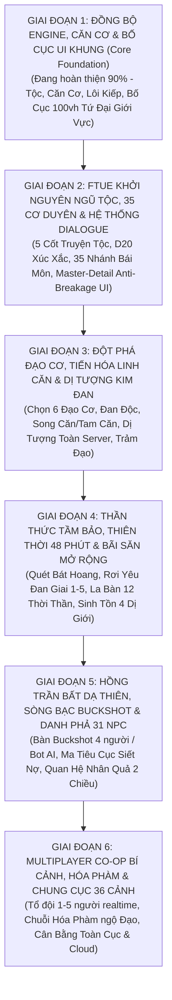

# [01] THIÊN ĐẠO KỶ NGUYÊN: MA TRẬN TIẾN TRÌNH & THỨ TỰ ƯU TIÊN PHÁT TRIỂN (MASTER WORKFLOW & ROADMAP)

> ⬅️ **[Bài Trước: Doc 00 - Bạch Bì Thư & Tầm Nhìn Dự Án](file:///c:/Users/newre/OneDrive/Máy%20tính/code%20tutien/docs/00_TONG_QUAN.md)** | 📖 **[Mục Lục Toàn Cảnh](file:///c:/Users/newre/OneDrive/Máy%20tính/code%20tutien/README.md)** | ➡️ **[Bài Kế: Doc 02 - Hệ Thống Cảnh Giới, Ngũ Tộc & Lôi Kiếp](file:///c:/Users/newre/OneDrive/Máy%20tính/code%20tutien/docs/02_CANH_GIOI_NGU_TOC_VA_THE_CHAT.md)**

> *"Vạn dặm trường chinh khởi đầu từ một bước chân. Muốn dựng nên cõi Hồng Hoang bất hủ, trước phải đắp nền móng kiên cố, sau mới dựng lầu cao gác ngọc. Phân rõ trước sau, định hình mạch lạc, việc trước làm xong việc sau mới thành!"*

Tài liệu này chuẩn hóa **2 Luồng Quy Trình Cốt Lõi (Two Master Flows)** đồng bộ toàn diện trên toàn bộ hệ thống 21 tài liệu thiết kế (Docs 00 $\rightarrow$ 20):
1. **FLOW A (PLAYER EXPERIENCE JOURNEY)**: Mạch tiến trình trải nghiệm của người chơi từ khi tạo nhân vật, bước vào thế giới đến khi phi thăng / trảm thiên (Đánh số từ BƯỚC 1 đến BƯỚC 10).
2. **FLOW B (DEVELOPMENT WORKFLOW & PRIORITIES)**: Thứ tự ưu tiên triển khai kỹ thuật của đội ngũ lập trình (Đánh số từ GIAI ĐOẠN 1 đến GIAI ĐOẠN 6: Khung Nền Móng $\rightarrow$ FTUE Khởi Nguyên $\rightarrow$ Đạo Cơ \& Ngũ Hành $\rightarrow$ Khám Phá Hoang Dã $\rightarrow$ Kinh Tế Hồng Trần $\rightarrow$ Endgame Co-op \& Cloud).

---

## 🧭 FLOW A: MẠCH TIẾN TRÌNH TRẢI NGHIỆM NGƯỜI CHƠI (IN-GAME PLAYER JOURNEY)

```mermaid
graph TD
    Step1["BƯỚC 1: CHỌN BẢN NGUYÊN NGŨ TỘC\n(Nhân, Tiên, Ma, Yêu, Minh - Roll Linh Căn, Khóa Ẩn Mạch - Doc 04, 05, 15)"] --> Step2["BƯỚC 2: CỐT TRUYỆN KHỞI NGUYÊN ĐỘC LẬP NGŨ TỘC\n(4 Màn Kịch Bản: Bi Kịch Cội Nguồn, Thức Tỉnh Cổ Kính Huyền Cơ, Tử Chiến Đầu Tiên - Doc 03, 20)"]
    Step2 --> Step3["BƯỚC 3: 35 ĐẠI CƠ DUYÊN KẾT DUYÊN & NGHI THỨC KHẮC TÊN\n(Chọn 6 Môn Phái / Tán Tu -> Trưởng Lão Hỏi Tên -> Khắc Đạo Hiệu Lên Tín Vật - Doc 03, 06, 14)"]
    Step3 --> Step4["BƯỚC 4: VÒNG LẶP TU LUYỆN SƠ CƠ & THIÊN THỜI\n(Luyện Khí / Dẫn Hồn - Động Phủ, Dược Điền, Khống Hỏa Luyện Đan, Săn Quái Bìa Rừng, Chu Kỳ 48 Phút - Doc 04, 05, 07, 09, 16, 18)"]
    Step4 --> Step5["BƯỚC 5: ĐÀI ĐỘ KIẾP LÔI ĐÌNH & ĐÚC ĐẠO ĐÀI TRÚC CƠ\n(Đỡ Sấm Sét, Chọn 1 trong 6 Hình Thái Đạo Cơ, Khai Mở Song Căn - Doc 04, 05, 15, 19)"]
    Step5 --> Step6["BƯỚC 6: SƠN HÀ VẤN ĐẠO (TRÚC CƠ -> KIM ĐAN)\n(Thí Luyện Biến Cố Phái, Thăng Cấp Lục Đẳng Đệ Tử, Cửu Chuyển Kim Đan & Dị Tượng, Khai Mở Tam Căn - Doc 03, 05, 06, 15)"]
    Step6 --> Step7["BƯỚC 7: XÃ HỘI MỞ, KHÁM PHÁ BÁT HOANG & HỒNG TRẦN\n(Thần Thức 4 Cực Hạn, Bí Cảnh Co-op 1-5 Người & Bát Môn, World Boss, Sòng Bạc Buckshot, Ma Tiêu Cục, 31 NPC - Doc 08, 10, 11, 12, 14, 19, 20)"]
    Step7 --> Step8["BƯỚC 8: HÓA PHÀM NHẬP THẾ & LĨNH NGỘ Ý CẢNH (HÓA THẦN -> LUYỆN HƯ)\n(Hóa Phàm 30 Năm Bên Lò Rèn A Ngưu Thúc, Ngộ Ý Cảnh Sinh Tử / Nhân Quả, Vén Màn Giới Bích - Doc 02, 08, 20)"]
    Step8 --> Step9["BƯỚC 9: THÁI CỔ NGHỊCH KIẾP & ĐẠO CẢNH THĂNG HOA (HỢP THỂ -> ĐẠI THỪA)\n(Cổ Thần Pháp Tướng, Tam Thiên Đại Đạo 7 Bậc Đạo Cảnh, Vén Màn Bí Mật Khí Linh Huyền Cơ - Doc 02, 17, 20)"]
    Step9 --> Step10["BƯỚC 10: CỬU CỬU THIÊN KIẾP & PHÁN XÉT CHUNG CỤC (ĐỘ KIẾP KỲ)\n(81 Đạo Lôi Phạt, Phán Xét Khương Thái Hư Thượng Giới -> 3 Đại Kết Cục: Phi Thăng / Trảm Đạo / Hợp Đạo - Doc 02, 18, 20)"]
```

### Chi Tiết Từng Nấc Thang Trải Nghiệm (Steps 1 $\rightarrow$ 10):
1. **Bước 1 - Chọn Bản Nguyên Ngũ Tộc**:
   - Chọn 1 trong Ngũ Đại Tộc (Tiên, Ma, Nhân, Yêu, Minh) $\rightarrow$ Đo Linh Căn ngũ hành / dị căn $\rightarrow$ Tạo ngẫu nhiên Ẩn Mạch bị phong ấn $\rightarrow$ Xác định 9 Thuộc Tính Mệnh khởi đầu ([`Doc 04`](file:///c:/Users/newre/OneDrive/Máy%20tính/code%20tutien/docs/02_CANH_GIOI_NGU_TOC_VA_THE_CHAT.md), [`Doc 05`](file:///c:/Users/newre/OneDrive/Máy%20tính/code%20tutien/docs/03_CAN_CO_TU_CHAT_VA_DAO_DAI.md), [`Doc 15`](file:///c:/Users/newre/OneDrive/Máy%20tính/code%20tutien/docs/04_THUOC_TINH_MENH_VA_TIEN_HOA_LINH_CAN.md)).
2. **Bước 2 - Cốt Truyện Khởi Nguyên Độc Lập Ngũ Tộc (FTUE 4 Màn & Khí Linh Huyền Cơ)**:
   - **☯️ Nhân Tộc**: *Biển Lửa Thanh Khê Thôn* $\rightarrow$ Thù giết cha mẹ $\rightarrow$ Đâm mù mắt U Minh Xích Lang.
   - **👑 Tiên Tộc**: *Đọa Đài Côn Lôn Tuyết Đỉnh* $\rightarrow$ Thù diệt tộc Thượng Giới $\rightarrow$ Đâm chết Băng Liệt Tuyết Khuyển.
   - **⚔️ Ma Tộc**: *Lò Sát Sinh Cửu U Huyết Trì* $\rightarrow$ Kén máu cắn xé sinh tồn $\rightarrow$ Nuốt nọc Huyết Độc Ma Hạt.
   - **🐉 Yêu Tộc**: *Thập Vạn Đại Sơn Tổ Sào Bi Kịch* $\rightarrow$ Phường săn lột da đoạt đan $\rightarrow$ Xé xác Đội Trưởng Thợ Săn.
   - **👻 Minh Tộc**: *Bỉ Ngạn Hoa Khai Sông Vong Xuyên* $\rightarrow$ Oan hồn vạc dầu u minh $\rightarrow$ Bóp nát yết hầu Ngục Tốt Dạ Xoa.
   - Thức tỉnh tàn phiến **Khí Linh Huyết Ngọc Cổ Kính (Huyền Cơ)** — Trái Tim Thiên Đạo Thứ Nhất, mở khóa Tab Ký Ức Đạo Tâm ([`Doc 03`](file:///c:/Users/newre/OneDrive/Máy%20tính/code%20tutien/docs/11_COT_TRUYEN_LUC_PHAI_VA_KY_NGO.md), [`Doc 20`](file:///c:/Users/newre/OneDrive/Máy%20tính/code%20tutien/docs/13_TOAN_THU_NPC_NHAN_VAT_COT_TRUYEN.md)).
3. **Bước 3 - 35 Đại Cơ Duyên Kết Duyên Môn Phái & Nghi Thức Khắc Tên**:
   - Tiếp cận 6 Đại Tông Phái (*Thanh Vân, Vạn Ma, Đan Hà, U Minh, Thái Hư, Hợp Hoan*) hoặc làm *Tán Tu Tự Do* với góc nhìn và thái độ đón nhận riêng biệt cho từng tộc ($5 \times 7 = 35$ Cơ Duyên).
   - Được môn phái thu nhận / Lập chí trên vách đá $\rightarrow$ Trưởng lão cất tiếng hỏi danh tính $\rightarrow$ Nhập **Đạo Hiệu** $\rightarrow$ Bút Chu Sa / Kiếm Khí khắc tên lên Tín Vật ([`Doc 03`](file:///c:/Users/newre/OneDrive/Máy%20tính/code%20tutien/docs/11_COT_TRUYEN_LUC_PHAI_VA_KY_NGO.md), [`Doc 06`](file:///c:/Users/newre/OneDrive/Máy%20tính/code%20tutien/docs/12_TONG_MON_VA_LUC_DANG_DE_TU.md), [`Doc 14`](file:///c:/Users/newre/OneDrive/Máy%20tính/code%20tutien/docs/05_TOAN_THU_VAT_PHAM_PHAP_BAO_VA_CO_DUYEN.md)).
4. **Bước 4 - Vòng Lặp Tu Luyện Sơ Cơ, Quản Lý Động Phủ & Canh Giờ Thiên Thời**:
   - Tọa Thiền tích lũy Tu Vi (chịu suy giảm Decay).
   - Nông trại Dược Điền 3 vườn, múc nước giếng linh tuyền, mini-game khống hỏa luyện đan.
   - Lịch luyện săn quái Bìa Rừng thu thập Yêu Đan Giai 1, bí kíp nhập môn.
   - Nén exp vào Tụ Linh Đỉnh bồi đắp Độ Vững Căn Cơ $>85\%$.
   - Căn giờ theo **La Bàn 12 Thời Thần & Khí Tượng** (chu kỳ 48 phút/ngày thực) để hưởng $+15\%$ buff Canh Giờ ([`Doc 04`](file:///c:/Users/newre/OneDrive/Máy%20tính/code%20tutien/docs/02_CANH_GIOI_NGU_TOC_VA_THE_CHAT.md), [`Doc 05`](file:///c:/Users/newre/OneDrive/Máy%20tính/code%20tutien/docs/03_CAN_CO_TU_CHAT_VA_DAO_DAI.md), [`Doc 07`](file:///c:/Users/newre/OneDrive/Máy%20tính/code%20tutien/docs/10_CHIEN_DAU_VA_BAI_SAN.md), [`Doc 09`](file:///c:/Users/newre/OneDrive/Máy%20tính/code%20tutien/docs/08_DONG_PHU_NONG_TRAI_LUYEN_DAN.md), [`Doc 16`](file:///c:/Users/newre/OneDrive/Máy%20tính/code%20tutien/docs/09_THIEN_THOI_THAP_NHI_THOI_THAN_VA_KHI_TUONG.md), [`Doc 18`](file:///c:/Users/newre/OneDrive/Máy%20tính/code%20tutien/docs/20_CAN_BANG_TOAN_CUC_VA_DIEU_CHINH_THONG_SO.md)).
5. **Bước 5 - Bước Lên Đài Độ Kiếp & Đúc Đạo Đài Trúc Cơ**:
   - Dẫn động sấm sét thực chiến, cắn Hộ Mạch Đan $\rightarrow$ Đột phá Trúc Cơ $\rightarrow$ Chọn 1 trong 6 Hình Thái Đạo Đài (*Kiếm Tủy, Huyết Liên, Ngũ Hành Luân Hồi, Thiên Đạo Vô Hạ, Quỷ Tháp, Dược Lô*).
   - Khai mở **Song Linh Căn** bổ khuyết thuộc tính chiến đấu ([`Doc 04`](file:///c:/Users/newre/OneDrive/Máy%20tính/code%20tutien/docs/02_CANH_GIOI_NGU_TOC_VA_THE_CHAT.md), [`Doc 05`](file:///c:/Users/newre/OneDrive/Máy%20tính/code%20tutien/docs/03_CAN_CO_TU_CHAT_VA_DAO_DAI.md), [`Doc 15`](file:///c:/Users/newre/OneDrive/Máy%20tính/code%20tutien/docs/04_THUOC_TINH_MENH_VA_TIEN_HOA_LINH_CAN.md), [`Doc 19`](file:///c:/Users/newre/OneDrive/Máy%20tính/code%20tutien/docs/07_THIET_KE_HE_THONG_GIAO_DIEN_UI_UX.md)).
6. **Bước 6 - Thí Luyện Môn Phái & Khắc Đạo Văn Kim Đan Cửu Chuyển**:
   - Thăng tiến Lục Đẳng Đồ Đệ: Tạp Dịch $\rightarrow$ Ngoại Môn $\rightarrow$ Nội Môn $\rightarrow$ Chân Truyền $\rightarrow$ Thủ Tịch.
   - Vượt qua biến cố Trúc Cơ riêng của từng phái.
   - Kết tụ Kim Đan, thức tỉnh Thiên Địa Dị Tượng chấn động server; khai mở **Tam Hoa Tụ Đỉnh (Tam Linh Căn)** ([`Doc 03`](file:///c:/Users/newre/OneDrive/Máy%20tính/code%20tutien/docs/11_COT_TRUYEN_LUC_PHAI_VA_KY_NGO.md), [`Doc 05`](file:///c:/Users/newre/OneDrive/Máy%20tính/code%20tutien/docs/03_CAN_CO_TU_CHAT_VA_DAO_DAI.md), [`Doc 06`](file:///c:/Users/newre/OneDrive/Máy%20tính/code%20tutien/docs/12_TONG_MON_VA_LUC_DANG_DE_TU.md), [`Doc 15`](file:///c:/Users/newre/OneDrive/Máy%20tính/code%20tutien/docs/04_THUOC_TINH_MENH_VA_TIEN_HOA_LINH_CAN.md)).
7. **Bước 7 - Thám Hiểm Bí Cảnh Co-op, Bát Hoang & Giải Trí Hồng Trần**:
   - Lập tổ đội Realtime 1 - 5 người vượt 4 Đại Bí Cảnh Luyện Hư & điều hướng Bát Môn Độn Giáp.
   - Phóng Thần Thức quét Bát Hoang, dấn thân vào 4 Vùng Đất Cực Hạn (Thủy, Hỏa, Lôi, Chướng).
   - Ghé Bất Dạ Thiên chơi Lôi Hoàn Đổ Mệnh (Buckshot Roulette 4 người), vay linh thạch Ma Tiêu Cục hoặc đấu giá Chợ Đen.
   - Giao lưu với mạng lưới **31 NPC** (Lý Huyền Chân, Độc Cô Diệt, Liễu Như Yên, Kim Vạn Lượng...): Kết thân nhận phúc duyên, trở mặt chuốc tai ương ([`Doc 08`](file:///c:/Users/newre/OneDrive/Máy%20tính/code%20tutien/docs/14_THAN_THUC_TAM_BAO_VA_DI_GIOI.md), [`Doc 10`](file:///c:/Users/newre/OneDrive/Máy%20tính/code%20tutien/docs/15_TIU_LAU_SONG_BAC_VA_TIN_DUNG_DEN.md), [`Doc 11`](file:///c:/Users/newre/OneDrive/Máy%20tính/code%20tutien/docs/17_BI_CANH_VA_TO_DOI_REALTIME.md), [`Doc 12`](file:///c:/Users/newre/OneDrive/Máy%20tính/code%20tutien/docs/18_BOSS_THE_GIOI_VA_MULTIPLAYER.md), [`Doc 14`](file:///c:/Users/newre/OneDrive/Máy%20tính/code%20tutien/docs/05_TOAN_THU_VAT_PHAM_PHAP_BAO_VA_CO_DUYEN.md), [`Doc 19`](file:///c:/Users/newre/OneDrive/Máy%20tính/code%20tutien/docs/07_THIET_KE_HE_THONG_GIAO_DIEN_UI_UX.md), [`Doc 20`](file:///c:/Users/newre/OneDrive/Máy%20tính/code%20tutien/docs/13_TOAN_THU_NPC_NHAN_VAT_COT_TRUYEN.md)).
8. **Bước 8 - Hóa Phàm Nhập Thế & Lĩnh Ngộ Ý Cảnh (Hóa Thần $\rightarrow$ Luyện Hư)**:
   - Trút bỏ toàn bộ pháp lực làm phàm nhân 30 năm đập búa bên lò rèn của **A Ngưu Thúc (Bất Diệt Kiếm Hoàng ẩn thế)**.
   - Chứng kiến sinh tử luân hồi, ngộ ra **Ý Cảnh Sinh Tử / Nhân Quả**.
   - Phá vỡ Không Gian Giới Bích, phát hiện sự thật Hạ Giới là "Bãi chăn thả của Thượng Giới" ([`Doc 02`](file:///c:/Users/newre/OneDrive/Máy%20tính/code%20tutien/docs/19_DAI_BIEN_NIEN_SU_36_CANH_GIOI.md), [`Doc 08`](file:///c:/Users/newre/OneDrive/Máy%20tính/code%20tutien/docs/14_THAN_THUC_TAM_BAO_VA_DI_GIOI.md), [`Doc 20`](file:///c:/Users/newre/OneDrive/Máy%20tính/code%20tutien/docs/13_TOAN_THU_NPC_NHAN_VAT_COT_TRUYEN.md)).
9. **Bước 9 - Thái Cổ Tranh Phong & Đạo Cảnh Thăng Hoa (Hợp Thể $\rightarrow$ Đại Thừa)**:
   - Triệu hoán Cổ Thần Pháp Tướng vạn trượng tham gia chiến trường liên tinh cầu.
   - Thâm nhập **Tam Thiên Đại Đạo**, thăng hoa 7 Bậc Đạo Cảnh (*Nhập Đạo $\rightarrow$ Đạo Hóa*), dung hợp combo công pháp Bách Gia Lưu Phái.
   - Vén màn bí mật Khí Linh Huyền Cơ: Mảnh vỡ Trái Tim Thiên Đạo Thứ Nhất ([`Doc 02`](file:///c:/Users/newre/OneDrive/Máy%20tính/code%20tutien/docs/19_DAI_BIEN_NIEN_SU_36_CANH_GIOI.md), [`Doc 17`](file:///c:/Users/newre/OneDrive/Máy%20tính/code%20tutien/docs/16_TAM_THIEN_DAI_DAO_VA_TIEU_DAO_LUU_PHAI.md), [`Doc 20`](file:///c:/Users/newre/OneDrive/Máy%20tính/code%20tutien/docs/13_TOAN_THU_NPC_NHAN_VAT_COT_TRUYEN.md)).
10. **Bước 10 - Cửu Cửu Thiên Kiếp & Phán Xét Chung Cục (Độ Kiếp Kỳ)**:
    - Vượt qua 81 đạo Lôi Phạt tối cao (tuân thủ Soft/Hard Caps chống one-shot).
    - Đối đầu với **Khương Thái Hư (Thượng Giới Mục Đồng)**: Quyết định 1 trong 3 Kết Cục Vĩ Đại:
      * **[Phi Thăng Chân Tiên]**: Quy phục trật tự Thượng Giới, trở thành Tiên Nhân chấp pháp.
      * **[Nghịch Thiên Trảm Đạo]**: Cùng vạn vạn tu sĩ đập tan Thần Giới, giải phóng cõi hạ giới.
      * **[Dĩ Thân Hợp Đạo]**: Tự bạo nhục thân, hòa linh hồn vào Trái Tim Thiên Đạo để tái thiết Kỷ Nguyên Mới ([`Doc 02`](file:///c:/Users/newre/OneDrive/Máy%20tính/code%20tutien/docs/19_DAI_BIEN_NIEN_SU_36_CANH_GIOI.md), [`Doc 18`](file:///c:/Users/newre/OneDrive/Máy%20tính/code%20tutien/docs/20_CAN_BANG_TOAN_CUC_VA_DIEU_CHINH_THONG_SO.md), [`Doc 20`](file:///c:/Users/newre/OneDrive/Máy%20tính/code%20tutien/docs/13_TOAN_THU_NPC_NHAN_VAT_COT_TRUYEN.md)).

---

## 🛠️ FLOW B: THỨ TỰ ƯU TIÊN TRIỂN KHAI KỸ THUẬT (DEVELOPMENT WORK ORDER)

Toàn bộ quá trình lập trình được phân bổ thành **6 Giai Đoạn Đánh Số Tuần Tự**. Nguyên tắc: **Hoàn thiện vững chắc giai đoạn trước mới kích hoạt giai đoạn sau**.

---

### 1️⃣ GIAI ĐOẠN 1: ĐỒNG BỘ ENGINE, CĂN CƠ & BỐ CỤC UI KHUNG (CORE FOUNDATION)
* **Trạng thái**: Đã xong phần lớn logic trong `cultivationConfig.js`, `server.js` và tài liệu chuẩn hóa.
* **Những việc cần làm ngay**:
  1. [x] Đồng bộ hóa toàn bộ 21 tài liệu thiết kế (Docs 00 $\rightarrow$ 20).
  2. [ ] Hoàn thiện giao diện chọn Ngũ Đại Tộc (Tiên, Ma, Nhân, Yêu, Minh) lúc tạo tài khoản mới.
  3. [ ] Khóa cứng viewport **100vh Zero Page Scroll** và dựng khung **Tứ Đại Giới Vực (4-Domain Matrix)** theo [`Doc 19`](file:///c:/Users/newre/OneDrive/Máy%20tính/code%20tutien/docs/07_THIET_KE_HE_THONG_GIAO_DIEN_UI_UX.md).
  4. [ ] Kích hoạt bảng hiển thị **Độ Vững Căn Cơ (%)** và **Đan Độc Kinh Mạch (%)** trên thanh trạng thái nhân vật.
  5. [ ] Khớp nối nút [Bế Quan Tẩy Độc] và [Cắn Thanh Tâm Đan] trên giao diện.

---

### 2️⃣ GIAI ĐOẠN 2: FTUE KHỞI NGUYÊN NGŨ TỘC, 35 CƠ DUYÊN & HỆ THỐNG HỘI THOẠI MASTER-DETAIL (EARLY HOOK)
* **Mục tiêu**: Đưa người chơi vào thế giới một cách cuốn hút, cá nhân hóa sâu sắc và áp dụng quy chuẩn chống vỡ giao diện.
* **Những việc cần làm**:
  1. [ ] Dựng màn hình dẫn nhập **5 Chương Khởi Nguyên Độc Lập** (Thanh Khê Thôn / Côn Lôn Đỉnh Tuyết / Cửu U Huyết Trì / Thập Vạn Đại Sơn / Sông Vong Xuyên Bỉ Ngạn) với hiệu ứng Typewriter + Khói lửa Dark Daoist.
  2. [ ] Tích hợp 3 cấp độ điều tốc đọc thoại: Click-to-Complete, nút `[⏭️ Skip Scene]` và nút `[⚡ Instant]` tốc độ 0ms ([`Doc 19`](file:///c:/Users/newre/OneDrive/Máy%20tính/code%20tutien/docs/07_THIET_KE_HE_THONG_GIAO_DIEN_UI_UX.md)).
  3. [ ] Dựng Modal hội thoại **Master-Detail Anti-Breakage Layout**: Nút chọn cố định chiều cao (`h-[44px]`), nút `[ℹ️]` xem chi tiết, văn bản dài chuyển sang bảng preview cố định ([`Doc 19`](file:///c:/Users/newre/OneDrive/Máy%20tính/code%20tutien/docs/07_THIET_KE_HE_THONG_GIAO_DIEN_UI_UX.md)).
  4. [ ] Thiết kế cơ chế chạm trán **Tử Chiến Đầu Tiên** với kẻ thù đặc trưng của từng tộc (Đổ Xúc Xắc D20 kiểm tra Phản xạ / Sát khí).
  5. [ ] Thức tỉnh mảnh **Huyết Ngọc Cổ Kính (Huyền Cơ)**, liên kết Tab Ký Ức Đạo Tâm `[🔮 Khí Linh / Ký Ức]` ([`Doc 20`](file:///c:/Users/newre/OneDrive/Máy%20tính/code%20tutien/docs/13_TOAN_THU_NPC_NHAN_VAT_COT_TRUYEN.md)).
  6. [ ] Menu lựa chọn **35 Cơ Duyên Kết Duyên Môn Phái** $\rightarrow$ Hộp thoại **Nghi Thức Khắc Tên**: Nhập Đạo Hiệu $\rightarrow$ Chu Sa khắc tên lên Tín Vật.

---

### 3️⃣ GIAI ĐOẠN 3: ĐỘT PHÁ ĐẠO CƠ, TIẾN HÓA LINH CĂN & DỊ TƯỢNG KIM ĐAN (FOUNDATION EVOLUTION)
* **Mục tiêu**: Tạo cảm giác thăng hoa tột đỉnh khi thăng cấp và phân hóa sâu sắc sức mạnh nhân vật.
* **Những việc cần làm**:
  1. [ ] Khi đột phá Trúc Cơ: Mở Pop-up cho người chơi chọn **1 trong 6 Hình Thái Đạo Đài** (Kiếm Tủy, Huyết Liên, Ngũ Hành Luân Hồi, Thiên Đạo Vô Hạ, Quỷ Tháp, Dược Lô) ([`Doc 05`](file:///c:/Users/newre/OneDrive/Máy%20tính/code%20tutien/docs/03_CAN_CO_TU_CHAT_VA_DAO_DAI.md)).
  2. [ ] Tính toán phẩm cấp Trúc Cơ (Phàm Phẩm, Địa Phẩm, Thiên Đạo) dựa trên Độ Vững Căn Cơ; kích hoạt khai mở **Song Linh Căn** ([`Doc 15`](file:///c:/Users/newre/OneDrive/Máy%20tính/code%20tutien/docs/04_THUOC_TINH_MENH_VA_TIEN_HOA_LINH_CAN.md)).
  3. [ ] Cơ chế **Kim Đan Cửu Chuyển**: Tính số vòng Đạo Văn khi kết đan $\rightarrow$ Kích hoạt hiệu ứng Dị Tượng toàn server qua Socket.io broadcast.
  4. [ ] Nút bấm **[Trảm Đạo Trọng Tu]** cho các cao thủ muốn phá Đạo Đài cũ để đúc lại Thiên Đạo Đạo Cơ ([`Doc 05`](file:///c:/Users/newre/OneDrive/Máy%20tính/code%20tutien/docs/03_CAN_CO_TU_CHAT_VA_DAO_DAI.md)).

---

### 4️⃣ GIAI ĐOẠN 4: THẦN THỨC TẦM BẢO, THIÊN THỜI 48 PHÚT & BÃI SĂN MỞ RỘNG (WORLD EXPLORATION)
* **Mục tiêu**: Chuyển đổi từ cày quái một nút sang khám phá thế giới đa chiều phụ thuộc vào thời khắc thiên đạo.
* **Những việc cần làm**:
  1. [ ] Tích hợp **La Bàn 12 Thời Thần & Khí Tượng** (chu kỳ 48 phút/ngày thực) trên 52px Slim Header ([`Doc 16`](file:///c:/Users/newre/OneDrive/Máy%20tính/code%20tutien/docs/09_THIEN_THOI_THAP_NHI_THOI_THAN_VA_KHI_TUONG.md), [`Doc 19`](file:///c:/Users/newre/OneDrive/Máy%20tính/code%20tutien/docs/07_THIET_KE_HE_THONG_GIAO_DIEN_UI_UX.md)).
  2. [ ] Nút bấm **[Phóng Thần Thức]** quét bản đồ theo bán kính cảnh giới (10 dặm $\rightarrow$ 5,000 dặm) ([`Doc 08`](file:///c:/Users/newre/OneDrive/Máy%20tính/code%20tutien/docs/14_THAN_THUC_TAM_BAO_VA_DI_GIOI.md)).
  3. [ ] Bảng kết quả rà quét ngẫu nhiên: Linh thảo, Thổ phỉ cứu dân lành, Cao nhân ẩn thế, Cổ Động Phủ.
  4. [ ] Hoàn thiện bảng rơi đồ: Nút [Luyện Hóa] Yêu Đan ăn Exp tức thì; Nút [Lĩnh Ngộ] Công Pháp Bí Tịch; Nút [Thối Thể] Huyết Thú Tinh Hoa.
  5. [ ] Tích hợp thanh **Áp Lực Sinh Tồn** (Oxi, Hỏa độc, Điện tích) khi vào 4 Vùng Đất Cực Hạn ([`Doc 08`](file:///c:/Users/newre/OneDrive/Máy%20tính/code%20tutien/docs/14_THAN_THUC_TAM_BAO_VA_DI_GIOI.md)).

---

### 5️⃣ GIAI ĐOẠN 5: HỒNG TRẦN BẤT DẠ THIÊN, SÒNG BẠC BUCKSHOT & DANH PHẢ 31 NPC (SANDBOX ECONOMY & NPC NETWORK)
* **Mục tiêu**: Tạo nét độc đáo, đen tối, giải trí và kịch tính bậc nhất trong game.
* **Những việc cần làm**:
  1. [ ] Giao diện **Bất Dạ Thiên Tửu Lầu**: Uống linh tửu nhận buff tạm thời; kết nối bà chủ Hồng Tiêu mua tin tình báo.
  2. [ ] Trò chơi **Lôi Hoàn Đổ Mệnh (Buckshot Roulette)**: Bàn tròn 4 người (hỗ trợ chơi với 3 Bot AI có cá tính: Lão Quỷ, Huyết Ma, Đan Sư; gặp gỡ Đổ Thánh Quách Bất Bại) ([`Doc 10`](file:///c:/Users/newre/OneDrive/Máy%20tính/code%20tutien/docs/15_TIU_LAU_SONG_BAC_VA_TIN_DUNG_DEN.md), [`Doc 20`](file:///c:/Users/newre/OneDrive/Máy%20tính/code%20tutien/docs/13_TOAN_THU_NPC_NHAN_VAT_COT_TRUYEN.md)).
  3. [ ] Bàn giao dịch **Ma Tiêu Cục Cho Vay**: Cho vay linh thạch vượt cấp, tính lãi suất 10%/ngày, kích hoạt 4 cấp độ siết nợ tróc nã toàn cõi của Hắc Huyết Lão Ma ([`Doc 10`](file:///c:/Users/newre/OneDrive/Máy%20tính/code%20tutien/docs/15_TIU_LAU_SONG_BAC_VA_TIN_DUNG_DEN.md)).
  4. [ ] Khởi tạo Database cho **31 NPC**, hệ thống tính điểm **Hảo Cảm / Ác Cảm (-100 đến +100)**: Kết thân nhận đại phúc duyên (Liễu Như Yên làm Đạo Lữ Song Tu, Lý Huyền Chân ban bảo kiếm), trở mặt kích hoạt Huyết Thù truy sát ([`Doc 20`](file:///c:/Users/newre/OneDrive/Máy%20tính/code%20tutien/docs/13_TOAN_THU_NPC_NHAN_VAT_COT_TRUYEN.md)).

---

### 6️⃣ GIAI ĐOẠN 6: MULTIPLAYER CO-OP BÍ CẢNH, HÓA PHÀM & 3 ĐẠI KẾT CỤC (ENDGAME, BALANCE & CLOUD)
* **Mục tiêu**: Xây dựng giá trị chơi lại lâu dài, cân bằng hoàn hảo và cốt truyện bất hủ.
* **Những việc cần làm**:
  1. [ ] Sảnh ghép đội **Bí Cảnh 1 - 5 Người Realtime** qua Socket.io: 4 Đại Bí Cảnh, Bát Môn Độn Giáp ([`Doc 11`](file:///c:/Users/newre/OneDrive/Máy%20tính/code%20tutien/docs/17_BI_CANH_VA_TO_DOI_REALTIME.md)).
  2. [ ] Chuỗi nhiệm vụ **Hóa Phàm 30 Năm**: Thu liễm tu vi làm thợ rèn bên cạnh A Ngưu Thúc, mở khóa Ý Cảnh Sinh Tử / Nhân Quả ([`Doc 02`](file:///c:/Users/newre/OneDrive/Máy%20tính/code%20tutien/docs/19_DAI_BIEN_NIEN_SU_36_CANH_GIOI.md), [`Doc 08`](file:///c:/Users/newre/OneDrive/Máy%20tính/code%20tutien/docs/14_THAN_THUC_TAM_BAO_VA_DI_GIOI.md), [`Doc 20`](file:///c:/Users/newre/OneDrive/Máy%20tính/code%20tutien/docs/13_TOAN_THU_NPC_NHAN_VAT_COT_TRUYEN.md)).
  3. [ ] Cửu Cửu Thiên Kiếp 81 đạo sấm sét và giao diện lựa chọn **3 Đại Kết Cục Chung Cực** (*Phi Thăng Chân Tiên / Nghịch Thiên Trảm Đạo / Dĩ Thân Hợp Đạo*) ([`Doc 02`](file:///c:/Users/newre/OneDrive/Máy%20tính/code%20tutien/docs/19_DAI_BIEN_NIEN_SU_36_CANH_GIOI.md)).
  4. [ ] Tích hợp toàn bộ hằng số **Hiến Pháp Cân Bằng Toàn Cục `GLOBAL_BALANCE_CONFIG`** (Soft/Hard Caps, công thức sát thương chuẩn hóa duy nhất) ([`Doc 18`](file:///c:/Users/newre/OneDrive/Máy%20tính/code%20tutien/docs/20_CAN_BANG_TOAN_CUC_VA_DIEU_CHINH_THONG_SO.md)).
  5. [ ] Triển khai lên Cloud Server 24/7 (Turso SQLite / Render / VPS) để nhóm bạn chơi chung bằng điện thoại và PC không cần mở máy chủ cá nhân.

---

## 📌 BẢNG TỔNG KẾT TIẾN ĐỘ THI CÔNG TOÀN BỘ 21 MODULE

| Mã Phân Hệ | Tên Phân Hệ Chi Tiết | Giai Đoạn Thi Công | Độ Ưu Tiên | Độ Khó Kỹ Thuật | Trạng Thái Hiện Tại |
| :---: | :--- | :---: | :---: | :---: | :---: |
| **Doc 00** | [Bạch Bì Thư & Tầm Nhìn Dự Án](file:///c:/Users/newre/OneDrive/Máy%20tính/code%20tutien/docs/00_TONG_QUAN.md) | Giai đoạn 1 | 🔴 P0 (Cao nhất) | Dễ | **Đã hoàn thiện 100%** |
| **Doc 01** | [Ma Trận Lộ Trình & Workflow Master](file:///c:/Users/newre/OneDrive/Máy%20tính/code%20tutien/docs/01_LO_TRINH_VA_WORKFLOW.md) | Giai đoạn 1 | 🔴 P0 (Cao nhất) | Trung bình | **Đã đồng bộ hóa 100%** |
| **Doc 02** | [Hệ Thống Cảnh Giới, Ngũ Tộc & Lôi Kiếp](file:///c:/Users/newre/OneDrive/Máy%20tính/code%20tutien/docs/02_CANH_GIOI_NGU_TOC_VA_THE_CHAT.md) | Giai đoạn 1 | 🔴 P0 (Cao nhất) | Dễ | **Đã code xong Config** |
| **Doc 03** | [Căn Cơ, Ẩn Mạch & 6 Hình Thái Đạo Đài](file:///c:/Users/newre/OneDrive/Máy%20tính/code%20tutien/docs/03_CAN_CO_TU_CHAT_VA_DAO_DAI.md) | Giai đoạn 3 | 🟡 P1 (Ưu tiên cao) | Dễ | **Đã có hàm tính toán** |
| **Doc 04** | [Thuộc Tính Mệnh & Tiến Hóa Linh Căn](file:///c:/Users/newre/OneDrive/Máy%20tính/code%20tutien/docs/04_THUOC_TINH_MENH_VA_TIEN_HOA_LINH_CAN.md) | Giai đoạn 3 | 🟡 P1 (Ưu tiên cao) | Dễ | **Thiết kế xong ma trận** |
| **Doc 05** | [Bách Khoa Toàn Thư 400 Vật Phẩm & Bảo Vật](file:///c:/Users/newre/OneDrive/Máy%20tính/code%20tutien/docs/05_TOAN_THU_VAT_PHAM_PHAP_BAO_VA_CO_DUYEN.md) | Giai đoạn 1 | 🔴 P0 (Cao nhất) | Dễ | **Đã danh mục hóa đầy đủ** |
| **Doc 06** | [Kiến Trúc CSDL SQLite & Đặc Tả API](file:///c:/Users/newre/OneDrive/Máy%20tính/code%20tutien/docs/06_DATABASE_SCHEMA_VA_API.md) | Giai đoạn 1 | 🔴 P0 (Cao nhất) | Dễ - Cơ bản | **Đã có bảng Characters & API** |
| **Doc 07** | [Bạch Thư Thiết Kế Đại Hệ Thống Giao Diện (UI/UX)](file:///c:/Users/newre/OneDrive/Máy%20tính/code%20tutien/docs/07_THIET_KE_HE_THONG_GIAO_DIEN_UI_UX.md) | Giai đoạn 1-2 | 🔴 P0 (Cao nhất) | Khá - Phức tạp | **Thiết kế xong Wireframe & CSS** |
| **Doc 08** | [Nơi Trú Ngụ, Dược Điền & Đan Đạo](file:///c:/Users/newre/OneDrive/Máy%20tính/code%20tutien/docs/08_DONG_PHU_NONG_TRAI_LUYEN_DAN.md) | Giai đoạn 1 | 🔴 P0 (Cao nhất) | Trung bình | **Đã có Mini-game & Nông trại** |
| **Doc 09** | [Thiên Thời, Thập Nhị Thời Thần & Khí Tượng](file:///c:/Users/newre/OneDrive/Máy%20tính/code%20tutien/docs/09_THIEN_THOI_THAP_NHI_THOI_THAN_VA_KHI_TUONG.md) | Giai đoạn 4 | 🟡 P1 (Ưu tiên cao) | Dễ - Trung bình | **Thiết kế xong chu kỳ 48 phút** |
| **Doc 10** | [Chiến Đấu & 2 Phân Khu Bãi Săn](file:///c:/Users/newre/OneDrive/Máy%20tính/code%20tutien/docs/10_CHIEN_DAU_VA_BAI_SAN.md) | Giai đoạn 1 | 🔴 P0 (Cao nhất) | Khá | **Đã có logic Turn-based** |
| **Doc 11** | [Cốt Truyện Phân Nhánh Ngũ Tộc & Lục Phái](file:///c:/Users/newre/OneDrive/Máy%20tính/code%20tutien/docs/11_COT_TRUYEN_LUC_PHAI_VA_KY_NGO.md) | Giai đoạn 2 | 🔴 P0 (Cao nhất) | Trung bình | **Thiết kế xong, chờ ráp UI** |
| **Doc 12** | [Tông Môn & Lục Đẳng Đồ Đệ](file:///c:/Users/newre/OneDrive/Máy%20tính/code%20tutien/docs/12_TONG_MON_VA_LUC_DANG_DE_TU.md) | Giai đoạn 2 | 🔴 P0 (Cao nhất) | Trung bình | **Thiết kế xong cấu trúc** |
| **Doc 13** | [Toàn Thư Danh Phả 31 NPC & Nhân Quả Hai Chiều](file:///c:/Users/newre/OneDrive/Máy%20tính/code%20tutien/docs/13_TOAN_THU_NPC_NHAN_VAT_COT_TRUYEN.md) | Giai đoạn 2-5 | 🟡 P1 (Ưu tiên cao) | Trung bình | **Thiết kế xong 31 NPC & JSON** |
| **Doc 14** | [Thần Thức Tầm Bảo & Sinh Tồn Dị Giới](file:///c:/Users/newre/OneDrive/Máy%20tính/code%20tutien/docs/14_THAN_THUC_TAM_BAO_VA_DI_GIOI.md) | Giai đoạn 4 | 🟡 P1 (Ưu tiên cao) | Trung bình | **Thiết kế xong công thức** |
| **Doc 15** | [Tửu Lầu, Sòng Bạc Buckshot & Vay Nợ](file:///c:/Users/newre/OneDrive/Máy%20tính/code%20tutien/docs/15_TIU_LAU_SONG_BAC_VA_TIN_DUNG_DEN.md) | Giai đoạn 5 | 🟢 P2 (Mở rộng) | Khá | **Thiết kế chi tiết luật chơi** |
| **Doc 16** | [Tam Thiên Đại Đạo & Bách Gia Lưu Phái](file:///c:/Users/newre/OneDrive/Máy%20tính/code%20tutien/docs/16_TAM_THIEN_DAI_DAO_VA_TIEU_DAO_LUU_PHAI.md) | Giai đoạn 6 | 🔵 P3 (Endgame) | Phức tạp | **Thiết kế xong 10 Đại Đạo** |
| **Doc 17** | [Bí Cảnh & Tổ Đội Realtime (1 - 5 Người)](file:///c:/Users/newre/OneDrive/Máy%20tính/code%20tutien/docs/17_BI_CANH_VA_TO_DOI_REALTIME.md) | Giai đoạn 6 | 🔵 P3 (Endgame) | Phức tạp | **Đã có khung Socket.io** |
| **Doc 18** | [Săn Boss Thế Giới & Xã Hội Multiplayer](file:///c:/Users/newre/OneDrive/Máy%20tính/code%20tutien/docs/18_BOSS_THE_GIOI_VA_MULTIPLAYER.md) | Giai đoạn 6 | 🔵 P3 (Endgame) | Khá | **Đã có đồng bộ HP toàn server** |
| **Doc 19** | [Đại Biên Niên Sử 36 Tiểu Cảnh Giới & Hóa Phàm](file:///c:/Users/newre/OneDrive/Máy%20tính/code%20tutien/docs/19_DAI_BIEN_NIEN_SU_36_CANH_GIOI.md) | Giai đoạn 6 | 🔵 P3 (Endgame) | Phức tạp | **Đã hoàn thiện 100%** |
| **Doc 20** | [Cân Bằng Toàn Cục & Móc Nối Đại Hệ Thống](file:///c:/Users/newre/OneDrive/Máy%20tính/code%20tutien/docs/20_CAN_BANG_TOAN_CUC_VA_DIEU_CHINH_THONG_SO.md) | Giai đoạn 1 | 🔴 P0 (Cao nhất) | Phức tạp | **Đã ban hành bộ hằng số** |

---

> ⬅️ **[Bài Trước: Doc 00 - Bạch Bì Thư & Tầm Nhìn Dự Án](file:///c:/Users/newre/OneDrive/Máy%20tính/code%20tutien/docs/00_TONG_QUAN.md)** | 📖 **[Mục Lục Toàn Cảnh](file:///c:/Users/newre/OneDrive/Máy%20tính/code%20tutien/README.md)** | ➡️ **[Bài Kế: Doc 02 - Hệ Thống Cảnh Giới, Ngũ Tộc & Lôi Kiếp](file:///c:/Users/newre/OneDrive/Máy%20tính/code%20tutien/docs/02_CANH_GIOI_NGU_TOC_VA_THE_CHAT.md)**
