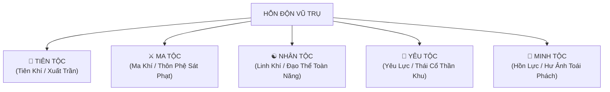
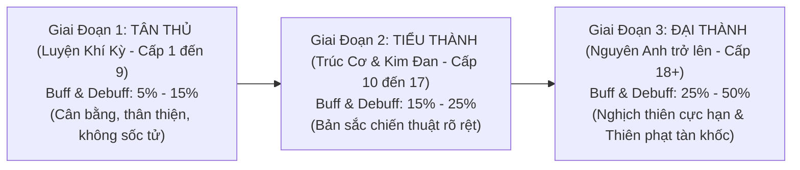
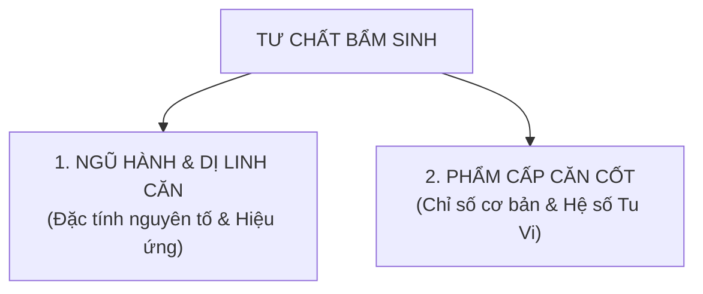
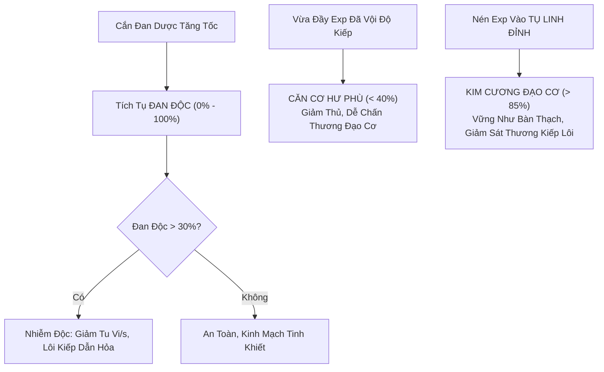

# [02] ĐẠI ĐẠO CHI NGUYÊN: HỆ THỐNG NGŨ TỘC, CẢNH GIỚI, TƯ CHẤT & CĂN CƠ

> ⬅️ **[Bài Trước: Doc 01 - Ma Trận Lộ Trình & Workflow Master](file:///c:/Users/newre/OneDrive/Máy%20tính/code%20tutien/docs/01_LO_TRINH_VA_WORKFLOW.md)** | 📖 **[Mục Lục Toàn Cảnh](file:///c:/Users/newre/OneDrive/Máy%20tính/code%20tutien/README.md)** | ➡️ **[Bài Kế: Doc 03 - Căn Cơ, Ẩn Mạch & 6 Hình Thái Đạo Đài](file:///c:/Users/newre/OneDrive/Máy%20tính/code%20tutien/docs/03_CAN_CO_TU_CHAT_VA_DAO_DAI.md)**

> *"Hỗn Độn sơ khai, Thiên Địa phân định. Vạn linh trong vũ trụ nương nhờ linh khí trời đất mà sinh sôi, chia thành Ngũ Đại Tộc: Tiên, Ma, Nhân, Yêu, Minh. Mỗi tộc một con đường, kẻ thuận theo đạo, kẻ nghịch thiên cải mệnh, cùng tranh phong trên con đường bất hủ trường sinh.*
> *Đại Đạo vô tình, Thiên Đạo chí công: Tộc có buff càng nghịch thiên thì debuff càng khốc liệt. Dục tốc bất đạt: Tu vi dễ đắc, Căn cơ khó bồi; Căn cơ bất ổn, kiếp lôi tan biến!"*

Tài liệu này là **quy chuẩn kỹ thuật và thiết kế nền tảng tối cao** định hình toàn bộ quy tắc về Chủng Tộc, Danh Phả Cảnh Giới, Tư Chất (Linh Căn), Căn Cơ (Đạo Cơ & Đan Độc), Thể Chất và Kiếp Nạn Đột Phá trong toàn bộ trò chơi Tu Chân Giới.

---

## 🏛️ CHƯƠNG 1: NGŨ ĐẠI CHỦNG TỘC & CƠ CHẾ HUYẾT MẠCH THỨC TỈNH (3 GIAI ĐOẠN)

### 1.1 Triết Lý Cân Bằng: Huyết Mạch Thức Tỉnh Theo Cảnh Giới (Progressive Scaling)
Ở giai đoạn đầu game (**Luyện Khí Kỳ - Phàm Thai Nhập Môn**), huyết mạch vạn linh chưa thức tỉnh hoàn toàn, tất cả đều khởi đầu từ nhục thân cơ bản. Để đảm bảo tính cân bằng tuyệt đối, tránh tình trạng "vừa vào game đã bị one-shot" hoặc "bị phế thiền định", toàn bộ Buff & Debuff được phân bổ theo **3 Giai Đoạn Thức Tỉnh**:

---

### 1.2 Bảng Ma Trận Buff & Debuff Tương Xứng Theo 3 Giai Đoạn

#### 👑 1. TIÊN TỘC (Khí chất thần thánh, thanh cao $\leftrightarrow$ Kỵ ma ô uế, kiêu sa hoảng loạn)
* **Bản nguyên**: Tiên Khí & Tiên Tinh thuần khiết.
* **Giai đoạn 1 (Luyện Khí Kỳ - Cấp 1 - 9)**:
  * *Buff*: Chỉ số gốc toàn diện **$+8\%$** (HP, ATK, DEF); Tiên Uy giảm nhẹ $5\%$ sát thương nhận từ Ma và Yêu.
  * *Debuff*: Khi Khí Huyết $<20\%$, công kích giảm nhẹ **$-10\%$** (tiên khí dao động); Chi phí Linh Thạch đột phá $+20\%$.
* **Giai đoạn 2 (Trúc Cơ & Kim Đan - Cấp 10 - 17)**:
  * *Buff*: Chỉ số gốc **$+16\%$**; Tiên Uy giảm $12\%$ sát thương từ Ma/Yêu.
  * *Debuff*: Khiết Thể Kỵ Uế: Nhận thêm $+20\%$ sát thương chuẩn khi trúng chiêu của Ma Tộc hoặc quái ma độc; khi HP $<25\%$ giảm $-18\%$ ATK; chi phí đột phá $+40\%$.
* **Giai đoạn 3 (Nguyên Anh trở lên - Cấp 18+)**:
  * *Buff*: Chỉ số gốc **$+25\%$**; Tiên Uy giảm $20\%$ sát thương; Vượt kiếp nhận *Thần Hi Tẩy Lễ* tăng vĩnh viễn $+6\%$ toàn thuộc tính.
  * *Debuff*: Khiết Thể Kỵ Uế: Nhận thêm **$+40\%$ sát thương chuẩn** từ Ma Độc/Huyết Sát; khi HP $<30\%$ giảm **$-25\%$ ATK**; chi phí đột phá gấp đôi ($+100\%$).

---

#### ⚔️ 2. MA TỘC (Hiếu sát, thôn phệ huyết nhục $\leftrightarrow$ Lôi kiếp tuyệt phạt, tâm ma phản phệ)
* **Bản nguyên**: Ma Khí & Huyết Tinh sát phạt.
* **Giai đoạn 1 (Luyện Khí Kỳ - Cấp 1 - 9)**:
  * *Buff*: Đánh quái nhận **$+15\%$ Tu Vi**; sở hữu sẵn **$5\%$ Hút Máu (Lifesteal)**; Cuồng Nộ: mỗi $-20\%$ HP tăng $+3\%$ ATK.
  * *Debuff*: Lôi Kiếp giáng xuống nhận thêm $+15\%$ sát thương (cắn 1 Hộ Mạch Đan là qua an toàn); hiệu quả thuốc hồi máu chính đạo giảm $-15\%$.
* **Giai đoạn 2 (Trúc Cơ & Kim Đan - Cấp 10 - 17)**:
  * *Buff*: Đánh quái **$+25\%$ Tu Vi**; **$8\%$ Hút Máu**; Cuồng Nộ: mỗi $-10\%$ HP tăng $+3\%$ ATK.
  * *Debuff*: Lôi Kiếp nhận thêm $+25\%$ sát thương và phải chịu thêm 1 đạo lôi kiếp; khi HP $<35\%$ có $10\%$ xác suất bị tâm ma cắn ngược mất $3\%$ máu; hiệu quả thuốc hồi máu $-25\%$.
* **Giai đoạn 3 (Nguyên Anh trở lên - Cấp 18+)**:
  * *Buff*: Đánh quái **$+40\%$ Tu Vi**; **$12\%$ Hút Máu**; Cuồng Nộ bộc phát: mỗi $-10\%$ HP tăng **$+6\%$ ATK** (tối đa $+54\%$ ATK khi máu đỏ).
  * *Debuff*: Thiên Đạo Tuyệt Phạt: Lôi Kiếp tăng **$+40\%$ sát thương** và chịu thêm **2 đạo lôi kiếp**; khi HP $<40\%$ có $20\%$ xác suất phản phệ tự mất $5\%$ máu; hiệu quả thuốc hồi máu $-35\%$.

---

#### 🐉 3. YÊU TỘC (Nhục thân bất diệt, da dày vảy cứng $\leftrightarrow$ Đần căn trì trệ, thân hình cồng kềnh)
* **Bản nguyên**: Yêu Lực & Thái Cổ Huyết Mạch.
* **Giai đoạn 1 (Luyện Khí Kỳ - Cấp 1 - 9)**:
  * *Buff*: Khí Huyết **$+15\%$**, Phòng Ngự **$+10\%$**, tự hồi $1\%$ Max HP mỗi hiệp đấu; tự nhiên giảm $10\%$ sát thương Lôi Kiếp.
  * *Debuff*: Tọa Thiền nhận tu vi giảm nhẹ **$-15\%$** (vẫn ngồi thiền tốt, nhưng khuyến khích săn quái); Thân Pháp trừ nhẹ **$-3$ Speed**.
* **Giai đoạn 2 (Trúc Cơ & Kim Đan - Cấp 10 - 17)**:
  * *Buff*: Khí Huyết **$+28\%$**, Phòng Ngự **$+20\%$**, tự hồi $2\%$ Max HP mỗi hiệp; giảm $20\%$ sát thương Lôi Kiếp; tỉ lệ rơi Yêu Đan/Huyết Thú tăng $+30\%$.
  * *Debuff*: Tọa Thiền nhận tu vi giảm **$-30\%$**; Thân Pháp trừ **$-8$ Speed**; không chế tạo được đan dược cao cấp.
* **Giai đoạn 3 (Nguyên Anh trở lên - Cấp 18+)**:
  * *Buff*: Khí Huyết **$+45\%$**, Phòng Ngự **$+30\%$**, tự hồi $3\%$ Max HP mỗi hiệp; giảm **$30\%$ sát thương Lôi Kiếp**; rơi Yêu Đan/Huyết Thú $+60\%$.
  * *Debuff*: Đần Căn: Tọa Thiền nhận tu vi giảm **$-45\%$** (buộc phải ra bãi săn cắn nuốt mới lên cấp nhanh); Thân Pháp trừ **$-15$ Speed** (luôn đánh sau); mù tịt đan đạo và trận pháp.

---

#### 👻 4. MINH TỘC (Hư ảnh thoắt ẩn, bạo kích trảm hồn $\leftrightarrow$ Khí huyết giấy, tuyệt kỵ dương lôi)
* **Bản nguyên**: Hồn Lực & U Minh Hư Ảnh.
* **Giai đoạn 1 (Luyện Khí Kỳ - Cấp 1 - 9)**:
  * *Buff*: Thân Pháp **$+6$ Speed** (luôn đánh trước); sở hữu **$8\%$ Né Tránh Tuyệt Đối (Dodge)**; Bạo Kích **$+8\%$**.
  * *Debuff*: Khí Huyết tối đa bị trừ nhẹ **$-10\%$** (vẫn đủ dày để không bị quái cắn chết); nhận thêm $15\%$ sát thương từ chiêu hệ Hỏa.
* **Giai đoạn 2 (Trúc Cơ & Kim Đan - Cấp 10 - 17)**:
  * *Buff*: Thân Pháp **$+15$ Speed**; **$14\%$ Né Tránh**; Bạo Kích **$+15\%$**; đòn đánh thiêu đốt $3\%$ HP đối thủ mỗi lượt.
  * *Debuff*: Khí Huyết tối đa **$-18\%$**; nhận thêm $+30\%$ sát thương từ chiêu hệ Hỏa và Lôi Kiếp Dương Tính.
* **Giai đoạn 3 (Nguyên Anh trở lên - Cấp 18+)**:
  * *Buff*: Thân Pháp **$+25$ Speed**; **$20\%$ Né Tránh**; Bạo Kích **$+25\%$**; đòn đánh thiêu đốt $5\%$ HP đối thủ mỗi lượt và cấm hồi máu trong 2 hiệp.
  * *Debuff*: Khí Huyết tối đa **$-25\%$** (dễ bị sốc chết nếu dính đòn bạo); nhận thêm **$+50\%$ sát thương** từ Hỏa công và Lôi Kiếp; không dùng được đan dược thảo mộc (chỉ hấp thu Hồn Tinh).

---

#### ☯️ 5. NHÂN TỘC (Ngộ tính nghịch thiên, vạn pháp quy tông $\leftrightarrow$ Phàm thai yếu ớt, thọ mệnh hạn hẹp)
* **Bản nguyên**: Linh Khí thuần khiết & Đạo Thể tự nhiên.
* **Giai đoạn 1 (Luyện Khí Kỳ - Cấp 1 - 9)**:
  * *Buff*: Tọa Thiền nhận tu vi nhanh nhất **$+15\%$ Tu Vi/s**; giảm $10\%$ nguyên liệu luyện đan; học công pháp bí tịch nhận $+25\%$ hiệu quả chỉ số.
  * *Debuff*: Khởi đầu không có chỉ số chiến đấu bẩm sinh; đầy 100% tu vi quá 180 giây mới bắt đầu hao hụt nhẹ.
* **Giai đoạn 2 (Trúc Cơ & Kim Đan - Cấp 10 - 17)**:
  * *Buff*: Tọa Thiền **$+22\%$ Tu Vi/s**; giảm $20\%$ nguyên liệu luyện đan; học công pháp nhận $+50\%$ chỉ số.
  * *Debuff*: Bắt đầu phải lưu ý tích tụ đan độc trong kinh mạch; đầy 100% tu vi quá 120 giây sẽ hao hụt tu vi do khí huyết suy thoái.
* **Giai đoạn 3 (Nguyên Anh trở lên - Cấp 18+)**:
  * *Buff*: Tọa Thiền **$+30\%$ Tu Vi/s**; giảm $30\%$ nguyên liệu luyện đan; học công pháp nhận **gấp đôi ($200\%$) chỉ số thuộc tính** (tiềm năng vô hạn)!
  * *Debuff*: Bình Cảnh Hao Mòn: Đầy 100% tu vi quá 60 giây không độ kiếp sẽ bị rò rỉ $-1\%$ tu vi mỗi phút; dễ tích đan độc nếu lạm dụng thuốc tăng cấp.

---

## 📜 CHƯƠNG 2: DANH PHẢ CẢNH GIỚI CHUẨN HÓA THEO TỘC (36 TIỂU BẬC)

Hệ thống phân chia thành **9 Đại Cảnh Giới**, mỗi đại cảnh giới gồm **4 Tiểu Cảnh Giới** (Sơ Kỳ $\rightarrow$ Trung Kỳ $\rightarrow$ Hậu Kỳ $\rightarrow$ Viên Mãn) tạo thành tổng cộng **36 Cấp Bậc Tiến Hóa**.

| Cấp | ☯️ NHÂN TỘC | 👑 TIÊN TỘC | ⚔️ MA TỘC | 🐉 YÊU TỘC | 👻 MINH TỘC | Chỉ Số Chuẩn (HP / ATK / DEF) |
| :---: | :--- | :--- | :--- | :--- | :--- | :--- |
| **1** | **Luyện Khí Kỳ** (Tầng 1-9) | Ngưng Tiên Kỳ | Ma Đồ Kỳ | Khai Trí Kỳ | Dẫn Hồn Kỳ | $500 - 2,000 \text{ HP} / 50 - 280 \text{ ATK} / 25 - 140 \text{ DEF}$ |
| **2** | **Trúc Cơ Kỳ** | Hóa Tiên Kỳ | Trúc Ma Kỳ | Thông Linh Kỳ | Tụ Phách Kỳ | $3,500 - 9,500 \text{ HP} / 450 - 1,200 \text{ ATK} / 220 - 600 \text{ DEF}$ |
| **3** | **Kim Đan Kỳ** | Tiên Đan Kỳ | Ma Đan Kỳ | Thối Cốt Kỳ | Minh Thể Kỳ | $15,000 - 42,000 \text{ HP} / 2,000 - 5,500 \text{ ATK} / 1,000 - 2,750 \text{ DEF}$ |
| **4** | **Nguyên Anh Kỳ** | Tiên Thai Kỳ | Thiên Ma Kỳ | Hóa Hình Kỳ | Quỷ Anh Kỳ | $65,000 - 185,000 \text{ HP} / 8,500 - 25,000 \text{ ATK} / 4,200 - 12,500 \text{ DEF}$ |
| **5** | **Hóa Thần Kỳ** | Chân Tiên Kỳ | Chân Ma Kỳ | Yêu Đan Kỳ | U Minh Kỳ | $260,000 - 620,000 \text{ HP} / 35,000 - 85,000 \text{ ATK} / 17,500 - 42,500 \text{ DEF}$ |
| **6** | **Luyện Hư Kỳ** | Tiên Tướng Kỳ | Cổ Ma Kỳ | Yêu Vương Kỳ | Quỷ Tôn Kỳ | $850,000 - 2.1M \text{ HP} / 120,000 - 300,000 \text{ ATK} / 60,000 - 150,000 \text{ DEF}$ |
| **7** | **Hợp Thể Kỳ** | Tiên Soái Kỳ | Ma Quân Kỳ | Yêu Hoàng Kỳ | Minh Vương Kỳ | $4M \text{ HP} / 550,000 \text{ ATK} / 275,000 \text{ DEF}$ |
| **8** | **Đại Thừa Kỳ** | Tiên Vương Kỳ | Ma Tôn Kỳ | Thiên Yêu Kỳ | Diêm La Kỳ | $12M \text{ HP} / 1.5M \text{ ATK} / 800,000 \text{ DEF}$ |
| **9** | **Độ Kiếp Kỳ** | Tiên Đế Kỳ | Ma Hoàng Kỳ | Thần Thú Kỳ | Vô Gian Hoàng | $35M \text{ HP} / 4.5M \text{ ATK} / 2.5M \text{ DEF}$ |

---

## 🧬 CHƯƠNG 3: HỆ THỐNG TƯ CHẤT & LINH CĂN (APTITUDE & SPIRITUAL ROOTS)

Tư chất đại diện cho **bản mệnh trời ban**, quyết định tốc độ hấp thu linh khí, độ tinh thuần của pháp lực và thiên hướng chiến đấu.

### 3.1 Bảng Phân Cấp Linh Căn Ngũ Hành & Dị Linh Căn

| Loại Linh Căn | Tỉ Lệ Xuất Hiện | Hiệu Ứng Tu Vi Ban Đầu | Đặc Tính Chiến Đấu & Bổ Trợ |
| :--- | :---: | :--- | :--- |
| **Tạp Linh Căn (Ngụy Căn)** *(4 - 5 hệ lẫn lộn)* | $40\%$ | Tu vi/s $-10\%$ | *Dẻo Dai Khổ Tu*: Khí Huyết $+5\%$, Phòng Ngự $+5\%$. Khi lên Kim Đan, chân nguyên dày hơn người thường, không bị khắc chế ngũ hành. |
| **Chân Linh Căn** *(2 - 3 hệ tương sinh)* | $42\%$ | Tu vi/s chuẩn ($100\%$) | *Quân Bình Phát Triển*: Thể chất hài hòa, dễ dàng học các bộ công pháp phối hợp (Mộc Hỏa, Kim Thủy...). |
| **Thiên Linh Căn (Đơn Căn)** *(1 hệ Kim/Mộc/Thủy/Hỏa/Thổ)* | **$10\%$** | Tu vi/s **$+20\%$** | *Trời Ban Thiên Tài*: Không có bình cảnh khi Trúc Cơ $\rightarrow$ Kim Đan (tỉ lệ kết đan tự nhiên cao hơn $40\%$). |
| **Dị Linh Căn — Phong** | $1.6\%$ | Tu vi/s $+12\%$ | Thân Pháp **$+4$ Speed**, Né Tránh **$+3\%$**. |
| **Dị Linh Căn — Lôi** | $1.6\%$ | Tu vi/s $+12\%$ | Bạo Kích **$+5\%$**, đòn đánh có $10\%$ làm tê liệt đối thủ 1 hiệp, giảm $10\%$ sát thương Lôi Kiếp. |
| **Dị Linh Căn — Băng** | $1.6\%$ | Tu vi/s $+12\%$ | Phòng Ngự **$+5\%$**, đòn đánh làm chậm $10\%$ tốc độ đối thủ. |
| **Dị Linh Căn — Ám** | $1.6\%$ | Tu vi/s $+12\%$ | Đòn đánh xuyên thấu **$8\%$ Phòng Ngự** của đối thủ. |
| **Dị Linh Căn — Huyết** | $1.6\%$ | Tu vi/s $+12\%$ | Sở hữu sẵn **$3\%$ Hút Máu (Lifesteal)** trong mọi đòn đánh. |
| **Hỗn Độn Linh Căn** | **$0.5\%$** | Tu vi/s **$+35\%$** | *Vạn Cổ Đệ Nhất Căn*: Tự động thích ứng ngũ hành, miễn nhiễm tương khắc, tăng $15\%$ mọi chỉ số. |

### 3.2 Bảy Bậc Phẩm Cấp Căn Cốt (Aptitude Grades)

| Phẩm Cấp | Tỉ Lệ | Chỉ Số Thuộc Tính | Hiệu Suất Tu Vi/s | Đặc Quyền Đột Phá |
| :--- | :---: | :---: | :---: | :--- |
| **Hạ Phẩm** | $45\%$ | $+0\%$ | $+0\%$ | Bình phàm, cần chăm chỉ cắn đan rèn luyện |
| **Trung Phẩm** | $30\%$ | $+6\%$ | $+5\%$ | Kinh mạch thông suốt nhẹ |
| **Thượng Phẩm** | $15\%$ | $+14\%$ | $+10\%$ | Tiết kiệm $5\%$ đan dược |
| **Cực Phẩm** | $6\%$ | $+25\%$ | $+18\%$ | Giảm $10\%$ sát thương Lôi Kiếp |
| **Địa Phẩm** | $2.5\%$ | $+40\%$ | $+28\%$ | Tăng $+5\%$ Bạo Kích |
| **Thiên Phẩm** | $1.2\%$ | $+60\%$ | $+40\%$ | Tự động lĩnh ngộ công pháp bậc cao |
| **Thần Phẩm** | **$0.3\%$** | **$+90\%$** | **$+60\%$** | Đại Đạo Chi Tử, độ kiếp sinh Thiên Địa Dị Tượng |

---

### 3.3 Bản Mệnh Ngũ Hành & Tiến Trình Khai Mở Linh Căn (Đơn -> Song -> Tam -> Hỗn Độn)

> *Xem chi tiết toàn thư tại: 👉 **[`docs/04_THUOC_TINH_MENH_VA_TIEN_HOA_LINH_CAN.md`](file:///c:/Users/newre/OneDrive/Máy%20tính/code%20tutien/docs/04_THUOC_TINH_MENH_VA_TIEN_HOA_LINH_CAN.md)***

Linh Căn không bất biến mà có thể **Nghịch Thiên Khai Mở**:
1. **Bản Mệnh Sơ Khai (Đơn Linh Căn)**: Khởi đầu với 1 trong 9 đại thuộc tính (Kim, Mộc, Thủy, Hỏa, Thổ, Phong, Lôi, Băng, Ám).
2. **Khai Mở Song Linh Căn (Lưỡng Nghi Dung Hợp)**:
   * *Điều kiện*: Đạt cảnh giới **Trúc Cơ Kỳ**, Căn cơ $\ge 70\%$, Đan độc $\le 30\%$.
   * *Cặp Tương Sinh* (Mộc Hỏa, Kim Thủy...): Cần **Nhị Cực Khai Khiếu Đan**. Mở khóa nội tại đặc thù như *Đan Đạo Tông Sư* (+15% ATK, +25% luyện đan), *Huyền Kim Lưu Thủy*.
   * *Cặp Tương Khắc / Dị Biến* (Băng Hỏa, Lôi Ám...): Cần **Lưỡng Nghi Âm Dương Đan** + **Thái Cực Bồ Đề Tâm** để dung hòa. Mở khóa *Băng Hỏa Đồng Thể* (+25% ATK, vừa thiêu đốt vừa đóng băng).
3. **Khai Mở Tam Linh Căn (Tam Hoa Tụ Đỉnh)**:
   * *Điều kiện khắt khe*: Đạt cảnh giới **Kim Đan Kỳ** (từ Lục Chuyển trở lên), Kim Cương Đạo Cơ $\ge 85\%$, Đan độc $\le 15\%$.
   * *Kỳ Ngộ / Cơ Duyên Đặc Biệt (Buộc phải đạt 1 trong 4)*:
     * Nuốt **Tam Diệp Hỗn Nguyên Thảo** hoặc thần đan **Tam Thanh Hóa Đạo Đan**.
     * **Dị Biến Kiếp Lôi**: Đón trọn đợt sét thứ 9 ở mức máu $<10\%$ HP mà không dùng hộ thuẫn.
     * Kỳ ngộ cổ mộ/bí cảnh (D20 rơi vào cửa Đại Cát - 20).
     * **Trảm Đạo Trọng Tu Niết Bàn**: Đã từng trảm đạo đúc lại đan điền mở rộng kinh mạch.
   * *Quyền năng*: Kích hoạt vĩnh viễn **[Tam Hoa Tụ Đỉnh]** (+25% All Stats, +30% Tu vi/s, kháng 35% từ 3 hệ nguyên tố tương ứng, tuyệt kỹ *Tam Muội Chân Hỏa / Sinh Sinh Kiếm Trận*).
4. **Hỗn Độn Đạo Căn**: Hội tụ đủ Ngũ Hành khi lên Hóa Thần/Luyện Hư $\rightarrow$ Vô khắc vô trừ, phản phệ vạn pháp.

---

## 🛡️ CHƯƠNG 4: HỆ THỐNG CĂN CƠ, ĐAN ĐỘC & CỬU PHẨM KIM ĐAN

> *"Dục tốc bất đạt: Tu vi dễ đắc, Căn cơ khó bồi. Đan độc tắc nghẽn kinh mạch, căn cơ hư phù ắt kiếp lôi tan biến!"*

### 4.1 Cơ Chế Đan Độc (Pill Toxins - $0\%$ đến $100\%$)
* **Quy tắc tích tụ**:
  * Tân thủ bắt đầu với **$0\%$ Đan Độc**.
  * Cắn linh đan hạ phẩm (Đan Thể Lực, Đan Hồi Máu): $+1\%$ Đan Độc.
  * Cắn đan tăng tu vi (Đan Tụ Khí, Trúc Cơ Đan): $+3\% - 5\%$ Đan Độc.
  * Nuốt sống Yêu Đan chưa thanh tẩy: $+4\%$ Đan Độc hung sát.
* **Mức độ ảnh hưởng của Đan Độc**:
  * **$0\% - 29\%$ (Thanh Khiết)**: Kinh mạch thông suốt, không có hiệu ứng tiêu cực.
  * **$30\% - 59\%$ (Nhiễm Độc Nhẹ)**: Tốc độ hấp thu tu vi bị giảm $-15\%$, lực ra chiêu giảm $-8\%$.
  * **$60\% - 79\%$ (Tạp Chất Nặng)**: Tu vi/s giảm $-35\%$; khi vào Đài Độ Kiếp, lôi kiếp dẫn hỏa thiêu đốt đan độc, gây thêm $+25\%$ sát thương thiêu đốt!
  * **$\ge 80\%$ (Đan Điền Bế Tắc / Đan Độc Công Tâm)**: Tu Vi ngưng trệ hoàn toàn! Không thể cắn thêm bất kỳ loại đan nào, lực chiến giảm $-50\%$, nguy cơ bộc phát *Tẩu Hỏa Nhập Ma*.
* **Cách Thanh Lọc Đan Độc**:
  * **[Bế Quan Tẩy Uế]**: Thao tác thiền tịnh tâm, thanh lọc $-2\%$ Đan Độc mỗi 5 giây.
  * **Tẩy Tủy Đan / Thanh Tâm Đan**: Uống 1 viên loại bỏ ngay $-25\%$ Đan Độc.

### 4.2 Cơ Chế Độ Vững Căn Cơ (Foundation Stability - $0\%$ đến $100\%$)
* **Tân thủ bắt đầu với $100\%$ Căn Cơ vững chắc**.
* **Nguyên nhân gây "Căn Cơ Hư Phù" ($<40\%$)**:
  * Vừa chạm mốc $100\%$ exp đã vội vàng bấm độ kiếp nhảy cấp mà không có giai đoạn trầm tích.
  * Uống thuốc liên tục đốt cháy giai đoạn.
  * *Hậu quả của Căn Cơ Hư Phù*: Phòng thủ thực tế giảm $-25\%$; trong giao tranh có $10\%$ xác suất bị đối thủ đánh trúng vết nứt đạo cơ gây chấn thương nặng; khi Độ Kiếp chịu thêm $+30\%$ sát thương sấm sét.
* **Bồi Đắp Kim Cương Đạo Cơ ($>85\%$)**:
  * **Tụ Linh Đỉnh Trầm Tích**: Khi exp đầy 100%, tiếp tục thiền định hoặc săn quái để nén exp vào Tụ Linh Đỉnh. Cứ mỗi $1,000$ exp nén vào đỉnh $\rightarrow$ Căn cơ tăng thêm $+5\%$ Độ Vững!
  * **Cố Bản Bồi Nguyên Đan**: Uống đan dược bồi bổ kinh mạch tăng $+20\%$ Độ Vững.

### 4.3 Phẩm Cấp Trúc Cơ & Cửu Phẩm Kim Đan
* **Khi Trúc Cơ (Luyện Khí $\rightarrow$ Trúc Cơ)**:
  * *Phàm Phẩm Trúc Cơ* (Căn cơ $<50\%$): Chỉ số $+80\%$, tiềm năng kết đan bị giới hạn.
  * *Địa Phẩm Trúc Cơ* (Căn cơ $50\% - 84\%$): Chỉ số $+150\%$, căn cơ ổn định.
  * *Thiên Đạo Trúc Cơ* (Căn cơ $\ge 85\%$, Đan độc $<15\%$): Chỉ số **$+250\%$**, chân nguyên hóa kim dịch, nhận danh hiệu *Thiên Đạo Đạo Cơ*!
* **Khi Kết Đan (Trúc Cơ $\rightarrow$ Kim Đan)**:
  * Phân định **Cửu Phẩm Kim Đan**:
    * *Nhất $\rightarrow$ Tam Phẩm (Hạ Phẩm)*: Kim đan màu xám tro, tiềm năng kẹt lại ở Kim Đan.
    * *Tứ $\rightarrow$ Lục Phẩm (Trung Phẩm)*: Ánh bạc lưu chuyển, tỉ lệ ngưng kết Nguyên Anh đạt $40\%$.
    * *Thất $\rightarrow$ Cửu Phẩm (Cửu Chuyển Cực Phẩm)*: Kim Đan tỏa tử kim hào quang, 9 đạo Đạo Vân quấn quanh! Tỉ lệ kết xuất Nguyên Anh đạt **$100\%$**, uy lực chiêu thức tăng $+80\%$.

---

## ⚡ CHƯƠNG 5: CƠ CHẾ TU VI, SUY GIẢM THIỀN ĐỊNH & TỤ LINH ĐỈNH

### 5.1 Quy Luật Hiệu Suất Thiền Định Suy Giảm (Decay Formula)
$$\text{MeditationEff}(id) = \max\left(15\%, 100\% - (\text{MinorSteps} \times 2\%) - (\text{MajorSteps} \times 5\%)\right)$$
- Mỗi tiểu cảnh giới: Giảm **$2\%$**.
- Mỗi đại cảnh giới vượt qua: Giảm thêm **$5\%$**.
- Giới hạn sàn tối thiểu: **$15\%$**.
- Khi lên cao, người tu tiên bắt buộc phải kết hợp **Lịch Luyện Săn Quái**, **Bí Cảnh Tổ Đội** và **Cắn Đan Dược** mới có thể bứt phá!

### 5.2 Tụ Linh Đỉnh (Bình Trữ 4/10 Exp Dôi Dư)
- Khi `exp >= maxExp` mà chưa vượt kiếp:
  - **$40\%$ ($4/10$)** tu vi thu nhận được sẽ nén vào **Tụ Linh Đỉnh** (vừa bồi đắp căn cơ, vừa tích trữ exp).
  - **$60\%$** tản mát vào hư không thiên địa.
- Sau khi độ kiếp thành công, bấm **[Trích Xuất Tu Vi]** để nạp thẳng lượng exp tích lũy vào thanh tiến độ cấp mới.

---

## 🌩️ CHƯƠNG 6: KIẾP NẠN ĐỘT PHÁ & ĐÀI LÔI ĐÌNH

### 6.1 Quy Trình Đài Độ Kiếp
1. Người chơi đầy 100% tu vi bước lên **Đài Độ Kiếp Lôi Đình**.
2. Có thể chọn dùng **Hộ Mạch Đan** (tạo khiên giảm $40\%$ sát thương lôi phạt).
3. Bấm **[DẪN ĐỘNG THIÊN KIẾP]**:
   - Tiểu Cảnh Giới: 3 đạo lôi phạt.
   - Đại Cảnh Giới: 5 - 7 đạo lôi phạt hung hiểm.
   - Mỗi đạo sét giáng xuống: $\text{Lôi Phạt} = \text{BaseDamage} \times \text{RaceMultiplier} \times \text{FoundationMultiplier} - (\text{DEF} \times 0.75)$.
   - Nếu sống sót: **Phi Thăng Cảnh Giới Mới**, hồi phục $100\%$ HP.
   - Nếu HP về 0: **Trọng Thương**, tụt về 1 HP và mất $20\%$ exp hiện tại.

### 6.2 Lôi Kiếp Biến Dị Theo Chủng Tộc (Theo Giai Đoạn Hiện Tại):
* **Tiên Tộc**: Lôi kiếp chuyển thành *Thần Hi Tẩy Thể*, vượt kiếp thành công nhận thêm thuộc tính vĩnh viễn ($+2\%$ ở Tier 1, $+4\%$ ở Tier 2, $+6\%$ ở Tier 3).
* **Ma Tộc**: *Cửu Trọng Ma Kiếp*, sát thương lôi tăng ($+15\%$ Tier 1, $+25\%$ Tier 2, $+40\%$ Tier 3) và nhận thêm đạo lôi ở giai đoạn sau.
* **Yêu Tộc**: *Hóa Hình Lôi Phạt*, lân bì tự nhiên giảm sát thương lôi ($-10\%$ Tier 1, $-20\%$ Tier 2, $-30\%$ Tier 3).
* **Minh Tộc**: *Minh Lôi Dương Hỏa*, nhận thêm sát thương lôi dương ($+15\%$ Tier 1, $+30\%$ Tier 2, $+50\%$ Tier 3).
* **Nhân Tộc**: *Cửu Cửu Thiên Kiếp*, lôi kiếp chuẩn mực của Thiên Đạo, ổn định và dễ kiểm soát.

---

## ⚔️ CHƯƠNG 7: CÔNG PHÁP, HUYẾT THÚ & YÊU ĐAN

* **Công Pháp Bí Tịch**: Rơi từ quái Tinh Anh / Biến Dị / Thái Cổ (Thái Hư Kiếm Quyết, Kim Cương Bất Hoại Thân, Thiên Lôi Huyễn Bộ, Bát Hoang Liệt Hỏa Kinh). Bấm **[Lĩnh Ngộ]** để tăng vĩnh viễn chỉ số; Nhân Tộc học công pháp nhận hiệu quả gấp đôi!
* **Huyết Thú Tinh Hoa**: Luyện hóa tăng Khí Huyết, Hút Máu, Kháng Lôi Kiếp.
* **Yêu Đan Giai 1 - 5**: Dùng luyện linh đan hoặc bấm **[Luyện Hóa]** trực tiếp nhận Tu Vi (Giai 1: $+200$, Giai 2: $+1,000$, Giai 3: $+5,000$, Giai 4: $+20,000$, Giai 5: $+80,000$).

---

> ⬅️ **[Bài Trước: Doc 01 - Ma Trận Lộ Trình & Workflow Master](file:///c:/Users/newre/OneDrive/Máy%20tính/code%20tutien/docs/01_LO_TRINH_VA_WORKFLOW.md)** | 📖 **[Mục Lục Toàn Cảnh](file:///c:/Users/newre/OneDrive/Máy%20tính/code%20tutien/README.md)** | ➡️ **[Bài Kế: Doc 03 - Căn Cơ, Ẩn Mạch & 6 Hình Thái Đạo Đài](file:///c:/Users/newre/OneDrive/Máy%20tính/code%20tutien/docs/03_CAN_CO_TU_CHAT_VA_DAO_DAI.md)**
