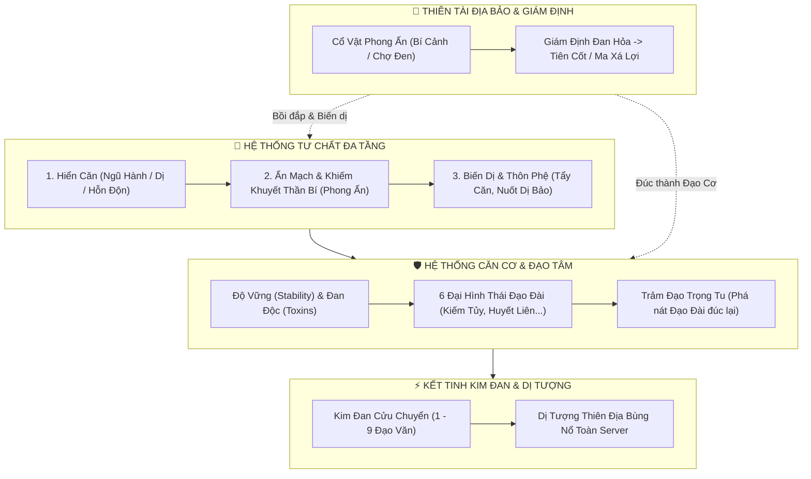
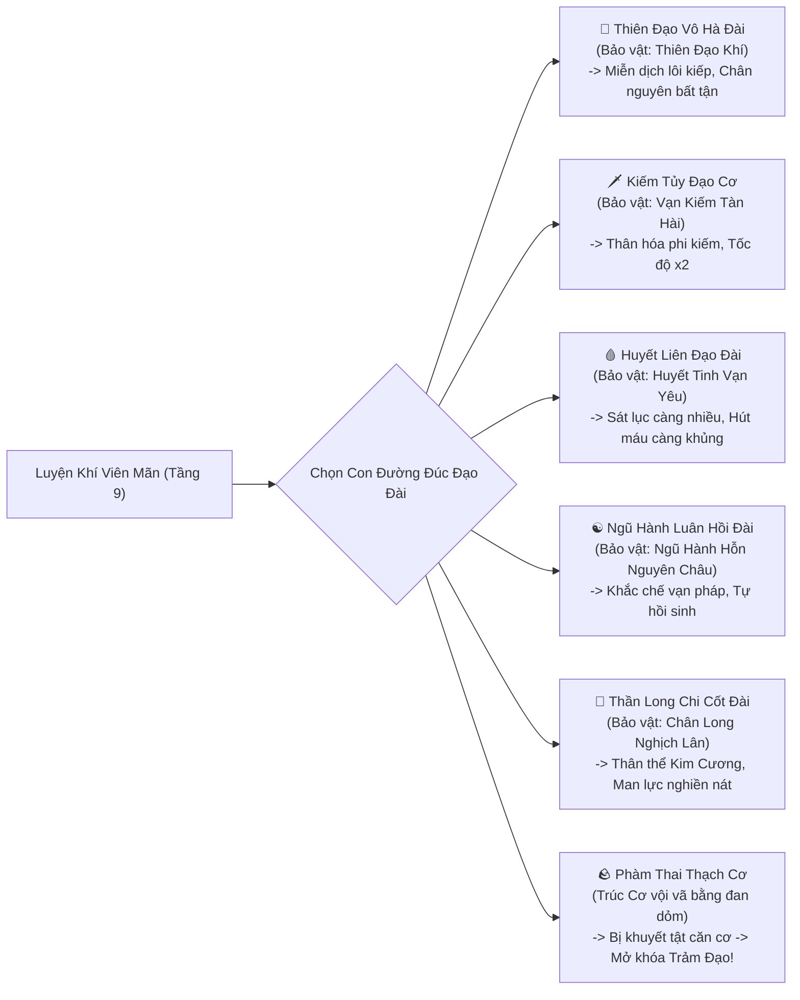
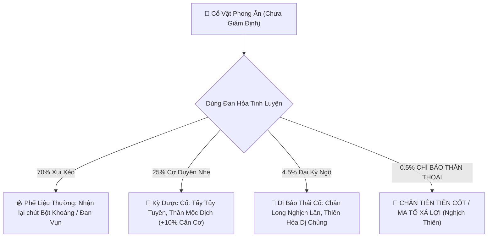

# [03] ĐẠO CƠ CHI BẢO: HỆ THỐNG CĂN CƠ & TƯ CHẤT THÂM SÂU (HUYỀN BÍ & KHÓ ĐOÁN)

> ⬅️ **[Bài Trước: Doc 02 - Hệ Thống Cảnh Giới, Ngũ Tộc & Lôi Kiếp](file:///c:/Users/newre/OneDrive/Máy%20tính/code%20tutien/docs/02_CANH_GIOI_NGU_TOC_VA_THE_CHAT.md)** | 📖 **[Mục Lục Toàn Cảnh](file:///c:/Users/newre/OneDrive/Máy%20tính/code%20tutien/README.md)** | ➡️ **[Bài Kế: Doc 04 - Thuộc Tính Mệnh & Tiến Hóa Linh Căn](file:///c:/Users/newre/OneDrive/Máy%20tính/code%20tutien/docs/04_THUOC_TINH_MENH_VA_TIEN_HOA_LINH_CAN.md)**

> *"Tu chân là hành trình nghịch thiên cải mệnh, cướp đoạt tạo hóa của trời đất. Kẻ phàm mắt thịt chỉ nhìn vào Linh Căn ngũ hành bề ngoài mà định đoạt một đời phế vật hay thiên tài, nào biết sâu trong huyết tủy còn ẩn chứa Thái Cổ Thần Mạch? Kẻ vội vàng thăng cấp đúc nên Đạo Đài vụn vỡ, đến khi Lôi Kiếp giáng xuống chỉ một tia sét đã hồn phi phách tán. Muốn bước lên đỉnh phong vạn giới, căn cơ phải sâu như vực thẳm, tư chất phải biến hóa khôn lường, kỳ ngộ phải phong phú ngút ngàn!"*

File cấu hình trung tâm dễ dàng điều chỉnh tại:
👉 **[`server/cultivationConfig.js`](file:///c:/Users/newre/OneDrive/Máy%20tính/code%20tutien/server/cultivationConfig.js)**

---

## 🧭 TRIẾT LÝ THIẾT KẾ: "CON ĐƯỜNG TU TIÊN KHÓ ĐOÁN"

Hệ thống không chỉ là một bảng chỉ số `%` đơn điệu, mà được chia thành **4 Tầng Kiến Trúc Huyền Bí**:
1. **Tư Chất Đa Tầng (Multi-layered Aptitude)**: Hiển Căn (bề ngoài) $\oplus$ Ẩn Mạch / Khiếm Khuyết Bẩm Sinh (bí mật khó lường) $\oplus$ Biến Dị & Thôn Phệ.
2. **Căn Cơ Đa Hình Thái (Dao Foundation Morphologies)**: Không chỉ là độ vững $\%$, mà là việc người chơi đúc nên **loại Đạo Đài gì** (Kiếm Tủy, Huyết Liên, Ngũ Hành Luân Hồi, Thiên Đạo Vô Hà...) cùng cơ chế **Trảm Đạo Trọng Tu** (Phá rồi lại lập).
3. **Kim Đan Dị Tượng Toàn Server**: Kim Đan khắc Đạo Văn, thức tỉnh Dị Tượng chấn động thiên địa (*Tử Khí Đông Lai, Vạn Kiếm Triều Bái, Huyết Hải Triều Sinh...*).
4. **Kỳ Bảo & Giám Định Cơ Duyên Khó Đoán**: Cơ chế nhặt "Cổ Vật Hoen Rỉ", dùng Đan Hỏa giải trừ phong ấn tìm thấy Tiên Cốt Thượng Cổ.

---

## 🧬 I. HỆ THỐNG TƯ CHẤT ĐA TẦNG (APTITUDE ECOSYSTEM)

### 1.1. Tầng 1: Hiển Căn (Linh Căn Bề Ngoài)
Khi mới bước chân vào tu đạo, đệ tử đo linh căn bằng Thạch Trụ chỉ nhìn thấy phẩm chất thông thường:
* **Tạp Linh Căn (Ngụy Căn - 40%)**: Tứ/Ngũ hệ hỗn tạp. Điểm mạnh: Thể phách dẻo dai (+5% HP, +5% DEF), không bị tương khắc ngũ hành. Bất lợi: Tu vi tăng chậm $-10\%$.
* **Chân Linh Căn (42%)**: 2-3 hệ tương sinh cân bằng. Quân bình chuẩn mực thiên đạo.
* **Ngũ Hành Thiên Linh Căn (10% tổng - Kim/Mộc/Thủy/Hỏa/Thổ mỗi loại 2%)**: Thuần dương/thuần âm đơn hệ, tu vi tăng vọt $+20\%$, nắm giữ nguyên tố cực hạn (Kim bén nhọn $+10\%$ ATK, Mộc hồi phục $+1.5\%$ HP/hiệp, Thủy tăng $+10\%$ HP, Hỏa thiêu đốt $+8\%$ ATK & $+2\%$ Crit, Thổ hộ thể $+12\%$ DEF).
* **Dị Linh Căn Biến Dị (8% tổng - Phong/Lôi/Băng/Ám/Huyết mỗi loại 1.6%)**:
  * *Phong*: $+4$ Thân Pháp, $+3\%$ Né Tránh.
  * *Lôi*: $+5\%$ Bạo Kích, giảm $10\%$ sát thương Lôi Kiếp.
  * *Băng*: $+5\%$ DEF, $15\%$ làm chậm tốc độ kẻ thù.
  * *Ám*: Xuyên thấu $8\%$ giáp kẻ thù.
  * *Huyết*: $3\%$ Hút Máu trong mỗi đòn đánh.
* **Hỗn Độn Linh Căn (0.5% - Vạn Cổ Thần Căn)**: Bao hàm vạn tượng, $+35\%$ Tu vi, $+12\%$ Toàn Thuộc Tính, kháng Lôi Kiếp $+15\%$.

---

### 1.2. Tầng 2: Ẩn Mạch & Khiếm Khuyết Thần Bí (Latent Traits & Dao Flaws)
> **Sự Thâm Sâu Khó Đoán**: 1 người roll ra "Tạp Linh Căn" có thể mang trong mình **Thần Ma Ẩn Mạch** bị phong ấn; hoặc 1 thiên tài có "Thiên Hỏa Linh Căn" nhưng lại dính **Cửu Âm Tuyệt Mạch** chết yểu!

Mỗi nhân vật khi tạo có xác suất mang theo **Ẩn Mạch** hoặc **Khiếm Khuyết** (Bí mật lúc ban đầu, chỉ hiển thị là dấu hỏi `???` cho đến khi gặp biến cố mở khóa):

| Mã Ẩn Mạch (`traitId`) | Tên Gọi & Trạng Thái | Điều Kiện Thức Tỉnh (Kỳ Ngộ Khó Đoán) | Hiệu Quả Sau Khi Thức Tỉnh Nghịch Thiên |
| :--- | :--- | :--- | :--- |
| `hoang_co_thanh_the` | **Hoang Cổ Thánh Thể (Bị 9 Đạo Tỏa Liên Phong Ấn)** *Khởi đầu: Bị coi là phế vật, tu vi $-20\%$, kinh mạch tắc nghẽn.* | Khi gặp Lôi Kiếp hoặc đánh Boss bị đánh tụt máu xuống $<5\%$ HP mà không chết. | **Phá xiềng xích**: Nhục thân hóa thần, HP $+50\%$, Kháng Lôi $+30\%$, đòn đánh tay kèm chấn động khí huyết nghiền nát hộ thuẫn! |
| `cuu_am_tuyet_mach` | **Cửu Âm Tuyệt Mạch (Hàn Độc Công Tâm)** *Khởi đầu: Thọ mệnh ngắn, mỗi giờ mất 5% HP nếu không có đan dược hỏa ấm áp.* | Phải tìm được Dị Hỏa (Thiên Hỏa) hoặc Song Tu với người có Thuần Dương Chi Thể. | **Nhiệt cực sinh hàn**: Biến thành Cửu U Băng Phách, toàn bộ đòn đánh đóng băng đối thủ $2$ hiệp, sát thương Băng $+35\%$. |
| `than_ma_an_mach` | **Thần Ma Dị Mạch** *Khởi đầu: Chân khí hỗn loạn, xuất chiêu ngẫu nhiên trúng hoặc hụt.* | Nuốt sống một viên Yêu Đan cấp Tướng trở lên ở trạng thái Đan Độc $\ge 50\%$. | **Thần Ma Hợp Thể**: Công kích tăng vọt $+25\%$, mở khóa nộ chiêu hóa thân Thần Ma chém sát thương chuẩn xuyên giáp. |
| `tu_nhien_dao_the` | **Tự Nhiên Đạo Thể (Trời Sinh Hòa Hợp)** *Khởi đầu: Trầm mặc, ít nói.* | Đi dạo quanh Vạn Mộc Linh Cảnh hoặc ngồi thiền dưới Gốc Cây Cổ Thụ 10 phút. | **Vô Chướng Ngại**: Đột phá từ Luyện Khí lên Trúc Cơ tỉ lệ thành công **$100\%$ không cần Trúc Cơ Đan**, exp thiền định $+15\%$. |
| `trung_dong_thien_nhan` | **Thượng Cổ Trùng Đồng (Mắt Kép Thần Bí)** *Khởi đầu: Đôi mắt màu xám tro kỳ quái.* | Bị đâm lén trong Bí Cảnh hoặc đổ xúc xắc D20 rơi vào cửa Tử Môn. | **Nhìn Thấu Càn Khôn**: Tăng vĩnh viễn $+10\%$ Bạo Kích, $+8\%$ Né Tránh; khi đi Chợ Đen có thể nhìn thấu giá trị thực của Cổ Vật chưa giám định! |
| `kiem_tam_thong_minh` | **Kiếm Tâm Thông Minh (Trời Sinh Kiếm Si)** *Khởi đầu: Không thể dùng bất kỳ vũ khí nào ngoài Kiếm.* | Tự thân mài giũa kiếm khí đánh bại 100 quái thú bằng Kiếm Quyết. | **Kiếm Đạo Độc Tôn**: Toàn bộ sát thương Kiếm chiêu $+30\%$, khi cầm Kiếm có tỉ lệ $20\%$ xuất ra Vô Song Kiếm Khí chém kép x2 sát thương! |

---

### 1.3. Tầng 3: Nghịch Thiên Cải Mệnh — Tẩy Căn, Khai Mở Song/Tam Căn & Thôn Phệ Dị Biến
Tư chất không phải là bản án chung thân! Bất kỳ ai cũng có thể lật ngược số phận:
1. **Tẩy Linh Trì & Tẩy Căn Cổ Đan**:
   * Tu sĩ Tạp Căn có thể dùng *Tẩy Tủy Đan Thất Chuyển* để trục xuất từng hệ tạp chất, biến Tạp Căn thành Tam Hợp Căn $\rightarrow$ Nhị Hợp Căn $\rightarrow$ Thuần Thiên Linh Căn!
2. **Khai Mở Song Linh Căn & Cơ Duyên Tam Linh Căn (Tam Hoa Tụ Đỉnh)**:
   * Tu sĩ có thể nghịch thiên dung nạp thêm Linh Căn thứ hai ở Trúc Cơ Kỳ (dùng *Nhị Cực Khai Khiếu Đan* hoặc *Lưỡng Nghi Âm Dương Đan*) và đạt tới cảnh giới huyền thoại **Tam Linh Căn** ở Kim Đan Kỳ nhờ Đại Kỳ Ngộ (Tam Diệp Hỗn Nguyên Thảo, Dị Biến Kiếp Lôi, Trảm Đạo Niết Bàn).
   * *Chi tiết toàn bộ quy tắc xem tại: 👉 **[`docs/04_THUOC_TINH_MENH_VA_TIEN_HOA_LINH_CAN.md`](file:///c:/Users/newre/OneDrive/Máy%20tính/code%20tutien/docs/04_THUOC_TINH_MENH_VA_TIEN_HOA_LINH_CAN.md)***
3. **Thôn Thiên Ma Công (Đoạt Căn)**:
   * Ma tu thuộc Vạn Ma Uyên có thể học tà pháp bí truyền: Giết thiên kiêu đối nghịch trong chiến trường PK, hút lấy Linh Căn của đối phương để dung nạp vào bản thân (Rủi ro: Mỗi lần hút làm rạn nứt $15\%$ Đạo Tâm và tăng gấp đôi uy lực Thiên Kiếp trừng phạt).
4. **Dị Biến Dưới Thiên Kiếp (Tribulation Mutation)**:
   * Khi độ kiếp Trúc Cơ/Kim Đan, nếu dám trần trụi đón trọn đợt sét thứ 9 mà không dùng Hộ Thuẫn Pháp Bảo, Linh Căn có $5\%$ xác suất dị biến thành **Dị Linh Căn — Lôi**, thức tỉnh **Lôi Cốt Thái Cổ**, hoặc phá vỡ rào cản đan điền mở ra Linh Căn thứ 3!

---

## 🛡️ II. CĂN CƠ ĐA HÌNH THÁI: ĐẠO ĐÀI CHI CẢNH (DAO FOUNDATION FORMS)

Căn cơ không chỉ là con số $\text{Stability} \in [0\%, 100\%]$, mà là **Hình Thái Đạo Đài** mà tu sĩ đúc nên khi bước vào Trúc Cơ Kỳ!

### 2.1. Sáu Đại Hình Thái Đạo Đài Độc Bản

| Mã Đạo Cơ | Tên Hình Thái | Nguyên Liệu Yêu Cầu Để Đúc | Thuộc Tính & Kỹ Năng Độc Bản Sau Khi Thành Cơ |
| :--- | :--- | :--- | :--- |
| `thien_dao_vo_ha` | **Thiên Đạo Vô Hà Đạo Đài** | Đạo Cơ Vững $\ge 90\%$, Đan Độc $\le 10\%$, thu thập được 1 luồng *Thiên Đạo Chi Khí* từ đỉnh Côn Lôn. | **Bất Hoại Bất Diệt**: Chỉ số tăng **$\times 2.5$**. Tự động thanh lọc mọi trạng thái xấu sau 2 hiệp. Lôi Kiếp đánh trúng không những không chết mà còn hấp thụ điện tích hồi phục HP! |
| `kiem_tuy_dao_co` | **Vạn Kiếm Tủy Đạo Cơ** | Nuốt và dung luyện 100 thanh Kiếm gãy thu thập từ Cổ Mộ; Căn cơ $\ge 75\%$. | **Thân Hóa Thần Kiếm**: Công kích $+35\%$, Tốc độ $+15$. Xuất hiện luồng *Vô Hình Kiếm Khí* tự động phóng ra chém kẻ thù ngẫu nhiên mỗi hiệp chiến đấu. |
| `huyet_lien_dao_dai` | **Cửu Phẩm Huyết Liên Đạo Đài** | Hiến tế 50 Yêu Đan Bậc Tướng; Tích lũy Ma Tính $\ge 30$; Căn cơ $\ge 70\%$. | **Huyết Hải Cuồng Nộ**: Hút máu $+15\%$. Khi HP tụt xuống dưới $30\%$, kích hoạt *Huyết Liên Hộ Thể* miễn nhiễm mọi sát thương chí mạng trong 1 hiệp và phản hồi $20\%$ sát thương cho địch. |
| `ngu_hanh_luan_hoi` | **Ngũ Hành Hỗn Nguyên Đạo Đài** | Đủ 5 loại Linh Thảo thượng cổ Kim Mộc Thủy Hỏa Thổ; Căn cơ $\ge 80\%$. | **Sinh Sinh Bất Tức**: Toàn bộ sát thương nguyên tố phải chịu giảm $-25\%$. Mỗi hiệp tự động hồi phục $4\%$ HP tối đa. Không bao giờ cạn kiệt chân nguyên. |
| `chan_long_dao_co` | **Thần Long Tủy Đạo Cơ** | Tắm trong *Chân Long Tinh Huyết* nhặt được từ Bí Cảnh; Căn cơ $\ge 80\%$. | **Long Uy Chấn Nhiếp**: Nhục thân Kim Cương, Phòng ngự $+30\%$. Khi xuất chiêu có tiếng Rồng ngâm làm choáng (Stun) đối thủ $1$ hiệp. |
| `pham_thai_thach_co` | **Phàm Thai Toái Thạch Cơ** | Trúc cơ vội vã khi căn cơ $< 50\%$ hoặc cắn Đan dỏm. | **Đạo Cơ Rạn Nứt**: Chỉ số chỉ nhân $\times 0.8$. Khi đánh nhau có $15\%$ bị thổ huyết mất lượt. Dẫn hỏa lôi kiếp $+40\%$. (Nhưng mở khóa quyền năng: **Trảm Đạo Trọng Tu**)! |

---

### 2.2. Tuyệt Học: Trảm Đạo Trọng Tu (Phá Rồi Lại Lập - Nghịch Thiên Tái Sinh)
Tu sĩ lỡ đúc phải *Phàm Thai Toái Thạch Cơ* hoặc cảm thấy Đạo Đài của mình chưa đủ hoàn mỹ để tranh đoạt Đại Đạo thì sao? Chấp nhận sống kiếp bình phàm hay liều mạng một phen?

* **Nghi Thức Trảm Đạo**:
  1. Nuốt một viên **Cửu Chuyển Tán Công Đan**.
  2. Tự tay dẫn nổ toàn bộ chân khí, **đập vỡ nát Đạo Đài hiện tại**, tu vi lập tức rớt ngược về **Luyện Khí Tầng 1**!
  3. **Niết Bàn Trùng Sinh Buff**:
     * Mặc dù về Luyện Khí Tầng 1, nhưng toàn bộ kinh mạch sau khi tái tạo sẽ mở rộng gấp đôi: Tốc độ tu vi kiếp thứ hai tăng **$+50\%$ vĩnh viễn**!
     * Lần Trúc Cơ tiếp theo, tu sĩ được cộng thêm **$+30\%$ Tỷ Lệ Đúc Ra Thiên Đạo Vô Hà Đạo Đài**.
     * Người dám Trảm Đạo 3 lần thành công sẽ mở khóa Ẩn Danh Hiệu huyền thoại: **[Vạn Kiếp Bất Diệt Đạo Tôn]**, toàn bộ chỉ số nhân đôi ($\times 2.0$)!

---

## ⚡ III. KẾT TINH KIM ĐAN & THIÊN ĐỊA DỊ TƯỢNG (KIM DAN PHENOMENON)

Khi từ Trúc Cơ Viên Mãn đột phá lên Kim Đan Kỳ, tu sĩ không chỉ nhận được 1 hạt châu tròn trịa. Kim Đan chia làm **Cửu Chuyển Đạo Văn** và kích hoạt **Thiên Địa Dị Tượng** rung chuyển toàn server!

### 3.1. Cửu Chuyển Đạo Văn (Kim Dan Inscriptions: 1 -> 9 Vòng)
* **1 - 3 Đạo Văn (Hạ Phẩm Kim Đan)**: Kim đan màu xám tro hoặc đục ngầu. Chân nguyên khô kiệt, tỉ lệ Kết Anh sau này chỉ đạt $25\%$.
* **4 - 6 Đạo Văn (Trung Phẩm Kim Đan)**: Ánh sáng thanh khiết, 6 vòng sáng lấp lánh. Tỷ lệ Kết Anh đạt $60\%$.
* **7 - 8 Đạo Văn (Thượng Phẩm Kim Đan)**: Kim quang chói lòa, hào quang vạn trượng. Tỷ lệ Kết Anh $85\%$.
* **9 Đạo Văn (Cửu Chuyển Cực Phẩm Kim Đan)**: Khắc trọn vẹn Cửu Đạo Thiên Văn, tử khí quấn quanh. Tỷ lệ Kết Anh **$100\%$ không bình cảnh**, pháp lực thâm hậu gấp 3 lần đồng cấp!

---

### 3.2. Sáu Đại Thiên Địa Dị Tượng Chấn Động Toàn Server
Khi một tu sĩ đúc thành Kim Đan từ Thượng Phẩm trở lên, hệ thống sẽ **bắn thông báo toàn server kèm hiệu ứng thời tiết đặc biệt trên màn hình của tất cả người chơi đang online**:

| Mã Dị Tượng | Tên Dị Tượng Bộc Phát | Mô Tả Huyền Ảo Bầu Trời Game | Hiệu Ứng Toàn Bản Đồ & Aura Thực Chiến |
| :--- | :--- | :--- | :--- |
| `tu_khi_dong_lai` | **Tử Khí Đông Lai Ba Vạn Dặm** | Toàn bộ bầu trời game ngập tràn mây tím ngũ sắc suốt 60 giây. | Người kết đan nhận Buff *Tử Khí Hộ Thể*: Phòng ngự $+20\%$. Toàn bộ người chơi cùng tông môn đang online được ké $+10\%$ exp trong 10 phút! |
| `van_kiem_trieu_quy` | **Vạn Kiếm Triều Quy** | Hàng vạn thanh kiếm ảo ảnh từ chân trời bay lượn trên bầu trời, phát ra tiếng kiếm minh vang dội. | Tất cả người chơi Kiếm Tu trong server nhận được tin nhắn kiếm minh chúc phúc. Chủ nhân nhận nội tại *Kiếm Ý Thông Thiên* xuyên giáp $15\%$. |
| `minh_hai_trieu_sinh` | **Minh Hải Triều Sinh (Trăng Mọc Biển Tối)** | Nền trời chuyển sang màn đêm u tịch, vầng trăng máu khổng lồ nhô lên từ biển sương mù. | Chủ nhân nhận hiệu ứng *Ám Ảnh Chi Vực*: Mỗi đòn đánh làm mù mắt kẻ thù, giảm $20\%$ tỉ lệ đánh trúng của địch. |
| `ma_than_hang_the` | **Ma Thần Hàng Thế** | Hư ảnh Thần Ma khổng lồ sừng sững xé rách mây đen, tiếng sấm đỏ rền vang tam giới. | Chỉ xuất hiện khi Ma Tu kết đan. Phát động uy áp kinh hoàng: Kẻ địch đối đầu giảm ngay $-15\%$ Công và Thủ vì khiếp sợ. |
| `kim_lien_dia_dung` | **Kim Liên Địa Dũng (Sen Vàng Mọc Từ Đất)** | Hàng vạn đóa sen vàng nở rộ dưới chân nhân vật và lan tỏa khắp các thành trì. | Chủ nhân nhận hào quang *Công Đức Vô Lượng*: Miễn nhiễm hoàn toàn với Đan Độc trong suốt 30 ngày tiếp theo! |
| `thien_loi_pha_gioi` | **Cửu Cực Lôi Kiếp Phá Giới** | 9 đạo sấm sét khổng lồ đánh nứt toác hư không, để lộ cảnh giới Tiên Giới thượng tầng. | Chủ nhân nuốt trọn sấm sét: Toàn bộ đòn đánh chuyển thành sát thương Chân Lôi bỏ qua khiên hộ thể! |

---

## 🎁 IV. THIÊN TÀI ĐỊA BẢO CĂN CƠ & HỆ THỐNG GIÁM ĐỊNH CƠ DUYÊN KHÓ ĐOÁN

Tu tiên không chỉ là ngồi cắn đan bình thường. Cơ duyên nằm ở những món đồ lai lịch bất minh!

### 4.1. Hệ Thống "Cổ Vật Phong Ấn" (Bí Cảnh & Chợ Đen)
Khi đi Bí Cảnh Roguelite hoặc lục lọi góc khuất Chợ Đen, người chơi sẽ nhặt được các vật phẩm chưa định hình:
* `co_vat_da_hoen_ri`: **Khối Đá Rêu Phong Cổ Xưa** (Giá bán chợ chỉ 50 Linh Thạch).
* `co_vat_khuc_go_den`: **Khúc Gỗ Cháy Đen Bất Thường** (Ai nhìn cũng tưởng là than củi).
* `co_vat_trung_hoa_thach`: **Quả Trứng Hóa Thạch Trầm Tích Vạn Năm**.

### 4.2. Cơ Chế Giám Định Đan Hỏa (Appraisal Mechanics)
Người chơi mang Cổ Vật về Động Phủ, dùng **Đan Hỏa** của mình để tôi luyện và giám định. Kết quả phụ thuộc vào **Khí Vận (Luck)** và **Đạo Nhãn / Trùng Đồng**:

#### Bảng Dị Bảo Căn Cơ Huyền Thoại:
1. **Chân Tiên Tiên Cốt (Fossilized Immortal Bone)**:
   * Xương ngón tay của một vị Chân Tiên thời Thái Cổ. Dung hợp vào cơ thể $\rightarrow$ Mở khóa vĩnh viễn tuyệt kỹ *Thiên Đạo Nhất Chỉ*, sát thương x3 khi kẻ địch còn dưới 20% HP.
2. **Hỗn Độn Tức Nhưỡng (Primordial Earth Soil)**:
   * Nắm đất ban sơ khai thiên lập địa. Thả vào Đan Điền $\rightarrow$ Căn cơ vĩnh viễn khóa ở mức **$100\%$ không bao giờ bị hư phù hay rạn nứt**!
3. **Niết Bàn Phượng Hoàng Tủy**:
   * Tủy sống Phượng Hoàng. Khi người chơi bị đánh chết trong giao tranh bí cảnh hoặc PK $\rightarrow$ Có **$50\%$ tỷ lệ bùng cháy lửa đỏ hồi sinh ngay tại chỗ** với $100\%$ HP và tăng $+20\%$ ATK trong 3 hiệp!
4. **Ma Tổ Xá Lợi**:
   * Hạt xá lợi của Cổ Ma. Nuốt vào $\rightarrow$ Tu vi tăng vọt ngay lập tức $500,000$ Exp, nhưng nhân vật bị gieo *Tâm Ma Chủng Tử*, ban đêm nếu không tĩnh tọa sẽ hóa điên tấn công mọi tu sĩ xung quanh!

---

## 🛠️ V. BẢNG TRA CỨU & TINH CHỈNH TẬP TRUNG (GAME DESIGNER CHEATSHEET)

Toàn bộ các cấu hình trên đều được định nghĩa trong file duy nhất:
👉 [`server/cultivationConfig.js`](file:///c:/Users/newre/OneDrive/Máy%20tính/code%20tutien/server/cultivationConfig.js)

### Danh Mục Các Biến Cấu Hình Dễ Chỉnh:

| Tên Đối Tượng Trong Code | Mục Đích Sử Dụng | Cách Chỉnh Trong 5 Giây |
| :--- | :--- | :--- |
| `SPIRITUAL_ROOTS` | 12 Loại Linh Căn (Tỉ lệ roll, buff exp, combat) | Sửa `rate: 0.02` thành `0.05` để tăng tỷ lệ roll; sửa các số `%` buff. |
| `APTITUDES` | 7 Cấp Căn Cốt (Hạ $\rightarrow$ Thần Phẩm) | Sửa `statBonus` hoặc `expRateBonus`. |
| `LATENT_TRAITS` | Danh sách Ẩn Mạch & Khiếm Khuyết Thần Bí | Bật/tắt `enabled: true/false`, sửa tỷ lệ thức tỉnh hoặc điều kiện giải phong ấn. |
| `FOUNDATION_FORMS` | 6 Hình Thái Đạo Đài (Kiếm Tủy, Huyết Liên...) | Chỉnh nguyên liệu yêu cầu `requiredStability`, `statMultiplier` và hiệu ứng combat độc bản. |
| `KIM_DAN_PHENOMENA` | 6 Đại Thiên Địa Dị Tượng khi kết đan | Sửa bán kính thông báo, nội tại aura buff toàn môn phái hoặc toàn server. |
| `ANCIENT_RELICS_APPRAISAL` | Bảng Tỉ Lệ Giám Định Cổ Vật & Rương Kỳ Ngộ | Tinh chỉnh tỉ lệ trúng Tiên Cốt Thần Thoại (`0.005`) hay Phế Liệu (`0.70`). |
| `REINCARNATION_RULES` | Quy tắc Trảm Đạo Trọng Tu (Phá rồi lại lập) | Sửa % tu vi hoàn trả, số lần trảm đạo tối đa và buff exp kiếp thứ hai. |

---
*Tài liệu này là chuẩn mực thiết kế (Design System Document) quy định toàn bộ linh hồn, chiều sâu và sự khó đoán của hành trình tu tiên trong Tu Chân Giới Online.*

---

> ⬅️ **[Bài Trước: Doc 02 - Hệ Thống Cảnh Giới, Ngũ Tộc & Lôi Kiếp](file:///c:/Users/newre/OneDrive/Máy%20tính/code%20tutien/docs/02_CANH_GIOI_NGU_TOC_VA_THE_CHAT.md)** | 📖 **[Mục Lục Toàn Cảnh](file:///c:/Users/newre/OneDrive/Máy%20tính/code%20tutien/README.md)** | ➡️ **[Bài Kế: Doc 04 - Thuộc Tính Mệnh & Tiến Hóa Linh Căn](file:///c:/Users/newre/OneDrive/Máy%20tính/code%20tutien/docs/04_THUOC_TINH_MENH_VA_TIEN_HOA_LINH_CAN.md)**
