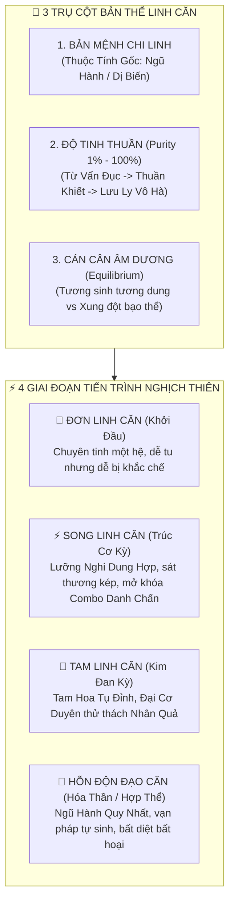
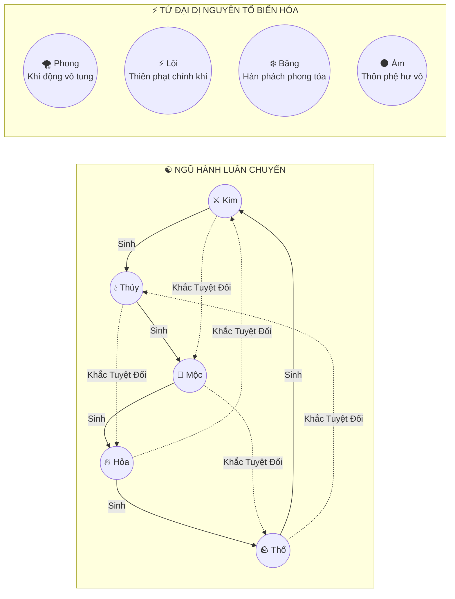
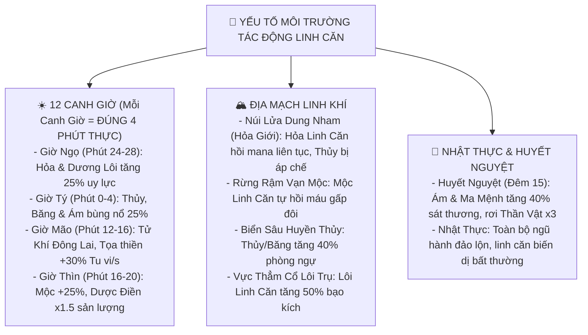
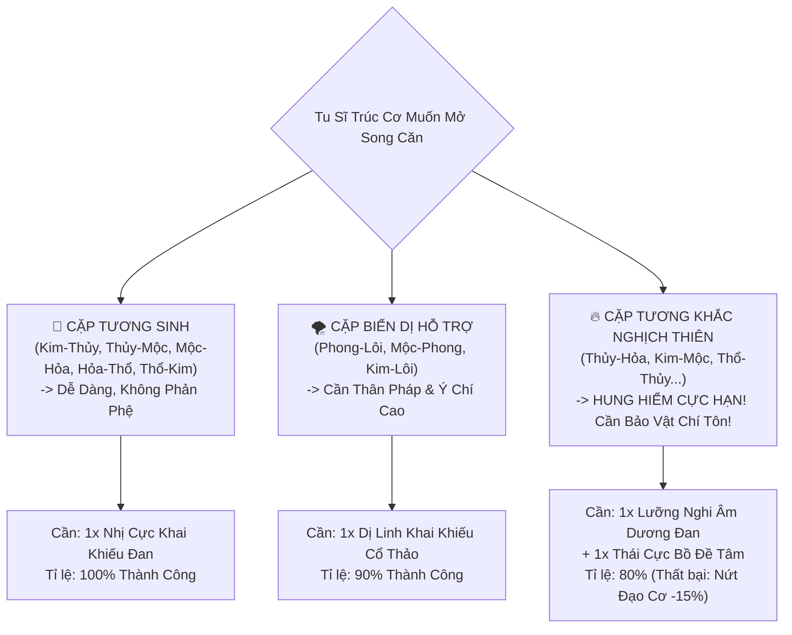
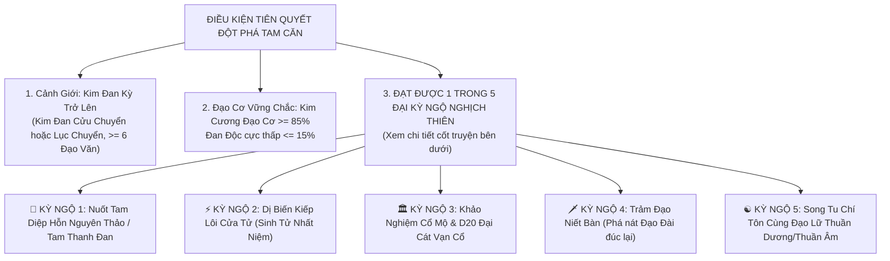
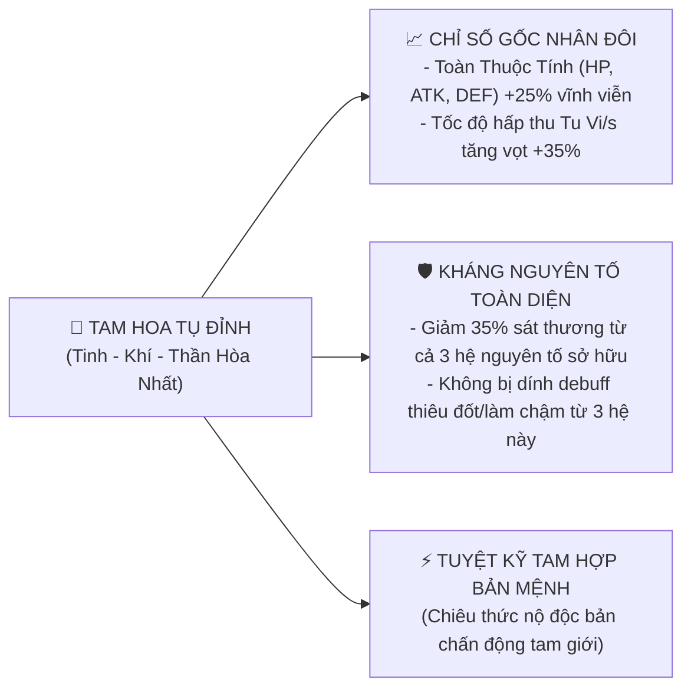
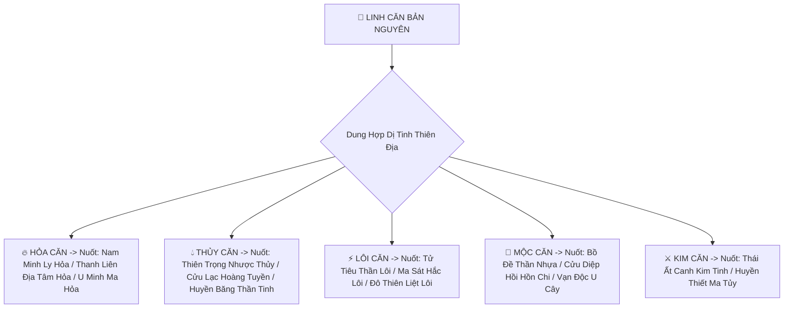
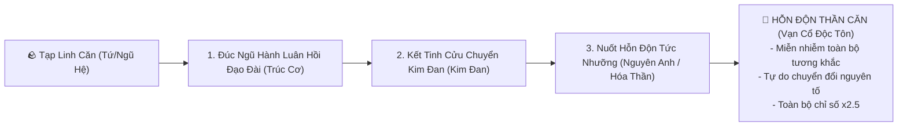

# [04] ĐẠI ĐẠO CHI CĂN: HỆ THỐNG THUỘC TÍNH MỆNH & TIẾN TRÌNH KHAI MỞ LINH CĂN (ĐƠN - SONG - TAM - HỖN ĐỘN)


> ⬅️ **[Bài Trước: Doc 03 - Căn Cơ, Ẩn Mạch & 6 Hình Thái Đạo Đài](file:///c:/Users/newre/OneDrive/Máy%20tính/code%20tutien/docs/03_CAN_CO_TU_CHAT_VA_DAO_DAI.md)** | 📖 **[Mục Lục Toàn Cảnh](file:///c:/Users/newre/OneDrive/Máy%20tính/code%20tutien/README.md)** | ➡️ **[Bài Kế: Doc 05 - Bách Khoa Toàn Thư 400 Vật Phẩm & Bảo Vật](file:///c:/Users/newre/OneDrive/Máy%20tính/code%20tutien/docs/05_TOAN_THU_VAT_PHAM_PHAP_BAO_VA_CO_DUYEN.md)**

> *"Trời đất mông muội, vạn vật sinh ra từ một luồng Hỗn Độn Chân Khí, phân định thành Lưỡng Nghi Âm Dương, diễn hóa thành Ngũ Hành, biến dị thành Lôi Đình Phong Vũ. Sinh linh giáng thế, ai ai cũng có một luồng Bản Mệnh Tiên Thiên.*
> *Kẻ thiển cận chê Tạp Căn trì trệ, khen Đơn Căn xuất chúng, nào biết Đơn Căn dễ gãy vì ngũ hành tương khắc tuyệt đối, còn Tạp Căn nếu kiên trì bồi đắp, vượt qua muôn vàn kiếp nạn lại chính là hạt giống duy nhất có thể thành tựu Hỗn Độn Đạo Căn!*
> *Đại Đạo 50, Thiên Diễn 49, trốn đi thứ nhất chính là cơ duyên nghịch thiên cải mệnh của kẻ tu đạo chân chính!"*

---

## 🧭 CHƯƠNG I: TRIẾT LÝ ĐẠI ĐẠO — BẢN MỆNH, CĂN CỐT & ĐỘ TINH THUẦN

Hệ thống Linh Căn trong Tu Chân Giới không phải là một danh hiệu tĩnh chỉ mang vài dòng cộng chỉ số đơn điệu, mà là một **Hệ Thống Sinh Thái Năng Lượng Sống (Living Elemental Ecosystem)** gắn liền với nhịp thở của nhân vật:



### 1.1. Khái Niệm: "Độ Tinh Thuần Linh Căn" (Purity Rate: $1\% \rightarrow 100\%$)
Cùng là Hỏa Linh Căn, nhưng đệ tử có **30% Tinh Thuần** sẽ khác biệt hoàn toàn với bậc thiên kiêu có **95% Tinh Thuần**:
* **$1\% - 40\%$ (Vẩn Đục / Tạp Căn)**: Chân khí lẫn nhiều cặn bã khoáng thạch. Sát thương nguyên tố chỉ đạt $70\%$, thi triển pháp thuật hao tốn thêm $+25\%$ chân nguyên.
* **$41\% - 75\%$ (Thanh Khiết / Chuẩn Mực)**: Chân khí lưu chuyển thông suốt. Sát thương đạt $100\%$, tương tác ổn định với công pháp bản mệnh.
* **$76\% - 90\%$ (Chân Căn Cực Phẩm)**: Linh căn tỏa hào quang nguyên tố. Sát thương nguyên tố tăng **$+25\%$**, giảm $15\%$ tiêu hao chân nguyên, tăng $5\%$ Bạo kích nguyên tố.
* **$91\% - 100\%$ (Lưu Ly Vô Hà / Tiên Thiên Chi Thể)**: Linh căn trong suốt như pha lê, không nhiễm một hạt bụi phàm trần! Sát thương nguyên tố tăng **$+50\%$**, tự động miễn nhiễm trạng thái debuff của hệ tương ứng, khi xuất chiêu có dị tượng bản mệnh bao quanh.

### 1.2. Cơ Chế "Linh Căn Trọc Hóa" (Toxins Contamination) & Thối Căn
* **Hiểm họa cắn đan**: Tu sĩ lạm dụng linh đan tạp chất, nuốt sống yêu đan chưa thanh lọc sẽ khiến **Đan Độc ăn mòn Linh Căn**, làm Độ Tinh Thuần tụt dốc ($-1\%$ Tinh Thuần mỗi khi Đan Độc vượt ngưỡng $60\%$).
* **Nghi thức Thối Căn**:
  * Dùng **[Tẩy Tủy Thần Tuyền]** kết hợp thiền định dưới thác nước linh khí để rửa sạch tạp chất.
  * Dùng **Đan Hỏa Đan Điền** tự thiêu đốt kinh mạch thanh lọc trọc khí (đòi hỏi ý chí kiên cường, chịu đựng đau đớn mất $20\%$ HP tạm thời).

---

## 🌌 CHƯƠNG II: CỬU ĐẠI THUỘC TÍNH MỆNH & MA TRẬN TƯƠNG TÁC THÂM SÂU

Hệ thống bao gồm **Ngũ Hành Chính Thống** (Kim, Mộc, Thủy, Hỏa, Thổ) và **Tứ Đại Dị Biến** (Phong, Lôi, Băng, Ám). Mỗi thuộc tính là một quy luật tự nhiên bất biến:



### 2.1. Bảng Thông Số Chi Tiết 9 Thuộc Tính Mệnh

| Thuộc Tính | Biểu Tượng | Mã Màu | Bản Chất Tự Nhiên | Khắc Hệ ($+35\%$ Sát Thương) | Kỵ Hệ (Nhận Thêm $+35\%$ ST) | Cơ Chế Chiến Đấu Đặc Trưng |
| :--- | :---: | :---: | :--- | :---: | :---: | :--- |
| **Kim Mệnh** | ⚔️ | `#eab308` | Can Cách bén nhọn, đúc từ kim thạch, tính sát phạt cực độ. | **Mộc** | **Hỏa** | **Phá Giáp & Trảm Đoạn**: Đòn đánh có $25\%$ xác suất bỏ qua $40\%$ Giáp đối thủ, tăng $+4\%$ Bạo Kích bẩm sinh. |
| **Mộc Mệnh** | 🌿 | `#22c55e` | Khúc Trực sinh sôi, vạn mộc trường sinh, dẻo dai bất khuất. | **Thổ** | **Kim** | **Sinh Sinh Bất Tức**: Mỗi hiệp hồi phục $2\%$ HP tối đa, kháng toàn bộ độc tố $+50\%$, có $15\%$ trói chân địch $1$ hiệp. |
| **Thủy Mệnh** | 💧 | `#06b6d4` | Nhuận Hạ thẩm thấu, biến ảo vô cùng, dung nạp vạn vật. | **Hỏa** | **Thổ** | **Hóa Kình Hộ Thể**: Chuyển $15\%$ sát thương nhận vào thành tiêu hao Chân Nguyên; làm chậm Tốc độ xuất chiêu của địch $15\%$. |
| **Hỏa Mệnh** | 🔥 | `#f97316` | Viêm Thượng cuồng bạo, thiêu đốt vạn linh, uy lực chí dương. | **Kim** | **Thủy** | **Liệt Diễm Thiêu Hồn**: Đòn đánh thiêu đốt $4\%$ Max HP địch/hiệp (duy trì 2 hiệp); sát thương công kích cơ bản $+10\%$. |
| **Thổ Mệnh** | 🪨 | `#d97706` | Giá Sắc trầm ổn, gánh vác thiên địa, phòng ngự tuyệt đối. | **Thủy** | **Mộc** | **Bất Động Như Sơn**: Phòng ngự $+15\%$, giảm $15\%$ sát thương Lôi Kiếp, có $20\%$ cơ hội bật Hộ Thuẫn Nham Thạch hấp thu đòn đánh. |
| **Phong Mệnh** | 🌪️ | `#10b981` | Vô hình vô tướng, gia tốc càn khôn, xé rách không gian. | Bổ trợ vạn hệ | Áp chế bởi Lôi | **Thần Hành Hư Bộ**: Thân pháp $+8$ Speed, Né tránh tuyệt đối $+6\%$, có $10\%$ cơ hội ra đòn kép liên tiếp. |
| **Lôi Mệnh** | ⚡ | `#c084fc` | Thiên kiếp cương chính, chí dương chí liệt, trừ tà diệt ma. | Ma, Yêu, Minh | Triệt tiêu bởi Thổ | **Cửu Cực Thần Lôi**: Bạo kích $+8\%$, giảm $20\%$ sát thương Lôi Kiếp, $20\%$ làm tê liệt đối thủ mất lượt, bỏ qua hộ thuẫn ma đạo. |
| **Băng Mệnh** | ❄️ | `#38bdf8` | Cực hàn ngưng đọng, phong tỏa huyết mạch, vạn vật ngủ say. | Hỏa, Thủy | Chấn nứt bởi Kim/Lôi | **Hàn Băng Thấu Xương**: Làm chậm đối phương $25\%$, đòn đánh bạo kích có $15\%$ đóng băng vĩnh viễn hồi máu của địch trong 2 hiệp. |
| **Ám Mệnh** | 🌑 | `#64748b` | Hư vô cắn nuốt, quỷ mị âm tà, ăn mòn căn nguyên. | Nhân, Tiên | Khắc chế bởi Lôi/Quang | **U Minh Phệ Hồn**: Sở hữu sẵn $5\%$ Hút Máu (Lifesteal), đòn đánh bỏ qua $12\%$ Giáp và làm giảm $10\%$ Công kích của kẻ thù. |

---

### 2.2. Chiều Sâu Môi Trường: "Thiên Thời, Địa Lợi & Tinh Tú Tương Hỗ"

> *Xem chi tiết toàn thư về Chu Kỳ 48 Phút tại: 👉 **[`docs/09_THIEN_THOI_THAP_NHI_THOI_THAN_VA_KHI_TUONG.md`](file:///c:/Users/newre/OneDrive/Máy%20tính/code%20tutien/docs/09_THIEN_THOI_THAP_NHI_THOI_THAN_VA_KHI_TUONG.md)***

Sức mạnh của Linh Căn biến thiên theo **Chu Kỳ 48 Phút (1 Ngày Game) & Tọa Độ Bản Đồ**:



---

## ⚡ CHƯƠNG III: TIẾN TRÌNH MỞ SONG LINH CĂN (LƯỠNG NGHI DUNG HỢP)

> *"Đơn căn như cây đứng một mình giữa bão, rất dễ gãy. Song căn như âm dương tương hỗ, như chim liền cánh, công thủ toàn diện. Nhưng kẻ tham lam mở bừa hai hệ xung khắc mà không có thần vật bảo hộ, ắt kinh mạch nổ tung, đạo tiêu thân vẫn!"*

### 3.1. Điều Kiện Nghiêm Ngặt Khai Mở Song Linh Căn
Để mở thêm luồng Linh Căn thứ hai vào cơ thể ở **Trúc Cơ Kỳ**, người tu tiên phải chuẩn bị chu toàn:

1. **Cảnh Giới Tối Thiểu**: **Trúc Cơ Kỳ** (Cấp 10+). Giai đoạn Luyện Khí kinh mạch còn mỏng manh như tơ lụa, mở thêm hệ thứ hai sẽ lập tức gây **Bạo Thể Tự Phế**.
2. **Đạo Cơ Vững Chắc**:
   * Độ Vững Căn Cơ: $\ge 70\%$.
   * Đan Độc Tích Tụ: $\le 30\%$ (tránh tạp chất dẫn hỏa bốc cháy kinh mạch).
3. **Cơ Chế "Cán Cân Chân Khí" (Elemental Equilibrium: 50/50)**:
   * Hai hệ phải được nuôi dưỡng ngang nhau. Nếu hệ A áp đảo hệ B quá $30\%$ (do cắn đan thiên lệch) $\rightarrow$ Xuất hiện trạng thái **Kinh Mạch Lệch Lạc**: Tự phản phệ mất $10\%$ máu mỗi hiệp đấu!



---

### 3.2. Bảng Ma Trận 12 Cặp Song Linh Căn Danh Chấn Thiên Hạ

Khi kết hợp 2 hệ, nhân vật được định danh bằng **Đạo Hiệu Song Căn** cùng nội tại thực chiến:

| Cặp Thuộc Tính | Danh Hiệu Bản Mệnh | Phân Loại | Hiệu Quả Chiến Đấu Độc Bản | Quyền Năng Đời Sống / Chế Tạo |
| :--- | :--- | :---: | :--- | :--- |
| **Mộc + Hỏa** | **Đan Đạo Tông Sư** | Tương Sinh | Công kích $+16\%$, đòn đánh thiêu đốt $3\%$ HP địch/hiệp. | Tốc độ luyện đan $+35\%$, tỉ lệ ra Đan Cực Phẩm tăng vọt $+30\%$. |
| **Kim + Thủy** | **Huyền Kim Lưu Thủy** | Tương Sinh | Công kích $+12\%$, Khí Huyết $+12\%$. Đòn đánh có $20\%$ xuất ra *Vô Định Kim Kiếm* làm chậm và xé rách giáp. | Tăng $+20\%$ hiệu suất đúc phi kiếm và pháp bảo sắc bén. |
| **Thủy + Mộc** | **Thủy Mộc Thanh Hoa** | Tương Sinh | Khí Huyết $+20\%$, tự hồi phục $3\%$ HP tối đa mỗi hiệp, kháng độc tính $+70\%$. | Dược điền nông trại tăng tốc sinh trưởng $+25\%$, cây không bao giờ bị sâu bọ. |
| **Hỏa + Thổ** | **Địa Hỏa Dung Nham** | Tương Sinh | Phòng ngự $+15\%$, Công kích $+10\%$. Tạo luồng Hỏa Nham Hộ Thể phản lại $15\%$ sát thương cận chiến. | Lò rèn khai khoáng sản sinh thêm quặng hiếm $+20\%$. |
| **Thổ + Kim** | **Bất Động Minh Vương** | Tương Sinh | Phòng ngự $+25\%$, Kháng Lôi Kiếp $+18\%$, giảm $25\%$ sát thương nhận từ bạo kích. | Xây dựng động phủ kiên cố, linh khí động phủ ngưng tụ nhanh hơn $20\%$. |
| **Phong + Lôi** | **Thần Tiêu Phong Lôi** | Dị Hợp | Thân pháp $+12$ Speed, Bạo kích $+10\%$. Đòn đánh kích phát tia sét liên hoàn nảy sang mục tiêu phụ. | Di chuyển trên bản đồ thế giới nhanh gấp đôi, giảm thời gian tầm bảo $30\%$. |
| **Băng + Phong** | **Hàn Sương Tuyết Vũ** | Dị Hợp | Né tránh $+8\%$, giảm $30\%$ tốc độ của đối phương, đòn đánh có $20\%$ làm đóng băng kẻ thù. | Miễn nhiễm hoàn toàn với bão tuyết và giá lạnh tại Băng Giới. |
| **Lôi + Hỏa** | **Cửu Thiên Lôi Diễm** | Cuồng Bạo | Công kích $+22\%$, Bạo kích $+8\%$. Đòn bạo kích gây nổ lan diện rộng xé rách mọi loại khiên chắn. | Khống chế Lôi Hỏa dung luyện kim loại cổ đại dễ dàng hơn. |
| **Băng + Hỏa** | **Băng Hỏa Đồng Thể** | *Tương Khắc Nghịch Thiên* | Sát thương bộc phá **$+30\%$**. Đòn đánh vừa gây Thiêu Đốt mất máu vừa Đóng Băng cấm kẻ thù hồi máu! | Tự do đi lại giữa Hỏa Giới và Thủy Giới mà không bị sốc nhiệt. |
| **Lôi + Ám** | **U Minh Tà Lôi** | *Dị Hệ Sát Phạt* | Bỏ qua **$30\%$ Giáp**, đòn đánh rút $4\%$ thể lực đối thủ, có $15\%$ khiến kẻ địch hoảng loạn bỏ lượt. | Thần Thức quét mộ cổ phát hiện cơ quan cạm bẫy từ xa. |
| **Kim + Mộc** | **Thần Mộc Canh Kim** | *Tương Khắc Cân Bằng* | Vừa sở hữu khả năng hồi phục $+2\%$ HP/hiệp vừa có đòn đánh bỏ qua $25\%$ phòng ngự. | Cắt tỉa linh thảo cổ mà không làm thoát linh khí. |
| **Thủy + Thổ** | **Huyền Minh Nê Đầm** | *Tương Khắc Khống Chế* | Giảm $35\%$ tốc độ kẻ địch, hấp thụ $15\%$ sát thương biến thành khiên bùn che chắn. | Khả năng tìm kiếm địa mạch linh tuyền dưới lòng đất cực nhạy. |

---

## 🌸 CHƯƠNG IV: ĐẠI CƠ DUYÊN TAM LINH CĂN — "TAM HOA TỤ ĐỈNH"

> *"Tam sinh vạn vật. Ba đóa Đạo Liên ngưng tụ trên đỉnh đầu: Tinh Liên — Khí Liên — Thần Liên hợp nhất. Kẻ đạt Tam Linh Căn đã nửa bước chạm vào quy luật luân hồi của tạo hóa! Nhưng cái giá của cơ duyên này là gì? Là máu, là kiếp lôi xé xác, là khảo nghiệm nhân quả vạn trượng!"*

Tam Linh Căn **TUYỆT ĐỐI KHÔNG THỂ ĐẠT ĐƯỢC BẰNG VIỆC CẮN ĐAN BÌNH THƯỜNG TRONG SHOP**. Đây là nấc thang phân hóa giữa một "Tu Sĩ Thường" và một "Tuyệt Thế Yêu Nghiệt" chấn động toàn cõi tu chân!



---

### 4.1. Chi Tiết 5 Chuỗi Kỳ Ngộ Nghịch Thiên & Khảo Nghiệm Nhân Quả

#### 🌿 1. Nuốt "Tam Diệp Hỗn Nguyên Thảo" (Thảo Dược 5,000 Năm)
* **Xuất xứ**: Chỉ mọc tại vách đá ngàn trượng ở trung tâm Bí Cảnh Cực Hạn Linh Cảnh, được canh giữ bởi Thần Thú Bậc 5 (Yêu Vương Kỳ).
* **Nghi Thức Luyện Hóa 3 Ngày 3 Đêm**:
  * Khi nuốt cỏ, tu sĩ phải ngồi thiền liên tục. Dược lực Tam Diệp chia thành 3 dòng khí lạnh, nóng, ấm xé rách đan điền.
  * **Rủi ro chí mạng**: Nếu Đan Độc nhân vật lúc nuốt $>15\%$, dược lực sẽ phản ứng với độc tố gây **Vỡ Nát Kim Đan**! Nếu vượt qua thành công, đan điền mở ra nhánh kinh mạch thứ 3 hoàn hảo.

#### ⚡ 2. Dị Biến Kiếp Lôi Cửa Tử (Sinh Tử Nhất Niệm)
* **Hành vi nghịch đạo**: Khi độ kiếp Kim Đan hoặc Nguyên Anh tại Đài Lôi Đình, người chơi cất toàn bộ Pháp Bảo hộ thân, trút bỏ giáp trụ, dũng cảm đón trọn tia lôi kiếp thứ 9 bằng thân xác trần trụi.
* **Điều kiện ngặt nghèo**: Đòn sét thứ 9 đánh xuống phải đưa máu nhân vật về mức **$<10\%$ Max HP** mà không bị chết (buộc phải tính toán phòng thủ cực kỳ chuẩn xác).
* **Kỳ tích giáng thế**: Lôi kiếp hủy diệt sẽ kích phát bản năng sinh tồn sâu thẳm nhất, thiên lôi tẩy tủy xé toạc rào cản luân xa, ép đan điền ngưng kết thành **Linh Căn thứ 3 Biến Dị (Phong hoặc Lôi)**!

#### 🏛️ 3. Khảo Nghiệm Cổ Mộ & D20 "Đại Cát Vạn Cổ"
* **Bối cảnh**: Quét Thần Thức trong Cổ Mộ Thái Cổ, người chơi kích hoạt cửa hầm bí mật dẫn vào Tẩm Điện Thần Ma.
* **Thử Thách Đạo Tâm**:
  * Đổ xúc xắc D20 rơi trúng **Số 20 Tuyệt Đối**.
  * Đối mặt với Tàn Hồn của Tiên Nhân Thái Cổ, người chơi phải vượt qua câu hỏi Đố Vui Vấn Tâm (chọn con đường hy sinh tư lợi vì đại đạo).
  * Được Tiên Nhân ban thưởng bí pháp: **[Tam Tài Khai Khiếu Quyết]**, đả thông luân xa thứ ba miễn phí!

#### 🗡️ 4. Trảm Đạo Niết Bàn (Cái Giá Của Sự Tự Hủy)
* **Quy trình tàn khốc**: Tu sĩ đã đạt Kim Đan nhưng tự tay nuốt *Cửu Chuyển Tán Công Đan*, đập nát Kim Đan và Đạo Đài, chấp nhận rơi ngược về **Luyện Khí Tầng 1**!
* **Bù đắp của Thiên Đạo**: Sau khi chịu đựng đau đớn tột cùng và tu luyện lại từ đầu lên Kim Đan, toàn bộ kinh mạch kiếp thứ hai sẽ rộng gấp đôi bình thường. Đan điền tự nhiên có đủ không gian dung nạp đồng thời 3 hệ nguyên tố mà không cần đan dược hỗ trợ.

#### ☯️ 5. Song Tu Chí Tôn Cùng Đạo Lữ
* **Điều kiện**: Kết bái Đạo Lữ với người chơi khác hoặc NPC Thần Cấp có thể chất đối lập cực hạn (VD: Nhân vật mang Thuần Dương Thể kết hợp cùng Đạo Lữ mang Cửu Âm Thể).
* **Quá trình**: Trải qua 7 lần Song Tu tại Động Phủ đạt chỉ số Hòa Hợp $100\%$ $\rightarrow$ Âm dương giao hòa kích phát luồng chân khí thứ 3 trung tính (Thổ hoặc Hỗn Độn sơ khai).

---

### 4.2. Quyền Năng Toàn Diện Của Cảnh Giới "Tam Hoa Tụ Đỉnh"

Khi đạt Tam Linh Căn, nhân vật bước lên hàng ngũ Tuyệt Thế Thiên Kiêu, mở khóa các đặc quyền tối thượng:



#### Ba Đại Tuyệt Kỹ Tam Hợp Huyền Thoại:

1. **Sinh Sinh Vạn Kiếm Quy Tông (Bộ: Kim - Thủy - Mộc)**:
   * *Mô tả*: Lấy Kim làm kiếm tủy, Thủy làm đường kiếm mềm mại, Mộc làm nguồn sinh lực bất tận.
   * *Uy lực*: Xuất chiêu triệu hồi 10,000 thanh kiếm ảo ảnh chém kẻ thù gây sát thương chuẩn $\times 2.8$, đồng thời chuyển $20\%$ sát thương thành máu hồi phục tức thì cho bản thân!

2. **Tam Muội Chân Hỏa Biển Trời (Bộ: Mộc - Hỏa - Thổ)**:
   * *Mô tả*: Mộc sinh Hỏa, Hỏa nung Thổ. Ngọn lửa thiêng không thể bị dập tắt bởi nước thường.
   * *Uy lực*: Thiêu rụi toàn bộ Hộ Thuẫn và Giáp của đối phương, kẻ trúng chiêu bị cấm tàng hình, cấm né tránh và mất $6\%$ Max HP mỗi hiệp suốt 3 hiệp đấu!

3. **Cửu Thiên Phong Hỏa Lôi Kiếp (Bộ: Phong - Lôi - Hỏa)**:
   * *Mô tả*: Bộ ba bạo lực hủy diệt tuyệt đối của trời đất.
   * *Uy lực*: Tỉ lệ bạo kích đạt $100\%$ trong 3 hiệp đầu. Nhát chém mang theo sấm sét và lửa cuồng bạo bỏ qua $45\%$ Phòng ngự của mọi kẻ thù!

---

## 🌌 CHƯƠNG V: NGHỊCH LÝ PHÁP BẢO DỊ TINH — DUNG NẠP THẦN HỎA & DỊ THỦY

> *"Hai người cùng có Hỏa Linh Căn, nhưng kẻ dung nạp Nam Minh Ly Hỏa của Chu Tước sẽ thiêu rụi tà ma, còn kẻ nuốt U Minh Quỷ Hỏa lại khiến đối thủ lạnh buốt thấu xương. Linh căn là mảnh đất, Dị Tinh chính là hạt giống thần kỳ gieo vào mảnh đất đó!"*

Mỗi Linh Căn sau khi khai mở có thể dung nạp **1 Loại Dị Tinh Thiên Địa** để tạo ra bản sắc chiến đấu độc bản không ai trùng lặp:



### Bảng Dị Tinh Thiên Địa & Hiệu Ứng Dung Hợp

| Loại Dị Tinh | Phẩm Cấp | Nơi Tìm Kiếm | Hiệu Quả Khi Dung Hợp Vào Linh Căn |
| :--- | :---: | :--- | :--- |
| **Nam Minh Ly Hỏa** | Thiên Phẩm | Đỉnh Hỏa Sơn Nam Minh | Đòn đánh biến thành Bạch Sắc Chân Hỏa, gây thêm $+50\%$ sát thương lên Ma Tộc và Yêu Tộc. |
| **U Minh Ma Hỏa** | Thiên Phẩm | Đáy Vạn Ma Uyên | Đòn đánh kèm theo Hàn Độc, vừa thiêu đốt vừa làm chậm Tốc độ kẻ địch $20\%$. |
| **Thiên Trọng Nhược Thủy** | Thiên Phẩm | Vực Sâu Bắc Minh Hải | Mỗi giọt nước nặng ngàn cân, đòn đánh có $25\%$ làm choáng (Stun) đối thủ $1$ hiệp. |
| **Tử Tiêu Thần Lôi** | Thần Phẩm | Đón lôi kiếp Nguyên Anh | Đòn đánh chuyển $100\%$ thành Sát Thương Chuẩn không thể bị cản phá bởi giáp hay khiên! |
| **Thái Ất Canh Kim** | Thiên Phẩm | Mỏ Khoáng Cổ Cương | Khí thế xuất kiếm sắc bén gấp đôi, tỉ lệ bạo kích tăng thêm $+8\%$ vĩnh viễn. |

---

## 👑 CHƯƠNG VI: NGHỊCH LÝ TẠP CĂN & HỖN ĐỘN ĐẠO CĂN VIÊN MÃN

### 6.1. Nghịch Lý: "Kẻ Tạp Căn Nghèo Hèn Mới Là Hạt Giống Hỗn Độn"
Trong tiểu thuyết tiên hiệp và thế giới Tu Chân Giới:
* **Thiên Linh Căn (Đơn Căn)**: Khởi đầu như rồng như phượng, lên cấp cực nhanh ở Luyện Khí và Trúc Cơ. Nhưng vì cơ thể quá thuần khiết một hệ, họ cực kỳ khó dung nạp thêm các hệ khác (rất dễ bị xung khắc bạo thể).
* **Tạp Linh Căn (Tứ/Ngũ Căn)**: Khởi đầu bị khinh thường là phế vật, tu vi tăng chậm $-10\%$. Nhưng cơ thể họ **đã quen với việc chứa đựng nhiều dòng năng lượng cùng lúc**!
* Khi kẻ Tạp Căn kiên trì vượt qua ngàn kiếp nạn, dùng đan dược nâng Độ Tinh Thuần của từng hệ lên $80\%+$, họ sẽ dung hợp thành công toàn bộ **5 Hệ Ngũ Hành Kim - Mộc - Thủy - Hỏa - Thổ**!



### 6.2. Quyền Năng Của Hỗn Độn Thần Căn (Chaos Spiritual Root)
* **Vạn Pháp Tự Sinh**: Khi đối đầu với bất kỳ kẻ thù nào, hệ thống tự động quét hệ của đối thủ và chuyển đổi toàn bộ đòn đánh của nhân vật sang hệ khắc chế mục tiêu!
* **Ngũ Hành Luân Hồi Hộ Thể**: Giảm $30\%$ sát thương nhận vào từ tất cả mọi đòn tấn công của Tiên, Ma, Nhân, Yêu, Minh.
* **Chân Nguyên Bất Tận**: Mỗi hiệp tự động hồi phục $4\%$ HP và $10\%$ Năng Lượng Chân Khí, không bao giờ cạn kiệt pháp lực.

---

## 💊 CHƯƠNG VII: BÁCH KHOA VẬT PHẨM & DƯỢC LIỆU TIẾN HÓA CĂN CƠ

Bảng quy chuẩn toàn bộ vật phẩm xúc tác phục vụ hệ thống (Đồng bộ với [Doc 14: Bách Khoa Toàn Thư Vật Phẩm](file:///c:/Users/newre/OneDrive/Máy%20tính/code%20tutien/docs/05_TOAN_THU_VAT_PHAM_PHAP_BAO_VA_CO_DUYEN.md)):

| Mã Định Danh (`itemId`) | Tên Vật Phẩm | Phẩm Cấp | Nguồn Thu Thập | Tác Dụng Cốt Lõi |
| :--- | :--- | :---: | :--- | :--- |
| `dan_nhi_cuc_khai_khieu` | **Nhị Cực Khai Khiếu Đan** | Huyền Phẩm | Lò Luyện Đan ($20 \text{ Linh Chi} + 10 \text{ Huyền Mộc}$) | Khai mở **Song Linh Căn Tương Sinh** ở Trúc Cơ Kỳ. |
| `dan_luong_nghi_am_duong` | **Lưỡng Nghi Âm Dương Đan** | Địa Phẩm | Lò Luyện Đan ($15 \text{ Cửu Âm Thảo} + 15 \text{ Cửu Dương Thảo}$) | Điều hòa kinh mạch, mở **Song Linh Căn Tương Khắc** (Băng-Hỏa, Thủy-Hỏa). |
| `thai_cuc_bo_de_tam` | **Thái Cực Bồ Đề Tâm** | Thiên Phẩm | Rơi từ Boss Thế Giới / Chợ Đen Bất Dạ Thiên | Bảo vật trấn định đan điền, ngăn ngừa bạo thể khi mở hệ xung khắc. |
| `thao_tam_diep_hon_nguyen` | **Tam Diệp Hỗn Nguyên Thảo** | Thần Phẩm | Đỉnh Cực Hạn Linh Cảnh (Bí Cảnh Bí Mật) | Nuốt vào kích phát **Tam Linh Căn** lập tức. |
| `dan_tam_thanh_hoa_dao` | **Tam Thanh Hóa Đạo Đan** | Thái Cổ | Luyện đan cấp Đạo Tổ (Cần Đan Hỏa cấp Thần) | Khai mở Tam Căn và ngưng tụ **Tam Hoa Tụ Đỉnh**. |
| `tay_tuy_than_tuyen` | **Tẩy Tủy Thần Tuyền** | Địa Phẩm | Suối ngầm Vạn Mộc Linh Cảnh | Tăng $+15\%$ Độ Tinh Thuần của Linh Căn, tẩy trừ trọc khí. |
| `hon_don_tuc_nhuong` | **Hỗn Độn Tức Nhưỡng** | Thái Cổ | Giám định Cổ Vật Phong Ấn ($0.5\%$ cơ hội) | Mảnh đất khai thiên, hợp nhất ngũ hành thành **Hỗn Độn Thần Căn**. |

---

## 🛠️ CHƯƠNG VIII: BẢNG TRA CỨU CODE & HƯỚNG DẪN CẤU HÌNH (DEVELOPER SPECS)

Cấu hình chi tiết được modular hóa trong file trung tâm:
👉 [`server/cultivationConfig.js`](file:///c:/Users/newre/OneDrive/Máy%20tính/code%20tutien/server/cultivationConfig.js)

### 8.1. Data Schema Nhân Vật Mở Rộng
```javascript
character = {
  // ... Thông tin cơ bản ...
  element: "Hỏa",                     // Thuộc tính bản mệnh tiên thiên
  rootPurity: 82,                     // Độ tinh thuần (1 - 100%)
  unlockedRoots: ["Hỏa", "Mộc"],      // Danh sách các Linh Căn đang sở hữu
  rootStage: "SONG_CAN",              // "DON_CAN" | "SONG_CAN" | "TAM_CAN" | "HON_DON"
  activeCombo: "dan_dao_tong_su",     // Mã Combo kích hoạt (từ DUAL_ROOT_COMBOS)
  hasTamHoaTuDinh: false,             // Cờ kích hoạt nội tại Tam Hoa Tụ Đỉnh
  fusedSpiritualEssence: "nam_minh_ly_hoa", // Dị Tinh Thiên Địa đã dung hợp
  luckyChancesMet: ["loi_kiep_di_bien"] // Mảng các kỳ ngộ đặc biệt đã hoàn thành
};
```

### 8.2. Logic Kiểm Tra Khai Mở Căn Trong Code
```javascript
// Kiểm tra điều kiện mở Song Linh Căn
function canUnlockDualRoot(character, targetElement, hasItem) {
  if (character.realmId < 10) return { pass: false, reason: "Chưa đạt cảnh giới Trúc Cơ Kỳ!" };
  if (character.foundation.stability < 70) return { pass: false, reason: "Đạo Cơ chưa đủ vững (Cần >= 70%)!" };
  if (character.foundation.pillToxins > 30) return { pass: false, reason: "Đan Độc quá cao (Cần <= 30%)!" };
  
  const isSynergy = checkElementalSynergy(character.element, targetElement);
  if (isSynergy && !hasItem("dan_nhi_cuc_khai_khieu")) {
    return { pass: false, reason: "Cần có Nhị Cực Khai Khiếu Đan để dẫn độn tương sinh!" };
  }
  if (!isSynergy && (!hasItem("dan_luong_nghi_am_duong") || !hasItem("thai_cuc_bo_de_tam"))) {
    return { pass: false, reason: "Hệ xung khắc! Buộc phải có Lưỡng Nghi Âm Dương Đan & Thái Cực Bồ Đề Tâm bảo hộ!" };
  }

  return { pass: true };
}
```

---
*Tài liệu này là Quy Chuẩn Thiết Kế Hệ Thống Chiều Sâu Toàn Cảnh (Master Deep System Document) định hình trọn vẹn sự kỳ ảo, tính chiến thuật khắc chế đa tầng và khát vọng nghịch thiên cải mệnh của toàn bộ người tu tiên trong Tu Chân Giới Online.*


---

> ⬅️ **[Bài Trước: Doc 03 - Căn Cơ, Ẩn Mạch & 6 Hình Thái Đạo Đài](file:///c:/Users/newre/OneDrive/Máy%20tính/code%20tutien/docs/03_CAN_CO_TU_CHAT_VA_DAO_DAI.md)** | 📖 **[Mục Lục Toàn Cảnh](file:///c:/Users/newre/OneDrive/Máy%20tính/code%20tutien/README.md)** | ➡️ **[Bài Kế: Doc 05 - Bách Khoa Toàn Thư 400 Vật Phẩm & Bảo Vật](file:///c:/Users/newre/OneDrive/Máy%20tính/code%20tutien/docs/05_TOAN_THU_VAT_PHAM_PHAP_BAO_VA_CO_DUYEN.md)**
