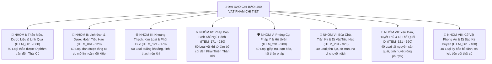
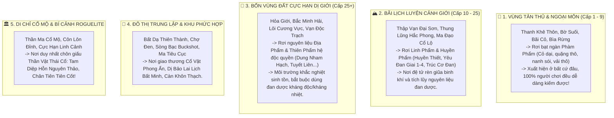

# [05] BÁCH KHOA TOÀN THƯ: ĐẠI ĐẠO CHI BẢO — 400 VẬT PHẨM, PHÁP BẢO & CƠ DUYÊN THÁI CỔ


> ⬅️ **[Bài Trước: Doc 04 - Thuộc Tính Mệnh & Tiến Hóa Linh Căn](file:///c:/Users/newre/OneDrive/Máy%20tính/code%20tutien/docs/04_THUOC_TINH_MENH_VA_TIEN_HOA_LINH_CAN.md)** | 📖 **[Mục Lục Toàn Cảnh](file:///c:/Users/newre/OneDrive/Máy%20tính/code%20tutien/README.md)** | ➡️ **[Bài Kế: Doc 06 - Kiến Trúc CSDL SQLite & Đặc Tả API](file:///c:/Users/newre/OneDrive/Máy%20tính/code%20tutien/docs/06_DATABASE_SCHEMA_VA_API.md)**

> *"Tu chân là hành trình cùng trời đất đoạt tạo hóa, cùng nhật nguyệt tranh huy hoàng. Một nhánh cỏ dại ven đường Thanh Khê Thôn có thể cứu người từ cõi chết; một thanh phi kiếm rỉ sét nơi chợ đen có thể ẩn giấu kiếm hồn Thái Cổ; một giọt tinh huyết rơi nơi đáy vực có thể đốt cháy cả vạn trượng giang sơn!*
> *Kẻ phàm mắt thịt chỉ nhìn phẩm cấp mà định giá, nào biết bốn trăm loại kỳ vật trong cõi trời đất đều mang mệnh số riêng. Kẻ có cơ duyên ắt biến phế liệu thành thần khí, kẻ vô phúc dẫu ôm chí bảo cũng rước họa sát thân!"*

---

## 🧭 I. QUY CHUẨN MA TRẬN 400 VẬT PHẨM TOÀN CHÂN GIỚI

Tài liệu này là **Tổng Phổ Vật Phẩm Tối Cao (Master Item Encyclopedia)** chuẩn hóa trọn vẹn **400 Vật Phẩm** phân bổ khắp cõi Tu Chân Giới, chia thành **8 Đại Nhóm Phân Loại**:



### 1.1. Hệ Thống 6 Bậc Phẩm Cấp Quy Chuẩn
* ⚪ **Phàm Phẩm (`#94a3b8`)**: Vật phẩm hạ cấp, xuất hiện phổ biến khắp nơi (ven đường, bụi cỏ, suối nước, tiệm tạp hóa, quái sơ cấp).
* 🟢 **Linh Phẩm (`#22c55e`)**: Thấm đượm linh khí, xuất hiện ở bìa rừng, bãi hoang dã sơ kỳ, đan phòng ngoại môn.
* 🔵 **Huyền Phẩm (`#38bdf8`)**: Vật phẩm trung cấp của bực Trúc Cơ/Kim Đan, yêu thú bậc trung, bí cảnh thông thường.
* 🟣 **Địa Phẩm (`#c084fc`)**: Bảo vật quý hiếm, rơi từ Boss Tinh Anh, 4 Vùng Cực Hạn, lò luyện đan cao cấp.
* 🟠 **Thiên Phẩm (`#f59e0b`)**: Thần vật trấn phái, rơi từ Boss Thế Giới, hẻm núi hiểm trở, đấu giá chợ đen nghìn vạn thạch.
* 🔴 **Thần Phẩm / Thái Cổ (`#ef4444`)**: Cực phẩm nghịch thiên, mảnh vỡ quy tắc vũ trụ, chỉ đạt được qua đại kỳ ngộ và cửa tử!

---

## 🌿 NHÓM I: THẢO MỘC, DƯỢC LIỆU & LINH QUẢ (ITEM_001 -> ITEM_060)

*Các loại thảo dược là nền tảng của nông trại Dược Điền, thuật luyện đan và hồi phục khí huyết.*

| ID | Tên Vật Phẩm | Phẩm | Hệ | Thông Số & Công Dụng Chi Tiết | Khu Vực Phân Bố & Nguồn Rơi | Tỉ Lệ / Ghi Chú |
| :---: | :--- | :---: | :---: | :--- | :--- | :--- |
| `ITEM_001` | **Cỏ Đuôi Chồn** | Phàm | Mộc | Cỏ dại phàm trần. Nguyên liệu độn thuốc. Bán $1 \text{ LT}$. | Ven đường Thanh Khê Thôn, bụi cỏ | Rơi bạt ngàn ($90\%$) |
| `ITEM_002` | **Cỏ Linh Lăng** | Phàm | Mộc | Cho linh thú ăn hồi phục $5$ thể lực. | Bãi cỏ Ngoại Môn, ven suối | Cực kỳ phổ biến ($85\%$) |
| `ITEM_003` | **Huyền Sâm Non** | Phàm | Mộc | Rễ sâm 1 năm. Bồi bổ khí huyết $+50 \text{ HP}$. | Đào đất Thanh Khê Thôn, Nông trại | Xuất hiện khắp nơi ($80\%$) |
| `ITEM_004` | **Dã Linh Chi** | Phàm | Mộc | Nấm mọc trên gỗ mục. Dùng nấu Thể Lực Đan. | Thân cây mục bìa rừng, Dược Điền | Phổ biến ($75\%$) |
| `ITEM_005` | **Hoàng Tinh Rừng** | Phàm | Thổ | Củ hoàng tinh dã sinh. Hồi phục $80 \text{ HP}$. | Ven suối nước, hốc đá ẩm | Phổ biến ($70\%$) |
| `ITEM_006` | **Địa Đinh Thảo** | Phàm | Thổ | Thảo mộc tính hàn, giải nhẹ $1\%$ Đan Độc. | Bãi cỏ hoang, bờ ruộng | Rơi khắp bản đồ ($70\%$) |
| `ITEM_007` | **Cam Thảo Dã Sinh**| Phàm | Thổ | Vị ngọt, điều hòa tính năng các vị thuốc sơ cấp. | Cửa tiệm tạp hóa, bờ mương | Rơi ngẫu nhiên ($80\%$) |
| `ITEM_008` | **Bạch Chỉ Thảo** | Phàm | Phong| Mùi thơm nhẹ, dùng chế tạo Bùa Trừ Tà sơ cấp. | Đỉnh đồi lộng gió Thanh Khê | Rơi mọi nơi ($75\%$) |
| `ITEM_009` | **Ngải Diệp Khô** | Phàm | Hỏa | Đốt xua đuổi muỗi độc, hồi $2$ Thể lực khi thiền. | Nương rẫy, nhà dân bỏ hoang | Nhặt tự do ($85\%$) |
| `ITEM_010` | **Kim Ngân Hoa** | Phàm | Kim | Hoa vàng trắng, tăng kháng độc nhẹ $+5\%$. | Bụi rậm Ngoại Môn phái | Phổ biến ($70\%$) |
| `ITEM_011` | **Cát Cánh Rừng** | Phàm | Kim | Thông đàm lợi phế, giảm $10\%$ ho sặc khi bị đòn. | Ven chân núi Thập Vạn | Phổ biến ($70\%$) |
| `ITEM_012` | **Phục Linh Thô** | Phàm | Thổ | Vón cục rễ thông, nguyên liệu luyện Tụ Khí Đan. | Gốc thông già bãi săn cấp 1 | Rơi từ quái lợn rừng ($65\%$) |
| `ITEM_013` | **Khúc Khắc Cổ Đan**| Phàm | Thủy | Dây leo giữ nước, giải khát, tăng $10 \text{ Mana}$. | Đầm lầy cạn, rãnh nước suối | Nhặt ven suối ($80\%$) |
| `ITEM_014` | **Cỏ Chỉ Thiên** | Phàm | Hỏa | Lá nhọn hướng trời, mang chút hỏa tính yếu. | Vùng đồi khô hạn bãi cấp 2 | Phổ biến ($75\%$) |
| `ITEM_015` | **Tang Diệp Già** | Phàm | Mộc | Lá dâu tằm già nuôi linh tằm nhả tơ đan đạo bào. | Nông trại thôn trang | Thu hoạch tự do ($90\%$) |
| `ITEM_016` | **Huyết Lan Hoa** | Linh | Hỏa | Hoa đỏ như máu, nguyên liệu chế Hồi Huyết Đan. | Vách đá Thập Vạn Đại Sơn | Tỉ lệ $35\%$ |
| `ITEM_017` | **Bách Niên Linh Chi**| Linh| Mộc | Linh chi trăm năm, tăng vĩnh viễn $+50 \text{ HP}$. | Rừng sâu ẩm ướt, Dược Điền cấp 2 | Tỉ lệ $30\%$ |
| `ITEM_018` | **U Cốc Linh Thảo** | Linh | Ám | Hấp thu âm khí khe núi, dùng luyện Dược Tẩy Uế. | Hẻm núi Hắc Phong, hang động | Tỉ lệ $28\%$ |
| `ITEM_019` | **Thanh Linh Trúc** | Linh | Phong| Đốt trúc chứa linh khí thanh khiết, Thân pháp $+2$. | Trúc Lâm Thanh Khê Thôn | Chặt trúc ($40\%$) |
| `ITEM_020` | **Hàn Đàm Tảo** | Linh | Thủy | Rong biển hồ lạnh, làm mát đan điền, hạ nhiệt độc. | Đáy hồ nước lạnh, Thủy Đàm | Bơi lặn nhặt ($30\%$) |
| `ITEM_021` | **Liệt Diễm Thảo** | Linh | Hỏa | Lá cây luôn nóng ran, nguyên liệu chế Liệt Hỏa Đan.| Gần miệng núi lửa nhỏ | Rơi quái hệ Hỏa ($35\%$) |
| `ITEM_022` | **Hoàng Thổ Căn** | Linh | Thổ | Rễ cây ăn sâu lòng đá, tăng $5\%$ Phòng ngự 10p. | Mỏ khoáng thạch, vách núi | Đào khoáng rơi ($30\%$) |
| `ITEM_023` | **Phong Hành Diệp** | Linh | Phong| Lá cây mỏng như cánh ve, Tốc độ $+4$ trong 15p. | Đỉnh núi cao đón gió lộng | Hái trên cây cao ($30\%$) |
| `ITEM_024` | **Tử Lôi Thảo** | Linh | Lôi | Thảo dược ngậm điện tích nhẹ, Bạo kích $+2\%$. | Vùng đất hay bị sét đánh | Rơi sau cơn mưa ($25\%$) |
| `ITEM_025` | **Băng Tinh Thảo** | Linh | Băng | Đóng băng giọt sương mai, giảm tốc độ kẻ thù $5\%$.| Đỉnh núi tuyết sương mù | Tỉ lệ $25\%$ |
| `ITEM_026` | **Tụ Linh Thảo** | Linh | Vô | Tự động hút linh khí xung quanh, Tu vi $+5\%$/s 1h. | Dược Điền Tông Môn phái | Trồng trọt thu hoạch |
| `ITEM_027` | **Đoạn Cốt Thảo** | Linh | Độc | Nhựa cây cực độc, bôi lên phi kiếm làm độc sát. | Bãi đầm lầy Vạn Độc | Quái bò cạp rơi ($25\%$) |
| `ITEM_028` | **Xà Nhục Chi** | Linh | Ám | Nấm có hoa văn da rắn, tăng hút máu $+1\%$. | Tổ rắn độc bãi săn cấp 5 | Săn quái rắn rơi ($30\%$) |
| `ITEM_029` | **Thanh Tâm Thảo** | Linh | Thủy | Làm dịu tâm ma, trừ $-5\%$ Đan Độc tức thì. | Đầm sen thanh tịnh | Thu hoạch bờ ao ($35\%$) |
| `ITEM_030` | **Thiên Ti Thảo** | Linh | Kim | Sợi dai như thép, dùng làm gân cung nỏ và lưới bẫy.| Rừng rậm cổ thụ | Hái trên dây leo ($30\%$) |
| `ITEM_031` | **Cửu Diệp Chi Lan**| Huyền| Mộc | 9 cánh lá phát quang, nguyên liệu Trúc Cơ Đan. | Rừng sâu Thập Vạn Đại Sơn | Hiếm ($15\%$) |
| `ITEM_032` | **Ngũ Sắc Linh Đằng**| Huyền| Vô | Dây leo mang 5 màu ngũ hành, cân bằng đan điền. | Bí Cảnh Vạn Mộc Tầng 2 | Rơi hòm bí cảnh ($12\%$) |
| `ITEM_033` | **Hỏa Diễm Quả** | Huyền| Hỏa | Quả chín đỏ bốc lửa, cắn vào tăng $+15 \text{ ATK}$ vĩnh viễn.| Hỏa Giới Cực Hạn | Khai thác bãi dung nham |
| `ITEM_034` | **Băng Phách Chi** | Huyền| Băng | Cành cây đóng băng ngàn năm không tan, DEF $+15$. | Động Băng Bắc Minh | Quái Băng Tinh rơi ($15\%$) |
| `ITEM_035` | **Canh Kim Thảo** | Huyền| Kim | Thân cây cứng như kiếm, tăng $5\%$ Phá Giáp. | Mỏ quặng Canh Kim | Đào quặng sâu ($12\%$) |
| `ITEM_036` | **Huyết Tinh Mộc** | Huyền| Huyết| Gỗ thấm máu yêu thú ngàn năm, dùng đúc Hộ Uyển. | Bãi tha ma cổ xưa | Sát phạt yêu ma rơi ($15\%$) |
| `ITEM_037` | **U Hồn Hoa** | Huyền| Minh | Hoa nở trong bóng tối, hấp thu hồn lực tăng né $+3\%$.| Đáy vực thẳm Ma Đạo | Hái giờ Tý ban đêm |
| `ITEM_038` | **Cửu Khúc Linh Tham**| Huyền| Thổ | Củ sâm uốn 9 khúc hình rồng, tăng $1,000 \text{ Exp}$. | Vườn Dược Tông Môn cấp 3 | Trồng 12 giờ mới chín |
| `ITEM_039` | **Lôi Kích Mộc Dịch**| Huyền| Lôi | Nhựa cây từ cổ thụ bị sét đánh trúng, kháng sét $+5\%$.| Đồi Lôi Điện sau mưa | Rất hiếm ($10\%$) |
| `ITEM_040` | **Địa Tâm Thổ Căn** | Huyền| Thổ | Rễ cây đâm vào nham thạch, tăng $+100 \text{ HP}$. | Hang ngầm dưới lòng đất | Đào bới lòng đất |
| `ITEM_041` | **Phong Linh Quả** | Huyền| Phong| Ăn vào thân thể nhẹ bẫng, Thân pháp $+8$ Speed. | Vách núi dựng đứng | Chim ưng canh giữ |
| `ITEM_042` | **Bách Thảo Lộ** | Huyền| Thủy | Sương mai ngưng tụ từ trăm loại cỏ, tẩy uế $-10\%$ độc.| Hứng sương vào giờ Mão | Thu hoạch bình ngọc |
| `ITEM_043` | **Kim Ti Đằng** | Huyền| Kim | Dây leo bọc tơ vàng óng, nguyên liệu đan Trúc Cơ. | Hốc đá mỏ vàng cổ | Tỉ lệ $15\%$ |
| `ITEM_044` | **Tử La Lan** | Huyền| Lôi | Hoa tím ngát tỏa điện tích, tăng $3\%$ Bạo kích. | Đầm lôi Vân Mộng | Rơi từ quái điện ($12\%$) |
| `ITEM_045` | **Vạn Niên Thạch Nhũ**| Huyền| Thủy | Giọt nước đá vôi nhỏ giọt ngàn năm, hồi phục 100% mana.| Hang động thạch nhũ | Hứng từng giọt ($10\%$) |
| `ITEM_046` | **Ngàn Năm Tuyết Liên**| Địa | Băng | Bông sen tuyết nở trên đỉnh tuyết sơn, xóa $100\%$ độc.| Đỉnh Phong Tuyết Sơn | Boss Băng Vượn giữ ($5\%$) |
| `ITEM_047` | **Huyết Độc Ma Nấm** | Địa | Ma | Nấm độc mọc từ xác Cổ Ma, độc sát cực mạnh thiêu máu.| Đáy Vạn Ma Uyên | Tỉ lệ rơi $4\%$ |
| `ITEM_048` | **Chu Quả Ngàn Năm** | Địa | Hỏa | Quả thần tiên, nuốt vào tăng thẳng $50,000 \text{ Tu Vi}$.| Hẻm núi dung nham bí mật | Thần Điêu canh giữ |
| `ITEM_049` | **Kim Tủy Thảo** | Địa | Kim | Tinh túy kim loại hóa cây, tăng vĩnh viễn $+20 \text{ ATK}$.| Động Kim Cương | Rất khó tìm ($4.5\%$) |
| `ITEM_050` | **Huyền Minh Thảo** | Địa | Thủy | Hút hàn khí bắc cực, nguyên liệu đúc Kim Đan Đan. | Vực sâu Bắc Minh Hải | Tỉ lệ rơi $3.5\%$ |
| `ITEM_051` | **Cửu Dương Chi Hoa** | Địa | Hỏa | Hoa 9 cánh rực rỡ như mặt trời, trừ ma tà $+25\%$. | Đỉnh núi Thái Dương | Hái đúng giờ Ngọ |
| `ITEM_052` | **Cửu Âm Hàn Đằng** | Địa | Băng | Dây leo lạnh buốt, nguyên liệu điều hòa Băng Hỏa. | Vùng cực âm tối tăm | Hái đúng giờ Tý |
| `ITEM_053` | **Ngộ Đạo Trà 1,000 Năm**| Thiên| Vô | Uống vào Tọa Thiền $+200\%$ Tu Vi/s trong 1 giờ! | Vách đá nghìn trượng bí cảnh | Kỳ ngộ rơi vực thẳm |
| `ITEM_054` | **Long Tiết Thảo** | Thiên| Huyết| Thảo mộc tưới đẫm máu rồng, Khí Huyết $+1,000 \text{ HP}$.| Hang ổ Chân Long | Đánh Boss Long Tộc |
| `ITEM_055` | **Hỗn Nguyên Linh Quả**| Thiên| Vô | Chứa hỗn độn chân khí sơ khai, tăng toàn thuộc tính $+8\%$.| Cây thiêng trung tâm Cổ Mộ | Đánh bại Thủ Hộ Giả |
| `ITEM_056` | **Cửu Chuyển Kim Liên**| Thiên| Quang| Sen vàng 9 tầng hào quang, miễn dịch đan độc 30 ngày. | Đầm sen Thiên Giới | Thần bí xuất hiện |
| `ITEM_057` | **U Minh Ma Hạch Thảo**| Thiên| Ma | Thảo mộc mọc trên bia mộ Ma Tôn, tăng sát thương Ma $+30\%$.| Mộ Cổ Ma Hoàng | Ma Tu độc quyền |
| `ITEM_058` | **Tam Diệp Hỗn Nguyên Thảo**| Thần| Vô | **Kỳ Dược Mở Tam Linh Căn**: Đả thông luân xa thứ 3! | Đỉnh Cực Hạn Linh Cảnh | Kỳ ngộ 5,000 năm ($0.1\%$) |
| `ITEM_059` | **Vạn Thọ Vô Cương Quả**| Thái Cổ| Vô| Kéo dài thọ mệnh, vĩnh viễn giảm $15\%$ sát thương Lôi Kiếp.| Di chỉ Thần Ma Thái Cổ | Thần Thức quét Hóa Thần |
| `ITEM_060` | **Bồ Đề Thần Thụ Chi** | Thái Cổ| Mộc| Cành cây Bồ Đề sơ khai, ngộ đạo đột phá $100\%$ không bình cảnh.| Phật Đài Hoang Phế Thượng Cổ | Đại Cơ Duyên Độc Nhất |

---

## 💊 NHÓM II: LINH ĐAN & TIÊU HAO DƯỢC PHẨM (ITEM_061 -> ITEM_120)

*Các loại linh đan hỗ trợ đột phá cảnh giới, mở kinh mạch, cứu mạng trong sinh tử.*

| ID | Tên Đan Dược | Phẩm | Thuộc Tính Mệnh | Công Dụng Thực Chiến & Chỉ Số | Đan Độc | Nguồn Gốc / Chế Tạo |
| :---: | :--- | :---: | :---: | :--- | :---: | :--- |
| `ITEM_061` | **Kim Sang Dược** | Phàm | Vô | Hồi phục $200 \text{ HP}$ lập tức trong trận đấu. | $0\%$ | Mua tiệm tạp hóa ($50 \text{ LT}$) |
| `ITEM_062` | **Hồi Khí Hoàn** | Phàm | Vô | Hồi phục $50 \text{ Mana}$ tức thì khi chiến đấu. | $+1\%$ | Mua shop hoặc luyện sơ cấp |
| `ITEM_063` | **Thể Lực Đan (Hạ)** | Phàm | Vô | Hồi phục $+20 \text{ Thể Lực}$ (Stamina) để hoạt động. | $+1\%$ | Luyện đan: Linh Chi + Hoàng Tinh |
| `ITEM_064` | **An Thần Tán** | Phàm | Vô | Giảm căng thẳng, tăng tỉ lệ rèn đồ thành công $+5\%$. | $0\%$ | Chế biến thảo dược dã sinh |
| `ITEM_065` | **Tích Cốc Đan (1 Ngày)**| Phàm| Vô | Không cần ăn uống, duy trì thể trạng 24 giờ. | $0\%$ | Nông trại cấp 1 nấu được |
| `ITEM_066` | **Chỉ Huyết Tán** | Phàm | Mộc | Ngưng chảy máu, cầm cự sát thương xuất huyết. | $0\%$ | Rơi từ đạo tặc Thanh Khê |
| `ITEM_067` | **Trừ Phong Thang** | Phàm | Phong| Xua tan phong hàn, tăng $2$ Speed trong 10 phút. | $+1\%$ | Nấu từ Bạch Chỉ + Gừng |
| `ITEM_068` | **Hóa Độc Hoàn Sơ Cấp**| Phàm| Thổ | Giải độc rắn rết thông thường, trừ $2\%$ đan độc. | $0\%$ | Chế từ Địa Đinh Thảo |
| `ITEM_069` | **Ôn Kinh Hoàn** | Phàm | Hỏa | Làm ấm kinh mạch, tăng $5\%$ sát thương Hỏa 10p. | $+1\%$ | Nấu từ Ngải Diệp |
| `ITEM_070` | **Bổ Huyết Cao** | Phàm | Mộc | Hồi phục $500 \text{ HP}$ sau trận đấu khi nghỉ ngơi. | $0\%$ | Mua tại Y Quán Thanh Khê |
| `ITEM_071` | **Dưỡng Khí Cao** | Phàm | Vô | Tọa Thiền nhận thêm $+10\%$ Tu Vi trong 30 phút. | $+1\%$ | Chế biến từ Huyền Sâm Non |
| `ITEM_072` | **Tụ Lực Hoàn** | Phàm | Kim | Đòn đánh kế tiếp tăng $+10 \text{ ATK}$ lực tay. | $+1\%$ | Rơi từ quái Thổ Phỉ |
| `ITEM_073` | **Khứ Ẩm Thang** | Phàm | Hỏa | Loại bỏ trạng thái ướt sũng khi đi dưới mưa. | $0\%$ | Nấu từ thảo dược khô |
| `ITEM_074` | **Thanh Lương Tán** | Phàm | Thủy | Hạ sốt, giảm $10\%$ sát thương nhận từ lửa nhỏ. | $0\%$ | Chế từ Khúc Khắc ven suối |
| `ITEM_075` | **Giải Tửu Đan** | Phàm | Vô | Tỉnh rượu tức thì tại Bất Dạ Thiên Tửu Lầu. | $0\%$ | Mua tại quầy rượu ($20 \text{ LT}$) |
| `ITEM_076` | **Tụ Khí Đan** | Linh | Vô | Uống vào tăng ngay $+300 \text{ Tu Vi}$ Luyện Khí Kỳ. | $+3\%$ | Luyện đan cấp 2 Tông Môn |
| `ITEM_077` | **Trúc Cơ Đan (Hạ)** | Linh | Vô | Tăng $25\%$ tỉ lệ thành công khi Trúc Cơ nhảy cấp. | $+4\%$ | Luyện đan: Huyền Sâm + Phục Linh |
| `ITEM_078` | **Bồi Nguyên Đan** | Linh | Thổ | Củng cố căn cơ, tăng $+5\%$ Độ Vững Căn Cơ. | $+2\%$ | Chế từ Cửu Khúc Linh Tham |
| `ITEM_079` | **Hộ Mạch Đan** | Linh | Kim | Lắp Đài Độ Kiếp: Giảm $40\%$ sát thương Lôi Kiếp. | $0\%$ | Lò luyện đan Ngoại Môn |
| `ITEM_080` | **Thanh Tâm Đan** | Linh | Thủy | Tẩy sạch $-15\%$ Đan Độc tích tụ trong kinh mạch. | $0\%$ | Luyện từ Thanh Tâm Thảo |
| `ITEM_081` | **Liệt Hỏa Đan** | Linh | Hỏa | Chuyển đòn đánh thành hỏa thiêu đốt $+10\%$ trong 1 trận.| $+2\%$ | Luyện từ Liệt Diễm Thảo |
| `ITEM_082` | **Băng Tâm Đan** | Linh | Băng | Giữ tâm trí lạnh lùng, miễn nhiễm hoảng sợ Stun 3 hiệp.| $+2\%$ | Luyện từ Hàn Đàm Tảo |
| `ITEM_083` | **Tật Phong Đan** | Linh | Phong| Tăng Thân Pháp $+6$ Speed trong 3 trận đấu. | $+2\%$ | Luyện từ Phong Hành Diệp |
| `ITEM_084` | **Bạo Kích Đan** | Linh | Lôi | Tăng $+5\%$ Bạo Kích trong trận chiến kế tiếp. | $+3\%$ | Luyện từ Tử Lôi Thảo |
| `ITEM_085` | **Dưỡng Hồn Đan** | Linh | Minh | Khôi phục Thần Thức bị tổn thương sau khi tầm bảo. | $+1\%$ | Mua tại Chợ Đen Tầng 1 |
| `ITEM_086` | **Thể Lực Đan (Trung)**| Linh| Vô | Hồi phục $+50 \text{ Thể Lực}$ dồi dào. | $+2\%$ | Nấu đan dược Bách Niên |
| `ITEM_087` | **Tích Cốc Đan (1 Tháng)**| Linh| Vô | No bụng suốt 30 ngày tu tiên không suy giảm thể lực.| $0\%$ | Dành cho đệ tử bế quan sâu |
| `ITEM_088` | **Giải Độc Đan Nhị Chuyển**| Linh| Mộc| Xóa bỏ toàn bộ trúng độc rắn rết ma trùng cấp 2. | $0\%$ | Luyện từ Bách Thảo Lộ |
| `ITEM_089` | **Bổ Thể Đan** | Linh | Thổ | Tăng vĩnh viễn $+100 \text{ Max HP}$ (tối đa ăn 5 viên).| $+3\%$ | Rơi từ quái Tinh Anh |
| `ITEM_090` | **Kim Cương Đan** | Linh | Kim | Tăng $+15\%$ Phòng ngự trong 3 hiệp đấu sống còn. | $+2\%$ | Lò đúc Kim Tinh chế tạo |
| `ITEM_091` | **Trúc Cơ Đan (Cực Phẩm)**| Huyền| Vô | Trúc Cơ thành công $100\%$, tăng $+15\%$ Đạo Cơ Vững. | $+2\%$ | Đan Sư Thượng Phẩm luyện ra |
| `ITEM_092` | **Nhị Cực Khai Khiếu Đan**| Huyền| Vô | **Vật Phẩm Mở Song Linh Căn Tương Sinh** ở Trúc Cơ! | $+5\%$ | Lò Đan: Linh Chi + Huyết Tinh |
| `ITEM_093` | **Tụ Nguyên Đan** | Huyền| Vô | Cắn vào nhận ngay $+5,000 \text{ Tu Vi}$ Trúc Cơ Kỳ. | $+4\%$ | Rơi từ Boss Hắc Phong Trại |
| `ITEM_094` | **Huyết Linh Đan** | Huyền| Huyết| Hút máu $+5\%$ trong suốt 5 trận đấu bí cảnh. | $+3\%$ | Chế từ Huyết Tinh Mộc |
| `ITEM_095` | **Lôi Linh Đan** | Huyền| Lôi | Phóng ra lôi hỏa làm choáng kẻ thù $1$ hiệp đầu tiên. | $+3\%$ | Luyện từ Lôi Kích Mộc Dịch |
| `ITEM_096` | **Kim Tủy Đan** | Huyền| Kim | Tăng vĩnh viễn $+15 \text{ ATK}$ lực công kích đòn tay.| $+4\%$ | Cần Canh Kim Thảo chế tạo |
| `ITEM_097` | **Huyền Thủy Đan** | Huyền| Thủy | Tạo khiên nước hấp thu $1,500$ sát thương đầu tiên. | $+2\%$ | Luyện từ Vạn Niên Thạch Nhũ |
| `ITEM_098` | **Hóa Ứ Thần Đan** | Huyền| Mộc | Chữa lành chấn thương Đạo Đài sau khi bị đánh bại. | $0\%$ | Cứu mạng đệ tử trọng thương |
| `ITEM_099` | **Thanh Tâm Tẩy Độc Đan**| Huyền| Thủy| **Thanh lọc lập tức $-25\%$ Đan Độc** bế tắc kinh mạch.| $0\%$ | Lò Đan Nội Môn Tông Môn |
| `ITEM_100` | **Quy Nguyên Đan** | Huyền| Vô | Hồi phục toàn bộ $100\%$ Mana và Khí Huyết sau trận. | $+2\%$ | Mua tại Đấu Giá Bất Dạ Thiên |
| `ITEM_101` | **Khí Huyết Bạo Đan** | Huyền| Hỏa | Đốt $20\%$ HP bản thân để tăng gấp đôi ATK trong 2 hiệp.| $+5\%$ | Ma Tu hay dùng liều mạng |
| `ITEM_102` | **Tật Phong Huyễn Bộ Đan**| Huyền| Phong| Tăng $+15$ Speed, né tránh đòn đánh tăng $+12\%$. | $+3\%$ | Luyện từ Phong Linh Quả |
| `ITEM_103` | **Ngự Lôi Đan** | Huyền| Lôi | Miễn dịch tê liệt và giảm $30\%$ sát thương Lôi Kiếp. | $+2\%$ | Dùng khi vượt kiếp Trúc Cơ |
| `ITEM_104` | **Cố Bản Bồi Nguyên Đan**| Huyền| Thổ| Tăng $+20\%$ Độ Vững Căn Cơ, chữa nứt Đạo Đài. | $+1\%$ | Thần dược ổn định kinh mạch |
| `ITEM_105` | **Tẩy Tủy Đan (Huyền)**| Huyền| Vô | Tẩy đổi ngẫu nhiên Linh Căn hoặc Căn Cốt nhân vật. | $0\%$ | Phần thưởng Nhiệm Vụ Tông Môn |
| `ITEM_106` | **Kim Đan Đan (Cực Phẩm)**| Địa | Vô | Tăng cơ hội ngưng kết **Lục Chuyển / Cửu Chuyển Kim Đan**.| $+5\%$ | Dược liệu ngàn năm chế tạo |
| `ITEM_107` | **Lưỡng Nghi Âm Dương Đan**| Địa | Âm Dương| **Vật Phẩm Mở Song Linh Căn Tương Khắc** (Băng Hỏa)! | $+4\%$ | Cần Cửu Dương + Cửu Âm Thảo |
| `ITEM_108` | **Phá Chướng Đan** | Địa | Vô | Phá vỡ bình cảnh đại cảnh giới khi exp đầy $100\%$. | $+3\%$ | Rơi từ Boss Thế Giới |
| `ITEM_109` | **Cửu Chuyển Hóa Huyết Đan**| Địa| Huyết| Khi máu đỏ $<15\%$, bộc phát hút máu $30\%$ lật kèo. | $+6\%$ | Ma Đạo chí bảo đan dược |
| `ITEM_110` | **Ngũ Hành Hỗn Nguyên Đan**| Địa| Ngũ Hành| Tăng toàn bộ kháng tính ngũ hành $+20\%$ trong 1 ngày.| $+3\%$ | Dung hợp 5 loại linh thảo cổ |
| `ITEM_111` | **Tẩy Căn Cổ Đan** | Địa | Vô | Trục xuất 1 nhánh tạp căn yếu nhất, tinh thuần hóa căn.| $0\%$ | Bí Cảnh Thái Cổ rơi rương |
| `ITEM_112` | **Băng Hỏa Cực Hạn Đan**| Địa | Băng Hỏa| Đòn đánh kích nổ song hệ thiêu đốt và đóng băng địch. | $+5\%$ | Đan dược kỳ dị chợ đen |
| `ITEM_113` | **U Minh Đoạt Hồn Đan**| Địa | Ám | Đánh bại kẻ thù hút lấy $10\%$ tu vi của đối thủ! | $+8\%$ | Tà đan bị cấm chính đạo |
| `ITEM_114` | **Cực Cực Thần Thể Đan**| Địa | Kim | Nhục thân hóa kim cương, giảm $30\%$ sát thương nhận vào.| $+4\%$ | Luyện từ Kim Tủy Thảo |
| `ITEM_115` | **Nguyên Anh Đan** | Thiên| Vô | Hóa Đan thành Thai, giúp ngưng kết Nguyên Anh Viên Mãn.| $+5\%$ | Bảo vật trấn tông môn phái |
| `ITEM_116` | **Cửu U Minh Hỏa Đan** | Thiên| Hỏa Độc| Tăng vĩnh viễn $+50 \text{ ATK}$, đòn đánh thiêu đốt $5\%$ HP/hiệp.| $+10\%$ | Luyện tại Địa Tâm Dung Nham |
| `ITEM_117` | **Cửu Chuyển Hồi Hồn Đan**| Thiên| Vô | **Chết lập tức hồi sinh $100\%$ HP tại chỗ** (dùng 1 lần).| $0\%$ | Đạt điểm tối đa Đố Vui Đạo Tâm |
| `ITEM_118` | **Vạn Kiếp Bất Diệt Đan**| Thiên| Thần | Miễn dịch hoàn toàn với cái chết trong 3 hiệp đấu! | $+5\%$ | Rơi từ Bí Cảnh Hóa Thần |
| `ITEM_119` | **Tam Thanh Hóa Đạo Đan**| Thái Cổ| Vô | **Đột Phá Tam Linh Căn & Khởi Động Tam Hoa Tụ Đỉnh**! | $0\%$ | Đan Đạo Thần Cấp mới luyện nổi |
| `ITEM_120` | **Cửu Chuyển Tán Công Đan**| Thái Cổ| Vô | **Đan Dược Trảm Đạo**: Tự phế đan điền trọng tu Niết Bàn! | $0\%$ | Phá rồi lại lập, exp kiếp sau x2 |

---

## ⚒️ NHÓM III: KHOÁNG THẠCH, KIM LOẠI & PHÔI ĐÚC (ITEM_121 -> ITEM_170)

*Nguyên liệu rèn đúc phi kiếm, tôi luyện giáp trụ và nâng cấp kiến trúc Động Phủ.*

| ID | Tên Khoáng Vật | Phẩm | Hệ | Đặc Tính Độ Cứng & Hiệu Quả Đúc | Khu Vực Khai Thác & Nguồn Gốc | Tỉ Lệ / Ghi Chú |
| :---: | :--- | :---: | :---: | :--- | :--- | :--- |
| `ITEM_121` | **Thiết Quặng Thô** | Phàm | Kim | Quặng sắt cơ bản, nung thành thỏi sắt rèn vũ khí. | Vách đá Thanh Khê Thôn, mỏ cạn | Đào đâu cũng có ($95\%$) |
| `ITEM_122` | **Đồng Phôi Dã Sinh**| Phàm | Kim | Đồng đỏ dẻo dai, dùng đúc đỉnh lò và chuông đồng. | Ven suối đá cuội, mỏ nông | Phổ biến ($90\%$) |
| `ITEM_123` | **Than Đá Lòng Đất** | Phàm | Hỏa | Cung cấp nhiệt lượng duy trì lửa lò luyện đan. | Hầm than bỏ hoang bãi cấp 1 | Nhặt tự do ($95\%$) |
| `ITEM_124` | **Cát Trắng Linh Khê**| Phàm| Thủy | Lọc sạch nước suối và tinh luyện thủy tinh phù chú. | Lòng suối Thanh Khê Thôn | Xúc cát đáy suối ($90\%$) |
| `ITEM_125` | **Đá Vôi Tinh Khiết** | Phàm | Thổ | Nguyên liệu xây dựng gia cố tường vách Động Phủ. | Núi đá vôi Ngoại Môn | Đào đá tự do ($90\%$) |
| `ITEM_126` | **Hắc Thiết Vụn** | Phàm | Kim | Vụn sắt đen thừa sau khi thợ rèn gõ búa, bán $2 \text{ LT}$.| Bãi phế liệu lò rèn | Nhặt góc lò rèn ($85\%$) |
| `ITEM_127` | **Thanh Đồng Mảnh** | Phàm | Kim | Mảnh vỡ đồ đồng cổ mốc meo, gom nấu lại thành thỏi. | Khu di tích hoang phế | Nhặt tự do ($80\%$) |
| `ITEM_128` | **Chì Xám Nặng** | Phàm | Thổ | Kim loại nặng chắn độc tố nhẹ, dùng bọc hộp thuốc. | Đáy mỏ quặng sâu | Đào mỏ nông ($75\%$) |
| `ITEM_129` | **Đá Bùi Nhùi Hỏa** | Phàm | Hỏa | Đập vào nhau tóe lửa mồi lò rèn và bếp lửa. | Vùng đồi khô cằn nắng gắt | Phổ biến ($85\%$) |
| `ITEM_130` | **Mảnh Gốm Cổ Rạn** | Phàm | Thổ | Mảnh bình gốm vỡ thời xưa, dùng nghiền làm men lò. | Đào đất trồng cây nông trại | Rơi ngẫu nhiên ($80\%$) |
| `ITEM_131` | **Bột Khoáng Đất Đỏ**| Phàm| Thổ | Phẩm màu tự nhiên vẽ phù chú cấp thấp. | Vùng đồi đất đỏ bãi săn 2 | Hót bột đất ($85\%$) |
| `ITEM_132` | **Thạch Anh Thường** | Phàm | Kim | Tinh thể trong suốt, khúc xạ ánh sáng làm kính lúp. | Ven bờ sông đá cuội | Nhặt tự do ($75\%$) |
| `ITEM_133` | **Hoàng Đồng Vụn** | Phàm | Kim | Vụn đồng vàng lấp lánh, đúc tiền đao sơ khai. | Hốc đá mỏ quặng | Rơi khi đập đá ($70\%$) |
| `ITEM_134` | **Thép Carbon Tôi** | Phàm | Kim | Sắt được thợ rèn tôi qua nước lạnh, rèn dao rựa. | Lò rèn Ngoại Môn | Mua của thợ rèn ($10 \text{ LT}$) |
| `ITEM_135` | **Gỉ Sắt Cổ Khối** | Phàm | Kim | Khối gỉ sét kết tủa lâu năm, nghiền làm chất xúc tác.| Đáy giếng cạn bỏ hoang | Nhặt tự do ($80\%$) |
| `ITEM_136` | **Huyền Thiết Nguyên Chất**| Linh| Kim| Sắt đen nặng trịch, rèn Phi Kiếm tăng $+15 \text{ ATK}$. | Mỏ quặng Thập Vạn Đại Sơn | Tỉ lệ $35\%$ |
| `ITEM_137` | **Hỏa Tinh Thạch** | Linh | Hỏa | Ngậm nhiệt lượng tự nhiên, nung chảy kim loại nhanh $20\%$.| Miệng núi lửa bãi săn cấp 4 | Khai thác đá lửa ($30\%$) |
| `ITEM_138` | **Lam Tinh Thạch** | Linh | Thủy | Đá lam biếc ngưng tụ hơi ẩm, khảm giáp tăng $+50 \text{ HP}$.| Đáy hồ nước sâu Bích Ba | Lặn mò ngọc ($30\%$) |
| `ITEM_139` | **Lục Phỉ Thúy** | Linh | Mộc | Ngọc bích xanh tươi, khảm trượng tăng hồi máu $+1\%$. | Vách đá trong rừng sâu | Đào mỏ đá quý ($25\%$) |
| `ITEM_140` | **Hoàng Thổ Thạch** | Linh | Thổ | Khối đá đất vàng óng, rèn khiên tăng $+10 \text{ DEF}$. | Hang động chuột dũi | Quái chuột rơi ($35\%$) |
| `ITEM_141` | **Phong Lôi Sa** | Linh | Phong Lôi| Cát bay lơ lửng ngậm điện tích, rèn phi tiêu tăng tốc.| Bãi cát lộng gió sấm chớp | Hót cát sau bão ($25\%$) |
| `ITEM_142` | **Băng Tinh Thạch** | Linh | Băng | Đá lạnh buốt như băng tuyết, khảm đao gây chậm $5\%$. | Vùng núi tuyết sương giá | Tỉ lệ $28\%$ |
| `ITEM_143` | **Bạch Ngân Tinh** | Linh | Kim | Bạc tinh luyện tinh khiết, dẫn truyền chân khí cực tốt.| Mỏ bạc cổ Tông Môn | Khai khoáng sâu ($30\%$) |
| `ITEM_144` | **Xích Đồng Phôi** | Linh | Hỏa | Đồng đỏ hấp thu hỏa tính, đúc lò luyện đan hạ phẩm. | Quặng mỏ gần nham thạch | Tỉ lệ $30\%$ |
| `ITEM_145` | **U Minh Thạch** | Linh | Ám | Hút ánh sáng xung quanh, dùng rèn ám khí dạ hành. | Mộ cổ bỏ hoang | Quái ma trơi rơi ($25\%$) |
| `ITEM_146` | **Linh Thạch Hạ Phẩm**| Linh| Vô | Đơn vị tiền tệ chính ngưng tụ linh khí trời đất. | Đào mỏ, đánh quái, nhiệm vụ | Có khắp nơi ($100\%$) |
| `ITEM_147` | **Linh Thạch Trung Phẩm**| Linh| Vô| Quy đổi bằng $100 \text{ Linh Thạch Hạ Phẩm}$. | Boss rơi, giao thương lớn | Phổ biến ($40\%$) |
| `ITEM_148` | **Tử Tinh Khoáng** | Linh | Lôi | Pha lê tím phát ra tia điện li ti, rèn chùy sét. | Đồi Lôi Điện | Khai khoáng sấm ($25\%$) |
| `ITEM_149` | **Canh Kim Tinh Phôi**| Huyền| Kim | Cực kỳ sắc bén, tăng $15\%$ tỉ lệ phá giáp phi kiếm. | Mỏ Canh Kim sâu 1,000 trượng | Hiếm ($12\%$) |
| `ITEM_150` | **Hải Lam Ngọc** | Huyền| Thủy | Ngọc biển xanh thẳm, khảm áo choàng bơi không tốn mana.| Hang ngầm biển sâu | Boss Thủy Quái rơi ($15\%$) |
| `ITEM_151` | **Dung Nham Hạch** | Huyền| Hỏa | Lõi đá nóng chảy trong lòng núi lửa, rèn hỏa đao. | Hỏa Giới Cực Hạn | Khai thác đá nham ($15\%$) |
| `ITEM_152` | **Cửu U Âm Thiết** | Huyền| Ma | Sắt đen lạnh giá dưới đáy vực sâu, sát thương Ma $+15\%$.| Đáy Vạn Ma Uyên | Ma Tu khai thác ($12\%$) |
| `ITEM_153` | **Thiên Lôi Thạch** | Huyền| Lôi | Hòn đá hứng trọn lôi kiếp, đúc vũ khí sét đánh nổ lan. | Đỉnh núi Lôi Cương Vực | Tỉ lệ $10\%$ |
| `ITEM_154` | **Hàn Ngọc Băng Tủy**| Huyền| Băng | Tủy đá ngàn năm đóng băng, đúc giáp miễn nhiễm lửa nhỏ.| Động Băng Bắc Minh | Tỉ lệ $10\%$ |
| `ITEM_155` | **Tinh Thần Sa** | Huyền| Tinh Tú| Cát rơi từ sao băng trên trời, dùng tinh luyện túi càn khôn.| Địa điểm sao băng rơi | Nhặt theo giờ đêm |
| `ITEM_156` | **Ma Huyết Tinh Thạch**| Huyền| Huyết| Thạch anh ngậm máu ma đầu, đúc vũ khí hút máu $+3\%$. | Chiến trường Thần Ma cổ | Sát phạt rơi đồ ($12\%$) |
| `ITEM_157` | **Ngũ Sắc Thần Sa** | Huyền| Ngũ Hành| Cát 5 màu điều hòa ngũ hành khi đúc pháp bảo dung hợp. | Bí Cảnh Vạn Mộc Tầng 3 | Hòm báu bí cảnh ($8\%$) |
| `ITEM_158` | **Bách Luyện Tinh Cương**| Huyền| Kim| Thép rèn đập nghìn lần, độ bền vũ khí không bao giờ hỏng.| Lò rèn Đạo Sư chế | Nghề rèn cấp 3 đúc |
| `ITEM_159` | **Phượng Hoàng Huyết Sa**| Huyền| Hỏa| Cát đỏ rực như máu phượng, hồi phục $1\%$ HP/hiệp. | Núi lửa cổ đại | Hiếm có ($8\%$) |
| `ITEM_160` | **Long Lân Thạch** | Huyền| Thổ | Vảy rồng hóa thạch thành đá, tăng $30 \text{ DEF}$ khi ép giáp.| Hang Rồng bỏ hoang | Tỉ lệ $10\%$ |
| `ITEM_161` | **Thái Cổ Hắc Thiết**| Địa | Kim | Thiết cổ đại từ kỷ nguyên sơ khai, sát thương bỏ qua $25\%$ giáp.| Cổ Mộ Thượng Cổ | Boss Cổ Thi rơi ($4\%$) |
| `ITEM_162` | **Huyết Ma Huyền Cương**| Địa | Huyết| Kim loại cuồng nộ ma đạo, bạo kích tăng thêm $+8\%$. | Huyết Trì Vạn Ma | Ma Tôn rèn luyện ($5\%$) |
| `ITEM_163` | **Cửu U Minh Thạch** | Địa | Ám | Hòn đá hút cạn ánh sáng xung quanh 10 trượng, né $+8\%$.| Đáy U Minh Giới | Cực hiếm ($3.5\%$) |
| `ITEM_164` | **Thái Dương Tinh Thạch**| Địa| Hỏa | Tinh thể mặt trời nóng bỏng, thiêu đốt địch $5\%$ HP/hiệp.| Đỉnh Côn Lôn giờ Ngọ | Hái đúng chính ngọ ($4\%$) |
| `ITEM_165` | **Cực Băng Tinh Phách**| Địa | Băng | Đóng băng vạn vật xung quanh, kẻ địch đánh vào bị chậm $20\%$.| Bắc Cực Băng Nhai | Boss Tuyết Nữ giữ ($4\%$) |
| `ITEM_166` | **Càn Khôn Thạch** | Địa | Không Gian| Mở rộng dung tích Túi Càn Khôn thêm $+50$ ô chứa đồ! | Đấu Giá Chợ Đen Tầng 3 | Giá $100,000 \text{ LT}$ |
| `ITEM_167` | **Thái Ất Canh Kim Tinh**| Thiên| Kim | Tinh túy Canh Kim tối thượng, đúc **Phi Kiếm Thần Cấp**! | Lõi mỏ quặng ngàn vạn năm | Boss Thế Giới rơi ($1\%$) |
| `ITEM_168` | **Tinh Hạch Vực Ngoại**| Thiên| Tinh Tú| Lõi thiên thạch rơi ngoài vũ trụ, chỉ số pháp bảo nhân $\times 1.5$.| Sự kiện Thiên Thạch Rơi | Tranh đoạt toàn server |
| `ITEM_169` | **Vạn Tải Hàn Ngọc Tủy**| Thiên| Băng | Băng tủy 10,000 năm, đúc Đạo Đài Băng Phách Bất Hoại. | Vực sâu vĩnh cửu tuyết sơn | Chỉ rơi rương bí mật |
| `ITEM_170` | **Hỗn Độn Tức Nhưỡng** | Thái Cổ| Hỗn Độn| **Đất Ban Sơ Vũ Trụ**: Dung hợp để thành tựu Hỗn Độn Đạo Căn! | Giám định Cổ Vật ($0.5\%$) | Vạn Cổ Thần Vật Độc Bản |

---

## ⚔️ NHÓM IV: PHÁP BẢO BINH KHÍ NGŨ HÀNH (ITEM_171 -> ITEM_230)

*Binh khí cầm tay quyết định chỉ số Công Kích (ATK), tầm đánh, bạo kích và sát thương nguyên tố.*

| ID | Tên Binh Khí | Phẩm | Hệ | Chỉ Số Chiến Đấu (ATK, Crit, Hiệu Ứng) | Phân Loại Vũ Khí | Yêu Cầu Cảnh Giới / Nguồn |
| :---: | :--- | :---: | :---: | :--- | :--- | :--- |
| `ITEM_171` | **Rỉ Sét Thiết Kiếm**| Phàm | Kim | $\text{ATK} +10$, Độ bền $50/50$. Chém quái sơ cấp. | Phi Kiếm | Khởi đầu tân thủ tặng |
| `ITEM_172` | **Gậy Gỗ Sồi Già** | Phàm | Mộc | $\text{ATK} +8$, Khí Huyết $+20 \text{ HP}$. | Pháp Trượng | Chặt gỗ thông rèn ra |
| `ITEM_173` | **Đao Bổ Củi** | Phàm | Kim | $\text{ATK} +12$, Tốc độ $-1$. Chém mạnh nhưng nặng. | Trọng Đao | Mua thợ rèn làng ($30 \text{ LT}$) |
| `ITEM_174` | **Liềm Cắt Cỏ Gai** | Phàm | Kim | $\text{ATK} +9$, Tỉ lệ rơi thảo dược khi đi rừng $+5\%$.| Lưỡi Liềm | Đạo cụ nông gia Thanh Khê |
| `ITEM_175` | **Dao Găm Thợ Săn** | Phàm | Kim | $\text{ATK} +11$, Bạo kích $+2\%$. Nhỏ gọn dễ giấu. | Đoản Đao | Rơi từ quái Thổ Phỉ |
| `ITEM_176` | **Cung Gỗ Thông** | Phàm | Phong| $\text{ATK} +10$, Tầm đánh xa, bắn trước $1$ hiệp. | Trường Cung | Đẽo từ cành gỗ dẻo |
| `ITEM_177` | **Giáo Gỗ Đuôi Nhọn**| Phàm | Mộc | $\text{ATK} +13$, Tầm đánh xuyên $2$ mục tiêu nhỏ. | Trường Thương | Binh khí tự chế sơ khai |
| `ITEM_178` | **Rìu Bổ Củi Sắt** | Phàm | Kim | $\text{ATK} +14$, Phá giáp nhẹ $+3\%$. | Đại Phủ | Rèn từ quặng sắt thô |
| `ITEM_179` | **Chùy Sắt Gai Thô** | Phàm | Thổ | $\text{ATK} +15$, Làm chậm địch $5\%$. Khá nặng tay. | Chiến Chùy | Đồ quái lợn rừng rơi |
| `ITEM_180` | **Đao Tàn Khuyết** | Phàm | Kim | $\text{ATK} +10$, Lưỡi mẻ, có $5\%$ chém rách da địch.| Đao | Nhặt bãi chiến trường cũ |
| `ITEM_181` | **Kiếm Gãy Mũi** | Phàm | Kim | $\text{ATK} +9$, Ngắn nhưng đâm cận chiến nhanh. | Đoản Kiếm | Nhặt hốc đá suối |
| `ITEM_182` | **Trượng Trúc Già** | Phàm | Mộc | $\text{ATK} +7$, Tọa thiền tăng $+5\%$ exp thu được. | Thiền Trượng | Chặt trúc bách thảo rèn |
| `ITEM_183` | **Nỏ Săn Bẫy Cò** | Phàm | Cơ Quan| $\text{ATK} +12$, Đòn đầu bạo kích $+5\%$. | Nỏ Cơ Quan | Mua tiệm đồ săn làng |
| `ITEM_184` | **Đoản Kiếm Gỗ Mộc**| Phàm | Mộc | $\text{ATK} +6$, Không sát thương mạnh, dùng tập luyện.| Mộc Kiếm | Đệ tử Ngoại Môn luyện tập |
| `ITEM_185` | **Mác Sắt Luyện Khí**| Phàm | Kim | $\text{ATK} +12$, Binh khí chuẩn mực lính canh gác cổng.| Giáo Dài | Tiêu binh tông môn trang bị |
| `ITEM_186` | **Thanh Phong Kiếm**| Linh | Phong| $\text{ATK} +45$, Tốc độ $+3$ Speed. Kiếm gió vút bay. | Phi Kiếm | Rèn từ Huyền Thiết + Phong Diệp |
| `ITEM_187` | **Xích Hỏa Đao** | Linh | Hỏa | $\text{ATK} +55$, Kèm thiêu đốt $2\%$ HP đối thủ mỗi lượt.| Bảo Đao | Luyện đao hỏa tinh thạch |
| `ITEM_188` | **Huyền Thủy Thương**| Linh | Thủy | $\text{ATK} +48$, Khí Huyết $+80 \text{ HP}$. Đâm nhu hòa. | Trường Thương | Quái đầm lầy rơi ($25\%$) |
| `ITEM_189` | **Toái Thạch Phủ** | Linh | Thổ | $\text{ATK} +60$, Giảm $10\%$ Giáp kẻ địch khi bổ trúng.| Đại Phủ | Rèn từ Hoàng Thổ Thạch |
| `ITEM_190` | **Mộc Linh Cung** | Linh | Mộc | $\text{ATK} +42$, Mỗi phát bắn tự hồi phục $+10 \text{ HP}$.| Cung | Đẽo từ cành Thanh Linh Trúc |
| `ITEM_191` | **Băng Tinh Trượng**| Linh | Băng | $\text{ATK} +40$, Làm chậm tốc độ đối thủ $15\%$. | Pháp Trượng | Khảm Băng Tinh Thạch |
| `ITEM_192` | **Lôi Quang Chùy** | Linh | Lôi | $\text{ATK} +58$, Có $10\%$ làm tê liệt địch mất 1 lượt.| Chiến Chùy | Rèn từ Tử Tinh Khoáng |
| `ITEM_193` | **Ám Hồn Chủy Thủ**| Linh | Ám | $\text{ATK} +50$, Bạo kích $+6\%$, Hút máu $+2\%$. | Dao Găm | Sát thủ chợ đen hay dùng |
| `ITEM_194` | **Phong Tật Kiếm** | Linh | Phong| $\text{ATK} +46$, Né tránh $+4\%$. Thân kiếm nhẹ như tơ.| Phi Kiếm | Bãi săn Thập Vạn rơi |
| `ITEM_195` | **Canh Kim Đoản Đao**| Linh | Kim | $\text{ATK} +52$, Xuyên thấu $10\%$ phòng ngự cơ bản. | Đoản Đao | Thợ rèn Nội Môn chế tạo |
| `ITEM_196` | **Hộ Thân Linh Hoàn**| Linh | Vô | $\text{ATK} +35$, Tạo vòng sáng bảo vệ giảm $5\%$ sát thương.| Pháp Hoàn | Đồ phòng thân đệ tử chân truyền |
| `ITEM_197` | **Huyết Ma Tàn Nhận**| Linh | Huyết| $\text{ATK} +56$, Càng ít máu chém càng đau (+10% khi máu đỏ).| Ma Đao | Quái Ma Đồ Kỳ rơi đồ |
| `ITEM_198` | **Phá Vân Cung** | Linh | Phong| $\text{ATK} +48$, Bỏ qua né tránh của kẻ địch. | Trường Cung | Rơi hòm báu bí cảnh cấp 1 |
| `ITEM_199` | **Tử Hà Phi Kiếm** | Linh | Quang| $\text{ATK} +50$, Tăng $10\%$ sát thương khi đánh vào giờ Mão.| Phi Kiếm | Hợp mệnh giờ Tử Khí Đông Lai |
| `ITEM_200` | **Bích Ba Linh Cầm**| Linh | Thủy | $\text{ATK} +38$, Đánh đàn ru ngủ đối phương $1$ hiệp. | Huyền Cầm | Vũ khí nữ tu Bích Ba Phái |
| `ITEM_201` | **Thái Hư Kiếm** | Huyền| Vô | $\text{ATK} +180$, Kiếm Ý lượn quanh chém kép $15\%$ x2 sát thương.| Phi Kiếm | Kiếm Phái Trúc Cơ Viên Mãn |
| `ITEM_202` | **Liệt Diễm Long Đao**| Huyền| Hỏa | $\text{ATK} +220$, Đòn đánh bùng nổ lửa lan sát thương $+25\%$.| Đại Đao | Luyện từ Dung Nham Hạch |
| `ITEM_203` | **Hàn Băng Phách Thương**| Huyền| Băng| $\text{ATK} +190$, Đóng băng kẻ thù $1$ hiệp khi bạo kích.| Trường Thương | Động Băng Bắc Minh rơi |
| `ITEM_204` | **Cửu U Ma Nhận** | Huyền| Ma | $\text{ATK} +210$, Hút máu $5\%$, ăn mòn $10\%$ giáp đối thủ.| Ma Đao | Thần Binh Ma Tu Vạn Ma Uyên |
| `ITEM_205` | **Thần Tiêu Lôi Kiếm**| Huyền| Lôi | $\text{ATK} +205$, Bạo kích $+8\%$, giật sét tia phụ sang địch.| Phi Kiếm | Rèn từ Thiên Lôi Thạch |
| `ITEM_206` | **Thanh Mộc Thần Trượng**| Huyền| Mộc| $\text{ATK} +160$, Tự hồi $3\%$ HP tối đa mỗi hiệp đấu. | Pháp Trượng | Dược Vương Cốc trấn cốc |
| `ITEM_207` | **Trấn Nhạc Đại Chùy**| Huyền| Thổ | $\text{ATK} +250$, Làm choáng địch $20\%$, giảm $15$ Speed địch.| Chiến Chùy | Nặng 1,000 cân nhục thân |
| `ITEM_208` | **Phệ Hồn Cung** | Huyền| Ám | $\text{ATK} +195$, Bắn rút chân nguyên kẻ địch $10\%$ mỗi phát.| Cung | Săn bắn trong bóng tối |
| `ITEM_209` | **Thất Tinh Đoản Kiếm**| Huyền| Tinh Tú| $\text{ATK} +185$, Bạo kích $+10\%$, né tránh $+6\%$. | Đoản Kiếm | Khảm 7 viên Tinh Thần Sa |
| `ITEM_210` | **Vạn Kiếm Tàn Phiến**| Huyền| Kim | $\text{ATK} +170$, Phóng ra 10 phi kiếm vụn vây hãm đối thủ.| Kiếm Trận | Nhặt từ Vạn Kiếm Trũng |
| `ITEM_211` | **Băng Hỏa Song Nhận**| Huyền| Băng Hỏa| $\text{ATK} +215$, Tay trái băng tay phải lửa, sát thương kép!| Song Đao | Luyện từ Lưỡng Nghi Đan Sa |
| `ITEM_212` | **Ngũ Hành Luân** | Huyền| Ngũ Hành| $\text{ATK} +190$, Tự đổi hệ nguyên tố theo hệ khắc đối thủ.| Luân Xa | Bí Cảnh Vạn Mộc Tầng 3 |
| `ITEM_213` | **Canh Kim Thần Kích**| Huyền| Kim | $\text{ATK} +230$, Đâm xuyên thấu $25\%$ giáp đối thủ. | Chiến Kích | Binh khí dũng tướng cổ đại |
| `ITEM_214` | **Phược Ma Tác** | Huyền| Kim Quang| $\text{ATK} +140$, Trói chặt Ma Tộc làm giảm $30\%$ ATK của quỷ.| Dây Thừng | Pháp bảo bắt yêu trừ ma |
| `ITEM_215` | **Hạo Nhiên Kiếm** | Huyền| Nho Đạo| $\text{ATK} +195$, Khí chất nho nhã, tăng $20\%$ exp thiền định.| Phi Kiếm | Nho gia tu chân truyền thừa |
| `ITEM_216` | **Long Tuyền Thần Kiếm**| Địa | Kim Thủy| $\text{ATK} +650$, Bạo kích $+12\%$. Kiếm khí xé rách hư không! | Phi Kiếm | Rèn dưới đáy suối Rồng |
| `ITEM_217` | **Cửu U Thần Ma Trượng**| Địa| Ma Ám | $\text{ATK} +720$, Hút máu $8\%$, triệu hồi 1 Hư Ảnh Ma Thần.| Pháp Trượng | Boss Ma Vương bãi săn cấp 5 |
| `ITEM_218` | **Thiên Lôi Phá Hư Kiếm**| Địa| Lôi | $\text{ATK} +680$, Đòn đánh triệu hồi lôi kiếp thật giáng xuống!| Phi Kiếm | Đón sét lôi đình tôi luyện |
| `ITEM_219` | **Xích Tiêu Hỏa Đao**| Địa | Thuần Dương| $\text{ATK} +750$, Thiêu rụi $5\%$ Max HP đối thủ mỗi lượt đấu.| Đại Đao | Luyện trong lòng núi lửa 100 năm |
| `ITEM_220` | **Huyền Minh Hàn Kiếm**| Địa | Cực Băng| $\text{ATK} +640$, Đóng băng địch tuyệt đối không thể giải trừ.| Phi Kiếm | Tinh hoa Bắc Minh Cực Hạn |
| `ITEM_221` | **Lưỡng Nghi Bát Quái Luân**| Địa| Âm Dương| $\text{ATK} +660$, Phản đòn $20\%$ sát thương nhận vào cho địch.| Luân Xa | Thái Cực Môn trấn phái |
| `ITEM_222` | **Bá Vương Thần Thương**| Địa| Man Lực| $\text{ATK} +800$, Đòn đâm gây sát thương chuẩn bỏ qua toàn bộ thủ.| Chiến Thương | Yêu Hoàng Thần Khu sử dụng |
| `ITEM_223` | **Bất Dạ Tửu Kiếm** | Địa | Phong Lưu| $\text{ATK} +630$, Càng uống say sát thương càng tăng x2! | Phi Kiếm | Mua tại Tầng 9 Bất Dạ Thiên |
| `ITEM_224` | **Tru Ma Phi Đao** | Địa | Sát Phạt| $\text{ATK} +700$, Tấn công từ xa đoạt mạng khi địch máu $<20\%$.| Phi Đao | Sát thủ đỉnh phong tam giới |
| `ITEM_225` | **Trảm Tiên Phi Đao**| Thiên| Sát Khí| $\text{ATK} +2,400$, Bạo kích $+25\%$. Khóa mục tiêu không thể né!| Phi Đao | Bảo vật Thượng Cổ trong hồ lô |
| `ITEM_226` | **Vạn Kiếm Quy Tông Kiếm**| Thiên| Toàn Kiếm| $\text{ATK} +2,200$, Triệu hồi 10,000 thanh kiếm ảo ảnh oanh tạc!| Trận Kiếm | Kiếm Tu Hóa Thần Kỳ lĩnh ngộ |
| `ITEM_227` | **Cửu Thiên Phong Hỏa Kiếm**| Thiên| Phong Hỏa| $\text{ATK} +2,500$, Kết hợp cuồng phong và thiên hỏa thiêu rụi bản đồ.| Song Kiếm | Rơi Boss Thế Giới Hỏa Giới |
| `ITEM_228` | **Thái Cổ Ma Hoàng Đao**| Thiên| Cổ Ma | $\text{ATK} +2,800$, Hút máu $15\%$, hóa thân Ma Tôn gầm thét! | Ma Đao | Vạn Ma Uyên Cấm Địa bảo vật |
| `ITEM_229` | **Hiên Viên Kiếm (Tàn Thể)**| Thần| Thánh Đạo| $\text{ATK} +8,000$, Thánh Đạo gia trì, toàn bộ chỉ số $\times 2.0$!| Thánh Kiếm | Khảo nghiệm Nhân Hoàng truyền thừa |
| `ITEM_230` | **Hỗn Độn Khai Thiên Phủ**| Thái Cổ| Khai Thiên| $\text{ATK} +15,000$, Bổ đôi hư không, chém xuyên tam giới vạn pháp!| Thần Phủ | Gom đủ 9 Mảnh Tàn Phiến đúc lại |

---

## 🛡️ NHÓM V: PHÒNG CỤ, PHÁP Y & HỘ THÂN KHÍ (ITEM_231 -> ITEM_280)

*Trang bị phòng ngự gia tăng Khí Huyết (HP), Giáp (DEF), Thân Pháp (Speed) và Kháng Nguyên Tố.*

| ID | Tên Trang Bị | Phẩm | Vị Trí | Chỉ Số Gia Trì (HP, DEF, Kháng Tố) | Ghi Chú & Nguồn Thu Thập |
| :---: | :--- | :---: | :---: | :--- | :--- |
| `ITEM_231` | **Áo Vải Thô Sơ** | Phàm | Giáp Thân | $\text{DEF} +5$, $\text{HP} +20$. Quần áo mặc hàng ngày. | Đồ tân thủ nhập môn |
| `ITEM_232` | **Hài Cỏ Gai Khô** | Phàm | Hài Giày | $\text{Speed} +1$. Giày bện từ cỏ gai đi đường đỡ đau chân. | Tự bện từ cỏ linh lăng |
| `ITEM_233` | **Khố Vải Gai** | Phàm | Hạ Giáp | $\text{DEF} +3$. Đơn giản mộc mạc. | Tiệm may Thanh Khê bán ($10 \text{ LT}$) |
| `ITEM_234` | **Mũ Rơm Che Nắng** | Phàm | Khôi Mão | Che nắng giảm $5\%$ mất thể lực khi đi dưới trưa hè. | Đạo cụ nông dân thôn |
| `ITEM_235` | **Bao Tay Vải Bố** | Phàm | Hộ Uyển | $\text{DEF} +2$. Bảo vệ ngón tay khi bổ củi và hái thuốc. | May vá tự chế |
| `ITEM_236` | **Đai Lưng Da Bò** | Phàm | Yêu Đái | $\text{HP} +15$. Thắt chặt bụng đỡ mỏi khi thiền định. | Rơi từ quái Bò Tót rừng |
| `ITEM_237` | **Hộ Tâm Gỗ Sồi** | Phàm | Hộ Tâm | $\text{DEF} +4$. Tấm gỗ chắn trước ngực đỡ tên bắn lén. | Đẽo từ gỗ già bìa rừng |
| `ITEM_238` | **Giày Rơm Rách Mũi**| Phàm | Hài Giày | Đi tạm khi chưa có tiền mua giày mới. | Nhặt góc đường làng |
| `ITEM_239` | **Áo Vải Ngoại Môn** | Phàm | Giáp Thân | $\text{DEF} +8$, $\text{HP} +40$. Đồng phục đệ tử ngoại môn phái. | Gia nhập tông môn được cấp |
| `ITEM_240` | **Hộ Uyển Da Dê** | Phàm | Hộ Uyển | $\text{DEF} +4$. Giữ ấm cổ tay khi ra đòn. | Rơi quái Sơn Dương |
| `ITEM_241` | **Giáp Da Linh Thỏ** | Phàm | Giáp Thân | $\text{DEF} +10$, Né tránh $+1\%$. Rất nhẹ nhàng êm ái. | May từ 10 bộ Da Thỏ rừng |
| `ITEM_242` | **Mão Vải Lam Cũ** | Phàm | Khôi Mão | $\text{DEF} +3$. Giữ tóc gọn gàng khi luyện kiếm. | Tiệm tạp hóa bán |
| `ITEM_243` | **Vớ Vải Mộc Dày** | Phàm | Hài Giày | Tránh cọ xát chân khi đi rừng gai góc. | Tự may nông trại |
| `ITEM_244` | **Áo Tơi Đi Mưa** | Phàm | Áo Khoác | Tránh bị ướt khi trời đổ mưa bão bãi săn. | Bện từ lá cọ khô |
| `ITEM_245` | **Đai Vải Bện Chắc** | Phàm | Yêu Đái | Tăng thêm $+5$ ô chứa đồ tạm thời. | Thợ may Thanh Khê |
| `ITEM_246` | **Thanh Linh Đạo Bào**| Linh | Giáp Thân | $\text{DEF} +35$, $\text{HP} +180$, Hồi phục $+1\%$ HP/hiệp. | Dệt từ tơ tằm linh mộc |
| `ITEM_247` | **Huyền Thiết Trọng Giáp**| Linh| Giáp Thân | $\text{DEF} +60$, $\text{HP} +250$, Speed $-3$. Giáp dày che chắn.| Rèn từ Huyền Thiết mỏ quặng |
| `ITEM_248` | **Tật Phong Hài** | Linh | Hài Giày | $\text{Speed} +6$, Né tránh $+3\%$. Bước đi thoăn thoắt như gió. | Khảm Phong Hành Diệp |
| `ITEM_249` | **Mộc Linh Hộ Oản** | Linh | Hộ Uyển | $\text{DEF} +20$, Kháng độc tính $+20\%$. Cổ tay thanh thoát. | Dệt từ vỏ cây cổ thụ |
| `ITEM_250` | **Xích Viêm Kính** | Linh | Hộ Tâm | $\text{DEF} +25$, Phản lại $5\%$ sát thương lửa cho kẻ tấn công.| Đúc từ Xích Đồng Phôi |
| `ITEM_251` | **Lam Thủy Giáp** | Linh | Giáp Thân | $\text{DEF} +40$, Kháng sát thương Hỏa $+15\%$. Áo giáp mát lạnh.| Rơi quái Thủy Tinh hồ sâu |
| `ITEM_252` | **Băng Tinh Quán** | Linh | Khôi Mão | Giữ đầu óc thanh tỉnh, giảm $10\%$ thời gian bị làm chậm. | Đính Băng Tinh Thạch |
| `ITEM_253` | **Tử Lôi Yêu Đái** | Linh | Yêu Đái | $\text{HP} +150$, Bạo kích $+2\%$. Luồng điện quấn quanh hông. | Rơi từ quái Lôi Báo |
| `ITEM_254` | **Ám Ảnh Dạ Hành Y**| Linh | Giáp Thân | $\text{DEF} +30$, Né tránh $+5\%$. Tàng hình hòa vào bóng đêm. | Sát thủ chợ đen hay mặc |
| `ITEM_255` | **Thổ Bích Hộ Khôi** | Linh | Khôi Mão | $\text{DEF} +30$, Giảm $10\%$ sát thương nhận từ choáng stun. | Nặn từ đất sét hoàng thổ |
| `ITEM_256` | **Huyết Thú Bì Giáp**| Linh | Giáp Thân | $\text{DEF} +45$, Hút máu $+2\%$. May từ da gấu máu bãi cấp 4. | Rơi Boss Gấu Hung Dữ |
| `ITEM_257` | **Bích Ngọc Y** | Linh | Giáp Thân | $\text{DEF} +38$, Tăng vẻ ngoài xuất trần, NPC giảm giá $5\%$. | May từ ngọc phỉ thúy |
| `ITEM_258` | **Hộ Thân Ngọc Bội** | Linh | Hộ Thân | Tự vỡ để đỡ $1$ đòn chí mạng chết người (dùng 1 lần). | Đạo cụ tông môn bảo hộ đệ tử |
| `ITEM_259` | **Thái Cực Bát Quái Bào**| Huyền| Giáp Thân| $\text{DEF} +140$, $\text{HP} +650$, Giảm $15\%$ sát thương ngũ hành.| Đạo Bào Chân Truyền Đệ Tử |
| `ITEM_260` | **Canh Kim Khôi Giáp**| Huyền| Giáp Thân | $\text{DEF} +220$, $\text{HP} +800$, Phản đòn $10\%$ sát thương vật lý.| Rèn từ Canh Kim Tinh Phôi |
| `ITEM_261` | **Ngũ Hành Hộ Thân Khí**| Huyền| Hộ Thân | Miễn nhiễm debuff thiêu đốt, đóng băng, tê liệt trong 2 hiệp.| Pháp bảo Trúc Cơ Viên Mãn |
| `ITEM_262` | **Phong Lôi Độn Hài**| Huyền| Hài Giày | $\text{Speed} +18$, Né tránh $+8\%$. Nhảy vọt xuyên vật cản map.| Hài phi hành cực nhanh |
| `ITEM_263` | **Cửu U Dạ Ma Giáp** | Huyền| Giáp Thân | $\text{DEF} +160$, Hút máu $4\%$. Ma khí che khuất thân hình. | Ma Tu Trúc Ma Kỳ mặc |
| `ITEM_264` | **Băng Hỏa Nghịch Lưu Y**| Huyền| Giáp Thân| $\text{DEF} +150$, Giảm $30\%$ sát thương nhận từ chiêu Hỏa & Băng.| Dệt từ sợi tơ Băng Hỏa |
| `ITEM_265` | **Thần Long Hộ Kính** | Huyền| Hộ Tâm | $\text{DEF} +80$, Miễn nhiễm đòn đâm chí mạng vào tim. | Khảm Long Lân Thạch |
| `ITEM_266` | **Thanh Vân Kiếm Bào**| Huyền| Giáp Thân | $\text{DEF} +130$, Khi mang Kiếm tăng thêm $+15\%$ Sát thương Kiếm.| Kiếm Tông độc quyền dệt |
| `ITEM_267` | **Huyết Ma Chiến Bào**| Huyền| Giáp Thân | Càng ít máu thủ càng trâu (+30% DEF khi máu dưới 25%). | Đấu trường PK sinh tử rơi |
| `ITEM_268` | **Hỗn Nguyên Đai Lưng**| Huyền| Yêu Đái | $\text{HP} +500$, Tăng $+30$ ô chứa đồ Túi Càn Khôn. | May từ gân dị thú |
| `ITEM_269` | **Thất Tinh Ngự Giáp**| Huyền| Giáp Thân | Chặn đứng hoàn toàn $1$ đòn sát thương mạnh nhất mỗi trận. | Rơi từ Bí Cảnh Tầng 3 |
| `ITEM_270` | **Tị Lôi Đạo Bào** | Huyền| Giáp Thân | **Kháng Lôi Kiếp $+25\%$**, bắt buộc mặc khi lên Kim Đan Đài.| Dệt từ sợi dây dẫn lôi ngầm |
| `ITEM_271` | **Long Lân Chiến Giáp**| Địa | Giáp Thân | $\text{DEF} +550$, $\text{HP} +2,500$, Giảm $25\%$ sát thương vật lý.| Đúc từ vảy Rồng thật |
| `ITEM_272` | **Vạn Kiếp Bất Diệt Bào**| Địa| Giáp Thân | Mỗi hiệp tự động hồi phục $4\%$ HP tối đa, kháng toàn bộ độc.| Thần tăng Thiền Tông truyền lại |
| `ITEM_273` | **Cửu U U Minh Khôi**| Địa | Khôi Mão | $\text{DEF} +280$, Phát ra uy áp làm sợ hãi giảm $15\%$ ATK kẻ thù.| Mũ trụ Ma Tôn thời xưa |
| `ITEM_274` | **Thiên Thần Dực Hài**| Địa | Hài Giày | $\text{Speed} +35$, Cho phép bay lượn lơ lửng trên không trung. | Rơi từ Boss Điểu Hoàng |
| `ITEM_275` | **Ngũ Sắc Hỗn Hợp Giáp**| Địa| Giáp Thân | Kháng $30\%$ mọi sát thương từ ngũ hành Kim Mộc Thủy Hỏa Thổ.| Rèn từ Ngũ Sắc Thần Sa |
| `ITEM_276` | **Thái Dương Chân Y** | Địa | Giáp Thân | Kẻ địch áp sát tấn công bị bỏng mất $3\%$ máu mỗi đòn đánh.| Luyện dưới chân mặt trời |
| `ITEM_277` | **Chân Long Nghịch Lân Giáp**| Thiên| Giáp Thân| $\text{DEF} +1,800$, $\text{HP} +8,000$. Bất hoại trước vũ khí thường!| Đúc từ Nghịch Lân Chân Long |
| `ITEM_278` | **Cửu Thiên Huyền Nữ Y**| Thiên| Giáp Thân | Né tránh $+20\%$, phản hồi $25\%$ pháp thuật của kẻ địch! | Thánh y Tiên Tộc truyền thừa |
| `ITEM_279` | **Thái Cổ Thần Ma Bì Giáp**| Thiên| Giáp Thân| Miễn nhiễm sát thương chuẩn xuyên giáp, nhục thân Kim Cương!| Lột từ da Cổ Ma vạn trượng |
| `ITEM_280` | **Thái Hư Hỗn Độn Bào**| Thái Cổ| Giáp Thân | Vạn Pháp Bất Xâm, hấp thu $35\%$ sát thương chuyển hóa thành HP!| Thần vật khai thiên lập địa |

---

## 📜 NHÓM VI: BÙA CHÚ, TRẬN KỲ & DỊ VẬT TIÊU HAO (ITEM_281 -> ITEM_320)

*Các loại phù lục tức thời, cờ trận phong tỏa và dị vật hỗ trợ thoát hiểm ngoạn mục.*

| ID | Tên Phù Chú / Trận Kỳ | Phẩm | Hệ | Hiệu Quả Thi Triển Tức Thì | Thời Hạn / Cách Dùng | Nguồn Gốc Thu Thập |
| :---: | :--- | :---: | :---: | :--- | :---: | :--- |
| `ITEM_281` | **Giấy Bùa Trắng Thô** | Phàm | Vô | Giấy dó phơi khô dùng làm phôi vẽ bùa chú sơ cấp. | Tiêu hao khi vẽ bùa | Tiệm giấy thôn Thanh Khê |
| `ITEM_282` | **Chu Sa Khoáng Bột** | Phàm | Hỏa | Mực đỏ tự nhiên dẫn truyền linh khí lên giấy bùa. | Pha mực vẽ bùa | Đào từ mỏ chu sa cạn |
| `ITEM_283` | **Bút Lông Thỏ Rừng** | Phàm | Mộc | Bút lông thô dùng tập vẽ các nét đan văn sơ khai. | Độ bền $30$ lần vẽ | Thợ săn chế tạo |
| `ITEM_284` | **Bùa Trừ Tà Sơ Cấp** | Phàm | Dương | Dán lên cửa động phủ xua đuổi dã thú và ma trơi nhỏ. | Kéo dài 24 giờ game | Mua đạo sĩ đầu làng ($10 \text{ LT}$) |
| `ITEM_285` | **Hỏa Cầu Phù Nhỏ** | Phàm | Hỏa | Ném ra nổ thành quả cầu lửa gây $80$ sát thương hỏa. | Tiêu hao 1 lần | Vẽ từ Chu Sa + Giấy Trắng |
| `ITEM_286` | **Thần Hành Phù (Hạ)**| Phàm | Phong | Tăng $3$ Speed di chuyển trên bản đồ trong 5 phút thực.| Tiêu hao 1 lần | Rơi từ quái rừng cấp 1 |
| `ITEM_287` | **Bùa Soi Sáng Hang** | Phàm | Quang | Tỏa ánh sáng vàng soi rõ đường đi trong hầm tối 15p. | Tiêu hao 1 lần | Thám hiểm hang sâu |
| `ITEM_288` | **Bùa Lạc Lối** | Phàm | Huyễn | Ném ra tạo sương mù đánh lạc hướng thú dữ chạy trốn. | Thoát combat $100\%$ | Nhặt hốc cây bí mật |
| `ITEM_289` | **Thang Nâng Chân Thảo**| Phàm| Mộc | Xông chân thư giãn, hồi phục $10$ Thể lực sau cày cuốc.| Dùng tại động phủ | Chế biến cỏ thơm |
| `ITEM_290` | **Đá Mài Dao Rừng** | Phàm | Thổ | Mài sắc bén vũ khí, hồi phục $20$ điểm độ bền binh khí.| Dùng $5$ lần mài | Mua tiệm rèn làng |
| `ITEM_291` | **Thần Hành Phù (Trung)**| Linh| Phong | Tốc độ di chuyển $\times 2.0$ trong 15 phút, lướt như bay.| Tiêu hao 1 lần | Vẽ đan văn cấp 2 |
| `ITEM_292` | **Hỏa Đạn Phù** | Linh | Hỏa | Phóng ra 3 quả cầu lửa gây $300$ sát thương diện rộng. | Tiêu hao trong combat | Rơi quái bãi săn cấp 3 |
| `ITEM_293` | **Băng Tiễn Phù** | Linh | Băng | Bắn tên băng làm đóng băng kẻ thù $1$ hiệp chiến đấu. | Tiêu hao trong combat | Đan sư Băng Phái vẽ |
| `ITEM_294` | **Kim Quang Hộ Thể Phù**| Linh| Kim | Tạo khiên vàng chặn $500$ sát thương trong 3 hiệp. | Tiêu hao trong combat | Phù chú hộ mạng Ngoại Môn |
| `ITEM_295` | **Độn Thổ Phù** | Linh | Thổ | Chui tọt xuống lòng đất trốn chạy khỏi trận đánh ngay lập tức!| Thoát trận đấu tức thì | Chợ Đen bán ($200 \text{ LT}$) |
| `ITEM_296` | **Định Thần Phù** | Linh | Tinh Thần| Giữ tâm trí bình thản, miễn nhiễm tẩu hỏa nhập ma 1h. | Dùng trước khi thiền | Tu sĩ Tông Môn hay mang |
| `ITEM_297` | **Dẫn Lôi Phù** | Linh | Lôi | Gọi 1 tia sét từ trên trời đánh trúng đầu địch gây tê liệt.| Tiêu hao trong combat | Vẽ từ Tử Lôi Thảo |
| `ITEM_298` | **Tụ Linh Trận Bàn Nhỏ**| Linh| Vô | Cắm xuống đất tăng linh khí động phủ $+15\%$ trong 24h. | Trận Bàn tiêu hao | Chế từ Hoàng Thổ Thạch |
| `ITEM_299` | **Bát Quái Phong Ma Phù**| Linh| Quang | Giam cầm ma quái trong 2 hiệp không thể cử động. | Tiêu hao trong combat | Rơi bãi Ma Đạo Cổ Lộ |
| `ITEM_300` | **Tàng Hình Phù Sơ Cấp**| Linh| Ảo Ảnh | Ẩn thân vô hình trong 60 giây, quái thường không nhìn thấy.| Tiêu hao 1 lần | Rất hữu ích đi hái trộm thuốc |
| `ITEM_301` | **Thiên Lôi Phá Ma Phù**| Huyền| Lôi | Sét đánh gây $1,500$ sát thương chuẩn lên quái Ma Tộc! | Tiêu hao 1 lần | Luyện từ Lôi Kích Mộc Dịch |
| `ITEM_302` | **Hóa Hình Phù** | Huyền| Yêu | Biến hình thành quái thú trà trộn vào lãnh địa yêu ma 30p. | Tiêu hao 1 lần | Dùng làm nhiệm vụ do thám |
| `ITEM_303` | **Di Hình Hoán Vị Phù**| Huyền| Không Gian| Đổi vị trí tức thời với đối thủ, né đòn tất sát chí mạng!| Phản ứng tức thì combat | Chợ Đen Tầng 2 bán |
| `ITEM_304` | **Ngũ Hành Na Di Phù**| Huyền| Ngũ Hành| Dịch chuyển tức thời về lại cửa Tông Môn từ bất kỳ đâu!| Tiêu hao 1 lần | Thoát hiểm khi bị truy sát |
| `ITEM_305` | **Tam Muội Chân Hỏa Phù**| Huyền| Hỏa | Phun biển lửa thiêu rụi toàn bộ hộ thuẫn của đối phương.| Tiêu hao trong combat | Rơi Boss Hỏa Hồ |
| `ITEM_306` | **Bát Môn Độn Giáp Kỳ**| Huyền| Trận Pháp| Cắm 8 cờ trận phong tỏa quái vật trong Bí Cảnh Luyện Hư.| Trận Kỳ cắm tại cửa | Đạo Cụ Tổ Đội Bí Cảnh |
| `ITEM_307` | **Tru Tiên Trận Kỳ Nhỏ**| Huyền| Sát Trận| Tăng toàn bộ sát thương của cả tổ đội $+20\%$ trong 10 hiệp.| Trận Kỳ cắm xuống đất | Dùng đánh Boss Thế Giới |
| `ITEM_308` | **Cực Hàn Băng Phong Phù**| Huyền| Băng | Đóng băng toàn bộ chiến trường, giảm $50\%$ tốc độ quái thú.| Tiêu hao trong combat | Phù chú Băng Giới |
| `ITEM_309` | **U Hồn Câu Phách Phù**| Huyền| Ám | Khóa chặt linh hồn kẻ địch, ngăn không cho đối thủ tẩu thoát.| Tiêu hao khi PK | Ma Tu săn đầu người hay dùng |
| `ITEM_310` | **Phá Giới Phù (Hạ)** | Huyền| Phá Cấm | Mở khóa các rương báu bị phong ấn trận pháp cấp Trúc Cơ.| Tiêu hao 1 lần | Tìm thấy trong bí cảnh |
| `ITEM_311` | **Cửu Thiên Độn Địa Phù**| Địa | Không Gian| Dịch chuyển xuyên map đến bất kỳ tọa độ nào đã ghi nhớ.| Tiêu hao 1 lần | Phù chú trân quý của Đại Năng |
| `ITEM_312` | **Vạn Kiếm Trận Kỳ** | Địa | Kiếm Trận| Triệu hồi ngàn thanh kiếm chém liên tục 5 hiệp vào kẻ địch.| Trận Kỳ cao cấp | Rơi hòm Boss Kiếm Tông |
| `ITEM_313` | **Cửu U Phong Thần Trận**| Địa | Trận Bàn| Phong tỏa toàn bộ không gian xung quanh $1,000$ dặm cấm bay!| Trận Bàn cắm xuống đất | Dùng vây bắt Ma Đầu |
| `ITEM_314` | **Đảo Chuyển Càn Khôn Phù**| Địa| Nghịch Chuyển| Đảo ngược thanh HP: Đang máu đỏ $<10\%$ biến thành $90\%$ HP!| Cực phẩm cứu mạng sinh tử | Đấu giá nghìn vạn thạch |
| `ITEM_315` | **Hỗn Nguyên Tụ Linh Trận**| Địa| Trận Bàn| Tăng tốc độ tu vi Động Phủ lên $+100\%$ suốt 7 ngày game.| Trận Bàn Động Phủ | Đạo Sư Trận Pháp chế tạo |
| `ITEM_316` | **Phá Giới Phù (Trung)**| Địa | Phá Cấm | Phá vỡ phong ấn động phủ cổ đại và rương báu Kim Đan.| Tiêu hao 1 lần | Rơi Boss Thế Giới |
| `ITEM_317` | **Đại Na Di Thần Phù** | Thiên| Hư Không | **Xuyên Không Gian**: Dịch chuyển sang thẳng Dị Giới khác tức thì!| Tiêu hao 1 lần | Bảo vật sinh tồn Dị Giới |
| `ITEM_318` | **Cửu Thiên Lôi Kiếp Phù**| Thiên| Thiên Phạt| Gọi 9 đạo Lôi Kiếp thật giáng thẳng vào kẻ thù gây $50,000$ ST!| Tiêu hao trong combat | Thần phù luyện từ Cực Kiếp |
| `ITEM_319` | **Thái Cổ Trấn Ma Đồ** | Thiên| Trấn Áp | Trấn áp vĩnh viễn Ma Đầu vào lòng núi đá suốt 30 ngày game.| Đại Trận Pháp Cổ | Trấn môn chi bảo |
| `ITEM_320` | **Phong Thần Bảng (Tàn Trang)**| Thái Cổ| Quy Tắc| Xóa tên kẻ địch khỏi luân hồi, đối thủ chết bị rớt 2 cấp tu vi!| Tiêu hao duy nhất 1 lần | Vạn Cổ Cấm Vật Thái Cổ |

---

## 🐉 NHÓM VII: YÊU ĐAN, HUYẾT THÚ & DỊ THỂ QUÁI DỊ (ITEM_321 -> ITEM_360)

*Chiến lợi phẩm săn quái hoang dã, nguyên liệu luyện huyết và thối luyện nhục thân.*

| ID | Tên Nguyên Liệu Quái | Phẩm | Hệ | Thuộc Tính Luyện Hóa & Chỉ Số | Nguồn Gốc Săn Bắt | Tỉ Lệ Rơi |
| :---: | :--- | :---: | :---: | :--- | :--- | :--- |
| `ITEM_321` | **Da Chuột Linh Thô** | Phàm | Thổ | Dùng may ví tiền hoặc túi nhỏ sơ cấp. Bán $3 \text{ LT}$. | Săn Chuột Linh Thanh Khê | Rơi bạt ngàn ($90\%$) |
| `ITEM_322` | **Nanh Sói Rừng** | Phàm | Kim | Nanh nhọn gắn mũi tên bắn quái, tăng $+2 \text{ ATK}$. | Đánh Chó Sói bìa rừng | Phổ biến ($80\%$) |
| `ITEM_323` | **Móng Gà Rừng Lửa** | Phàm | Hỏa | Chứa chút tàn tích lửa nhỏ, dùng mồi lò nung. | Săn Gà Rừng Đỏ | Phổ biến ($85\%$) |
| `ITEM_324` | **Lông Nhím Rừng** | Phàm | Kim | Nhọn hoắt, dùng làm kim châm cứu khai thông huyệt đạo.| Đánh Nhím Rừng bãi săn 1 | Rơi nhiều ($80\%$) |
| `ITEM_325` | **Vảy Cá Suối Thanh Khê**| Phàm| Thủy | Vảy lấp lánh phản chiếu ánh trăng, may áo tơi chống nước.| Câu cá ven suối | Câu cá trúng ($75\%$) |
| `ITEM_326` | **Mai Rùa Đá Nhỏ** | Phàm | Thổ | Độ cứng khá tốt, làm khiên tay nhỏ cho tân thủ. | Bắt Rùa Đá ven hồ | Tỉ lệ $70\%$ |
| `ITEM_327` | **Gạc Hươu Nhỏ Khô** | Phàm | Mộc | Ngâm rượu uống bồi bổ khí huyết, tăng $+5$ Thể Lực. | Săn Hươu Sao rừng sâu | Tỉ lệ $75\%$ |
| `ITEM_328` | **Xương Linh Miêu** | Phàm | Phong | Xương nhẹ và dẻo, dùng gia cố cán phi kiếm. | Đánh Linh Miêu leo cây | Tỉ lệ $70\%$ |
| `ITEM_329` | **Nọc Bọ Cạp Thường** | Phàm | Độc | Nhựa độc bôi lên mũi dao găm gây mất $10 \text{ HP}$/hiệp.| Bắt Bọ Cạp khe đá | Tỉ lệ $65\%$ |
| `ITEM_330` | **Mỡ Trăn Đất** | Phàm | Thủy | Bôi trơn trục lò rèn và xoa bóp tan vết bầm tím. | Săn Trăn Đất đầm lầy | Rơi thịt trăn ($80\%$) |
| `ITEM_331` | **Yêu Đan Giai 1** | Linh | Vô | Nuốt sống tăng $+200 \text{ Tu Vi}$ (+4% Đan Độc tích tụ). | Quái Luyện Khí Tầng 1-3 | Tỉ lệ rơi $40\%$ |
| `ITEM_332` | **Yêu Đan Giai 2** | Linh | Vô | Nuốt sống tăng $+1,000 \text{ Tu Vi}$ (+5% Đan Độc). | Quái Luyện Khí Tầng 4-9 | Tỉ lệ rơi $35\%$ |
| `ITEM_333` | **Huyết Hùng Bì** | Linh | Thổ | Da gấu dày cộm, may giáp chống rét và tăng $+30 \text{ DEF}$.| Săn Gấu Nâu bãi săn cấp 4 | Tỉ lệ $30\%$ |
| `ITEM_334` | **Lang Vương Xỉ** | Linh | Phong | Răng nanh Sói Chúa, khảm đao tăng $+5\%$ Bạo Kích. | Boss Lang Vương Ngoại Môn | Rơi khi hạ Boss |
| `ITEM_335` | **Độc Chu Nha** | Linh | Độc | Răng nhện chứa kịch độc tê liệt đối phương trong 1 hiệp.| Quái Nhện Độc hang sâu | Tỉ lệ $28\%$ |
| `ITEM_336` | **Băng Hồ Vĩ** | Linh | Băng | Đuôi cáo tuyết mượt mà, giữ ấm và tăng $3\%$ Né Tránh. | Săn Cáo Tuyết núi lạnh | Tỉ lệ $25\%$ |
| `ITEM_337` | **Hỏa Báo Nhục** | Linh | Hỏa | Thịt báo lửa nướng ăn hồi phục $100\%$ Thể Lực lập tức.| Săn Báo Lửa bãi săn cấp 5 | Tỉ lệ $35\%$ |
| `ITEM_338` | **Kim Ưng Dực** | Linh | Kim | Cánh đại bàng lông cứng như sắt, rèn phi tiêu xuyên giáp.| Săn Đại Bàng trên vách núi | Tỉ lệ $25\%$ |
| `ITEM_339` | **Hắc Thủy Xà Đảm** | Linh | Thủy | Mật rắn nước đen, nuốt vào sáng mắt tăng $5\%$ Chính Xác.| Săn Rắn Nước bãi đầm lầy | Tỉ lệ $30\%$ |
| `ITEM_340` | **Cự Viên Cốt** | Linh | Thổ | Xương vượn khổng lồ, nghiền thành bột đúc đan dược thể phách.| Săn Vượn Khổng Lồ | Tỉ lệ $28\%$ |
| `ITEM_341` | **Yêu Đan Giai 3** | Huyền| Vô | Nuốt vào tăng $+5,000 \text{ Tu Vi}$ Trúc Cơ Kỳ. | Quái Trúc Cơ Sơ/Trung Kỳ | Tỉ lệ rơi $20\%$ |
| `ITEM_342` | **Yêu Đan Giai 4** | Huyền| Vô | Nuốt vào tăng $+20,000 \text{ Tu Vi}$ Trúc Cơ Viên Mãn. | Quái Trúc Cơ Đỉnh Phong | Tỉ lệ rơi $15\%$ |
| `ITEM_343` | **Huyết Ma Dịch** | Huyền| Huyết| Huyết tinh ma đạo, luyện hóa tăng $3\%$ Hút Máu vĩnh viễn.| Quái Ma Đồ Vạn Ma Uyên | Tỉ lệ $15\%$ |
| `ITEM_344` | **Cửu Đầu Xà Huyết** | Huyền| Độc Thủy| Máu rắn 9 đầu, kháng độc $+40\%$, đòn đánh tẩm kịch độc. | Boss Rắn Chín Đầu đầm lầy | Rơi khi diệt Boss |
| `ITEM_345` | **Độc Giác Tê Giác** | Huyền| Thổ | Sừng tê giác một sừng, rèn khiên chắn giảm $20\%$ bạo kích.| Săn Tê Giác Thiết Giáp | Tỉ lệ $12\%$ |
| `ITEM_346` | **Thần Tiêu Ưng Trảo**| Huyền| Lôi | Móng vuốt ngậm sét của ưng thần, tăng $+8\%$ Bạo kích. | Săn Lôi Ưng đỉnh núi cao | Tỉ lệ $15\%$ |
| `ITEM_347` | **Huyết Lang Hạch** | Huyền| Huyết| Tinh hạch Lang Tộc, luyện đan tăng $+30 \text{ ATK}$ cuồng nộ.| Boss Lang Vương Tinh Anh | Tỉ lệ $18\%$ |
| `ITEM_348` | **Băng Hùng Đảm** | Huyền| Băng | Mật gấu băng giá ngàn năm, giảm sát thương Lửa $-20\%$. | Boss Gấu Bắc Cực bãi tuyết | Tỉ lệ $15\%$ |
| `ITEM_349` | **Ma Chu Linh Tơ** | Huyền| Ma | Tơ nhện ma không thể chém đứt bằng đao thường, may áo giáp.| Quái Nhện Chúa Vạn Ma | Tỉ lệ $14\%$ |
| `ITEM_350` | **Kim Sí Điểu Vũ** | Huyền| Kim | Lông vũ chim cánh vàng, ném ra như ngàn thanh phi kiếm phóng.| Chim Kim Sí Điểu trên không | Rất khó săn bắn |
| `ITEM_351` | **Yêu Đan Giai 5 (Vương)**| Địa| Vô | Nuốt vào tăng $+80,000 \text{ Tu Vi}$ Kim Đan Kỳ! | Boss Yêu Vương Thập Vạn | Tỉ lệ rơi $8\%$ |
| `ITEM_352` | **Chân Long Tinh Huyết**| Địa| Long Tộc| Tắm trong máu Rồng: Khí Huyết $+2,000 \text{ HP}$, nhục thân Kim Cương.| Boss Chân Long Bí Cảnh | Rất hiếm ($5\%$) |
| `ITEM_353` | **Phượng Hoàng Tàn Vũ**| Địa| Niết Bàn| Lông đuôi Phượng Hoàng: Chết có $20\%$ tỉ lệ hồi sinh $50\%$ máu!| Hỏa Sơn Nam Minh Hải | Boss Phượng Hoàng rơi |
| `ITEM_354` | **Kỳ Lân Chi Giác** | Địa | Thánh Thú| Sừng Kỳ Lân mang lại Khí Vận may mắn, tăng $15\%$ rơi đồ hiếm.| Bí Cảnh Cực Phẩm | Khảo nghiệm Thánh Thú |
| `ITEM_355` | **Thái Cổ Thần Viên Tủy**| Địa| Man Lực| Tủy sống vượn thần cổ đại, tăng vĩnh viễn $+50 \text{ ATK}$ lực tay.| Hẻm núi Vượn Thần Thái Cổ | Tỉ lệ $4\%$ |
| `ITEM_356` | **Cửu Vĩ Hồ Hạch** | Địa | Huyễn Thuật| Tinh hạch Cáo 9 Đuôi, tăng $+10\%$ Né Tránh và mê hoặc địch.| Boss Yêu Hồ Bất Dạ Thiên | Rơi rương bí mật |
| `ITEM_357` | **Yêu Đan Giai 6 (Hoàng)**| Thiên| Vô | Nuốt vào tăng $+300,000 \text{ Tu Vi}$ Nguyên Anh Kỳ! | Boss Yêu Hoàng Thế Giới | Rơi toàn server |
| `ITEM_358` | **Chân Long Nghịch Lân**| Thiên| Long Uy | Vảy ngược dưới cổ Rồng, đúc thành giáp miễn nhiễm sát thương chuẩn!| Rơi khi chém đứt Nghịch Lân | Tỉ lệ $2\%$ |
| `ITEM_359` | **Thiên Bằng Thần Dực** | Thiên| Phong Cực| Đôi cánh Kim Sí Đại Bằng, thân pháp $+50$ Speed, lướt vạn dặm.| Boss Đại Bằng Hư Không | Đại kỳ ngộ trên trời |
| `ITEM_360` | **Cổ Ma Chi Tâm** | Thái Cổ| Ma Tổ | Trái tim Ma Tổ còn đập thình thịch, nuốt vào hóa thân Thần Ma! | Trảm sát Ma Tổ Thái Cổ | Bảo vật độc nhất vô nhị |

---

## 🏺 NHÓM VIII: CỔ VẬT PHONG ẤN & DỊ BẢO CƠ DUYÊN (ITEM_361 -> ITEM_400)

*Những bảo vật lai lịch bất minh đào được từ cổ mộ, chợ đen chưa giám định, ẩn giấu truyền thừa nghịch thiên.*

| ID | Tên Cổ Vật / Dị Bảo | Phẩm | Trạng Thái Ban Đầu | Hiệu Quả Sau Khi Dùng Đan Hỏa Giám Định | Cơ Duyên Sở Hữu / Nơi Nhặt |
| :---: | :--- | :---: | :---: | :--- | :--- |
| `ITEM_361` | **Khối Đá Rêu Phong Cổ** | Phàm | Chưa Giám Định | $70\%$ ra Bột Khoáng vụn; $30\%$ trúng Ngọc Bội Cổ phong ấn.| Nhặt dưới đáy vực Thanh Khê ($50 \text{ LT}$) |
| `ITEM_362` | **Khúc Gỗ Cháy Đen Mờ** | Phàm | Chưa Giám Định | Trông như than củi. Giám định có $15\%$ ra Lôi Kích Thần Mộc.| Nhặt rừng cây sau sấm sét |
| `ITEM_363` | **Đồng Xu Rỉ Sét Chữ** | Phàm | Chưa Giám Định | Đồng tiền gỉ xanh. Giám định ra Tiền Bói Toán Chiêm Tinh. | Đào đất rễ cây cổ thụ |
| `ITEM_364` | **Mảnh Gốm Đạo Vân** | Phàm | Chưa Giám Định | Mảnh vỡ chum nước. Giám định ra công thức nấu cháo linh dược.| Đào nương rẫy nông trại |
| `ITEM_365` | **Gương Đồng Ố Vàng** | Phàm | Chưa Giám Định | Gương mờ mịt. Giám định bằng lửa ra Kính Chiếu Yêu sơ cấp. | Mua tiệm đồ cũ chợ đen ($30 \text{ LT}$) |
| `ITEM_366` | **Hạt Chuỗi Mục Nát** | Phàm | Chưa Giám Định | Tràng hạt gỗ mục. Giám định ra Hạt Bồ Đề xua đuổi ma trơi.| Nhặt miếu hoang bìa rừng |
| `ITEM_367` | **Cuộn Da Dê Rách Mép**| Phàm| Chưa Giám Định | Rách góc chữ mờ. Giám định ra Bản Đồ Dược Điền bí mật. | Lục lọi nhà hoang sơn tặc |
| `ITEM_368` | **Đá Trầm Tích Vạn Năm**| Phàm| Chưa Giám Định | Khối đá nặng trịch. Đập vỡ ra Hóa Thạch Trùng Độc cổ đại. | Đáy suối đá ngầm sâu |
| `ITEM_369` | **Đoạn Kiếm Gỉ Sắt Cổ** | Phàm | Chưa Giám Định | Kiếm cùn gỉ sét. Rửa axit ra Lưỡi Kiếm Canh Kim còn sắc bén.| Đào bãi rác lò rèn cũ |
| `ITEM_370` | **Chiếc Hộp Khóa Gỉ** | Phàm | Bị Khóa | Dùng chìa khóa sắt cạy ra nhận ngẫu nhiên $100 - 500 \text{ LT}$.| Nhặt trong hốc cây rừng |
| `ITEM_371` | **Trứng Hóa Thạch Vạn Năm**| Linh| Phong Ấn | Giữ ấm đan điền 3 ngày ấp nở ra **Linh Thú Tân Thủ** đồng hành!| Hốc đá tổ chim đại bàng |
| `ITEM_372` | **Ngọc Bội Phong Ấn** | Linh | Phong Ấn | Tẩy uế giải trừ phong ấn nhận mặt dây chuyền tăng $+200 \text{ HP}$.| Rơi từ Boss Sơn Tặc |
| `ITEM_373` | **Tàn Quyển Bí Tịch Mờ**| Linh| Rách Nát | Đem ghép với 3 trang khác học được Bí Tịch *Thần Hành Bộ*. | Lục lọi kệ sách cổ miếu |
| `ITEM_374` | **Bình Đất Nung Linh Dịch**| Linh| Niêm Phong | Mở nắp uống nhận ngay $+3,000 \text{ Tu Vi}$ ngưng tụ lâu năm. | Đào hầm mộ hoang |
| `ITEM_375` | **Chuông Đồng Rạn Nứt**| Linh | Nứt Vỡ | Dùng Chân Hỏa hàn gắn lại thành Chuông Trừ Tà làm choáng quái.| Bãi chiến trường cổ |
| `ITEM_376` | **Khóa Trường Mệnh Cổ**| Linh | Phong Ấn | Mở khóa đeo cổ giúp nhân vật khi chết rơi ít đồ hơn $50\%$.| Chợ Đen Tầng 1 bán |
| `ITEM_377` | **Bát Quái Kính Bụi Phủ**| Linh| Bụi Bặm | Lau chùi sạch sẽ soi ra tàng hình của quái vật Dạ Hành. | Hòm báu bí cảnh cấp 2 |
| `ITEM_378` | **Mai Rùa Bói Toán Cổ** | Linh | Cổ Xưa | Thảy 3 đồng xu lên mai rùa dự đoán giờ hoàng đạo độ kiếp. | Đạo sĩ lang thang tặng |
| `ITEM_379` | **Trâm Bạc Thượng Cổ** | Linh | Hoen Rỉ | Cọ rửa bằng Thần Tuyền ra cây trâm đâm huyệt đạo tăng mana.| Nhặt ven hồ Bích Ba |
| `ITEM_380` | **Dây Chuyền Nanh Thú** | Linh | Nguyên Thủy| Đeo vào người nhận hiệu ứng dã tính: Bạo kích tăng $+3\%$. | Bộ tộc người man hoang dã |
| `ITEM_381` | **Kiếm Cổ Gãy Lưỡi** | Huyền| Tàn Khuyết | **Càng Tàn Khuyết Càng Hung**: Máu $<20\%$ tăng $+50\%$ Sát Thương Chuẩn!| Mộ Kiếm Thượng Cổ |
| `ITEM_382` | **Khối Thiên Thạch Đen** | Huyền| Vực Ngoại | Dùng Đan Hỏa nung 7 ngày tách ra $10$ hạt Tinh Thần Sa quý giá.| Nhặt sau đêm sao băng |
| `ITEM_383` | **Cổ Trận Đồ Rách Mép** | Huyền| Tàn Phiến | Mở ra lối đi bí mật dẫn thẳng vào Căn Phòng Kho Báu Bí Cảnh!| Rơi từ Boss Bí Cảnh Tầng 2 |
| `ITEM_384` | **Bình Hút Hồn Cổ Ma** | Huyền| Tà Dị | Mở nắp giải thoát 10 Oan Hồn, hoặc dùng giam cầm linh hồn kẻ thù.| Đáy Vạn Ma Uyên |
| `ITEM_385` | **Thần Mộc Sấm Đánh** | Huyền| Lôi Mộc | Khúc gỗ ngâm trong sấm sét ngàn năm, đúc cán kiếm ngự lôi.| Rừng sét đánh Thập Vạn |
| `ITEM_386` | **Vảy Long Hóa Thạch** | Huyền| Hóa Thạch | Mài ra thành bột uống tăng vĩnh viễn $+5\%$ Phòng ngự nhục thân.| Động Rồng cổ xưa |
| `ITEM_387` | **Cầu Thủy Tinh Hồn Phách**| Huyền| Phong Ấn| Giải phong ấn nhận được 1 Linh Hồn Hộ Vệ chiến đấu cùng 10 trận.| Chợ Đen Bất Dạ Thiên |
| `ITEM_388` | **Bản Đồ Cổ Mộ Thần Bí**| Huyền| Mật Thư | Chỉ đường đến lăng mộ Vương Gia thời xưa chứa đầy vàng bạc.| Nhặt trong bụng cá lớn |
| `ITEM_389` | **Thạch Nhũ Lệ Tình** | Huyền| Huyền Bí | Nhỏ vào mắt mở khóa khả năng nhìn thấu độ bền pháp bảo đối thủ.| Đáy động thạch nhũ |
| `ITEM_390` | **Cờ Chiêu Hồn Rách** | Huyền| Âm Khí | Cắm xuống bãi tha ma gọi vong hồn quái vật dậy chiến đấu thay.| Phái Minh Tộc cấm chế |
| `ITEM_391` | **Chân Tiên Chỉ Cốt (Khối)**| Địa| Hóa Thạch | Xương ngón tay Chân Tiên bị phong ấn trong đá thạch anh.| Giám định Cổ Vật ($4.5\%$ trúng) |
| `ITEM_392` | **Kim Liên Mọc Từ Đất** | Địa | Điềm Lành | Đóa sen vàng ngưng tụ từ công đức, miễn nhiễm đan độc 30 ngày.| Kỳ ngộ xuất hiện ngẫu nhiên |
| `ITEM_393` | **Ma Tổ Xá Lợi (Chưa Tẩy)**| Địa| Ma Tính | Nuốt vào tăng ngay $500,000 \text{ Exp}$, nhưng bị Tâm Ma quấy nhiễu!| Cổ Mộ Ma Tôn |
| `ITEM_394` | **Trùng Đồng Cổ Nhãn** | Địa | Thần Nhãn | Dung hợp vào hốc mắt: Mở khóa **Thượng Cổ Trùng Đồng** nhìn thấu càn khôn!| Kỳ ngộ D20 cửa Tử Môn |
| `ITEM_395` | **Cửu Âm Băng Phách Tâm**| Địa| Cực Âm | Trái tim băng vĩnh cửu, hóa giải Cửu Âm Tuyệt Mạch thành thần thể!| Đáy vực sâu Bắc Cực |
| `ITEM_396` | **Thái Cực Bồ Đề Tâm** | Địa | Âm Dương | **Bảo vật điều hòa âm dương**: Cho phép mở Song Linh Căn Tương Khắc!| Rơi Boss Thế Giới |
| `ITEM_397` | **Huyết Ngọc Cổ Kính (Mảnh 1/3)**| Thiên| Tàn Khuyết| Thu thập đủ 3 mảnh ghép lại thành Kính Chiếu Yêu vạch trần mọi ngụy trang.| Rơi rải rác 3 đại bí cảnh |
| `ITEM_398` | **Niết Bàn Phượng Hoàng Tủy**| Thiên| Tái Sinh| Chết trong giao tranh có **$50\%$ bùng cháy lửa đỏ hồi sinh $100\%$ HP**!| Rơi hòm bí mật Hỏa Giới |
| `ITEM_399` | **Thiên Đạo Chi Khí Tinh Hoa**| Thiên| Tiên Thiên| Luồng khí sơ khai vũ trụ: Dùng đúc **Thiên Đạo Vô Hà Đạo Đài**!| Thu thập trên đỉnh Côn Lôn |
| `ITEM_400` | **Chân Tiên Tiên Cốt Hoàn Chỉnh**| Thái Cổ| Chí Tôn | **Chí Bảo Nghịch Thiên Số 1**: Mở khóa tuyệt kỹ *Thiên Đạo Nhất Chỉ*, sát thương x3!| Giám định Cổ Vật ($0.5\%$ trúng) |

---

## 🗺️ IX. BẢN ĐỒ PHÂN BỐ ĐỊA LÝ & SINH THÁI RƠI ĐỒ TOÀN SERVER

Hệ thống 400 vật phẩm được phân bổ tự nhiên theo cấu trúc địa lý nhằm đảm bảo **tính logic, chiều sâu thế giới và khuyến khích người chơi thám hiểm mạo hiểm**:



---

## 🛠️ X. DEVELOPER CHEAT SHEET & DATA INTEGRATION

Toàn bộ 400 vật phẩm trên được lập trình mô-đun hóa để các hàm trong [`server/gameEngine.js`](file:///c:/Users/newre/OneDrive/Máy%20tính/code%20tutien/server/gameEngine.js) và [`server/server.js`](file:///c:/Users/newre/OneDrive/Máy%20tính/code%20tutien/server/server.js) có thể tra cứu trong $O(1)$:

```javascript
// Cấu trúc chuẩn của 1 vật phẩm trong từ điển Master Items
const MASTER_ITEMS_CATALOG = {
  "ITEM_001": { id: "ITEM_001", key: "co_duoi_chon", name: "Cỏ Đuôi Chồn", tier: "Pham", element: "Moc", category: "herb", price: 1, commonEverywhere: true },
  "ITEM_058": { id: "ITEM_058", key: "thao_tam_diep_hon_nguyen", name: "Tam Diệp Hỗn Nguyên Thảo", tier: "Than", element: "Vo", category: "herb", unlocksRoot: "TAM_CAN" },
  "ITEM_092": { id: "ITEM_092", key: "dan_nhi_cuc_khai_khieu", name: "Nhị Cực Khai Khiếu Đan", tier: "Huyen", element: "Vo", category: "pill", unlocksRoot: "SONG_CAN" },
  "ITEM_170": { id: "ITEM_170", key: "hon_don_tuc_nhuong", name: "Hỗn Độn Tức Nhưỡng", tier: "ThaiCo", element: "HonDon", category: "ore", unlocksRoot: "HON_DON" },
  "ITEM_400": { id: "ITEM_400", key: "chan_tien_tien_cot", name: "Chân Tiên Tiên Cốt Hoàn Chỉnh", tier: "ThaiCo", element: "Vo", category: "relic", passiveSkill: "thien_dao_nhat_chi" }
};
```

---
*Tài liệu này là Bách Khoa Toàn Thư Master Catalog chính thức ấn định trọn vẹn 400 vật phẩm của trò chơi Tu Chân Giới Online, mở ra một vũ trụ tầm bảo phong phú, cân bằng và tràn đầy cơ duyên kỳ ngộ bất tận.*


---

> ⬅️ **[Bài Trước: Doc 04 - Thuộc Tính Mệnh & Tiến Hóa Linh Căn](file:///c:/Users/newre/OneDrive/Máy%20tính/code%20tutien/docs/04_THUOC_TINH_MENH_VA_TIEN_HOA_LINH_CAN.md)** | 📖 **[Mục Lục Toàn Cảnh](file:///c:/Users/newre/OneDrive/Máy%20tính/code%20tutien/README.md)** | ➡️ **[Bài Kế: Doc 06 - Kiến Trúc CSDL SQLite & Đặc Tả API](file:///c:/Users/newre/OneDrive/Máy%20tính/code%20tutien/docs/06_DATABASE_SCHEMA_VA_API.md)**
