# [06] THIẾT KẾ CSDL (SQLITE / JSON ENGINE) & ĐẶC TẢ GIAO TIẾP API TOÀN DIỆN

> ⬅️ **[Bài Trước: Doc 05 - Bách Khoa Toàn Thư 400 Vật Phẩm & Bảo Vật](file:///c:/Users/newre/OneDrive/Máy%20tính/code%20tutien/docs/05_TOAN_THU_VAT_PHAM_PHAP_BAO_VA_CO_DUYEN.md)** | 📖 **[Mục Lục Toàn Cảnh](file:///c:/Users/newre/OneDrive/Máy%20tính/code%20tutien/README.md)** | ➡️ **[Bài Kế: Doc 07 - Bạch Thư Thiết Kế Đại Hệ Thống Giao Diện (UI/UX)](file:///c:/Users/newre/OneDrive/Máy%20tính/code%20tutien/docs/07_THIET_KE_HE_THONG_GIAO_DIEN_UI_UX.md)**

Tài liệu này định nghĩa cấu trúc dữ liệu bền vững (Persistence Schema) và đặc tả toàn bộ giao thức REST API / WebSocket Realtime kết nối giữa Client và Server cho thế giới Tu Chân Giới Online.

---

## 🧭 I. CẤU TRÚC BẢNG CSDL (DATABASE SCHEMA & ERD)

```mermaid
erDiagram
    CHARACTERS ||--o{ INVENTORY : "chứa vật phẩm"
    CHARACTERS ||--o{ GARDEN_PLOTS : "sở hữu dược điền"
    CHARACTERS ||--o{ NPC_AFFINITIES : "khắc ghi nhân quả"
    CHARACTERS ||--o{ MARKET_LISTINGS : "treo bán phường thị"
    CHARACTERS ||--o{ MAILBOX : "nhận tiên tín"
    CHARACTERS ||--o{ BOUNTY_QUESTS : "nhận huyền thưởng"
    CHARACTERS ||--o{ BOSS_DAMAGE : "ghi danh trảm Boss"
    CHARACTERS ||--o{ PVP_MATCHES : "luận đạo đấu pháp"
    WORLD_BOSS ||--o{ BOSS_DAMAGE : "hứng chịu sát thương"

    CHARACTERS {
        string id PK "Đạo hiệu / ID duy nhất"
        string name "Đạo hiệu hiển thị"
        string password_hash "Mật khẩu mã hóa"
        string race "Ngũ Tộc (TIEN | MA | NHAN | YEU | MINH)"
        string sect_origin "Tông môn (THANH_VAN | VAN_MA | DAN_HA | U_MINH | THAI_HU | HOP_HOAN | TAN_TU)"
        string sect_rank "Lục đẳng đệ tử (TAP_DICH | NGOAI_MON | NOI_MON | CHAN_TRUYEN | THU_TICH | THANH_TU)"
        int sect_contribution "Điểm cống hiến môn phái"
        datetime last_stipend_claimed_at "Thời gian nhận bổng lộc hàng ngày"
        string realm "Cảnh giới (Luyện Khí -> Độ Kiếp)"
        int realm_stage "Tiểu cảnh giới (1..9 hoặc 1..4 Sơ/Trung/Hậu/Viên Mãn)"
        bigint exp "Tu vi hiện có"
        bigint max_exp "Tu vi cần đột phá"
        bigint stored_exp "Tu vi dôi dư nén trong Tụ Linh Đỉnh"
        int hp "Khí huyết hiện tại"
        int max_hp "Khí huyết tối đa"
        int atk "Công kích"
        int def "Phòng ngự"
        int speed "Thân pháp / Tốc độ"
        int stamina "Thể lực hiện tại (0..100)"
        int max_stamina "Thể lực tối đa"
        bigint spirit_stones "Linh thạch thông dụng"
        string physique "Thể chất bản mệnh"
        string physique_pending "Thể chất chờ nhận mới khi tẩy tủy"
        string element "Linh căn chủ đạo (Kim/Mộc/Thủy/Hỏa/Thổ/Dị/Hỗn Độn)"
        string latent_trait "Ẩn mạch thượng cổ"
        int foundation_stability "Độ vững căn cơ (0..100%)"
        int pill_toxins "Đan độc kinh mạch (0..100%)"
        string foundation_form "Hình thái Đạo Đài (thien_dao_vo_ha, kiem_tuy...)"
        int kim_dan_grade "Phẩm cấp Kim Đan (1..9 chuyển)"
        int reincarnation_count "Số lần Trảm Đạo Trọng Tu"
        string dao_path "Đại Đạo bản mệnh (KiemDao, ThucThe, SinhTu, LuanHoi...)"
        string sub_profession "Nghề phụ ẩn (TranPhap, DanThanh, NguThu, KhoiLoi...)"
        string companion_id "ID Đạo Lữ kết duyên (Player hoặc NPC)"
        datetime last_dual_cultivate_at "Thời gian song tu gần nhất"
        string titles "Danh sách Danh Hiệu mở khóa (JSON Array)"
        string active_title "Danh hiệu đang hiển thị trên đầu"
        json learned_skills "Bí tịch đã học { [skill_id]: { level, exp, unlocked } }"
        json equipped_skills "6 ô Bát Quái Đạo Đài [SKILL_001..SKILL_006]"
        json equipped_artifacts "Lục Vị Trang Bị { weapon, armor, boots, amulet, ring, relic }"
        bigint debt_amount "Nợ Linh Thạch tại Ma Tiêu Cục"
        datetime debt_due_at "Hạn chót trả nợ trước khi bị siết nợ"
        int debt_tier "Cấp độ siết nợ (1..4)"
        datetime last_active "Lần cuối hoạt động"
    }

    INVENTORY {
        string id PK "Mã định danh ô đồ"
        string character_id FK "Chủ sở hữu"
        string item_id "Mã vật phẩm (ITEM_001 -> ITEM_400, ARTIFACT, SKILL)"
        string item_type "HERB | PILL | WEAPON | ARMOR | ACCESSORY | RELIC | MANUAL | MATERIAL"
        int quantity "Số lượng chồng"
        string location "BAG (Túi Hành Trang 24-180 ô) | VAULT (Tàng Bảo Khố Động Phủ 500 ô)"
        int refine_level "Tế luyện huyết mạch (0..9 chuyển)"
        int durability "Độ bền (0..100)"
        boolean spirit_awakened "Khí Linh bản mệnh đã thức tỉnh hay chưa"
    }

    GARDEN_PLOTS {
        string id PK
        string character_id FK
        string garden_type "DAN (Chế Đan) | HOA (Luyện Hóa) | HIEM (Quý Hiếm)"
        int plot_index "Vị trí ô đất (0..7)"
        int stage "Giai đoạn sinh trưởng (0: Trống, 1: Hạt, 2: Mầm, 3: Trưởng Thành, 4: Thu Hoạch)"
        int water_level "Độ ẩm thổ nhưỡng (0..5)"
        int fert_level "Độ phì nhiêu dinh dưỡng (0..6)"
        boolean has_bug "Có sâu bọ gặm nhấm rễ cây hay không"
        string planted_herb_id "Mã thảo dược đang gieo"
        datetime planted_at "Thời điểm gieo mầm"
    }

    NPC_AFFINITIES {
        string id PK
        string character_id FK
        string npc_id "Mã NPC (NPC_01 -> NPC_31)"
        int affinity "Điểm quan hệ (-100 đến +100)"
        string relation_status "TU_DICH | DICH_Y | LANH_NHAT | BANG_HUU | TRI_KY | DAO_LU"
        json memory_ledger "Nhật ký nhân quả các quyết định đối thoại"
        datetime last_interacted_at "Lần cuối đàm đạo / tặng quà"
    }

    MARKET_LISTINGS {
        string id PK "Mã phiên giao dịch"
        string seller_id FK "Đạo hiệu người bán"
        string seller_name "Tên người bán"
        string item_id "Mã vật phẩm / pháp bảo"
        json item_data "Dữ liệu chi tiết (phẩm cấp, tế luyện, chỉ số)"
        int quantity "Số lượng bán"
        bigint price_per_unit "Giá bán mỗi đơn vị (Linh thạch)"
        boolean is_sold "Đã bán hay chưa"
        datetime listed_at "Thời điểm niêm yết"
        datetime expires_at "Thời điểm hết hạn thu hồi"
    }

    MAILBOX {
        string id PK
        string sender_id "Người gửi (Player ID hoặc 'TIEN_GIOI_THIEN_DAO')"
        string sender_name "Tên người gửi"
        string receiver_id FK "Người nhận"
        string title "Tiêu đề thư"
        string content "Nội dung phong thư"
        json attached_items "Vật phẩm đính kèm [ { item_id, quantity, refine_level } ]"
        bigint attached_spirit_stones "Linh thạch gửi kèm"
        boolean is_read "Đã mở xem"
        boolean is_claimed "Đã nhận quà đính kèm"
        datetime sent_at "Thời điểm phát thư"
    }

    BOUNTY_QUESTS {
        string id PK
        string character_id FK
        string quest_type "KILL_MONSTER | COLLECT_HERB | CRAFT_PILL | PVP_WIN | DUEL_COMPANION"
        string title "Tên nhiệm vụ Huyền Thưởng"
        string target_id "Mục tiêu (ID quái, thảo dược, đan dược)"
        int current_progress "Tiến độ hiện tại"
        int target_progress "Yêu cầu hoàn thành"
        bigint reward_exp "Tu vi thưởng"
        bigint reward_spirit_stones "Linh thạch thưởng"
        json reward_items "Vật phẩm thưởng đính kèm"
        boolean is_claimed "Đã nhận thưởng"
        datetime reset_date "Ngày áp dụng (làm mới mỗi 00:00)"
    }

    PVP_MATCHES {
        string id PK
        string challenger_id FK "Kẻ thách đấu"
        string defender_id FK "Người ứng chiến"
        bigint wager_stones "Mức cược Linh Thạch luận đạo"
        string status "PENDING | IN_PROGRESS | CHALLENGER_WON | DEFENDER_WON | DRAW | CANCELLED"
        json combat_turns "Nhật ký từng hiệp đấu pháp turn-based"
        string winner_id "Đạo hiệu kẻ thắng cuộc"
        datetime created_at
    }

    WORLD_BOSS {
        string id PK "Mã Boss"
        string name "Tên Boss Cổ Đại"
        bigint current_hp "Khí huyết hiện tại"
        bigint max_hp "Khí huyết tối đa"
        boolean is_alive "Còn sống hay đã bị tiêu diệt"
        datetime respawn_at "Thời điểm tái sinh"
    }

    BOSS_DAMAGE {
        string id PK
        string boss_id FK
        string character_id FK
        bigint damage_amount "Tổng sát thương đã cống hiến"
        datetime updated_at
    }
```

---

## 📡 II. ĐẶC TẢ REST API ENDPOINTS

### 1. Xác Thực, Nhân Vật & Căn Cơ Bản Mệnh
- `POST /api/auth/login`: Đăng nhập hoặc tự động tạo mới nhân vật `{ name, password, race, sect }`.
- `GET /api/character/me`: Truy xuất toàn bộ thông tin chỉ số, cảnh giới, 6 ô trang bị, Bát Quái Đạo Đài, căn cơ, đan độc, nợ nần và bổng lộc.
- `POST /api/character/equip`: Trang bị hoặc tháo gỡ pháp khí vào 1 trong Lục Vị Trang Bị `{ itemId, slot: "WEAPON" | "ARMOR" | "BOOTS" | "AMULET" | "RING" | "RELIC", isUnequip?: boolean }`.
- `POST /api/character/title/set`: Thay đổi Danh Hiệu hiển thị trên đầu `{ titleId: string }`.

### 2. Tu Luyện, Độ Kiếp & Hộ Pháp
- `POST /api/cultivation/tribulation`: Khởi động Lôi Đình Thiên Kiếp tại Đài Độ Kiếp.
  - Body: `{ useProtectionPill: boolean, helperId?: string }`
  - Tính toán sát thương lôi phạt. Nếu có đạo hữu **Hộ Pháp**, chia sẻ $35\%$ sát thương sang người hộ pháp; nếu sống sót $\rightarrow$ Thăng cấp đại cảnh giới, khai mở thần thông mới.
- `POST /api/cultivation/reincarnate`: Trảm Đạo Trọng Tu (phá vỡ Đạo Đài, Niết Bàn về Luyện Khí Tầng 1, nhận vĩnh viễn $+50\%$ Exp).
- `POST /api/cultivation/cleanse`: Bế quan tẩy uế hoặc dùng Thanh Tâm Đan thanh tẩy Đan Độc kinh mạch.
- `POST /api/cultivation/dual-cultivate`: Song Tu cùng Đạo Lữ (Player hoặc NPC) 1 lần/ngày `{ companionId: string }` $\rightarrow$ Tăng vọt $20\% - 50\%$ tu vi hiện có.

### 3. Bí Tịch, Công Pháp & Bát Quái Đạo Đài ([Doc 22](file:///c:/Users/newre/OneDrive/Máy%20tính/code%20tutien/docs/22_TOAN_THU_300_CONG_PHAP_BI_TICH.md))
- `POST /api/skills/learn`: Tiêu thụ Bí Tịch trong túi đồ để lĩnh ngộ công pháp `{ skillItemId: string }`.
- `POST /api/skills/equip-daodai`: Cài đặt công pháp vào 1 trong 6 vị trí của Bát Quái Đạo Đài `{ slotIndex: 0..5, skillId: string }`.
- `GET /api/skills/synergy`: Tính toán tổng hiệu ứng cộng hưởng ngũ hành, hút máu, xuyên giáp của 6 bộ công pháp đang trang bị.

### 4. Lịch Luyện, Bãi Săn & Thần Thức Tầm Bảo
- `POST /api/training/solo`:
  - Body: `{ zoneId: string, mode: "NORMAL" | "QUICK_X1" | "QUICK_X10" }`
  - Tính toán turn-based combat theo bộ chỉ số trang bị + công pháp Đạo Đài; rơi Yêu Đan, Bí Tịch, Huyết Thú Tinh Hoa.
- `POST /api/divine-sense/scan`: Phóng xuất Thần Thức quét Bát Hoang theo cảnh giới $\rightarrow$ Trả về vị trí Cổ Động Phủ, Cấm Địa hoặc Cơ Duyên Ẩn Thế.

### 5. Động Phủ, Nông Trại & Luyện Đan Phòng
- `POST /api/farm/well`: Múc nước giếng linh khí (đồng bộ Cụ Linh Trận).
- `POST /api/farm/action`: Thao tác AOE `{ action: "WATER" | "FERTILIZE" | "CLEAR_BUGS" | "HARVEST", garden: "DAN" | "HOA" | "HIEM" }`.
- `POST /api/alchemy/craft`: Khống hỏa luyện chế đan dược `{ pill_id: string, quantity: number }`.
- `POST /api/vault/transfer`: Chuyển đồ qua lại giữa Túi Hành Trang và Tàng Bảo Khố 500 ô `{ itemId: string, quantity: number, toVault: boolean }`.

### 6. Phường Thị Tự Do & Tiên Tín Hòm Thư ([Doc 25](file:///c:/Users/newre/OneDrive/Máy%20tính/code%20tutien/docs/25_PHUONG_THI_DAU_GIA_VA_GIAO_DICH_P2P.md))
- `GET /api/market/listings`: Lấy danh sách hàng hóa đang bán trên Phường Thị kèm bộ lọc Phẩm cấp/Chủng loại.
- `POST /api/market/sell`: Treo bán vật phẩm lên Phường Thị `{ itemId: string, quantity: number, pricePerUnit: number }`.
- `POST /api/market/buy`: Mua hàng hóa từ người chơi khác `{ listingId: string, quantity: number }`.
- `POST /api/mail/send`: Gửi tiên thư kèm linh thạch hoặc pháp bảo cho đạo hữu `{ receiverName: string, title: string, content: string, items?: array, stones?: number }`.
- `GET /api/mail/inbox`: Lấy danh sách thư tín trong hộp thư.
- `POST /api/mail/claim`: Nhận vật phẩm và linh thạch đính kèm trong thư `{ mailId: string }`.

### 7. Lôi Đài Đấu Pháp 1v1 & Tông Môn ([Doc 24](file:///c:/Users/newre/OneDrive/Máy%20tính/code%20tutien/docs/24_LOI_DAI_DAU_PHAP_PVP_VA_BANG_PHAI.md))
- `POST /api/pvp/challenge`: Phát chiến thư thách đấu đạo hữu trên Lôi Đài `{ targetPlayerName: string, wagerStones: number }`.
- `POST /api/pvp/respond`: Chấp thuận hoặc từ chối chiến thư `{ matchId: string, accept: boolean }`.
- `POST /api/sect/stipend/claim`: Nhận bổng lộc lương đệ tử hàng ngày dựa trên Đẳng cấp môn phái.
- `POST /api/sect/contribute`: Đóng góp Linh thạch/Dược liệu tích lũy điểm Cống hiến Tông Môn `{ amount: number }`.

### 8. Huyền Thưởng Bảng / Nhiệm Vụ Hàng Ngày ([Doc 26](file:///c:/Users/newre/OneDrive/Máy%20tính/code%20tutien/docs/26_DAO_LU_SONG_TU_HO_PHAP_DO_KIEP_VA_BOUNTY.md))
- `GET /api/bounty/daily`: Lấy danh sách 5 nhiệm vụ hàng ngày được làm mới mỗi 00:00.
- `POST /api/bounty/claim`: Nhận thưởng nhiệm vụ đã hoàn thành `{ questId: string }`.

---

## ⚡ III. ĐẶC TẢ REALTIME WEBSOCKET (SOCKET.IO EVENTS)

| Tên Event (Client $\rightarrow$ Server) | Tên Event (Server $\rightarrow$ Client) | Ý Nghĩa Nghiệp Vụ Thực Chiến |
| :--- | :--- | :--- |
| `join_world` | `world_state` | Gửi định danh khi vào game, đồng bộ trạng thái server & danh sách bạn bè online |
| `chat:send` | `chat:new_message` | Chat realtime kênh Thế Giới, Môn Phái, Tổ Đội hoặc Mật Ngữ cá nhân |
| `party:create` / `party:join` | `party:updated` | Tạo và đồng bộ phòng Tổ Đội Bí Cảnh (1 - 5 người) |
| `party:start` | `party:started` / `party:error` | Trưởng nhóm kích hoạt tiến vào Bí Cảnh viễn chinh |
| `boss:attack` | `boss:hp_updated` | Đồng bộ sát thương lên Boss Thế Giới toàn server theo thời gian thực |
| `boss:leaderboard` | `boss:dps_ranking` | Cập nhật bảng xếp hạng sát thương Boss cạnh tranh bổng lộc |
| `pvp:challenge_received` | `pvp:challenge_popup` | Nhảy thông báo chiến thư thách đấu Lôi Đài trực tiếp lên màn hình đối thủ |
| `pvp:turn_action` | `pvp:turn_result` | Đồng bộ từng lượt xuất chiêu, kích hoạt tuyệt kỹ công pháp giữa 2 người chơi |
| `tribulation:start` | `tribulation:broadcast` | Phát thông báo toàn server khi có cao thủ độ kiếp Kim Đan / Nguyên Anh |
| `tribulation:assist` | `tribulation:guard_joined` | Đạo hữu trong phòng nhảy vào hỗ trợ Hộ Pháp gánh sét lôi đình |
| `market:item_sold` | `market:sold_notification` | Thông báo tức thì cho người bán khi có vật phẩm được mua trên Phường Thị |
| `celestial:tick` | `celestial:time_update` | Đồng bộ 12 Thời Thần (48 phút/ngày thực) & Khí tượng Huyết Nguyệt lên Header |

---

> ⬅️ **[Bài Trước: Doc 05 - Bách Khoa Toàn Thư 400 Vật Phẩm](file:///c:/Users/newre/OneDrive/Máy%20tính/code%20tutien/docs/05_TOAN_THU_VAT_PHAM_PHAP_BAO_VA_CO_DUYEN.md)** | 📖 **[Mục Lục Toàn Cảnh](file:///c:/Users/newre/OneDrive/Máy%20tính/code%20tutien/README.md)** | ➡️ **[Bài Kế: Doc 07 - Bạch Thư Thiết Kế UI/UX](file:///c:/Users/newre/OneDrive/Máy%20tính/code%20tutien/docs/07_THIET_KE_HE_THONG_GIAO_DIEN_UI_UX.md)**
