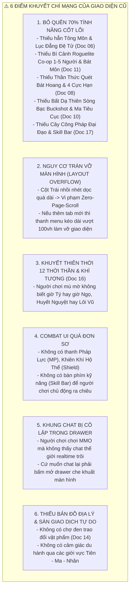
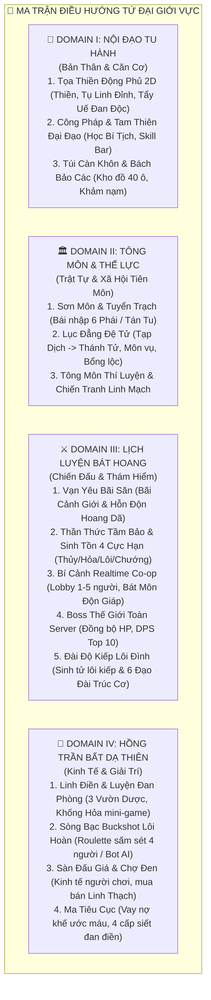
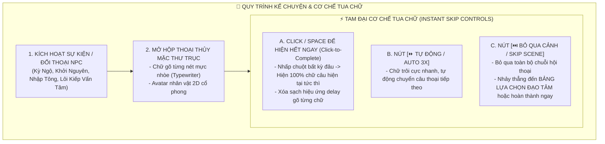
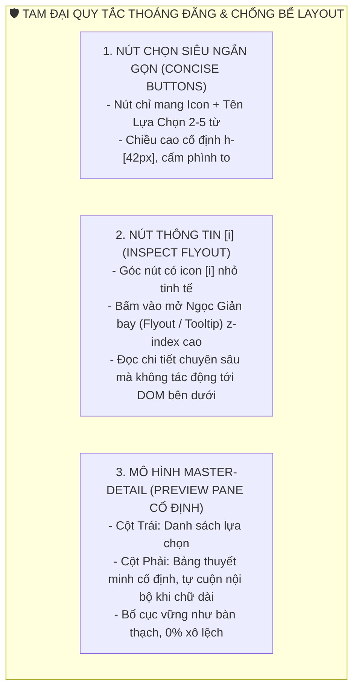
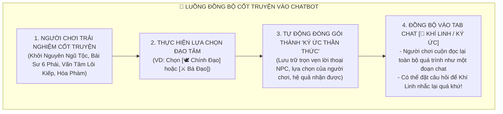
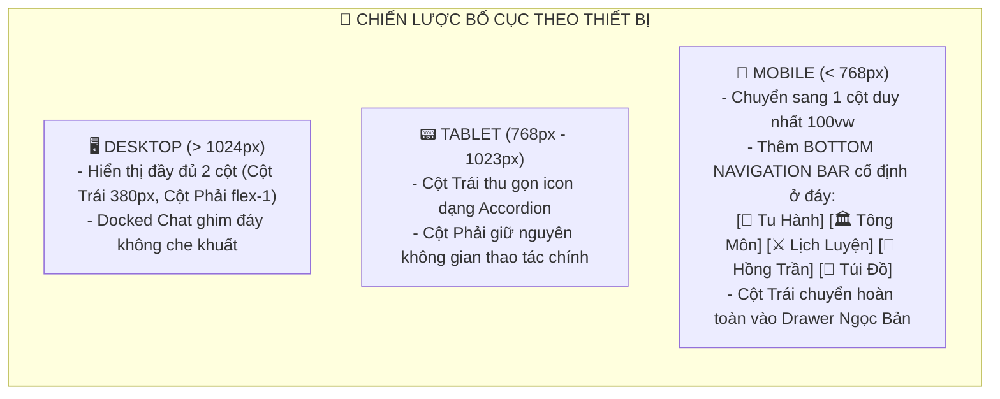
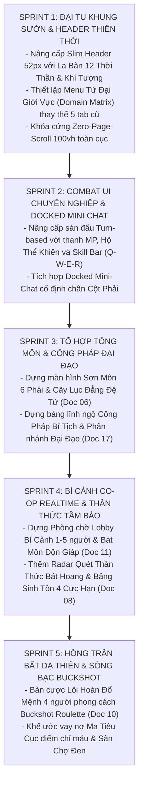

# [07] BẠCH THƯ THIẾT KẾ ĐẠI HỆ THỐNG GIAO DIỆN (UI/UX DESIGN SYSTEM & MASTER INTERFACE ARCHITECTURE)
### *Đặc Tả Toàn Diện Kiến Trúc Giao Diện Thủy Mặc, Bố Cục Tứ Đại Giới Vực & Giải Quyết Triệt Để Mọi Điểm Khuyết Hệ Thống*


> ⬅️ **[Bài Trước: Doc 06 - Kiến Trúc CSDL SQLite & Đặc Tả API](file:///c:/Users/newre/OneDrive/Máy%20tính/code%20tutien/docs/06_DATABASE_SCHEMA_VA_API.md)** | 📖 **[Mục Lục Toàn Cảnh](file:///c:/Users/newre/OneDrive/Máy%20tính/code%20tutien/README.md)** | ➡️ **[Bài Kế: Doc 08 - Nơi Trú Ngụ, Dược Điền & Đan Đạo](file:///c:/Users/newre/OneDrive/Máy%20tính/code%20tutien/docs/08_DONG_PHU_NONG_TRAI_LUYEN_DAN.md)**

> *"Thần khí ẩn trong hình tướng, đạo vận toát giữa nét mặc hương. Giao diện của một cõi tu chân không đơn thuần là những ô nút bấm hay bảng dữ liệu thô kệch, mà là cuộn tranh Sơn Hà Xã Tắc mở ra trước mắt tu sĩ: Một nét mực loang là linh khí vần vũ, một dấu son Chu Sa là sinh tử nhất niệm, một trục cuộn gỗ mun khép mở là cả cõi Hồng Hoang chấn động!"*

---

## 🧭 LỜI TỰA: NGUYÊN DO ĐẠI CẢI TỔ GIAO DIỆN (WHY THE PARADIGM SHIFT?)

Trong giai đoạn đầu phát triển (Alpha), giao diện của dự án chỉ gói gọn trong **5 Tab đơn sơ** (*Tọa Thiền, Săn Quái, Linh Điền, Boss Thế Giới, Túi Đồ*). Tuy nhiên, khi đối chiếu với toàn bộ hệ thống đại bách khoa của **Thiên Đạo Kỷ Nguyên** (Docs 00 $\rightarrow$ 18), cấu trúc 5 tab này đã bộc lộ **những điểm khuyết chí mạng**:



Tài liệu này được tái thiết lập để **chuẩn hóa một Đại Kiến Trúc Giao Diện hoàn chỉnh**, giải quyết triệt để mọi điểm khuyết trên mà vẫn bảo toàn nghiêm ngặt nguyên lý **Thủy Mặc Cổ Phong & Zero Page Scroll 100vh**.

---

## 🏛️ PHẦN I: MA TRẬN ĐIỀU HƯỚNG TỨ ĐẠI GIỚI VỰC (THE 4-DOMAIN NAVIGATION MATRIX)

Thay vì liệt kê một hàng dọc 12-15 nút bấm làm vỡ layout, toàn bộ các tính năng tu chân được phân nhóm khoa học vào **Tứ Đại Giới Vực (4 Core Domains)**. Đây là khung điều hướng trung tâm của game:



---

## 🎨 PHẦN II: THƯ VIỆN DESIGN TOKENS 2.0 (CHUẨN THỦY MẶC & DẠ MẶC)

### 1. Bảng Mã Màu Tokens (Color Variables)

```css
:root {
  /* --- 1. HỆ MÀU NHẬT CHIẾU (LIGHT PARCHMENT / BẠCH MẶC) --- */
  --bg-paper: #F3EAD7;             /* Nền giấy dó / lụa tơ tằm cổ */
  --bg-card: #FAF4EB;              /* Nền lụa bồi / giấy tuyên cao cấp */
  --bg-card-subtle: #F0E5D0;       /* Lớp giấy bọc ngoài / header phụ */
  --bg-card-pure: #FCF9F3;         /* Thẻ thông tin sáng thanh khiết */
  
  --ink-black: #1A1A1A;            /* Nét mực nồng đậm nhất */
  --ink-deep: #2A2A2A;             /* Mực tiêu đề phụ */
  --ink-grey: #6B6B6B;             /* Mực xám thông số phụ */
  --ink-faint: #9E9E9E;            /* Mực pha nước mờ */
  --ink-border: rgba(26, 26, 26, 0.22); /* Nét bút lông chia khối 1px */
  
  /* --- 2. ĐIỂM NHẤN CHU SA & TRỤC CUỘN THƯ THƯ (ACCENTS) --- */
  --cinnabar: #B3261E;             /* Đỏ son Chu Sa - Điểm nhấn tối cao */
  --cinnabar-light: #D3342B;       /* Đỏ son rực rỡ khi hover/active */
  --cinnabar-dark: #8E1C15;        /* Đỏ son đậm viền ngọc tỷ */
  --wood-dark: #3A200E;            /* Gỗ trắc đen nẹp góc */
  --wood-main: #543118;            /* Gỗ gụ trục cuốn nẹp hai đầu */
  --wood-light: #784825;           /* Vành gỗ sáng */

  /* --- 3. MÀU NGŨ HÀNH BẢN MỆNH (ELEMENTAL ACCENTS) --- */
  --element-kim: #E5A93C;          /* Kim: Hoàng Kim Xán Lạn */
  --element-moc: #2E7D32;          /* Mộc: Bích Lục Thanh Diệp */
  --element-thuy: #1976D2;         /* Thủy: Lam Thủy U Hàn */
  --element-hoa: #D32F2F;          /* Hỏa: Xích Viêm Cuồng Liệt */
  --element-tho: #795548;          /* Thổ: Hoàng Thổ Trầm Mặc */
  --element-loi: #7B1FA2;          /* Lôi: Tử Tiêu Thần Lôi */
  --element-phong: #00897B;        /* Phong: Thanh Phong Vô Ảnh */

  /* --- 4. HỆ MÀU DẠ MẶC (DARK DAOIST / U MINH CHI DẠ) --- */
  --dark-bg-void: #0D0D11;         /* Hư vô tăm tối */
  --dark-card: #16161C;            /* Phiến đá huyền thạch */
  --dark-border: rgba(255, 255, 255, 0.12); /* Trăng bạc mờ */
  --dark-gold: #D4AF37;            /* Vàng đế vương */
}
```

### 2. Chuẩn Typography & Chống Trôi Layout (Tabular Numbers)
* **Tiêu đề cổ phong**: `font-family: 'Noto Serif', serif;` với `letter-spacing: 0.5px - 1px;`.
* **Văn bản hệ thống**: `font-family: 'Be Vietnam Pro', sans-serif;` (Cỡ 11px - 13px, độ sắc nét cao).
* **Số liệu biến động (Exp, HP, MP, Linh thạch)**: Bắt buộc dùng class `.font-serif-num` đi kèm thuộc tính:
  ```css
  .font-serif-num {
    font-family: 'Noto Serif', serif;
    font-feature-settings: "tnum";
    font-variant-numeric: tabular-nums; /* Giữ cố định độ rộng con số, chống giật rung giao diện */
  }
  ```

---

## 📐 PHẦN III: THIẾT KẾ BỐ CỤC ĐẠI CỤC (THE MASTER WIREFRAME 100VH)

Toàn bộ giao diện được cấu trúc theo dạng lưới Widescreen đạt chuẩn **Zero Page Scroll (100vh)**:

```
+===================================================================================================================+
|  THIÊN ĐẠO ĐỈNH ĐẦU (MASTER SLIM HEADER - 52PX - CỐ ĐỊNH Z-30)                                                    |
|  [☯ TU CHÂN GIỚI]  [📍 Thanh Vân Sơn: Hàn Đàm]  |  [⏰ GIỜ THÂN (15:00) | 🌧️ LINH VŨ]  |  [💎 5,420] [🌙] [☰ NGỌC BẢN] |
|  Status Pills: [Cảnh Giới: Luyện Khí 9]  [TL: 95/100]  [HP: 480/500]  [MP: 210/250]  [Căn Cơ: 94%] [Độc: 12%]     |
+===================================================================================================================+
|  KHUNG TRẢI NGHIỆM ĐẠI CỤC (FLEX 1 - H-FULL - MAX-W 1700PX - ZERO BODY SCROLL)                                    |
|                                                                                                                   |
|  +-------------------------------------+  +--------------------------------------------------------------------+  |
|  | CỘT TRÁI (3 CỘT / ~380PX):          |  | CỘT PHẢI (9 CỘT / TRUNG TÂM HOẠT ĐỘNG THAY ĐỔI THEO DOMAIN TAB):  |  |
|  |                                     |  |                                                                    |  |
|  | 1. THƯ HỌA HỒ SƠ BẢN MỆNH (SCROLL): |  | [ KHU VỰC A: KHÔNG GIAN TƯƠNG TÁC CHÍNH (CANVAS 2D / COMBAT / BẢN ĐỒ) ]|  |
|  | - Avatar Ngũ Hành Động [🔥 Hỏa]     |  | - Nếu ở Nội Đạo  : Động Phủ 2D Thủy Mặc Canvas + Nút Vung Kiếm Khí |  |
|  | - Đạo Hiệu: Hàn Lập [Nhân Tộc]      |  | - Nếu ở Lịch Luyện: Sàn đấu quái Turn-based hoặc Săn Boss Thế Giới |  |
|  | - Linh Căn: Chân Linh Căn (Mộc-Hỏa) |  | - Nếu ở Tông Môn : Tông Điện Đại Hội & Bảng Thăng Cấp Đệ Tử         |  |
|  | - Ẩn Mạch: Bích Lục Trường Sinh Mạch|  | - Nếu ở Hồng Trần: Vườn Dược 8 Ô hoặc Bàn Cược Lôi Hoàn Buckshot   |  |
|  | - Đạo Đài: (Chưa đúc - Cần Trúc Cơ) |  +--------------------------------------------------------------------+  |
|  |                                     |                                                                        |  |
|  | 2. CÂY ĐIỀU HƯỚNG TỨ ĐẠI GIỚI VỰC:  |  +--------------------------------------------------------------------+  |
|  | [▼] I. NỘI ĐẠO TU HÀNH              |  | [ KHU VỰC B: BẢNG THAO TÁC TÁC VỤ & BÀN PHÍM KỸ NĂNG SKILL BAR ]     |  |
|  |   ├─ 🧘 Tọa Thiền & Động Phủ 2D     |  | - Thanh Tiến Độ Tu Vi (Exp Bar) & Nút [⚡ DẪN ĐỘNG LÔI KIẾP]         |  |
|  |   ├─ 📜 Công Pháp & Đại Đạo         |  | - Bảng Tụ Linh Đỉnh & Nút [Bế Quan Tẩy Độc]                           |  |
|  |   └─ 🎒 Túi Càn Khôn & Bách Bảo     |  | - Bàn Phím Chiêu Thức Chiến Đấu: [Q: Kiếm] [W: Khiên] [E: Lôi] [R: Đan]|  |
|  | [▶] II. TÔNG MÔN & THẾ LỰC          |  +--------------------------------------------------------------------+  |
|  |   ├─ 🏛️ Sơn Môn Bái Sư (6 Phái)     |                                                                        |  |
|  |   ├─ 🎖️ Lục Đẳng Đệ Tử (Ngoại Môn)  |  +--------------------------------------------------------------------+  |
|  |   └─ ⚔️ Môn Vụ & Thí Luyện          |  | [ KHU VỰC C: DOCKED MINI WORLD CHAT (GHIM ĐÁY - KHÔNG CHE MÀN HÌNH) ] |  |
|  | [▶] III. LỊCH LUYỆN BÁT HOANG       |  | [Thế Giới] Tiêu Viêm: Đạo hữu nào đi Bí Cảnh Luyện Hư không? (2/5)    |  |
|  |   ├─ 💀 Vạn Yêu Bãi Săn             |  | [Tông Môn] Trưởng Lão: Mau về phòng thủ linh mạch bị tuyên chiến!      |  |
|  |   ├─ 👁️ Thần Thức Tầm Bảo & 4 Cực  |  | [Hệ Thống] Đạo hữu [Vương Lâm] vừa kết đan Cửu Chuyển chấn động giới! |  |
|  |   ├─ 🌀 Bí Cảnh Co-op Realtime (1-5)|  | [ Ô Nhập Truyền Âm...                     ] [GỬI] [ ⤢ MỞ RỘNG TOÀN KHUNG]|  |
|  |   └─ 🐉 Boss Thế Giới Toàn Server   |  +--------------------------------------------------------------------+  |
|  | [▶] IV. HỒNG TRẦN BẤT DẠ THIÊN      |                                                                            |
|  |   ├─ 🌱 Linh Điền & Luyện Đan Phòng |                                                                            |
|  |   ├─ 🎲 Sòng Bạc Lôi Hoàn Buckshot  |                                                                            |
|  |   ├─ ⚖️ Chợ Đen & Đấu Giá           |                                                                            |
|  |   └─ 🩸 Ma Tiêu Cục (Vay Nợ Máu)    |                                                                            |
|  |                                     |                                                                            |
|  | 3. ĐẠO HỮU ĐỒNG HÀNH MINI (ONLINE)  |                                                                            |
|  | - 35 Đạo hữu trong cõi (Realtime)   |                                                                            |
|  +-------------------------------------+  +--------------------------------------------------------------------+  |
+===================================================================================================================+
```

---

## 🧩 PHẦN IV: ĐẶC TẢ CHI TIẾT 12 PHÂN HỆ GIAO DIỆN (GIẢI QUYẾT TRỌN VẸN CÁC ĐIỂM KHUYẾT)

---

### 1. Phân Hệ Slim Header & La Bàn Thiên Thời (Khắc Phục Điểm Khuyết 3)

* **Vị trí**: Cố định đỉnh màn hình, chiều cao `52px`, nền `var(--bg-card)/95%` phủ kính mờ `backdrop-blur-md`.
* **Thành phần từ Trái sang Phải**:
  1. **Ấn Chương Nhãn Hiệu**: `[仙] TU CHÂN GIỚI` + Số tu sĩ online kèm chấm xanh xung nhịp.
  2. **Tọa Độ Địa Lý Hiện Tại**: Thẻ ngọc hiển thị khu vực nhân vật đang tọa lạc (Ví dụ: `Thanh Vân Tông - Vọng Nguyệt Đài`, `Đầm Lầy U Minh - Tầng 3`).
  3. **La Bàn Thiên Thời 12 Thời Thần (Doc 16)**:
     - Biểu tượng đĩa bát quái quay tròn hiển thị Canh Giờ: `Tý (23-01h)`, `Sửu (01-03h)` ... `Ngọ (11-13h)`.
     - Chỉ số khí tượng trực quan: `🌧️ Linh Vũ (+10% Mộc, +15% Tưới ruộng)`, `⚡ Lôi Vũ (Tăng 25% uy lực Lôi Kiếp)`, `🌑 Huyết Nguyệt (Yêu thú cuồng bạo x2 rơi đồ)`.
  4. **Nhóm Chỉ Số Cốt Lõi (Status Pills Không Bao Giờ Xuống Dòng)**:
     - Cảnh Giới: Badge đỏ son Chu Sa.
     - Thể Lực (TL): `95/100` (Icon sét).
     - Khí Huyết (HP): `480/500` (Icon giọt máu).
     - Pháp Lực (MP): `210/250` (Icon ngọn lửa xanh) $\rightarrow$ *Mới bổ sung để tung chiêu!*
     - Linh Thạch: `💎 5,420`.
     - Căn Cơ: `94%` (Xanh ngọc).
  5. **Nút Thao Tác Hệ Thống**: Nút đổi chế độ Nhật/Dạ & Nút mở Drawer Ngọc Bản Tu Sĩ.

---

### 2. Phân Hệ Tọa Thiền Động Phủ & Canvas 2D Thủy Mặc Interactive

* **Khu vực tương tác Canvas 2D (`dongPhu2D.js`)**:
  - Không gian tĩnh tại: Đài sen đá ngọc trên đỉnh núi mây mù, thác nước linh tuyền đổ xuống, cây tùng cổ thụ lay động theo gió.
  - Hạt Linh Khí (Particles): Các đốm sáng ngũ hành bay lơ lửng, khi người chơi rê chuột thì hạt tụ lại xoay quanh con trỏ; khi nhấp chuột thì phát ra tiếng **"Vút"** kèm nhát chém kiếm khí Chu Sa rực lửa.
* **Bảng Chỉ Số Tu Vi & Nén Căn Cơ (Doc 05, Doc 09)**:
  - Thanh tiến độ Tu Vi chính: Có sóng nước gợn bên trong ống trúc bọc đồng.
  - Khi đầy 100%: Nút **[⚡ TIẾN VÀO ĐÀI ĐỘ KIẾP]** phát sáng nhịp đập mãnh liệt (Pulsating Red Glow).
  - Khối **Tụ Linh Đỉnh (Lưu Trữ Tu Vi Dôi Dư)**:
    - Hiển thị lượng exp nén tích lũy. Nút **[Nén Tu Vi Vào Căn Cơ]** giúp nâng độ vững Đạo Cơ từ $70\% \rightarrow 95\%$.
  - Khối **Đan Độc Kinh Mạch (%)**:
    - Khi uống đan vượt ngưỡng $50\%$, viền màn hình nổi gân xanh độc tố. Nút **[Bế Quan Tẩy Uế (-15% Độc, tiêu hao 10 TL)]** kích hoạt animation nhân vật toát mồ hôi đen gột rửa kinh mạch.

---

### 3. Phân Hệ Công Pháp & Tam Thiên Đại Đạo (Khắc Phục Điểm Khuyết 1 & 4)

Giao diện quản lý toàn bộ hệ thống bí tịch, tầng thứ công pháp và thiết lập thanh kỹ năng chiến đấu (Skill Bar).

```
+--------------------------------------------------------------------------+
| 📜 CÔNG PHÁP BÍ TỊCH & TAM THIÊN ĐẠI ĐẠO (10 ĐẠI TRƯỜNG PHÁI)            |
+--------------------------------------------------------------------------+
| CÂY ĐẠI ĐẠO BẢN NGUYÊN:     | BỘ KỸ NĂNG XUẤT TRẬN (ACTIVE SKILL BAR):   |
|                             | [Q] Thanh Nguyên Kiếm Khí (Lv.4 - Sát thương)
| [X] KIẾM ĐẠO (Đang tu luyện)| [W] Hộ Thể Kiếm Cương     (Lv.2 - Khiên HP)  |
| - Tầng 1: Ngự Kiếm Thuật    | [E] Vạn Kiếm Quy Tông     (Lv.1 - Tuyệt kỹ)  |
| - Tầng 2: Nhân Kiếm Hợp Nhất| [R] Hồi Xuân Thuật        (Pháp thuật Thủy)  |
| - Tầng 3: Trảm Thiên Kiếm Ý |                                            |
|                             | TỦ SÁCH CÔNG PHÁP ĐÃ LĨNH NGỘ (BÍ TỊCH):   |
| [ ] MA ĐẠO (Huyết Sát)      | 1. Thái Hư Hóa Kiếm Quyết [Thiên Giai]     |
| [ ] TRẬN ĐẠO (Cấm Chế)      | 2. Cửu Chuyển Niết Bàn Kinh [Địa Giai]      |
| [ ] PHÙ ĐẠO (Lôi Phù)       | 3. Đại Lực Kim Cương Thần Công [Huyền Giai] |
|                             |                                            |
| [ ĐIỂM NGỘ TÍNH: 14 ĐIỂM ]  | [ LĨNH NGỘ TẦNG MỚI ]  [ ĐỔI BỘ KỸ NĂNG ]  |
+--------------------------------------------------------------------------+
```

---

### 4. Phân Hệ Tông Môn & Lục Đẳng Đệ Tử (Khắc Phục Điểm Khuyết 1 - Doc 06)

* **Giao Diện Sơn Môn Tổng Điện**:
  - Đối với **Tán Tu**: Hiển thị bảng điều kiện Bái Sơn Khảo Hạch của 6 Đại Phái (*Thanh Vân, Vạn Ma, Đan Hà, U Minh, Thái Hư, Hợp Hoan*) hoặc con đường dựng Tán Tu Minh.
  - Đối với **Đệ Tử Đã Nhập Tông**:
    - **Cấp Bậc Đệ Tử**: Huy hiệu Lục Đẳng (`Tạp Dịch` $\rightarrow$ `Ngoại Môn` $\rightarrow$ `Nội Môn` $\rightarrow$ `Chân Truyền` $\rightarrow$ `Thủ Tịch` $\rightarrow$ `Thánh Tử`).
    - **Bảng Cống Hiến Môn Phái**: Nộp Linh thảo, Yêu đan đổi lấy Cống Hiến Điểm.
    - **Đại Điện Môn Vụ**: Danh sách nhiệm vụ tuần tra sơn môn, thảo phạt ma tu, hộ tống thương đội.
    - **Phúc Lợi Tông Môn**: Nút nhận **Bổng Lộc Định Kỳ** (Linh Thạch & Đan dược) theo cấp bậc đệ tử.
    - **Hộ Pháp Thiền Định**: Khi tọa thiền trong Tông Môn, nhận buff giảm $100\%$ nguy cơ Tâm Ma Phản Phệ!

---

### 5. Phân Hệ Vạn Yêu Bãi Săn & Sàn Đấu Turn-Based Hoàn Chỉnh (Doc 07)

Sàn đấu chiến thuật theo lượt với đầy đủ thông số đối kháng, giải quyết hoàn toàn sự thiếu thốn của UI cũ:

```
+--------------------------------------------------------------------------------------+
| 💀 BÃI SĂN: VẠN KIẾM CỔ TRỦNG (KHU VỰC CẢNH GIỚI: LUYỆN KHÍ 7-9)                     |
+--------------------------------------------------------------------------------------+
| BÊN TA (TU SĨ):                               BÊN ĐỊCH (YÊU THÚ / MA TU):            |
| 🥋 Hàn Lập [Nhân Tộc - Luyện Khí 9]           👹 Huyết Nhãn Xích Lang [Yêu Thú Giai 1]|
| HP : [████████████████████░░] 420/500 (84%)    HP : [████████░░░░░░░░░░] 180/400 (45%)|
| MP : [████████████░░░░░░░░] 140/250 (56%)    NỘI KHÍ: [██████████████████] 100% (Sắp nộ)|
| KHIÊN HỘ THỂ: [120 HP (Kiếm Cương)]          NGŨ HÀNH: 🔥 HỎA (Bị khắc bởi 💧 Thủy)  |
| BUFF: [Tăng 15% Né Tránh - 2 lượt]           DEBUFF: [Trúng Độc - Mất 25 HP/lượt]    |
+--------------------------------------------------------------------------------------+
| [ NHẬT KÝ CHIẾN ĐẤU THỜI GIAN THỰC (COMBAT LOG CHỮ THƯ PHÁP CHẠY MƯỢT) ]:             |
| > Hàn Lập điểm chân lùi 3 thước, vung Thanh Trúc Kiếm trảm ra [Thanh Nguyên Kiếm Khí]!|
| > Đòn đánh khắc hệ giáng [145 SÁT THƯƠNG BẠO KÍCH] rực lửa!                         |
| > Xích Lang gầm rống, nanh vuốt cào rách hộ thể kiếm khiên, làm vỡ 60 điểm giáp!     |
+--------------------------------------------------------------------------------------+
| BÀN PHÍM THI TRIỂN CHIÊU THỨC (SKILL SHORTCUTS):                                     |
| [1] Trảm Kiếm (0 MP) | [2] Lôi Bạo (40 MP) | [3] Kiếm Cương (30 MP) | [4] Hồi Huyết Đan |
| [x] TỰ ĐỘNG XUẤT CHIÊU (AUTO-COMBAT)     |     [ 🏃 RÚT LUI KHỎI BÃI SĂN (TIÊU HAO 5 TL) ]   |
+--------------------------------------------------------------------------------------+
```

---

### 6. Phân Hệ Thần Thức Tầm Bảo & 4 Vùng Đất Cực Hạn (Khắc Phục Điểm Khuyết 1 - Doc 08)

* **Giao Diện Radar Quét Bát Hoang**:
  - Vòng tròn Thần Thức bán kính tỏa ra từ vị trí nhân vật.
  - Cự ly quét mở rộng theo cảnh giới (Luyện Khí: $100$ trượng $\rightarrow$ Trúc Cơ: $1000$ trượng $\rightarrow$ Hóa Thần: Quét trọn một châu lục).
  - Nút **[Phóng Thần Thức Tầm Bảo (Tiêu hao 15 MP)]**:
    - Phát hiện các điểm sáng trên bản đồ: Cổ Mộ Ẩn Tàng, Dược Thảo Ngàn Năm, Thú Triều, hoặc Tu sĩ khác đang trọng thương.
* **Bảng Sinh Tồn 4 Vùng Đất Cực Hạn (Thủy, Hỏa, Lôi, Chướng)**:
  - Hiển thị 4 thanh Kháng Tính Môi Trường: `Kháng Hàn Băng`, `Kháng Liệt Hỏa`, `Kháng Thiên Lôi`, `Kháng Chướng Khí`.
  - Cảnh báo môi trường nguy hiểm: *"Nhiệt độ dung nham vượt ngưỡng! Mỗi 10 giây thiêu đốt 5% HP nếu không cắn Tị Hỏa Đan hoặc mặc Huyền Băng Giáp!"*

---

### 7. Phân Hệ Bí Cảnh Co-op Realtime & Bát Môn Độn Giáp (Khắc Phục Điểm Khuyết 1 - Doc 11)

Tổ đội nhiều người chơi trực tuyến phá ải Roguelite:

```
+--------------------------------------------------------------------------+
| 🌀 BÍ CẢNH CO-OP: U MINH CỔ ĐIỆN (PHÒNG CHỜ REALTIME 1 - 5 NGƯỜI)        |
+--------------------------------------------------------------------------+
| THÀNH VIÊN TỔ ĐỘI:                                                       |
| 1. 👑 [Chủ Phòng] Hàn Lập   - Nhân Tộc | Luyện Khí 9 | SẴN SÀNG          |
| 2. ⚔️ Tiêu Viêm            - Ma Tộc   | Luyện Khí 8 | SẴN SÀNG          |
| 3. 🌸 Nam Cung Uyển        - Tiên Tộc | Luyện Khí 9 | SẴN SÀNG          |
| 4. 🐉 (Đang chờ đạo hữu...)                                              |
| 5. 🐉 (Đang chờ đạo hữu...)                                              |
|                                                                          |
| ĐIỀU HƯỚNG BÁT MÔN ĐỘN GIÁP TẦNG 1 (CHỌN 1 TRONG 3 CỬA CÁT HUNG):        |
| +--------------------+ +--------------------+ +--------------------+     |
| |    🚪 SINH MÔN     | |    🚪 KINH MÔN     | |    🚪 TỬ MÔN       |     |
| | - Độ nguy hiểm: Thấp| | - Độ nguy hiểm: Vừa| | - Độ nguy hiểm: Cực |     |
| | - Quái: Dược Điền Quỷ| | - Quái: Binh Mã Dũng| | - Boss: Thần Ma Hồn |     |
| | - Thưởng: Linh Dược| | - Thưởng: Pháp Bảo | | - Thưởng: Thần Tích |     |
| |      [BỎ PHIẾU]    | |      [BỎ PHIẾU]    | |      [BỎ PHIẾU]    |     |
| +--------------------+ +--------------------+ +--------------------+     |
|                                                                          |
| [ 🚀 BẮT ĐẦU VƯỢT ẢI (ĐỒNG BỘ REALTIME TẤT CẢ THÀNH VIÊN QUA SOCKET) ]   |
+--------------------------------------------------------------------------+
```

---

### 8. Phân Hệ Sòng Bạc Buckshot Lôi Hoàn & Vay Nợ Ma Tiêu Cục (Khắc Phục Điểm Khuyết 1 - Doc 10)

Khu vui chơi giải trí và cờ bạc đen tối độc nhất vô nhị:

1. **Bàn Cược Lôi Hoàn Đổ Mệnh (Roulette Buckshot Xianxia)**:
   - Bàn gỗ Huyết Long tròn 4 chỗ ngồi. Ở giữa đặt **Lôi Hạp Thần Khí** (Hộp phóng sấm chứa $N$ viên sấm nổ thật và $M$ viên sấm xịt).
   - Thanh sinh mệnh đan điền: 3 giọt máu đan điền.
   - Hàng pháp bảo gian lận đặt trên bàn:
     * *Kính Chiếu Yêu*: Soi thấy viên lôi hoàn tiếp theo là thật hay xịt.
     * *Còng Hàn Thiết*: Khóa đối thủ mất 1 lượt bốc.
     * *Đao Cắt Lòng*: Cắt đứt cầu chì lôi hạp $\rightarrow$ Gấp đôi sát thương đợt kế tiếp!
     * *Thanh Tâm Đan*: Uống vào hồi phục 1 điểm sinh mệnh đan điền.
   - Nút hành động: `[Tự Nhắm Vào Bản Thân (Bắn xịt được đi tiếp)]` hoặc `[Nhắm Vào Đạo Hữu Đối Diện]`.
2. **Khế Ước Vay Nợ Ma Tiêu Cục**:
   - Giao diện tờ giấy da dê cổ bị cháy loang lổ góc, ở góc dưới có **Dấu Ấn Điểm Chỉ Máu**.
   - Thông số hiển thị: Số tiền vay (`10,000 Linh Thạch`), Lãi suất (`5% mỗi canh giờ thực`), Hạn chót hoàn trả.
   - Bảng cảnh báo 4 Cấp Độ Đòi Nợ Siết Đan Điền:
     * *Cấp 1*: Nhắc nợ đỏ rực trên màn hình.
     * *Cấp 2*: Bị phong tỏa không cho vào chợ mua bán.
     * *Cấp 3*: Giảm $50\%$ tốc độ hấp thu tu vi thiền định.
     * *Cấp 4*: Sát thủ Ma Tiêu Cục nhảy ra truy sát, đánh bại sẽ phế đan điền và tịch thu sạch kho đồ!

---

### 9. Phân Hệ Túi Càn Khôn & Sàn Đấu Giá Tự Do (Doc 14)

* **Lưới Ô Vật Phẩm 40 Ô**:
  - Phân loại rõ ràng qua Tab con: `[Toàn Bộ]` | `[Đan Dược]` | `[Linh Thảo]` | `[Pháp Bảo]` | `[Bí Tịch]` | `[Khoáng Thạch]`.
  - Mỗi ô hiển thị hình minh họa cổ phong, phẩm chất hiển thị bằng viền hào quang (Trắng: Phàm $\rightarrow$ Xanh: Linh $\rightarrow$ Tím: Huyền $\rightarrow$ Vàng: Địa $\rightarrow$ Cam: Thiên $\rightarrow$ Đỏ: Thần).
* **Sàn Đấu Giá & Chợ Đen Trao Đổi (Doc 00)**:
  - Bảng danh sách vật phẩm người chơi khác đang treo bán: Tên món đồ, người bán, giá niêm yết bằng Linh Thạch.
  - Chức năng **[Treo Bán Vật Phẩm]**: Chọn đồ từ túi, nhập giá bán, đóng thuế giao dịch $5\%$ cho Vạn Bảo Các.

---

### 10. Phân Hệ Docked Mini World Chat (Khắc Phục Điểm Khuyết 5)

* **Vị trí**: Ghim cố định ở chân Cột Phải (Dưới cùng của khu vực thao tác), chiều cao mặc định `96px`.
* **Ưu điểm vượt trội**:
  - Không che khuất tầm nhìn như Drawer trượt cũ.
  - Hiển thị liên tục 3 dòng tin nhắn mới nhất trôi theo thời gian thực (Kèm tag kênh: `[Thế Giới]`, `[Tông Môn]`, `[Bí Cảnh]`, `[Hệ Thống]`).
  - Có thanh input truyền âm mini gõ Enter gửi ngay lập tức.
  - Góc phải có nút **[⤢ Mở Rộng]**: Khi bấm sẽ mở Drawer chat toàn cảnh với bộ lọc tab kênh và lịch sử 200 tin nhắn.

---

## 📜 PHẦN V: KIẾN TRÚC GIAO DIỆN KỂ CHUYỆN (NARRATIVE UI) & CƠ CHẾ TUA CHỮ TỨC THÌ (SKIP / FAST-FORWARD)

Để cốt truyện của **Thiên Đạo Kỷ Nguyên** thấm đượm vào từng thao tác mà không gây ức chế cho người chơi (nhất là những người chơi thích đọc nhanh, cày lại acc hoặc đã quen nội dung), hệ thống giao diện chuẩn hóa **Kiến Trúc Kể Chuyện Kép (Dual-Paced Storytelling)**: Vừa có chiều sâu điện ảnh cổ phong, vừa có **Cơ Chế Bỏ Qua & Tua Chữ Thần Tốc**.



---

### 1. Đặc Tả Wireframe Khung Đối Thoại Cổ Phong Có Cụm Phím Tua Nhanh

Khung đối thoại trượt mở ở nửa dưới màn hình hoặc dạng Modal cuộn thư trục, có đầy đủ các nút kiểm soát tốc độ trực quan ở góc trên bên phải:

```
+===================================================================================================================+
| [ Nền Sơn Hà Xã Tắc Làm Mờ Backdrop-blur-sm ]                                                                     |
|                                                                                                                   |
|  +-------------------------------------------------------------------------------------------------------------+  |
|  | 📜 [THANH VÂN KIẾM TÔNG - CHƯỞNG MÔN ĐẠI ĐIỆN]                     [⚡ HIỆN HẾT] [⏩ TỰ ĐỘNG] [⏭️ BỎ QUA (ESC)] |  |
|  +-------------------------------------------------------------------------------------------------------------+  |
|  |  +------------+  "Ngươi thân mang Song Linh Căn Hỏa - Mộc, trong mắt đượm sát khí ngút trời...               |  |
|  |  |            |   Ắt hẳn đã trải qua thảm kịch biển lửa Thanh Khê Thôn.                                     |  |
|  |  |  AVATAR    |   Kiếm đạo của phái ta lấy thủ hộ thiên hạ làm gốc,                                         |  |
|  |  |  TRƯỞNG     |   liệu ngươi có thể buông bỏ chấp niệm thù hận để cầu trường sinh đại đạo?"                  |  |
|  |  |  LÃO       |                                                                                             |  |
|  |  |  CỔ PHONG  |   (Nhấp chuột bất kỳ hoặc nhấn SPACE để hiện hết câu chữ tức thì...)                        |  |
|  |  +------------+                                                                                             |  |
|  +-------------------------------------------------------------------------------------------------------------+  |
|  +-------------------------------------------------------------------------------------------------------------+  |
|  | LỰA CHỌN ĐẠO TÂM (BỐ CỤC THOÁNG ĐÃNG - MASTER-DETAIL - CỐ ĐỊNH CHỐNG BỂ LAYOUT):                            |  |
|  |                                                                                                             |  |
|  | [ DANH SÁCH LỰA CHỌN (GỌN GÀNG, KHÔNG DÀI DÒNG) ]   [ BẢNG NGỌC GIẢN THUYẾT MINH CỐ ĐỊNH (PREVIEW PANE) ]     |  |
|  | ┌─────────────────────────────────────────────────┐   ┌─────────────────────────────────────────────────────────┐ |  |
|  | │ [x] 🕊️ CHÍNH ĐẠO                 [ ℹ️ Chi Tiết ] │   │ 🕊️ ĐẠO TÂM CHÍNH ĐẠO (Thủ Hộ Thương Sinh)              │ |  |
|  | ├─────────────────────────────────────────────────┤   │ - Ý Nghĩa : Dập tắt lửa hận, chuyên tâm vấn đạo        │ |  |
|  | │ [ ] ⚔️ BÁ ĐẠO                    [ ℹ️ Chi Tiết ] │   │ - Hiệu Quả: +15% Tu Vi Thiền Định, Mở khóa Kiếm Quyết   │ |  |
|  | ├─────────────────────────────────────────────────┤   │ - Hạn Chế : Giảm 10% Sát thương khi đồ sát cùng tộc     │ |  |
|  | │ [ ] 🍂 TIÊU DAO                  [ ℹ️ Chi Tiết ] │   │ (Bấm vào nút [ ℹ️ ] để mở flyout đọc lore chuyên sâu mà │ |  |
|  | └─────────────────────────────────────────────────┘   │  không làm xô lệch hoặc phình to các nút bên trái!)     │ |  |
|  |                                                       └─────────────────────────────────────────────────────────┘ |  |
|  +-------------------------------------------------------------------------------------------------------------+  |
+===================================================================================================================+
```

---

### 2. Tứ Đại Thao Tác Bỏ Qua & Kiểm Soát Tốc Độ (UX Interaction Rules)

1. **Thao tác 1: Nhấp Chuột / Phím Space để Hiện Hết Chữ Ngay (Click-to-Complete)**:
   - Khi dòng thoại đang chạy hiệu ứng gõ chữ, người chơi chỉ cần:
     * Nhấp chuột trái vào bất kỳ vị trí nào trên hộp thoại, HOẶC
     * Nhấn phím `Space` hoặc `Enter`.
   - **Phản ứng tức thì**: Toàn bộ nội dung câu nói hiển thị ra $100\%$ ngay lập tức ($0\text{ms}$ delay), con trỏ chuyển sang biểu tượng tam giác đỏ Chu Sa nhấp nháy `[Tiếp ↵]` chờ người chơi đọc xong và nhấn lần nữa để sang câu kế tiếp.
2. **Thao tác 2: Nút [⏭️ Bỏ Qua Cảnh] (Skip Scene)**:
   - Dành cho người chơi muốn bỏ qua toàn bộ lời thoại dẫn truyện:
     * Nhấp nút `[⏭️ Bỏ Qua]` ở góc phải, HOẶC nhấn phím `Esc` / `Tab`.
     * Hệ thống lập tức nhảy qua tất cả các câu thoại trung gian, mở thẳng **Bảng Lựa Chọn Đạo Tâm** (nếu có phân nhánh) hoặc đóng hộp thoại và nhận thưởng nhiệm vụ tức thì.
3. **Thao tác 3: Nút [⏩ Tự Động] (Auto-Play Mode)**:
   - Tự động chạy chữ tốc độ nhanh gấp 3 lần ($10\text{ms}$/chữ), tự động chuyển câu sau $1.2$ giây không cần người chơi phải bấm chuột.
4. **Thao tác 4: Thiết Lập Tốc Độ Chữ Mặc Định Trong Ngọc Bản (Global Settings)**:
   - Trong Menu Cài Đặt (Ngọc Bản Tu Sĩ), cung cấp thanh gạt **Tốc Độ Xuất Chữ (Text Speed)** với 4 mức:
     * `Thư Họa Mặc Tích (35ms/chữ)`: Trải nghiệm điện ảnh, chậm rãi, phong vị cổ xưa.
     * `Tiêu Chuẩn (15ms/chữ)`: Tốc độ mặc định cân bằng.
     * `Cực Tốc (5ms/chữ)`: Lướt nhanh thoăn thoắt.
     * `Nhập Thần Hiện Tức Thì (0ms / Instant)`: **Chữ xuất hiện đầy đủ 100% ngay lập tức khi mở hộp thoại**, không chạy hiệu ứng gõ chữ, tối ưu tuyệt đối cho người chơi hardcore.

---

### 3. Đoạn Mã Kỹ Thuật Chuẩn Cho Developer (Typewriter with Instant Skip Logic)

Triển khai mẫu JavaScript sạch sẽ, chống lỗi nhảy lặp timer và hỗ trợ đầy đủ phím tắt:

```javascript
// public/js/narrativeDialogue.js
class NarrativeDialogueSystem {
  constructor() {
    this.textContainer = document.getElementById('dialogue-text');
    this.btnSkip = document.getElementById('btn-dialogue-skip');
    this.btnInstant = document.getElementById('btn-dialogue-instant');
    this.btnAuto = document.getElementById('btn-dialogue-auto');
    
    this.currentSentence = "";
    this.charIndex = 0;
    this.typewriterTimer = null;
    this.isTyping = false;
    this.textSpeed = 18; // ms mỗi ký tự
    this.isAutoPlay = false;

    this.initEventListeners();
  }

  initEventListeners() {
    // 1. Nhấp chuột vào hộp thoại để hiện hết chữ ngay lập tức
    document.getElementById('dialogue-box').addEventListener('click', () => {
      this.handleUserAdvance();
    });

    // 2. Nút Hiện Hết Ngay
    this.btnInstant?.addEventListener('click', (e) => {
      e.stopPropagation();
      this.forceCompleteCurrentSentence();
    });

    // 3. Nút Bỏ Qua Toàn Bộ Cảnh (Skip Scene)
    this.btnSkip?.addEventListener('click', (e) => {
      e.stopPropagation();
      this.skipEntireScene();
    });

    // 4. Bắt phím Space / Enter / Esc
    window.addEventListener('keydown', (e) => {
      if (!this.isOpen()) return;
      if (e.code === 'Space' || e.code === 'Enter') {
        e.preventDefault();
        this.handleUserAdvance();
      } else if (e.code === 'Escape' || e.code === 'Tab') {
        e.preventDefault();
        this.skipEntireScene();
      }
    });
  }

  showSentence(text, callbackWhenDone) {
    this.currentSentence = text;
    this.charIndex = 0;
    this.textContainer.textContent = "";
    this.isTyping = true;
    this.onSentenceDone = callbackWhenDone;

    // Nếu người chơi cài đặt tốc độ = 0 (Hiện tức thì)
    if (this.textSpeed === 0) {
      this.forceCompleteCurrentSentence();
      return;
    }

    this.typeNextChar();
  }

  typeNextChar() {
    if (this.charIndex < this.currentSentence.length) {
      this.textContainer.textContent += this.currentSentence[this.charIndex];
      this.charIndex++;
      this.typewriterTimer = setTimeout(() => this.typeNextChar(), this.textSpeed);
    } else {
      this.finishTyping();
    }
  }

  // ÉP HIỆN HẾT CHỮ TỨC THÌ (FORCE INSTANT COMPLETE)
  forceCompleteCurrentSentence() {
    if (!this.isTyping) return;
    clearTimeout(this.typewriterTimer);
    this.textContainer.textContent = this.currentSentence;
    this.finishTyping();
  }

  finishTyping() {
    this.isTyping = false;
    clearTimeout(this.typewriterTimer);
    document.getElementById('dialogue-indicator-next')?.classList.remove('hidden');
    if (this.isAutoPlay) {
      setTimeout(() => this.handleUserAdvance(), 1200);
    }
  }

  handleUserAdvance() {
    if (this.isTyping) {
      // Đang gõ chữ -> Click là hiện hết ngay lập tức!
      this.forceCompleteCurrentSentence();
    } else {
      // Đã hiện hết chữ -> Click để sang câu tiếp theo
      if (this.onSentenceDone) this.onSentenceDone();
    }
  }

  skipEntireScene() {
    clearTimeout(this.typewriterTimer);
    this.isTyping = false;
    this.triggerDecisionOrFinish();
  }
}
```

---

### 4. NGUYÊN TẮC THOÁNG ĐÃNG, NÚT THÔNG TIN [ℹ️] & BỐ CỤC MASTER-DETAIL (CHỐNG BỂ LAYOUT KHI LỰA CHỌN)

Một lỗi rất phổ biến trong các web game là **nhồi nhét quá nhiều chữ vào nút bấm hoặc bung nở hàng loạt đoạn văn bản dài khi bấm chọn**, dẫn đến hậu quả:
- Chiều cao các nút nhảy loạn xạ, đẩy các khối giao diện khác xô lệch (Layout Shifting làm "bể layout").
- Không gian trở nên nghẹt thở, gò bó, chữ tràn khỏi khung nhìn.

Để giải quyết triệt để, hệ thống giao diện chuẩn hóa **Tam Đại Quy Tắc Chống Bể Layout**:



#### A. Đặc Tả Nút Thông Tin [ℹ️] (Inspect Button Specification)
- **Vị trí**: Nằm ở góc trên bên phải của các Thẻ Chọn (Card Option) hoặc nút bấm.
- **Phong cách cổ phong**: Icon `fa-solid fa-circle-info` hoặc chữ `[ 仙/ℹ️ ]` đỏ son Chu Sa thanh mảnh, bo tròn viền lụa.
- **Tương tác**:
  * Khi rê chuột (Hover trên PC): Hiện Tooltip tóm tắt 1 dòng.
  * Khi nhấp (Click): Mở một **Flyout Card Thần Thức** nổi trên màn hình với nền giấy tuyên, hiển thị:
    1. *Cội Nguồn Lore*: Điển tích tiên hiệp 3-4 dòng.
    2. *Thuộc Tính Bản Mệnh*: Tỉ lệ cộng dồn, phần thưởng chính xác.
    3. *Hạn Chế / Rủi Ro*: Những điều cần lưu tâm trước khi chọn.
  * Nhấp ra ngoài vùng trống hoặc phím `Esc`: Tự động đóng êm ái.

#### B. Ứng Dụng Trên 4 Khu Vực Trọng Điểm Có Nhiều Lựa Chọn
1. **Màn Chọn 5 Tộc Khởi Nguyên (Nhân, Tiên, Ma, Yêu, Minh)**:
   - Các card tộc rộng rãi, chỉ có: Icon lớn + Tên tộc + Dòng buff ngắn nhất (`+15% Tu Vi`).
   - Nút `[ℹ️]` mở cửa sổ giới thiệu Cốt truyện Khởi nguyên và 3 Giai đoạn Thức Tỉnh của tộc đó.
2. **Màn Chọn 6 Hình Thái Đạo Đài Trúc Cơ (Doc 05)**:
   - Cột trái: 6 thanh Đạo Đài thanh mảnh (`Thiên Đạo Vô Hạ`, `Kiếm Tủy`, `Huyết Ngục`...).
   - Cột phải: Bảng ngọc giản cố định hiển thị hoạt ảnh Đạo Đài, điều kiện Căn Cơ yêu cầu và chỉ số kích hoạt.
3. **Màn Vấn Tâm Lôi Kiếp & Sự Kiện Cốt Truyện**:
   - Các nút quyết định chỉ mang nhãn triết lý: `[🕊️ Chính Đạo]`, `[⚔️ Bá Đạo]`, `[🍂 Tiêu Dao]`.
   - Bảng xem trước bên cạnh giải thích nhân quả của từng con đường.
4. **Bãi Săn & Bí Cảnh**:
   - Danh sách phó bản chỉ hiển thị Tên bãi + Cấp đề xuất.
   - Nút `[ℹ️ Tỉ Lệ Rớt]` mở Modal chi tiết danh sách Yêu đan, Bí tịch rơi ra với tỷ lệ % minh bạch.

#### C. Quy Chuẩn CSS Chống Bể Layout Dành Cho Developer
```css
/* Quy chuẩn nút bấm lựa chọn ổn định */
.choice-btn {
  height: 44px;                 /* Cố định chiều cao tuyệt đối */
  min-height: 44px;
  max-height: 44px;
  display: flex;
  align-items: center;
  justify-content: space-between;
  padding: 0 12px;
  white-space: nowrap;          /* Cấm xuống dòng làm phình nút */
  overflow: hidden;
  text-overflow: ellipsis;     /* Cắt chữ dài nếu màn hình nhỏ */
  transition: all 0.2s ease;
}

/* Khung hiển thị chi tiết cố định (Preview Pane) */
.detail-preview-pane {
  height: 100%;
  min-height: 180px;
  max-height: 320px;
  overflow-y: auto;             /* Tự cuộn nội bộ nếu lore dài hàng nghìn từ */
  padding: 12px;
  border: 1px solid var(--ink-border);
  background: var(--bg-card);
}
```

---

### 5. HỆ THỐNG LƯU TRỮ KÝ ỨC VÀO CHATBOT THẦN THỨC (NARRATIVE MEMORY ARCHIVE & KHÍ LINH CHATBOT)

Một cải tiến đột phá theo yêu cầu: **Sau khi người chơi hoàn thành các màn cốt truyện, toàn bộ diễn biến, lời thoại và đặc biệt là các lựa chọn đạo tâm của họ sẽ được tự động đồng bộ vào một Tab Chatbot chuyên biệt ("Khí Linh Huyết Ngọc / Ký Ức Đạo Tâm")**. Người chơi có thể mở ra đọc lại bất cứ lúc nào như một cuốn nhật ký tu chân sống động.



#### A. Wireframe Giao Diện Tab Chatbot Ký Ức Trong Khung Chat

Được tích hợp trực tiếp vào hệ thống Chat của game (Docked Mini Chat hoặc Expanded Chat Drawer) dưới Tab **`[🔮 Khí Linh / Ký Ức]`**:

```
+===================================================================================================================+
| 🔮 KHÍ LINH HUYẾT NGỌC CỔ KÍNH (NHẬT KÝ ĐẠO TÂM & LỊCH SỬ CỐT TRUYỆN)                                [⤢ THU NHỎ / ĐÓNG] |
+===================================================================================================================+
| BỘ LỌC CHƯƠNG HỒI: [ Toàn Bộ ]  [ Hồi 1: Khởi Nguyên ]  [ Hồi 2: Bái Môn ]  [ Hồi 3: Trúc Cơ ]  [ Hồi 4: Hóa Phàm ] |
+-------------------------------------------------------------------------------------------------------------------+
|                                                                                                                   |
| [ 📜 HỒI 1: BI KỊCH THANH KHÊ THÔN - KHẮC ĐẠO HIỆU ] (Ghi chép vào Năm thứ 1 - Giờ Tý)                           |
|                                                                                                                   |
| 👴 [Trưởng Lão Thanh Vân]: "Kiếm đạo của phái ta lấy thủ hộ thiên hạ làm gốc,                                     |
|    liệu ngươi có thể buông bỏ chấp niệm thù hận để cầu trường sinh đại đạo?"                                      |
|                                                                                                                   |
|           ┌─────────────────────────────────────────────────────────────────────────────────────────────┐         |
|           │ 👤 BẠN ĐÃ LỰA CHỌN: [ 🕊️ CHÍNH ĐẠO ]                                                       │         |
|           │ "Đệ tử nguyện dập tắt lửa hận thù, chuyên tâm vấn đạo trường sinh, thủ hộ thương sinh!"     │         |
|           └─────────────────────────────────────────────────────────────────────────────────────────────┘         |
|                                                                                                                   |
| ⚡ [Hệ Thống Thiên Đạo Ghi Nhận]:                                                                                 |
|    - Đạo hiệu [Hàn Lập] được khắc bằng Chu Sa lên Thanh Phong Ngọc Bài.                                           |
|    - Thức tỉnh thuộc tính: +15% Tu Vi Thiền Định, Mở khóa Bí Kíp Nhập Môn [Thanh Nguyên Kiếm Quyết].              |
|                                                                                                                   |
| ───────────────────────────────────────────────────────────────────────────────────────────────────────────────── |
|                                                                                                                   |
| [ ⚡ HỒI 3: ĐÀI ĐỘ KIẾP LÔI ĐÌNH - TÂM MA KHẢO NGHIỆM ] (Ghi chép vào Năm thứ 3 - Giờ Ngọ)                         |
|                                                                                                                   |
| 👹 [Tâm Ma Hư Ảnh]: "Năm xưa ngươi vì bảo vệ bản thân mà đâm mù mắt U Minh Xích Lang, nay sấm sét bổ đầu,        |
|    liệu đạo tâm của ngươi có run sợ trước nhân quả báo ứng?"                                                      |
|                                                                                                                   |
|           ┌─────────────────────────────────────────────────────────────────────────────────────────────┐         |
|           │ 👤 BẠN ĐÃ LỰA CHỌN: [ ⚡ VẤN ĐẠO BẤT HỐI - NGHỊCH THIÊN TRẢM ĐẠO ]                          │         |
|           │ "Ta tu tiên là để nghịch thiên cải mệnh, một kiếm chém tan lôi kiếp, không thẹn với lòng!" │         |
|           └─────────────────────────────────────────────────────────────────────────────────────────────┘         |
|                                                                                                                   |
| ⚡ [Hệ Thống Thiên Đạo Ghi Nhận]:                                                                                 |
|    - Vượt qua 3 đợt Xích Lôi, đúc thành công [Thiên Đạo Vô Hạ Đạo Đài] (+40% Toàn Chỉ Số).                       |
|                                                                                                                   |
+-------------------------------------------------------------------------------------------------------------------+
| [ 💬 Hỏi Khí Linh: "Nhắc lại lý do ta thù hận Ma Tộc?" hoặc gõ từ khóa tìm kiếm...            ] [ 🔮 VẤN THẦN THỨC ] |
+===================================================================================================================+
```

#### B. Đặc Tả Tương Tác Cốt Lõi (Interactive Features)

1. **Ghi Nhận Đầy Đủ Cả Lời Thoại Lẫn Lựa Chọn Của Người Chơi**:
   - Mọi quyết định rẽ nhánh đều được đóng khung Chu Sa trang trọng (`border-cinnabar bg-card-pure`), trích dẫn nguyên văn câu trả lời mà người chơi đã chọn lúc bấy giờ.
   - Bên dưới mỗi lựa chọn luôn có dòng tóm tắt hệ quả (Buff chỉ số, danh hiệu nhận được, pháp bảo được ban).
2. **Tìm Kiếm & Bộ Lọc Nhanh Theo Chương Hồi**:
   - Thanh điều hướng trên cùng cho phép lọc nhanh theo các mốc lớn: *Khởi Nguyên $\rightarrow$ Bái Tông Môn $\rightarrow$ Trúc Cơ Vấn Tâm $\rightarrow$ Đại Chiến Bí Cảnh $\rightarrow$ Hóa Phàm*.
3. **Chatbot Khí Linh Trợ Thủ (Interactive AI Dialogue)**:
   - Ở chân khung chat có ô nhập liệu: Người chơi có thể gõ các câu hỏi như:
     * *"Huyết Ngọc, năm xưa ta đã chọn đúc Đạo Cơ gì?"*
     * *"Tại sao ta lại gia nhập Thanh Vân Kiếm Tông?"*
   - Khí Linh Huyết Ngọc Cổ Kính sẽ lập tức trích xuất đúng phân đoạn ký ức đó và hồi đáp bằng giọng điệu cổ kính: *"Hồi bẩm Đạo Hữu, vào năm thứ nhất tại Thanh Khê Thôn, đạo hữu đã chọn con đường Chính Đạo..."*.

#### C. Cấu Trúc Dữ Liệu Lưu Trữ (JSON Schema Cho Backend & Frontend)
```json
{
  "character_id": "char_999",
  "story_chronicles": [
    {
      "id": "mem_001",
      "chapter_title": "Hồi 1: Bi Kịch Thanh Khê Thôn",
      "game_year": 1,
      "solar_time": "Giờ Tý",
      "dialogue_history": [
        {
          "speaker": "Trưởng Lão Thanh Vân",
          "avatar": "elder_thanhvan.png",
          "text": "Kiếm đạo của phái ta lấy thủ hộ thiên hạ làm gốc, liệu ngươi có thể buông bỏ chấp niệm thù hận?"
        },
        {
          "speaker": "Hàn Lập",
          "is_player_choice": true,
          "choice_tag": "CHÍNH ĐẠO",
          "text": "Đệ tử nguyện dập tắt lửa hận thù, chuyên tâm vấn đạo trường sinh, thủ hộ thương sinh!"
        }
      ],
      "rewards_summary": "+15% Tu Vi Thiền Định, Mở khóa Kiếm Quyết Trấn Phái"
    }
  ]
}
```

---

## 📱 PHẦN VI: CHIẾN LƯỢC RESPONSIVE ĐA MÀN HÌNH (PC, TABLET & MOBILE)



### Thanh Điều Hướng Đáy Trên Mobile (Mobile Bottom Navigation Bar)
Khi truy cập trên điện thoại di động (iOS Safari / Android Chrome):
- Thanh Header đỉnh đầu tự động ẩn các chữ rườm rà, chỉ giữ lại số liệu linh thạch, HP, và nút Ngọc Bản.
- Đáy màn hình xuất hiện thanh **Bottom Bar 5 nút ấn triện**:
  1. `[🧘 Tu Hành]`: Mở nhanh Tọa Thiền & Động Phủ 2D.
  2. `[🏛️ Tông Môn]`: Mở giao diện Sơn Môn & Đệ Tử.
  3. `[⚔️ Lịch Luyện]`: Mở Bãi Săn, Bí Cảnh Co-op, Boss.
  4. `[🏮 Hồng Trần]`: Mở Nông Trại, Sòng Bạc Buckshot, Chợ Đen.
  5. `[🎒 Túi Đồ]`: Mở Bách Bảo Các & Bảng Nhân Vật.

---

## 💻 PHẦN VII: ĐẶC TẢ KỸ THUẬT LẬP TRÌNH CHO FRONTEND DEVELOPERS

### 1. Kiến Trúc File Mã Nguồn Khuyến Nghị
```
public/
├── index.html            # Khung Semantic HTML5 chuẩn Tứ Đại Giới Vực, Zero-scroll
├── style.css             # Design Tokens, Hệ màu Nhật/Dạ, Grid 100vh, Animations
├── js/
│   ├── app.js            # Entry point, Socket.io, Điều phối router tab
│   ├── dongPhu2D.js      # Engine đồ họa Canvas 2D Động Phủ & tương tác kiếm khí
│   ├── combatEngineUI.js # Điều khiển giao diện lượt đánh, thanh HP/MP, Skill Bar
│   ├── chatUI.js         # Quản lý Docked Mini Chat & Expanded Chat Drawer
│   ├── sectUI.js         # Giao diện Tông Môn, Lục Đẳng Đệ Tử, Môn Vụ
│   └── buckshotUI.js     # Giao diện Bàn cược Lôi Hoàn 4 người & Vay nợ Ma Tiêu Cục
```

### 2. Quy Tắc Tối Ưu Hiệu Năng Cốt Tử (Performance Rules)
1. **DOM Recycling & Targeted Mutation**:
   - Nghiêm cấm gán `innerHTML` trên các container lớn như danh sách chat hoặc lưới túi đồ khi chỉ có 1 item thay đổi.
   - Sử dụng `DocumentFragment` khi tạo danh sách và trực tiếp cập nhật `textContent` / `classList` cho các node thông số.
2. **Quản Lý Vòng Lặp Canvas 2D**:
   - Canvas `dongPhu2D.js` chỉ được chạy `requestAnimationFrame` khi tab Động Phủ đang hiển thị (`display !== 'none'`). Khi người chơi chuyển sang tab Bãi Săn hoặc Sòng Bạc, lập tức gọi `cancelAnimationFrame()` để đưa mức tiêu thụ CPU về **0%**.
3. **Chống Rung Giật Bố Cục (Cumulative Layout Shift = 0)**:
   - Mọi khối chứa nội dung động (Exp Bar, HP, Combat Log, Chat) đều phải được chỉ định kích thước `min-height` hoặc `height` cố định kèm `overflow-y: auto`.

---

## 🗓️ PHẦN VIII: LỘ TRÌNH TRIỂN KHAI KỸ THUẬT THEO SPRINT (UI SPRINT ROADMAP)



---

> *Bạch thư thiết kế này là bản quy chuẩn giao diện chính thức và cao cấp nhất của **Tu Chân Giới Online**, hóa giải toàn bộ các điểm khuyết của phiên bản sơ khởi và đặt nền móng vững chắc cho trải nghiệm tu tiên nhập vai hoàn mỹ trên mọi nền tảng.*


---

> ⬅️ **[Bài Trước: Doc 06 - Kiến Trúc CSDL SQLite & Đặc Tả API](file:///c:/Users/newre/OneDrive/Máy%20tính/code%20tutien/docs/06_DATABASE_SCHEMA_VA_API.md)** | 📖 **[Mục Lục Toàn Cảnh](file:///c:/Users/newre/OneDrive/Máy%20tính/code%20tutien/README.md)** | ➡️ **[Bài Kế: Doc 08 - Nơi Trú Ngụ, Dược Điền & Đan Đạo](file:///c:/Users/newre/OneDrive/Máy%20tính/code%20tutien/docs/08_DONG_PHU_NONG_TRAI_LUYEN_DAN.md)**
