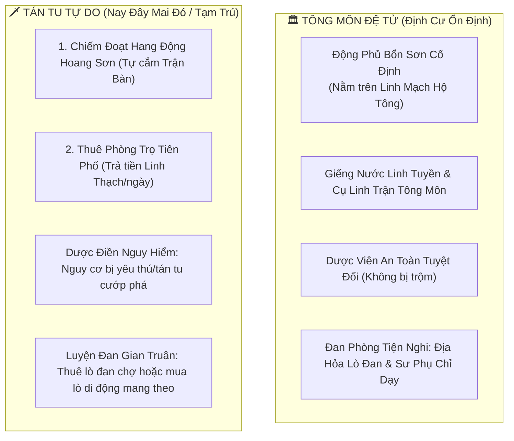
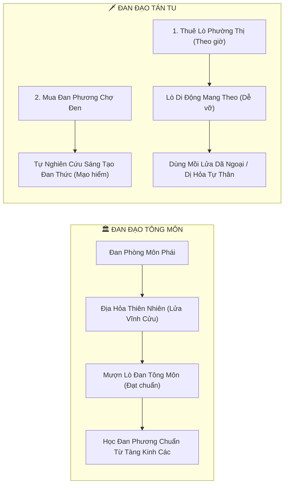

# [08] NƠI CƯ TRÚ, CANH TÁC DƯỢC ĐIỀN & BÁCH BIẾN ĐAN ĐẠO: TÔNG MÔN ĐỘNG PHỦ VS TÁN TU TẠM TRÚ


> ⬅️ **[Bài Trước: Doc 07 - Bạch Thư Thiết Kế Đại Hệ Thống Giao Diện (UI/UX)](file:///c:/Users/newre/OneDrive/Máy%20tính/code%20tutien/docs/07_THIET_KE_HE_THONG_GIAO_DIEN_UI_UX.md)** | 📖 **[Mục Lục Toàn Cảnh](file:///c:/Users/newre/OneDrive/Máy%20tính/code%20tutien/README.md)** | ➡️ **[Bài Kế: Doc 09 - Thiên Thời, Thập Nhị Thời Thần & Khí Tượng](file:///c:/Users/newre/OneDrive/Máy%20tính/code%20tutien/docs/09_THIEN_THOI_THAP_NHI_THOI_THAN_VA_KHI_TUONG.md)**

> *"Người trong tông môn có động phủ linh tuyền, lò đan ấm áp khói sương mờ mịt; kẻ làm tán tu nay đây mai đó, chiếm hang hoang che chắn trận bàn, đun lò di động giữa gió lạnh mưa dầm. Đan đạo mênh mông như biển, kẻ có sư phụ chỉ điểm chưa chắc đã thành danh, kẻ nếm trăm loại cỏ đắng tự ngộ đan thức chưa hẳn đã là phế phẩm. Muốn thành Đan Thánh, trước phải tôi luyện hỏa hầu, lấy vạn lần thành bại đúc nên viên mãn!"*

Tài liệu này quy chuẩn **Hệ Thống Nơi Trú Ngụ & Canh Tác Dược Thảo** phân hóa giữa **Đệ Tử Tông Môn** và **Tán Tu Tự Do**, đồng thời thiết kế chi tiết **Cơ Chế Mini-game Luyện Đan Khống Hỏa**, **Thanh Độ Thành Thạo Đan Thức (Mở Khóa Auto-Craft)** và **Bảng Danh Hiệu Đan Đạo 9 Bậc** ánh xạ với cảnh giới tu vi.

---

## 🏛️ 1. PHÂN HÓA NƠI TRÚ NGỤ: TÔNG MÔN ĐỘNG PHỦ VS TÁN TU TẠM CƯ

Trong thế giới Tu Chân Giới Online, nơi ở không đơn thuần là chốn nghỉ ngơi mà là cái nôi nuôi dưỡng tài nguyên linh thảo và luyện đan. Địa vị xã hội quyết định hoàn toàn điều kiện cư ngụ:



### 1.1. Động Phủ Tông Môn (Sect Cavern Abode)
* **Quyền sở hữu**: Nhận được ngay sau khi bái nhập 1 trong Lục Đại Phái và đạt chức vị Ngoại Môn Đệ Tử. Động phủ gắn chặt với sơn môn cố định (Thanh Vân Côn Lôn Đỉnh, Vạn Ma Cửu U Uyên, Đan Hà Bách Thảo Sơn...).
* **Lợi thế vượt trội**:
  - **Linh Mạch Hộ Tông**: Tọa thiền trong động phủ nhận thêm $+15\%$ tốc độ tích lũy tu vi.
  - **Giếng Linh Tuyền & Cụ Linh Trận**: Nước linh khí dồi dào, CD múc nước mặc định $10 \text{ phút } 5 \text{ giây}$ (rút xuống $4 \text{ phút } 35 \text{ giây}$ khi bật Cụ Linh Trận).
  - **Dược Viên An Toàn**: Tuyệt đối không bị người chơi khác hoặc quái thú cướp bóc nhờ Đại Trận Hộ Tông che chở.
  - **Địa Hỏa Đan Phòng**: Sử dụng nguồn Địa Hỏa thiên nhiên của môn phái, độ ổn định nhiệt độ cao $+20\%$, giảm tỷ lệ nổ lò $-25\%$. Có Trưởng Lão Luyện Đan hướng dẫn tăng $+15\%$ exp đan đạo mỗi mẻ đan.

### 1.2. Nơi Tạm Trú Của Tán Tu (Rogue Camps & Lodgings)
Tán tu không có môn phái che chở, phải linh hoạt thích ứng với 3 mô hình tạm cư:
1. **Hang Động Hoang Dã (Wilderness Cave)**:
   - Tán tu tìm các hang động thiên nhiên tại Bìa Rừng hoặc Sườn Núi Hoang Dã để dựng lều tạm trú.
   - *Ưu điểm*: Miễn phí, không tốn linh thạch thuê mướn.
   - *Rủi ro sinh tử*: Không có trận pháp tông môn bảo vệ. Phải mua **Ẩn Nặc Trận Kỳ** cắm trước cửa hang; nếu trận kỳ hết hạn, dược điền có $30\%$ nguy cơ bị yêu thú phá phách hoặc bị Tán Tu Ác Đạo đột nhập trộm cắp linh thảo!
   - *Nguồn nước*: Phải tự đi tìm khe suối linh tuyền hoang dã để lấy nước tưới; thời gian hồi nước phụ thuộc vào khu vực địa lý ($8 \rightarrow 15 \text{ phút}$).
2. **Thuê Phòng Tiên Khách Điếm Tại Phường Thị (Rented Inn Rooms)**:
   - Thuê phòng trọ tại Chợ Đen Tiên Phủ hoặc các Tiên Trấn trung lập (phí từ $50 \rightarrow 200 \text{ Linh Thạch / ngày}$).
   - *Ưu điểm*: An toàn tuyệt đối, có hộ vệ phường thị canh gác.
   - *Nhược điểm*: Không có đất vườn rộng lớn, chỉ được đặt **3 Chậu Linh Thổ Cơ Động** để trồng thảo dược số lượng ít.
3. **Lều Dã Ngoại Di Động (Nomadic Tents)**:
   - Mang theo trong Túi Càn Khôn, dựng trại nhanh khi đi săn quái xa. Chỉ dùng hồi phục thể lực và nấu nướng đơn giản, không canh tác được dài hạn.

---

## 🌿 2. BA PHÂN KHU DƯỢC VIÊN & CHU KỲ CANH TÁC

Dù ở Động Phủ Tông Môn hay Hang Động Tán Tu, người tu tiên đều phân chia khu vực trồng thảo dược thành 3 phân khu:

| Phân Khu | Chức Năng Cốt Lõi | Các Loại Thảo Dược Tiêu Biểu | Chu Kỳ Trưởng Thành |
| :--- | :--- | :--- | :---: |
| **1. Vườn Chế Đan** | Cung cấp thảo dược cơ bản luyện đan tăng tu vi, thể lực, hồi máu. | *Huyền Sâm, Linh Chi, Hoàng Tinh* | $15 - 30 \text{ phút}$ |
| **2. Vườn Luyện Hóa** | Trồng thảo dược hỗ trợ thối thể kim thân, tăng giáp phòng ngự, chống rét/nóng. | *Huyết Mộc, Thiết Cốt Thảo, Băng Tinh Thảo* | $45 - 90 \text{ phút}$ |
| **3. Vườn Quý Hiếm** | Trồng kỳ hoa dị thảo Thái Cổ dùng luyện Thần Đan đột phá cảnh giới cao cấp. | *Cửu Diệp Chi Lan, Ngộ Đạo Trà, Thiên Sơn Tuyết Liên* | $3 - 6 \text{ giờ}$ |

```mermaid
flowchart LR
    Stage0["Hạt Giống (Giai đoạn 0)"] -->|Tưới Nước AOE (Thủy)| Stage1["Nảy Mầm (Giai đoạn 1)"]
    Stage1 -->|Bón Phân AOE (Thổ)| Stage2["Cây Non (Giai đoạn 2)"]
    Stage2 -->|Bắt Sâu AOE (Kim)| Stage3["Cây Lớn (Giai đoạn 3)"]
    Stage3 -->|Thời gian trôi qua| Stage4["Chín Muồi (Giai đoạn 4)\n(Thu Hoạch)"]
```

### Các Thao Tác Chăm Sóc AOE (1 Chạm Toàn Vườn):
* **Tưới Nước AOE (Hệ Thủy)**: Độ ẩm đất $< 5/5 \rightarrow$ Bấm tưới nước tiêu hao $1$ Thùng Nước Linh Tuyền, giảm $20\%$ thời gian sinh trưởng của toàn bộ ô đất.
* **Bón Phân AOE (Hệ Thổ)**: Độ màu mỡ $< 6/6 \rightarrow$ Tiêu hao Linh Phân (mua ở chợ hoặc ủ từ rác hữu cơ), tăng $+25\%$ sản lượng thảo dược khi thu hoạch.
* **Bắt Sâu AOE (Hệ Kim)**: Linh trùng cắn phá kinh mạch cây cỏ $\rightarrow$ Thi triển Kim Khí Trảm Trùng quét sạch toàn bộ sâu bệnh, tránh mất mát dược tính.
* **Thu Hoạch AOE**: Khi số ô đạt trạng thái Chín Muồi $\ge 80\%$, kích hoạt nút gom toàn bộ thảo dược vào Túi Càn Khôn chỉ với 1 cú click!

---

## ⚗️ 3. LÒ ĐAN & NGUỒN CÔNG THỨC: TÔNG MÔN VS TÁN TU

Cơ chế tiếp cận công cụ luyện đan phản ánh rõ nét sự phân hóa giàu nghèo và tính chất giang hồ:



### 3.1. Sự Khác Biệt Về Lò Đan & Nguồn Nhiệt:
* **Tông Môn**: Được vào **Luyện Đan Phòng** của sơn môn. Lò đan đúc bằng huyền thiết thượng phẩm, gắn trực tiếp vào mạch ngầm **Địa Hỏa**. Nhiệt độ ổn định tuyệt đối, ngọn lửa cháy liên tục không tốn củi/than hay linh thạch tiếp hỏa.
* **Tán Tu**:
  1. *Thuê Lò Phường Thị*: Tại các Tiên Trấn có dịch vụ cho thuê Lò Đan công cộng ($10 - 50 \text{ Linh Thạch / giờ}$). Ưu điểm: Lò tốt, lửa ổn định; Nhược điểm: Phải xếp hàng khi đông người, tốn kém tiền bạc.
  2. *Sở Hữu Lò Đan Di Động*: Mua từ thợ rèn hoặc nhặt được trong bí cảnh (*Thanh Đồng Tiểu Đỉnh, Hắc Thiết Lò*). Có thể đặt ngay trong hang đá hoặc ngoài trời. Nhược điểm: Phải tự bỏ Linh Thạch hoặc củi linh mộc làm chất đốt; lò phẩm cấp thấp chịu nhiệt kém, nếu thao tác sai rất dễ bị nứt vỡ hoặc **Nổ Lò** hỏng bét trang bị!

### 3.2. Nguồn Đan Phương (Công Thức Luyện Đan):
* **Đan Phương Chính Thống (Tông Môn)**: Dùng điểm Cống Hiến Môn Phái đổi tại Tàng Kinh Các. Công thức rõ ràng, nguyên liệu chuẩn mực, tỷ lệ dung hợp cao.
* **Đan Phương Tán Tu & Đan Thức Tự Sáng Tạo**:
  - *Mua Đan Phương Chợ Đen*: Giá rẻ hơn nhưng có xác suất mua phải đan phương rách nát, sao chép sai lệch một vài vị thuốc tá sứ.
  - *Tự Do Sáng Tạo Đan Thức (Experimental Alchemy)*: Tán tu có thể tự ý thả các loại thảo dược bất kỳ vào lò đan theo cảm hứng và lý thuyết ngũ hành!
    * Nếu phối hợp hợp lý: Có thể ngộ ra **Dị Đan Độc Quyền** (chỉ số cao hơn đan thường $20\%$, có thể tự đặt tên cho viên đan!).
    * Nếu xung khắc ngũ hành: Bốc khói đen kịt, nổ tung lò đan, mất sạch nguyên liệu và bị thương kinh mạch!

---

## 🎮 4. MINI-GAME LUYỆN ĐAN: CƠ CHẾ KHỐNG HỎA & ĐỘ THÀNH THẠO (PROFICIENCY SYSTEM)

Để luyện đan không chỉ là việc bấm nút vô hồn, mỗi mẻ đan đều gắn liền với một cơ chế thử thách kỹ năng **Khống Hỏa & Ngưng Đan**:

```mermaid
graph TD
    StartFurnace["1. Chọn Đan Phương & Bỏ Dược Liệu Vào Lò"] --> CheckMastery{"2. Kiểm Tra Độ Thành Thạo Của Đan Thức"}
    
    CheckMastery -->|Chưa Viên Mãn (< 100%)| MiniGame["3. BẮT BUỘC CHƠI MINI-GAME KHỐNG HỎA\n(Cân bằng nhiệt độ & Bỏ dược liệu đúng nhịp)"]
    CheckMastery -->|ĐÃ VIÊN MÃN (100%)| AutoCraft["3. KÍCH HOẠT TỰ ĐỘNG LUYỆN HÀNG LOẠT (AUTO-CRAFT)\n(Bấm 1 nút luyện x10, x50, x100 rảnh tay!)"]
    
    MiniGame --> ResultCalc{"4. Đánh Giá Kết Quả Khống Hỏa"}
    ResultCalc -->|Hoàn Hảo (Perfect)| PerfectPill["Thu Được CỰC PHẨM ĐAN DƯỢC (Có Đan Văn)\n+ Tăng nhiều EXP Thành Thạo"]
    ResultCalc -->|Đạt Chuẩn (Good)| NormalPill["Thu Được Đan Dược Tiêu Chuẩn\n+ Tăng EXP Thành Thạo"]
    ResultCalc -->|Thất Bại (Fail)| BoomFurnace["NỔ LÒ ĐAN: Mất nguyên liệu, nứt lò, trúng Đan Độc\n+ Nhận ít EXP bài học xương máu"]
    
    AutoCraft --> FastReward["Nhận Đan Dược Tức Thì Không Cần Chơi Mini-game"]
```

### 4.1. Cơ Chế Mini-game Khống Hỏa (The Flame Mastery Mini-game):
Khi bấm nút [Bắt Đầu Nấu Đan], một giao diện động sẽ mở ra:
1. **Thanh Nhiệt Độ (Temperature Gauge)**: Có một con trỏ dao động liên tục từ Hàn $\rightarrow$ Ôn $\rightarrow$ Nhiệt $\rightarrow$ Bạo Liệt.
   - Mỗi giai đoạn nấu đan (*Hòa tan thảo dược $\rightarrow$ Gạn lọc tạp chất $\rightarrow$ Ngưng kết đan hình*) yêu cầu giữ con trỏ trong một **Vùng Nhiệt An Toàn (Vùng Xanh Lá)**.
   - Người chơi nhấp chuột / chạm màn hình để tiếp thêm linh hỏa (đẩy nhiệt lên) hoặc thả tay để nhiệt hạ xuống.
2. **Nhịp Điệu Thả Thuốc (Herb Drop Timing)**:
   - Một vòng tròn co lại; người chơi bấm đúng lúc vòng tròn trùng khít để thả vị thuốc tá/sứ vào thời khắc vàng.

### 4.2. Thanh Độ Thành Thạo Đan Thức (Recipe Mastery Bar):
Mỗi loại đan phương sở hữu một thanh tiến độ từ $0 \rightarrow 100 \text{ Điểm Thành Thạo}$:
* **Cấp 1: Sơ Học ($0 - 29\%$)**: Vùng nhiệt an toàn hẹp, con trỏ dao động nhanh. Bắt buộc chơi mini-game. Tỷ lệ thất bại cao nếu lơ là.
* **Cấp 2: Thuần Thục ($30 - 69\%$)**: Vùng nhiệt an toàn nới rộng $+30\%$, con trỏ di chuyển chậm lại.
* **Cấp 3: Đại Thành ($70 - 99\%$)**: Vùng nhiệt an toàn rộng lớn, xuất hiện cơ hội bấm nút kích hoạt Đan Văn (Pill Veins) tăng gấp đôi công hiệu.
* **Cấp 4: VIÊN MÃN ($100\%$) — TỰ ĐỘNG HÓA HOÀN TOÀN (AUTO-CRAFT)**:
  - Khi một đan thức đạt $100\%$ độ thành thạo, người chơi đã thấu suốt quy luật ngũ hành của viên đan đó!
  - **Mở khóa tính năng [Luyện Đan Tự Động / Nhàn Rỗi]**: Người chơi có thể nhập số lượng ($x10, x50, x100$) và bấm nút [Luyện Hàng Loạt]. Hệ thống tự động khấu trừ thảo dược và trả về đan dược thành phẩm ngay lập tức mà **không cần chơi mini-game nữa**!

---

## 🎖️ 5. BẢNG DANH HIỆU ĐAN ĐẠO 9 BẬC (ALCHEMIST RANKS)

Hệ thống danh xưng Đan Đạo gồm **9 Phẩm Cấp**, ánh xạ trực tiếp với 9 Đại Cảnh Giới tu vi. 

> [!IMPORTANT]
> **Quy Tắc Tiến Cấp Tuyệt Đối**: Cảnh giới tu vi cao chỉ là **Điều Kiện Cần** (cần thần thức và chân hỏa đủ mạnh để nung chảy thảo dược cấp cao). **Điều Kiện Đủ** bắt buộc là phải có đủ **EXP Độ Thành Thạo Đan Đạo** tích lũy từ việc luyện đan thực chiến! Kẻ tu vi Hóa Thần nhưng chưa từng nhóm lửa nấu thuốc thì vẫn mãi chỉ là một tên "Đan Đồ" học việc!

```mermaid
graph LR
    D1["1. Luyện Đan Đồng Tử\n(Cảnh giới: Luyện Khí)"] --> D2["2. Luyện Đan Sư Hạ Phẩm\n(Cảnh giới: Trúc Cơ)"]
    D2 --> D3["3. Luyện Đan Sư Trung Phẩm\n(Cảnh giới: Kim Đan)"]
    D3 --> D4["4. Luyện Đan Sư Thượng Phẩm\n(Cảnh giới: Nguyên Anh)"]
    D4 --> D5["5. Luyện Đan Đại Sư (Đan Tông)\n(Cảnh giới: Hóa Thần)"]
    D5 --> D6["6. Đan Vương\n(Cảnh giới: Luyện Hư)"]
    D6 --> D7["7. Đan Hoàng\n(Cảnh giới: Hợp Thể)"]
    D7 --> D8["8. Đan Thánh\n(Cảnh giới: Đại Thừa)"]
    D8 --> D9["9. Đan Thần (Thái Cổ Đan Đế)\n(Cảnh giới: Độ Kiếp)"]
```



| Phẩm Bậc Đan Đạo | Cảnh Giới Ánh Xạ | Điểm Thành Thạo Đan Đạo Đòi Hỏi | Đan Dược Tiêu Biểu Có Thể Luyện | Đặc Quyền & Thần Thông Đan Đạo |
| :--- | :--- | :---: | :--- | :--- |
| **1. Luyện Đan Đồng Tử** | Luyện Khí Kỳ | $0 - 500 \text{ EXP}$ | Thể Lực Đan Hạ Phẩm, Hồi Huyết Đan Sơ Cấp. | Nhận diện được tính dược của các thảo dược cơ bản. |
| **2. Luyện Đan Sư Hạ Phẩm** | Trúc Cơ Kỳ | $501 - 2,000 \text{ EXP}$ | **Trúc Cơ Đan**, Hộ Mạch Đan, Thanh Tâm Tẩy Độc Đan. | Giảm $10\%$ thời gian nấu đan; giảm $10\%$ tỷ lệ Đan Độc trong sản phẩm. |
| **3. Luyện Đan Sư Trung Phẩm** | Kim Đan Kỳ | $2,001 - 6,000 \text{ EXP}$ | **Kim Đan Đan**, Tẩy Tủy Đan, Hộ Căn Đan. | Có $15\%$ tỉ lệ luyện ra Đan Dược Nhị Chuyển (tăng $30\%$ hiệu quả). |
| **4. Luyện Đan Sư Thượng Phẩm** | Nguyên Anh Kỳ | $6,001 - 15,000 \text{ EXP}$ | Ngưng Anh Đan, Tịch Hồn Đan, Bổ Thiên Đan. | Giảm $15\%$ nguyên liệu thảo dược yêu cầu; đan dược miễn nhiễm phân rã. |
| **5. Đan Tông (Luyện Đan Đại Sư)** | Hóa Thần Kỳ | $15,001 - 35,000 \text{ EXP}$ | Hóa Thần Đan, Ý Cảnh Linh Đan, Diệt Ma Đan. | Mở khóa lò luyện đan thứ 2 (nấu 2 mẻ đan song song). |
| **6. Đan Vương** | Luyện Hư Kỳ | $35,001 - 70,000 \text{ EXP}$ | Phá Hư Đan, Hư Không Hồi Linh Đan. | Dùng Thần Thức điều khiển ngọn lửa từ xa, không bao giờ bị nổ lò đan. |
| **7. Đan Hoàng** | Hợp Thể Kỳ | $70,001 - 150,000 \text{ EXP}$ | Cổ Thần Tụ Phách Đan, Pháp Tướng Đan. | Có thể luyện đan bằng Pháp Tướng Chân Thân, tốc độ nấu nhanh gấp 3 lần. |
| **8. Đan Thánh** | Đại Thừa Kỳ | $150,001 - 300,000 \text{ EXP}$ | Cửu Chuyển Hoàn Hồn Thánh Đan, Khởi Tử Hồi Sinh Đan. | Tỉ lệ luyện thành luôn $\ge 95\%$; có cơ hội sinh ra **Đan Lôi Dị Tượng** tạo Đan Thú. |
| **9. Đan Thần (Thái Cổ Đan Đế)** | Độ Kiếp Kỳ | $> 300,000 \text{ EXP}$ | Nghịch Thiên Cải Mệnh Đan, Bất Tử Bất Diệt Đan. | Dĩ Thiên Địa Vi Lô, Dĩ Vạn Vật Vi Dược! Tự sáng tạo công thức thần cấp vô song. |

---

## 💊 6. BẢNG ĐAN PHƯƠNG CHUẨN HÓA & NGUYÊN LIỆU PHỐI CHẾ

| Tên Đan Dược | Cấp Bậc Yêu Cầu | Nguyên Liệu Thảo Dược Cần Dùng | Tác Dụng Chuẩn Hóa & Cơ Chế Kinh Mạch |
| :--- | :--- | :--- | :--- |
| **Thể Lực Đan** (Hạ/Trung/Thượng) | Đồng Tử | $10 \text{ Linh Chi} + 5 \text{ Hoàng Tinh}$ | Hồi phục tức thì $+20 \rightarrow +100 \text{ Thể Lực}$ (tích tụ $+1\%$ Đan Độc kinh mạch). |
| **Hồi Huyết Đan** | Đồng Tử | $10 \text{ Hoàng Tinh} + 5 \text{ Huyết Mộc}$ | Hồi phục $100\%$ Khí Huyết (HP) tức thời trong chiến đấu hoặc sau khi bị thương. |
| **Hộ Mạch Đan** | Sư Hạ Phẩm | $12 \text{ Thiết Cốt Thảo} + 8 \text{ Huyền Sâm}$ | Trang bị vào ô Bảo Hộ tại Đài Độ Kiếp: Giảm **$40\%$ sát thương Lôi Kiếp** giáng xuống. |
| **Trúc Cơ Đan** | Sư Hạ Phẩm | $15 \text{ Huyền Sâm} + 10 \text{ Huyết Mộc}$ | Định hình Đạo Đài, giảm $30\%$ nội thương kinh mạch và tăng **$+15\%$ Độ Vững Căn Cơ** khi Trúc Cơ. |
| **Thanh Tâm Tẩy Độc Đan** | Sư Hạ Phẩm | $15 \text{ Cửu Diệp Chi Lan} + 10 \text{ Linh Chi}$ | Uống trực tiếp: Thanh lọc ngay **$-25\%$ Đan Độc** tích tụ trong kinh mạch, tránh bế tắc kinh lạc. |
| **Tẩy Tủy Đan** | Sư Trung Phẩm | $20 \text{ Thiết Cốt Thảo} + 10 \text{ Linh Chi}$ | Tẩy rửa kinh tủy miễn phí không tốn Linh Thạch, đổi ngẫu nhiên Thể Chất / Linh Căn ẩn tàng. |
| **Kim Đan Đan** | Sư Trung Phẩm | $30 \text{ Huyền Sâm} + 20 \text{ Băng Tinh Thảo}$ | Ngưng kết chân nguyên, tăng tỉ lệ khắc thêm **Đạo Văn** lên Kim Đan (dễ đạt Lục Chuyển / Cửu Chuyển). |
| **Ngưng Anh Đan** | Sư Thượng Phẩm | $25 \text{ Ngộ Đạo Trà} + 20 \text{ Cửu Diệp Chi Lan}$ | Bảo vệ đan điền khi Kim Đan vỡ nát ngưng kết Nguyên Anh, chống tâm ma đoạt xá. |
| **Cửu Chuyển Hoàn Hồn Đan** | Đan Thánh | $50 \text{ Thiên Sơn Tuyết Liên} + 50 \text{ Ngộ Đạo Trà}$ | Tái tạo lại nhục thân hoàn mỹ cho Minh Tộc hoặc cứu sống người chơi bị diệt hồn trong cấm địa. |

---

## 💾 7. CẤU TRÚC DATABASE & API ĐAN ĐẠO

### Bổ sung vào bảng `CHARACTERS` hoặc bảng phụ `ALCHEMY_PROFILES`:
```sql
ALTER TABLE CHARACTERS ADD COLUMN residence_type TEXT DEFAULT 'SECT_ABODE'; -- 'SECT_ABODE' | 'WILD_CAVE' | 'RENTED_INN'
ALTER TABLE CHARACTERS ADD COLUMN alchemy_rank TEXT DEFAULT 'DAN_DONG';     -- DAN_DONG -> DAN_SU_HA -> ... -> DAN_THAN
ALTER TABLE CHARACTERS ADD COLUMN alchemy_exp INTEGER DEFAULT 0;
ALTER TABLE CHARACTERS ADD COLUMN cauldron_type TEXT DEFAULT 'DEFAULT';    -- 'SECT_FURNACE' | 'PORTABLE_BRONZE' | 'BLACK_IRON'
ALTER TABLE CHARACTERS ADD COLUMN recipe_mastery TEXT DEFAULT '{}';        -- JSON: {"TrucCoDan": 100, "HoMachDan": 45}
```

### Các Endpoint Luyện Đan Mở Rộng:
* `POST /api/alchemy/start-minigame`: Khởi tạo phiên nấu đan, trả về độ khó và vùng an toàn dựa trên độ thành thạo.
* `POST /api/alchemy/submit-minigame`: Gửi kết quả khống hỏa, tính toán ra đan thường hay cực phẩm, cộng EXP thành thạo công thức và EXP danh hiệu đan đạo.
* `POST /api/alchemy/auto-craft`: Dành cho công thức đã đạt **Viên Mãn (100% Mastery)**, nấu hàng loạt theo số lượng yêu cầu mà không cần qua minigame.
* `POST /api/alchemy/rank-up`: Kiểm tra điều kiện Cảnh Giới Tu Vi + EXP Đan Đạo để phong cấp Danh Hiệu Đan Đạo mới.


---

> ⬅️ **[Bài Trước: Doc 07 - Bạch Thư Thiết Kế Đại Hệ Thống Giao Diện (UI/UX)](file:///c:/Users/newre/OneDrive/Máy%20tính/code%20tutien/docs/07_THIET_KE_HE_THONG_GIAO_DIEN_UI_UX.md)** | 📖 **[Mục Lục Toàn Cảnh](file:///c:/Users/newre/OneDrive/Máy%20tính/code%20tutien/README.md)** | ➡️ **[Bài Kế: Doc 09 - Thiên Thời, Thập Nhị Thời Thần & Khí Tượng](file:///c:/Users/newre/OneDrive/Máy%20tính/code%20tutien/docs/09_THIEN_THOI_THAP_NHI_THOI_THAN_VA_KHI_TUONG.md)**
