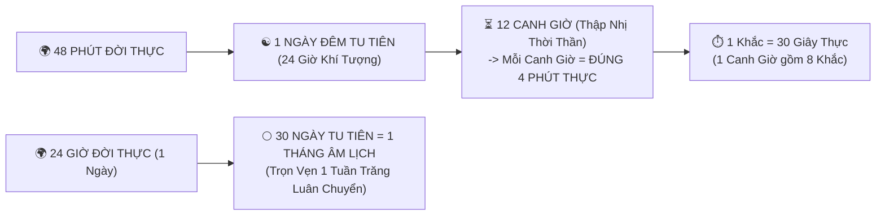
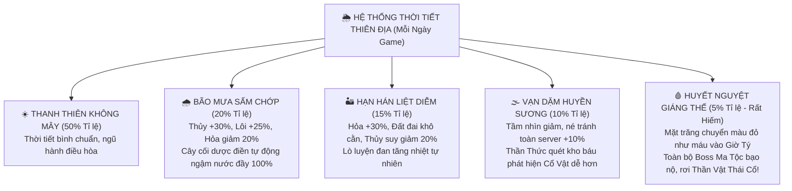

# [09] THIÊN ĐẠO LUÂN HỒI: HỆ THỐNG THIÊN THỜI, THẬP NHỊ THỜI THẦN & KHÍ TƯỢNG VŨ TRỤ


> ⬅️ **[Bài Trước: Doc 08 - Nơi Trú Ngụ, Dược Điền & Đan Đạo](file:///c:/Users/newre/OneDrive/Máy%20tính/code%20tutien/docs/08_DONG_PHU_NONG_TRAI_LUYEN_DAN.md)** | 📖 **[Mục Lục Toàn Cảnh](file:///c:/Users/newre/OneDrive/Máy%20tính/code%20tutien/README.md)** | ➡️ **[Bài Kế: Doc 10 - Chiến Đấu & 2 Phân Khu Bãi Săn](file:///c:/Users/newre/OneDrive/Máy%20tính/code%20tutien/docs/10_CHIEN_DAU_VA_BAI_SAN.md)**

> *"Trời có bốn mùa tám tiết, đất có mười hai thời thần. Một hơi thở của đất trời sinh ra gió mây sấm chớp, một vòng quay của nhật nguyệt định đoạt thịnh suy của vạn linh. Người tu tiên thuận thiên thời thì làm ít công nhiều, chân khí dồi dào; nghịch thiên thời thì đan dược cháy khét, lôi kiếp bủa vây.*
> *Bốn mươi tám phút trần gian, một ngày đêm cõi tiên; hai mươi tư giờ trôi qua, trọn vẹn một tuần trăng luân chuyển!"*

---

## 🧭 I. TỔNG QUAN HỆ THỐNG & TOÁN HỌC THỜI GIAN ĐỒNG BỘ

Để người chơi có đủ thời gian tính toán chiến thuật, căn giờ hái thuốc, luyện đan, săn boss và đi chợ đen mà **không bị quá gấp gáp (như mốc 24 phút) hay quá chậm chạp (như giờ đời thực)**, thế giới Tu Chân Giới áp dụng chuẩn **Chu Kỳ Thiên Đạo 48 Phút**:



### 1.1. Ma Trận Chuyển Đổi Thời Không Cực Chuẩn
* **$1\text{ Ngày Đêm Tu Tiên}$** = **$48\text{ Phút Thực Tế}$** ($2,880\text{ giây}$).
* **$1\text{ Canh Giờ (Thời Thần)}$** = **$4\text{ Phút Thực Tế}$** ($240\text{ giây}$).
* **$1\text{ Khắc}$** = **$30\text{ Giây Thực Tế}$** ($1\text{ Canh Giờ} = 8\text{ Khắc}$).
* **$1\text{ Tháng Tu Tiên (Nguyệt Lệnh)}$** = **$30\text{ Ngày Tu Tiên}$** = **$24\text{ Giờ Thực Tế}$**!
  * Cứ đúng $1\text{ ngày đời thực}$ ($24\text{h}$), thế giới game hoàn thành đúng $1\text{ tháng âm lịch}$ ($30\text{ ngày tu tiên}$).
  * **Ngày 1 - 7**: Trăng khuyết đầu tháng (Thượng Huyền Nguyệt).
  * **Ngày 15 (Giữa trưa hoặc nửa đêm thực tế)**: **Trăng Tròn (Vọng Nguyệt)**, xác suất kích hoạt **Huyết Nguyệt (Blood Moon)**!
  * **Ngày 30**: Trăng tối (Hối Nhật), mở lối vào Cổ Mộ & U Minh Ma Vực.

---

## ⏳ II. THẬP NHỊ THỜI THẦN (12 CANH GIỜ & MA TRẬN THIÊN ĐẠO GIA TRÌ)

Mỗi Canh Giờ kéo dài đúng **4 phút đời thực**, mang lại hào quang thiên địa và đặc quyền riêng biệt cho từng con đường tu đạo:

```mermaid
graph TD
    subgraph NGAY_DEM ["☀️ VÒNG TUẦN HOÀN 12 THỜI THẦN (48 PHÚT)"]
        Ty["🌑 1. GIỜ TÝ (Phút 0 - 4): Thái Âm Cực Thịnh\nThủy/Băng/Ám +25% | Mở Chợ Đen & Ma Tiêu Cục"]
        Suu["🪨 2. GIỜ SỬU (Phút 4 - 8): Âm Trọc Trầm Tích\nThổ +20% | Bế quan tẩy uế đan độc +30%"]
        Dan["🌅 3. GIỜ DẦN (Phút 8 - 12): Dương Khí Sơ Sinh\nLôi Kiếp giảm -15% sát thương | Giờ Vàng Độ Kiếp"]
        Mao["🌸 4. GIỜ MÃO (Phút 12 - 16): Tử Khí Đông Lai\nTọa Thiền tăng +30% Tu Vi/s toàn server"]
        Thin["🌿 5. GIỜ THÌN (Phút 16 - 20): Vạn Mộc Triều Dương\nMộc +25% | Thu hoạch Dược Điền x1.5 sản lượng"]
        Ti["🔥 6. GIỜ TỊ (Phút 20 - 24): Thuần Dương Nhen Nhóm\nĐan Hỏa ổn định, giảm 25% cháy khét lò luyện"]
        Ngo["☀️ 7. GIỜ NGỌ (Phút 24 - 28): Thái Dương Cực Thịnh\nHỏa & Lôi bùng nổ +25% công kích | Trừ tà sát ma"]
        Mui["⚒️ 8. GIỜ MÙI (Phút 28 - 32): Hỏa Nung Kim Địa\nĐào khoáng thạch nhận thêm 25% phôi quặng hiếm"]
        Than["⚔️ 9. GIỜ THÂN (Phút 32 - 36): Bạch Hổ Canh Kim\nKim +25% | Tăng 20% độ bén rèn Phi Kiếm"]
        Dau["🌪️ 10. GIỜ DẬU (Phút 36 - 40): Hoàng Hôn Lạc Nhật\nPhong +25% | Thân pháp phi hành tốc độ x2"]
        Tuat["🐺 11. GIỜ TUẤT (Phút 40 - 44): Ma Chướng Khởi Sinh\nQuái hoang dã cuồng bạo | Rơi Yêu Đan/Bí Tịch +35%"]
        Hoi["🌌 12. GIỜ HỢI (Phút 44 - 48): Vạn Linh Quy Tịch\nKhí huyết lắng đọng, hồi phục Thể Lực +50%"]

        Ty --> Suu --> Dan --> Mao --> Thin --> Ti --> Ngo --> Mui --> Than --> Dau --> Tuat --> Hoi --> Ty
    end
```



### 2.1. Bảng Quy Chuẩn Chi Tiết 12 Canh Giờ

| Canh Giờ | Mốc Thời Gian (Phút Thực) | Tên Gọi & Hiện Tượng Trời Đất | Hệ Linh Căn Được Gia Trì | Tác Động Chiến Đấu & Đời Sống Tu Tiên |
| :---: | :---: | :--- | :---: | :--- |
| **TÝ** | `00:00 - 04:00` | **Thái Âm Cực Thịnh**<br>*Bầu trời tối đen, sương lạnh buốt giá* | 💧 Thủy<br>❄️ Băng<br>🌑 Ám | **Công kích $+25\%$** cho hệ Thủy/Băng/Ám. Cửa ải **Chợ Đen Bất Dạ Thiên** mở cửa đón khách ngầm, Ma Tiêu Cục hoạt động mạnh. |
| **SỬU** | `04:00 - 08:00` | **Âm Trọc Trầm Tích**<br>*Đất ẩm tích tụ, gió ngừng thổi* | 🪨 Thổ | **Phòng ngự Thổ Mệnh $+20\%$**. Đệ tử ngồi thiền tẩy uế đan độc hiệu quả tăng **$+30\%$**, kinh mạch thông suốt. |
| **DẦN** | `08:00 - 12:00` | **Dương Khí Sơ Sinh**<br>*Tia sáng đầu tiên xé tan màn đêm* | ⚡ Lôi (Dương) | **Thời Điểm Vàng Độ Kiếp**: Sát thương Lôi Kiếp tự nhiên giảm **$-15\%$**, đan điền hấp thu điện tích dễ dàng hơn. |
| **MÃO** | `12:00 - 16:00` | **Tử Khí Đông Lai**<br>*Chân trời phía đông ngập mây tím ngũ sắc* | Toàn Hệ | Tọa Thiền Tĩnh Tọa toàn server nhận thêm **$+30\%$ Tu Vi/s**; uống trà ngộ đạo nhận gấp đôi hiệu quả. |
| **THÌN** | `16:00 - 20:00` | **Vạn Mộc Triều Dương**<br>*Hạt sương đọng trên linh thảo, hoa nở rộ* | 🌿 Mộc | **Mộc Mệnh $+25\%$**. Nông trại Dược Điền sản sinh thêm **$\times 1.5$ sản lượng thảo dược**, sâu bọ biến mất hoàn toàn. |
| **TỊ** | `20:00 - 24:00` | **Thuần Dương Nhen Nhóm**<br>*Nhiệt độ tăng dần, linh khí lưu chuyển nhanh* | 🔥 Hỏa | Giảm **$25\%$ tỉ lệ cháy nổ lò luyện đan**; đan dược xuất lò có tỉ lệ lên Cực Phẩm cao hơn $15\%$. |
| **NGỌ** | `24:00 - 28:00` | **Thái Dương Cực Thịnh**<br>*Mặt trời đứng bóng, dương khí ngập tràn tam giới* | 🔥 Hỏa<br>⚡ Dương Lôi | **Công kích $+25\%$** cho hệ Hỏa & Lôi. Đòn đánh thiêu rụi ma khí, gây thêm $+30\%$ sát thương chuẩn lên quái Ma Tộc/Minh Tộc. |
| **MÙI** | `28:00 - 32:00` | **Hỏa Nung Kim Địa**<br>*Đá núi nóng bỏng, địa nhiệt bốc lên* | 🪨 Thổ<br>⚔️ Kim | Khai thác mỏ quặng, đào khoáng thạch tăng **$+25\%$ tỉ lệ rơi Tinh Thạch hiếm**; rèn giáp tăng độ bền $+20\%$. |
| **THÂN** | `32:00 - 36:00` | **Bạch Hổ Canh Kim**<br>*Gió mang theo kiếm khí lành lạnh* | ⚔️ Kim | **Kim Mệnh $+25\%$**. Phi kiếm và pháp bảo cận chiến tăng $15\%$ tỉ lệ xuyên giáp, bạo kích $+5\%$. |
| **DẬU** | `36:00 - 40:00` | **Hoàng Hôn Lạc Nhật**<br>*Mây đỏ rực chân trời, tà dương buông lơi* | 🌪️ Phong | **Phong Mệnh $+25\%$**. Thân pháp tăng vọt, tốc độ di chuyển trên bản đồ thế giới tăng gấp đôi, né tránh $+8\%$. |
| **TUẤT** | `40:00 - 44:00` | **Ma Chướng Khởi Sinh**<br>*Bóng tối ùa về, tiếng sói tru vượn hót* | ⚔️ Ma / Tà | **Giờ Săn Quái Hoang Dã**: Toàn bộ quái bãi săn cuồng nộ tăng $+15\%$ Công, nhưng rơi **Yêu Đan, Huyết Thú & Bí Tịch $+35\%$**! |
| **HỢI** | `44:00 - 48:00` | **Vạn Linh Quy Tịch**<br>*Vạn vật chìm vào giấc ngủ, hư không tĩnh lặng* | Toàn Hệ | Tốc độ hồi phục **Thể Lực (Stamina) tăng $+50\%$**; giá rượu ngon tại Bất Dạ Thiên Tửu Lầu giảm $20\%$. |

---

## 🌧️ III. HỆ THỐNG KHÍ TƯỢNG VŨ TRỤ (WEATHER & COSMIC EVENTS)

Không chỉ có ngày và đêm, cứ mỗi **Chu Kỳ 48 Phút (1 Ngày Game)**, thiên địa sẽ ngẫu nhiên xuất hiện một **Hiện Tượng Thời Tiết Đặc Thù**:



### 3.1. Đại Dị Tượng: Huyết Nguyệt Giáng Thế (Blood Moon Event)
* **Quy luật xuất hiện**: Có $5\%$ xác suất bộc phát vào **Đêm Ngày 15 (Giờ Tý)** của tháng tu tiên.
* **Biểu hiện trên toàn server**:
  * Toàn bộ bầu trời game nhuốm một màu đỏ thẫm ma mị, âm nhạc nền chuyển sang điệu huyền bí rùng rợn.
  * Thông báo rền vang toàn máy chủ: *“Huyết Nguyệt tế thiên, Vạn Ma phục sinh! Chư vị tu sĩ hãy cẩn trọng sát kiếp!”*
* **Hiệu ứng đặc biệt suốt 4 phút Giờ Tý**:
  * Toàn bộ người chơi thuộc **Ma Tộc** và người có **Ám/Huyết Linh Căn** tăng **$+40\%$ Sát thương toàn diện**!
  * Boss Thế Giới và Quái Tinh Anh bộc phát trạng thái cuồng sát: HP tăng gấp đôi, nhưng **tỉ lệ rơi Trang Bị Thiên Phẩm và Thần Cốt tăng vọt $\times 3$ lần**!

---

## 🖥️ IV. THIẾT KẾ ĐỒNG HỒ THIÊN ĐẠO TRÊN GIAO DIỆN (UI DIAL)

Giao diện sẽ được tích hợp một **La Bàn Bát Quái Thời Thần (Celestial Time Dial)** nằm trang trọng tại Top Header:

```
+---------------------------------------------------------------------------------------+
|  [☯️ TU CHÂN GIỚI]    ☀️ Giờ Ngọ (Khắc 3)   |  Khí Tượng: Mưa Bão 🌧️  |  Server: 48m Cycle |
|  Hiệu Ứng Hoàng Đạo: [Hỏa & Lôi +25% Công Kích]  •  [Dược Điền Tự Động Hấp Thụ Nước]  |
+---------------------------------------------------------------------------------------+
```

### Các Chi Tiết Tương Tác:
1. **Biểu tượng Thời Thần chuyển động**:
   * Ban ngày (Dần $\rightarrow$ Thân): Vầng Thái Dương vàng rực quay chậm.
   * Ban đêm (Dậu $\rightarrow$ Sửu): Vầng Thái Âm nguyệt bạch dịu mát.
   * Khi có Huyết Nguyệt: Biểu tượng vầng trăng máu nhấp nháy đỏ rực.
2. **Thanh Tiến Độ 4 Phút (Canh Giờ Bar)**:
   * Một thanh viền mảnh chạy từ $0\%$ đến $100\%$ trong suốt $4\text{ phút}$, giúp đạo hữu nhìn vào là biết **còn bao nhiêu giây nữa sẽ chuyển sang Canh Giờ tiếp theo** để chuẩn bị đan dược hay độ kiếp!
3. **Tooltip Bát Quái Thông Minh**:
   * Rê chuột vào La Bàn sẽ hiển thị bảng tóm tắt: Thời thần hiện tại, thuộc tính được buff, sự kiện sắp diễn ra trong canh giờ kế tiếp.

---

## 🛠️ V. THUẬT TOÁN ĐỒNG BỘ MÁY CHỦ (SERVER AUTHORITATIVE ALGORITHM)

Để đảm bảo hàng triệu người chơi cùng thấy một canh giờ chuẩn xác mà **không bị lệch dù chỉ 1 phần nghìn giây (No Drift, Anti-Desync)**, thời gian tu tiên được tính toán toán học thuần túy dựa trên hàm Epoch Time:

```javascript
// server/timeEngine.js - Động cơ thời gian Thiên Đạo 48 phút
const REAL_MINUTES_PER_DAY = 48; // 1 ngày tu tiên = 48 phút thực
const MS_PER_GAME_DAY = REAL_MINUTES_PER_DAY * 60 * 1000; // 2,880,000 ms
const MS_PER_HOUR = MS_PER_GAME_DAY / 12; // 240,000 ms (đúng 4 phút thực / 1 Canh Giờ)
const MS_PER_MONTH = MS_PER_GAME_DAY * 30; // 24 giờ thực = 1 tháng tu tiên (30 ngày)

const CANH_GIO_CONFIG = [
  { id: "ty",   name: "Giờ Tý",   element: ["Thủy", "Băng", "Ám"], buffDesc: "Thủy, Băng & Ám +25% Sát Thương" },
  { id: "suu",  name: "Giờ Sửu",  element: ["Thổ"],                buffDesc: "Thổ Mệnh +20% Thủ, Tẩy Uế Đan Độc +30%" },
  { id: "dan",  name: "Giờ Dần",  element: ["Lôi"],                buffDesc: "Dương Khí Sơ Sinh: Giảm 15% Lôi Kiếp" },
  { id: "mao",  name: "Giờ Mão",  element: ["Toàn Hệ"],            buffDesc: "Tử Khí Đông Lai: Tọa Thiền +30% Tu Vi/s" },
  { id: "thin", name: "Giờ Thìn", element: ["Mộc"],                buffDesc: "Vạn Mộc Triều Dương: Dược Điền x1.5 Sản Lượng" },
  { id: "ti",   name: "Giờ Tị",   element: ["Hỏa"],                buffDesc: "Luyện Đan: Giảm 25% Cháy Khét Lò Luyện" },
  { id: "ngo",  name: "Giờ Ngọ",  element: ["Hỏa", "Lôi"],         buffDesc: "Thái Dương Cực Thịnh: Hỏa & Lôi +25% Uy Lực" },
  { id: "mui",  name: "Giờ Mùi",  element: ["Thổ", "Kim"],         buffDesc: "Hỏa Nung Kim Địa: Đào Quặng +25% Phôi Hiếm" },
  { id: "than", name: "Giờ Thân", element: ["Kim"],                buffDesc: "Bạch Hổ Canh Kim: Kim Mệnh +25% Phá Giáp" },
  { id: "dau",  name: "Giờ Dậu",  element: ["Phong"],              buffDesc: "Hoàng Hôn Lạc Nhật: Phong Mệnh +25% Thân Pháp" },
  { id: "tuat", name: "Giờ Tuất", element: ["Ma"],                 buffDesc: "Ma Chướng Khởi Sinh: Rơi Yêu Đan/Bí Tịch +35%" },
  { id: "hoi",  name: "Giờ Hợi",  element: ["Toàn Hệ"],            buffDesc: "Vạn Linh Quy Tịch: Hồi Phục Thể Lực +50%" }
];

// Hàm tính toán trạng thái Thiên Đạo tức thì
function getCelestialTimeState(timestamp = Date.now()) {
  const cycleProgress = timestamp % MS_PER_GAME_DAY;
  const hourIndex = Math.floor(cycleProgress / MS_PER_HOUR); // 0 đến 11
  const secondsLeftInHour = Math.floor((MS_PER_HOUR - (cycleProgress % MS_PER_HOUR)) / 1000);
  
  // Tính ngày trong tháng (1 đến 30)
  const monthProgress = timestamp % MS_PER_MONTH;
  const dayOfMonth = Math.floor(monthProgress / MS_PER_GAME_DAY) + 1;
  const isFullMoon = dayOfMonth === 15;

  return {
    hourIndex,
    currentHour: CANH_GIO_CONFIG[hourIndex],
    secondsLeftInHour,
    progressPercent: Number(((cycleProgress % MS_PER_HOUR) / MS_PER_HOUR * 100).toFixed(1)),
    dayOfMonth,
    isFullMoon
  };
}

module.exports = {
  REAL_MINUTES_PER_DAY,
  MS_PER_GAME_DAY,
  MS_PER_HOUR,
  CANH_GIO_CONFIG,
  getCelestialTimeState
};
```

---
*Tài liệu này là quy chuẩn toán học và cơ chế vận hành chính thức của dòng thời gian Thiên Đạo trong Tu Chân Giới Online, đảm bảo tính công bằng, sống động và hấp dẫn tột đỉnh cho cộng đồng người tu tiên.*


---

> ⬅️ **[Bài Trước: Doc 08 - Nơi Trú Ngụ, Dược Điền & Đan Đạo](file:///c:/Users/newre/OneDrive/Máy%20tính/code%20tutien/docs/08_DONG_PHU_NONG_TRAI_LUYEN_DAN.md)** | 📖 **[Mục Lục Toàn Cảnh](file:///c:/Users/newre/OneDrive/Máy%20tính/code%20tutien/README.md)** | ➡️ **[Bài Kế: Doc 10 - Chiến Đấu & 2 Phân Khu Bãi Săn](file:///c:/Users/newre/OneDrive/Máy%20tính/code%20tutien/docs/10_CHIEN_DAU_VA_BAI_SAN.md)**
