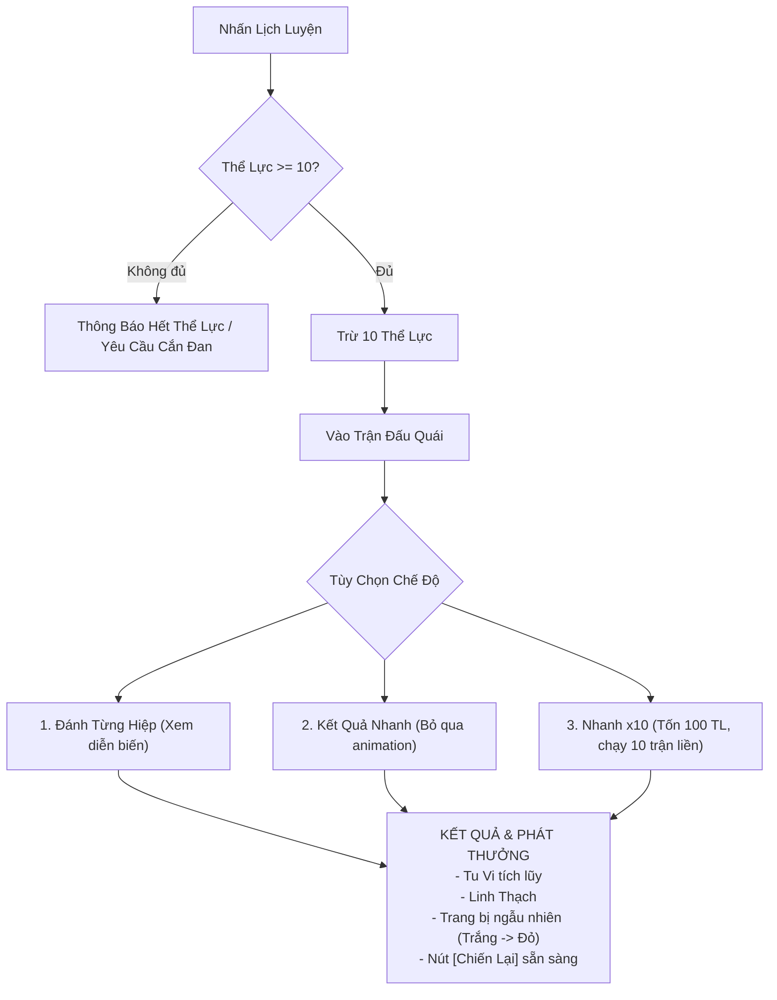
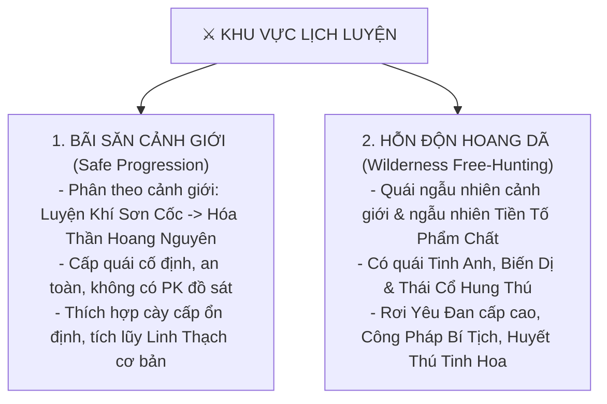
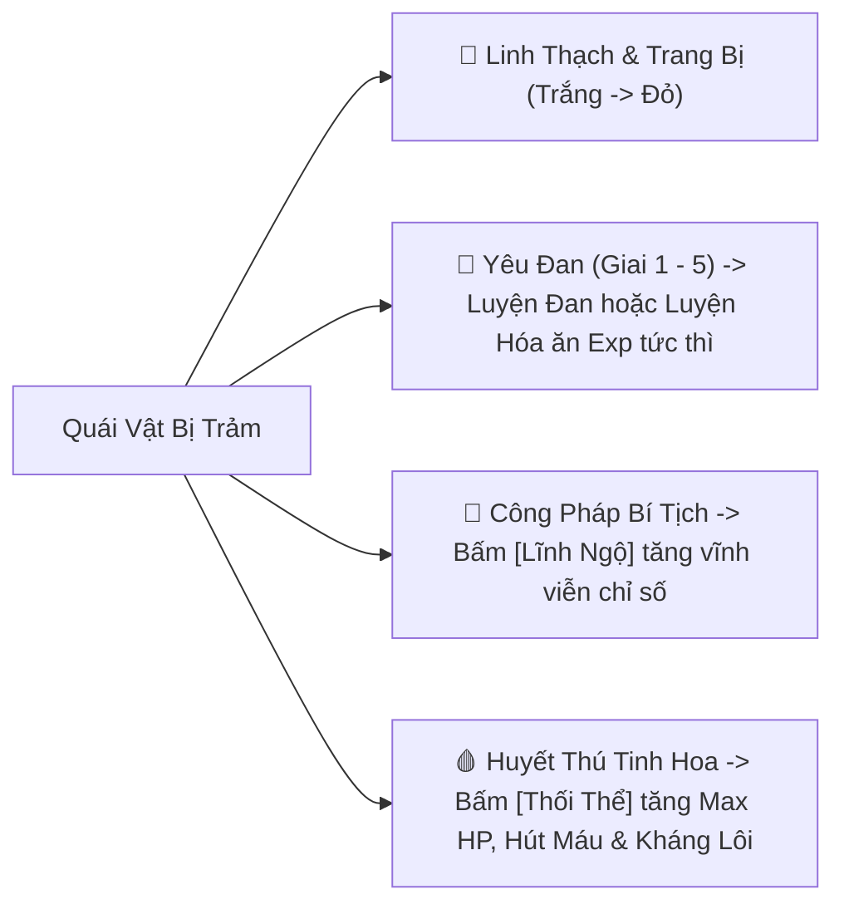

# [10] HỆ THỐNG CHIẾN ĐẤU & LỊCH LUYỆN

> ⬅️ **[Bài Trước: Doc 09 - Thiên Thời, Thập Nhị Thời Thần & Khí Tượng](file:///c:/Users/newre/OneDrive/Máy%20tính/code%20tutien/docs/09_THIEN_THOI_THAP_NHI_THOI_THAN_VA_KHI_TUONG.md)** | 📖 **[Mục Lục Toàn Cảnh](file:///c:/Users/newre/OneDrive/Máy%20tính/code%20tutien/README.md)** | ➡️ **[Bài Kế: Doc 11 - Cốt Truyện Phân Nhánh Ngũ Tộc & Lục Phái](file:///c:/Users/newre/OneDrive/Máy%20tính/code%20tutien/docs/11_COT_TRUYEN_LUC_PHAI_VA_KY_NGO.md)**

Module này định nghĩa công thức tính toán sát thương theo lượt (Turn-based Combat Engine) và chế độ Lịch Luyện cày cấp solo.

---

## 1. Công Thức Chiến Đấu (Combat Engine Formula)

### 1.1 Sát Thương Cơ Bản
$$\text{Damage} = \max\left(1, \left(\text{ATK}_{\text{người đánh}} \times \text{SkillMultiplier}\right) - \left(\text{DEF}_{\text{người nhận}} \times 0.5\right)\right)$$

### 1.2 Khắc Hệ Ngũ Hành (Elemental Counter)
Quy luật tương khắc: **Kim $\rightarrow$ Mộc $\rightarrow$ Thổ $\rightarrow$ Thủy $\rightarrow$ Hỏa $\rightarrow$ Kim**.
- Nếu hệ đánh **khắc** hệ nhận: $\text{Damage} \times 1.25$ ($+25\%$ sát thương).
- Nếu hệ đánh **bị khắc**: $\text{Damage} \times 0.85$ (giảm $15\%$ sát thương).

### 1.3 Bạo Kích & Né Tránh
- **Tỉ lệ Bạo Kích** = $\text{CritChance} - \text{CritResist}$ (Tối thiểu $5\%$, Tối đa $80\%$).
- Khi nổ bạo kích: $\text{Damage} \times 1.5$ (hoặc cao hơn tùy thể chất/trang bị).
- **Thứ tự đánh**: Bên có chỉ số **Tốc Độ (Speed)** cao hơn sẽ được xuất chiêu trước.

---

## 2. Cơ Chế Thể Lực (Stamina Management)

- **Giới hạn Thể Lực**: $100$ điểm (Khởi đầu) $\rightarrow 400$ điểm (theo cảnh giới).
- **Tốc độ hồi phục**: $+1$ Thể Lực mỗi $2 \text{ phút}$ (Idle Regen).
- **Hồi phục nhanh**: Dùng Thể Lực Đan hoặc Rượu Linh từ túi đồ.

---

## 3. Hoạt Động Lịch Luyện (Training & Grinding)

Lịch luyện là hoạt động tiêu hao thể lực chính của người chơi để thu thập trang bị và linh thạch.

### Chế Độ Nhanh x10 (Quick x10)
- Kiểm tra Thể lực tối thiểu phải $\ge 100 \text{ TL}$.
- Tự động chạy ngầm 10 lượt giao tranh độc lập.
- Hiển thị bảng tổng kết gồm tổng Tu Vi, tổng Linh Thạch và danh sách toàn bộ trang bị thu được.

### Cơ Chế Hồi Máu Tự Động Trong Lịch Luyện
- Khi máu nhân vật $< 90\%$: Tự động hiển thị nút **[Hồi Máu]** (dùng dược liệu hoặc đan dược trong túi) để giữ an toàn cho nhân vật trước khi bắt đầu lượt đánh tiếp theo.

---

## 🗺️ 4. KIẾN TRÚC 2 PHÂN KHU LỊCH LUYỆN (HUNTING ECOSYSTEM)

Hệ thống bãi săn được phân chia thành **2 Phân Khu** rõ rệt nhằm cân bằng giữa cày cuốc an toàn và mạo hiểm đoạt đại cơ duyên:

### 4.1. Bãi Săn Theo Cảnh Giới (Safe Progression)
| Tên Khu Vực | Cảnh Giới Yêu Cầu | Quái Vật Tiêu Biểu | Tài Nguyên Rơi Chủ Đạo |
| :--- | :--- | :--- | :--- |
| **Thanh Khê Thôn Bìa Rừng** | Luyện Khí (1 - 3) | Linh Thỏ, Dã Lang, Thổ Phỉ | Linh Thạch hạ phẩm, Thảo dược cơ bản |
| **Luyện Khí Sơn Cốc** | Luyện Khí (4 - 9) | Bạch Xà, Hắc Hùng, U Minh Lang | Yêu Đan Giai 1, Trang bị Luyện Khí |
| **Trúc Cơ Đầm Lầy** | Trúc Cơ Kỳ | Huyết Lạc Mãng, Ngân Giác Tê | Yêu Đan Giai 2, Trúc Cơ Tinh Huyết |
| **Kim Đan Cổ Trận** | Kim Đan Kỳ | U Hồn Tướng, Kim Sí Điểu | Yêu Đan Giai 3, Linh thạch trung phẩm |
| **Nguyên Anh Thiên Nhai** | Nguyên Anh Kỳ | Cổ Ma Khôi Lỗi, Huyết Giao | Yêu Đan Giai 4, Khoáng thạch quý |
| **Hóa Thần Hoang Nguyên** | Hóa Thần Kỳ | Thái Cổ Cự Thú, Chân Ma Huyễn Ảnh | Yêu Đan Giai 5, Cực Phẩm Linh Thạch |

---

## 🎁 5. HỆ THỐNG RƠI ĐỒ TOÀN DIỆN (FULL LOOT ECOSYSTEM)

Chiến thắng quái vật trong bãi săn không chỉ rơi trang bị mà đem lại 4 nhóm tài nguyên tu chân cốt lõi:

1. **Yêu Đan (Giai 1 $\rightarrow$ Giai 5)**:
   - Dùng làm tá dược luyện chế các loại Tiên Đan quý hiếm.
   - Bấm **[Luyện Hóa]** trực tiếp trong túi đồ nhận ngay lượng Tu Vi khổng lồ:
     - Giai 1: $+200 \text{ Tu Vi}$
     - Giai 2: $+1,000 \text{ Tu Vi}$
     - Giai 3: $+5,000 \text{ Tu Vi}$
     - Giai 4: $+20,000 \text{ Tu Vi}$
     - Giai 5: $+80,000 \text{ Tu Vi}$
2. **Công Pháp Bí Tịch (Tàn Quyển & Toàn Bản)**:
   - Rơi từ quái *Tinh Anh, Biến Dị, Thái Cổ*.
   - Người chơi bấm **[Lĩnh Ngộ]** để hấp thu tri thức, tăng vĩnh viễn thuộc tính bản thân (Công, Thủ, Thân Pháp, Kháng Lôi). *Nhân Tộc học công pháp nhận hiệu quả gấp đôi!*
3. **Huyết Thú Tinh Hoa**:
   - Dùng để tôi luyện gân cốt. Bấm **[Thối Thể]** tăng mạnh Khí Huyết, gia tăng tỉ lệ Hút Máu (Lifesteal) và sức chịu đựng Lôi Kiếp.

---

## 🧭 6. KẾT NỐI HỆ THỐNG THẦN THỨC TẦM BẢO & VÙNG ĐẤT CỰC HẠN

Bên cạnh giao diện săn quái cổ điển, người chơi có thể kích hoạt **Kỹ Thuật Thần Thức Phóng Xuất (Scan Bát Hoang)** để truy tìm Cổ Động Phủ hoặc dấn thân vào **4 Vùng Đất Sinh Tồn Cực Hạn** (Thủy Giới - Oxi, Hỏa Giới - Hỏa Độc, Lôi Giới - Điện Tích, Chướng Giới - Độc Tố) theo đặc tả chi tiết tại [`14_THAN_THUC_TAM_BAO_VA_DI_GIOI.md`](file:///c:/Users/newre/OneDrive/Máy%20tính/code%20tutien/docs/14_THAN_THUC_TAM_BAO_VA_DI_GIOI.md).

---

> ⬅️ **[Bài Trước: Doc 09 - Thiên Thời, Thập Nhị Thời Thần & Khí Tượng](file:///c:/Users/newre/OneDrive/Máy%20tính/code%20tutien/docs/09_THIEN_THOI_THAP_NHI_THOI_THAN_VA_KHI_TUONG.md)** | 📖 **[Mục Lục Toàn Cảnh](file:///c:/Users/newre/OneDrive/Máy%20tính/code%20tutien/README.md)** | ➡️ **[Bài Kế: Doc 11 - Cốt Truyện Phân Nhánh Ngũ Tộc & Lục Phái](file:///c:/Users/newre/OneDrive/Máy%20tính/code%20tutien/docs/11_COT_TRUYEN_LUC_PHAI_VA_KY_NGO.md)**
