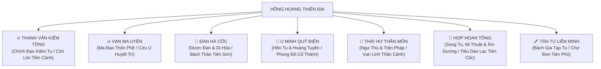
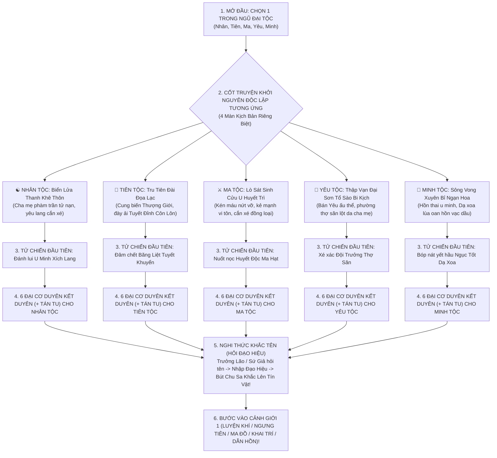
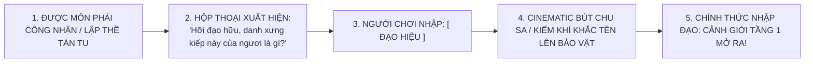
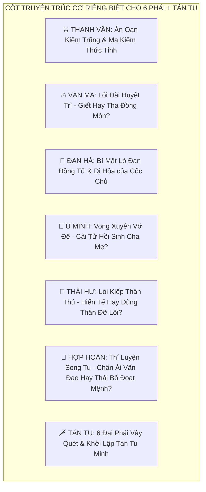
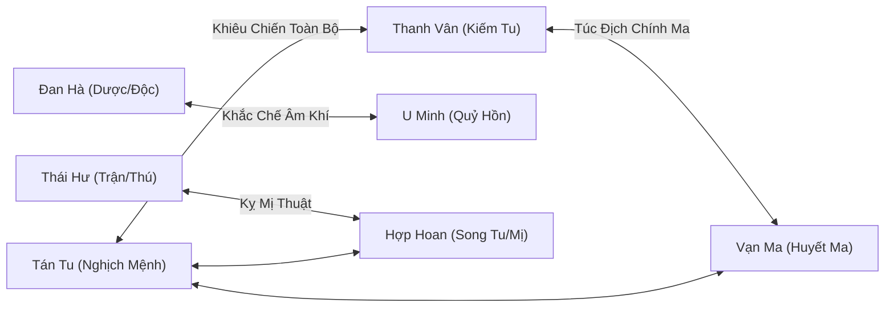

# [11] THIÊN MỆNH CHI QUẢ: ĐẠI BIÊN NIÊN SỬ CỐT TRUYỆN PHÂN NHÁNH LỤC ĐẠI TÔNG PHÁI & HỆ QUẢ NHÂN QUẢ


> ⬅️ **[Bài Trước: Doc 10 - Chiến Đấu & 2 Phân Khu Bãi Săn](file:///c:/Users/newre/OneDrive/Máy%20tính/code%20tutien/docs/10_CHIEN_DAU_VA_BAI_SAN.md)** | 📖 **[Mục Lục Toàn Cảnh](file:///c:/Users/newre/OneDrive/Máy%20tính/code%20tutien/README.md)** | ➡️ **[Bài Kế: Doc 12 - Tông Môn & Lục Đẳng Đồ Đệ](file:///c:/Users/newre/OneDrive/Máy%20tính/code%20tutien/docs/12_TONG_MON_VA_LUC_DANG_DE_TU.md)**

> *"Đại đạo năm mươi, Thiên diễn bốn chín, nhân độn thứ nhất. Trước ngã rẽ thiên địa, sáu đại tông môn sáu ngọn cờ riêng: kẻ dĩ kiếm vấn đạo, kẻ thôn phệ ma công, kẻ cứu nhân độ thế, kẻ thấu suốt hoàng tuyền, kẻ ngự thú thông thiên, kẻ dĩ tình nhập đạo mê đắm hồng trần! Một ý niệm thiện ác định đoạt kiếp người, một tiếng xúc xắc gieo xuống chuyển dịch càn khôn!"*

Tài liệu này quy chuẩn **Kiến Trúc Cốt Truyện Phân Nhánh & Cơ Duyên Khác Biệt Cho Lục Đại Tông Phái (+ Tán Tu)** trong Tu Chân Giới Online. Mỗi tông phái sở hữu bối cảnh, cơ duyên nhập môn, tuyến nhiệm vụ độc quyền và hệ quả cánh bướm hoàn toàn riêng biệt.

---

## 🏛️ 1. TỔNG QUAN BẢN SẮC & ĐẠO QUẢ CỦA LỤC ĐẠI TÔNG PHÁI



| Tông Môn | Bản Sắc & Tôn Chỉ | Linh Căn & Thuộc Tính Thiên Hướng | Pháp Bảo Nhập Môn & Đặc Quyền Tối Thượng |
| :--- | :--- | :--- | :--- |
| **Thanh Vân Kiếm Tông** | *Dĩ Kiếm Nhập Đạo*: Ngạo thị quần hùng, chính khí lẫm nhiên, sát phạt cương trực. | Kim / Lôi / Phong<br>(Công kích & Thân pháp cao) | **Thanh Vân Linh Kiếm**<br>Học *Thanh Vân Kiếm Quyết* (kích hoạt Kiếm Khí trảm kích x1.5 sát thương). |
| **Vạn Ma Uyên** | *Kẻ Mạnh Vi Tôn*: Nghịch thiên cướp đoạt, thôn phệ huyết nhục, cuồng nộ sát phạt. | Ma Khí / Ám / Huyết<br>(Hút máu & Bạo kích cực cao) | **Hắc Ma Lệnh Kỳ**<br>Học *Thôn Thiên Ma Công* (+15% Exp quái, 8% Hút máu bẩm sinh). |
| **Đan Hà Cốc** | *Dĩ Đan Thông Thần*: Nắm giữ nguồn sống đan dược toàn cõi, phú khả địch quốc. | Mộc / Hỏa<br>(Hồi phục, Độc sát & Dị hỏa) | **Thần Nông Dược Đỉnh**<br>Giảm 25% nguyên liệu luyện đan, nông trại lớn nhanh $+30\%$, miễn nhiễm 30% Đan Độc. |
| **U Minh Quỷ Điện** | *Thấu Suốt Sinh Tử*: Sai khiến âm hồn, khống chế Hoàng Tuyền, thoắt ẩn thoắt hiện. | Hồn Lực / Âm Thủy / Băng<br>(Né tránh, Chế ngự & Khống chế) | **Bách Quỷ Nhiếp Hồn Phiên**<br>Gọi âm hồn trợ chiến, sở hữu $10\%$ Né Tránh tự nhiên, đòn đánh gây tê liệt. |
| **Thái Hư Thần Môn** | *Vạn Thú Hợp Trận*: Thuần phục Thái Cổ Thần Thú, bố trí đại trận kinh thiên động địa. | Thổ / Ngũ Hành Tương Sinh<br>(Khí huyết cực dày, Hộ giáp & Phản đòn) | **Thái Hư Linh Thú Đai**<br>Sở hữu Thần Thú Ấu Thể đồng hành cắn quái, chia sẻ $20\%$ sát thương cho chủ nhân. |
| **Hợp Hoan Tông** | *Dĩ Tình Nhập Đạo*: Âm dương bổ khuyết, song tu thăng hoa, mị hoặc điên đảo chúng sinh. | Thuần Dương / Thuần Âm / Đào Hoa Dị Căn<br>(Mị lực, Hút chân nguyên & Khống chế) | **Âm Dương Hoan Hỷ Linh**<br>Tọa Thiền cùng Đạo Lữ (Song Tu) tăng **$+100\%$ Tu Vi/s (gấp đôi)**; chiêu thức có tỉ lệ Mị Hoặc làm đối thủ mất lượt. |
| **Tán Tu Tự Do** | *Bách Gia Quy Tông*: Không tông không phái, tự do học vạn bí tịch, phiêu bạt giang hồ. | Hỗn Hợp Ngũ Hành / Dị Căn<br>(Biến hóa khôn lường) | **Túi Càn Khôn Tán Tu**<br>Học được tất cả công pháp rơi từ quái, nhưng chịu rủi ro Tâm Ma Thổ Huyết. |

---

## 🏮 2. HỒI 1: KHỞI NGUYÊN ĐỘC LẬP NGŨ ĐẠI TỘC & 35 ĐẠI CƠ DUYÊN KẾT DUYÊN MÔN PHÁI

> **Quy Chuẩn Flow Nhập Môn Tuyệt Đối**:
> 1. Người chơi chọn **Bản Nguyên Chủng Tộc** trước (Nhân, Tiên, Ma, Yêu, Minh).
> 2. Trực tiếp dấn thân vào **Chương Khởi Nguyên Độc Lập** của Chủng Tộc đó (4 Màn kịch bản: Bối cảnh bi kịch $\rightarrow$ Thần vật thức tỉnh $\rightarrow$ Trận chiến sinh tử đầu tiên $\rightarrow$ Tiếp cận Cửu Châu).
> 3. Đứng trước **Ngã Rẽ Kết Duyên Môn Phái**: 6 Đại Tông Phái (+ Tán Tu Tự Do) xuất hiện với tình huống, thái độ tiếp nhận và góc nhìn văn hóa riêng biệt dựa trên chủng tộc của người chơi ($5 \times 7 = 35$ Cơ Duyên Độc Quyền).
> 4. Sau khi môn phái công nhận (hoặc sau khi thề lập chí tán tu trên vách đá) $\rightarrow$ Kích hoạt **Nghi Thức Khắc Tên (The Naming Ceremony)**: Nhập Đạo Hiệu để khắc lên Tín Vật Môn Phái / Bia Đá Giang Hồ!



---

### ☯️ 2.1. KHỞI NGUYÊN NHÂN TỘC: TAI ƯƠNG BIỂN LỬA THANH KHÊ THÔN (PHÀM NHÂN NGHỊCH THIÊN)

* **Ý niệm cốt lõi**: *Sinh mạng phàm trần như hạt bụi, nhưng ý chí nghịch thiên tựa trường sơn!*
* **Mỹ thuật & Bầu không khí**: Màn đêm giông bão sấm chớp, ánh lửa đỏ ngút trời thiêu rụi xóm làng. Tiếng la hét ai oán, mùi khói khét lẹt hòa cùng mùi máu tanh nồng.

#### 📜 Màn 1: Đêm Trăng Máu Bi Thảm
Bạn tỉnh dậy giữa tiếng nổ rền vang rung chuyển đất trời. Căn nhà tranh vách đất của gia đình bạn tại **Thanh Khê Thôn** đã sụp đổ một nửa trong biển lửa. Trước mắt bạn, người cha phàm trần cả đời chất phác đang dùng chiếc đòn gánh gãy che chắn trước miệng đàn ma lang. Mẹ bạn dùng chút tàn lực cuối cùng đè lên nắp hầm rơm giấu bạn vào trong, thều thào qua kẽ hở: 
> *"Hài nhi... đừng ra ngoài... sống sót... nhất định phải sống sót..."*

Móng vuốt yêu thú xé toạc nắp hầm. Máu nóng của song thân nhỏ giọt qua kẽ nẹp gỗ rỏ thẳng xuống trán bạn. Cha mẹ ngã gục trong vũng máu, ánh mắt vẫn mở trừng trừng nhìn về phía bạn. Nỗi tuyệt vọng và căm hận tột cùng nổ tung trong lồng ngực!

#### 💎 Màn 2: Dị Biến & Thần Vật Huyết Ngọc Thức Tỉnh
Trước cổ bạn, chiếc túi vải đựng chiếc bùa bình an mẹ khâu cho từ thuở lọt lòng bất chợt nóng rực như than hồng. Lớp vải cháy rụi, để lộ một mảnh **Huyết Ngọc Cổ Kính** rỉ sét xám tro. 
Khi giọt máu của cha mẹ và giọt lệ uất nghẹn của bạn rơi vào mặt gương, Huyết Ngọc rung lên bần bật, phóng ra một quầng sáng huyết sắc chói lòa! Một dòng nhiệt lưu cuồn cuộn tràn thẳng vào đan điền, xé toạc cửu khiếu kinh mạch vốn bế tắc của phàm nhân. Bạn không còn là một đứa trẻ yếu đuối; tiếng gầm thét trong linh hồn đánh thức **Đạo Thể Tự Nhiên**!

#### ⚔️ Màn 3: Tử Chiến Đầu Tiên — Đánh Lui U Minh Xích Lang
* **Kẻ thù**: *U Minh Xích Lang* (Luyện Khí Tầng 1 — HP: 180, ATK: 25, Kỹ năng: *Cắn Xé Huyết Nhục*).
* **Diễn biến**: Con sói đầu đàn ngửi thấy mùi linh khí bộc phát từ hầm rơm, quay đầu lại, đôi mắt đỏ rực gầm lên một tiếng lao thẳng vào bạn.
* **Cơ chế chiến đấu**: Bạn vớ lấy khúc đòn gánh cháy đỏ, mượn sức bật của dòng nhiệt lưu Cổ Kính vừa khai mở, dồn toàn bộ sức mạnh vào một đòn đâm thẳng vào mắt trái của ác thú! Xúc xắc định mệnh: *Bạo Kích Nghịch Mệnh*!
* **Kết cục**: Cây đòn gánh xuyên thủng sọ sói. Con dã thú giãy giụa rồi tắt thở. Bạn đứng giữa đống tro tàn, cả người đẫm máu sói và máu cha mẹ, thở dốc trong đêm giông bão. Lúc này, bầu trời xé toạc, các luồng tiên quang và ma khí từ chân trời ập tới...

#### 🌌 Màn 4: 6 Đại Cơ Duyên Kết Duyên Môn Phái (+ Tán Tu) Cho Nhân Tộc

##### 1. ⚔️ Kết Duyên Thanh Vân Kiếm Tông: Kiếm Khí Tru Yêu, Phàm Cốt Vấn Đạo
* **Hoàn cảnh**: Một đạo kiếm quang màu thanh lam xé rách mây mù đáp xuống đỉnh đồi. Trưởng Lão Lăng Kiếm Phong thu hồi phi kiếm, nhìn thấy một đứa trẻ phàm nhân đứng hiên ngang bên xác con sói hung tợn, tay vẫn nắm chặt khúc gỗ cháy đỏ không hề run rẩy.
* **Đối thoại & Tông chỉ**: 
  > Lão nhìn sâu vào mắt bạn, trầm giọng: *"Phàm nhân nhỏ bé, thân không một tấc sắt mà dám rút cây gỗ gãy đồ sát yêu lang! Kiếm cốt không nằm ở huyết thống, mà sinh ra từ gan tấc gang tấc bất khuất! Ngươi có muốn bái nhập Thanh Vân, lấy kiếm trong tay trảm tận yêu ma trong thiên hạ để tế vong hồn song thân?"*
* **Tín vật trao tay**: Bạn quỳ xuống dập đầu ba lạy. Lão vung tay trao cho bạn **Thanh Vân Kiếm Bài** cùng thanh kiếm sắt nhập môn **Thanh Phong Thiết Kiếm**, dắt bạn đạp mây bay về Côn Lôn Tiên Cảnh.

##### 2. 🔥 Kết Duyên Vạn Ma Uyên: Oán Hận Dục Ma, Huyết Thệ Phục Thù
* **Hoàn cảnh**: Một bóng đen cuồn cuộn ma diễm hạ xuống từ vòm trời. Hắc Ma Tán Nhân đi thu thập oán hồn thôn làng, chứng kiến bạn dùng răng nanh cắn rách tai sói, ánh mắt đỏ ngầu hận ý thấu tận trời xanh.
* **Đối thoại & Tông chỉ**:
  > Lão cười khằng khặc đầy khoái trá: *"Ha ha ha! Lòng căm thù thật tinh khiết! Thiên đạo bất nhân coi phàm nhân như sâu kiến dẫm đạp! Lũ danh môn chính phái ngâm thơ giảng đạo có cứu được cha mẹ ngươi không? Không! Chỉ có sức mạnh tột cùng của Ma Đạo mới giúp ngươi xé xác mọi kẻ thù! Theo ta về Vạn Ma Uyên, biến nỗi đau thành lưỡi đao đồ sát Cửu Châu!"*
* **Tín vật trao tay**: Bạn siết chặt nắm đấm, tiếp nhận luồng ma khí đen kịt. Lão trao cho bạn chiếc **Hắc Ma Cốt Phù**, dẫn dắt bạn lặn sâu vào Cửu U Huyết Trì.

##### 3. 🌿 Kết Duyên Đan Hà Cốc: Dược Tâm Tế Thế, Bách Thảo Trùng Sinh
* **Hoàn cảnh**: Trong biển lửa ngút ngàn, bạn phát hiện một thiếu nữ đan sư mặc áo xanh lục của Đan Hà Cốc bị ma diễm làm bỏng nặng, ngất xỉu bên bờ suối. Bạn không màng tấm thân rách rưới, dùng nước suối làm mát và nhai nát lá mã đề đắp lên vết thương cứu sống nàng.
* **Đối thoại & Tông chỉ**:
  > Đội cứu viện của Đan Hà Cốc tìm đến nơi. Nữ Trưởng Lão nhìn thấy cảnh tượng đó liền rưng rưng nước mắt: *"Bản thân vừa mất đi tất cả, toàn thân rỉ máu mà vẫn dốc lòng cứu người! Trong hoạn nạn thấy rõ Bồ Đề Tâm. Đan Đạo không phải để trường sinh, mà là để cứu vớt sinh linh khỏi hoạn nạn! Hài tử, hãy theo ta về Bách Thảo Sơn học thuật cải tử hoàn sinh!"*
* **Tín vật trao tay**: Bạn được đưa về thánh địa đan đạo, được ban tặng **Thần Nông Dược Đỉnh** và chiếc áo **Lục Dược Linh Y**.

##### 4. 👻 Kết Duyên U Minh Quỷ Điện: Hiếu Cảm Hoàng Tuyền, Tàn Hồn Bất Diệt
* **Hoàn cảnh**: Khi âm phong lạnh thấu xương thổi qua, hai dải khói trắng mờ ảo mang hình bóng cha mẹ bạn sắp tan biến vào hư vô. Bạn dùng mảnh Huyết Ngọc Cổ Kính liều mạng gom giữ hai sợi tàn hồn, dập đầu đến toác trán giữa hư không cầu xin trời đất.
* **Đối thoại & Tông chỉ**:
  > Bạch Vô Thường / Quỷ Sứ áo trắng của U Minh Quỷ Điện hiện hình từ làn sương đêm, nâng chiếc đèn lồng ma quái, thở dài: *"Sinh lão bệnh tử là lẽ trời, hồn về Phong Đô là định mệnh. Nhưng mảnh ngọc của ngươi lại có thể tụ hồn, chữ Hiếu của ngươi chấn động quỷ thần! Nhập Quỷ Điện ta, học bí pháp ngự hồn, ngươi sẽ tự tay bảo bọc tàn hồn song thân trong Hồn Đăng, đợi ngày đoạt lại luân hồi!"*
* **Tín vật trao tay**: Quỷ Sứ thu nhận bạn, trao chiếc **Dẫn Hồn Minh Đăng** có chứa hai đóa tàn hỏa đại diện cho linh hồn cha mẹ.

##### 5. 🐉 Kết Duyên Thái Hư Thần Môn: Vạn Vật Hữu Linh, Cứu Thú Định Mệnh
* **Hoàn cảnh**: Trong chuồng gia súc rực lửa, một con ấu thú *Tiểu Thanh Lân Thú* bị xà nhà đè gãy chân đang kêu rên tuyệt vọng. Bạn không bỏ chạy thoát thân mà liều mình đội xà nhà nóng rực, kéo ấu thú ra ngoài, cả hai cùng lăn lộn trong bùn đất dập lửa.
* **Đối thoại & Tông chỉ**:
  > Ngự Thú Trưởng Lão của Thái Hư Thần Môn cưỡi cự ưng giáng trần, nhìn thấy con thú nhỏ quấn quýt liếm láp vết thương trên trán bạn: *"Vạn vật đều có tánh linh! Phàm nhân lấy mạng mình che chở cho ấu thú, tâm hồn giao cảm với vạn linh! Đây chính là thiên phú tuyệt đỉnh của Thái Hư Thần Môn ta!"*
* **Tín vật trao tay**: Trưởng lão phong bạn làm Linh Đồng, trao tặng **Thái Hư Linh Thú Đai**, ấu thú tự nguyện ký kết khế ước linh hồn cùng bạn đồng hành!

##### 6. 🌸 Kết Duyên Hợp Hoan Tông: Tình Si Khai Hoa, Âm Dương Đạo Cốt
* **Hoàn cảnh**: Khói lửa mịt mù, một vị nữ tu Hợp Hoan Tông nhan sắc khuynh thành lướt qua. Nàng nhìn thấy bạn dù máu me bê bết vẫn ôm chặt chiếc hài thêu của mẹ và chiếc tẩu thuốc của cha vào lòng, đáy mắt chất chứa tình cảm sâu đậm nguyên sơ thuần khiết nhất của cõi hồng trần.
* **Đối thoại & Tông chỉ**:
  > Nàng khẽ đáp xuống, nâng cằm bạn lên, khẽ thở dài: *"Thiên hạ đều nói Hợp Hoan ta vô tình trác táng, nhưng đâu biết 'Chữ Tình' mới là đạo căn thâm sâu nhất của đất trời! Không có si tình nát lòng, sao thấu suốt được chân lý Âm Dương tương hợp? Ngươi mang Thuần Tình Đạo Cốt, theo tỷ tỷ về Tiêu Dao Cốc, dùng tình vấn đạo, tiêu dao cửu châu!"*
* **Tín vật trao tay**: Nàng khoác lên người bạn chiếc áo lụa phấn hồng, trao cho bạn chiếc chuông **Âm Dương Hoan Hỷ Linh**.

##### 7. 🗡️ Kết Duyên Tán Tu Tự Do: Nuốt Ngọc Nhảy Sông, Giang Hồ Nghịch Mệnh
* **Hoàn cảnh**: Từ xa, bạn nhìn thấy tu sĩ các phái bay lượn trên trời nhưng chỉ chăm chú nhặt bảo vật yêu thú rơi ra mà dửng dưng nhìn thôn dân chết cháy. Bạn cười thảm, nhận ra: Thần tiên hay ma quỷ cũng chỉ là lũ ích kỷ mượn danh!
* **Quyết định độc hành**:
  > Bạn ngậm mảnh Huyết Ngọc Cổ Kính nuốt ực vào bụng, dùng sức tàn nhảy tùm xuống dòng nước lũ xiết của sông Thanh Khê trôi dạt về phương xa, để lại lời thề thấu tận trời xanh: *"Đời này ta không quỳ lạy thần phật, không dập đầu trước môn phái nào! Ta là phàm nhân, ta sẽ tự bước đi con đường của chính mình!"*
* **Tín vật khởi đầu**: Dạt vào bờ hoang, nhặt được một **Túi Càn Khôn Rách** của tu sĩ chết đuối, bắt đầu kiếp Tán Tu tự do học vạn pháp.

---

### 👑 2.2. KHỞI NGUYÊN TIÊN TỘC: ĐỌA ĐÀI CÔN LÔN TUYẾT ĐỈNH (THIÊN GIA TRỤY PHÀM)

* **Ý niệm cốt lõi**: *Rơi từ chín tầng mây xuống bùn lầy tuyết trắng, ngạo cốt bất diệt thề phạt Tiên Cung!*
* **Mỹ thuật & Bầu không khí**: Côn Lôn Đỉnh bão tuyết gầm thét ngàn trượng, băng giá cắt da cắt thịt. Máu tiên tỏa ánh kim quang nhuộm đỏ nền tuyết trắng xóa hoang vu.

#### 📜 Màn 1: Cung Biến Thượng Giới & Rơi Xuống Tru Tiên Đài
Bạn vốn mang dòng máu tôn quý của Tiên Gia tại Cửu Trọng Tiên Cung. Biến cố cung đình đẫm máu: gia tộc bạn bị Trảm Tiên Điện vu cáo cấu kết dị tộc, Tiên Đế hạ chiếu tru di cửu tộc. Cả gia đình bị chém đầu trên Trảm Tiên Đài.
Riêng bạn bị đánh gãy toàn bộ Tiên Cốt, tước đoạt tiên tịch, ném thẳng xuống vực sâu vô tận của **Tru Tiên Đài**. Thân thể bạn rơi tự do xé toạc chín tầng mây, phá vỡ giới bích hạ giới, cắm thẳng xuống đỉnh tuyết **Côn Lôn Sơn** ngàn trượng hoang vu!

#### 💎 Màn 2: Cổ Kính Cứu Chủ & Tàn Dư Tiên Huyết
Bạn nằm trong hố tuyết sâu hoắm, xương cốt vỡ vụn, tiên lực thần thánh bị phong ấn gần như sạch bách. Trong ngực áo rách rưới, mảnh **Huyết Ngọc Cổ Kính** — bảo vật cấm kỵ mà Tiên Mẫu đã liều chết nhét vào áo bạn trước lúc hành hình — bừng sáng ánh đỏ rực rỡ.
Mảnh ngọc điên cuồng hấp thu giọt máu tiên kim sắc của bạn, phóng ra một đạo tiên quang bảo vệ tâm mạch, cưỡng ép ngưng tụ một sợi **Tiên Khí Bản Nguyên** trong đan điền, giữ cho hồn phách không bị cái lạnh cắt da của cõi phàm dập tắt.

#### ⚔️ Màn 3: Tử Chiến Đầu Tiên — Đâm Chết Băng Liệt Tuyết Khuyển
* **Kẻ thù**: *Băng Liệt Tuyết Khuyển* (Ngưng Tiên Tầng 1 — HP: 220, ATK: 30, Kỹ năng: *Hàn Băng Phệ Cốt*).
* **Diễn biến**: Con linh khuyển hoang dã trên đỉnh tuyết ngửi thấy mùi máu tiên thượng giới thơm ngát, gầm gừ lao tới định xé xác bạn làm món ăn bổ dưỡng.
* **Cơ chế chiến đấu**: Dù tiên cốt đã gãy, khí phách thần thánh của Tiên Tộc không cho phép bạn bị loài súc sinh hạ giới làm nhục! Bạn bẻ gãy một nhánh băng nhọn hoắt, ngưng tụ sợi Tiên Khí duy nhất vào đầu nhọn, quát vang một tiếng đâm thẳng qua họng ác khuyển!
* **Kết cục**: Máu sói tuyết bắn tung tóe lên tuyết trắng. Bạn thở dốc dựa lưng vào vách băng, mắt rực lửa phục thù! Lúc này, các thế lực hạ giới phát hiện dị tượng tuyết sơn liền kéo đến...

#### 🌌 Màn 4: 6 Đại Cơ Duyên Kết Duyên Môn Phái (+ Tán Tu) Cho Tiên Tộc

##### 1. ⚔️ Kết Duyên Thanh Vân Kiếm Tông: Tiên Đồng Giáng Trần, Kiếm Thông Thiên Đình
* **Hoàn cảnh**: Đội ngũ tuần sơn Kiếm Tông bắt gặp luồng kim quang Tiên Khí bốc lên trời. Chưởng Môn Thanh Vân Kiếm Tông đích thân giáng lâm, nhìn thấy ấn ký hoa sen tiên gia trên trán bạn dù quần áo rách rưới.
* **Đối thoại & Tông chỉ**:
  > Chưởng môn kinh ngạc quỳ một gối hành lễ kiếm đạo: *"Kim quang quán nhật, Tiên Cốt bất phàm! Hóa ra là Tiên Đồng Thượng Giới giáng trần! Thanh Vân ta vốn thờ phụng Đạo Tổ, nay đệ tử tiên gia gặp nạn, Kiếm Tông xin nguyện đem Vạn Kiếm Quy Tông truyền thừa cho người, chờ ngày người vung kiếm chém ngược lên Thượng Giới!"*
* **Tín vật trao tay**: Được đón về Côn Lôn Đỉnh, phong làm **Thánh Chủng Danh Dự**, ban thưởng **Thanh Vân Chân Vũ Kiếm**.

##### 2. 🔥 Kết Duyên Vạn Ma Uyên: Tiên Ma Đọa Lạc, Nghịch Phạt Cửu Trọng Thiên
* **Hoàn cảnh**: Ma Tôn Vạn Ma Uyên đạp mây đen xé toạc bão tuyết, nhìn thấy vết thương do Tru Tiên Đài xé rách trên người bạn cùng nỗi căm hận ngút trời trong đáy mắt tiên nhân.
* **Đối thoại & Tông chỉ**:
  > Ma Tôn cười vang sấm sét: *"Thiên Đế đạo mạo đã giết sạch người thân của ngươi! Tiên Cung đã phản bội ngươi! Ngươi còn muốn làm Tiên làm gì? Hãy đọa Ma đi! Để Ma Khí Cửu U hòa quyện cùng Tiên Huyết, đúc nên Đọa Lạc Tiên Ma vô tiền khoáng hậu! Một ngày nào đó, hai ta sẽ dẫn vạn ma san bằng Tiên Cung, lôi cổ Thiên Đế xuống tế đầu người thân ngươi!"*
* **Tín vật trao tay**: Bạn cắn nát môi, đồng ý đọa ma. Ma Tôn truyền ma huyết vào người bạn, trao **Hắc Ma Tru Tiên Lệnh**.

##### 3. 🌿 Kết Duyên Đan Hà Cốc: Tiên Thể Dục Đan, Vạn Niên Tuyết Liên Khai
* **Hoàn cảnh**: Máu tiên của bạn nhỏ xuống tuyết khiến đóa Tuyết Liên ngàn năm bên cạnh bỗng nhiên nở rộ rực rỡ, tỏa hương thơm ngát khắp mười dặm. Dược Tôn Đan Hà Cốc hái thuốc chấn động tìm đến.
* **Đối thoại & Tông chỉ**:
  > Lão nhìn thấy bạn, nghẹn ngào thốt lên: *"Tiên Huyết Thần Dịch! Hạ giới mạt pháp ngàn năm nay thiếu đi một giọt Tiên Huyết để luyện chế Cửu Chuyển Thần Đan! Đạo hữu, nếu người bái nhập Đan Hà, ta sẽ dùng toàn bộ dược khố thiên hạ đắp lại Tiên Cốt cho người, đổi lại, người sẽ là Đan Thánh tối cao của sơn cốc ta!"*
* **Tín vật trao tay**: Bạn được rước về Dược Cốc trị thương bằng linh tuyền thượng phẩm, ban **Bách Thảo Tiên Lô**.

##### 4. 👻 Kết Duyên U Minh Quỷ Điện: Tiên Hồn Tịch Diệt, Minh Khí Trùng Sinh
* **Hoàn cảnh**: Bạn kiệt sức nằm trên băng, hồn phách chao đảo sắp lìa khỏi xác. Sứ giả áo đen của Phong Đô xuất hiện từ cõi âm hàn, nhìn thấy tàn dư Tiên Hồn bất tử của bạn.
* **Đối thoại & Tông chỉ**:
  > Sứ giả khom mình cất giọng ma quái: *"Tiên thể có thể vỡ, nhưng Tiên Hồn vạn kiếp bất diệt. Côn Lôn Sơn lạnh giá này rất gần Hoàng Tuyền. Bái nhập Quỷ Điện, lấy Minh Khí nuôi Tiên Hồn, ngươi sẽ nắm giữ quyền năng Sinh - Tử lưỡng giới, biến Tiên Cung kiêu ngạo thành nấm mồ chôn xác kẻ thù!"*
* **Tín vật trao tay**: Bạn nắm lấy ngọn lửa xanh ma quái, tiếp nhận thân phận **Minh Tiên Chân Truyền**, nhận **Cửu U Hồn Bài**.

##### 5. 🐉 Kết Duyên Thái Hư Thần Môn: Vạn Thú Quỳ Phục, Thánh Linh Chủ Nhân
* **Hoàn cảnh**: Khi bạn đứng dậy, một tia Tiên Uy bẩm sinh tỏa ra khiến bầy linh thú cấp cao quanh đỉnh tuyết Côn Lôn lập tức phục rạp xuống đất run rẩy quy phục.
* **Đối thoại & Tông chỉ**:
  > Đại Trưởng Lão Thái Hư Thần Môn chứng kiến cảnh này chấn động rụng rời: *"Không cần dùng bùa chú, chỉ một ánh mắt Tiên Gia đã khiến vạn thú quỳ lạy xưng thần! Người chính là Thần Chủ mà Thái Cổ Thần Thú chờ đợi triệu năm nay!"*
* **Tín vật trao tay**: Trưởng lão cung kính rước bạn về làm **Tôn Chủ Thần Thú**, trao cho chiếc đai nạm ngọc **Thái Cổ Linh Đai**.

##### 6. 🌸 Kết Duyên Hợp Hoan Tông: Tuyệt Sắc Tiên Thai, Song Tu Cực Lạc
* **Hoàn cảnh**: Tông Chủ Hợp Hoan Tông du ngoạn tuyết sơn ngắm hoa mai, bất chợt nhìn thấy một thiếu niên/thiếu nữ tiên gia dù thân tàn ma dại nhưng dung nhan xuất trần như tranh vẽ, khí chất thanh cao siêu phàm thoát tục.
* **Đối thoại & Tông chỉ**:
  > Đôi mắt nàng đong đầy si mê, khẽ buông lời ngọc: *"Trời ơi... tạo hóa sao lại sinh ra một Tiên Thai hoàn mỹ nhường này? Ở cõi phàm trần u tối này, chỉ có Tiêu Dao Cốc mới xứng đáng che chở cho người. Cùng tỷ tỷ song tu, lấy âm dương hòa hợp đúc lại Tiên Cốt, chẳng phải khoái lạc hơn khổ tu sao?"*
* **Tín vật trao tay**: Bạn được đón về tẩm cung ngọc bích, trao tặng chiếc chuông tiên **Côn Lôn Ngọc Linh**.

##### 7. 🗡️ Kết Duyên Tiên Tộc Tán Tu: Ngạo Cốt Tuyết Sơn, Tự Đúc Tiên Thân
* **Quyết định độc hành**:
  > Bạn nhìn xuống muôn trùng sơn hà hạ giới, cười lạnh: *"Lũ sâu kiến phàm nhân, môn phái thấp hèn sao xứng để bản tọa cúi đầu bái sư? Tiên Gia ta chỉ quỳ trước phụ mẫu, không thờ bất kỳ ai!"*
* **Hành trình**: Bạn một thân một mình đi sâu vào hang băng ngàn trượng bế quan, cắn cỏ tuyết tự chữa thương, thề tự tay chém rách bầu trời trở về Thượng Giới. Nhặt được **Tàn Phiến Tiên Kinh**.

---

### ⚔️ 2.3. KHỞI NGUYÊN MA TỘC: LÒ SÁT SINH CỬU U HUYẾT TRÌ (SINH RA TỪ HUYẾT HẢI)

* **Ý niệm cốt lõi**: *Không cha không mẹ, sinh ra từ vũng máu, cắn xé đồng loại để đoạt lấy quyền sinh tồn!*
* **Mỹ thuật & Bầu không khí**: Đáy vực sâu vạn trượng của Cửu U Huyết Trì. Đầm lầy máu sôi sùng sục, xương trắng chất thành núi, oán khí cuồn cuộn ngút trời.

#### 📜 Màn 1: Kén Máu Nứt Vỡ & Luật Rừng Đáy Vực
Bạn mở mắt ra từ bên trong một chiếc kén máu khổng lồ dưới đáy **Cửu U Huyết Trì** — nơi chôn cất xác chết của vạn Cổ Ma Thần từ thời Hỗn Độn. Bạn dùng móng vuốt xé toạc lớp màng nhầy chui ra ngoài. 
Không có tiếng khóc của trẻ thơ, không có bàn tay ấm áp của mẹ hiền! Xung quanh bạn là hàng trăm ma thai và ấu trùng ma thú vừa nở ra, đỏ ngầu mắt xông vào cắn xé lẫn nhau để nuốt thịt uống máu. Quy luật duy nhất dưới đáy Huyết Trì: **Kẻ Nhanh Chân Nuốt Kẻ Chậm Chân!**

#### 💎 Màn 2: Chạm Tay Cổ Kính & Ma Hạch Bạo Phát
Trong lúc lăn lộn tranh giành sự sống giữa đống xương khô, bàn tay đầy máu của bạn quờ phải một mảnh vỡ sắc lạnh: **Huyết Ngọc Cổ Kính**.
Mảnh ngọc tiếp xúc với ma huyết bẩm sinh của bạn liền phát ra tiếng gầm thét như vạn con ác quỷ thức tỉnh! Toàn bộ oán khí và huyết sát của Huyết Trì bị Cổ Kính hút cạn rồi nén chặt vào lồng ngực bạn, ngưng tụ thành một khối **Ma Hạch** đập thình thịch dữ dội, ban cho bạn bản năng **Thôn Phệ Bạo Ngược** tuyệt đỉnh!

#### ⚔️ Màn 3: Tử Chiến Đầu Tiên — Nuốt Nọc Huyết Độc Ma Hạt
* **Kẻ thù**: *Huyết Độc Ma Hạt* (Ma Đồ Tầng 1 — HP: 200, ATK: 32, Kỹ năng: *Huyết Độc Trát Thích*).
* **Diễn biến**: Một con bò cạp ma khổng lồ từ đống xương tàn lao tới, giương chiếc đuôi độc đỏ lòm bổ thẳng vào đầu bạn nhằm biến bạn thành con mồi lót dạ.
* **Cơ chế chiến đấu**: Bản năng ma tộc trỗi dậy! Bạn không hề né tránh, giơ tay đón lấy ngòi độc đâm xuyên lòng bàn tay, đồng thời há miệng cắn đứt cổ họng của ác hạt! Bạn hút cạn nọc độc và ma huyết của nó vào bụng, mượn kịch độc tôi luyện gân cốt!
* **Kết cục**: Vỏ bò cạp nát vụn. Bạn đứng dậy trên đống xương tàn, mắt rực lửa huyết quang ma đạo! Lúc này, các thế lực ma đạo và gián điệp phát hiện chấn động đáy vực...

#### 🌌 Màn 4: 6 Đại Cơ Duyên Kết Duyên Môn Phái (+ Tán Tu) Cho Ma Tộc

##### 1. 🔥 Kết Duyên Vạn Ma Uyên: Huyết Mạch Ma Thần, Sói Đầu Đàn Cửu U
* **Hoàn cảnh**: Ma Tôn đi thị sát Huyết Trì, chứng kiến bạn tay không xé xác bọ cạp độc, toàn thân tắm máu đứng ngạo nghễ giữa xác chết đồng loại.
* **Đối thoại & Tông chỉ**:
  > Lão vỗ đùi cười vang như sấm sét: *"Ha ha ha! Quả là một con sói đầu đàn sinh ra từ vũng máu! Tàn bạo, dứt khoát, không một chút do dự! Vạn Ma Uyên ta không nuôi phế vật, chỉ dung nạp kẻ khát máu như ngươi! Đến đây, làm Chân Truyền Thiếu Chủ của Huyết Trì!"*
* **Tín vật trao tay**: Nhận lệnh bài **Thôn Thiên Ma Giáp** và quyền thống lĩnh đệ tử Ma Uyên.

##### 2. ⚔️ Kết Duyên Thanh Vân Kiếm Tông: Gian Tế Ma Thai, Dĩ Kiếm Tàng Ma
* **Hoàn cảnh**: Bạn dùng năng lực của Cổ Kính cưỡng ép phong tỏa toàn bộ ma khí vào sâu trong Ma Hạch, biến diện mạo thành một thiếu niên gầy gò yếu ớt lết ra khỏi miệng vực. Đội chấp pháp Thanh Vân tuần tra ngỡ bạn là nô lệ phàm nhân bị ma tu bắt cóc nên động lòng trắc ẩn cứu sống.
* **Đối thoại & Tông chỉ**:
  > Bạn quỳ xuống giả vờ khóc lóc cầu xin học kiếm diệt ma: *"Đa tạ tiên trưởng cứu mạng, đệ tử nguyện theo người học kiếm trảm yêu trừ ma!"* Trưởng lão gật đầu khen ngợi tâm tính kiên định. Bạn thầm cười lạnh trong bụng: *"Danh môn chính phái ngây thơ! Ta sẽ vào Kiếm Trũng, học sạch kiếm quyết rồi thôn phệ cả sơn môn các ngươi!"*
* **Tín vật trao tay**: Nhận **Thanh Vân Kiếm Bài (Danh Nghĩa Ngoại Môn)**.

##### 3. 🌿 Kết Duyên Đan Hà Cốc: Ma Độc Dị Thể, Dược Đỉnh Luyện Cổ
* **Hoàn cảnh**: Ma khí và nọc độc trong người bạn tỏa ra khiến cỏ cây héo rũ. Đan Sư nhánh Độc Tu của Đan Hà Cốc bắt gặp, mừng rỡ như bắt được vàng ròng.
* **Đối thoại & Tông chỉ**:
  > Lão già Độc Đan hưng phấn xoa tay: *"Hảo một cỗ Thể Chất Ma Độc bẩm sinh! Lấy nhục thân của ngươi làm dẫn, dùng độc nuôi đan, cả thiên hạ này sẽ phải run sợ trước Độc Đan của hai thầy trò ta!"*
* **Tín vật trao tay**: Đưa về mật thất sâu trong Dược Cốc, trao **Cửu U Luyện Độc Đỉnh**.

##### 4. 👻 Kết Duyên U Minh Quỷ Điện: Ma Sát Quỷ Hồn, Cửu U Chi Vương
* **Hoàn cảnh**: Quỷ Sứ Phong Đô xuất hiện trong màn sương đen của Huyết Trì, chứng kiến ma sát ngút trời của bạn.
* **Đối thoại & Tông chỉ**:
  > Quỷ Sứ nâng chiêu hồn phiên cúi đầu: *"Ma tính cường bạo, Quỷ đạo âm u! Nếu kết hợp sức mạnh ma thể của ngươi với vạn quỷ hoàng tuyền, ngươi sẽ là Ma Quỷ Chi Vương chấn động tam giới!"*
* **Tín vật trao tay**: Trao **Vạn Ma Nhiếp Hồn Phiên**, đưa về điện U Minh tu luyện.

##### 5. 🐉 Kết Duyên Thái Hư Thần Môn: Huyết Nộ Hàng Hung Thú, Dĩ Bạo Chế Bạo
* **Hoàn cảnh**: Khí tức sát phạt của Ma Hạch khiến những hung thú Thái Cổ hung dữ nhất cũng phải cụp đuôi sợ hãi. Trưởng lão Ngự Thú Thái Hư đang đau đầu vì con *Cửu Đầu Ma Xà* nổi điên, bạn bước tới trừng mắt gầm lên một tiếng, con xà liền nằm rạp xuống liếm chân bạn.
* **Đối thoại & Tông chỉ**:
  > Trưởng lão kinh ngạc thán phục: *"Dĩ bạo chế bạo, ma uy hàng thú! Môn phái ta thiếu những kẻ có sát khí áp chế hung thú như ngươi!"*
* **Tín vật trao tay**: Nhận làm Đệ Tử Chế Ngự Thú Dữ, trao **Huyết Thú Ma Đai**.

##### 6. 🌸 Kết Duyên Hợp Hoan Tông: Cuồng Ma Mị Ảnh, Dã Tính Diệt Hồn
* **Hoàn cảnh**: Nữ đệ tử Hợp Hoan Tông đi ngang qua, bắt gặp thân thể vạm vỡ đẫm máu tỏa ra khí tức dã tính cuồng nhiệt đầy cám dỗ chết người của Ma Tộc.
* **Đối thoại & Tông chỉ**:
  > Nàng liếm môi, đôi mắt long lanh ma mị: *"Một con sói hoang hoang dại thế này... quả là cực phẩm lò luyện! Theo tỷ tỷ về Tiêu Dao Cốc, chúng ta cùng nhau trác táng điên cuồng, biến cả cõi tu chân thành biển hoan lạc!"*
* **Tín vật trao tay**: Ban tặng áo lụa ma đạo **Hoan Hỷ Ma Y**.

##### 7. 🗡️ Kết Duyên Ma Tộc Tán Tu: Độc Hành Ma Thần, Bãi Săn Cửu Châu
* **Quyết định độc hành**:
  > Bạn xé toạc chiếc khăn che mặt, khinh bỉ cả Ma Uyên: *"Ngay cả Ma Uyên cũng có thứ luật lệ rác rưởi! Ta sinh ra tự do giữa đất trời, kẻ nào cản đường ta, ta giết kẻ đó!"*
* **Hành trình**: Một thân một đao bước ra khỏi đầm máu, biến cả Cửu Châu thành bãi săn riêng. Nhặt được **Huyết Nhục Tàn Đao**.

---

### 🐉 2.4. KHỞI NGUYÊN YÊU TỘC: THẬP VẠN ĐẠI SƠN TỔ SÀO BI KỊCH (DÃ TÍNH THỨC TỈNH)

* **Ý niệm cốt lõi**: *Dã tính đại ngàn thức tỉnh, huyết nợ lột da đoạt đan phải trả bằng máu!*
* **Mỹ thuật & Bầu không khí**: Hang đá sâu thẳm giữa Thập Vạn Đại Sơn nguyên sinh. Ánh đuốc bập bùng, mùi lông cháy khét, tiếng xích sắt va đập loảng xoảng và tiếng cười man rợ của phường thợ săn loài người.

#### 📜 Màn 1: Tổ Sào Đẫm Máu & Xiềng Xích Nô Lệ
Bạn là một ấu thể Bán Yêu (nửa người nửa rồng/hổ/hồ ly) sinh sống yên bình cùng cha mẹ thú trong hang đá cổ xưa giữa **Thập Vạn Đại Sơn**. Đột ngột, một đoàn thợ săn Nhân Tộc võ trang tận răng mang theo nỏ kích và phù chú ập vào tàn sát.
Cha mẹ thú gầm thét liều mạng che chắn cho bạn, bị chém đứt đầu, lột da xẻ thịt, mổ bụng đoạt Yêu Đan ngay trước mắt bạn! Máu của cha mẹ bắn đầy mặt bạn. Bạn bị trói chặt bằng xích sắt xuyên qua xương bả vai, ném vào lồng sắt chuẩn bị đem về Chợ Đen Tiên Phủ bán đấu giá làm thú cưỡi nô lệ.

#### 💎 Màn 2: Tiếng Gầm Phẫn Nộ & Yêu Khí Cổ Kính
Trong tuyệt vọng, giọt lệ máu của bạn rơi xuống lớp đất đá dưới đáy lồng sắt, đánh thức mảnh **Huyết Ngọc Cổ Kính** bị chôn vùi vạn năm.
Cổ Kính bùng nổ luồng Yêu Khí Thái Cổ ngút trời! Toàn bộ huyết mạch viễn cổ ẩn giấu trong người bạn thức tỉnh: Vảy rồng hoàng kim mọc kín da thịt, móng vuốt sắc lẹm bung ra bẻ gãy vụn dây xích sắt, đôi mắt hóa thành đồng tử rồng rực lửa căm thù!

#### ⚔️ Màn 3: Tử Chiến Đầu Tiên — Xé Xác Đội Trưởng Thợ Săn
* **Kẻ thù**: *Đội Trưởng Thợ Săn Nhân Tộc* (Khai Trí Tầng 1 — HP: 210, ATK: 28, Kỹ năng: *Trảm Yêu Phù Đao*).
* **Diễn biến**: Tên đội trưởng thợ săn giật mình quay lại, rút thanh trảm đao sáng loáng chém thẳng vào đầu bạn.
* **Cơ chế chiến đấu**: Bạn gầm vang rung chuyển hang đá, dùng lớp vảy rồng cứng hơn thép đỡ trọn nhát đao, đồng thời vung vuốt rồng xé toạc cổ họng hắn, giật lại chiếc túi vải đựng Yêu Đan của cha mẹ!
* **Kết cục**: Tên thợ săn ngã gục trong vũng máu. Bạn phá lồng bước ra, ôm lấy di vật của cha mẹ gầm thét thấu tận mây xanh! Lúc này, các thế lực nghe tiếng long ngâm vội vã kéo đến...

#### 🌌 Màn 4: 6 Đại Cơ Duyên Kết Duyên Môn Phái (+ Tán Tu) Cho Yêu Tộc

##### 1. 🐉 Kết Duyên Thái Hư Thần Môn: Thánh Thú Quy Tông, Tổ Thú Tái Sinh
* **Hoàn cảnh**: Chưởng Môn Thái Hư Thần Môn tuần sơn, chứng kiến bạn thức tỉnh vảy rồng hoàng kim và khí tức Thần Long Thái Cổ tuyệt tích vạn năm.
* **Đối thoại & Tông chỉ**:
  > Chưởng môn xúc động rơi lệ, quỳ mọp sát đất: *"Trời không tuyệt Thái Hư ta! Tổ Thú Thần Long chuyển thế! Xin Thánh Thú bái nhập Thái Hư, chúng ta nguyện dốc toàn lực toàn tông phụng dưỡng ngài thành Thần Thú Hộ Tông tối thượng!"*
* **Tín vật trao tay**: Cung kính dâng tặng **Vạn Linh Thánh Đai**, phong làm Đệ Tử Thánh Vị.

##### 2. 🔥 Kết Duyên Vạn Ma Uyên: Liên Minh Huyết Yêu, Nợ Máu Trả Bằng Máu
* **Hoàn cảnh**: Ma Tôn Vạn Ma Uyên đáp xuống, nhìn thấy xác tên thợ săn loài người bị bạn xé xác.
* **Đối thoại & Tông chỉ**:
  > Ma Tôn cười lớn: *"Lũ Nhân Tộc đạo mạo coi Yêu Tộc các ngươi là thú vật để lột da làm áo! Ngươi có muốn trả mối thù diệt tộc này không? Theo ta, liên minh Yêu - Ma san bằng thành trì loài người, uống máu kẻ thù báo thù cho phụ mẫu!"*
* **Tín vật trao tay**: Ban tặng **Huyết Yêu Lệnh**, lập bạn làm Thống Lĩnh Huyết Yêu Quân.

##### 3. 🌿 Kết Duyên Đan Hà Cốc: Dược Thú Tri Kỷ, Nước Mắt Đan Sư
* **Hoàn cảnh**: Bạn kiệt sức gục ngã bên bìa rừng. Một tiểu cô nương đan sư hái thuốc nhìn thấy bạn toàn thân rách rưới không hề sợ hãi, nàng khóc thương lấy nước linh tuyền rửa vết thương và đắp thuốc cho bạn.
* **Đối thoại & Tông chỉ**:
  > Nàng ôm lấy bạn, sụt sùi: *"Đừng sợ... ta không làm hại ngươi đâu. Về cốc với ta nhé, ở đó có linh dược, có hoa cỏ, không ai được phép làm tổn thương ngươi nữa!"*
* **Tín vật trao tay**: Theo nàng về Bách Thảo Sơn, nhận chức vụ Linh Thú Thủ Hộ Dược Viên, ban **Linh Thảo Hộ Mệnh Đỉnh**.

##### 4. 🌸 Kết Duyên Hợp Hoan Tông: Hồ Mị Tuyệt Trần, Vạn Người Say Đắm
* **Hoàn cảnh**: Yêu Tộc hóa hình mang dung mạo mị hoặc trời ban. Trưởng Lão Hợp Hoan Tông nhìn thấy đôi tai hồ ly lấp lánh và khí chất hoang dại quyến rũ mê hồn của bạn.
* **Đối thoại & Tông chỉ**:
  > Nàng mỉm cười vuốt ve mái tóc bạn: *"Dã tính quyến rũ chết người! Ở cõi hồng trần này, sắc đẹp và mị lực của Yêu Tộc là vũ khí sắc bén nhất! Theo ta về Tiêu Dao Cốc, biến vạn tu sĩ kiêu ngạo thành nô bộc dưới chân ngươi!"*
* **Tín vật trao tay**: Ban tặng áo choàng **Thiên Hồ Sa Y**.

##### 5. ⚔️ Kết Duyên Thanh Vân Kiếm Tông: Thú Kiếm Hợp Nhất, Vấn Đạo Trảm Nghiệp
* **Hoàn cảnh**: Một kiếm tu cô độc của Thanh Vân xuất hiện trảm sát nốt bầy thợ săn độc ác, giải cứu các linh thú còn lại trong lồng.
* **Đối thoại & Tông chỉ**:
  > Lão nhìn bạn nghiêm nghị: *"Vạn vật hữu linh, sát sinh bừa bãi là tạo nghiệp ác. Ngươi có muốn học kiếm pháp Thanh Vân, dĩ kiếm bảo vệ sinh linh rừng thẳm, chứng minh cho thiên hạ thấy Yêu Tộc cũng có thể vấn đỉnh kiếm đạo?"*
* **Tín vật trao tay**: Quỳ bái kiếm sư, nhận **Thanh Vân Tùng Kiếm**.

##### 6. 👻 Kết Duyên U Minh Quỷ Điện: Thú Hồn Bất Tử, Tế Điện Cha Mẹ
* **Hoàn cảnh**: Bạn ôm xác cha mẹ khóc cạn nước mắt. Quỷ Sứ Phong Đô lướt tới trong sương đêm.
* **Đối thoại & Tông chỉ**:
  > Quỷ Sứ thì thầm: *"Nhục thân đã mất, nhưng Thú Hồn của phụ mẫu ngươi vẫn còn quanh quẩn. Nhập Quỷ Điện, ta dạy ngươi bí thuật dung hợp Thú Hồn, để cha mẹ ngươi vĩnh viễn kề vai sát cánh cùng ngươi chiến đấu!"*
* **Tín vật trao tay**: Dẫn dắt hai linh hồn thú vào **Nhiếp Thú Hồn Phiên**.

##### 7. 🗡️ Kết Duyên Yêu Tộc Tán Tu: Thập Vạn Đại Sơn Yêu Vương, Cấm Địa Rừng Thẳm
* **Quyết định độc hành**:
  > Bạn ngậm chặt yêu đan của cha mẹ vào miệng, giương móng vuốt gầm lên: *"Lũ hai chân xảo quyệt! Từ nay Thập Vạn Đại Sơn này là lãnh địa của ta! Kẻ nào dám bước vào săn bắn, ta sẽ xé xác kẻ đó làm mồi cho kền kền!"*
* **Hành trình**: Lặn sâu vào rừng già xưng vương xưng bá. Nhặt được **Nanh Vuốt Cổ Thú**.

---

### 👻 2.5. KHỞI NGUYÊN MINH TỘC: BỈ NGẠN HOA KHAI SÔNG VONG XUYÊN (CỬU U HỒN THAI)

* **Ý niệm cốt lõi**: *Không có nhục thân phàm trần, lấy hồn vấn đạo, bẻ gãy gông cùm luân hồi!*
* **Mỹ thuật & Bầu không khí**: Bờ sông Vong Xuyên u tối lạnh lẽo rực cháy biển hoa Bỉ Ngạn đỏ thắm như máu. Bầu trời âm u không trăng sao, vạc dầu sôi sùng sục và tiếng oan hồn gào thét bi ai.

#### 📜 Màn 1: Tỉnh Giấc Bên Bờ Hoàng Tuyền & Vạc Dầu Oan Hồn
Bạn tỉnh giấc trong một hình hài bán trong suốt, bềnh bồng giữa rừng hoa **Bỉ Ngạn đỏ rực** bạt ngàn bên bờ sông **Vong Xuyên**. Ký ức tiền kiếp như một tấm gương vỡ nát, bạn không nhớ nổi tên mình, chỉ cảm nhận hơi lạnh thấu tận tâm can.
Phía trước, bầy Quỷ Sai Dạ Xoa mặt xanh nanh vàng đang vung roi xích gai sắt quất túi bụi, lùa hàng vạn oan hồn vào Vạc Dầu sôi sục để xóa sạch ký ức. Trong đám oan hồn, một bóng hình quen thuộc kiếp trước đang giơ bàn tay run rẩy gào khóc gọi bạn cứu giúp!

#### 💎 Màn 2: Cổ Kính Lục Hỏa & Bất Diệt Minh Hạch
Khi bạn lao tới định cứu người, dòng nước sông Vong Xuyên cuộn sóng đánh bạt một vật thể trôi dạt vào ngực bạn: **Huyết Ngọc Cổ Kính**.
Mảnh Cổ Kính vừa chạm vào hồn thể liền bốc lên ngọn lửa **U Minh Lục Hỏa** xanh biếc thiêu đốt hư không! Cổ Kính khóa chặt ba hồn bảy vía của bạn, bảo vệ ký ức và linh trí không bị dòng nước lãng quên cuốn trôi, ngưng tụ thành một khối **Bất Diệt Minh Hạch** tỏa ra uy lực nhiếp hồn kinh thiên!

#### ⚔️ Màn 3: Tử Chiến Đầu Tiên — Bóp Nát Yết Hầu Ngục Tốt Dạ Xoa
* **Kẻ thù**: *Ngục Tốt Dạ Xoa* (Dẫn Hồn Tầng 1 — HP: 190, ATK: 27, Kỹ năng: *Câu Hồn Tỏa Liêm*).
* **Diễn biến**: Tên Dạ Xoa thấy bạn dám chống lại lệnh áp giải, vung roi xích sắt câu hồn quất thẳng vào tâm linh bạn.
* **Cơ chế chiến đấu**: Thân thể bạn hóa thành hư ảnh thoắt ẩn thoắt hiện né tránh đòn roi, tung móng vuốt linh hồn xuyên thủng ngực tên quỷ sai, bóp nát chiếc roi xích giải phóng đàn oan hồn!
* **Kết cục**: Tên Dạ Xoa tan thành đám khói đen. Đàn oan hồn dập đầu cảm tạ bạn rồi bay vào hư không. Giữa rừng Bỉ Ngạn rực lửa, các sứ giả âm dương xuất hiện...

#### 🌌 Màn 4: 6 Đại Cơ Duyên Kết Duyên Môn Phái (+ Tán Tu) Cho Minh Tộc

##### 1. 👻 Kết Duyên U Minh Quỷ Điện: Hoàng Tuyền Thiếu Chủ, Minh Vương Tái Thế
* **Hoàn cảnh**: Quỷ Vương Phong Đô đích thân đi tuần Vong Xuyên, chứng kiến bạn tay không bóp nát Dạ Xoa, toàn thân tỏa ra U Minh Chân Khí thuần khiết vạn năm hiếm gặp.
* **Đối thoại & Tông chỉ**:
  > Quỷ Vương cười sảng khoái: *"Vạn năm Hoàng Tuyền mới đúc kết nên một U Minh Đạo Thai tuyệt đỉnh thế này! Mau theo bổn vương về Phong Đô, lập ngươi làm Thiếu Chủ Cửu U, thống lĩnh vạn quỷ hoàng tuyền!"*
* **Tín vật trao tay**: Trao tặng **Phong Đô Minh Vương Lệnh**, tiếp nhận đỉnh cao hồn đạo.

##### 2. 🌿 Kết Duyên Đan Hà Cốc: Nghịch Chuyển Hoàn Hồn, Bạch Ngọc Đúc Thân
* **Hoàn cảnh**: Bạn khao khát tìm lại cảm giác ấm áp của xác thịt phàm trần. Bạn bay lên dương thế tìm đến Đan Hà Cốc cầu xin đan dược tái tạo nhục thân.
* **Đối thoại & Tông chỉ**:
  > Dược Tôn cảm nhận linh hồn tinh khiết của bạn, mỉm cười hiền từ: *"Âm Dương tương sinh. Ngươi lấy linh hồn vô hình giúp ta phân định tính âm của vạn thảo, ta sẽ luyện chế Cửu Chuyển Hoàn Hồn Đan đúc lại cho ngươi một nhục thân bạch ngọc hoàn mỹ!"*
* **Tín vật trao tay**: Trao **U Minh Dược Đỉnh**, trở thành Đan Sư Hồn Thể đặc biệt.

##### 3. 🔥 Kết Duyên Vạn Ma Uyên: Hồn Ma Thôn Thiên, Bóng Ma Tuyệt Mệnh
* **Hoàn cảnh**: Bạn muốn sức mạnh hủy diệt để không bao giờ bị giam cầm nơi địa ngục nữa. Ma Tôn Vạn Ma Uyên dang rộng vòng tay đón nhận.
* **Đối thoại & Tông chỉ**:
  > Ma Tôn gầm vang: *"Hồn thể vô hình kết hợp Ma Công thôn phệ, ngươi sẽ là bóng ma sát thủ đáng sợ nhất tam giới! Kẻ thù chưa kịp thấy hình thì hồn đã nát vụn!"*
* **Tín vật trao tay**: Ban tặng giáp ma vô hình **Hắc Ma Hồn Giáp**.

##### 4. 🌸 Kết Duyên Hợp Hoan Tông: Câu Hồn Đoạt Phách, U Mộng Tuyệt Sắc
* **Hoàn cảnh**: Minh Tộc mang vẻ đẹp ma mị u tịch, tóc trắng như tuyết, mắt xanh như ngọc. Nữ đệ tử Hợp Hoan Tông bắt gặp bạn dưới ánh trăng dương gian, mê đắm không dứt.
* **Đối thoại & Tông chỉ**:
  > Nàng khẽ thì thầm: *"U hồn tuyệt mỹ nhường này, há lại để chôn vùi dưới cõi âm u? Hãy theo tỷ tỷ nhập thế, dùng mị thuật câu hồn đoạt phách vạn kẻ si tình trong cõi hồng trần!"*
* **Tín vật trao tay**: Trao dải lụa ma mị **Câu Hồn U Sa**.

##### 5. ⚔️ Kết Duyên Thanh Vân Kiếm Tông: Dĩ Hồn Vi Kiếm, Vô Ảnh Kiếm Khí
* **Hoàn cảnh**: Bạn trôi dạt đến Kiếm Trũng của Thanh Vân, nơi vạn thanh kiếm rỉ sét cắm trên sườn núi. Bạn hòa linh hồn mình vào kiếm khí, phát ra tiếng kiếm ngâm chấn động cửu tiêu.
* **Đối thoại & Tông chỉ**:
  > Kiếm Tôn kinh hãi thốt lên: *"Kiếm không cần vỏ, dĩ hồn vi kiếm! Đây chính là cảnh giới Kiếm Hồn mà kiếm tu ngàn năm mơ ước! Nhập môn phái ta, ngươi sẽ là đệ nhất Vô Ảnh Kiếm Tu!"*
* **Tín vật trao tay**: Trao tặng **Hư Không Kiếm Phách**.

##### 6. 🐉 Kết Duyên Thái Hư Thần Môn: Vạn Quỷ Trận Nhãn, Tru Tiên Trận Đồ
* **Hoàn cảnh**: Trưởng Lão Trận Pháp Thái Hư bế tắc khi bố trí Thập Phương Tuyệt Sát Trận vì thiếu một trận nhãn linh hồn thuần khiết.
* **Đối thoại & Tông chỉ**:
  > Trưởng lão mừng rỡ như điên: *"Minh Hồn vô hình vô tướng, là mắt xích hoàn mỹ nhất cho Tru Tiên Trận Đồ! Mời đạo hữu về làm Hộ Trận Tôn Giả của tông môn!"*
* **Tín vật trao tay**: Trao tặng **Thái Hư Trận Bàn**.

##### 7. 🗡️ Kết Duyên Minh Tộc Tán Tu: Dạ Hành Cô Hồn, Phiêu Bạt Dương Gian
* **Quyết định độc hành**:
  > Bạn bay vút qua Quỷ Môn Quan bay lên dương thế, cất tiếng cười u tịch giữa trời đêm: *"Ta không thuộc về cõi chết, cũng chẳng màng cõi sống! Ta là bóng đêm tự do của Cửu Châu!"*
* **Hành trình**: Phiêu dạt giữa nhân gian như một bóng ma tự do. Nhặt được chiếc sáo ngọc **Hoàng Tuyền Hồn Tiêu**.

---

## 🖋️ 3. NGHI THỨC KHẮC TÊN (THE NAMING CEREMONY)

Sau khi lựa chọn xong Môn Phái (hoặc Tán Tu) ở Màn 4, khung cảnh chuyển sang góc nhìn cận cảnh điện thờ / vách đá hoang sơn. Vị Trưởng Lão tiếp nhận nâng ngọc bài / kiếm bài lên, cất tiếng hỏi danh tính trang trọng:



### Lời Thoại Hỏi Đạo Hiệu Độc Quyền Theo Môn Phái Tiếp Nhận:
* **⚔️ Thanh Vân Kiếm Tông**: Kiếm Trưởng Lão nâng thanh kiếm lệnh, chính khí lẫm nhiên:
  > *"Kiếm cốt đã định, sát phạt do tâm! Hãy cho ta biết tục danh của ngươi để chấp sự dùng kiếm khí khắc vào **Thanh Vân Kiếm Bài**, từ nay danh chấn kiếm tông!"*
* **🔥 Vạn Ma Uyên**: Ma Tôn ném chiếc sọ rượu qua, ngửa mặt cười vang rúng động trời đất:
  > *"Khá lắm tiểu tử! Máu này, hận ý này rất hợp khẩu vị của lão tử! Xưng tên đi, để **Hắc Ma Bảng** khắc tên ngươi làm run rẩy toàn cõi Cửu Châu!"*
* **🌿 Đan Hà Cốc**: Nữ Đan Sư mỉm cười dịu dàng, khẽ cúi đầu cảm tạ:
  > *"Ơn cứu mạng và duyên ngộ ngàn năm khó gặp. Dám hỏi tôn danh của đạo hữu để muội trân trọng ghi vào **Bách Thảo Danh Bạ**?"*
* **👻 U Minh Quỷ Điện**: Quỷ Sứ nâng ngọn Hồn Đăng bốc lửa xanh le lói, giọng trầm đục:
  > *"Hồn phách đã định, nhân quả đã gieo. Hãy nói tên ngươi để ta dùng chu sa khắc lên **Phong Đô Hồn Bảng**, từ nay sinh tử do ngươi tự đoạt!"*
* **🐉 Thái Hư Thần Môn**: Trưởng Lão vuốt râu mỉm cười, linh thú vây quanh quỳ lạy:
  > *"Linh thú nhận chủ, vạn vật quy tông! Tiểu hữu, hãy xưng đạo hiệu để đời đời ghi tạc vào **Vạn Thú Tông Phả**!"*
* **🌸 Hợp Hoan Tông**: Mỹ Phụ khẽ nâng cằm bạn, ánh mắt đong đầy mị hoặc lả lơi:
  > *"Tiểu oan gia tuấn tú thế này, đêm ngày tỷ tỷ tương tư thì phải gọi tên ngươi là gì đây hử? Mau nói tên cho tỷ tỷ ghi vào **Hoan Hỷ Thần Tịch** nào~"*
* **🗡️ Tán Tu Tự Do**: Bạn đứng trên mỏm đá ngắm nhìn sông núi hùng vĩ, rút đoản đao rạch một vệt máu lên vách đá:
  > *"Trời đất bao la, thân này không nương tựa ai! Từ nay ta là tán tu độc hành, đạo hiệu kiếp này của ta là..."*

Sau khi người chơi gõ xong tên và nhấn xác nhận, hiệu ứng **Nét Bút Chu Sa Rực Lửa** sẽ khắc từng nét chữ Đạo Hiệu lên mặt bảo vật, mở ra cánh cửa dẫn vào thế giới tu chân huyền ảo!

---

## 🌿 4. HỒI 2 (TRÚC CƠ): TUYẾN CỐT TRUYỆN RIÊNG BIỆT CHO LỤC ĐẠI PHÁI


Khi bước vào Trúc Cơ Kỳ, mỗi môn phái sẽ đối mặt với một **Biến Cố Môn Phái Đặc Thù**:



### 1. Thanh Vân Kiếm Tông: Án Oan Kiếm Trũng
* Canh giữ Kiếm Trũng, đứng trước cám dỗ của Ma Kiếm Thượng Cổ.
* *Lựa chọn*: **[Rút Kiếm Ngăn Chặn Kẻ Trộm]** (thăng Nội Môn danh giá) hay **[Cầm Lấy Ma Kiếm Hấp Thu]** (sát thương kinh hoàng nhưng kiếm khí ma hóa).

### 2. Vạn Ma Uyên: Lôi Đài Huyết Trì (10 Sống 1)
* Đối mặt với người đồng môn từng chia nửa chiếc bánh bao ngày đầu nhập môn.
* *Lựa chọn*: **[Xuất Thủ Trảm Sát Nuốt Exp]** (Ma Tôn khen ngợi nhận Chân Truyền) hay **[Hợp Lực Phá Vỡ Kết Giới Đào Tẩu]** (cặp bài trùng phản nghịch).

### 3. Đan Hà Cốc: Bí Mật Lò Đan Đồng Tử & Dị Hỏa
* Phát hiện Cốc Chủ dùng máu đồng nam đồng nữ nuôi ngọn *Cửu U Minh Hỏa* luyện đan trường sinh.
* *Lựa chọn*: **[Tố Giác Cứu Lũ Trẻ]** (cứu được đứa bé Thiên Linh Căn sau này cứu mạng bạn) hay **[Thỏa Hiệp Nuốt Dị Hỏa]** (luyện đan thần tốc $+50\%$ công lực, mang nghiệp báo).

### 4. U Minh Quỷ Điện: Vong Xuyên Vỡ Đê
* Cơ hội dùng bí pháp đưa hồn cha mẹ nhập xác phàm để hồi sinh.
* *Lựa chọn*: **[Cưỡng Ép Hồi Sinh]** (cha mẹ thành bán quỷ, chịu lôi phạt mất 30% exp) hay **[Tụng Kinh Siêu Độ Vào Luân Hồi]** (Đạo Tâm Đại Từ Bi, thức tỉnh Lục Đạo Luân Hồi Nhãn).

### 5. Thái Hư Thần Môn: Lôi Kiếp Thần Thú Phá Trận Hộ Tông
* Thần Thú đột phá dẫn tới lôi phạt nguy cơ làm sập sơn môn. Trưởng Lão bắt hủy khế ước hiến tế thú.
* *Lựa chọn*: **[Dùng Thân Đỡ Lôi Cứu Thú]** (bị sét đánh tơi bời nhưng Thần Thú tiến hóa Cực Phẩm thề chết không rời) hay **[Hiến Tế Thú]** (lên Chân Truyền nhưng cả đời mất linh thú).

### 6. 🌸 Hợp Hoan Tông: Thí Luyện Đạo Lữ (Chân Ái Song Tu vs Thái Bổ Đoạt Mệnh)
* **Bối cảnh**: Để đột phá Trúc Cơ, Hợp Hoan Tông yêu cầu đệ tử phải cùng một Đạo Lữ tiến hành *Song Tu Độ Kiếp*. Bạn được ghép đôi với một vị sư huynh/sư tỷ có tình ý sâu đậm với bạn từ lâu.
* **Tình huống ngã rẽ**: Trong mật thất, một cuốn tà quyển *Thái Bổ Bí Thuật* cám dỗ bạn: Nếu bạn nhẫn tâm hút cạn toàn bộ chân nguyên và tu vi của đối phương, bạn sẽ lập tức nhảy vọt lên **Trúc Cơ Viên Mãn** mà không tốn công khổ tu!
* **Lựa chọn**:
  * **[CHÂN ÁI SONG TU - ÂM DƯƠNG HÒA HỢP]**:
    * Hai bên tôn trọng lẫn nhau, chân khí giao hòa, cùng nhau an toàn bước vào Trúc Cơ Sơ Kỳ.
    * *⚡ HỆ QUẢ CÁNH BƯỚM*: Đạo Tâm thuần khiết, đối phương cảm kích thề làm **Đạo Lữ Sinh Tử Tương Tùy**. Khi hai người cùng online tọa thiền, tốc độ tu vi nhân đôi và không bao giờ bị phản phệ!
  * **[THÁI BỔ ĐOẠT MỆNH - HÚT CẠN ĐỐI PHƯƠNG]**:
    * Đổ xúc xắc Mị Lực ($D20 + \text{Charm} \ge 12$).
    * Bạn dùng mị thuật mê hoặc, hút sạch chân nguyên của sư huynh/sư tỷ đó. Bạn thăng cấp thẳng lên **Trúc Cơ Viên Mãn**, nhận danh xưng *Hợp Hoan Ma Đồng / Mỹ Diễm Yêu Cơ*.
    * *⚡ HỆ QUẢ CÁNH BƯỚM (ÁC BÁO BÁM THẦN)*: Đối phương bị phế toàn bộ tu vi, căm hận thấu xương thề báo thù. Gia tộc của người đó phát lệnh **Tru Sát Ngươi Toàn Server**! Khi độ kiếp Kim Đan, hương phấn của kẻ bị hại sẽ hóa thành Tâm Ma Mê Loạn khiến bạn tự cắn đứt kinh mạch!

### 7. Tán Tu Tự Do: Cuộc Vây Quét & Khởi Lập Tán Tu Minh
* Bị 6 đại phái cấm vận bãi săn hoang dã.
* *Lựa chọn*: **[Đứng Lên Thành Lập Tán Tu Minh]** (tạo thế lực thứ 7 đối đầu các đại phái) hay **[Ẩn Danh Làm Gian Thương Hai Mang]** (buôn bán tài nguyên tích lũy tiền của).

---

## ⚡ 4. MA TRẬN ĐỐI ĐẦU GIỮA LỤC ĐẠI TÔNG PHÁI TRONG VẠN TÔNG LUẬN VÕ

Trong Đấu Trường Côn Lôn Đỉnh và Chiến Trường Chiếm Đoạt Linh Mạch, 6 Tông Môn tạo thành thế chân vạc đa chiều:



* **Thanh Vân vs Hợp Hoan**: Đạo sĩ nghiêm nghị đối đầu với Yêu Cơ lả lơi $\rightarrow$ Khắc chế giữa Kiếm Ý Chính Khí và Mị Thuật Mê Hồn.
* **Vạn Ma vs Hợp Hoan**: Hai nhánh ma tà tranh đoạt Huyết Tinh và Chân Nguyên.
* **Đan Hà vs Hợp Hoan**: Cuộc chiến giữa Đan Dược Chính Phái và Hoan Hỷ Hương / Tình Dược Cực Phẩm.

---

## 💾 5. CẤU TRÚC DATABASE CỐT TRUYỆN MỞ RỘNG

```json
{
  "characterId": "char_01",
  "sectOrigin": "HOP_HOAN_TONG", // THANH_VAN | VAN_MA | DAN_HA | U_MINH | THAI_HU | HOP_HOAN | TAN_TU
  "sectRank": "NGOAI_MON",       // TAP_DICH -> NGOAI_MON -> NOI_MON -> CHAN_TRUYEN -> THU_TICH -> THANH_TU
  "prologueChoice": "JOINED_HOP_HOAN",
  "sectExclusiveItems": ["Am_Duong_Hoan_Hy_Linh", "Hop_Hoan_Sa_Y"],
  "dualCultivation": {
    "partnerName": "Bạch Thiển Thiển",
    "dualCultivationMode": "CHAN_AI", // CHAN_AI (Chân ái) | THAI_BO (Hút cạn)
    "charmLevel": 35
  },
  "sectSpecificKarma": {
    "hopHoanChoice": "PURE_LOVE",
    "nemesisNpc": null
  },
  "daoHeart": -10
}
```


---

> ⬅️ **[Bài Trước: Doc 10 - Chiến Đấu & 2 Phân Khu Bãi Săn](file:///c:/Users/newre/OneDrive/Máy%20tính/code%20tutien/docs/10_CHIEN_DAU_VA_BAI_SAN.md)** | 📖 **[Mục Lục Toàn Cảnh](file:///c:/Users/newre/OneDrive/Máy%20tính/code%20tutien/README.md)** | ➡️ **[Bài Kế: Doc 12 - Tông Môn & Lục Đẳng Đồ Đệ](file:///c:/Users/newre/OneDrive/Máy%20tính/code%20tutien/docs/12_TONG_MON_VA_LUC_DANG_DE_TU.md)**
