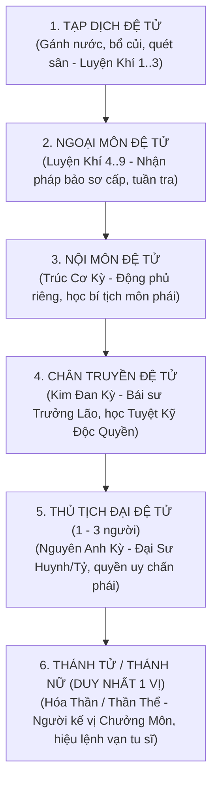
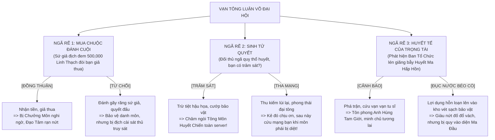

# [12] TÔNG MÔN TRẬT TỰ: HỆ THỐNG LỤC ĐẲNG ĐỆ TỬ & QUY CHẾ TÔNG PHÁI


> ⬅️ **[Bài Trước: Doc 11 - Cốt Truyện Phân Nhánh Ngũ Tộc & Lục Phái](file:///c:/Users/newre/OneDrive/Máy%20tính/code%20tutien/docs/11_COT_TRUYEN_LUC_PHAI_VA_KY_NGO.md)** | 📖 **[Mục Lục Toàn Cảnh](file:///c:/Users/newre/OneDrive/Máy%20tính/code%20tutien/README.md)** | ➡️ **[Bài Kế: Doc 13 - Toàn Thư Danh Phả 31 NPC & Nhân Quả Hai Chiều](file:///c:/Users/newre/OneDrive/Máy%20tính/code%20tutien/docs/13_TOAN_THU_NPC_NHAN_VAT_COT_TRUYEN.md)**

> *"Sơn môn nguy nga ngàn trượng, quy củ nghiêm minh như sắt. Bước chân vào tông môn, phàm nhân từ đống bùn lầy tạp dịch từng bước đổ máu tranh phong, đạp lên thiên kiêu vạn phái để bước lên đài Thánh Tử, hiệu lệnh thiên hạ!"*

Tài liệu này chuẩn hóa **Lục Đẳng Đồ Đệ (6 Cấp Bậc Đệ Tử Chính Quy)** áp dụng cho toàn bộ Tông Môn trong Tu Chân Giới Online, cùng hệ thống điều kiện thăng tiến, bổng lộc, quyền hạn và cơ chế cạnh tranh đoạt vị.

---

## 🏛️ 1. BẢNG PHÂN CẤP LỤC ĐẲNG ĐỆ TỬ (6-TIER SECT HIERARCHY)

Trật tự tông môn được phân chia nghiêm ngặt theo thứ tự lũy tiến:
$$\textbf{Tạp Dịch} \;\longrightarrow\; \textbf{Ngoại Môn} \;\longrightarrow\; \textbf{Nội Môn} \;\longrightarrow\; \textbf{Chân Truyền} \;\longrightarrow\; \textbf{Thủ Tịch} \;\longrightarrow\; \textbf{Thánh Tử / Thánh Nữ}$$



---

## 📜 2. CHI TIẾT ĐÃI NGỘ, ĐIỀU KIỆN & QUYỀN HẠN TỪNG CẤP BẬC

### 🧹 1. TẠP DỊCH ĐỆ TỬ (Laborer / Handyman Disciple)
* **Bản chất**: Phàm nhân mới nhập môn hoặc đệ tử có căn cốt thấp kém, chưa mở được Khí Hải.
* **Điều kiện nhập cấp**: Phàm nhân hoặc Luyện Khí Tầng 1 - 3; vượt qua kỳ kiểm tra thể lực cơ bản.
* **Bổn phận & Nhiệm vụ**:
  * Gánh nước tưới Linh Điền, dọn dẹp quảng trường sơn môn, đốn Linh Mộc ở bìa rừng.
* **Đãi ngộ & Quyền lợi**:
  * Bổng lộc: $50 \text{ Linh Thạch} / \text{ngày}$.
  * Chỗ ở: Phòng ngủ tập thể tại Tạp Dịch Viện.
  * Công pháp: Nhận bộ công pháp nhập môn cơ bản *[Tạp Dịch Thối Thể Quyết]* (+5% Khí Huyết).
* **Con đường thăng cấp**: Đạt **Luyện Khí Tầng 4** + Hoàn thành 10 nhiệm vụ tạp dịch $\rightarrow$ Đăng ký tham gia **Khảo Hạch Ngoại Môn**.

---

### 🗡️ 2. NGOẠI MÔN ĐỆ TỬ (Outer Court Disciple)
* **Bản chất**: Lực lượng đông đảo nhất của tông phái, bắt đầu bước vào con đường tu đạo chính thức.
* **Điều kiện nhập cấp**: Đạt **Luyện Khí Tầng 4 - 9**; thi đấu thắng khảo hạch hoặc có công dâng nộp dị bảo lúc bái sơn.
* **Bổn phận & Nhiệm vụ**:
  * Tuần tra sơn môn, thu gom thảo dược, săn bắt yêu thú cấp thấp bảo vệ bá tánh quanh vùng.
* **Đãi ngộ & Quyền lợi**:
  * Bổng lộc: $500 \text{ Linh Thạch} / \text{ngày}$ + 2 viên *Tụ Khí Đan* / tuần.
  * Trang bị môn phái: Nhận **Thanh Vân Đạo Bào** + **Phi Kiếm Hạ Phẩm**.
  * Tàng Kinh Các: Được phép vào **Tầng 1** mượn đọc các bí kíp Hoàng Giai.
* **Con đường thăng cấp**: Đột phá **Trúc Cơ Kỳ** + Lọt vào **Top 50 Đại Hội Tỷ Thí Ngoại Môn** tổ chức định kỳ $\rightarrow$ Tiến nhập Nội Môn.

---

### 🛡️ 3. NỘI MÔN ĐỆ TỬ (Inner Court Disciple)
* **Bản chất**: Rường cột của môn phái, được tông môn bắt đầu dồn tài nguyên bồi dưỡng thực sự.
* **Điều kiện nhập cấp**: Đạt **Trúc Cơ Kỳ (Sơ Kỳ trở lên)**; vượt qua Khảo Thí Trúc Cơ.
* **Bổn phận & Nhiệm vụ**:
  * Làm đội trưởng dẫn dắt đệ tử ngoại môn đi săn quái, trấn giữ các mỏ khoáng thạch, hộ tống thương đội tông môn.
* **Đãi ngộ & Quyền lợi**:
  * Bổng lộc: $3,000 \text{ Linh Thạch} / \text{ngày}$ + 1 viên *Trúc Cơ Đan* / tháng.
  * Cư ngụ: Được cấp **Động Phủ Độc Lập** có mắt Linh Tuyền nhỏ $\rightarrow$ Tốc độ Tọa Thiền tăng **$+25\%$**, không lo bị quấy rầy.
  * Tàng Kinh Các: Được vào **Tầng 2**, học các bộ kiếm quyết / chú thuật Huyền Giai.
* **Con đường thăng cấp**: Đột phá **Kim Đan Kỳ** + Được một vị Trưởng Lão nhận làm đồ đệ hoặc hoàn thành Nhiệm Vụ Sinh Tử $\rightarrow$ Thăng cấp Chân Truyền.

---

### 🌟 4. CHÂN TRUYỀN ĐỆ TỬ (True Transmission / Core Disciple)
* **Bản chất**: Tinh hoa tuyệt đối, là đệ tử đích truyền mang dòng máu và danh dự của các đại Trưởng Lão.
* **Điều kiện nhập cấp**: Đạt **Kim Đan Kỳ**; phải có một vị Trưởng Lão thực quyền hoặc Chưởng Môn đích thân nhận làm Đồ Đệ Thân Truyền.
* **Bổn phận & Nhiệm vụ**:
  * Tham gia tranh đoạt Bí Cảnh Thượng Cổ, đại diện tông môn giao lưu võ học liên phái, tiêu diệt ma đầu danh tiếng.
* **Đãi ngộ & Quyền lợi**:
  * Bổng lộc: $20,000 \text{ Linh Thạch} / \text{ngày}$ + Đan dược cực phẩm theo quý.
  * Cư ngụ: Sở hữu **Ngọn Núi Riêng Biệt (Độc Lập Đỉnh)** có **Tụ Linh Trận Cao Cấp** $\rightarrow$ Tọa Thiền tăng **$+50\%$ Tu Vi/s**, tự động thanh lọc Đan Độc $-3\%/\text{giờ}$.
  * Công Pháp: Được truyền thụ **Tuyệt Kỹ Độc Quyền Trấn Phái (Tầng 1 - 3)** mà tán tu không bao giờ học được.
  * Hộ pháp: Khi Độ Kiếp được Trưởng Lão đích thân hộ pháp $\rightarrow$ Giảm $30\%$ sát thương Lôi Kiếp.
* **Con đường thăng cấp**: Đạt **Nguyên Anh Kỳ** + Đánh bại các Chân Truyền khác trong **Đại Hội Luận Kiếm Tông Phái** $\rightarrow$ Đoạt chức Thủ Tịch.

---

### 👑 5. THỦ TỊCH ĐẠI ĐỆ TỬ (Chief / Head Disciple - Đại Sư Huynh / Đại Sư Tỷ)
* **Bản chất**: Đứng đầu toàn bộ đệ tử môn phái, là biểu tượng sức mạnh và uy nghiêm của thế hệ trẻ.
* **Số lượng giới hạn**: **Chỉ có từ 1 đến 3 người** trong toàn bộ Tông Môn (tùy quy mô tông môn).
* **Điều kiện nhập cấp**:
  * Đạt **Nguyên Anh Kỳ**.
  * Đứng đầu bảng Xếp Hạng Chiến Lực Chân Truyền hoặc chiến thắng Lôi Đài Khiêu Chiến Thủ Tịch.
* **Bổn phận & Nhiệm vụ**:
  * Thay mặt Chưởng Môn thanh lý môn hộ, chỉ huy đệ tử trong các cuộc Tông Môn Chiến tranh đoạt Linh Mạch.
* **Đãi ngộ & Quyền lợi**:
  * Bổng lộc: $100,000 \text{ Linh Thạch} / \text{ngày}$.
  * Trang bị: Ban thưởng **Pháp Bảo Bản Mệnh Trấn Môn Cực Phẩm** (VD: *Thanh Hư Thần Kiếm, Vạn Ma Lệnh Kỳ*).
  * Công Pháp: Mở khóa **Tuyệt Kỹ Trấn Phái Tối Cao (Tầng 4 - 5)**.
  * Quyền lực: Có quyền điều động Đội Chấp Pháp, phạt cấm túc hoặc tước đoạt tài nguyên của đệ tử cấp dưới vi phạm môn quy.
* **Con đường thăng cấp**: Vượt qua khảo nghiệm tối cao của Thái Thượng Trưởng Lão $\rightarrow$ Phong làm Thánh Tử / Thánh Nữ.

---

### ☀️ 6. THÁNH TỬ / THÁNH NỮ (Holy Son / Holy Maiden - Người Kế Vị Tối Cao)
* **Bản chất**: Thiên Đạo Chi Tử, người kế thừa ngai vị Chưởng Môn tiếp theo, là gương mặt đại diện cho toàn bộ tông phái trước cõi Hồng Hoang.
* **Số lượng giới hạn**: **DUY NHẤT 1 VỊ** trong toàn Tông Môn!
* **Điều kiện nhập cấp**:
  * Đạt **Hóa Thần Kỳ** (hoặc Kim Đan/Nguyên Anh nếu thức tỉnh **Hỗn Độn Linh Căn / Hoang Cổ Thần Thể** hiếm có 1-0-2).
  * Được Thái Thượng Trưởng Lão và Chưởng Môn cử hành đại lễ **Thiên Đạo Khấn Nguyện** phong vị.
* **Đãi ngộ & Quyền lực Tối Thượng**:
  * **Hưởng $10\%$ tổng tài nguyên** Linh Thạch và Dược liệu khai thác từ tất cả các mỏ Linh Mạch mà Tông Môn chiếm đóng trên toàn server!
  * **Hộ Tông Đại Trận Bất Diệt**: Sở hữu ngọc bội hộ thân có thể triệu hồi Hư Ảnh Chưởng Môn giáng lâm cứu nguy 1 lần mỗi tuần khi máu về 0.
  * **Hiệu Lệnh Toàn Phái**: Phát động Lệnh Tông Môn Chiến, chỉ định mục tiêu khai chiến với bang hội đối địch.
  * **Hào Quang Thánh Vực**: Đi đến đâu có dị tượng hào quang kim sắc tỏa ra đến đó, toàn bộ thành viên trong tông môn đi cùng được hưởng buff $+15\%$ toàn thuộc tính.

---

## ⚔️ 3. CƠ CHẾ TRANH ĐOẠT VỊ TRÍ & VẠN TÔNG LUẬN VÕ (PVP CHỨC VỊ & LIÊN PHÁI)

Trong thế giới Tu Chân Giới Online, địa vị không bao giờ là bất biến. Trật tự được tôi luyện qua hai cấp độ luận võ: **Nội Môn Đoạt Vị** và **Vạn Tông Luận Võ Liên Phái**.

---

### 3.1. Lôi Đài Đoạt Vị Nội Môn (Rank Challenge Hàng Tuần)
* Diễn ra vào mỗi tối **Chủ Nhật**:
  * Bất kỳ Chân Truyền Đệ Tử nào cũng có quyền gửi chiến thư khiêu chiến **Thủ Tịch Đại Đệ Tử**.
  * Trận đấu diễn ra công khai trước toàn thể môn phái. Người thắng lập tức soán ngôi nhận bổng lộc $100,000$ Linh Thạch/ngày và nắm quyền điều động Chấp Pháp Viện.
* **Luận Tội Phế Truất**:
  * Nếu Thủ Tịch hoặc Thánh Tử/Nữ vi phạm môn quy (bị bắt gặp đồ sát đồng môn, để mất mỏ Linh Mạch vào tay bang khác, hoặc bị điểm Ma Khí quá cao trái với tông phong) $\rightarrow$ Hội Đồng Trưởng Lão có quyền bỏ phiếu **Tước Đoạt Danh Hiệu**, giáng xuống làm **Tạp Dịch** để rèn luyện lại đạo tâm!

---

### 🏆 3.2. VẠN TÔNG LUẬN VÕ: ĐẠI HỘI THIÊN KIÊU LIÊN PHÁI (INTER-SECT GRAND TOURNAMENT)

* **Quy mô & Thể thức**:
  * Định kỳ hàng tháng, Thiên Đình giáng lệnh mở **Đấu Trường Côn Lôn Đỉnh**.
  * Toàn bộ Lục Đại Tông Môn trong Server (*Thanh Vân Kiếm Tông, Vạn Ma Uyên, Đan Hà Cốc, U Minh Quỷ Điện, Thái Hư Thần Môn, Hợp Hoan Tông*) cử ra đội ngũ tuyển thủ xuất sắc nhất ở từng bảng đấu:
    * **Bảng Thiếu Niên**: Dành cho Đệ Tử Ngoại Môn & Nội Môn (Luyện Khí - Trúc Cơ).
    * **Bảng Thiên Kiêu**: Dành cho Chân Truyền & Thủ Tịch (Kim Đan - Nguyên Anh).
  * **Sự Góp Mặt Của Tán Tu Hắc Mã**: Những Tán Tu giang hồ xuất sắc nhất cũng được cấp vé tham gia, đại diện cho ý chí tự do đến "vả mặt" các đại tông môn ngạo mạn!
* **Hệ Thống Đặt Cược Toàn Server (Sect Betting)**: Toàn bộ tu sĩ không thi đấu có thể chi Linh Thạch đặt cược cho các đấu thủ, tạo không khí lễ hội náo nhiệt.

#### 🎁 Phần Thưởng Đỉnh Cao:
* **Cho Cá Nhân Vô Địch**:
  * Ban thưởng **Thần Khí Thiên Giai Tối Thượng** + $1,000,000 \text{ Linh Thạch}$.
  * Mở khóa Danh Hiệu Độc Quyền Toàn Server: **[Côn Lôn Đệ Nhất Thiên Kiêu]**.
  * Nhận **Thái Cổ Đạo Dẫn Lệnh** mở khóa tầng ẩn của 4 Đại Bí Cảnh.
* **Cho Toàn Thể Tông Môn Của Quán Quân**:
  * Giành quyền cai quản và độc quyền khai thác **Cực Phẩm Linh Mạch Thần Cấp** trong 30 ngày!
  * Toàn bộ thành viên trong tông môn (từ Tạp Dịch đến Chưởng Môn) được **buff $+20\%$ Tốc độ Tu Vi/s** và nhân đôi lương bổng lộc hàng ngày trong suốt tháng đó!

---

### 🎭 3.3. CÁC CƠ CHẾ RẼ NHÁNH CỐT TRUYỆN ĐỊNH MỆNH TRONG ĐẠI HỘI (BRANCHING CHOICES)

Đại hội Luận Võ không đơn thuần là giao đấu tính điểm, mà là nơi diễn ra các âm mưu chính trị, cám dỗ danh lợi và quyết định lương tâm định đoạt tương lai:



#### 1. Ngã Rẽ 1: Vụ Giao Dịch Hắc Ám / Mua Chuộc Đánh Cuội (Match-Fixing Bribe)
* Đêm trước trận Bán Kết, một sứ giả bí ẩn của Tông Môn đối địch đem theo **$500,000 \text{ Linh Thạch}$** và một viên **Thần Đan Thượng Phẩm** đến gặp bạn: *"Sư đệ của ta cần chức vô địch để kế vị Chưởng Môn. Chỉ cần ngươi giả vờ trúng chiêu rơi khỏi lôi đài, toàn bộ chỗ này là của ngươi!"*
* **Lựa chọn**:
  * **[ĐỒNG THUẬN / NHẬN HỐI LỘ]**:
    * Nhận ngay $500,000$ Linh Thạch và Thần Đan tăng cấp vọt.
    * *Hệ quả dài hạn*: Chưởng Môn nhìn thấy đường kiếm giả tạo của bạn $\rightarrow$ Lạnh lùng tước quyền Chân Truyền, giáng xuống Ngoại Môn. Đạo Tâm vấy bẩn khiến Lôi Kiếp sau này khó qua.
  * **[TỪ CHỐI / CHÍNH KHÍ QUYẾT CHIẾN]**:
    * Đổ xúc xắc Uy Áp (D20 + ATK_Mod $\ge 12$): Đánh văng tên sứ giả ra khỏi cửa, hôm sau lên đài dùng thực lực nghiền nát đối thủ!
    * *Hệ quả dài hạn*: Đem vinh quang tối thượng về cho Tông Môn, được Chưởng Môn đặc cách thăng làm **Thủ Tịch Đại Đệ Tử**. Nhưng Tông Môn đối thủ ôm hận, cử sát thủ mai phục bạn ở bãi săn hoang dã.

#### 2. Ngã Rẽ 2: Sinh Tử Quyết - Nương Tay Hay Trảm Thảo Trừ Căn?
* Trong trận Chung Kết, bạn đánh gãy linh kiếm của đối thủ. Hắn ngã quỵ trên vũng máu, hai mắt vằn tia đỏ rực nhưng bất lực chờ chết. Theo quy định lôi đài: Nếu đối thủ chưa kịp hô "Nhận Thua", bạn có quyền tung đòn kết liễu hợp lệ.
* **Lựa chọn**:
  * **[XUẤT KIẾM TRẢM SÁT]**:
    * Nhát kiếm đoạt mạng, tước đoạt toàn bộ túi càn khôn và nhặt được Pháp Bảo Bản Mệnh của đối thủ.
    * *⚡ HỆ QUẢ CÁNH BƯỚM LÂU DÀI*: Tông Môn đối địch phát cuồng, Chưởng Môn của họ đứng bật dậy đập bàn tuyên bố **Huyết Chiến Trừ Diệt Môn Phái Bạn**! Kích hoạt sự kiện **Tông Môn Chiến Toàn Server** kéo dài 7 ngày, hai bên chém giết bất tận ngoài biên giới.
  * **[THU KIẾM THA MẠNG]**:
    * Bạn tra kiếm vào bao, đưa tay đỡ đối thủ dậy: *"Thắng bại là chuyện thường của binh gia, giữ mạng mà tiếp tục tu đạo!"*
    * *⚡ HỆ QUẢ CÁNH BƯỚM LÂU DÀI*: Đối thủ rơi lệ cúi đầu tạ ơn. Sau này khi môn phái của bạn gặp đại nạn bị bao vây, chính người này đã liều mạng phản bội tông môn của hắn, **mở cửa sau mật đạo để giải cứu bạn thoát chết**!

#### 3. Ngã Rẽ 3: Bí Mật Huyết Tế Đại Trận Của Ban Tổ Chức
* Giữa lúc đại hội sôi sục nhất, Thần Thức của bạn tình cờ dò quét phát hiện: Dưới chân lôi đài Côn Lôn Đỉnh đã được Ban Tổ Chức (Trọng tài tối cao bị ma hóa) lén chôn giấu một **Huyết Tế Cửu U Đại Trận** nhằm gom trọn tinh huyết của vạn vạn thiên kiêu đến dự khán!
* **Lựa chọn**:
  * **[PHÁ TRẬN CẢNH BÁO TOÀN TRƯỜNG]**:
    * Đổ xúc xắc Ngộ Tính (D20 + Ngộ Tính $\ge 15$): Bỏ dở chức vô địch, dùng kiếm khí kích nổ mắt trận vạch trần âm mưu. Cứu sống hàng vạn tu sĩ và tông môn các phái.
    * *Hệ quả*: Được toàn thể các đại phái đồng lòng suy tôn làm **Thiên Hạ Minh Chủ Kế Vị**, nhận được sự kính ngưỡng của toàn server.
  * **[ĐỤC NƯỚC BÉO CÒ - LẺN VÀO BẢO KHỐ]**:
    * Giả vờ không biết, nhân lúc đại trận phát động gây hỗn loạn, lén đột nhập vào Mật Thất Bảo Khố của Ban Tổ Chức vơ vét sạch sẽ hàng chục Thần Đan và Pháp Bảo Thượng Cổ!
    * *Hệ quả*: Giàu nứt đố đổ vách, tài nguyên đủ dùng 3 đời; nhưng bị liệt vào hàng ngũ Ma Đầu tàn nhẫn, Đạo Tâm chuyển dịch mạnh về Ma Tính (-40).

---

## 💾 4. CẤU TRÚC LƯU TRỮ TRONG DATABASE

```json
{
  "sect": {
    "sectId": "thanh_van_tong",
    "sectName": "Thanh Vân Kiếm Tông",
    "rank": "THU_TICH", 
    "rankTitle": "Thủ Tịch Đại Sư Huynh",
    "rankLevel": 5, // 1: TAP_DICH, 2: NGOAI_MON, 3: NOI_MON, 4: CHAN_TRUYEN, 5: THU_TICH, 6: THANH_TU
    "contributionPoints": 15400,
    "joinedAt": 1726000000000,
    "masterNpc": "Thanh Vân Chưởng Môn - Lý Huyền Chân",
    "exclusiveSkills": ["Thanh_Van_Kiem_Quyet_Tang_4", "Van_Kiem_Quy_Tong"],
    "tournamentHistory": {
      "lastRank": "QUAN_QUAN",
      "bribeChoice": "REJECTED", // REJECTED (Tố giác/quyết chiến) | ACCEPTED (Bán độ)
      "mercyChoice": "SPARE",    // SPARE (Tha mạng) | EXECUTE (Trảm sát)
      "savedRivalNpc": "Diệp Cô Thần - Vạn Ma Uyên"
    }
  }
}
```


---

> ⬅️ **[Bài Trước: Doc 11 - Cốt Truyện Phân Nhánh Ngũ Tộc & Lục Phái](file:///c:/Users/newre/OneDrive/Máy%20tính/code%20tutien/docs/11_COT_TRUYEN_LUC_PHAI_VA_KY_NGO.md)** | 📖 **[Mục Lục Toàn Cảnh](file:///c:/Users/newre/OneDrive/Máy%20tính/code%20tutien/README.md)** | ➡️ **[Bài Kế: Doc 13 - Toàn Thư Danh Phả 31 NPC & Nhân Quả Hai Chiều](file:///c:/Users/newre/OneDrive/Máy%20tính/code%20tutien/docs/13_TOAN_THU_NPC_NHAN_VAT_COT_TRUYEN.md)**
