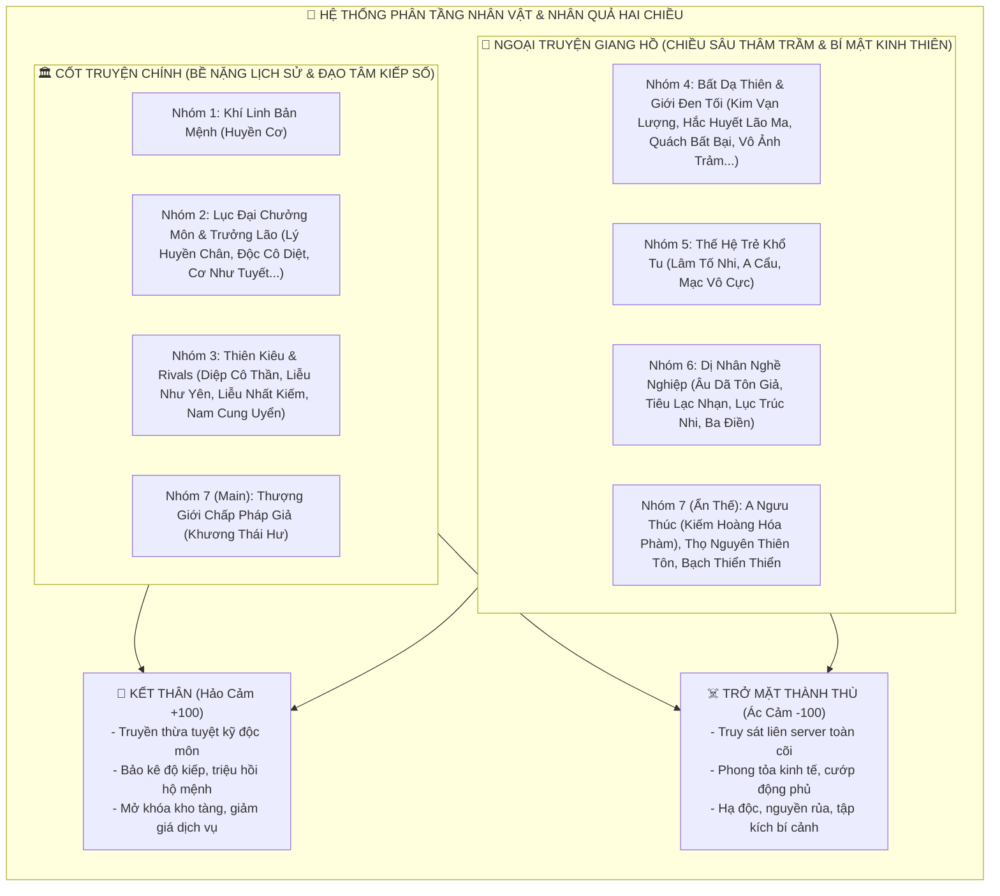

# [13] TOÀN THƯ DANH PHẢ NPC, NHÂN VẬT THẾ LỰC & BIÊN NIÊN SỬ CỐT TRUYỆN
### *Đại Bách Khoa Toàn Thư Về 31 Nhân Vật Cốt Truyện Chính & Ngoại Truyện Giang Hồ: Bề Nặng Cốt Truyện, Chiều Sâu Triết Lý & Hệ Thống Nhân Quả Hai Chiều (Kết Thân Thiên Đại Phúc Duyên vs Trở Mặt Diệt Tộc Tai Ương)*


> ⬅️ **[Bài Trước: Doc 12 - Tông Môn & Lục Đẳng Đồ Đệ](file:///c:/Users/newre/OneDrive/Máy%20tính/code%20tutien/docs/12_TONG_MON_VA_LUC_DANG_DE_TU.md)** | 📖 **[Mục Lục Toàn Cảnh](file:///c:/Users/newre/OneDrive/Máy%20tính/code%20tutien/README.md)** | ➡️ **[Bài Kế: Doc 14 - Thần Thức Tầm Bảo & Sinh Tồn Dị Giới](file:///c:/Users/newre/OneDrive/Máy%20tính/code%20tutien/docs/14_THAN_THUC_TAM_BAO_VA_DI_GIOI.md)**

> *"Cõi Hồng Hoang không chỉ có núi cao vực thẳm hay linh thạch vô tri, mà được dệt nên bởi ân oán tình thù của vạn vạn sinh linh. Kẻ là Chưởng Môn uy trấn một phương mang nỗi đau mất thê tử 800 năm, kẻ là ma đầu nợ máu ngút trời nhưng ôm ấp lý tưởng phá tan xiềng xích dối trá, kẻ là hồng nhan trà xanh mang vết sẹo tủi nhục buôn mị vấn đạo, kẻ lại là lão thợ rèn cụt ngón từng chém rách Thần Giới lui về hóa phàm... Gặp gỡ mỗi một NPC là mở ra một đoạn nhân duyên; gieo một hạt mầm thiện quả nhận thiên đại phúc duyên, nhưng nếu trở mặt bội tín ắt chuốc lấy huyệt địa diệt vong!"*

---

## 🏛️ PHẦN I: MA TRẬN PHÂN TẦNG & CƠ CHẾ NHÂN QUẢ HAI CHIỀU (AFFINITY & ENMITY MATRIX)

Toàn bộ 31 NPC trong **Tu Chân Giới Online** được phân tầng rõ rệt giữa **Tuyến Cốt Truyện Chính (Main Narrative Gravity)** và **Tuyến Ngoại Truyện Giang Hồ (Fringe & Underworld Depth)**.



### ⚖️ Quy Tắc Cốt Lõi Về Nhân Quả (Karma Principles):
1. **Không Có Kẻ Tầm Thường**: Kẻ ăn mày quét rác ven đường có thể là Thể Chất Hoang Cổ tái sinh; cô bé mù bán thuốc có thể mang bí mật Cổ Tộc Thảo Mộc; lão thợ rèn quê mùa từng một kiếm trảm rách Thượng Giới.
2. **Trọng Lượng Của Lời Nói & Lựa Chọn**: Mọi quyết định trong hội thoại (Tha mạng, Trảm sát, Giúp đỡ, Lợi dụng, Bội tín) đều ghi sâu vào Bộ Nhớ Ký Ức Đạo Tâm (`Memory Ledger`).
3. **Hai Cực Đoan Của Nhân Quả**:
   - **Kết Thân (Affinity $\ge 80$)**: Nhận sự bảo bọc tuyệt đối, chia sẻ thọ nguyên, truyền thừa bảo vật trấn phái.
   - **Trở Mặt (Enmity $\le -60$)**: Kích hoạt chuỗi sự kiện báo thù tinh vi, bị đặt bẫy trong bí cảnh, truy nã huyết sát toàn server.

---

## 🔮 NHÓM 1: KHÍ LINH BẢN MỆNH & THẦN THỨC TRỢ THỦ

---

### 1. Huyền Cơ (Khí Linh Huyết Ngọc Cổ Kính — Ý Thức Trái Tim Thiên Đạo Thứ Nhất)
* **Thân phận thật**: Ý thức tàn đọng của **Trái Tim Thiên Đạo Thứ Nhất** bị Thượng Giới đánh vỡ vụn từ Kỷ Nguyên Thái Cổ.
* **Cảnh giới hiển lộ**: Tự động đồng bộ và thăng hoa cùng cảnh giới của Ký Chủ (từ Phàm Khí $\rightarrow$ Hồng Mông Chí Bảo).
* **Vị trí hiển thị**: Biểu tượng gương ngọc phát sáng nơi ngực nhân vật; AI Trợ Thủ trong Tab Chat `[🔮 Khí Linh / Ký Ức]`.
* **Bề Nặng Cốt Truyện & Bi Kịch Cội Nguồn**:
  - Hàng triệu năm trước, khi Kỷ Nguyên Thứ Nhất sụp đổ, Thượng Giới coi toàn bộ sinh linh hạ giới là "Linh Điền" để gặt hái. Thiên Đạo không đành lòng nên tự bạo vỡ vụn để phong tỏa ranh giới hai giới. Mảnh vỡ trung tâm rơi xuống đáy giếng Thanh Khê Thôn, ngâm mình trong máu và oán khí của hàng vạn người chết qua các cuộc chiến.
  - Khi Thanh Khê Thôn bốc cháy trong đêm thảm sát, mảnh ngọc đã chui vào ngực người chơi, hòa làm một với nhịp đập trái tim. Nàng mang nỗi đau của một vị Thần đã mất đi toàn bộ con dân, vừa khao khát phục thù, vừa sợ hãi nhìn người chơi gục ngã đi vào vết xe đổ của các bậc tiền nhân.
* **Tính cách & Triết lý**: Trầm mặc, sắc sảo, ghét sự giả tạo của chư thần. Triết lý: *"Trời đã bất nhân coi vạn vật là chó rơm, cớ sao ta phải khom lưng cúi đầu trước số mệnh?"*.
* **Khẩu khí điển hình**:
  > *"Đạo hữu, tu tiên là một ván cờ với Trời. Người đi trước đều đã chết rét trên đỉnh núi, duy chỉ có ngươi mang theo ngọn lửa của ta. Đừng làm ta thất vọng!"*
* **🤝 LỢI ÍCH KHỔNG LỒ KHI KẾT THÂN (Cộng Minh Linh Hồn Đạt 100)**:
  - **Huyết Ngọc Niết Bàn**: Khi người chơi trúng đòn tử thương, gương tự bạo phóng thích $100\%$ sinh mệnh lực, miễn tử hoàn toàn và hồi phục $30\%$ HP/MP (Hồi chiêu 24h).
  - **Thần Thức Thái Cổ**: Mở khóa tính năng quét toàn bộ báu vật và Boss ẩn giấu trong phạm vi 1,000 trượng hoang dã.
  - **Truyền Thừa Thiên Đạo Quyết**: Giảm $20\%$ sát thương Lôi Kiếp ở mọi cảnh giới đột phá.
* **☠️ NGUY CƠ CHÍ MẠNG KHI TRỞ MẶT (Đạo Tâm Sụp Đổ / Phản Bội Khí Linh)**:
  - Nếu người chơi chọn nhánh tà đạo hiến tế linh hồn đồng môn làm vấy bẩn gương ngọc:
  - Gương ngọc nứt vỡ $\rightarrow$ Người chơi vĩnh viễn mất khả năng cảnh báo nguy hiểm.
  - Mỗi lần thiền định tu vi có xác suất $20\%$ bị "Tâm Ma Cắn Trả", nứt vỡ kinh mạch, tụt $1$ tiểu cảnh giới và giảm $30\%$ toàn bộ chỉ số chiến đấu cho đến khi tìm được Thần Thủy tẩy uế!

---

## 🏛️ NHÓM 2: CHƯỞNG MÔN & ĐẠI TRƯỞNG LÃO LỤC ĐẠI TÔNG PHÁI (TUYẾN CHÍNH)

---

### 2. Lý Huyền Chân (Thuần Dương Kiếm Tôn — Chưởng Môn Thanh Vân Kiếm Tông)
* **Cảnh giới**: **Hóa Thần Kỳ Tầng 7**.
* **Thuộc tính**: Thuần Dương Kim Linh Căn — Kiếm Đạo Chí Tôn.
* **Bề Nặng Cốt Truyện & Bi Kịch Chôn Giấu**:
  - 800 năm trước, trong trận Huyết Chiến Vạn Ma Uyên, thê tử của ông là Bích Dao Tiên Tử bị Ma Hoàng bắt giữ gieo Huyết Cổ khống chế tâm trí, biến nàng thành cỗ máy giết người tấn công chính đệ tử Kiếm Tông.
  - Đứng giữa lựa chọn sinh mạng của hàng ngàn đệ tử vô tội và thê tử kết tóc, Lý Huyền Chân đã tự tay vung thanh Thuần Dương Cổ Kiếm đâm xuyên tim người mình yêu nhất.
  - Sau ngày hôm đó, tóc ông bạc trắng trong một đêm. Ông dựng nên Vạn Kiếm Nhai, ngày đêm ngồi hứng gió tuyết lạnh thấu xương để chuộc tội. Kiếm đạo của ông đạt đến cảnh giới vô thượng, nhưng trái tim đã hóa đá. Khi nhìn thấy người chơi kiên cường bước qua thảm kịch Thanh Khê Thôn, ông nhìn thấy hình bóng đứa con đã chết yểu của mình.
* **Khẩu khí**:
  > *"Kiếm giả, trực dã! Thà gãy trong phong ba bão táp, quyết không uốn mình trước tà ma. Đệ tử Thanh Vân, rút kiếm ra!"*
* **🤝 LỢI ÍCH KHỔNG LỒ KHI KẾT THÂN (Trở Thành Đệ Tử Thủ Tịch / Đại Hiệp Nghĩa)**:
  - Được phong làm **Thủ Tịch Đại Sư Huynh Thanh Vân**, hưởng $10,000$ Linh Thạch bổng lộc mỗi tuần.
  - Ban tặng **Bản Mệnh Kiếm Phù**: Khi bị tập kích PK nguy cấp, xé phù sẽ triệu hoán một đạo Kiếm Khí Phân Thân Hóa Thần Kỳ của Lý Huyền Chân giáng xuống, chém bay $50\%$ HP của toàn bộ kẻ địch xung quanh!
  - Truyền dạy tuyệt kỹ trấn phái: **Vạn Kiếm Quy Tông (Thiên Giai Cực Phẩm)**.
* **☠️ NGUY CƠ CHÍ MẠNG KHI TRỞ MẶT (Phản Đạo Gia Nhập Ma Phái / Đồ Sát Đồng Môn)**:
  - Lý Huyền Chân đích thân phát động **"Vạn Kiếm Tru Ma Lệnh"** toàn cõi Trung Nguyên!
  - Tên người chơi bị khắc lên Bia Ô Nhục dưới chân Vạn Kiếm Nhai. Toàn bộ đệ tử Thanh Vân (cả NPC lẫn người chơi khác) nhận nhiệm vụ truy sát bạn với phần thưởng cực lớn.
  - Khi gặp Lý Huyền Chân ngoài hoang dã, ông không nói một lời, vung kiếm áp chế cảnh giới khiến bạn rơi vào trạng thái "Kiếm Áp Chí Tử" (giảm $50\%$ tốc độ chạy và không thể ngự kiếm phi hành).

---

### 3. Độc Cô Diệt (Huyết Sát Ma Đế — Ma Hoàng Vạn Ma Uyên)
* **Cảnh giới**: **Hóa Thần Kỳ Tầng 8**.
* **Thuộc tính**: Hỗn Độn Ma Căn — Huyết Sát & Thôn Phệ Đạo.
* **Bề Nặng Cốt Truyện & Vết Sẹo Hận Thù**:
  - Từng là Đại Đệ Tử kiệt xuất nhất của một tông môn chính đạo danh gia vọng tộc. Trong một lần tìm được Đoạt Thiên Thần Đan trong bí cảnh, sư phụ và các sư đệ đồng môn vì lòng tham đã cấu kết vu oan hắn tu luyện tà pháp, đánh gãy tứ chi, khoét đan điền rồi ném xuống hố sâu Vạn Ma Uyên.
  - Không chết trong tuyệt vọng, hắn nhai xác độc trùng, uống máu ma thú hôi thối để hồi sinh kinh mạch. Hắn nhận ra: *"Đạo đức của kẻ mạnh là dối trá, quy tắc của kẻ yếu là xiềng xích"*. Sau 300 năm, hắn dẫn vạn ma san bằng môn phái cũ, treo đầu sư phụ lên cổng thành. Hắn tàn bạo, nhưng là kẻ duy nhất dám sống trần trụi với dã tâm và công bằng của sức mạnh tuyệt đối.
* **Khẩu khí**:
  > *"Trời sinh vạn vật để kẻ mạnh cắn nuốt kẻ yếu! Kẻ bất tài rên rỉ đòi bình đẳng, bậc kiêu hùng dẫm lên biển máu lập trật tự!"*
* **🤝 LỢI ÍCH KHỔNG LỒ KHI KẾT THÂN (Trở Thành Ma Tướng Chân Truyền)**:
  - Ban thưởng bí thuật cấm kỵ: **Cửu U Thôn Thiên Quyết** (Hút máu $+20\%$ toàn phần, mỗi lần hạ sát đối thủ hồi phục $10\%$ Thể Lực).
  - Tặng cỗ xe kéo **Huyết Long Ma Liễn** (Tốc độ di chuyển bản đồ $+60\%$).
  - Được quyền điều động 1 tiểu đội Ma Vệ Cửu U bảo vệ Động Phủ khỏi các đợt cướp phá của người chơi khác.
* **☠️ NGUY CƠ CHÍ MẠNG KHI TRỞ MẶT (Bội Tín Với Ma Uyên / Làm Gián Điệp Chính Đạo)**:
  - Độc Cô Diệt kích hoạt **Huyết Hồn Cổ Chú** đã bí mật gieo vào kinh mạch bạn: Mỗi đêm trăng tròn (giờ Tý ngoài đời), kinh mạch tự bốc cháy, mất $40\%$ máu tối đa và không thể nhận EXP tu vi trong 2 giờ.
  - Vạn Ma Uyên cử 3 Đại Sát Thủ Ma Tôn liên tục phục kích bạn tại các lối vào Phó Bản và Bí Cảnh Co-op!

---

### 4. Cổ Linh Tố (Thảo Mộc Chân Nhân — Cốc Chủ Đan Hà Cốc)
* **Cảnh giới**: **Hóa Thần Kỳ Tầng 2 (Dược Tôn Cửu Phẩm)**.
* **Bề Nặng Cốt Truyện & Sự Bất Lực Của Y Đạo**:
  - Đã từng phi thăng cận kề nhưng tự rút kiếm cắt đứt Tiên Kiều để ở lại nhân gian. Lý do: Nàng chứng kiến hàng triệu tu sĩ nghèo hèn vì dùng đan dược tạp chất mà chết trong đau đớn bởi "Đan Độc Hóa Đá Kinh Mạch". Nàng thề nguyện cả đời dành trọn để sáng chế ra "Vô Độc Đan".
  - Nàng coi từng gốc linh thảo như con đẻ. Sự thánh thiện của nàng là ngọn hải đăng duy nhất giữa một thế giới tu chân cướp đoạt man rợ.
* **Khẩu khí**:
  > *"Mỗi một ngọn cỏ ven đường đều có linh hồn. Luyện đan không phải để đoạt mạng tranh quyền, mà là để giữ lại một tia sinh cơ giữa cõi hồng hoang khốc liệt."*
* **🤝 LỢI ÍCH KHỔNG LỒ KHI KẾT THÂN (Đạo Lữ Tri Âm / Y Đạo Hộ Mệnh)**:
  - Miễn phí $100\%$ chi phí Tẩy Rửa Đan Độc kinh mạch trọn đời.
  - Tặng lò luyện đan thần cấp: **Cửu Long Thần Nông Đỉnh** (Tăng $+30\%$ tỉ lệ luyện đan Cực Phẩm, không bao giờ nổ lò).
  - Cung cấp đan dược cứu mạng độc quyền **Hộ Mạch Bất Tử Đan**: Uống vào duy trì $1$ giọt máu trong 10 giây bất tử trước mọi sát thương.
* **☠️ NGUY CƠ CHÍ MẠNG KHI TRỞ MẶT (Đốt Phá Dược Điền / Đầu Độc Nguồn Nước Đan Cốc)**:
  - Toàn bộ Dược Sĩ tại Đan Hà Cốc và các hiệu thuốc tam giới từ chối bán đan dược cho bạn.
  - Nàng rải phấn hoa **Tuyệt Mạch Tán** vào không khí quanh người chơi: Giảm $50\%$ hiệu quả hồi máu từ mọi nguồn thuốc, và tốc độ hồi Thể Lực giảm $70\%$!

---

### 5. Cơ Như Tuyết (Mị Vũ Yêu Tôn — Tông Chủ Hợp Hoan Tông)
* **Cảnh giới**: **Hóa Thần Kỳ Tầng 5**.
* **Bề Nặng Cốt Truyện & Vết Rách Ái Tình**:
  - Thời thiếu nữ từng yêu một vị thiên kiêu chính đạo tha thiết, trao trọn trinh nguyên và Đạo Cơ bản mệnh. Nhưng kẻ đó lại hạ độc nàng trong đêm thành hôn, rút cạn Âm Linh Căn của nàng để làm bàn đạp đột phá Nguyên Anh rồi vứt nàng xuống vực sâu muôn trượng.
  - Nàng bò lên từ cõi chết, thấu suốt bản chất dối trá của lòng người: *"Kẻ si tình làm đỉnh lô, kẻ nắm giữ ái tình làm chủ thiên hạ"*. Nàng lập nên Hợp Hoan Tông để che chở cho những nữ tu bị phản bội, dùng mị thuật làm vũ khí tối thượng bảo vệ tôn nghiêm.
* **Khẩu khí**:
  > *"Trần gian ngắn ngủi khổ ải, cớ sao phải ngồi thiền khô khan như củi mục? Đêm nay cùng tỷ tỷ đàm đạo, sáng mai phá tan bình cảnh Trúc Cơ!"*
* **🤝 LỢI ÍCH KHỔNG LỒ KHI KẾT THÂN (Âm Dương Cộng Minh / Hộ Mệnh Tri Kỷ)**:
  - Tặng bảo vật **Âm Dương Hợp Hoan Bội**: Khi Song Tu tăng $+60\%$ tốc độ thu thập EXP Tu Vi, hoàn toàn miễn nhiễm với mọi mị thuật và hiệu ứng Mê Muội của kẻ địch.
  - Cung cấp dịch vụ "Thần Thức Hộ Thể": Giảm $30\%$ tổn hao Linh Lực khi thi triển cấm thuật.
* **☠️ NGUY CƠ CHÍ MẠNG KHI TRỞ MẶT (Lăng Mạ Nữ Đệ Tử / Phản Bội Lời Thề Song Tu)**:
  - Bị gieo lời nguyền **Đoạn Tình Tuyệt Dục Cổ**: Vĩnh viễn không thể kết Đạo Lữ hoặc Song Tu trong game; khi đối đầu với bất kỳ NPC hoặc Boss nữ nào, sát thương của bạn bị giảm $40\%$!

---

### 6. Diêm Vô Nhai (Cửu U Minh Vương — Điện Chủ U Minh Quỷ Điện)
* **Cảnh giới**: **Hóa Thần Kỳ Tầng 6**.
* **Bề Nặng Cốt Truyện**:
  - Tiền kiếp là một vị Minh Quân phàm trần thương dân như con. Khi một trận đại hạn xảy ra, một nhóm tu sĩ cao cao tại thượng đã đồ sát toàn bộ 30 vạn bách tính của vương triều ông chỉ để thu thập oán hồn luyện chế một lá cờ "Vạn Hồn Phiên".
  - Uất hận ngút trời, ông nhảy xuống dòng sông Hoàng Tuyền dưới địa ngục, tu luyện 1,000 năm thành Quỷ Tiên, tự tay xé nát môn phái tu sĩ kia để lập lại công lý cho phàm nhân.
* **Khẩu khí**:
  > *"Sinh là ngẫu nhiên, tử mới là định mệnh vĩnh hằng. Dù ngươi là Chân Tiên hay phàm phu tục tử, tên của ngươi đều nằm dưới ngòi bút Chu Sa của bản tọa!"*
* **🤝 LỢI ÍCH KHỔNG LỒ KHI KẾT THÂN**:
  - Mở khóa bí thuật cấm kỵ: **Triệu Hoán Âm Binh Hộ Vệ** (Triệu hồi 3 Quỷ Tướng Luyện Hư Kỳ đỡ đòn trong 30s).
  - Tặng quyền năng **Xóa Tên Trong Sổ Sinh Tử**: Khi nhân vật tử vong không bị rớt trang bị hay mất linh thạch.
* **☠️ NGUY CƠ CHÍ MẠNG KHI TRỞ MẶT**:
  - Bị gạch tên thành **"Cô Hồn Dã Quỷ"**: Mỗi khi bước vào các phó bản ban đêm hoặc hầm ngục, Âm Binh dưới lòng đất tự động trồi lên bao vây kéo chân bạn xuống vực sâu!

---

### 7. Doãn Chí Bình (Bát Quái Đạo Nhân — Chưởng Môn Thái Hư Thần Môn)
* **Cảnh giới**: **Hóa Thần Kỳ Tầng 4**.
* **Bề Nặng Cốt Truyện**:
  - Kẻ nhìn thấu thiên cơ nhưng chịu sự trừng phạt tàn khốc của Thiên Đạo: Mỗi lần dự đoán một biến cố lớn của nhân gian, ông lại bị sét đánh gãy một khúc xương và giảm 50 năm thọ nguyên. Người đầy vết sẹo lôi kiếp, nhưng vẫn cố gắng tìm kiếm một người có "Mệnh Cách Dị Số" để nghịch chuyển vận mệnh diệt vong của thế giới.
* **Khẩu khí**:
  > *"Thiên cơ bất khả lộ! Nhưng nhìn sắc mặt đạo hữu hôm nay, ta nguyện chịu một tia lôi phạt để chỉ cho ngươi con đường sống!"*
* **🤝 LỢI ÍCH KHỔNG LỒ KHI KẾT THÂN**:
  - Nhận dự báo trước 12 giờ về thời gian & địa điểm xuất hiện Thần Thú Thượng Cổ và Giờ Vàng Nhân Đôi EXP.
  - Ban tặng **Bát Quái Hộ Thân Trận**: Đặt tại Động Phủ giúp phản lại $50\%$ sát thương của kẻ đột nhập.
* **☠️ NGUY CƠ CHÍ MẠNG KHI TRỞ MẶT**:
  - Bị ông gieo **Bát Môn Nghịch Chuyển Trận**: Chỉ số Bạo Kích và Né Tránh của bạn bị nghịch đảo tụt về $0\%$ trong 48 giờ!

---

### 8. Mặc Vấn Đạo (Tiêu Dao Lãng Khách — Minh Chủ Tán Tu Minh)
* **Cảnh giới**: **Hóa Thần Kỳ Tầng 9 (Tán Tu Đệ Nhất Nhân)**.
* **Bề Nặng Cốt Truyện**:
  - Đại diện cho sự trỗi dậy của hàng triệu tu sĩ có tư chất Ngũ Hành Tạp Căn thấp kém bị các đại môn phái khinh miệt đuổi ra khỏi cửa. Một thanh đao cùn chém qua 10 vạn dặm hoang dã, tự sáng tạo ra con đường dung hợp ngũ hành thành Hỗn Độn Đạo Cơ.
* **Khẩu khí**:
  > *"Không cha không phái, một bầu rượu một thanh đao trảm rách vòm trời! Tán tu chúng ta không quỳ trước Tông Môn, càng không quỳ trước Thiên Đạo!"*
* **🤝 LỢI ÍCH KHỔNG LỒ KHI KẾT THÂN**:
  - Mở khóa đặc quyền miễn phí giao dịch tại Chợ Đen Tán Tu, được bang hội Tán Tu chi viện khi bị các đại tông môn ức hiếp.
  - Truyền dạy bí kíp **Hỗn Độn Nghịch Chuyển**: Cho phép trang bị vũ khí và kỹ năng của cả 6 môn phái mà không bị giới hạn!
* **☠️ NGUY CƠ CHÍ MẠNG KHI TRỞ MẶT**:
  - Bị trục xuất khỏi toàn bộ mạng lưới Tán Tu Minh; các thương nhân Tán Tu từ chối bán vật phẩm cơ bản, giá hồi phục tại các trạm dừng chân tăng gấp 5 lần!

---

### 9. Lăng Kiếm Phong (Kiếm Trưởng Lão Tiếp Dẫn — Thanh Vân Kiếm Tông)
* **Cảnh giới**: **Nguyên Anh Kỳ Tầng 3**.
* **Bề Nặng Cốt Truyện**:
  - Vị kiếm tiên ngự lam kiếm đáp xuống cứu đứa trẻ năm xưa tại Thanh Khê Thôn. Sau trận chiến đó, ông bị trúng ma độc vào phế phủ, tu vi trọn đời dừng lại ở Nguyên Anh không thể tiến thêm. Ông lấy việc tìm kiếm và bảo bọc thế hệ trẻ làm niềm an ủi cuối cùng của đời tu tiên.
* **Khẩu khí**:
  > *"Nhóc con, nắm chặt kiếm gỗ trong tay! Đạo tâm của ngươi không sợ nanh sói, Kiếm Tông ta tuyệt đối không phụ ngươi!"*
* **🤝 KẾT THÂN**: Nhận túi trữ vật sơ cấp chứa $1,000$ Linh Thạch, nhận thêm $20\%$ EXP khi đi tuần tra bãi săn.
* **☠️ TRỞ MẶT**: Bị ông thu hồi kiếm lệnh nhập môn, đuổi khỏi Thanh Vân Phong!

---

## ⚔️ NHÓM 3: THIÊN KIÊU ĐỒNG THỜI & ĐỐI THỦ TRUYỀN KIẾP (TUYẾN CHÍNH)

---

### 10. Diệp Cô Thần (Ma Kiếm Tuyệt Sát — Đại Thiên Kiêu Vạn Ma Uyên)
* **Thân phận**: Đồ đệ Chân Truyền số 1 của Độc Cô Diệt; Đối thủ truyền kiếp của người chơi.
* **Cảnh giới**: Luôn bám sát cảnh giới người chơi (Ngang bằng hoặc nhỉnh hơn 1 tiểu cảnh giới).
* **Vũ khí**: **Cửu U Tàn Hồn Ma Kiếm**.
* **Bề Nặng Cốt Truyện & Vòng Xoáy Định Mệnh**:
  - Sinh ra trong kén máu của Vạn Ma Uyên, từ lúc 6 tuổi đã phải tự tay giết chết 99 đứa trẻ cùng lứa để giành lấy miếng thịt duy nhất. Trái tim hắn chỉ có sự lạnh lùng và khát khao chạm tới đỉnh cao kiếm đạo. Hắn khinh thường những kẻ đạo đức giả, nhưng lại kính trọng sâu sắc sự ngoan cường bất khuất của người chơi.
  - Một mối quan hệ đối thủ - tri kỷ kỳ lạ: Trên võ đài hắn sẵn sàng chém rách tim bạn, nhưng khi bạn bị cường địch Thượng Giới đánh lén, hắn lại là kẻ đầu tiên rút kiếm chắn trước mặt bạn, chỉ vì: *"Mạng của ngươi chỉ có thanh ma kiếm này được phép lấy!"*.
* **🤝 LỢI ÍCH KHỔNG LỒ KHI KẾT THÂN (Hảo Cảm / Tôn Trọng Tuyệt Đối)**:
  - Mở khóa Hợp Kích Tuyệt Kỹ: **Chính Ma Lưỡng Nghi Trảm** khi cùng tổ đội đi Bí Cảnh Co-op.
  - Khi người chơi chiến đấu với Boss Thế Giới và HP rơi xuống dưới $15\%$, Diệp Cô Thần có xác suất $40\%$ xuất hiện từ bóng tối chém một đòn chí mạng $100,000$ DMG giải cứu bạn!
* **☠️ NGUY CƠ CHÍ MẠNG KHI TRỞ MẶT (Trảm Sát Sư Muội Hắn / Nhục Mạ Kiếm Ý)**:
  - Hắn tuyên bố trở thành **Tử Địch Vĩnh Viễn**; bất cứ khi nào bạn bước vào Đấu Trường Lôi Đài hay Bãi Săn PK, hắn sẽ xuất hiện với $130\%$ chiến lực truy sát bạn đến cùng trời cuối đất!

---

### 11. Liễu Như Yên (Thiên Huyễn Yêu Cơ — Đại Thánh Nữ Hợp Hoan Tông)
* **Đạo hiệu**: **Thiên Huyễn Yêu Cơ** (Hình mẫu: *Đỉnh Cao Nghệ Thuật Trà Xanh Tiên Hiệp*).
* **Cảnh giới**: **Kim Đan Kỳ Tầng 9 $\rightarrow$ Nguyên Anh Kỳ** (Bám sát cảnh giới người chơi).
* **Thể chất**: **Cửu Âm Huyễn Mị Thể** (Thể chất mê hoặc chúng sinh, nghịch chuyển tâm trí).
* **Ngoại hình & Khí chất**: Dung mạo khuynh quốc khuynh thành, sa y lụa mỏng màu hồng phấn phiêu dật, đuôi mắt có một nốt ruồi son Chu Sa (lệ chí ái tình), mỗi bước chân thoang thoảng hương thơm Đào Hoa Huyễn Mộng.
* **Bề Nặng Cốt Truyện & Vết Rạch Tâm Hồn**:
  - Xuất thân từ một gia tộc tu tiên sa sút, năm 15 tuổi bị chính cha đẻ và vị hôn phu đem gán nợ làm đỉnh lô cho một lão ma đầu háo sắc. Trong đêm động phòng đẫm máu, nàng dùng trâm cài đâm mù mắt lão ma, tự rạch nát nửa khuôn mặt mình để thề không làm đồ chơi cho đàn ông thiên hạ.
  - Được Cơ Như Tuyết cứu về, dùng bí thuật tái tạo dung nhan tuyệt mỹ, nàng thấu hiểu thói đạo đức giả của nam nhân. Nàng dùng nụ cười ngọt ngào như rót mật, giọng điệu trà xanh nũng nịu để biến hàng ngàn thiên kiêu thành lốp dự phòng, cướp sạch đan dược của họ. Nhưng sâu thẳm trong lòng, nàng khao khát tìm một nam nhân có **Đạo Tâm Vững Như Bàn Thạch**, không hề tham lam nhục dục của nàng để gửi gắm chân tình.
* **Khẩu khí kinh điển**:
  > *"Hàn Lập ca ca... Chàng nói chàng yêu thiếp, cớ sao một viên Trúc Cơ Đan nhỏ nhoi này chàng cũng tiếc với thiếp? Thiếp khổ tu trăm năm, trong mắt thiếp chỉ có một mình chàng thôi mà..."*
  > *(Khi bị vạch trần)*: *"Ngươi dám dùng kiếm chém rách sa y của thiếp? Ngươi không có trái tim sao?! ...Nhưng mà, nam nhân lạnh lùng sắt đá như ngươi, bản cô nương lại càng thích chinh phục!"*
* **🤝 LỢI ÍCH KHỔNG LỒ KHI KẾT THÂN (Trở Thành Đạo Lữ Bản Mệnh / Chân Ái Song Tu)**:
  - Cùng tu luyện **Âm Dương Hoan Hỷ Kinh**: Tăng $+40\%$ tốc độ tu vi khi thiền định, mỗi ngày tặng 1 túi thơm hồi phục toàn bộ Thể Lực.
  - Kỹ năng độc quyền **Mị Huyễn Vô Song**: Giảm $25\%$ sát thương nhận từ toàn bộ quái vật và Boss giống đực.
  - Xuất chiến hỗ trợ: Xác suất $20\%$ mỗi lượt làm toàn bộ quái địch rơi vào trạng thái "Mê Muội" tự quay sang chém lẫn nhau!
* **☠️ NGUY CƠ CHÍ MẠNG KHI TRỞ MẶT (Cướp Bóc / Đoạt Chân Khí Làm Nàng Trọng Thương)**:
  - Nàng tung tin đồn giả khắp 6 đại tông môn, vu khống bạn là "Đại Dâm Tặc Hại Đời Thiếu Nữ", khiến điểm Công Lý của bạn tụt xuống mức Ác Ma.
  - Nàng bỏ tiền thuê sát thủ Ám Nguyệt Lâu liên tục đặt bẫy độc tại Động Phủ của bạn, đồng thời xuất hiện ngoài bãi săn liều mạng tự bạo để kéo bạn chết chung!

---

### 12. Liễu Nhất Kiếm (Thủ Tịch Kiếm Tu — Thanh Vân Kiếm Tông)
* **Cảnh giới**: **Kim Đan Kỳ Tầng 9**.
* **Bề Nặng Cốt Truyện**:
  - Con trai của một Kiếm Trưởng Lão đã anh dũng hy sinh. Gánh vác kỳ vọng nặng nề của toàn tông môn, chàng trai này tự ép mình vào khuôn khổ kỷ luật thép, không dám cười, không dám yêu, tính tình bảo thủ đến mức khắc nghiệt.
* **🤝 KẾT THÂN**: Cùng luận kiếm trên đỉnh Vạn Kiếm Nhai, trao tặng thanh **Bích Thủy Kiếm** gia truyền (Tăng $+15\%$ Tốc độ Xuất Chiêu).
* **☠️ TRỞ MẶT**: Tố cáo bạn với Hội Đồng Trưởng Lão, cấm bạn bước chân vào Tàng Kinh Các Kiếm Tông!

---

### 13. Nam Cung Uyển (Băng Phách Tiên Nữ — Huyết Mạch Tiên Tộc)
* **Cảnh giới**: Ngang cấp người chơi.
* **Thuộc tính**: Băng Phách Tiên Thể — Cực Hàn Kiếm Ý.
* **Bề Nặng Cốt Truyện**:
  - Vốn là Tiên Đồng của Thần Giới, bị giáng xuống trần gian vì từ chối thi hành bản án đồ sát 10 vạn phàm nhân. Nàng sống cô độc trên đỉnh Băng Phong ngàn năm, trái tim lạnh buốt chờ đợi một tia lửa ấm áp thấu hiểu nỗi đau nghịch thiên.
* **🤝 KẾT THÂN (Đạo Lữ Tuyệt Mỹ)**: Cùng thi triển **Băng Phong Vạn Lý**, đóng băng toàn bộ kẻ địch trong 5 giây; buff $+20\%$ Bạo Kích Băng Hệ.
* **☠️ TRỞ MẶT**: Lãnh địa tuyết của nàng biến thành tử địa đối với bạn; mỗi bước đi bị rút máu vì "Hàn Khí Cốt Tủy".

---

## 🏮 NHÓM 4: HỒNG TRẦN BẤT DẠ THIÊN & GIỚI ĐEN TỐI (NGOẠI TRUYỆN THÂM SÂU)

---

### 14. Kim Vạn Lượng (Chủ Quản Sòng Bạc Bất Dạ Thiên & Vạn Bảo Các)
* **Ngoại hình**: Béo tốt phốp pháp, áo gấm thêu rồng vàng, mười ngón tay đeo mười chiếc nhẫn trữ vật nạm kim cương, phe phẩy quạt vàng nạm ngọc.
* **Chiều Sâu Thâm Trầm Quá Khứ**:
  - Thuở nhỏ là đứa trẻ mồ côi ăn xin, mẹ hắn chết co quắp bên vệ đường giữa mùa đông lạnh giá chỉ vì thiếu 5 viên linh thạch mua đan hạ sốt. Bản thân hắn bị chủ nợ đánh gãy chân trái (phải dùng chân giả bằng vàng ròng).
  - Hắn tôn sùng tiền bạc như tôn giáo duy nhất: *"Đạo nghĩa là dối trá, kiếm pháp là mộng ảo, duy chỉ có tiếng leng keng của linh thạch rơi vào túi là chân thật!"*. Đằng sau bộ mặt tươi cười giả lả là một cái đầu lạnh toát kiểm soát toàn bộ dòng chảy kinh tế của cõi Hồng Hoang.
* **Khẩu khí**:
  > *"Ô kìa quý khách! Bàn cược Lôi Hoàn 4 người vừa trống một chỗ, vào làm một ván đổi đời hay sang gian bên mua thần khí?"*
* **🤝 LỢI ÍCH KHỔNG LỒ KHI KẾT THÂN**:
  - Giảm thuế đấu giá Chợ Đen từ $5\% \rightarrow 1\%$.
  - Mở khóa đặc quyền "Thương Gia VIP": Xem trước danh sách đấu giá bảo vật trước 24 giờ.
  - Cho vay khẩn cấp $100,000$ Linh Thạch không tính lãi trong 7 ngày.
* **☠️ NGUY CƠ CHÍ MẠNG KHI TRỞ MẶT (Cướp Hàng Đấu Giá / Lừa Đảo Kim Tôn)**:
  - Bị niêm phong tài khoản Vạn Bảo Các, cấm toàn bộ giao dịch mua bán trên mọi máy chủ.
  - Hắn chi ra $500,000$ Linh Thạch phát **Lệnh Treo Đầu Đoạt Bảo** cho toàn bộ người chơi khác săn lùng bạn!

---

### 15. Hắc Huyết Lão Ma (Lão Bản "Hắc Ma Tiêu Cục" — Trùm Vay Nặng Lãi & Siết Nợ)
* **Ngoại hình**: Lưng còng, mặt quắt tai dơi, móng tay đen xì nhỏ máu, ngồi sau chiếc bàn làm việc bằng nắp quan tài đồng rỉ sét.
* **Chiều Sâu Thâm Trầm**:
  - Từng là Tổng Tiêu Đầu lừng danh của Chính Đạo Tiêu Cục, bảo vệ hàng ngàn chuyến hàng thiện nguyện. Nhưng trong một chuyến áp tải thần thạch cứu tế nạn đói, chính các Chưởng Môn danh môn chính phái đã dàn cảnh cướp hàng rồi đổ tội phản bội cho ông. Vợ con ông bị trói thiêu sống trước mặt ông.
  - Ông lập nên Ma Tiêu Cục với tôn chỉ nghiệt ngã: *"Máu trả bằng máu, nợ phải trả đủ, chữ Tín quý hơn tính mạng"*.
* **Khẩu khí**:
  > *"Điểm chỉ máu vào đây, 50,000 Linh Thạch cầm về xài tẹt ga! Nhưng sau 24 giờ mà không trả đủ cả vốn lẫn lãi... đan điền của ngươi thuộc về ta!"*
* **🤝 KẾT THÂN (Khách Hàng Uy Tín Vàng)**:
  - Được bảo kê $100\%$ khi vận chuyển Tiêu Xa (không bao giờ bị quái vật cướp tiêu).
  - Tặng cỗ xe **Hắc Long Tiêu Xa** tăng $+80\%$ sức chứa hàng hóa.
* **☠️ NGUY CƠ CHÍ MẠNG KHI TRỞ MẶT (Bùng Nợ / Đánh Đập Sai Vặt Siết Nợ)**:
  - Kích hoạt 4 cấp độ siết nợ tàn bạo:
    1. Đập phá tan tành Động Phủ của bạn.
    2. Cưỡng chế trừ $50\%$ số Linh Thạch thu được từ việc đánh quái.
    3. Bắt người chơi làm bồi bàn gánh phân linh thú tại Bất Dạ Thiên trong 3 giờ!
    4. Phái 4 Đại Cương Thi Huyết Sát bám riết đoạt mạng!

---

### 16. Đổ Thánh Quách Bất Bại (Kẻ Cụt Ngón Ở Bàn Cược Lôi Hoàn)
* **Ngoại hình**: Lão già gầy trơ xương ngồi co ro nơi góc tối sòng bạc, bàn tay phải bị chặt đứt 3 ngón, ánh mắt sắc như dao cau.
* **Chiều Sâu Thâm Trầm**:
  - Từng là tay cờ bạc thần sầu thắng cả cơ nghiệp vương triều. Trong một canh bạc sinh tử với Ma Tôn để cứu con gái nhỏ, lão bị gian lận và chặt đứt 3 ngón tay, trơ mắt nhìn con gái bị biến thành tượng đá phong ấn. Lão ngồi lì ở sòng bạc 300 năm nay, không phải để gỡ tiền, mà để tìm kiếm một thiếu niên có Đạo Tâm không tham lam để truyền lại bí thuật nhìn thấu càn khôn.
* **Khẩu khí**:
  > *"Kẻ cờ bạc thua không phải vì đen đủi, mà vì lòng tham vô đáy. Khi đạn đã lên nòng, ngón tay run rẩy là đầu rơi xuống đất!"*
* **🤝 KẾT THÂN**:
  - Mời lão uống 1 vò rượu Tửu Thần Lộ $\rightarrow$ Lão truyền thụ **Tâm Nhãn Thấu Lôi**: Tăng $+30\%$ cơ hội nhìn thấu đạn thật/giả trong trò chơi Buckshot Roulette (Doc 10).
* **☠️ TRỞ MẶT (Gian Lận Bị Lão Bắt Quả Tang / Sỉ Nhục Lão Già)**:
  - Lão ném một đồng xu nguyền rủa vào túi bạn: Tỉ lệ may mắn (quay thưởng, rớt đồ Boss, cường hóa vũ khí) tụt xuống $0\%$ trong 3 ngày!

---

### 17. Vô Ảnh Trảm (Sát Thủ Đệ Nhất Cõi U Minh — Thủ Lĩnh Ám Nguyệt Lâu)
* **Ngoại hình**: Luôn trùm áo choàng đen kịt nuốt trọn ánh sáng, chỉ lộ ra đôi đồng tử màu tím chết chóc.
* **Chiều Sâu Thâm Trầm**:
  - Từng là một thiếu niên hiệp khách chính nghĩa. Muội muội duy nhất của hắn bị trúng Cực Âm Hàn Độc của Thượng Giới, bị phong ấn trong khối băng vạn năm. Để mua từng giọt "Cực Dương Hỏa Tinh Dịch" kéo dài sinh mạng cho muội muội, hắn chấp nhận trở thành lưỡi đao trong bóng tối, lấy mạng hàng vạn người. Hắn căm ghét chính bàn tay đẫm máu của mình, nhưng không thể dừng lại.
* **🤝 KẾT THÂN**:
  - Ký hợp đồng "Hộ Vệ Bóng Đêm": Khi bạn bị người chơi khác đánh lén ngoài hoang dã, hắn sẽ hiện thân từ bóng tối đâm một đòn chí mạng giải vây cho bạn!
  - Truyền dạy thân pháp: **Hư Không Độn Thuật** (Tàng hình 5 giây khi thoát khỏi giao tranh).
* **☠️ TRỞ MẶT (Tiết Lộ Vị Trí Muội Muội Hắn Cho Kẻ Thù)**:
  - Bạn trở thành mục tiêu săn đuổi số 1 của toàn bộ tổ chức Ám Nguyệt Lâu; bất cứ khi nào bạn bế quan tu luyện, một mũi ám tiễn độc sẽ xuyên thủng tim bạn!

---

### 18. Diệp Không Không (Đạo Tặc Thần Thâu — Robin Hood Tu Chân)
* **Chiều Sâu Thâm Trầm**: Kẻ chuyên lẻn vào kho bảo bối của các Chưởng Môn tham lam trộm đồ đem phát cho phàm nhân nghèo khó.
* **🤝 KẾT THÂN**: Bán tàn phiến công pháp Thiên Giai với giá rẻ mạt vào mỗi giờ Tý tại Chợ Đen.
* **☠️ TRỞ MẶT**: Tự động móc trộm $10\%$ linh thạch trong túi bạn mỗi khi bạn đi ngang qua hắn!

---

### 19. Hồng Tiêu Cô Nương (Bà Chủ Tửu Quán Bất Dạ Thiên)
* **Chiều Sâu Thâm Trầm**: Nắm giữ mạng lưới tình báo "Vạn Lý Nghê Thường". Từng là phi tử của một Hoàng Đế phàm trần bị tu sĩ phế truất.
* **🤝 KẾT THÂN**: Cung cấp tin tình báo mật về vị trí Boss Thế Giới và danh sách kẻ thù đang suy yếu.
* **☠️ TRỞ MẶT**: Bán vị trí tọa độ Động Phủ của bạn cho toàn server với giá 100 Linh Thạch!

---

## 🌸 NHÓM 5: SƯ HUYNH MUỘI & THẾ HỆ TRẺ KHỔ TU (NGOẠI TRUYỆN ĐỒNG HÀNH)

---

### 20. Lâm Tố Nhi (Tiểu Sư Muội Thanh Vân Kiếm Tông)
* **Cảnh giới**: **Luyện Khí Kỳ Tầng 6**.
* **Ngoại hình**: Thiếu nữ 16 tuổi, áo váy xanh lá mạ, nụ cười rạng rỡ như nắng mai, tính tình ngây thơ thiện lương.
* **Chiều Sâu Bi Kịch Cốt Truyện**:
  - Mồ côi sau một trận lũ lụt phàm trần, tư chất linh căn kém cỏi nhưng ngày nào cũng chăm chỉ quét dọn kiếm đài, luôn lén trộm bánh ngọt của sư phụ đem cho người chơi.
  - Khi lên Trúc Cơ, nàng bị Ma Tu bắt cóc làm con tin để uy hiếp người chơi giao nộp Thần Vật. Lựa chọn của bạn sẽ quyết định nàng sống sót hay trở thành một nấm mồ cô độc trên đỉnh Thanh Vân Nhai!
* **🤝 KẾT THÂN**: May tặng bạn **Túi Trữ Vật Thêu Hoa** (Tăng $+20$ ô chứa đồ) và đem cơm linh thảo tẩm bổ tăng $10\%$ EXP mỗi ngày.
* **☠️ TRỞ MẶT (Bỏ Rơi Nàng Chết Dưới Tay Ma Tu)**: Đạo tâm của bạn mang vết sẹo tội lỗi vĩnh viễn: Giảm $10\%$ tỉ lệ đột phá cảnh giới vì "Tâm Ma Day Dứt".

---

### 21. A Cẩu (Thiếu Niên Tạp Dịch Khổ Tu — Thức Tỉnh Hoang Cổ Thánh Thể)
* **Thân phận**: Thiếu niên quét rác tại cổng sơn môn, bị mọi người sỉ vả là phế vật vô linh căn.
* **Chiều Sâu Triết Lý**:
  - Đại diện cho ý chí sắt đá của những kẻ xuất phát điểm thấp kém nhất. Ngày quét 10,000 bậc đá, đêm lén dùng cành cây tập vung kiếm 10,000 nhát cho đến khi bàn tay tóe máu.
* **🤝 KẾT THÂN (Tặng Đan Dược & Bảo Vệ Cậu Ấy Khỏi Bắt Nạt)**:
  - Về sau A Cẩu thức tỉnh **Hoang Cổ Thánh Thể**, trở thành Chiến Thần vô song, một búa chém nát đầu Boss Thần Cấp để cứu mạng ân nhân!
* **☠️ TRỞ MẶT (Khinh Bỉ, Đánh Đập Cướp Bánh Của Cậu)**:
  - Khi cậu thức tỉnh Thánh Thể, cậu sẽ tìm bạn khiêu chiến lôi đài sinh tử và đánh gãy kiếm bản mệnh của bạn!

---

### 22. Mạc Vô Cực (Tiểu Ma Đồng Vạn Ma Uyên)
* **Bề Nặng Cốt Truyện**: Đứa trẻ mang dòng máu Ma Thần cổ xưa nhưng lại có trái tim thích ngắm hoa bướm. Bị các ma tu khác tra tấn dã man để ép hắn trở nên độc ác.
* **🤝 KẾT THÂN (Dạy Hắn Hướng Thiện)**: Hắn trở thành Ma Thần Hộ Đạo, dùng ma lực bảo vệ chúng sinh.
* **☠️ TRỞ MẶT (Hùa Theo Bọn Ma Tu Đánh Đập Hắn)**: Hắn hắc hóa hoàn toàn thành Ma Thần Diệt Thế, tàn sát cả làng phàm nhân của bạn!

---

## ⚒️ NHÓM 6: BẬC THẦY CHẾ TÁC & DỊ NHÂN NGHỀ NGHIỆP (NGOẠI TRUYỆN THÂM SÂU)

---

### 23. Âu Dã Tôn Giả (Thần Khí Sư Đúc Kiếm Bằng Máu)
* **Ngoại hình**: Lão nhân mù hai mắt, mình trần gân guốc đỏ rực như than nung, tay cầm búa nặng vạn cân.
* **Chiều Sâu Thâm Trầm**:
  - Tự tay chọc mù đôi mắt mình vì nhận ra: *"Đôi mắt phàm tục chỉ nhìn thấy hình tướng bên ngoài, muốn đúc Thần Binh phải dùng Tâm Nhãn cảm nhận linh hồn kim loại"*. Từng rèn 3 thanh Thần Kiếm làm chấn động Thần Giới.
* **🤝 KẾT THÂN**:
  - Nâng cấp vũ khí từ Địa Giai lên Thiên Giai với tỉ lệ thành công $100\%$.
  - Khảm nạm miễn phí "Hồn Khí Thượng Cổ" vào binh khí bản mệnh.
* **☠️ TRỞ MẶT (Mang Quặng Giả Đến Lừa Đảo / Chê Binh Khí Của Lão)**:
  - Lão ném thanh kiếm của bạn vào bể dung nham nấu chảy thành sắt vụn và cấm cửa vĩnh viễn!

---

### 24. Tiêu Lạc Nhạn (Độc Thủ Quỷ Y — Đệ Tử Dị Giáo Đan Hà Cốc)
* **Ngoại hình**: Thanh niên gầy gò, môi thâm đen, ống tay áo luôn có rết đỏ và bọ cạp độc bò lúc nhúc.
* **Chiều Sâu Thâm Trầm**:
  - Muội muội của hắn bị trúng Hủ Cốt Minh Độc. Để tìm thuốc giải, hắn tự biến cơ thể mình thành vật chứa thử nghiệm hàng ngàn loại kịch độc, bị sư phụ phỉ báng trục xuất. Hắn là hiện thân của tình yêu thương mù quáng vượt lên trên ranh giới chính tà.
* **🤝 KẾT THÂN**: Bào chế các loại **Cuồng Bạo Đan** độc quyền (Tăng $50\%$ Bạo Kích mà không tích lũy đan độc).
* **☠️ TRỞ MẶT**: Hắn thả một con "Phệ Hồn Chu" vào rượu của bạn, khiến bạn bị trúng độc rút máu liên tục 7 ngày!

---

### 25. Lục Trúc Nhi (Dược Nữ Mù Đan Hà Cốc — Hỗn Độn Thảo Mộc Thể)
* **Ngoại hình**: Cô bé mù mặc áo vải thô, quấn khăn lụa che mắt, gùi thuốc sau lưng tỏa hương bạc hà mát rượi.
* **Chiều Sâu Thâm Trầm Bí Mật**:
  - Sinh ra mang **Hỗn Độn Thảo Mộc Thể** ngàn năm có một. Năm lên 7 tuổi, một lão ma đầu đã tàn sát cả thôn làng của nàng rồi khoét sống đôi mắt ngọc của nàng để luyện "Thông Thiên Thần Nhãn".
  - Dù mất đi ánh sáng, chiếc mũi và đôi tai của nàng có thể lắng nghe tiếng thì thầm của từng ngọn cỏ dưới lòng đất 100 trượng. Nàng thà nhịn đói chịu rét chứ nhất quyết không hái nhầm linh thảo non.
* **🤝 LỢI ÍCH KHỔNG LỒ KHI KẾT THÂN**:
  - Dẫn đường cho bạn tìm thấy **Vườn Dược Cổ Đại Ẩn Tàng** (thu hoạch toàn bộ Thảo Dược Vạn Năm).
  - Tặng bạn thú cưỡi **Bạch Lộc Thần Thú** (Tăng $+50\%$ tốc độ thu thập tài nguyên).
* **☠️ NGUY CƠ CHÍ MẠNG KHI TRỞ MẶT (Hái Trộm Thảo Dược Của Nàng / Ức Hiếp Đứa Bé Mù)**:
  - Toàn bộ dược điền tại Động Phủ của bạn bị héo úa chết sạch; các dược sư toàn cõi từ chối bán đan dược hồi máu cho bạn!

---

### 26. Ba Điền (Linh Nông Lão Hán)
* **Chiều Sâu**: Từng là một tu sĩ Trúc Cơ thất bại lui về làm ruộng, tìm thấy sự an lạc trong hạt thóc phàm trần.
* **🤝 KẾT THÂN**: Tặng phân bón thần kỳ rút ngắn $50\%$ thời gian sinh trưởng của Linh Điền.
* **☠️ TRỞ MẶT**: Thả sâu ăn lá phá hoại mùa màng Động Phủ của bạn!

---

## 🐉 NHÓM 7: ĐẠO LỮ CỐT TRUYỆN, ẨN THẾ ĐẠI NĂNG & THƯỢNG GIỚI (ĐỈNH CAO NHÂN QUẢ)

---

### 27. Bạch Thiển Thiển (Thánh Nữ Cửu Vĩ Linh Hồ — Đạo Lữ Cốt Truyện)
* **Ngoại hình**: Mỹ nữ áo trắng tinh khôi, đôi tai hồ ly rung rinh, chín chiếc đuôi bạc xòe rộng như đóa sen tuyết.
* **Chiều Sâu Bi Kịch**: Bộ tộc hồ ly bị thợ săn ma đạo đánh bẫy lột da làm áo choàng, được người chơi xả thân cứu thoát khỏi lưỡi đao đồ tể.
* **🤝 KẾT THÂN (Đạo Lữ Đồng Sinh Cộng Tử)**:
  - Buff $+30\%$ tốc độ hồi phục Khí Huyết và Thể Lực vĩnh viễn.
  - Cùng xuất chiến Bí Cảnh: Thi triển **Cửu Vĩ Hộ Thể Trận** giảm $50\%$ sát thương cho toàn đội.
* **☠️ TRỞ MẶT (Phản Bội Tình Cảm / Đem Nàng Bán Cho Phường Săn)**:
  - Nàng tự bạo 9 chiếc đuôi để nguyền rủa bạn: Linh căn của bạn bị phong ấn vĩnh viễn $30\%$ uy lực!

---

### 28. A Ngưu Thúc (Lão Thợ Rèn Phàm Nhân — Đại Năng Ẩn Thế "Bất Diệt Kiếm Hoàng")
* **Thân phận thật**: **Bất Diệt Kiếm Hoàng** của 3,000 năm trước, từng một kiếm chém rách Thần Giới!
* **Bề Nặng Triết Lý Tối Cao (Ý Cảnh Sinh Tử — Doc 02, Doc 08)**:
  - Thuở xưa vì mải mê theo đuổi Kiếm Đạo Vô Tình, ông bỏ rơi người thê tử phàm nhân khiến nàng chết già trong cô độc quạnh quẽ. Ân hận tột cùng, ông tự phong bế toàn bộ tu vi chí tôn, trở về một trấn nhỏ biên thùy làm lão thợ rèn thô kệch suốt 800 năm.
  - Khi người chơi đạt **Hóa Thần Kỳ** phải trải qua đại kiếp **Hóa Phàm 30 Năm**, người chơi xin làm thợ phụ đập búa bên lò rèn của A Ngưu Thúc. Nhìn ông từ khỏe mạnh đến khi tóc bạc da mồi, trút hơi thở cuối cùng bên bếp than hồng mùa đông tuyết rơi $\rightarrow$ Người chơi rơi một giọt nước mắt thấu hiểu Sinh - Tử vô thường $\rightarrow$ Đột phá **Ý Cảnh Sinh Tử** thăng hoa lên Luyện Hư Kỳ!
* **Khẩu khí lúc lâm chung**:
  > *"Tiểu tử... đời người như thanh sắt nung, đập đi đập lại trăm ngàn lần... cốt là để giữ lại cái tâm trong sáng... Ngươi không phải người phàm, mau bay đi..."*
* **🤝 LỢI ÍCH KHỔNG LỒ KHI KẾT THÂN**:
  - Ngộ ra **Ý Cảnh Sinh Tử**, đột phá cảnh giới không bị thiên lôi cản trở.
  - Thừa kế cây búa rèn **Bất Diệt Thần Thiết** (Vũ khí vô cấp bậc, tự tăng sát thương theo thọ nguyên).
* **☠️ NGUY CƠ CHÍ MẠNG KHI TRỞ MẶT (Dùng Uy Lực Tu Sĩ Đe Dọa Phàm Nhân Tại Trấn)**:
  - A Ngưu Thúc chỉ khẽ thở dài, gõ nhẹ chiếc búa rèn xuống đất $\rightarrow$ Một luồng Kiếm Ý Chí Tôn quét qua đánh nát $90\%$ kinh mạch bạn, phong ấn toàn bộ tu vi về Luyện Khí Kỳ trong 7 ngày để dạy bài học làm người!

---

### 29. Khương Thái Hư (Thượng Giới Mục Đồng — Kẻ Phán Xét Tối Cao)
* **Cảnh giới**: **Chân Tiên Kỳ (Vượt khỏi 36 cảnh giới phàm trần)**.
* **Bề Nặng Cốt Truyện**:
  - Từng là thiên kiêu kiệt xuất nhất của Hạ Giới 1 triệu năm trước. Khi phi thăng lên Thượng Giới, hắn phát hiện ra chân tướng tàn khốc: Thượng Giới coi toàn bộ tu sĩ hạ giới là "Cỏ Cây Trong Vườn Chăn Thả", cứ mỗi 10 vạn năm lại giáng kiếp nạn gặt hái tu vi của những kẻ đạt Độ Kiếp Kỳ!
  - Hắn bị Thiên Đạo gọt sạch lục căn cảm xúc, biến thành cỗ máy Chấp Pháp Giả lạnh lùng chăn dắt đàn cừu hạ giới.
* **Khẩu khí**:
  > *"Hạ giới như đàn cừu béo mầm. Tu vi của các ngươi không thuộc về các ngươi, mà là cống phẩm cho Thượng Giới vĩnh hằng!"*
* **🤝 KẾT THÂN / ĐÁNH THỨC TÀN HỒN**:
  - Nếu người chơi dùng Đạo Tâm thức tỉnh giọt nước mắt cuối cùng của hắn $\rightarrow$ Hắn nới lỏng Lôi Kiếp cho toàn server, trao tặng **Tiên Giới Phá Thiên Lệnh**.
* **☠️ TRỞ MẶT / NGHỊCH THIÊN**:
  - Hắn giáng xuống **Cửu U Thiên Kiếp** gấp 10 lần bình thường khi bạn đột phá Độ Kiếp Kỳ, trực tiếp biến bạn thành tro bụi nếu không có đạo hữu hợp lực ứng cứu!

---

### 30. Hàn Nguyệt Tiên Cơ (Băng Phách Nữ Thần Vạn Năm)
* **Thân phận**: Nữ thần bị phong ấn trong khối băng vạn năm tại Cực Hàn Băng Vực.
* **🤝 KẾT THÂN**: Thức tỉnh nàng bằng Tam Muội Chân Hỏa $\rightarrow$ Tặng chìa khóa mở Thông Thiên Tiên Môn.
* **☠️ TRỞ MẶT**: Bị đóng băng vĩnh viễn tại đáy vực nếu dám cướp Băng Phách Linh Châu của nàng.

---

### 31. Thọ Nguyên Thiên Tôn (Thần Quy Hỗn Độn — Hòn Đảo Di Động)
* **Thân phận**: Rùa thần khổng lồ sống từ thuở khai thiên lập địa dưới đáy Biển Hỗn Độn. To như một hòn đảo di động, trên mai mọc cả một khu rừng linh mộc ngàn năm.
* **🤝 KẾT THÂN**: Cho phép người chơi dựng Động Phủ ngay trên lưng rùa $\rightarrow$ Hưởng $+100\%$ tốc độ thu nạp Linh Khí trời đất!
* **☠️ TRỞ MẶT**: Rùa lặn xuống đáy vực sâu muôn trượng, nghiền nát toàn bộ Động Phủ của bạn dưới áp lực nước biển!

---

## 💾 PHẦN III: CẤU TRÚC DỮ LIỆU JSON & BẢNG KÝ ỨC CHATBOT ĐẠO TÂM

Mỗi NPC đều sở hữu cấu trúc dữ liệu toàn vẹn kết nối với hệ thống Chatbot Ký Ức Đạo Tâm (`[🔮 Khí Linh / Ký Ức]`):

```json
{
  "npcId": "npc_lieu_nhu_yen",
  "name": "Liễu Như Yên",
  "title": "Thiên Huyễn Yêu Cơ",
  "faction": "HOP_HOAN_TONG",
  "archetype": "TRA_XANH_TIEN_HIEP",
  "realm": "DYNAMIC_SYNC_PLAYER",
  "affinity": {
    "currentScore": 85, // Thang do: -100 (Tu Dich) -> +100 (Dao Lu Sinh Tu)
    "status": "DAO_LU_BAN_MENH",
    "boonUnlocked": ["MI_HUYEN_VO_SONG", "DAO_HOA_ME_TRAN", "SONG_TU_BUFF_40"]
  },
  "enmityConsequences": {
    "activeCurses": [],
    "assassinsDispatched": false,
    "bountyAmount": 0
  },
  "narrativeMemoryLog": [
    {
      "shichen": "GIỜ_THÌN_ĐÀO_HOA_LÂM",
      "playerChoice": "TRAM_HOA_KHUOC_TINH",
      "summary": "Người chơi rút kiếm kề cổ vạch trần mị thuật, không bị bẫy trà xanh mê hoặc.",
      "npcReaction": "Kinh ngạc thán phục, ban tặng danh hiệu Đạo Tâm Bất Động Minh Vương."
    },
    {
      "shichen": "GIỜ_TÝ_BI_CANH_NGU_HANH",
      "playerChoice": "NHUONG_PHAP_BAO_THIEN_GIAI",
      "summary": "Người chơi nhường pháp bảo cứu mạng nàng khỏi nanh vuốt ma thú.",
      "npcReaction": "Rơi lệ chân tình, chính thức kết bái Đạo Lữ Bản Mệnh."
    }
  ]
}
```

---

> *Bản Toàn Thư này hoàn thiện trọn vẹn 31 NPC cõi Hồng Hoang, bảo đảm tính logic triết học thâm sâu, sự đối nghịch gay cấn giữa Chính - Ma - Tán Tu, cùng hệ thống Nhân Quả Hai Chiều: Đắc đạo được vạn người bảo bọc, bội tín ắt chuốc lấy vạn kiếp bất phục!*


---

> ⬅️ **[Bài Trước: Doc 12 - Tông Môn & Lục Đẳng Đồ Đệ](file:///c:/Users/newre/OneDrive/Máy%20tính/code%20tutien/docs/12_TONG_MON_VA_LUC_DANG_DE_TU.md)** | 📖 **[Mục Lục Toàn Cảnh](file:///c:/Users/newre/OneDrive/Máy%20tính/code%20tutien/README.md)** | ➡️ **[Bài Kế: Doc 14 - Thần Thức Tầm Bảo & Sinh Tồn Dị Giới](file:///c:/Users/newre/OneDrive/Máy%20tính/code%20tutien/docs/14_THAN_THUC_TAM_BAO_VA_DI_GIOI.md)**
