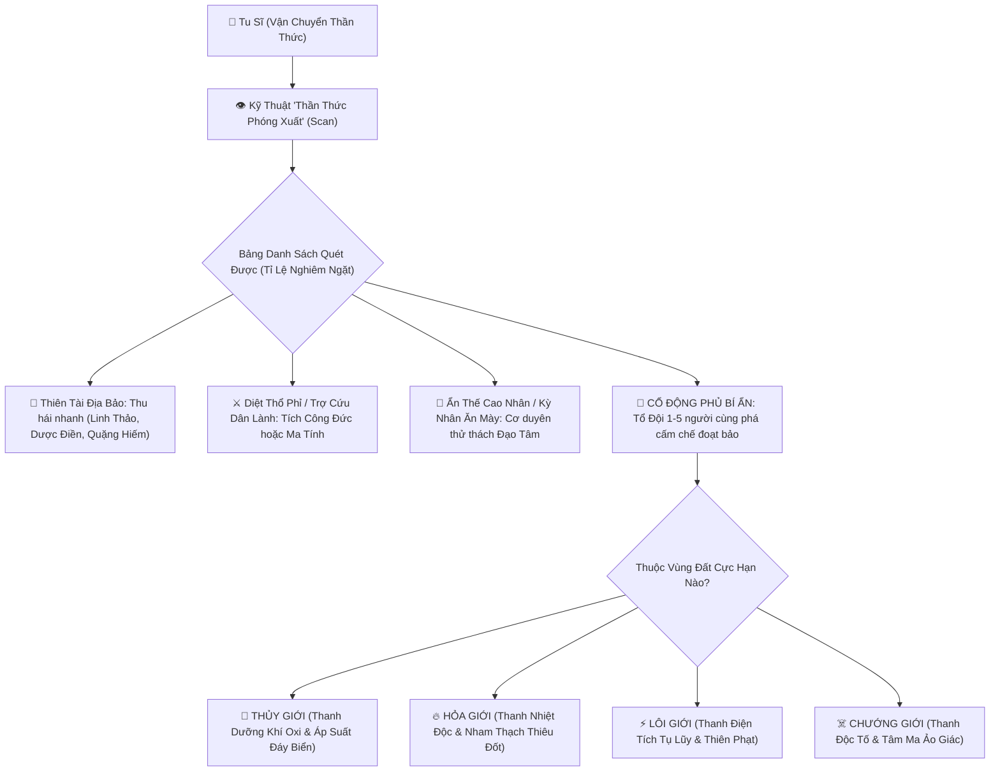
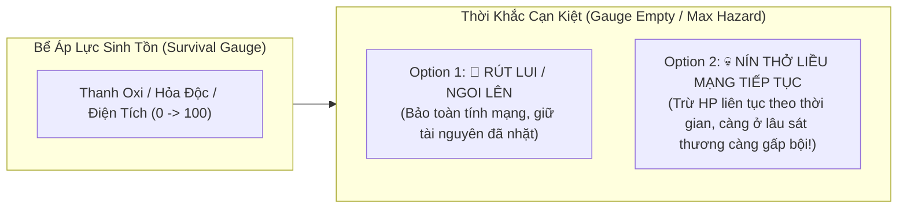
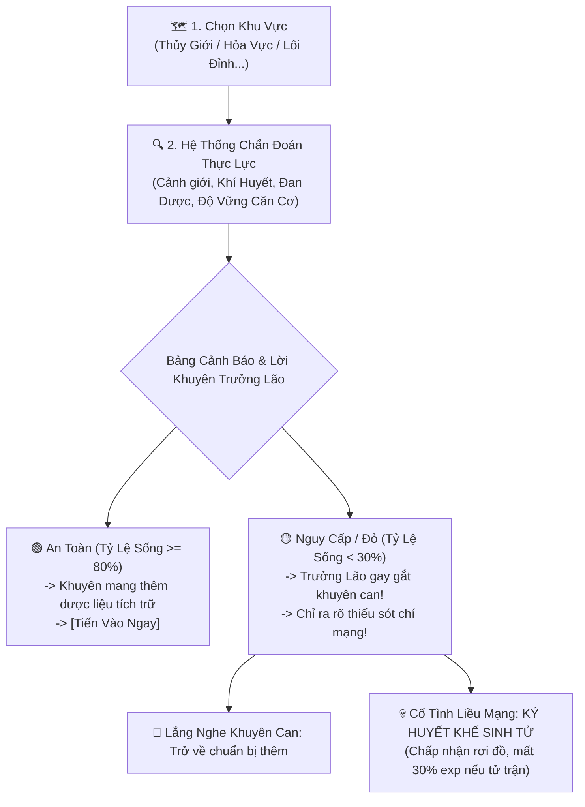
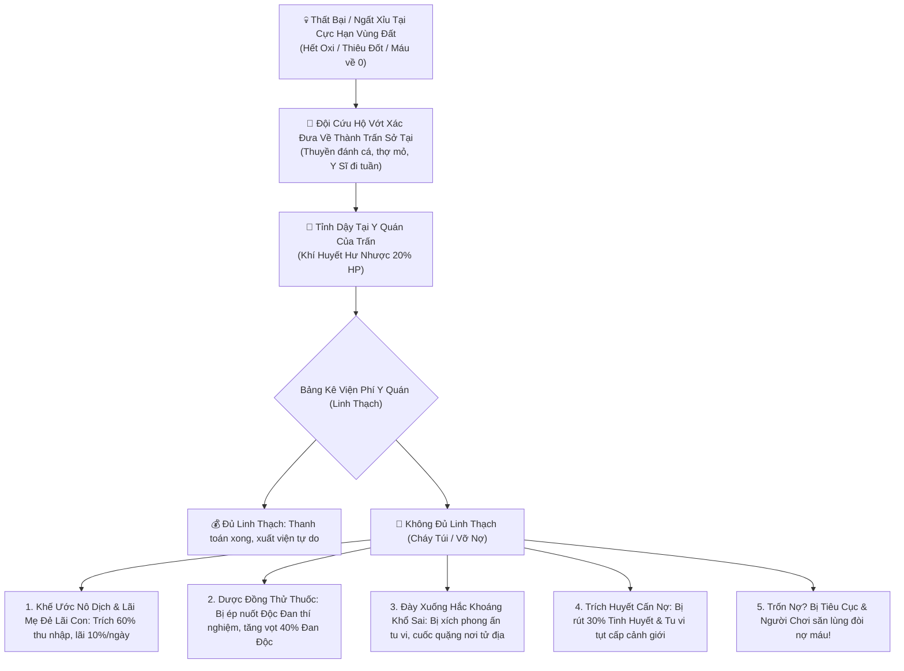
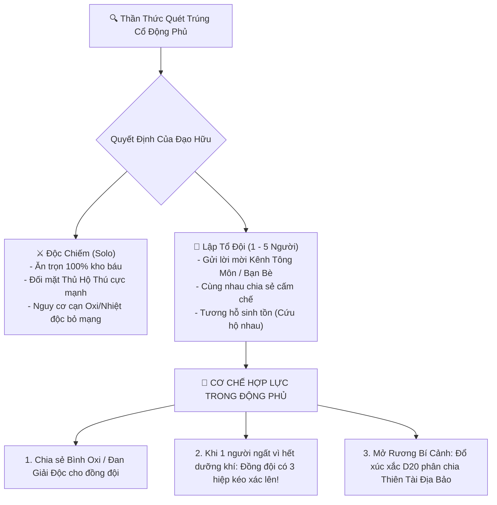

# [14] KIẾN TRÚC HỆ THỐNG: THẦN THỨC BÁT HOANG & SINH TỒN DỊ GIỚI (DIVINE SENSE SCANNING & EXTREME REALMS)

> ⬅️ **[Bài Trước: Doc 13 - Toàn Thư Danh Phả 31 NPC & Nhân Quả Hai Chiều](file:///c:/Users/newre/OneDrive/Máy%20tính/code%20tutien/docs/13_TOAN_THU_NPC_NHAN_VAT_COT_TRUYEN.md)** | 📖 **[Mục Lục Toàn Cảnh](file:///c:/Users/newre/OneDrive/Máy%20tính/code%20tutien/README.md)** | ➡️ **[Bài Kế: Doc 15 - Tửu Lầu, Sòng Bạc Buckshot & Vay Nợ](file:///c:/Users/newre/OneDrive/Máy%20tính/code%20tutien/docs/15_TIU_LAU_SONG_BAC_VA_TIN_DUNG_DEN.md)**

> *"Tu sĩ chân chính ngao du thiên hạ, nào cần dùng hai mắt phàm tục nhìn đường? Phóng xuất Thần Thức, vạn dặm sơn hà thu vào một niệm! Dưới đáy vạn trượng Đông Hải tìm Giao Long Thủy Phủ, trong lòng dung nham Địa Tâm đoạt Thiên Hỏa Dị Chủng. Muốn đoạt tạo hóa nơi tuyệt cảnh, phải đổi bằng sinh mạng: hết hơi dưới đáy biển sâu, nhiệt độc thiêu đốt lục phủ ngũ tạng... Đi tiếp đoạt bảo hay ngoi lên giữ mạng? Đó chính là lằn ranh giữa kẻ nghịch thiên thành thần và nắm xương tàn dưới đáy đại dương!"*

Tài liệu này quy chuẩn hóa ý tưởng thiết kế xuất sắc của bạn: **Thay thế di chuyển pixel thông thường bằng Hệ Thống Thần Thức Tầm Bảo kết hợp Cơ Chế Sinh Tồn Tại Các Cực Hạn Vùng Đất (Thủy Giới, Hỏa Ngục, Lôi Vực...)**.

---

## 🧭 I. TỔNG QUAN KIẾN TRÚC: THẦN THỨC VÀ DỊ GIỚI

---

## 👁️ II. CƠ CHẾ "THẦN THỨC TẦM BẢO" THEO CẢNH GIỚI (DIVINE SCAN)

Trong Tiên Hiệp, **Thần Thức (Spiritual Sense)** là giác quan thứ sáu của tu sĩ. Cảnh giới càng cao, Thần Niệm càng mạnh, phạm vi rò quét càng xa và càng nhìn thấu các bí cảnh bị phong ấn.

### 2.1. Năng Lực Thần Thức Theo Cảnh Giới

| Cảnh Giới | Tên Cấp Thần Thức | Bán Kính Quét | Số Lượng Mục Tiêu Phát Hiện | Thời Gian Hồi (Cooldown) | Khả Năng Thấu Thị Cấm Chế |
| :--- | :--- | :---: | :---: | :---: | :--- |
| **Luyện Khí (1 - 9)** | *Sơ Thức (Ý Niệm)* | $10 \text{ dặm}$ | $2 - 3 \text{ vị trí}$ | $60 \text{ giây}$ | Chỉ quét được bề mặt: Linh thảo hạ phẩm, thú dữ phàm tục, sơn tặc cướp bạt. |
| **Trúc Cơ** | *Thần Niệm Hóa Hình* | $50 \text{ dặm}$ | $4 - 5 \text{ vị trí}$ | $45 \text{ giây}$ | Nhìn sâu xuống lòng đất $100\text{m}$: Mạch khoáng ngầm, Động Phủ Tán Tu sơ cấp. |
| **Kim Đan** | *Thần Thức Xuất Khiếu* | $200 \text{ dặm}$ | $6 - 7 \text{ vị trí}$ | $30 \text{ giây}$ | Nhìn thấu Ảo Trận: Thủy Phủ dưới đáy biển, Động Phủ Cổ Nhân, Dị Bảo phát quang. |
| **Nguyên Anh** | *Thần Vực Hàng Lâm* | $1,000 \text{ dặm}$ | $8 - 10 \text{ vị trí}$ | $20 \text{ giây}$ | Xuyên thấu Không Gian: Khe nứt bí cảnh thượng cổ, nhìn thấu Ẩn Thế Cao Nhân cải trang. |
| **Hóa Thần** | *Thiên Đạo Đồng Hóa* | $5,000 \text{ dặm}$ | $12 - 15 \text{ vị trí}$ | $10 \text{ giây}$ | Quét trọn vẹn cả một Đại Châu: Thần Vật Thái Cổ, Thần Ma Tàn Hài, Tiên Cốt xuất thế! |

---

### 2.2. Ma Trận Tỉ Lệ Xuất Hiện Mục Tiêu Nghiêm Ngặt (Strict Rarity Matrix)

Mỗi lần bấm nút **[Phóng Thần Thức]**, hệ thống tính toán dựa trên **Cảnh Giới $\times$ Khí Vận (Luck) $\times$ Đạo Nhãn/Trùng Đồng**:

| Nhóm Mục Tiêu | Tỉ Lệ Cơ Bản | Nội Dung Chi Tiết | Hành Động Khả Thi Của Người Chơi |
| :--- | :---: | :--- | :--- |
| **1. Tài Nguyên Linh Dược / Quặng Mạch** | $65\%$ | Bụi Linh Chi 50 năm, Mỏ Huyết Thạch, Cây Ngưng Khí Quả... | **[Thu Thập Nhanh]**: Nhặt ngay vào túi đồ (mất 2s), nhận exp Nghề Hái Lượm / Khai Khoáng. |
| **2. Yêu Thú Tác Loạn / Thổ Phỉ Sơn Tặc** | $20\%$ | Ổ cướp Hắc Phong Trại đang chặn đường giết dân; Yêu Thú cuồng bạo. | **[Đánh Úp Tiêu Diệt]**: Đánh úp bất ngờ tăng $20\%$ bạo kích hiệp đầu. Cứu dân lành $\rightarrow$ Tăng **Công Đức Thiên Đạo**; Đồ sát cướp kho bạc $\rightarrow$ Tăng **Ma Tính**. |
| **3. Nhân Gian Kỳ Ngộ & Cao Nhân Ẩn Thế** | $10\%$ | Lão ăn mày rách rưới hóa ra là Kiếm Tiên; Nữ tu bị thương ngất bên suối; Đố vui Đạo Tâm. | **[Tương Tác Chọn Lựa (Yes/No)]**: Giúp đỡ hay cướp đoạt? Trả lời câu hỏi trí tuệ để nhận điểm Ngộ Tính hoặc Bí Kíp cổ. |
| **4. ĐỘNG PHỦ BÍ ẨN (Dungeon Lair)** | $4.5\%$ | Cổ Động của tu sĩ tiền bối để lại; Thủy Phủ dưới hồ; Hang Hỏa Nham Ma Tôn. | **[Đột Kích Đơn Độc]** hoặc **[Tạo Đội 1 - 5 Người]**: Rủ bạn bè/tông môn cùng vào phá cấm chế, săn Boss thủ động. |
| **5. THIÊN ĐỊA DỊ BẢO XUẤT THẾ (Mythic Discovery)** | **$0.5\%$** | Dị Bảo Thái Cổ tỏa hào quang chọc trời: Chân Long Nghịch Lân, Thiên Hỏa Dị Chủng, Tiên Cốt. | **[Chiếm Đoạt Tức Thì]**: Nhận bảo vật quý hiếm! Bắn thông báo lên kênh chat vùng, kích thích tu sĩ khác bay tới tranh cướp! |

---

## 🌊 III. CƠ CHẾ SINH TỒN TẠI CÁC CỰC HẠN VÙNG ĐẤT (EXTREME SURVIVAL REALMS)

Một trong những chiều sâu xuất sắc nhất: **Các vùng đất tu tiên không chỉ là bãi quái thông thường, mà môi trường tự nhiên chính là kẻ thù nguy hiểm nhất!**

### 3.0. Hệ Thống Lựa Chọn Khu Vực & Lời Khuyên Cảnh Báo Thiên Cơ (Pre-flight Elder Advice)

Trước khi kích hoạt Thần Thức hoặc cất bước thám hiểm, người chơi được mở bảng **Lựa Chọn Khu Vực (Zone Selector)**. Vì bản tính tu sĩ thường có những kẻ liều mạng muốn vượt cấp đoạt bảo, hệ thống **bắt buộc đưa ra bảng chẩn đoán thực lực và Lời Khuyên Của Trưởng Lão** trước khi cho phép tiến vào.

#### Bảng Danh Sách Các Khu Vực Khám Phá & Ngưỡng Thực Lực:

| Tên Khu Vực | Ngũ Hành & Cực Hạn | Cảnh Giới Đề Xuất | Mối Nguy Môi Trường | Dược Vật Khắc Chế Bắt Buộc | Tỉ Lệ Sống Dự Đoán Cho Tân Thủ |
| :--- | :--- | :---: | :--- | :--- | :---: |
| **1. Ngoại Vi Thanh Khê Thôn** | Phàm Trần / Bình Hòa | Luyện Khí 1 - 5 | Thú hoang phàm trần, sơn tặc | Đan Hồi Máu thường | $98\%$ (An toàn tuyệt đối) |
| **2. Vạn Mộc Linh Uyên** | Mộc Hệ / Chướng Khí Nhẹ | Luyện Khí 6 - 9 | Thực vật ăn thịt người, sương độc | Thất Diệp Giải Độc Thảo | $75\%$ (Bình thường) |
| **3. Vạn Trượng Đông Hải (Thủy Giới)** | Thủy Hệ / Áp Suất Đáy Biển | Trúc Cơ Trung Kỳ $\ge$ Cấp 11 | Cạn kiệt Oxi, ép vỡ lồng ngực | **Bích Thủy Đan**, Tị Thủy Châu | **$15\%$ (Cực Kỳ Nguy Hiểm)** |
| **4. Địa Tâm Nham Thạch (Hỏa Giới)** | Hỏa Hệ / Viêm Ma Dung Nham | Trúc Cơ Viên Mãn $\ge$ Cấp 13 | Nhiệt độc cháy da, hỏa độc công tâm | **Hàn Băng Đan**, Băng Phách Hoàn | **$10\%$ (Hung Hiểm Cực Độ)** |
| **5. Cực Lôi Phong Bão Đỉnh (Lôi Vực)** | Lôi Hệ / Thiên Phạt Thường Niên | Kim Đan Sơ Kỳ $\ge$ Cấp 14 | Sét đánh liên hồi, tĩnh điện nổ tung | **Tị Lôi Đan**, Dẫn Lôi Mộc | **$8\%$ (Tử Địa)** |
| **6. Thập Vạn Cổ Ma Lâm (Chướng Giới)** | Ám Hệ / Tử Khí Cổ Ma | Kim Đan Hậu Kỳ $\ge$ Cấp 16 | Ảo giác tâm ma, tự tàn sát bản thân | **Thanh U Cổ Đan**, Bồ Đề Tâm Chủng | **$5\%$ (Cửu Tử Nhất Sinh)** |

---

#### 3.0.1. Hệ Thống Lời Khuyên Của Trưởng Lão (Pre-flight Elder Advice System)

Khi một tu sĩ định "nhảy cóc" liều mạng bước vào vùng đất vượt cấp (ví dụ: Luyện Khí Tầng 8 định lặn xuống Vạn Trượng Đông Hải):

> 👴 **Lời Khuyên Của Trưởng Lão Hộ Pháp**:
> *"Đạo hữu dừng bước! Lão phu quan sát thấy ngươi chỉ mới Luyện Khí Tầng 8, phổi vẫn là phàm thai, chưa đạt Trúc Cơ để sinh ra Hộ Thể Chân Khí. Trong túi trữ vật của ngươi lại **không có lấy một viên Bích Thủy Đan hay Tị Thủy Châu nào**!*
>
> *Nước biển ngàn trượng sâu như vực thẳm, ngươi lặn xuống chưa đầy **35 giây** là dưỡng khí cạn kiệt, lồng ngực nát vụn làm mồi cho thủy quái! Hãy quay về thôn làng tu luyện cho vững, chớ vì vài cọng linh thảo mà vứt bỏ tính mạng!"*

* **Bảng Đánh Giá Chi Tiết Thiếu Sót (Pre-exploration Checklist)**:
  * ❌ **Cảnh Giới Quá Thấp**: Luyện Khí 8 (Khuyên: Trúc Cơ $\ge$ Cấp 11).
  * ❌ **Thiếu Thuốc Cứu Mạng**: Túi đồ có `0` viên Bích Thủy Đan (Khuyên: Mang tối thiểu 3 viên).
  * ⚠️ **Căn Cơ Hư Phù**: Độ vững hiện tại $38\%$ (Dưới đáy biển áp suất sẽ kích hoạt nứt Đạo Cơ, tự mất $15\%$ HP).
  * 📊 **TỶ LỆ SỐNG SÓT DỰ ĐOÁN**: **$12\%$ (Cực kỳ nguy ngập)**.

---

#### 3.0.2. Cơ Chế "Ký Huyết Khế Sinh Tử" Cho Kẻ Cố Tình Liều Mạng

Tiên đạo vô tình nhưng cũng là con đường nghịch thiên dành cho những kẻ điên cuồng muốn cướp đoạt vận mệnh. Game **không cấm tuyệt đối việc vượt cấp**, mà trao quyền quyết định cho người chơi thông qua **Lựa Chọn Đạo Tâm**:

1. **[Lắng Nghe Khuyên Can (Khuyến Nghị)]**:
   * Trở về an toàn, mở tab Luyện Đan hoặc Chợ Đen để gom mua Bích Thủy Đan / Hàn Băng Đan rồi mới quay lại.
2. **[Bất Chấp Nguy Hiểm — KÝ HUYẾT KHẾ SINH TỬ]**:
   * Người chơi điểm chỉ máu lên **Huyết Khế Thiên Đạo**: *"Tự gánh chịu mọi hậu quả, sống chết do mệnh!"*
   * **Hình Phạt Nếu Bỏ Mạng Nơi Tuyệt Cảnh**:
     * Rơi rớt ngẫu nhiên **$30\% - 50\%$ vật phẩm** mang theo trong túi đồ.
     * Bị tổn thương kinh mạch, tụt **$-25\%$ exp cảnh giới hiện tại**!
   * **Phần Thưởng Nếu Sống Sót Trở Về (High Risk - High Reward)**:
     * Nhặt được Thiên Tài Địa Bảo vượt cấp giúp tu vi tăng vọt!
     * Thức tỉnh danh hiệu ẩn độc bản: **[Nghịch Mệnh Cuồng Đồ]** (Tăng vĩnh viễn $+5\%$ Tỉ Lệ Bạo Kích và $+5\%$ Tốc Độ Chạy khi máu dưới $20\%$)!

---

### 3.1. Đại Cực Hạn Vùng Đất 1: THỦY GIỚI (VẠN TRƯỢNG ĐÔNG HẢI / THỦY PHỦ)
* **Khái niệm**: Thế giới dưới nước sâu ngàn trượng, áp suất kinh hoàng, ánh sáng mặt trời không lọt tới. Nơi ngự trị của Thủy Tinh Cung, Giao Long Thao Thiết và Trân Châu ngàn năm.
* **Chỉ số sinh tồn**: **Thanh Dưỡng Khí / Tức Khí (Breath / Oxygen Gauge)** (Ví dụ: $100 \text{ Điểm}$, mỗi giây lặn mất $1 \text{ Điểm}$).
* **Khi Hết Dưỡng Khí (0 Điểm)**:
  * Hệ thống rung cảnh báo đỏ màn hình: *"Dưỡng khí đã cạn kiệt! Nước biển ngàn trượng bắt đầu tràn vào phổi và ép vỡ lồng ngực!"*
  * **Lựa chọn 1: [Ngoi Lên Mặt Nước]** $\rightarrow$ Nhân vật dùng toàn lực bơi thoát hiểm, trở về bờ an toàn.
  * **Lựa chọn 2: [Nín Thở Đi Tiếp (Push Your Luck)]**:
    * Hiệp 1 - 5: Trừ $-5\%$ Max HP mỗi hiệp.
    * Hiệp 6 - 10: Trừ $-15\%$ Max HP mỗi hiệp kèm trạng thái **Ngạt Thở** (Giảm $50\%$ sức tấn công).
    * Quá 10 hiệp: Hồn lìa khỏi xác, chìm sâu xuống đáy biển!
* **Cơ Chế Khắc Phục (Chiều Sâu Tiến Hóa)**:
  * **Tăng Tạm Thời (Đan Dược & Pháp Bảo)**:
    * Nuốt **Bích Thủy Đan**: Tăng ngay $+100 \text{ Điểm Dưỡng Khí}$.
    * Mang theo **Tị Thủy Châu**: Giảm tốc độ tiêu hao dưỡng khí đi $-50\%$.
    * Cầm **Quy Tức Phù**: Đóng băng tiêu hao dưỡng khí trong 30 giây.
  * **Tăng Vĩnh Viễn (Cảnh Giới & Thể Chất)**:
    * *Luyện Khí*: Dùng phổi phàm nhân, dưỡng khí tối đa $60 \text{s}$.
    * *Trúc Cơ*: Khí tức kéo dài, dưỡng khí $180 \text{s}$.
    * *Kim Đan Kỳ*: **Đạt cảnh giới Thai Tức (Thai Nghén Đan Điền)** - không cần hít thở không khí phàm trần! Dưỡng khí tăng vọt lên **$600 \text{s}$ (10 phút)**!
    * Sở hữu *Thiên Thủy Linh Căn* hoặc *Huyền Thủy Linh Thể*: Miễn nhiễm hoàn toàn với ngạt thở dưới nước, bơi lội như rồng gặp nước!

---

### 3.2. Đại Cực Hạn Vùng Đất 2: HỎA GIỚI (ĐỊA TÂM NHAM THẠCH / VIÊM MA VỰC)
* **Khái niệm**: Miệng núi lửa thượng cổ, biển dung nham nóng hàng ngàn độ. Nơi thai nghén Cửu Dương Thần Thảo, Thiên Hỏa Dị Chủng và Hỏa Tinh Ma Thú.
* **Chỉ số sinh tồn**: **Thanh Hỏa Độc / Nhiệt Độ Cơ Thể (Thermal Toxicity)** (0% $\rightarrow$ 100%).
* **Khi Thanh Hỏa Độc chạm 100%**:
  * Da thịt bốc khói, chân nguyên bị bốc hơi.
  * Nếu liều mạng ở lại: Mỗi hiệp chịu sát thương **Chân Hỏa Thiêu Đốt** xuyên qua mọi loại giáp.
* > 👴 **Lời Khuyên Trưởng Lão**: *"Nham thạch Địa Tâm là Thái Cổ Dị Hỏa, không phải lửa củi phàm trần! Trong túi không có nổi một viên Hàn Băng Đan hay Thanh Tâm Dịch mà dám nhảy vào, chưa đầy 3 hiệp chân khí bốc hơi khô kiệt, Đạo Đài nứt toác hóa thành tro bụi!"*
* **Khắc Phục**:
  * Nuốt **Hàn Băng Đan**, **Thanh Tâm Dược Dịch** để hạ nhiệt tức thì.
  * Cảnh giới càng cao, Hộ Thể Chân Khí càng dày, ngăn nhiệt độ xâm lấn lâu hơn.
  * Sở hữu *Thiên Hỏa Linh Căn* hoặc *Cửu Dương Vương Thể*: Coi dung nham như bồn tắm suối nước nóng, ở càng lâu tu vi tăng càng nhanh!

---

### 3.3. Đại Cực Hạn Vùng Đất 3: LÔI VỰC (CỰC LÔI PHONG BÃO ĐỈNH)
* **Khái niệm**: Đỉnh núi chọc trời quanh năm lôi vân bao phủ, sấm chớp tím đen giáng xuống liên hồi.
* **Chỉ số sinh tồn**: **Thanh Tích Điện (Static Charge)** (0% $\rightarrow$ 100%).
* **Cơ chế**:
  * Mỗi bước đi hoặc mỗi trận đánh trong Lôi Vực làm tăng thanh tích điện.
  * Khi đầy $100\%$: Lập tức **kích hoạt một đạo Cuồng Lôi giáng phạt thẳng vào đầu** gây sát thương kinh hoàng!
* > 👴 **Lời Khuyên Trưởng Lão**: *"Sấm sét Cực Lôi là lôi kiếp tự nhiên của trời đất. Bước vào đó mà không mang Dẫn Lôi Mộc xả điện hay cắn Tị Lôi Đan, điện tích tụ đầy người sẽ triệu hồi lôi kiếp đánh ngươi hồn phi phách tán!"*
* **Khắc Phục**:
  * Cắm **Dẫn Lôi Mộc** xuống đất để xả bớt điện tích.
  * Cắn **Tị Lôi Đan** hoặc mặc Đạo Bào cách điện.
  * Người có *Dị Linh Căn — Lôi* có thể hấp thụ điện tích này để tích lũy nộ chiêu!

---

### 3.4. Đại Cực Hạn Vùng Đất 4: CHƯỚNG GIỚI (THẬP VẠN ĐỘC LÂM / HUYẾT TRẢO ĐẦM LẦY)
* **Khái niệm**: Rừng nguyên sinh ngập tràn khí mê, tử thi mục nát tạo thành Chướng Khí tím ngắt.
* **Chỉ số sinh tồn**: **Độc Khí Xâm Lấn (Miasma Gauge)**.
* **Cơ chế**:
  * Độc khí ngấm vào thần kinh sinh ra **Ảo Giác Tâm Ma**: Tầm nhìn bị bóp méo, quái thú biến hình thành người thân, xuất chiêu có $30\%$ tự đánh vào bản thân.
* > 👴 **Lời Khuyên Trưởng Lão**: *"Độc chướng Cổ Ma Lâm xâm thực thần thức cực nhanh, khiến ngươi sinh ra ảo giác tự đâm kiếm vào tim mình! Không có Thanh U Cổ Đan hộ tâm đan điền, tuyệt đối chớ có bước qua ranh giới bia đá cảnh báo!"*
* **Khắc Phục**:
  * Ngậm **Thất Diệp Giải Độc Thảo**, uống **Thanh U Đan**.
  * Tu sĩ có Đạo Tâm vững vàng hoặc có Thể Chất Bách Độc Bất Xâm sẽ miễn nhiễm.

---

### 3.5. Hệ Thống Thành Trấn Cứu Hộ & Cơ Chế Y Phí Viện Quán (Town Hubs, Rescue & Medical Fee)

Tu chân giới không có bữa ăn nào miễn phí, và càng không có ai liều mạng cứu ngươi mà không cần thù lao!

Mỗi Cực Hạn Vùng Đất đều có một **Thành Trấn / Tiên Trấn Dịch Trạm** án ngữ ở cửa ngõ. Khi người chơi thám hiểm thất bại (hết Oxi ngạt thở, bị thiêu đốt ngất xỉu, bị quái đánh cạn máu):
* **Nhân vật không bị xóa (không Permadeath)**, mà sẽ được **Đội cứu hộ / Ngư dân / Y Sĩ của Thành Trấn vớt về cứu chữa**.
* **Nhân vật tỉnh dậy tại Y Quán (Infirmary) của Thành Trấn sở tại**, nhưng **bắt buộc phải thanh toán Chi Phí Cứu Hộ & Viện Phí**!

#### Mạng Lưới 6 Thành Trấn Cứu Hộ Tương Ứng Từng Vùng:

| Vùng Đất Thám Hiểm | Thành Trấn Cứu Hộ Tương Ứng | Lực Lượng Vớt Xác / Cứu Hộ | Bảng Y Phí Cơ Bản (Linh Thạch) |
| :--- | :--- | :--- | :---: |
| **Ngoại Vi Thanh Khê** | **Thôn Thanh Khê** | Thôn Dân hái thuốc, Lão Thôn Trưởng | $100 \text{ LT}$ (Phí tượng trưng) |
| **Vạn Mộc Linh Uyên** | **Lạc Hà Cổ Thành** | Tuần Tiên Vệ, Đệ tử hái thuốc Đan Hà Cốc | $500 \text{ LT}$ |
| **Vạn Trượng Đông Hải** | **Hải Lăng Tiên Cảng (Ngư Tiều Phố)** | Đội thuyền thợ lặn săn ngọc trai, Ngư Dân Đông Hải | **$2,000 \text{ LT}$** (Bao gồm tiền dầu thuyền + Bích Thủy Hoàn trợ tim) |
| **Địa Tâm Nham Thạch** | **Xích Hỏa Cổ Trấn (Thiết Vi Thành)** | Thợ rèn đúc giáp, Hỏa Linh Tu Sĩ | **$5,000 \text{ LT}$** (Tiền ngâm bể Hàn Băng Tuyền hạ hỏa độc) |
| **Cực Lôi Phong Bão** | **Lôi Khê Tiên Trấn (Tỵ Lôi Quan)** | Đạo sĩ trừ tà, Châm Cứu Sư phóng điện | **$10,000 \text{ LT}$** (Tiền châm cứu dẫn điện tích khỏi kinh mạch) |
| **Thập Vạn Cổ Ma Lâm** | **U Hồn Dịch Trạm (Hắc Trấn)** | Dược Ma ẩn thế, Tiêu Cục Ma Đạo | **$25,000 \text{ LT}$** (Tiền dùng Thần Thảo trừ tà trục tâm ma) |

---

#### 💀 LUẬT XỬ LÝ CON NỢ TÀN KHỐC (ĐÚNG CHẤT TU CHÂN GIỚI):
Kẻ liều mạng đâm đầu vào chỗ chết mà không có tiền trả viện phí sẽ nếm trải sự tàn nhẫn đích thực của Tu Chân Giới. Chưởng Quầy Y Quán và các thế lực Tiên Trấn sẽ không để con nợ yên thân:

1. **Khế Ước Nô Dịch Hồn Ấn & Lãi Cắt Cổ (Soul Bond & 10%/Day Interest)**:
   * Bị khắc một đạo **Nô Ấn Nợ Nần** lên trán.
   * Toàn bộ Linh Thạch kiếm được từ săn quái, bán đồ Chợ Đen sẽ bị **tự động trích $60\%$ để siết nợ**!
   * **Lãi mẹ đẻ lãi con**: Mỗi 24 giờ chưa trả hết nợ, số nợ **tự động tăng thêm $+10\%$ tiền lãi**!
   * Khi mang Nô Ấn: Bị cấm tham gia Lôi Đài Tông Môn và Bí Cảnh cao cấp vì thân phận nô bộc mạt hạng.

2. **Làm "Dược Đồng Thử Thuốc" (Nuốt Đan Thí Nghiệm Đột Biến)**:
   * Chưởng Quầy cười lạnh: *"Không có tiền trả? Lão phu vừa luyện ra một mẻ đan dược biến dị chưa rõ độc tính, ngươi nuốt cạn viên này coi như xí xóa một nửa nợ!"*
   * Nuốt thuốc thử nghiệm:
     * Tăng vọt **$+40\%$ Đan Độc**, kinh mạch bế tắc, cấm cắn đan tu vi trong 1 giờ!
     * $70\%$ bị co rút kinh mạch, giảm $-30\%$ Max HP tạm thời.
     * Nhưng nếu vận khí nghịch thiên ($5\%$ phúc duyên): Đan dược biến dị kích thích tiềm năng, tăng nhẹ $+3\%$ Căn Cơ!

3. **Đày Xuống Hắc Khoáng Khổ Sai (Penal Colony Mining)**:
   * Bị xích cùm Hắc Thiết khóa chặt chân khí, đày xuống tầng sâu nhất của Hầm Mỏ Tiên Trấn.
   * Bắt buộc phải đào đủ **100 khối Hắc Quặng** giữa bầy yêu quái lòng đất và môi trường sụp lún mà không có giáp bảo hộ. Đào xong nộp đủ số lượng mới được cởi xích phóng thích!

4. **Trích Huyết Cấn Nợ (Rút Tinh Huyết & Tụt Cấp Tu Vi)**:
   * Y Sĩ dùng pháp bảo cắm thẳng vào Đan Điền, rút **$30\%$ Tinh Huyết và Chân Nguyên** của bạn để cô đọng thành Huyết Tinh bán cho người khác bù tiền thuốc:
     * Tụt ngay lập tức **$-30\%$ Exp cảnh giới hiện tại** (có thể rớt cấp nếu đang ở đầu cảnh giới)!
     * Max HP bị giảm $-50\%$ trong 12 giờ vì kiệt quệ tinh huyết.

5. **Trốn Nợ? Lệnh Truy Nã Tiên Trấn Toàn Server (Debt Bounty)**:
   * Nếu người chơi tìm cách lén lút trốn khỏi trấn khi chưa trả nợ:
     * Tên của bạn lập tức bị dán lên **Bảng Cáo Thị Truy Nã Con Nợ** ở tất cả các Thành Trấn!
     * Y Quán treo thưởng Linh Thạch cho bất kỳ tu sĩ nào khác đánh gục bạn. Kẻ săn tiền thưởng hạ gục bạn sẽ được tiền, còn xác của bạn bị lôi về lại hầm ngục Y Quán để tiếp tục bị ép làm nô dịch!

---

#### Trạng Thái "Khí Huyết Hư Nhược" Sau Khi Tỉnh Lại:
* Sau khi thoát chết trở về, nhân vật chỉ còn **$20\%$ HP** và mang trạng thái **[Khí Huyết Hư Nhược]** trong $5 \text{ phút}$:
  * Tốc độ hồi phục giảm $-50\%$, lực tấn công giảm $-20\%$.
  * Để xóa nhanh trạng thái này: Có thể chi thêm Linh Thạch mua **Bát Bảo Thang** tại Y Quán hoặc ngồi thiền tịnh dưỡng trong Động Phủ.

> 💡 **Tác Dụng Răn Đe & Cân Bằng Đỉnh Cao**:
> 1. **Biến việc "Liều mạng" thành canh bạc sinh tử thực sự**: Tu tiên không phải trò chơi trẻ con. Đi liều mà chết là có nguy cơ biến thành "Dược đồng thử thuốc" hoặc "Nô lệ đào quặng", khiến người chơi phải cân nhắc cực kỳ nghiêm túc trước khi xông vào vùng đất chết!
> 2. **Kích thích tương tác MMO**: Hệ thống truy nã con nợ mở ra gameplay Săn Tiền Thưởng (Bounty Hunter) giữa người chơi với nhau!
> 3. **Bộ Lọc Đốt Tiền & Kinh Tế Sống Động**: Vừa tạo ra áp lực tài chính, vừa khiến thế giới tu chân tàn khốc, chân thực đến gai người!

---

## 🏯 IV. ĐỘNG PHỦ TỔ ĐỘI THEO VÙNG ĐẤT (CO-OP LAIR SYSTEM)

Khi Thần Thức quét trúng một **Động Phủ Bí Ẩn** (xác suất $4.5\%$):

### Phân Loại Động Phủ Theo Khu Vực Quét:
1. **Ở Thủy Giới**: Sinh ra **Giao Long Thủy Phủ** (Toàn bộ động phủ chìm trong nước $\rightarrow$ Tổ đội vừa phải đánh Boss Thủy Quái, vừa phải canh chừng bình Oxi của nhau; người chơi hệ Thủy có thể niệm chú bong bóng nước che chở đồng đội).
2. **Ở Hỏa Giới**: Sinh ra **Nham Ma Cổ Điện** (Sàn đá sụt lún vào dung nham, cần phối hợp nhảy né vùng lửa nóng).
3. **Ở Lôi Vực**: Sinh ra **Lôi Thần Trận Đồ** (Cần người có kháng lôi đứng ra hứng các cột sét để đồng đội mở rương).

---

## 🎮 V. TỔNG HỢP VÒNG LẶP GAMEPLAY (CORE LOOP)

Vòng lặp trải nghiệm người chơi sẽ trở nên cực kỳ cuốn hút:

$$\textbf{Ngồi Thiền Tích Khí} \;\longrightarrow\; \textbf{Phóng Thần Thức Quét Map} \;\longrightarrow\; \textbf{Phân Loại Mục Tiêu (Hái Dược / Trảm Phỉ / Động Phủ)}$$
$$\rotatebox[origin=c]{180}{$\longrightarrow$} \;\textbf{Chuẩn Bị Đan Dược Thích Nghi (Bích Thủy Đan / Hàn Băng Đan)} \;\longrightarrow\; \textbf{Xông Vào Dị Giới}$$
$$\rotatebox[origin=c]{180}{$\longrightarrow$} \;\textbf{Đối Mặt Thử Thách Cạn Kiệt Dưỡng Khí: [Rút Lui] hay [Liều Mạng Đoạt Bảo]?}$$
$$\rotatebox[origin=c]{180}{$\longrightarrow$} \;\textbf{Niết Bàn Trở Về với Dị Bảo / Thăng Hoa Cảnh Giới}$$

---

## 💎 VI. ĐÁNH GIÁ CỦA CHUYÊN GIA GAME DESIGN

Ý tưởng này giải quyết triệt để **3 bài toán hóc búa nhất** của dự án:
1. **Tránh hoàn toàn bẫy lag server của Map 2D WASD**: Server chỉ xử lý logic quét (Random roll) và logic đếm ngược thời gian thanh sinh tồn, cực kỳ nhẹ nhàng, chịu tải hàng chục ngàn người online cùng lúc.
2. **Đậm chất Tiên Hiệp đỉnh cao**: Không ai tu tiên mà lại chạy bộ từng bước chân. Phóng Thần Thức nhìn thấu càn khôn mới là phong phạm của bậc đại năng!
3. **Cơ chế "Push Your Luck" cực kỳ gây nghiện**: Cảm giác sắp cạn oxi dưới đáy biển, máu tụt từng giây nhưng trước mắt là chiếc rương Chân Long lấp lánh... Cố thêm 1 giây để mở rương hay bấm chạy? Đó chính là cảm xúc thót tim làm nên một tựa game huyền thoại!

---

> ⬅️ **[Bài Trước: Doc 13 - Toàn Thư Danh Phả 31 NPC & Nhân Quả Hai Chiều](file:///c:/Users/newre/OneDrive/Máy%20tính/code%20tutien/docs/13_TOAN_THU_NPC_NHAN_VAT_COT_TRUYEN.md)** | 📖 **[Mục Lục Toàn Cảnh](file:///c:/Users/newre/OneDrive/Máy%20tính/code%20tutien/README.md)** | ➡️ **[Bài Kế: Doc 15 - Tửu Lầu, Sòng Bạc Buckshot & Vay Nợ](file:///c:/Users/newre/OneDrive/Máy%20tính/code%20tutien/docs/15_TIU_LAU_SONG_BAC_VA_TIN_DUNG_DEN.md)**
