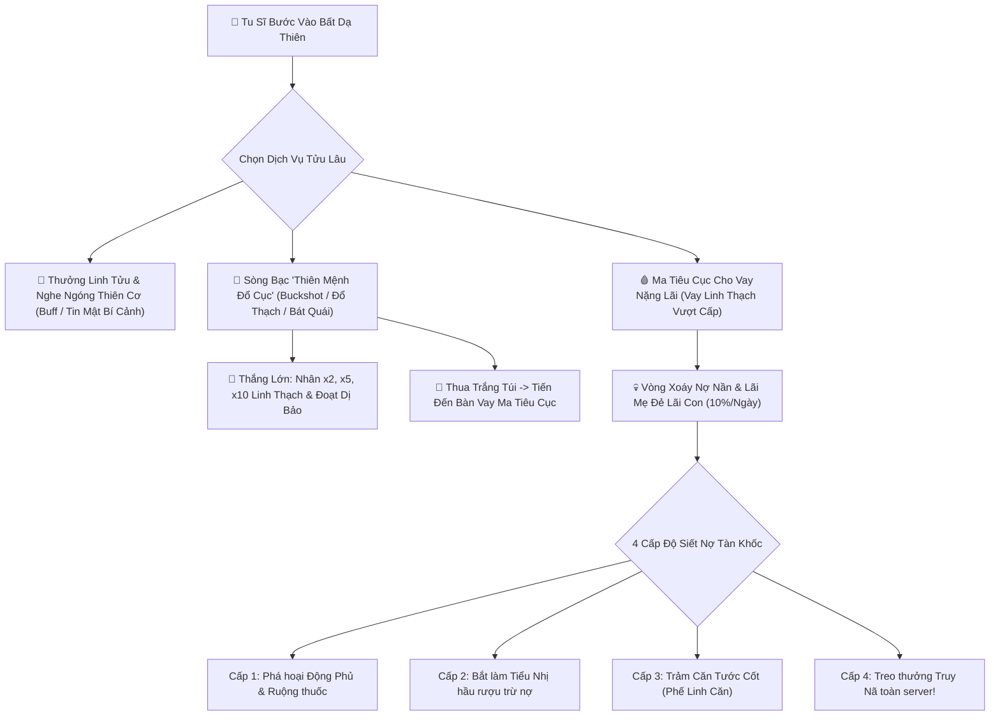
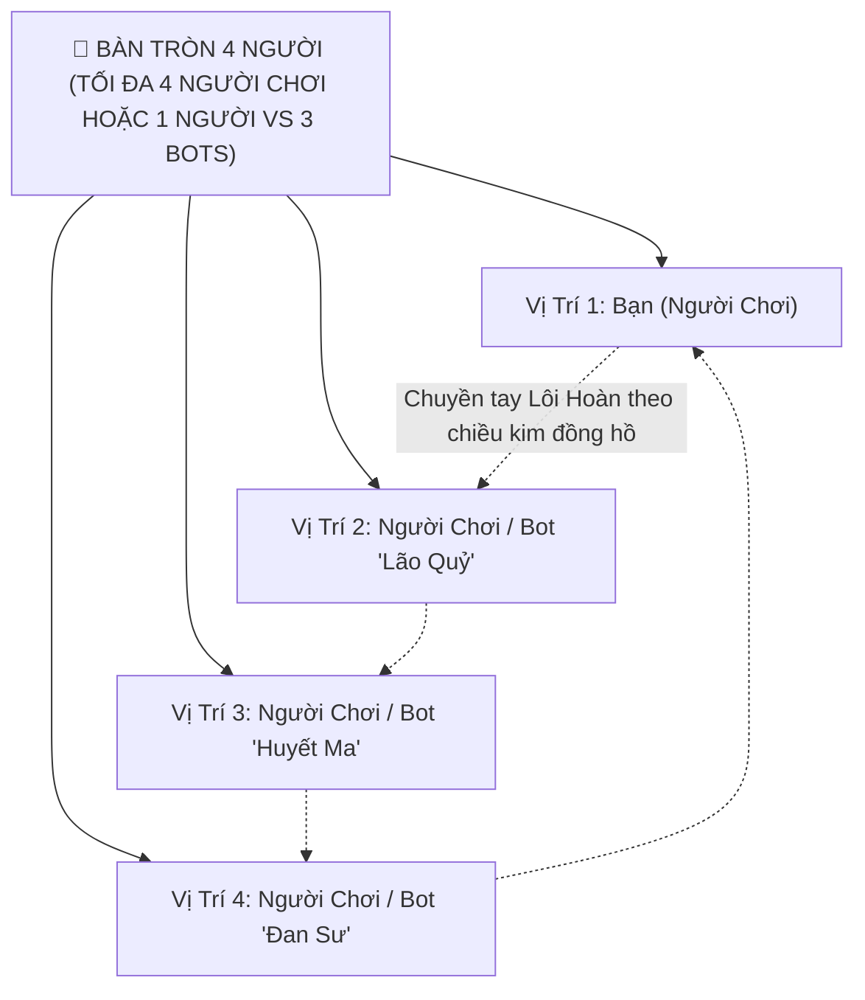
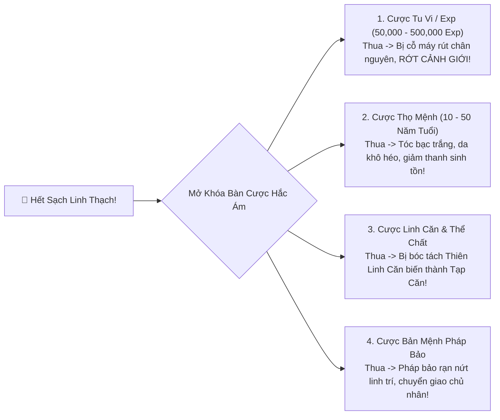
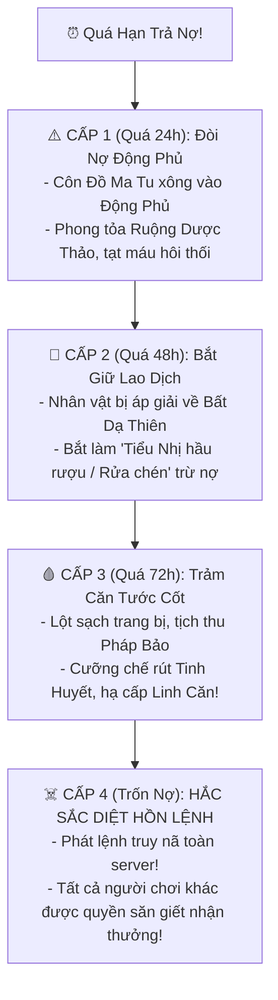
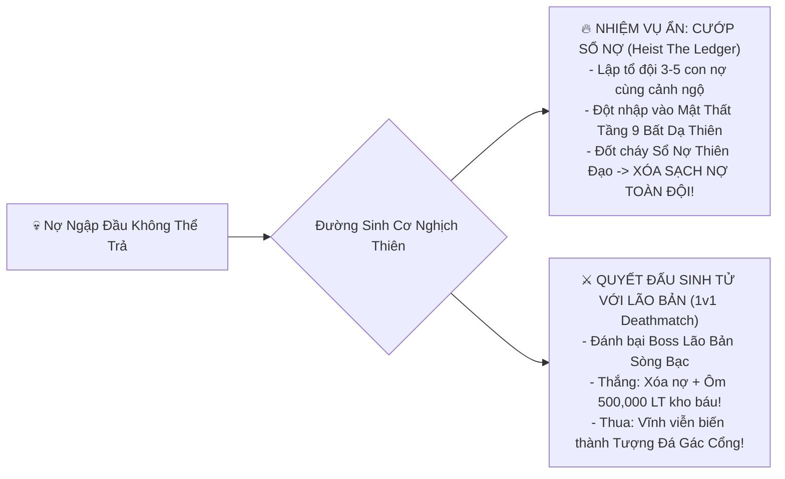

# [15] BẤT DẠ THIÊN TỬU LÂU: HỆ THỐNG SÒNG BẠC CỔ ĐẠI & MA ĐẠO CHO VAY NẶNG LÃI (GAMBLE WITH ME CONCEPT)

> ⬅️ **[Bài Trước: Doc 14 - Thần Thức Tầm Bảo & Sinh Tồn Dị Giới](file:///c:/Users/newre/OneDrive/Máy%20tính/code%20tutien/docs/14_THAN_THUC_TAM_BAO_VA_DI_GIOI.md)** | 📖 **[Mục Lục Toàn Cảnh](file:///c:/Users/newre/OneDrive/Máy%20tính/code%20tutien/README.md)** | ➡️ **[Bài Kế: Doc 16 - Tam Thiên Đại Đạo & Bách Gia Lưu Phái](file:///c:/Users/newre/OneDrive/Máy%20tính/code%20tutien/docs/16_TAM_THIEN_DAI_DAO_VA_TIEU_DAO_LUU_PHAI.md)**

> *"Tu tiên là cuộc đánh cược lớn nhất của đời người: đem tính mạng phàm trần cược lấy trường sinh bất tử! Tại Bất Dạ Thiên Tửu Lâu, rượu là quỳnh tương ngọc dịch, còn trên chiếu bạc, thứ đặt cược không chỉ có Linh Thạch... Kẻ đỏ mắt đem Tu Vi ngàn năm, Thọ Mệnh trăm tuổi, thậm chí cả Thiên Linh Căn bẩm sinh ra cược một ván đổi đời! Kẻ thắng ngạo thị tam giới, kẻ thua biến thành nô bộc bị siết nợ tróc nã khắp cửu châu!"*

Tài liệu này phát triển ý tưởng **"Gamble With Me"** thành một hệ thống **Tửu Lâu Sòng Bạc & Tín Dụng Đen Tu Chân Giới (Underground Casino & Predatory Loan System)**, mở rộng quy mô hệ thống nợ từ việc "chữa bệnh" thành một nhánh gameplay tâm lý, đen tối, kịch tính và gây nghiện bậc nhất!

---

## 🎲 I. BỐI CẢNH: "BẤT DẠ THIÊN TỬU LÂU" (NƠI KHÔNG BAO GIỜ TẮT ĐÈN)

* **Vị Trí Tọa Lạc**: Nằm tại ngã ba ranh giới giữa Lạc Hà Thành và Vực Vạn Ma — khu vực Tam Phàm Bất Quản (không thuộc quyền kiểm soát của bất kỳ Đại Tông Môn nào).
* **Kiến Trúc**: Tòa lầu gác 9 tầng treo đèn lồng đỏ máu lơ lửng giữa mây mù, tiếng nhạc tỳ bà ma mị hòa cùng tiếng xúc xắc va vào bát ngọc vang giòn, mùi hương quỳnh tương ngào ngạt lẫn mùi sát khí lạnh gáy.
* **Quy Tắc Sòng Bạc**:
  > *"Vào lầu uống rượu, tiền trao cháo múc.*
  > *Rời chiếu sạch túi, lấy mạng gán nợ!"*

---

## ⚡ II. CÁC TRÒ CHƠI CỜ BẠC CỰC HẠN (GAMBLE WITH ME MECHANICS)

Không phải những trò cờ bạc phàm trần tẻ nhạt, Bất Dạ Thiên Tửu Lâu tổ chức những canh bạc **nghẹt thở, đậm tính tâm lý và mưu mẹo Tiên Hiệp**:

---

### 1. Trò Chơi 1: Lôi Hoàn Đổ Mệnh (Buckshot Roulette Bàn Tròn 4 Người)
> *Lấy cảm hứng từ Buckshot Roulette & Russian Roulette: Căng thẳng nghẹt thở trong bàn tròn 4 vị trí sinh tử!*

* **Quy Mô Bàn Cược (Hỗ Trợ Tối Đa 4 Người)**:
  * **Chế độ Online Nhiều Người**: Tối đa **4 người chơi thật** cùng vào bàn tròn (Đông, Tây, Nam, Bắc) chuyền tay nhau chiếc Lôi Hoàn.
  * **Chế độ Chơi Đơn (Solo vs 3 Bots)**: Nếu không đủ người hoặc muốn chơi một mình, hệ thống tự động đưa vào **3 Con Bot Ma Tu** với 3 phong cách tính toán và cá tính khác nhau:
    * 🤖 **Bot 1: "Lão Quỷ Ma Ranh"**: Lối chơi cẩn trọng, tính toán xác suất viên đạn từng hiệp, thích dùng *Thiên Lý Kính* soi đạn và luôn nhắm bắn kẻ nhiều máu nhất.
    * 🤖 **Bot 2: "Huyết Ma Liều Mạng"**: Phong cách điên cuồng, thường xuyên dùng *Toái Lôi Đao x2 sát thương* và dám **tự bắn vào ngực mình** để cướp lượt liên tiếp!
    * 🤖 **Bot 3: "Đan Sư Sợ Chết"**: Lối chơi phòng thủ, ưu tiên nuốt *Hồi Xuân Đan*, chuyên bắn lén kẻ yếu máu nhất để loại trừ bớt đối thủ an toàn.

* **Luật Chơi Bàn Tròn 4 Người**:
  * Giữa bàn là chiếc **Cửu Lôi Cổ Hoàn** nạp ngẫu nhiên **6 - 8 Viên Đạn Lôi Đan**:
    * Trong đó có $X$ viên Đạn Thật (sét tím giật mất $1$ máu sinh mạng).
    * Và $Y$ viên Đạn Giả (chỉ có khói trắng vô hại).
    * Mỗi người chơi khởi đầu với **3 Giọt Máu Sinh Tử (Hộ Thể Lôi Phù)**. Mất hết máu $\rightarrow$ Bị loại khỏi bàn cược!
  * **Lượt Đi & Quyết Định Chiến Thuật**:
    * **[Tự Bóp Cò Vào Ngực Mình]**:
      * Nếu là Đạn Giả $\rightarrow$ Được cộng điểm cược và **ĐƯỢC ĐI TIẾP MỘT LƯỢT NỮA** (giữ nguyên quyền bắn)!
      * Nếu là Đạn Thật $\rightarrow$ Ăn trọn sát thương lôi phạt, mất $1$ giọt máu sinh mạng và **mất lượt**, chuyền Lôi Hoàn cho người kế tiếp.
    * **[Chĩa Nòng Sang 1 Trong 3 Đối Thủ]**:
      * Được tự do chọn mục tiêu (chọn Bắn Người B, C, hoặc D).
      * Nếu là Đạn Thật $\rightarrow$ Mục tiêu trúng đạn mất $1$ máu!
      * Nếu là Đạn Giả $\rightarrow$ Mục tiêu thở phào vô sự, lượt đi chuyển giao cho người kế tiếp theo chiều kim đồng hồ.

* **Hệ Thống Đạo Cụ Chiến Thuật Dành Riêng Cho Bàn 4 Người (Tactical Items)**:
  Mỗi hiệp nạp đạn, mỗi người được Thiên Đạo phát ngẫu nhiên các đạo cụ huyền diệu:
  * 🔍 **Thiên Lý Kính**: Nhìn thấu viên đạn hiện tại trong nòng là Thật hay Giả.
  * 🗡️ **Toái Lôi Đao**: Cắt ngắn nòng lôi hoàn $\rightarrow$ Phát bắn tiếp theo nếu là Đạn Thật sẽ gây **Gấp Đôi Sát Thương (Trừ 2 giọt máu)**!
  * 📿 **Tịnh Tâm Trượng**: Trói tay $1$ đối thủ chỉ định, ép người đó bị mất lượt đi tiếp theo.
  * 🔄 **Chuyển Luân Phù (Reverse/Skip)**: Đảo ngược chiều chuyền lượt (từ thuận chiều kim đồng hồ sang ngược chiều kim đồng hồ) để né tránh hiểm cảnh!
  * 🔄 **Nghịch Mệnh Phù**: Đảo ngược thuộc tính viên đạn hiện tại (Thật hóa Giả, Giả hóa Thật).
  * 💊 **Hồi Xuân Đan**: Hồi phục $+1$ giọt máu sinh mệnh.
  * 💥 **Thiên Lôi Cộng Hưởng (Bùa Cực Đoan)**: Kích hoạt hiệu ứng diện rộng: Nếu phát bắn tiếp theo là Đạn Thật, **toàn bộ 3 đối thủ còn lại đều bị vạ lây mất 1 máu**!

* **Cơ Chế Sinh Tồn Cuối Cùng (Last Man Standing)**:
  * Người sống sót cuối cùng trên bàn cược sẽ **gom trọn toàn bộ tiền cược Linh Thạch hoặc kho báu** của cả 3 đối thủ thua cuộc!

---

### 2. Trò Chơi 2: Đổ Thạch Thượng Cổ (Ancient Ore Mystery Unboxing)
* **Khái niệm**: Lòng đất sâu ở các Cấm Địa khai quật được các tảng đá hóa thạch cổ xưa được bao bọc bởi lớp vỏ đá dày ngăn thần thức nhìn xuyên qua.
* **Cách chơi**:
  * Người chơi bỏ Linh Thạch mua các tảng đá:
    * *Đá Rêu Nhỏ (500 LT)*
    * *Đá Huyết Trầm Trung Phẩm (3,000 LT)*
    * *Đá Thiên Thạch Thái Cổ Cực Phẩm (20,000 LT)*.
  * Dùng **Đao Cắt Đá Đan Hỏa** xẻ đá trước sự chứng kiến của toàn bộ tu sĩ trong sòng bạc:
    * $70\%$: Ra đá vôi rác rưởi (Lỗ trắng tay, chỉ thu lại 10 LT).
    * $20\%$: Ra Linh Tinh Trung Phẩm (Hòa vốn hoặc x2).
    * $9\%$: Ra Cực Phẩm Dị Hỏa / Khoáng Thạch rèn thần binh (x10 giá trị).
    * **$1\%$ ĐẠI KỲ NGỘ CHẤN ĐỘNG**: Cắt ra **Chân Long Trứng Hóa Thạch** hoặc **Mảnh Vỡ Pháp Bảo Thần Khí** trị giá hàng trăm ngàn Linh Thạch! Cả sòng bạc vang tiếng hoan hô chúc tụng!

---

### 3. Trò Chơi 3: Bát Quái Tửu Lệnh (Liar's Dice Tiên Hiệp)
* Người chơi và đối thủ dùng chung bình rượu Tiên, mỗi người úp một chiếc Bát Cổ chứa 5 viên xúc xắc Bát Quái.
* Vừa đoán số mặt quẻ, vừa tố rượu và Linh Thạch. Ai nói dối bị bắt thóp sẽ phải **uống cạn 1 chén Liệt Hỏa Rượu** (tăng Đan Độc và say xỉn giảm thị giác) đồng thời thua toàn bộ tiền cược trên bàn!

---

### 4. Trò Chơi 4: Âm Dương Đấu Cổ Bát (Gu-Poison Arena - Chiến Thuật Đấu Trùng & Nhỏ Máu Lật Kèo)
* **Bối cảnh**: Thú chơi ma đạo tàn khốc bậc nhất. Giữa sới bạc là một chiếc **Bát Ngọc Trấn Cổ** bao bọc bởi trận pháp ngũ hành.
* **Quy tắc**:
  * Hai bên hoặc người chơi chọn cược vào 1 trong 2 Cổ Trùng Thái Cổ:
    * *Thất Tinh Kim Thiềm* (Hệ Kim - Giáp dày phản đòn).
    * *Bách Túc Phệ Huyết Ngô Công* (Hệ Huyết - Độc sát hút máu).
    * *Cửu U Băng Tằm* (Hệ Thủy - Phun tơ đông cứng).
    * *Thiên Hỏa Xích Hạt* (Hệ Hỏa - Độc kích bạo liệt).
  * Các loài bọ mang hệ tương sinh tương khắc ngũ hành rõ rệt. Khi trận đấu diễn ra, 2 con bọ cắn xé nhau từng giây trên màn hình hiển thị thanh máu!
* **Chiều Sâu Tâm Lý & Can Thiệp Bất Hợp Pháp (Live In-play Interventions)**:
  * Trong lúc 2 con bọ cắn nhau, tỷ lệ cược (Live Odds) nhảy liên tục. Người chơi có thể tố thêm tiền khi thấy bọ của mình yếu thế.
  * **Hành vi Lén Gian Lận (Illicit Feeding)**: Người chơi có thể liều mạng bấm nút:
    * **[Búng giọt Tinh Huyết vào Bát]**: Bọ của bạn ăn máu nổi điên tăng $+50\%$ Công Kích để lật kèo!
    * **[Rắc Độc Vụ Trộm]**: Làm mù mắt bọ đối phương.
  * ⚠️ **RỦI RO CHẾT NGƯỜI**: Trọng Tài Ma Tôn đảo mắt canh chừng. Tỉ lệ bị phát hiện gian lận là $30\%$. Nếu bị bắt quả tang $\rightarrow$ Bị phạt tiền gấp 5 lần và bị chặt đứt $1$ ngón tay (giảm $-20\%$ ATK trong 12 giờ)!

---

### 5. Trò Chơi 5: Bát Môn Độn Giáp Kỳ Bàn (Dao Blackjack 21 Điểm Chân Nguyên)
* **Khái niệm**: Trò chơi bài lá Đạo Phù kết hợp Kỳ Môn Độn Giáp và phong cách Blackjack 21 điểm.
* **Luật Chơi**:
  * Mỗi quân bài là một tấm **Pháp Phù** mang điểm Linh Lực từ $1$ đến $10$ điểm.
  * Người chơi và Nhà Cái rút bài sao cho tổng điểm chân nguyên tiến gần đến mốc **21 Điểm (Đại Viên Mãn)** nhất.
  * Nếu vượt quá 21 điểm $\rightarrow$ **Bạo Thể Đan Điền (Bust)**, phát nổ thua trắng tiền cược!
* **Chiều Sâu Bát Môn Tương Khắc**:
  * Mỗi ván, bàn cờ ngẫu nhiên xoay vào một trong **Bát Môn**:
    * Rút bài ở **Sinh Môn**: Được miễn nhiễm Bạo Thể 1 lần nếu chạm 22 điểm. Thắng ván này được nhân đôi tiền!
    * Rút bài ở **Tử Môn**: Cực kỳ hiểm ác! Bắt buộc phải rút tối thiểu 4 lá bài mới được dừng. Kẻ dám thắng ở Tử Môn nhận thưởng $\times 5$ lần tiền cược!
    * Rút bài ở **Khai Môn**: Được phép nhìn lén lá bài úp của Nhà Cái.

---

### 6. Trò Chơi 6: Lô Đỉnh Dị Biến Đổ Cục (Blind Alchemy Roulette - Canh Bạc Nồi Đan)
* **Khái niệm**: Một chiếc Lò Đan Cổ Khổng Lồ sôi sục giữa sảnh tửu lâu.
* **Luật Chơi**:
  * 4 người chơi cùng ngồi vào bàn. Mỗi người bí mật ném vào lò đan 1 món dược liệu hoặc khoáng thạch từ túi của mình (giấu kín không cho người khác thấy).
  * Lửa Đan Hỏa bùng cháy, lò đan bắt đầu rung lắc dữ dội vì phản ứng dược tính!
  * **Các Cửa Đặt Cược**:
    * **Cửa Tiên Đan Thần Phẩm (Tỉ lệ 1 ăn 15)**: Ra đan dược cực phẩm, người đặt cửa này ôm trọn đan và tiền.
    * **Cửa Đan Thường (1 ăn 2)**: Ra thuốc hồi máu / thể lực bình thường.
    * **Cửa BẠO ĐỈNH NỔ LÒ (Tỉ lệ 1 ăn 6)**: Dược tính xung đột quá gắt khiến lò đan nổ tung! Toàn bộ người đặt cửa Tiên Đan mất sạch tiền!
* **Chiến Thuật Thâm Hiểm**: Người chơi cố tình ném vào 1 loại thảo dược kịch độc tương khắc với người khác để **cố tình kích nổ lò đan**, ăn trọn tiền cược cửa Bạo Đỉnh!

---

### 7. Trò Chơi 7: Cửu U Mê Cung Đua Thú (Nether Maze Beast Racing)
* **Quy tắc**:
  * 6 con Linh Thú dị biến (*Phong Liệp Báo, Thiết Huyết Hùng, Hỏa Hồ Ly, Độc Giác Tê, Ma Ảnh Viên, Bạch Ngọc Thỏ*) được thả vào một Mê Cung Bát Quái đầy cạm bẫy chết chóc.
  * Bẫy cấm chế ngẫu nhiên thay đổi mỗi vòng: Bẫy Sét rơi, Bẫy Lửa phụt, Bẫy Chông, Bẫy Đầm Lầy làm chậm.
  * Các con thú có thể **cắn chết nhau** ngay trên đường chạy nếu va chạm!
* **Hệ Thống Kèo Cược Đa Dạng**:
  * Kèo Quán Quân (Về đích đầu tiên).
  * Kèo "Sát Thủ" (Con thú nào cắn chết nhiều đối thủ nhất trên đường đua).
  * Kèo "Tử Địa Toàn Diệt" (Tỉ lệ 1 ăn 50: Toàn bộ 6 con thú đều bị bẫy cấm chế giết sạch trước khi chạm vạch đích!).

---

### 8. Trò Chơi 8: Đoán Mộng Thiên Cơ (Celestial Prediction Market Toàn Server)
* **Khái niệm**: Thị trường dự đoán vận mệnh thời gian thực dựa trên các sự kiện lớn đang diễn ra trên toàn server game!
* **Các Kèo Cá Cược Thiên Cơ Nóng Hổi**:
  * *"Trong 30 phút tới, có vị đạo hữu nào độ kiếp Kim Đan bị Thiên Lôi đánh chết không?"* (Kèo Có / Không).
  * *"Đại chiến chiếm Mỏ Cực Phẩm Linh Mạch tối nay giữa Thanh Vân Kiếm Tông và Vạn Ma Uyên, bang phái nào sẽ đoạt được mắt trận?"*
  * *"Boss Thế Giới Hắc Long chiều nay sẽ rơi ra Pháp Bảo phẩm cấp gì?"*
* **Cơ chế**: Toàn bộ tu sĩ trong server cùng dồn Linh Thạch vào đầm cược (Pari-mutuel Pool), Thiên Đạo trừ $5\%$ thuế, số tiền còn lại chia đều theo tỷ lệ cho những người đoán đúng vận mệnh!

---

## 🎭 II.1. HỆ THỐNG PHÂN TẦNG TỬU LÂU & CƠ CHẾ BẮT GIAN LẬN THẦN THỨC

### 1. Ba Tầng Chiếu Bạc (Casino Tiers):
Bất Dạ Thiên Tửu Lâu phân cấp rạch ròi theo cảnh giới và địa vị:
* **Tầng 1 - Phàm Trần Tiếu Sảnh (Hạ Cục)**:
  * Dành cho đệ tử Luyện Khí Kỳ. Tiền cược nhỏ từ $50 - 500 \text{ Linh Thạch}$. Ồn ào, náo nhiệt, cãi vã đập bàn mắng chửi như chợ búa.
* **Tầng 5 - Tiên Thiên Nhã Gian (Trung Cục)**:
  * Yêu cầu đạt **Trúc Cơ Kỳ**. Tiền cược từ $5,000 - 50,000 \text{ Linh Thạch}$ hoặc cược bằng Khoáng Thạch, Pháp Bảo, Đan Dược hiếm. Không gian trang nhã, có Ca Kỹ đàn tỳ bà hầu rượu.
* **Tầng 9 - Vô Thượng Ma Vực / Vạn Kiếp Các (Chí Tôn Cục)**:
  * Chỉ mở cửa cho tu sĩ từ **Kim Đan Kỳ trở lên** hoặc người có *Thiên Mệnh Hắc Kim Bài*.
  * Nơi không dùng Linh Thạch để cược! Đây là nơi diễn ra các canh bạc tàn khốc: **Cược Tu Vi, Cược Thọ Mệnh, Cược Thiên Linh Căn và Bản Mệnh Pháp Bảo!**

---

### 2. Cơ Chế "Dùng Thần Thức Gian Lận" & Hình Phạt Chặt Tay:
Trong sòng bạc Tiên Hiệp, không ai là kẻ chơi lương thiện. Tu sĩ có thể vận chuyển công pháp để gian lận:
* **Các Chiêu Trò Gian Lận Khả Thi**:
  * Dùng *Thần Thức* nhìn xuyên bát ngọc đoán xúc xắc.
  * Dùng *Trùng Đồng* nhìn thấu tảng đá cổ chứa ngọc hay chứa vôi.
  * Dùng *Thần Pháp Vô Ảnh* tráo đổi đạn trong Lôi Hoàn.
* **Mạng Lưới Chấp Pháp Ma Sòng Bạc**:
  * Trên xà nhà lầu gác treo **Bát Quái Kính Chiếu Ma** và các **Chấp Pháp Ma Tôn** ẩn thân canh giữ.
  * Mỗi khi bấm nút **[Gian Lận Thần Thức]**, hệ thống tính toán:
    $$\text{Tỷ Lệ Thành Công} = (\text{Ngộ Tính} + \text{Thân Pháp} + \text{Khí Vận}) \times 0.5 - \text{Cảnh Giới Chấp Pháp}$$
  * ❌ **HẬU QUẢ NẾU BỊ BẮT QUẢ TANG**:
    * Bị Chấp Pháp Ma Tôn vung đao **chặt đứt 1 cánh tay** tại chỗ (Giảm vĩnh viễn $-30\%$ ATK trong 24 giờ cho đến khi uống Tục Cốt Đan).
    * Tịch thu toàn bộ tiền cược trên bàn.
    * Bị lột sạch y phục, ném thẳng từ Tầng 9 xuống đường cái làm trò cười cho toàn thể tu sĩ trong thành trấn!

---

## 🩸 III. VẬT ĐẶT CƯỢC PHI TIỀN TỆ: "KHI LINH THẠCH KHÔNG CÒN Ý NGHĨA"

Điều biến Bất Dạ Thiên Tửu Lâu thành cơn ác mộng chính là: **Khi bạn cháy túi Linh Thạch, Chủ Sòng Bạc sẽ mỉm cười cho phép bạn cược những thứ quý giá nhất của đời tu tiên!**

1. **Canh Bạc Tu Vi (Cultivation Exp Gamble)**:
   * Đặt cược $100,000 \text{ Exp}$. Thắng nhận về Đan Dược thượng phẩm; Thua bị ống dẫn chân khí cắm vào đan điền rút cạn, **tụt cấp cảnh giới ngay tại chỗ**!
2. **Canh Bạc Thọ Mệnh (Lifespan Gamble)**:
   * Đặt cược 20 năm tuổi thọ. Thua thì nhân vật lập tức biến hình thành lão già tóc hoa râm, thanh Oxi và thanh Hỏa Độc trong các vùng đất dị giới bị co hẹp vĩnh viễn $-20\%$!
3. **Canh Bạc Linh Căn (Spiritual Root Sacrifice)**:
   * Canh bạc tàn nhẫn nhất: Người mang *Thiên Hỏa Linh Căn* cùng đường cược lấy $500,000$ Linh Thạch. Thua một cái, Lão Bản vung đao đoạt căn, linh căn biến thành *Tạp Căn*, cả đời phế vật!

---

## 🏦 IV. HỆ THỐNG CHO VAY NẶNG LÃI: "HẮC MA TIÊU CỤC" (PREDATORY LOAN SHARKS)

Nếu không muốn cược mạng, người chơi có thể bước sang gian phòng bên cạnh gặp **Lão Bản Ma Tiêu Cục** để ký khế ước vay Linh Thạch:

### 1. Ba Gói Vay Ma Quỷ:

| Gói Vay | Hạn Mức Vay | Điều Kiện Thế Chấp | Lãi Suất Hàng Ngày (Realtime Compound) | Thời Gian Ân Hạn |
| :--- | :---: | :--- | :---: | :---: |
| **1. Tán Tu Cứu Cấp** | $5,000 \text{ LT}$ | Tín nhiệm nhân vật, điểm chỉ tay | **$5\% / \text{ngày}$** | $48 \text{ giờ}$ |
| **2. Thiên Kiêu Đổ Mệnh** | $50,000 \text{ LT}$ | Thế chấp Động Phủ & Ruộng Thuốc | **$8\% / \text{ngày}$** | $24 \text{ giờ}$ |
| **3. Vạn Kiếp Nghịch Mệnh** | $500,000 \text{ LT}$ | **Ký Hồn Đạo Nô Lệ Khế Ước** | **$12\% / \text{ngày}$** | **$12 \text{ giờ}$** |

> ⚠️ **Quy Tắc Lãi Mẹ Đẻ Lãi Con**: Tiền lãi được tính theo thời gian thực (mỗi 24 giờ nhân dồn). Ví dụ vay $50,000 \text{ LT}$ gói 2, sau 3 ngày không trả số nợ phình to lên gần $63,000 \text{ LT}$!

---

## 💀 V. BỐN CẤP ĐỘ SIẾT NỢ TÀN KHỐC (ESCALATING DEBT ENFORCEMENT)

Khi quá hạn ân hạn mà con nợ không trả đủ cả gốc lẫn lãi, hệ thống siết nợ sẽ kích hoạt theo 4 cấp độ leo thang:

### 1. Cấp 1 (Chậm 24h) — Quấy Phá Động Phủ:
* Một toán Côn Đồ Ma Tu xuất hiện tại Động Phủ của bạn.
* Tụ Linh Trận bị đập phá (mất buff exp), Ruộng Dược Điền bị niêm phong dán bùa đòi nợ, cây thuốc bị đóng băng không lớn được!

### 2. Cấp 2 (Chậm 48h) — Bắt Đi Làm Tiểu Nhị Hầu Rượu:
* Bị trói bằng Dây Thừng Trói Tiên lôi về sòng bạc Bất Dạ Thiên.
* Bạn bị ép đổi trang phục thành **Tiểu Nhị Bưng Rượu**:
  * Mỗi khi có người chơi khác bước vào Tửu Lâu uống rượu, bạn phải bưng bê phục vụ.
  * Mỗi lượt phục vụ được trừ $50 \text{ Linh Thạch}$ tiền nợ! Bị bạn bè và người chơi cùng server nhìn thấy chọc quê!

### 3. Cấp 3 (Chậm 72h) — Trảm Căn Tước Cốt:
* Không còn khả năng chi trả, Chủ Sòng Bạc không kiên nhẫn nữa:
  * Toàn bộ Pháp Bảo, Đan Dược trong túi bị tịch thu bán đấu giá thanh lý tài sản.
  * Bị áp giải vào Lò Luyện Ma, cưỡng chế rút bớt $30\%$ Chân Nguyên và giáng cấp Thể Chất/Linh Căn xuống $1$ bậc!

### 4. Cấp 4 — Trốn Nợ? "Hắc Sắc Diệt Hồn Lệnh" (PVP Debt Bounty):
* Nếu con nợ tìm cách trốn vào rừng sâu hoặc cấm địa để quỵt nợ:
  * Tên bạn rực sáng **Màu Đỏ Máu** trên bảng thông báo toàn server: *"Kẻ quỵt nợ [Đạo Hiệu] đang lẩn trốn, đầu hắn trị giá 30,000 Linh Thạch!"*
  * Bất kỳ người chơi nào khác trên server tìm thấy và giết chết bạn sẽ nhận trọn tiền thưởng từ sòng bạc! Xác bạn hồi sinh tại buồng giam hầm ngục của Tửu Lâu để tiếp tục lao dịch!

---

## 🗡️ VI. CON ĐƯỜNG NGHỊCH THIÊN: ĐỘT KÍCH CƯỚP SỔ NỢ (HEIST THE CASINO LEDGER)

Tu chân giới luôn chừa lại một đường sinh cơ cho kẻ cùng đường liều mạng! Nếu nợ quá nhiều không thể trả nổi, người chơi có **2 Lựa Chọn Nghịch Thiên**:

### 1. Nhiệm Vụ Đột Kích: Cướp Sổ Nợ Thiên Đạo (Co-op Heist Dungeon)
* Dành riêng cho nhóm người chơi đang cùng mắc nợ:
* Lập tổ đội 3–5 người, bí mật nhận nhiệm vụ từ một Thích Khách giấu mặt:
  * Đột nhập vào **Tầng 9 Bất Dạ Thiên Lầu** vào giờ Tý (nửa đêm).
  * Vượt qua hệ thống bẫy Trận Pháp Bát Quái và tiêu diệt Đội Trưởng Đòi Nợ.
  * Tìm đến Mật Khố, dùng Chân Hỏa **đốt cháy cuốn Sổ Nợ Thiên Đạo**:
    * **Thành công**: Toàn bộ thành viên tham gia được **Xóa Nợ $100\%$ sạch sẽ**, đồng thời chia nhau hòm báu chứa vàng bạc của sòng bạc!
    * **Thất bại**: Bị bắt tống giam xuống Hắc Khoáng Khổ Sai đào quặng $3$ ngày!

### 2. Quyết Đấu Sinh Tử Với Lão Bản Sòng Bạc:
* Kẻ tự tin vào lực chiến của mình có thể bước lên đỉnh lầu phát động **Lôi Đài Sinh Tử 1v1** với Lão Bản:
  * **Nếu thắng**: Lão Bản cười lớn bái phục, xé bỏ toàn bộ giấy nợ và tặng thêm một món **Chí Bảo Thần Thoại** của sòng bạc!
  * **Nếu thua**: Nhân vật bị hóa đá thành bức tượng đứng gác ở cửa ra vào Tửu Lâu suốt 24 giờ cho thiên hạ chiêm ngưỡng!

---

## 💎 VII. TỔNG KẾT GIÁ TRỊ GAMEPLAY CHO DỰ ÁN

| Yếu Tố | Giá Trị Mang Lại Cho Tu Chân Giới Online |
| :--- | :--- |
| **Tính Hấp Dẫn & Gây Nghiện** | Cực cao! Cảm giác đặt cược thót tim của Buckshot Roulette và Đổ Thạch là thứ giữ chân người chơi hàng giờ liền. |
| **Kinh Tế MMO Vững Chắc** | Sòng bạc là cỗ máy đốt Linh Thạch khổng lồ nhất server, hút sạch tiền dư thừa của đại gia lẫn dân cày, triệt tiêu lạm phát. |
| **Liên Kết Chặt Chẽ Với Hệ Thống Nợ** | Biến món nợ thành một hệ sinh thái trừng phạt tàn khốc, mở ra các hoạt động đột kích cướp sổ nợ và săn tiền thưởng PvP giữa người chơi! |
| **Đậm Chất Tiên Hiệp Ma Đạo** | Tái hiện chân thực một thế giới tu chân tàn nhẫn, nơi con người có thể bán cả linh căn, thọ mệnh và linh hồn vì lòng tham! |

---

> ⬅️ **[Bài Trước: Doc 14 - Thần Thức Tầm Bảo & Sinh Tồn Dị Giới](file:///c:/Users/newre/OneDrive/Máy%20tính/code%20tutien/docs/14_THAN_THUC_TAM_BAO_VA_DI_GIOI.md)** | 📖 **[Mục Lục Toàn Cảnh](file:///c:/Users/newre/OneDrive/Máy%20tính/code%20tutien/README.md)** | ➡️ **[Bài Kế: Doc 16 - Tam Thiên Đại Đạo & Bách Gia Lưu Phái](file:///c:/Users/newre/OneDrive/Máy%20tính/code%20tutien/docs/16_TAM_THIEN_DAI_DAO_VA_TIEU_DAO_LUU_PHAI.md)**
