# [16] TAM THIÊN ĐẠI ĐẠO: BÁCH GIA TU CHÂN, TIỂU ĐẠO PHÂN NHÁNH & CẢNH GIỚI NGỘ ĐẠO (MASTER TOME)


> ⬅️ **[Bài Trước: Doc 15 - Tửu Lầu, Sòng Bạc Buckshot & Vay Nợ](file:///c:/Users/newre/OneDrive/Máy%20tính/code%20tutien/docs/15_TIU_LAU_SONG_BAC_VA_TIN_DUNG_DEN.md)** | 📖 **[Mục Lục Toàn Cảnh](file:///c:/Users/newre/OneDrive/Máy%20tính/code%20tutien/README.md)** | ➡️ **[Bài Kế: Doc 17 - Bí Cảnh & Tổ Đội Realtime (1 - 5 Người)](file:///c:/Users/newre/OneDrive/Máy%20tính/code%20tutien/docs/17_BI_CANH_VA_TO_DOI_REALTIME.md)**

> *"Đại Đạo ba ngàn, nhánh rẽ vạn nẻo. Kẻ phàm phu tục tử chỉ biết cắm đầu thổ nạp linh khí tăng cấp tu vi, nào biết cảnh giới chỉ là chiếc thuyền nan, còn 'ĐẠO' mới là ngọn hải đăng soi tỏ bến bờ vĩnh hằng!*
> *Một kiếm chém rách hư không là Kiếm Đạo; một lò thâu tóm nhật nguyệt là Đan Đạo; non sông làm bàn cờ phong tỏa vạn lý là Trận Đạo; đúc bách binh thức tỉnh linh tính là Khí Đạo; nét bút chu sa câu thông thiên địa là Phù Đạo; nhục thân báng bổ lôi kiếp là Thể Đạo; vạn linh cộng sinh sai khiến trùng thú là Ngự Thú Trùng Cổ Đạo; tạo vật vô tình luyện thi chiến thần là Cơ Quan Khôi Lỗi Đạo; trộm nhìn số mệnh tị hung xu cát là Thiên Cơ Bói Toán Đạo; nghịch chuyển âm dương thôn phệ sát phạt là Ma Đạo Song Tu.*
> *Người đắc Đạo, một cọng cỏ dại cũng trảm được tinh thần; kẻ vô Đạo, dẫu lên Hóa Thần cũng chỉ là bao thịt di động chờ ngày thiên kiếp lôi đình đánh tan thành tro bụi!"*

---

## 🧭 CHƯƠNG I: BẢN NGUYÊN ĐẠI ĐẠO & CƠ CHẾ NGỘ ĐẠO SONG HÀNH

Trong thế giới **Tu Chân Giới Online**, thực lực của một tu sĩ tuyệt đối không chỉ đo đạc bằng con số cấp bậc cảnh giới cơ bản. Hệ thống sức mạnh được cấu thành từ **Hai Trục Song Song Độc Lập** bổ trợ và nhân cấp lẫn nhau:

```mermaid
graph TD
    subgraph DUAL_AXIS ["☯️ TRỤC SONG HÀNH SỨC MẠNH TU CHÂN"]
        TV["1. TU VI CẢNH GIỚI (Chân Nguyên Năng Lượng)\nLuyện Khí -> Trúc Cơ -> Kim Đan -> Nguyên Anh -> Hóa Thần -> Luyện Hư -> Hợp Thể -> Đại Thừa\n(Dung tích đan điền, HP, DEF, Mana, Căn Cơ Độ Kiếp)"]
        DC["2. ĐẠO CẢNH NGỘ TÍNH (Quy Tắc Vũ Trụ Thấu Hiểu)\nKiếm Đạo, Đan Đạo, Trận Đạo, Khí Đạo, Phù Đạo, Thể Đạo, Ngự Thú, Khôi Lỗi, Thiên Cơ, Ma Đạo\n(Sự can thiệp, thao túng và bẻ cong quy luật tự nhiên)"]
        
        TV <-->|"Cộng Hưởng Bội Tăng Sát Thương"| DC
    end

    subgraph DAO_7_TIERS ["🌟 THẤT TRỌNG ĐẠO CẢNH TIẾN HÓA"]
        D1["Bậc 1: Nhập Đạo (Ngộ Chiêu - Bắt chước hình thái)"]
        D2["Bậc 2: Đạo Mang (Ngưng Khí - Tỏa hào quang 3 trượng)"]
        D3["Bậc 3: Đạo Ý (Sinh Linh - Ý niệm linh hồn can thiệp vật chất)"]
        D4["Bậc 4: Đạo Thai / Đạo Tâm (Ngưng Hồn - Tâm cảnh bàn thạch, miễn nhiễm ma chướng)"]
        D5["Bậc 5: Đạo Vực (Domain - Triển khai lãnh địa quy tắc độc tôn 30 trượng)"]
        D6["Bậc 6: Vô Thượng Pháp Tắc (Chưởng Quy - Thao túng luật vũ trụ)"]
        D7["Bậc 7: Đạo Hóa Hợp Chân (Chân Thần - Thân hóa thiên đạo, một niệm diệt giới!)"]

        D1 --> D2 --> D3 --> D4 --> D5 --> D6 --> D7
    end
```

### 1.1. Thang Điểm & Điều Kiện Đột Phá Thất Trọng Đạo Cảnh

Đạo Cảnh không thể cắn thuốc tăng cấp bừa bãi. Điểm Ngộ Đạo ($\text{Dao Points}$) thu thập qua: **Quan sát kỳ quan thiên nhiên, sinh tử huyết chiến, đọc tàn thư cổ bia, đốn ngộ canh giờ hoàng đạo, và thử thách tâm ma**.

| Bậc Đạo Cảnh | Danh Xưng Cảnh Giới | Điểm Ngộ Đạo Yêu Cầu | Yêu Cầu Tu Vi Tối Thiểu | Biểu Hiện Thị Giác & Dị Tượng | Chỉ Số Gia Trì Chiến Đấu Nghịch Thiên |
| :--- | :--- | :--- | :--- | :--- | :--- |
| **Bậc 1** | **Nhập Đạo** | $100$ | Luyện Khí Tầng 3 | Động tác xuất chiêu mượt mà, không còn vụng về. | $+10\%$ Sát thương kỹ năng thuộc Đạo tương ứng. |
| **Bậc 2** | **Đạo Mang** | $500$ | Luyện Khí Tầng 7 | Mũi kiếm/bàn tay phát ra luồng sáng sắc lạnh dài 3 trượng. | $+25\%$ Sát thương, đòn đánh có $15\%$ làm rách hộ thuẫn. |
| **Bậc 3** | **Đạo Ý** | $1,800$ | Trúc Cơ Kỳ | Khí thế bốc lên lay động phong vân, chim chóc cúi lạy. | $+50\%$ Sát thương, mở khóa **Bản Nguyên Ý Niệm Độc Bản**. |
| **Bậc 4** | **Đạo Tâm** | $5,000$ | Kim Đan Kỳ | Đúc thành Đạo Thai trong đan điền, ánh mắt thâm thúy như hắc ám. | Miễn nhiễm $100\%$ ảo ảnh ma chướng, $+30\%$ Kháng khống chế. |
| **Bậc 5** | **Đạo Vực (Domain)** | $15,000$ | Nguyên Anh Kỳ | Triển khai kết giới quy tắc riêng biệt bán kính 30 trượng. | Địch trong Vực giảm $-30\%$ All Stats; chủ nhân bạo kích $100\%$! |
| **Bậc 6** | **Pháp Tắc** | $50,000$ | Hóa Thần Kỳ | Một lời nói ra biến thành xích sắt quy tắc trói buộc trời đất. | $100\%$ Sát thương chuẩn, bỏ qua hoàn toàn Giáp & Kháng nguyên tố. |
| **Bậc 7** | **Đạo Hóa Hợp Chân**| $200,000$ | Hợp Thể / Đại Thừa | Bản thân hòa làm một cùng quy tắc thiên địa vĩnh hằng bất diệt. | Bất tử trước mọi đòn tấn công dưới cấp Thần; 1 chiêu diệt vạn dặm! |

> **Nghịch lý Đạo Cảnh (Vượt Cấp Trảm Địch)**: Một kiếm tu Trúc Cơ Kỳ sở hữu **Kiếm Ý Đại Thành (Bậc 3-4)** hoàn toàn có thể dùng một nhát kiếm chém chết tên Kim Đan Sơ Kỳ cắn thuốc tăng cấp mà không hiểu Đạo. Đây là chìa khóa để người chơi kỹ năng cao vượt ải khiêu chiến đại năng!

---

## 🏛️ CHƯƠNG II: CHI TIẾT THẬP ĐẠI ĐẠO & BÁCH GIA LƯU PHÁI

---

### 🗡️ 1. KIẾM ĐẠO (THE SWORD DAO) — "VẠN BINH CHI VƯƠNG, Ý TẠI KIẾM TIÊN"

> *"Trăm vạn người luyện kiếm chỉ dừng lại ở Kiếm Chiêu; mười vạn người luyện ra Kiếm Khí; vạn người mới ngưng tụ được Kiếm Mang. Nhưng trong ngàn năm vạn kiếp, kẻ thật sự ngộ ra **KIẾM Ý** lại hiếm như lá mùa thu!*
> *Chiêu thức có hình ắt có sơ hở; chân khí có hạn ắt có lúc kiệt cùng; duy chỉ có **Ý NIỆM CỦA KIẾM** là trường tồn bất diệt cùng nhật nguyệt càn khôn.*
> *Người đạt đỉnh phong Kiếm Ý, dẫu kiếm gãy tay phế, chân khí khô kiệt, chỉ một ánh mắt cũng đủ chém đứt thần hồn đại địch ngoài ngàn dặm!"*

#### 1.1. Lục Đại Lưu Phái Kiếm Tu Chuyên Sâu

Trong Kiếm Đạo, tùy theo tính cách, thể chất và công pháp mà kiếm tu phân nhánh thành 6 trường phái chiến đấu cực đoan:

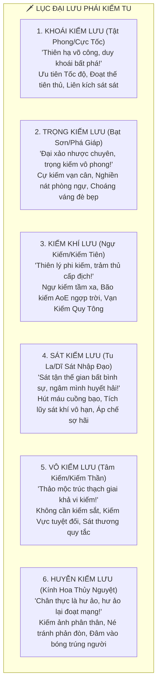

##### 1. Khoái Kiếm Lưu (Cực Tốc Nhất Kiếm)
* **Triết lý**: Ra kiếm nhanh hơn cả tia chớp và suy nghĩ của kẻ thù. Khi đối thủ nhận ra kiếm vung lên thì yết hầu đã đứt lìa.
* **Chỉ số đặc trưng**: Thân Pháp Speed $+40\%$, Tỉ lệ Tấn Công Trước (Initiative) đạt $95\%$, Tỉ lệ Song Kích x2 đòn đánh là $40\%$, nếu bạo kích có $15\%$ xuất chiêu x3 liên hoàn.
* **Tuyệt kỹ môn phái**:
  * *Thuấn Ảnh Trảm*: Lướt xuyên qua 3 mục tiêu trong 0.1 giây, để lại 3 vết kiếm khí nổ tung sau lưng.
  * *Bạt Kiếm Thuật (Iaido Strike)*: Giữ kiếm trong bao tích lực, khi rút kiếm nhát đầu tiên tăng $250\%$ Sát thương bạo kích.

##### 2. Trọng Kiếm Lưu (Đại Xảo Nhược Chuyên)
* **Triết lý**: Không màng chiêu thức hoa mỹ, dùng cự kiếm nặng từ ngàn cân đến vạn cân làm bằng Huyền Thiết nện xuống như thiên thạch rơi.
* **Chỉ số đặc trưng**: Sức tấn công ATK cơ bản $+45\%$, Bỏ qua $40\%$ Giáp đối thủ, Tỉ lệ Đánh Choáng mục tiêu $30\%$ (khiến địch mất lượt 1 hiệp).
* **Tuyệt kỹ môn phái**:
  * *Thái Sơn Bạt Nhạc*: Nhảy lên cao bổ kiếm xuống đất, tạo sóng chấn động làm nứt toác mặt đất bán kính 10 trượng, toàn bộ đối thủ ngã gục.
  * *Phá Giáp Bá Nhận*: Nhát chém đập vỡ nát khiên chắn và pháp bảo hộ thân, khiến mục tiêu nhận thêm $+50\%$ sát thương trong 3 hiệp tiếp theo.

##### 3. Kiếm Khí Lưu (Vạn Kiếm Quy Tông)
* **Triết lý**: Dùng thần thức ngự kiếm bay lượn trên chín tầng mây. Biến một thanh kiếm thành vạn đạo kiếm quang càn quét chiến trường.
* **Chỉ số đặc trưng**: Tầm đánh xa ngàn trượng, Sát thương AoE diện rộng $+50\%$, Tăng $+30\%$ Điểm Thần Thức / Mana tối đa.
* **Tuyệt kỹ môn phái**:
  * *Vạn Kiếm Quy Tông*: Phóng ra 1,000 thanh quang kiếm bay lượn trên trời rồi trút xuống như mưa bão, xóa sổ toàn bộ quái vật trong khu vực.
  * *Ngự Kiếm Phi Hành Thuật*: Đạp kiếm bay xuyên địa hình bản đồ với tốc độ gấp 5 lần chạy bộ, bỏ qua mọi sông suối đầm lầy.

##### 4. Sát Kiếm Lưu (Tu La Huyết Đạo)
* **Triết lý**: "Dĩ sát chỉ sát, ngâm mình trong biển máu!" Kiếm vung lên là phải thấy máu, kiếm không thấy máu chủ nhân sẽ bị phản phệ.
* **Chỉ số đặc trưng**: Sở hữu $12\%$ Hút Máu vĩnh viễn trên mọi đòn đánh. Mỗi khi hạ gục 1 mạng kẻ địch, vĩnh viễn cộng dồn $+6\%$ ATK trong trận đấu (tối đa $+120\%$).
* **Tuyệt kỹ môn phái**:
  * *Huyết Hải Tru Ma*: Biến chân khí thành biển máu nhấn chìm chiến trường, kẻ địch dính máu bị rút HP theo giây và bị làm chậm $-50\%$.
  * *Tuyệt Mệnh Nhất Kích*: Khi HP bản thân dưới $20\%$, toàn bộ sát thương chuyển hóa thành Huyết Sát bạo kích gấp 3 lần.

##### 5. Vô Kiếm Lưu (Tâm Kiếm Cực Cảnh)
* **Triết lý**: Tay không cầm kiếm, nhưng tâm chứa vạn kiếm. Một cọng cỏ dại nhặt ven đường rót kiếm ý vào cũng sắc bén hơn cả Thần Binh Bảo Kiếm!
* **Chỉ số đặc trưng**: Kháng tước đoạt vũ khí $100\%$, Đòn đánh chuyển thành **Sát thương chuẩn quy tắc** bỏ qua ngũ hành tương khắc, Mở khóa **Kiếm Vực (Sword Domain)** sớm hơn các phái khác 1 đại cảnh giới.
* **Tuyệt kỹ môn phái**:
  * *Vạn Vật Vi Kiếm*: Thổi một làn gió, búng một hạt cát cũng hóa thành mũi phi kiếm vô hình đâm thủng đan điền đối thủ.
  * *Trảm Đạo Tuyệt Niệm*: Nhát kiếm không chém vào da thịt mà chém đứt linh căn và mối liên kết chân nguyên của đối phương, khiến địch bị phong bế tu vi 3 hiệp.

##### 6. Huyễn Kiếm Lưu (Kính Hoa Thủy Nguyệt)
* **Triết lý**: Kiếm như bóng trong gương, trăng dưới đáy nước. Địch nhìn thấy kiếm chém từ bên trái nhưng thực chất kiếm đã đâm xuyên tim từ sau lưng.
* **Chỉ số đặc trưng**: Tỉ lệ Né Tránh $+35\%$, Khi né tránh thành công tự động phân tách ra 1 *Kiếm Ảnh Phân Thân* đánh lén sau lưng đối thủ với $70\%$ sát thương.
* **Tuyệt kỹ môn phái**:
  * *Huyễn Ảnh Kiếm Vũ*: Tạo ra 4 tàn ảnh bao vây mục tiêu đồng loạt tấn công, đối thủ không thể xác định đâu là chân thân.
  * *Kính Nguyệt Phản Xạ*: Dựng lên tấm gương kiếm khí, phản hồi $100\%$ sát thương phép thuật ngược lại kẻ vừa xuất chiêu.

---

#### 1.2. Cửu Đại Bản Nguyên Kiếm Ý (9 Loại Ý Niệm Linh Hồn Vô Thượng)

Khi kiếm tu đột phá đến **Bậc 3: Kiếm Ý**, linh hồn họ sẽ cộng hưởng với 1 trong 9 nguồn Ý Niệm Bản Nguyên của vũ trụ:

| Tên Loại Kiếm Ý | Đạo Tâm Triết Học Bản Nguyên | Cơ Chế Chiến Đấu Độc Tôn Trong Trận | Kỹ Năng Nộ Kiếm Ý Kích Hoạt | Tâm Ma Tương Ứng & Rủi Ro |
| :--- | :--- | :--- | :--- | :--- |
| **1. Bất Diệt Kiếm Ý** | *"Thân xác dẫu nát tan, kiếm ý ngàn thu vĩnh bất diệt!"* | Khi HP về 0: **Không chết ngay**, duy trì chiến đấu thêm 3 hiệp với $100\%$ ATK, có $35\%$ tự động hồi sinh với $50\%$ HP! | *Vạn Cổ Trường Tồn*: Miễn nhiễm toàn bộ hiệu ứng khống chế và debuff trong 3 hiệp. | Cố chấp không chịu buông bỏ, dễ bị kẹt ở bình cảnh khi gặp đại nạn. |
| **2. Tịch Diệt Tuyệt Tình**| *"Vong tình tuyệt ái, vạn vật giai điêu linh. Trảm đứt trần duyên!"*| Đòn đánh **chém bay toàn bộ khiên hộ thuẫn và buff** của đối thủ; cấm kẻ địch hồi phục máu trong 4 hiệp. | *Tịch Diệt Vạn Vật*: Xóa sạch thanh nộ khí và mana của toàn bộ đối thủ. | Trái tim hóa đá, giảm $-50\%$ độ hảo cảm NPC và không thể kết duyên Đạo Lữ. |
| **3. Hỗn Độn Khai Thiên** | *"Một kiếm xé toạc hồng mông, phá vỡ vạn pháp trật tự!"* | **$100\%$ Sát thương chuẩn**, bỏ qua Giáp, Khiên và Kháng Ngũ Hành; bạo kích làm vỡ vụn không gian gây choáng. | *Khai Thiên Tích Địa*: Đòn đánh xé toạc kết giới bí cảnh và phá hủy trận pháp tức thì. | Chân khí hao tổn cực lớn, nếu không kết liễu địch sẽ kiệt sức. |
| **4. Sinh Tử Luân Hồi** | *"Tay trái cầm kiếm Sinh độ nhân, tay phải cầm kiếm Tử diệt quỷ."* | Chém đồng đội: Hồi $100\%$ HP và giải bách độc; Chém kẻ thù: Hút $25\%$ HP tối đa chuyển thành lực công kích. | *Lưỡng Nghi Đảo Nghịch*: Đổi thanh HP của mình cho kẻ địch có HP thấp nhất! | Đòi hỏi ngộ tính âm dương cực cao, sai lầm dẫn đến kinh mạch nghịch chuyển. |
| **5. Hạo Nhiên Thương Sinh** | *"Vì trời đất lập tâm, vì sinh dân lập mệnh, ngút trời chính khí!"* | Tăng **$+60\%$ Sát thương lên Ma Tộc, Quỷ Tộc và tà tu**; ánh sáng kiếm xua tan toàn bộ ma chướng sương mù. | *Chính Khí Trường Ca*: Tạo kết giới ánh sáng bảo vệ toàn đội giảm $50\%$ sát thương nhận vào. | Không thể tu luyện bất kỳ công pháp tà đạo nào, giết người vô tội bị tước đạo quả. |
| **6. Thời Không Hư Vô** | *"Kiếm vung hôm nay, chém trúng kẻ thù của quá khứ và vị lai!"* | **Đòn đánh bỏ qua thời gian**: Kẻ địch nhận sát thương trước khi kịp nhìn thấy kiếm vung; không thể né hay đỡ đòn! | *Thời Gian Đình Chỉ*: Đóng băng toàn bộ chiến trường trong 1 hiệp, tự do xuất chiêu. | Bị Thiên Đạo quy tắc cắn trả, giảm thọ mệnh nếu dùng quá nhiều lần. |
| **7. Tu La Sát Kiếm Ý** | *"Dĩ sát nhập đạo, giết một người là tội, giết trăm vạn là hùng!"* | Đòn đánh kèm $15\%$ Hút Máu. Mỗi mạng hạ gục cộng dồn vĩnh viễn $+8\%$ ATK; tỏa sát khí giảm $-25\%$ Công/Thủ địch. | *Huyết Hải Diệt Thế*: Biến toàn bộ sát khí tích lũy thành vụ nổ nguyên tử càn quét map. | Dễ rơi vào trạng thái phát cuồng mất kiểm soát (**Kiếm Nô**). |
| **8. Bá Đạo Chí Tôn** | *"Thiên hạ ngàn vạn kiếm tu, đứng trước mặt ta đều phải quỳ phục!"* | **Áp chế Kiếm Tu tuyệt đối**: Toàn bộ đối thủ dùng Kiếm bị giảm $-40\%$ lực chiến và mất hoàn toàn khả năng bạo kích. | *Vạn Kiếm Triều Tông*: Ép toàn bộ phi kiếm của đối thủ quay đầu đâm ngược lại chủ nhân! | Tính cách kiêu ngạo vô song, dễ bị cả giới kiếm tu vây hãm mưu hại. |
| **9. Tiêu Dao Du Kiếm** | *"Tùy tâm sở dục, gió thổi mây bay, không kềm tỏa, không chấp niệm."* | Thân pháp né tránh tăng vọt **$+30\%$**. Mỗi lần né đòn thành công lập tức kích phát *Vô Ảnh Kiếm Khí* phản đòn tự động! | *Tiêu Dao Lục Hợp*: Dịch chuyển xuyên không gian thoát khỏi mọi vòng vây tử địa. | Thờ ơ với danh lợi, khó lòng thành lập tông môn hùng mạnh lâu dài. |

---

#### 1.3. Kiếm Cốt, Kiếm Thai, Kiếm Trủng & Hiểm Họa Kiếm Nô

* **Tiên Thiên Kiếm Cốt (Vũ Khí Trong Cơ Thể)**: Cứ 1 vạn kiếm tu mới có 1 người sinh ra mang Tiên Thiên Kiếm Cốt. Đoạn xương sườn thứ bảy mọc thành hình mũi kiếm thu nhỏ, tự động sản sinh chân khí kiếm khí liên tục 24/7 không cần ngồi thiền, chém ra kiếm mang sắc hơn người thường gấp đôi.
* **Ngưng Tụ Kiếm Thai (Đạo Cơ Đan Điền)**: Khi đạt Kim Đan Kỳ, kiếm tu thuần túy không ngưng kết Kim Đan tròn trịa thông thường, mà đúc chân nguyên thành một thanh **Kim Đan Kiếm Thai** lơ lửng trong đan điền. Kiếm thai có thể phóng ra khỏi miệng trảm thủ cấp địch ngoài ngàn dặm (**Bạch Quang Nhất Thiểm**).
* **Kiếm Trủng (Cổ Kiếm Mộ Cổ Xưa)**: Nơi chôn cất hàng triệu thanh tàn kiếm của các bậc tiền bối tử trận. Người chơi tiến vào Kiếm Trủng có thể:
  * Ngồi thiền trước vách đá mang vết chém thượng cổ (**Kiếm Ngân**) để giác ngộ Kiếm Ý.
  * Thu phục tàn linh kiếm khí để rèn đúc Phi Kiếm bản mệnh.
* **Hiểm Họa Rơi Vào "Kiếm Nô"**: Kiếm tu nếu tâm tính không đủ vững vàng, quá ham hố uy lực sát phạt của hung kiếm cổ đại (như *Thất Sát Kiếm*, *Tru Tiên Tàn Kiếm*) sẽ bị Khí Linh tà ác của thanh kiếm chiếm đoạt thần thức. Nhân vật biến thành **Kiếm Nô**:
  * Mất quyền điều khiển nhân vật trong 24 giờ game.
  * Tự động đi khắp bản đồ chém giết mọi người chơi và NPC gặp trên đường.
  * Muốn cứu thoát phải nhờ bạn bè dùng *Phật Môn Kim Cương Phù* trấn áp và cho uống *Thanh Tâm Tẩy Niệm Dịch*.

---

### 💊 2. ĐAN ĐẠO (THE ALCHEMY DAO) — "THIÊN ĐỊA VI LÔ, THẦN DƯỢC THÔNG THIÊN"

> *"Thảo mộc hữu tình, đan hỏa vô tư. Kẻ luyện đan là kẻ đi trộm thọ mệnh của đất trời để nối dài sinh mệnh cho phàm nhân, là kẻ biến cọng cỏ dại bên đường thành linh dược khởi tử hồi sinh!"*

Đan Sư là huyết mạch kinh tế, chỗ dựa sinh tồn và thế lực tối thượng của mọi tông môn lớn. Một viên cực phẩm thần đan có thể dập tắt một cuộc chiến tranh hoặc cứu sống một vị Thái Thượng Trưởng Lão sắp dầu cạn đèn tắt.

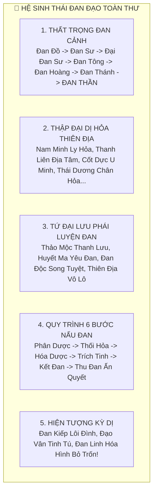

#### 2.1. Thất Trọng Đan Cảnh (7 Cấp Bậc Đan Sư Chi Tiết)

1. **Đan Đồ (Nhận Biết Thảo Dược)**: Nắm vững tính năng của 10,000 loại thảo dược, phân biệt được rễ cây ngàn năm và củ cải dại. Chỉ luyện được thuốc tán, cao dán phàm phẩm.
2. **Đan Sư (Nhập Môn Đan Hỏa)**: Ngưng tụ được chân hỏa trong lòng bàn tay, luyện được các loại linh đan cấp 1-2 dành cho Luyện Khí Kỳ (*Hồi Khí Đan*, *Ích Tinh Đan*). Tỷ lệ thành công: $60\%$.
3. **Đại Đan Sư (Thấu Hiểu Đan Lý)**: Bắt đầu dung nạp Thú Hỏa hoặc Địa Hỏa sơ cấp, luyện được đan dược cấp 3-4 phục vụ Trúc Cơ Kỳ (*Trúc Cơ Đan*, *Tẩy Tủy Đan*). Xuất hiện đan dược Nhị Phẩm có 1-2 Đạo Vân. Tỷ lệ nổ lò giảm xuống dưới $15\%$.
4. **Đan Tông (Tông Sư Luyện Đan)**: Điều khiển lửa đạt mức xuất thần nhập hóa, luyện thành công đan dược cấp 5-6 dành cho Kim Đan Kỳ (*Ngưng Kim Đan*, *Kết Anh Đan*). Bắt đầu xuất hiện dị tượng đan hương ngào ngạt bay xa trăm dặm.
5. **Đan Hoàng (Hoàng Giả Đan Giới)**: Sở hữu Dị Hỏa Thiên Địa, luyện được đan dược cấp 7-8 cho Nguyên Anh và Hóa Thần (*Cửu Chuyển Hồi Hồn Đan*, *Hóa Thần Dịch*). Đan xuất lò kích phát **Tam Sắc Đan Kiếp** sấm sét giáng xuống!
6. **Đan Thánh (Đan Sinh Đạo Vân)**: Luyện đan không cần nhìn công thức, tự do sáng tạo phối phương. Đan dược luyện ra toàn bộ đạt cấp **Cực Phẩm Viên Mãn mang 9 Đạo Vân**, dẫn động **Cửu Sắc Lôi Kiếp**.
7. **Đan Thần (Thiên Địa Vi Lô)**: Cảnh giới huyền thoại! Lấy trời đất làm nắp lò, lấy nhật nguyệt làm ngọn lửa, lấy một con sông linh mạch làm nước luyện đan. Luyện ra **Hóa Hình Thần Đan** có linh hồn riêng, mở lò đan tự biến thành thần tiên bay lên mây!

---

#### 2.2. Thập Đại Dị Hỏa Chi Tôn (Ngọn Lửa Luyện Đan Nghịch Thiên)

Lửa phàm chỉ luyện được rác rưởi. Đan Sư muốn bước lên đỉnh cao bắt buộc phải lặn lội xuống vực sâu dung nham, mộ cổ u minh hay đỉnh núi băng tuyết để hàng phục **Dị Hỏa**:

| Tên Dị Hỏa | Màu Sắc & Nguồn Gốc | Độ Nguy Hiểm Khi Dung Nạp | Hiệu Quả Luyện Đan Độc Bản | Hiệu Quả Xuất Chiến Khi Phun Ra |
| :--- | :--- | :--- | :--- | :--- |
| **1. Nam Minh Ly Hỏa** | Đỏ rực ánh vàng (Sinh ra từ lông vũ Thần Điểu Chu Tước) | Trung bình (Đòi hỏi huyết mạch thuần khiết) | Đan dược thành phẩm **$0\%$ Đan Độc**, nâng $20\%$ phẩm chất thuốc. | Thiêu rụi tà ma, sát thương chí mạng nhân $\times 2.5$ lên Ma Tộc. |
| **2. Thanh Liên Địa Tâm Hỏa** | Xanh ngọc bích (Khai sinh từ dung nham ngàn năm dưới lòng đất) | Khá cao (Phải dùng Hàn Băng Tuyền để áp chế) | Tăng tốc độ luyện đan $+35\%$, giảm $50\%$ nguy cơ nổ lò. | Tạo khiên lửa bảo vệ người chơi, phản lại $30\%$ sát thương cận chiến. |
| **3. Cốt Dực U Minh Hỏa** | Trắng bệch như xương (Mọc trong mồ mả cổ nghìn năm) | Cực cao (Hàn khí ăn mòn linh hồn tu sĩ) | Chuyên dùng luyện đan dược hệ Âm, Băng và Ám cấp cao. | Lửa lạnh thấu xương, trúng phải bị đóng băng kinh mạch 3 hiệp. |
| **4. Thái Dương Chân Hỏa** | Vàng kim chói lòa (Hấp thụ tinh hoa mặt trời 10 vạn năm) | Cực độ nguy hiểm (Dễ thiêu cháy đan điền) | Nhiệt độ cực hạn nung chảy kim loại thần thoại, luyện đan Niết Bàn. | Phun ra quả cầu lửa nổ tung AoE diện rộng xóa sổ cả bản đồ. |
| **5. Cửu U Minh Ma Hỏa** | Tím đen hắc ám (Sinh ra từ đáy Ma Giới U Minh) | Nghịch thiên tà đạo (Dễ biến thành Ma Đầu) | Luyện ra hung đan kích phát chiến lực bạo tăng gấp 4 lần. | Đốt cháy thanh Mana/Chân nguyên của kẻ địch thành tro bụi. |
| **6. Thất Thải Vẫn Lạc Hỏa** | Bảy màu rực rỡ (Thiên thạch vũ trụ rơi xuống mặt đất) | Cực cao (Năng lượng không gian bất ổn) | Tăng tỷ lệ xuất hiện **Đạo Vân Cực Phẩm** lên thêm $+25\%$. | Xé rách không gian, gây sát thương chuẩn xuyên thấu mọi phòng ngự. |
| **7. Hư Vô Thôn Viêm** | Vô hình vô sắc (Ngọn lửa hư không không hình dáng) | Huyền thoại (Chỉ có trong truyền thuyết cổ xưa) | Cho phép luyện đan mà không cần bất kỳ dược thảo phụ trợ nào! | Thôn phệ đòn đánh phép thuật của kẻ thù chuyển thành HP cho chủ. |
| **8. Bát Hoang Phá Diệt Hỏa** | Đỏ thẫm như máu (Hội tụ oán niệm chiến trường viễn cổ) | Rất cao (Sát khí bừng bừng dễ tẩu hỏa) | Luyện đan bạo kích chiến đấu và đan độc cấm kỵ. | Mỗi giây thiêu đốt $5\%$ máu tối đa của đối thủ suốt trận. |
| **9. Hồng Liên Nghiệp Hỏa** | Đóa sen đỏ thắm (Lửa thiêu đốt tội lỗi nhân quả) | Thử thách Đạo Tâm (Nếu có tội sẽ tự thiêu mình) | Tẩy sạch hoàn toàn nghiệp chướng và tâm ma cho người uống đan. | Kẻ thù sát nghiệt càng nặng, dính lửa sát thương càng nhân gấp bội! |
| **10. Hỗn Độn Sơ Hỏa** | Xám tro nguyên thủy (Ngọn lửa đầu tiên khai thiên lập địa) | Vô Thượng Chi Tôn (Ngàn năm vạn kiếp khó gặp) | Luyện ra được Thần Đan Khởi Tử Hồi Sinh và Cải Biến Linh Căn! | Một tia lửa rơi xuống có thể thiêu rụi cả một hành tinh! |

---

#### 2.3. Tứ Đại Lưu Phái Luyện Đan Chuyên Sâu

* **Thảo Mộc Thanh Lưu (Chính Thống Dưỡng Sinh Phái)**: Tôn trọng tự nhiên, chú trọng điều hòa âm dương giữa các loại cây cỏ. Đan dược luyện ra tinh khiết không tì vết, giúp người uống mở rộng kinh mạch, tăng tuổi thọ và đột phá cảnh giới an toàn mà không để lại bất kỳ di chứng nào.
* **Huyết Ma Yêu Đan Lưu (Huyết Luyện Hung Đan Phái)**: Khinh bỉ việc nhặt cỏ tốn thời gian. Họ săn bắt Thần Thú, chém giết Yêu Vương, móc lấy quả tim đỏ hỏn và Yêu Đan ném vào lò máu! Luyện ra loại đan đỏ như máu tươi, cắn vào chiến lực tăng vọt $\times 300\%$ trong 10 phút, nhưng tích tụ yêu khí trong tạng phủ.
* **Đan Độc Song Tuyệt Lưu (Dĩ Độc Nhập Đạo)**: "Đan đến cực hạn là Độc, Độc đến đỉnh phong là Đan!" Chế tạo các loại phấn độc vô hình thả vào gió làm thối rữa đan điền đối thủ ngoài vạn dặm. Bản thân uống thuốc độc mỗi ngày để rèn luyện lục phủ ngũ tạng trở thành Bách Độc Bất Xâm Thể.
* **Thiên Địa Vô Lô Lưu (Càn Khôn Tạo Hóa Phái)**: Không dùng lò đồng lò bạc. Đan Sư đứng trên đỉnh núi cao, lấy hư không càn khôn làm đỉnh lò, lấy mây gió sấm chớp làm đan hỏa, luyện một vùng đất linh mạch vạn dặm cô đặc thành một viên Cửu Chuyển Thần Đan duy nhất!

---

#### 2.4. Quy Trình 6 Bước Nấu Đan & Đan Kiếp Biến Hóa

1. **Phân Dược (Chia Thuốc)**: Cân đo chính xác từng mi-li-gam dược liệu. Sai 1 sợi rễ cây có thể làm hỏng toàn bộ mẻ thuốc.
2. **Thối Hỏa (Khởi Lửa Đun Lò)**: Vận chuyển chân hỏa nung nóng lò đan đến nhiệt độ ổn định, trục xuất uế khí còn sót trong lò.
3. **Hóa Dược (Nung Chảy Thành Nước)**: Ném dược thảo vào theo thứ tự Quân - Thần - Tá - Sứ, dùng nhiệt độ thích hợp ép thảo mộc tan chảy thành tinh chất lỏng lơ lửng giữa lò.
4. **Trích Tinh (Lọc Bỏ Tạp Chất)**: Bước quyết định đan độc! Dùng thần thức cực vi soi chiếu, bóc tách từng hạt cặn bã đen kịt vứt ra ngoài. Lọc càng kỹ, đan phẩm càng cao ($0\%$ Đan Độc đòi hỏi thần thức cực hạn).
5. **Kết Đan (Ngưng Khí Thành Viên)**: Vận chuyển chân khí xoay tròn khối tinh chất lỏng với tốc độ cao, ép nó cô đặc lại thành từng viên tròn trịa óng ánh.
6. **Thu Đan Ấn Quyết (Bắt Đan Về Tay)**: Tung ra thủ ấn gia truyền (như *Cửu Long Khất Đan Quyết*, *Bát Quái Phong Linh Thủ*) mở nắp lò thu đan vào bình ngọc.
   * **Hiện tượng Đan Kiếp**: Đan từ cấp 6 trở lên khi mở nắp lò sẽ kích hoạt mây đen kéo đến, **Sấm Sét Đan Lôi** giáng xuống. Đan Sư phải dùng nhục thân hoặc pháp bảo che chắn cho viên đan. Vượt qua sấm sét, viên đan sẽ khắc lên mình các đường vân thần bí (**Đạo Vân**). Đan 9 Đạo Vân là tuyệt phẩm thiên hạ!
   * **Hiện tượng Đan Linh Hóa Hình**: Đan cấp 7 trở lên sau khi chịu lôi kiếp sẽ sinh ra linh trí! Viên đan mọc ra cánh chim phượng hoàng hoặc biến thành một đứa trẻ con bằng ngón tay lách qua nắp lò **tự động bay vút lên trời trốn chạy**! Đan Sư phải tung lưới vàng bay theo truy bắt.

---

### ⛩️ 3. TRẬN ĐẠO (THE ARRAY DAO) — "NON SÔNG LÀM BÀN CỜ, CẢN PHÁ THẦN MA"

> *"Kẻ phàm phu nhìn non sông chỉ thấy đá sỏi hiểm trở, bậc Trận Sư nhìn thế đất lại thấy hàng vạn sát trận ngút ngàn rình rập. Một cọc trận cắm xuống long mạch, một vạn đại quân tiến vào chỉ có đường chôn thây!"*

Trận Tu không cần đối đầu đao kiếm trực diện. Họ biến không gian, địa hình, ngũ hành và thời gian thành cạm bẫy vĩ mô nghiền nát quân thù.

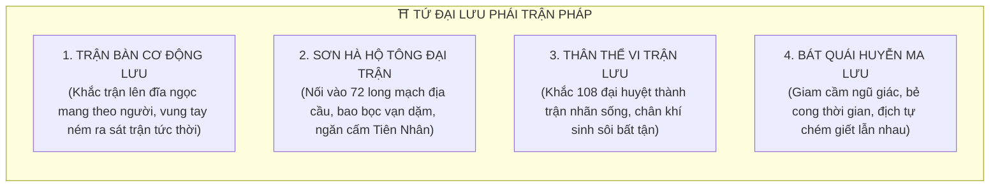

#### 3.1. Tứ Đại Lưu Phái Trận Đạo Chuyên Sâu

* **Trận Bàn Cơ Động Lưu (Chiến Trận Tốc Chiến)**: Dành cho tu sĩ thích du ngoạn solo. Chế tác sẵn các đĩa Trận Bàn bằng ngọc thạch hoặc huyền thiết. Khi gặp kẻ địch, lập tức ném đĩa trận xuống chân, kích hoạt *Tiểu Tru Tiên Trận* hoặc *Ngũ Hành Tỏa Linh Trận* trong 0.5 giây giam cầm và tiêu diệt địch thủ.
* **Sơn Hà Hộ Phái Trận Lưu (Địa Mạch Vạn Lý Phái)**: Bậc thầy phong thủy địa lý. Cắm 360 cọc trận bằng bạch ngọc vào lòng đất, kết nối hệ thống sông ngòi và núi non tạo thành bức tường năng lượng bảo vệ cả một tông môn. Khi đại nạn xảy ra, đại trận kích hoạt có thể chịu đựng đòn đánh của 10 vị đại năng Hóa Thần suốt 3 năm ròng rã!
* **Thân Thể Vi Trận Lưu (Nhục Thân Trận Tu)**: Không dùng ngoại vật. Lấy chính da thịt làm vải vẽ trận, lấy 108 đại huyệt đạo làm Trận Nhãn, dùng kinh mạch làm dây dẫn trận văn. Bản thân biến thành một cỗ máy trận pháp di động: Chân khí tự động vận chuyển tuần hoàn không bao giờ cạn kiệt, kẻ thù đánh vào bị phản chấn sát thương gấp đôi.
* **Bát Quái Mê Tung Huyễn Trận Lưu (Ảo Ảnh Vô Giới Phái)**: Thao túng ngũ giác và ý thức của kẻ thù. Đối phương bước vào trận sẽ thấy ngày biến thành đêm, người thân biến thành quái vật gớm ghiếc, không gian bị bẻ cong đi mãi không hết một căn phòng. Kẻ địch tự vung kiếm tàn sát lẫn nhau đến người cuối cùng mà vẫn tưởng mình đang lập công!

---

#### 3.2. Cấu Trúc Ngũ Đại Trụ Cột Vận Hành Pháp Trận

1. **Trận Nhãn (Lõi Trận - Core)**: Nơi hội tụ toàn bộ năng lượng sinh tử. Thường đặt một món Cực Phẩm Thần Khí (như *Định Hải Thần Châm*, *Hạo Thiên Kính*) hoặc một viên Yêu Đan Cửu Giai để làm nguồn phát năng lượng. Trận Nhãn bị phá hủy, đại trận lập tức sụp đổ tan tành.
2. **Trận Kỳ (Cờ Lệnh Điều Phối)**: Đạo cụ bằng linh ti ngàn năm dùng để phân bổ luồng khí ngũ hành, thay đổi thuộc tính trận pháp từ Hỏa Sát sang Băng Phong tùy ý người điều khiển.
3. **Trận Cơ (Móng Cọc Địa Mạch)**: Hệ thống cọc trận đúc bằng Huyền Thiết cắm sâu vào lòng đất để hút linh khí tự nhiên từ long mạch, giúp trận pháp vận hành vĩnh cửu mà không hao tốn linh thạch của chủ nhân.
4. **Trận Văn (Đạo Ngữ Cổ Khắc)**: Những ký tự thần bí thời Thái Cổ được khắc ngoằn ngoèo nối các trận nhãn. Trận văn càng tinh xảo, năng lượng truyền tải càng nhanh và ít bị hao hụt.
5. **Trận Linh (Linh Hồn Hộ Trận)**: Đại trận vận hành hàng ngàn năm sẽ tích tụ linh khí đất trời sinh ra một sinh mệnh độc lập khổng lồ (rồng lửa, rùa thần đá). Trận Linh có thể tự động suy nghĩ, phát hiện kẻ xâm nhập và điều động sát trận tiêu diệt kẻ thù mà không cần chủ nhân can thiệp!

---

#### 3.3. Thuật Phá Trận: "Kỳ Môn Độn Giáp & Bát Môn Sinh Tử"

Khi người chơi bị rơi vào đại trận của đối thủ, không thể dùng man lực đập phá mà phải dùng thuật Bói Toán Kỳ Môn để tìm đường thoát:

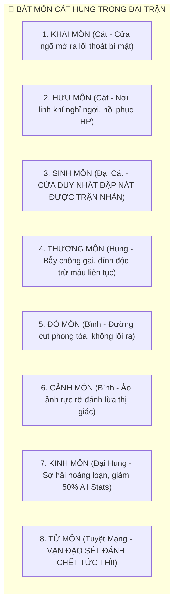

* **Đi nhầm vào Tử Môn**: Nhận ngay $999,999$ Sát thương Lôi Hỏa sát trận, bốc hơi trong 1 nốt nhạc!
* **Dò ra Sinh Môn & Trảm Trận Nhãn**: Đại trận lập tức vỡ vụn như gương vỡ, toàn bộ đệ tử canh trận bị chấn động đứt kinh mạch, chủ trận bị phản phệ thổ huyết giảm $50\%$ tu vi!

---

### ⚒️ 4. KHÍ ĐẠO (THE REFINING DAO) — "ĐÚC LINH THÀNH THẦN, VẠN BINH QUY TÔNG"

> *"Sắt vụn phàm trần qua ngàn lần đập búa hóa thành tinh cương; tinh cương ngâm trong máu Phượng Hoàng sinh ra Khí Linh! Kẻ luyện khí là cha mẹ của thần binh, ban cho khối sắt lạnh vô tri một linh hồn bất diệt!"*

Khí Sư biến khoáng thạch thô sơ dưới đáy biển sâu hay thiên thạch vũ trụ thành những món pháp bảo rung chuyển tam giới:

```mermaid
graph TD
    subgraph KHI_DAO_RANKS ["⚒️ 9 BẬC PHÁP BẢO TIẾN HÓA TRONG TU CHÂN GIỚI"]
        P1["1. Phàm Khí (Sắt bén phàm trần, chém sắt chém gỗ)"] --> P2["2. Linh Khí (Dẫn truyền được Chân Khí tu sĩ)"]
        P2 --> P3["3. Pháp Khí (Khắc 1-3 trận pháp, kích hoạt kỹ năng đặc thù)"]
        P3 --> P4["4. Bảo Khí (Đúc bằng huyền thiết ngàn năm, tỏa ánh linh quang)"]
        P4 --> P5["5. Cổ Bảo (Pháp bảo tàn tích cổ xưa, uy lực thô bạo không cần luyện hóa)"]
        P5 --> P6["6. Thông Thiên Linh Bảo (Sinh ra KHÍ LINH ĐỘC LẬP, tự động hộ chủ nghênh chiến)"]
        P6 --> P7["7. Tiên Khí (Chứa quy tắc Tiên Giới, biến đổi hình thái vạn biến)"]
        P7 --> P8["8. Huyền Thiên Chi Bảo (Thiên địa tự sinh trong hỗn đồn, mang 1 tia Pháp Tắc)"]
        P8 --> P9["9. KHAI THIÊN THẦN KHÍ (Xé toạc vũ trụ, sáng thế và diệt thế trong 1 cái vung tay!)"]
    end
```

#### 4.1. Tứ Đại Lưu Phái Luyện Khí Chuyên Sâu

1. **Bản Mệnh Ôn Dưỡng Lưu (Nhất Đời Nhất Kiếm)**: Người luyện cả đời chỉ đúc duy nhất một thanh phi kiếm hoặc pháp bảo bản mệnh. Nuốt pháp bảo vào đan điền, dùng máu tim (tinh huyết) và chân hỏa ấp ủ nuôi nấng suốt trăm năm.
   * *Đặc quyền*: Độ đồng hóa đạt $200\%$, pháp bảo tăng cấp cùng với cảnh giới của chủ nhân (Trúc Cơ tiến cấp Kim Đan thì kiếm cũng tự tiến cấp Bảo Khí).
   * *Rủi ro*: Người còn kiếm còn, kiếm gãy người chết hoặc trọng thương phế bỏ tu vi!
2. **Huyết Tế Dục Linh Lưu (Tà Khí Trấn Phái)**: Muốn vũ khí nhanh chóng sinh ra Khí Linh cấp cao, họ săn lùng Thần Thú thượng cổ, Ma Vương hoặc bắt sống linh hồn của các vị đại năng tu sĩ ném thẳng vào lò lửa đỏ rực khi vũ khí sắp xuất xưởng!
   * *Đặc quyền*: Pháp bảo sở hữu Khí Linh hung tàn cực độ, có khả năng tự động bay ra khỏi bao bay quanh chủ nhân chém giết quân thù mà chủ không cần tiêu tốn 1 giọt mana nào!
3. **Thiên Công Khắc Văn Lưu (Trận Phù Thần Công)**: Chuyên gia chạm khắc các Đạo Văn cổ ngữ lên thân vũ khí. Một chiếc khiên có thể khắc 36 tầng *Huyền Vũ Thuẫn Văn*, một thanh đao có thể khắc 72 tầng *Phá Giáp Huyết Văn*.
4. **Vạn Binh Hợp Thể Lưu (Tàn Binh Nghịch Chuyển)**: Thu gom hàng ngàn mảnh vỡ kiếm gãy khiên nứt từ các cổ chiến trường ngàn năm trước, dùng bí hỏa nung chảy dung hợp lại. Sinh ra một món Thần Khí dị dạng mang oán niệm ngút trời của hàng vạn tử sĩ.

---

#### 4.2. Khí Linh Thức Tỉnh & Hiểm Họa "Khí Linh Phản Phệ"

* **Thức Tỉnh Khí Linh**: Khi pháp bảo đạt cấp **Thông Thiên Linh Bảo**, bên trong sẽ ngưng tụ một quả cầu ánh sáng linh hồn. Khí Linh có thể hóa hình thành hình dáng con thú nhỏ, một thiếu nữ áo trắng hoặc một kiếm khách tí hon ngồi trên mũi kiếm trò chuyện cùng chủ nhân.
* **Nguy Cơ Phản Phệ**: Nếu cảnh giới người chơi quá yếu mà lại cầm Thần Khí quá mạnh (ví dụ Trúc Cơ Kỳ nhặt được Thông Thiên Linh Bảo):
  * Khí Linh kiêu ngạo sẽ khinh thường người cầm, **từ chối tung chiêu** khi đánh Boss ($30\%$ xác suất đòn đánh thành vô dụng).
  * Trong lúc nguy cấp máu đỏ, Khí Linh tà ác có thể **quay ngược mũi kiếm hút cạn tinh huyết của chủ nhân** để bộc phát sức mạnh tự thân rồi bay đi tìm chủ mới!

---

### 📜 5. PHÙ ĐẠO (THE TALISMAN DAO) — "NÉT BÚT THÔNG THIÊN ĐỊA, CHU SA ĐỊNH CÀN KHÔN"

> *"Một vuông giấy vàng dời non lấp biển; một giọt chu sa định đoạt sinh tử càn khôn. Pháp thuật niệm chú mất nửa ngày trời, Phù Sư vung tay ném bùa chỉ mất 0.01 giây!"*

Phù Tu là bậc thầy nén đại pháp thuật vào những tờ giấy bùa nhỏ gọn mang theo bên mình, tạo ra khả năng bộc phát hỏa lực tức thời kinh hoàng nhất Tu Chân Giới.

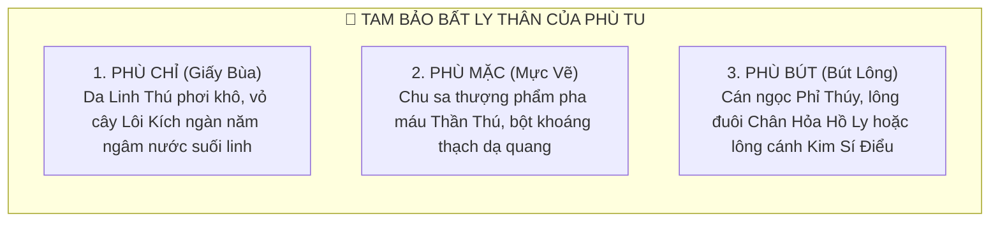

#### 5.1. Tứ Đại Cảnh Giới Phù Đạo Tiến Hóa

1. **Nhất Bút Thành Phù (Hạ Thừa)**: Đặt bút xuống là phải vẽ một mạch không đứt đoạn. Chân khí rót vào đều đặn như dòng nước chảy; ngập ngừng một khắc lá bùa lập tức bốc cháy thành tro.
2. **Chỉ Phù Mịt Trời / Bách Phù Lưu (Trung Thừa)**: Tích lũy hàng ngàn lá bùa trong túi Càn Khôn. Khi giao chiến, vung tay ném ra cả ngàn lá bùa nổ tung như thiên thạch rơi ngút trời (*Kim Phù Vũ*, *Lôi Đình Hải*), dùng tiền đè chết đối thủ!
3. **Hư Không Họa Phù (Thượng Thừa)**: Bứt phá giới hạn vật chất! Không cần giấy, không cần bút mực. Chấm ngón tay vào hư không, lấy linh khí trời đất làm mực vẽ thành bùa chú lơ lửng giữa trời rồi bắn thẳng vào kẻ địch trong 0.1 giây.
4. **Pháp Tắc Hóa Phù / Bản Thân Vi Phù (Cực Đỉnh Viễn Cổ)**: Khắc phù văn vào chính xương thịt, lục phủ ngũ tạng của mình. Toàn thân biến thành một lá Thiên Đạo Cấm Phù di động. Một ánh mắt phóng ra phù văn phong ấn cả một ngọn núi!

---

#### 5.2. Ngũ Đại Hệ Phù Chú Nghịch Thiên

* **Công Kích Lôi Hỏa Phù**: *Cửu Thiên Huyền Lôi Phù*, *Phần Thiên Liệt Diễm Phù* — Ném ra tạo vụ nổ sấm sét và biển lửa diện rộng, gây sát thương tức thì không thể né tránh.
* **Phòng Ngự Kim Cang Phù**: *Thần Hộ Bát Quái Phù*, *Bất Động Như Sơn Phù* — Dựng lên lồng kính kim quang bao bọc cơ thể, hấp thụ $100\%$ sát thương trong 3 hiệp.
* **Thần Hành & Na Di Phù**: *Đại Na Di Phù* (Dịch chuyển xuyên không gian trốn thoát khỏi bí cảnh nguy hiểm), *Súc Địa Thành Thốn Phù* (Tăng $300\%$ tốc độ chạy trên bản đồ thế giới).
* **Phong Ấn Cấm Thuật Phù**: *Thiên Đạo Tỏa Thần Phù* — Dán thẳng lên trán đối thủ, khóa chặt kinh mạch và đan điền, phong bế toàn bộ cấp độ tu vi của kẻ địch về phàm nhân trong 5 hiệp!
* **Tà Thuật Cấm Phù**: *Huyết Thần Cấm Mệnh Phù* — Dùng máu tim vẽ bùa, sát thương nhân $\times 5$ lần nhưng người dùng bị tổn hao 10 năm thọ mệnh.

---

### 🛡️ 6. THỂ ĐẠO (BODY CULTIVATION) — "NHỤC THÂN THÀNH THÁNH, ĐAO THƯƠNG BẤT NHẬP"

> *"Pháp thuật dẫu huyền diệu biến hóa cũng chỉ là ngoại vật vay mượn của đất trời; duy có từng thớ cơ bắp, xương tủy và dòng máu này mới là vĩnh hằng bất biến của chính ta!*
> *Thiên kiếp giáng xuống, pháp bảo vỡ nát, linh khí cạn kiệt, chỉ có nắm đấm sắt này mới xé toạc được sấm sét, đấm nát hư không mà bước lên đỉnh cao vĩnh cửu!"*

Thể Tu khinh thường những kẻ tu luyện pháp thuật đứng từ xa lẩm bẩm niệm chú. Họ lấy thân xác làm đỉnh lô, lấy đau đớn tột cùng làm ngọn lửa rèn giũa nhục thân thành món vũ khí tàn bạo và bền bỉ nhất cõi trời đất.

```mermaid
graph TD
    subgraph THE_DAO_8_REALMS ["🛡️ BÁT TRỌNG NHỤC THÂN CỰC CẢNH (BODY CULTIVATION TIERS)"]
        R1["Trọng 1: ĐỒNG BÌ (Da Đồng Sắt Cổ)\n(Đao kiếm phàm trần chém vào chỉ tóe tia lửa, giảm 30% sát thương vật lý)"]
        R2["Trọng 2: THIẾT CỐT (Xương Cốt Gang Thép)\n(Đập gãy xương rồi ngâm thuốc nối lại; tay không bẻ gãy binh khí kẻ địch)"]
        R3["Trọng 3: NGÂN HUYẾT (Máu Bạc Tinh Khiết)\n(Máu chuyển ánh bạc, đào thải 100% độc tố, tốc độ hồi phục máu x3 lần)"]
        R4["Trọng 4: KIM TẠNG (Lục Phủ Ngũ Tạng Hoàng Kim)\n(Tim phổi đúc bằng vàng ròng, miễn nhiễm sóng âm và chấn động nội thương)"]
        R5["Trọng 5: NGỌC TỦY (Tủy Xương Ngọc Bích Lưu Ly)\n(Tủy xương sinh ra Thần Ma Chân Huyết, bộc phát man lực vạn cân đấm nát đồi núi)"]
        R6["Trọng 6: THẦN MA PHÁP TƯỢNG (Bản Thể Cổ Thần)\n(Hóa thân cự nhân cao trăm trượng, một bước vượt sông, một tay che trời)"]
        R7["Trọng 7: BẤT DIỆT KIM THÂN (Thân Xác Bất Tử Bất Hoại)\n(Lôi kiếp giáng xuống chỉ rèn thêm độ cứng; gãy tay chân tự mọc lại sau 1 hiệp)"]
        R8["Trọng 8: NHỤC THÂN THÀNH THÁNH (Khai Thiên Liệt Địa)\n(Tay không xé rách không gian thứ nguyên, đấm vỡ nát tinh cầu, thọ cùng trời đất!)"]

        R1 --> R2 --> R3 --> R4 --> R5 --> R6 --> R7 --> R8
    end
```

#### 6.1. Chi Tiết Bát Trọng Nhục Thân Cực Cảnh

1. **Trọng 1: Đồng Bì (Luyện Da)**:
   * *Quá trình*: Dùng roi gai sắt quất rách da thịt, sau đó ngâm mình trong nước sôi pha *Thiết Diệp Thảo* và muối khoáng 49 ngày đêm.
   * *Năng lực*: Da dẻ chuyển sang màu đồng cổ bóng loáng. Miễn nhiễm toàn bộ vũ khí phàm trần; giảm $-30\%$ sát thương vật lý từ quái vật; tăng $+25\%$ Kháng hiệu ứng Chảy Máu.
2. **Trọng 2: Thiết Cốt (Luyện Xương)**:
   * *Quá trình*: Dùng chùy sắt đập nứt các khớp xương, uống *Hắc Ngọc Đoạn Cốt Cao* để xương tự lành lại dày hơn trước gấp 3 lần.
   * *Năng lực*: Xương cứng như huyền thiết đen. Dùng cẳng tay đỡ đòn có $25\%$ cơ hội bẻ gãy đao kiếm thường của đối phương; tăng $+40\%$ Phòng thủ DEF cơ bản.
3. **Trọng 3: Ngân Huyết (Luyện Máu)**:
   * *Quá trình*: Thay toàn bộ máu bẩn phàm tục, kích thích tủy sinh ra dòng máu mang ánh bạc óng ánh.
   * *Năng lực*: Độc dược đi vào máu lập tức bị bạc hóa thiêu rụi (Kháng Bách Độc $100\%$); tốc độ hồi phục HP tự nhiên tăng vọt gấp 3 lần ($+5\%$ HP mỗi lượt đấu).
4. **Trọng 4: Kim Tạng (Luyện Lục Phủ Ngũ Tạng)**:
   * *Quá trình*: Nuốt lửa địa hỏa và kim loại lỏng *Canh Kim Tinh Hoa* vào bụng để tôi luyện tim, gan, tỳ, phế, thận.
   * *Năng lực*: Toàn bộ nội tạng đúc bằng vàng ròng. Miễn nhiễm hoàn toàn với các đòn đánh chấn động âm ba (như tiếng gầm của hổ, tiếng chuông Phật) và đòn nội thương xuyên giáp.
5. **Trọng 5: Ngọc Tủy (Hoán Cốt Luyện Tủy)**:
   * *Quá trình*: Rút sạch tủy xương phàm trần, thay bằng tủy ngọc lưu ly trong suốt như pha lê.
   * *Năng lực*: Tủy sinh ra *Cổ Thần Chi Lực*. Mỗi đòn đánh tay không sở hữu man lực vạn cân, đấm vỡ nát pháp bảo hộ thân; sát thương tay tăng vọt $+80\%$.
6. **Trọng 6: Thần Ma Pháp Tượng (Cực Hạn Hóa Thần)**:
   * *Quá trình*: Đánh thức ký ức huyết mạch Thần Ma viễn cổ nằm sâu trong tế bào.
   * *Năng lực*: Bộc phát hóa thân thành Cổ Thần cự nhân cao trăm trượng phủ kín hoàng kim hoặc ma diễm. Mọi đòn đánh biến thành đòn đánh diện rộng AoE; kẻ địch bé nhỏ đứng dưới chân bị áp chế giảm $-40\%$ lực tấn công.
7. **Trọng 7: Bất Diệt Kim Thân (Niết Bàn Bất Hoại)**:
   * *Quá trình*: Đứng giữa trận lôi kiếp 9 tầng trời mà không dùng bất kỳ pháp bảo hay khiên chắn nào, để sấm sét giáng thẳng vào đầu tôi luyện tế bào.
   * *Năng lực*: Nhục thân bất hoại trước lôi kiếp; đứt đầu, gãy tay chân đều tự động mọc lại sau 1 khắc (**Tích Huyết Trùng Sinh** sơ cấp). Miễn nhiễm $100\%$ sát thương Bạo Kích.
8. **Trọng 8: Nhục Thân Thành Thánh (Khai Thiên Sáng Thế)**:
   * *Quá trình*: Vượt qua cửa ải sinh tử, dùng nắm đấm đánh nát Thiên Đạo trói buộc.
   * *Năng lực*: Không cần chân khí, không cần pháp tắc! Một quyền tung ra xé toạc không gian thứ nguyên, đấm vỡ nát các vì sao trên trời. Thân thể trường tồn bất diệt cùng vũ trụ, dẫu càn khôn sụp đổ nhục thân vẫn sừng sững nghìn thu!

---

#### 6.2. Tứ Đại Lưu Phái Thể Đạo Chuyên Sâu

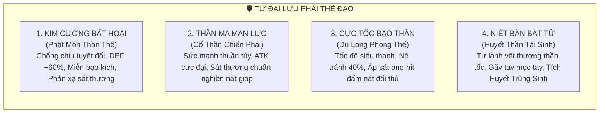

* **Kim Cương Bất Hoại Lưu (Tường Thành Bất Tử)**:
  * Đi sâu vào phòng ngự cực đoan. Nhận thêm $+60\%$ Giáp DEF, miễn nhiễm hoàn toàn với các đòn đánh Bạo Kích. Khi bị kẻ địch tấn công, lớp da kim cương tự động phản lại $30\%$ sát thương vật lý và phép thuật ngược lại đối phương (**Phản Phệ Thần Công**).
* **Thần Ma Man Lực Lưu (Bá Vương Phá Giới)**:
  * Đi sâu vào sát thương bạo lực. Chuyển hóa toàn bộ điểm Thể Lực (HP/DEF) thành Sức Tấn Công ATK thô. Mỗi đòn đấm ra đều mang theo hiệu ứng **Sát Thương Chuẩn** bỏ qua $100\%$ khiên hộ thuẫn và giáp sắt. Đánh trúng có $35\%$ làm vỡ nát vũ khí kẻ địch.
* **Cực Tốc Bạo Thân Lưu (Tử Thần Vô Ảnh)**:
  * Nén các bó cơ bắp đến cực hạn để bùng nổ tốc độ vượt qua cả phi kiếm. Tỉ lệ né tránh đạt $+40\%$. Khi áp sát đối thủ, tung ra chuỗi combo *Bách Liệt Quyền* 100 cú đấm trong 1 giây khiến đối thủ không kịp giơ khiên chống đỡ.
* **Niết Bàn Bất Tử Lưu (Ma Thần Huyết Dịch)**:
  * Sở hữu khả năng sinh tồn kinh hoàng nhất trò chơi. Mỗi hiệp đấu tự động hồi phục lại $15\%$ HP tối đa. Khi bị trảm sát đứt lìa đầu hoặc nát tim, kích hoạt kỹ năng **Tích Huyết Trùng Sinh**: Chỉ cần 1 giọt máu còn sót lại rơi xuống đất, trong 3 hiệp sau sẽ tự động tái tạo lại toàn bộ thân thể nguyên vẹn!

---

#### 6.3. Tam Đại Phương Pháp Tôi Thể Khắc Nghiệt

* **Dược Dục Thang (Ngâm Vạc Thuốc Sôi)**: Ngồi xếp bằng trong vạc đồng chứa đầy nọc độc của 100 con rắn độc, máu Gấu Đen và 36 vị thảo mộc đắng ngắt được đun sôi sùng sục suốt 77 bốn mươi chín ngày.
* **Thiên Lôi Tôi Thể (Dẫn Sét Đánh Mình)**: Đứng trên đỉnh núi cao giữa trời giông bão, cắm cọc sắt dẫn sét đánh thẳng vào đỉnh đầu để dòng điện xé toạc từng thớ thịt rồi hàn gắn lại với mật độ tế bào dày đặc hơn.
* **Trọng Lực Thần Trận (Luyện Cơ Dưới Lòng Đất)**: Bước vào mật thất có trọng lực gấp 10x đến 100x lần bình thường. Mỗi bước đi nặng như gánh ngọn núi, thở một hơi cũng làm rách phổi. Tu luyện ở đây 1 năm nhục thân cứng hơn người thường gấp mười lần!

---

### 🐺 7. NGỰ THÚ & TRÙNG CỔ ĐẠO (BEAST TAMING & GU DAO)

> *"Vạn linh sinh ra giữa đất trời đều mang linh tính. Kẻ ngự thú là kẻ kết bạn cùng rồng phượng; kẻ luyện cổ là kẻ nuốt vạn độc vào thân để bước lên ngai vàng độc tôn!"*

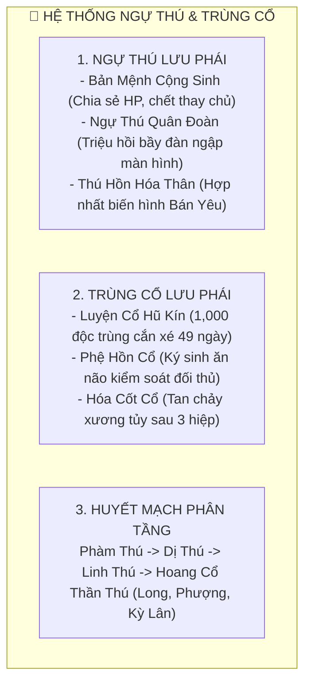

#### 7.1. Ba Nhánh Ngự Thú Thuần Hóa

1. **Bản Mệnh Cộng Sinh Lưu (Đồng Sinh Cộng Tử)**:
   * Ký kết *Huyết Khế Bình Đẳng* với một con Thần Thú từ khi nó còn là quả trứng. Chủ nhân và thú cưng chia sẻ chung thanh máu HP và điểm kinh nghiệm tu vi.
   * **Bí thuật Chết Thay (Thế Mạng Thuật)**: Khi chủ nhân nhận đòn tấn công chí mạng $99,999$ sát thương, linh thú sẽ tự động nhảy ra chắn đòn và chết thay, bảo toàn tính mạng cho chủ nhân!
2. **Ngự Thú Quân Đoàn Lưu (Bầy Đàn Áp Đảo)**:
   * Dùng *Nô Dịch Phù Ấn* thuần hóa hàng ngàn con yêu thú cấp thấp (Bầy Sói Lửa, Đàn Ong Độc, Bầy Chuột Ma). Khi chiến đấu, thả ra một đạo quân thú ngập tràn màn hình cắn xé đối thủ, khiến kẻ địch kiệt sức vì thiếu mana.
3. **Thú Hồn Dung Hợp Lưu (Hóa Thân Bán Yêu)**:
   * Không mang thú cưng đi theo rườm rà. Họ phong ấn linh hồn Yêu Vương vào trong cơ thể mình. Khi xuất chiêu, kích hoạt trạng thái **Bán Thần Hóa**: Mọc ra đôi cánh rồng bay lượn trên trời, mọc móng vuốt hổ xé rách áo giáp đối thủ!

---

#### 7.2. Trùng Cổ Đạo: Bí Pháp Luyện Cổ & Lục Đại Thần Cổ

Trùng Tu nhốt 1,000 con độc trùng (bọ cạp, rết, nhện, rắn, cóc độc) vào một chiếc hũ gốm chôn sâu dưới đất trong 49 ngày đêm không cho ăn uống. Chúng tự cắn xé tàn sát lẫn nhau, con sống sót cuối cùng nuốt hết độc tố của 999 con kia sẽ biến thành **CỔ VƯƠNG**.

| Tên Cổ Trùng Thần Thoại | Cơ Chế Ký Sinh & Tấn Công | Tác Hại Lên Mục Tiêu | Cách Giải Độc & Hóa Giải |
| :--- | :--- | :--- | :--- |
| **1. Phệ Hồn Cổ** | Thả con bọ nhỏ bằng hạt cát bay vào tai đối thủ ăn mòn thần thức. | Biến kẻ địch thành con rối sống (**Puppet**), tự quay đầu chém đồng đội! | Phải dùng *Tẩy Tủy Đan* hoặc lôi hỏa thiêu đốt não bộ. |
| **2. Hóa Cốt Cổ** | Chui qua lỗ chân lông bò vào tủy xương đối phương. | Làm tan chảy toàn bộ xương cốt kẻ địch thành nước đen sau 3 hiệp đấu! | Uống *Hắc Ngọc Đoạn Cốt Thần Dịch* trong vòng 10 phút. |
| **3. Tình Cổ (Đạo Lữ Khế)** | Cấy 1 đôi cổ trùng vào tim của hai người nam và nữ. | Nếu một người phản bội hoặc thay lòng, tim sẽ bị cổ trùng cắn nát tức thì! | Không thể hóa giải trừ khi cả hai cùng tự nguyện chết. |
| **4. Thọ Mệnh Cổ** | Cấy vào cơ thể bản thân để hút sinh khí. | Hút thọ mệnh kẻ địch chuyển hóa thành tuổi thọ cho chủ nhân ($+50$ năm thọ). | Bị Thiên Đạo trừng phạt, sét đánh giảm thọ mệnh. |
| **5. Băng Tàm Cổ** | Con tằm tuyết vạn năm nhả tơ cực lạnh. | Đóng băng toàn bộ kinh mạch và đan điền, khiến địch không thể xuất chiêu. | Dùng ngọn lửa *Nam Minh Ly Hỏa* làm tan chảy tơ băng. |
| **6. Cửu Khiếu Thiên Trùng** | Cổ trùng thần thoại cực hiếm trong truyền thuyết. | Chui vào đan điền gặm nhấm đan độc, cải tạo tư chất biến **Phế Căn thành Thiên Căn**! | Đòi hỏi người nuôi phải cho nó ăn 1,000 viên Thượng Phẩm Linh Thạch mỗi ngày. |

---

### 🤖 8. CƠ QUAN & KHÔI LỖI ĐẠO (PUPPETRY & CORPSE DAO)

> *"Con người có cảm xúc ắt biết sợ hãi, có xác thịt ắt biết đớn đau; duy chỉ có gỗ đá vô tình và thi thể gang thép mới là những chiến binh hoàn hảo nhất trên sa trường!"*

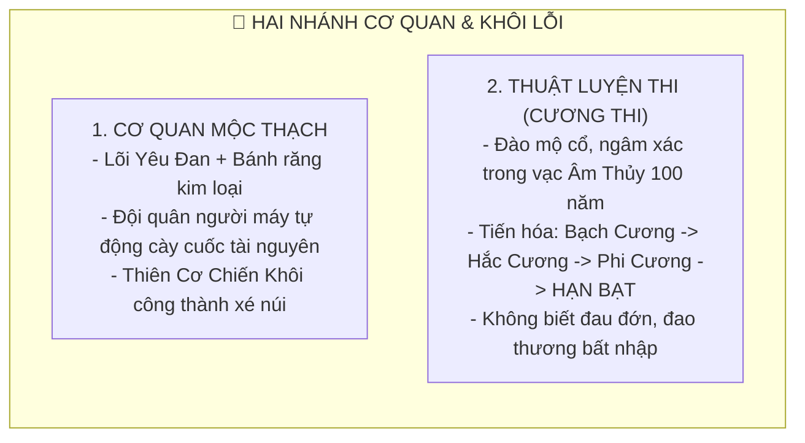

#### 8.1. Cơ Quan Thuật & Hệ Thống Tự Động Hóa Động Phủ (Automation Farming)

* **Thiên Cơ Chiến Khôi**: Người máy đúc bằng gỗ thần ngàn năm và thép huyền thiết, dùng Yêu Đan bậc cao làm trái tim năng lượng. Khôi lỗi có thể bay lượn, bắn tên lửa chân khí và che chắn hộ chủ.
* **Hệ Thống Tự Động Hóa Động Phủ**: Người chơi học Cơ Quan Đạo có thể chế tạo đội quân Khôi Lỗi Công Nhân:
  * Thả 10 con khôi lỗi đi đào khoáng thạch, hái thuốc trên núi 24/24 ngay cả khi người chơi đã **Offline**.
  * Chế tạo Khôi Lỗi Canh Cổng tự động bắt giữ và tiêu diệt người chơi khác lẻn vào ăn trộm động phủ!

#### 8.2. Thuật Luyện Thi & Tứ Trọng Cương Thi Tiến Hóa

Luyện Thi Sư đi đào trộm mộ cổ của các vị tiền bối đại năng, ngâm xác chết trong vạc Âm Thủy và huyết trì dưới lòng đất để luyện thành Cương Thi chiến đấu:

$$\text{Bạch Cương (Sơ cấp)} \longrightarrow \text{Hắc Cương (Trung cấp)} \longrightarrow \text{Phi Cương (Cao cấp)} \longrightarrow \textbf{HẠN BẠT (Thần Ma Chi Cực)}$$

* **1. Bạch Cương**: Thân thể mọc lông trắng, sợ ánh nắng mặt trời và sợ lửa. Nhảy từng bước chậm chạp, thực lực ngang Luyện Khí Kỳ.
* **2. Hắc Cương**: Lông chuyển sang màu đen kịt, da cứng như tấm gỗ lim, nhảy xa trăm trượng, không sợ nước. Thực lực ngang Trúc Cơ Kỳ.
* **3. Phi Cương**: Mọc ra đôi cánh dơi sau lưng, bay lượn trên trời như chim ưng, đao kiếm chém vào chỉ tóe tia lửa, biết hút máu tu sĩ từ xa. Thực lực ngang Kim Đan / Nguyên Anh Kỳ.
* **4. HẠN BẠT (Thi Thần Viễn Cổ)**: Cương thi cấp Thần Ma trong truyền thuyết!
  * Khi Hạn Bạt xuất thế, đất đai khô cằn ngàn dặm, sông ngòi bốc hơi cạn đáy, lửa đỏ thiêu rụi bầu trời!
  * Lực chiến sánh ngang Hóa Thần Tôn Giả, một tiếng gầm làm vỡ nát thần thức của vạn người!

---

### 🔮 9. THIÊN CƠ & BÓI TOÁN ĐẠO (DIVINATION & DESTINY DAO)

> *"Trời đất có mắt, số mệnh có ghi. Kẻ trộm nhìn cuốn sổ Thiên Cơ là kẻ dám thò tay vào miệng hùm để cướp lấy sinh cơ giữa muôn trùng tử lộ!"*

Thiên Cơ Sư là những kẻ thần bí nhất giang hồ. Họ không cần ra tay đánh nhau, chỉ cần bấm ngón tay gieo một quẻ là biết trước tương lai họa phúc.

```mermaid
graph TD
    subgraph KHI_VAN_BAT_SAC ["🌈 BÁT SẮC KHÍ VẬN TRÊN ĐẦU VẠN LINH"]
        KV1["1. KHÍ XÁM TRO: Đại Hung! Điềm báo chết yểu, họa sát thân sắp giáng xuống trong ngày!"]
        KV2["2. KHÍ TRẮNG PHÀM: Bình thường, một đời an phận thủ thường, không sóng gió không kỳ ngộ."]
        KV3["3. KHÍ XANH LỤC: Tiểu Hữu Cơ Duyên, sắp nhặt được linh thảo hoặc bí kíp ven đường."]
        KV4["4. KHÍ XANH LAM: Bậc kỳ tài trăm năm có một, tư chất hơn người, đệ tử nòng cốt môn phái."]
        KV5["5. KHÍ TÍM VƯƠNG GIẢ: Long khí ngút trời, bậc minh chủ môn phái hoặc thống soái một cõi."]
        KV6["6. KHÍ VÀNG KIM: CHÂN MỆNH THIÊN TỬ! Đứng yên bảo vật tự rơi trúng đầu, rơi xuống vực nhặt bí tịch."]
        KV7["7. KHÍ ĐỎ RỰC SÁT KHÍ: Sát Thần Giáng Thế! Đi đến đâu máu chảy thành sông đến đó."]
        KV8["8. HỖN ĐỘN ĐẠO QUANG: ĐẠI ĐẠO CHI TỬ! Người mang sứ mệnh thay đổi toàn bộ cõi Tu Chân Giới!"]

        KV1 --> KV2 --> KV3 --> KV4 --> KV5 --> KV6 --> KV7 --> KV8
    end
```

#### 9.1. Kỹ Năng Bốc Quẻ "Tị Hung Xu Cát"
* **Bấm Quẻ Trước Khi Đi Phụ Bản (Bí Cảnh)**: Thiên Cơ Sư có thể gieo quẻ biết trước:
  * Cửa bí cảnh nào có chứa Cực Phẩm Cổ Bảo.
  * Cửa bí cảnh nào ẩn giấu Boss hung sát vượt cấp để cảnh báo đồng đội né tránh.
* **Chọn Giờ Hoàng Đạo Đột Phá**: Tính toán Canh Giờ và Khí Tượng phù hợp với Linh Căn của bản thân để tăng thêm **$+25\%$ Tỉ Lệ Đột Phá Cảnh Giới Thành Công**.

#### 9.2. Cái Giá Của Việc Trộm Nhìn Vận Mệnh: "Ngũ Bại Tam Khuyết"
Thiên Đạo tuyệt đối không cho phép kẻ phàm tự do dòm ngó thiên cơ. Người bói toán can thiệp vào số mệnh người khác càng nhiều sẽ bị Thiên Phạt giáng xuống:
* **Ngũ Bại**: Phúc, Lộc, Thọ, Tài, Mệnh (Người bói toán thường nghèo rớt mồng tơi hoặc chết trẻ yểu mệnh).
* **Tam Khuyết**:
  * *Khuyết Nhãn (Mù Mắt)*: Đôi mắt bị ánh sáng thiên đạo thiêu mù.
  * *Khuyết Chi (Tàn Tật)*: Gãy tay hoặc thọt chân.
  * *Khuyết Quyến (Cô Độc)*: Cả đời sống một mình, cha mẹ mất sớm, không vợ không con.

---

### 🩸 10. MA ĐẠO & ÂM DƯƠNG ĐẠO (DEMONIC & DUAL CULTIVATION DAO)

> *"Chính đạo là ngụy quân tử mượn danh nhân nghĩa; Ma đạo ta tùy tâm sở dục, khoái ý ân cừu, thuận ta thì sống nghịch ta thì chết!"*

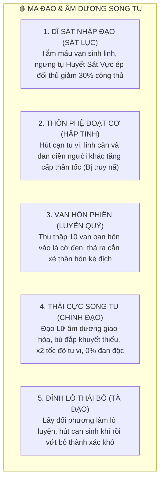

#### 10.1. Ba Nhánh Ma Công Thôn Phệ
1. **Dĩ Sát Nhập Đạo (Tu La Sát Đạo)**:
   * Giết người càng nhiều, sát khí càng nồng đậm. Khi sát khí đạt đỉnh phong sẽ ngưng tụ thành **Huyết Sát Vực** màu đỏ máu bao quanh cơ thể. Kẻ địch bước vào bị tiếng gào thét của oan hồn làm rối loạn tâm trí, giảm $-30\%$ Phòng thủ và mất khả năng né tránh.
2. **Thôn Phệ Đoạt Cơ (Hấp Tinh Đại Pháp)**:
   * Bí pháp tà ác bắt sống tu sĩ khác để hút cạn Chân Nguyên và gặm nhấm Linh Căn của họ biến thành của mình.
   * *Hậu quả*: Tăng cấp cực nhanh nhưng Chân Nguyên bị pha tạp, khi Độ Kiếp bị Thiên Lôi giáng phạt mạnh gấp 3 lần và bị các Tông Môn Chính Đạo phát lệnh **Truy Nã Toàn Server**!
3. **Vạn Hồn Phiên (Hắc Ma Luyện Phách)**:
   * Luyện một lá cờ ma quái bằng da người. Mỗi khi giết một kẻ thù, giam cầm linh hồn họ vào lá cờ bắt làm nô lệ. Khi cờ tích đủ 10 vạn linh hồn (**Thập Vạn Hồn Phiên**), vung cờ lên mây đen che khuất mặt trời, quỷ khóc thần gào xé nát đại trận tông môn.

#### 10.2. Âm Dương Song Tu: Chính Đạo vs Tà Đạo Thải Bổ
* **Thái Cực Bổ Khuyết (Chính Đạo Song Tu)**:
  * Hai người nam và nữ kết làm Đạo Lữ, cùng ngồi xếp bằng vận chuyển chu thiên chân khí. Chân khí thuần dương của nam dung hòa cùng chân khí thuần âm của nữ tạo thành đồ hình Thái Cực hoàn mỹ.
  * *Hiệu quả*: Tốc độ tăng tu vi **nhân gấp đôi ($\times 2.0$)**, tự động hóa giải $100\%$ Đan Độc trong cơ thể mà không cần uống giải dược!
* **Thải Âm Bổ Dương / Thải Dương Bổ Âm (Tà Đạo Thải Bổ)**:
  * Coi đối phương là "Đỉnh Lô" (lò thuốc sống). Dùng mị thuật câu dẫn đối phương ân ái rồi thi triển bí pháp hút sạch toàn bộ tinh hoa sinh mệnh của đối thủ biến thành của mình, bỏ lại nạn nhân trở thành một cái xác khô gầy gò chết tức tưởi!

---

## 🌪️ CHƯƠNG III: CƠ CHẾ ĐỐN NGỘ, ĐẠO KIẾP & MA TRẬN 16 LIÊN ĐẠO

### 3.1. Cơ Chế "Đốn Ngộ" (Sudden Epiphany)
Trong quá trình bôn tẩu giang hồ, người chơi có xác suất kích hoạt khoảnh khắc **Đốn Ngộ Thần Kỳ**:
* **Điều kiện kích hoạt**:
  * Tĩnh tọa ngắm bình minh vào đúng Giờ Mão trên đỉnh núi cao tuyết phủ.
  * Sau một trận chiến sinh tử máu đỏ dưới $3\%$ HP mà lội ngược dòng hạ gục Boss.
  * Uống đan dược cực phẩm *Cửu Khiếu Ngộ Đạo Đan* kết hợp thắp nén hương *Ngộ Đạo Trầm Hương*.
* **Hiệu quả Đốn Ngộ**:
  * Nhận ngay lập tức **$+1,000$ Điểm Ngộ Đạo**.
  * Tự động phá vỡ 1 bình cảnh tiểu cảnh giới hiện tại mà không cần cắn đan dược.
  * Nhận được danh hiệu độc bản và ánh hào quang rực rỡ quanh đầu trong 7 ngày.

---

### 3.2. Đạo Kiếp & Tâm Ma Tẩu Hỏa Nhập Ma
Đột phá Đạo Cảnh từ Bậc 4 trở lên phải trải qua **Đạo Kiếp Thử Thách**:
* Không phải sấm sét đánh vào da thịt, mà là **Tâm Ma Huyễn Cảnh** xuất hiện trong tâm trí:
  * Người chơi phải đối mặt với hình bóng quá khứ: Kẻ thù từng giết, người yêu từng phản bội, hoặc chính bản ngã tà ác của bản thân.
  * Trả lời sai các câu hỏi vấn đáp Đạo Tâm hoặc đan độc quá cao ($>50\%$) sẽ bị **Tẩu Hỏa Nhập Ma**:
    * Đan điền nứt toác, rớt 1 tiểu cảnh giới tu vi.
    * Rơi vào trạng thái cuồng loạn tự động chạy ra chiến trường tấn công bất kỳ ai trong 1 giờ.

---

### 🧩 3.3. Ma Trận 16 Tổ Hợp Nghề Nghiệp Ẩn Danh Chấn Thiên Hạ (Cross-Dao Synergies)

Tu sĩ đỉnh cao luôn tinh thông từ 2 Đạo trở lên, kết hợp tạo thành các **Nghề Nghiệp Ẩn Nghịch Thiên** với kỹ năng độc quyền:

| Tổ Hợp 2 Đạo | Danh Xưng Nghề Nghiệp Ẩn | Quyền Năng Thực Chiến Độc Bản Nghịch Thiên |
| :--- | :--- | :--- |
| **Kiếm Đạo $\oplus$ Trận Đạo** | **Vạn Kiếm Trận Sư** | Phóng 108 thanh phi kiếm cắm xuống đất tạo thành *Thập Tuyệt Kiếm Trận*, vừa chém vừa giam cầm đối thủ! |
| **Đan Đạo $\oplus$ Thể Đạo** | **Cửu Chuyển Dược Thân** | Coi chính thân xác mình là lò đan, nuốt đan dược không bao giờ dính đan độc; da thịt tỏa mùi hương thảo mộc mê hoặc quái vật. |
| **Khí Đạo $\oplus$ Khôi Lỗi Đạo** | **Thần Cơ Cơ Quan Sư** | Chế tạo đội quân người máy mang trang bị toàn bộ Pháp Bảo Cực Phẩm, sức chiến đấu ngang ngửa tu sĩ chân chính! |
| **Phù Đạo $\oplus$ Kiếm Đạo** | **Kiếm Phù Song Tuyệt** | Dán bùa Lôi Hỏa lên thân kiếm, mỗi nhát chém phóng ra kiếm khí nổ tung sấm sét và lửa thiêu diện rộng. |
| **Ngự Thú $\oplus$ Thể Đạo** | **Bán Long Thần Thể** | Dung hợp máu rồng vào người, mọc vảy rồng giáp sắt, tay không xé rách pháp bảo hộ thân của đối thủ! |
| **Thiên Cơ $\oplus$ Kiếm Đạo** | **Đoán Vận Sát Kiếm** | Nhìn thấu điểm yếu chết người trên cơ thể đối thủ, nhát kiếm chém trúng luôn kích hoạt **$100\%$ Bạo Kích Tuyệt Đối**! |
| **Đan Đạo $\oplus$ Phù Đạo** | **Dược Phù Tông Sư** | Vẽ bùa mang theo dược lực hồi phục, ném bùa cứu sống đồng đội từ khoảng cách ngàn trượng mà không cần lại gần. |
| **Ma Đạo $\oplus$ Khôi Lỗi Đạo** | **Thi Ma Tôn Giả** | Điều khiển đội quân Hạn Bạt và Cương Thi khổng lồ càn quét bản đồ, hút cạn sinh khí vạn dặm. |
| **Trận Đạo $\oplus$ Phù Đạo** | **Trận Phù Nhất Niệm** | Ném 8 lá bùa ra không trung kết thành đại trận tức thì trong 0.1 giây mà không cần cắm cọc trận rườm rà. |
| **Thể Đạo $\oplus$ Ma Đạo** | **Tu La Ma Khu** | Càng bị đánh mất máu, công kích càng bạo tăng gấp 3 lần; khi chết kích hoạt tự nổ đan điền tiêu diệt kẻ thù cùng chết! |
| **Thiên Cơ $\oplus$ Trận Đạo** | **Bát Quái Diễn Thiên Sư** | Bố trí trận pháp thuận theo thiên cơ; kẻ địch bước vào trận bị tước đoạt toàn bộ khí vận may mắn rớt đồ. |
| **Kiếm Đạo $\oplus$ Khí Đạo** | **Kiếm Tủy Đúc Thần** | Tự tay rèn thanh kiếm bản mệnh ăn sâu vào xương tủy; kiếm gãy có thể dùng máu tự tái sinh lại nguyên trạng. |
| **Đan Đạo $\oplus$ Ngự Thú Đạo** | **Vạn Thú Dược Vương** | Luyện chế linh đan đặc biệt cho thú cưng cắn, kích thích huyết mạch linh thú tiến hóa thành Thần Thú Thượng Cổ! |
| **Khí Đạo $\oplus$ Thể Đạo** | **Bách Luyện Kim Thân** | Dùng chính búa tạ và lò rèn đúc nện lên thân thể mình, biến da thịt thành khối hợp kim Thần Khí bất hoại! |
| **Phù Đạo $\oplus$ Ma Đạo** | **Huyết Phù Ma Sư** | Dùng máu người chết vẽ thành hàng ngàn lá tà phù đỏ rực, nguyền rủa kẻ thù suy kiệt thọ mệnh từ xa. |
| **Thiên Cơ $\oplus$ Ma Đạo** | **Nghịch Mệnh Ma Hoàng** | Nhìn thấy số mệnh bi đát của mình nhưng dùng ma công tàn bạo cưỡng ép nghịch chuyển càn khôn đoạt mạng ông trời! |

---

## 🛠️ CHƯƠNG IV: DEVELOPER SPECIFICATION & CODE INTEGRATION

Hệ thống Tam Thiên Đại Đạo được lập trình đồng bộ vào hệ thống máy chủ tại file:
👉 [`server/cultivationConfig.js`](file:///c:/Users/newre/OneDrive/Máy%20tính/code%20tutien/server/cultivationConfig.js)

### 4.1. Cấu Trúc Đối Tượng Nhân Vật Ngộ Đạo (`character.daoMastery`)

```javascript
character.daoMastery = {
  // Điểm ngộ tính tổng hợp tích lũy từ thiền định, chiến đấu, đốn ngộ
  comprehensionPoints: 12500,
  
  // Trạng thái chi tiết 10 Đạo
  paths: {
    swordDao: {
      tier: 4,                        // Bậc 4: Đạo Tâm / Kiếm Ý Đại Thành
      branch: "khoai_kiem",           // Khoái Kiếm Lưu
      swordIntent: "bat_diet",         // Bất Diệt Kiếm Ý
      hasDomain: false,               // Chưa mở Kiếm Vực
      swordBoneAwakened: true,        // Đã thức tỉnh Tiên Thiên Kiếm Cốt
      masteryExp: 4200
    },
    alchemyDao: {
      tier: 3,                        // Bậc 3: Đại Đan Sư
      branch: "thao_moc_thanh",       // Thảo Mộc Thanh Lưu
      fusedFire: "thanh_lien_dia_tam",// Đã dung nạp Thanh Liên Hỏa
      pillsMasteredCount: 48,
      masteryExp: 1900
    },
    bodyDao: {
      tier: 5,                        // Bậc 5: Ngọc Tủy
      branch: "kim_cuong_bat_hoai",   // Kim Cương Bất Hoại
      physiqueHardness: 92,           // Độ cứng nhục thân
      masteryExp: 6800
    },
    arrayDao: {
      tier: 2,                        // Bậc 2: Đạo Mang
      branch: "tran_ban_co_dong",
      masteryExp: 600
    },
    refiningDao: {
      tier: 1,
      branch: "ban_menh_on_duong",
      masteryExp: 200
    },
    talismanDao: {
      tier: 2,
      branch: "bach_phu_luu",
      masteryExp: 750
    },
    beastDao: {
      tier: 1,
      branch: "ban_menh_cong_sinh",
      bondedBeastId: "PET_042",
      masteryExp: 300
    },
    puppetDao: {
      tier: 1,
      branch: "co_quan_moc_thach",
      activePuppets: 3,
      masteryExp: 150
    },
    divinationDao: {
      tier: 2,
      fateAuraSeen: true,
      backlashResistance: 40,
      masteryExp: 800
    },
    demonicDao: {
      tier: 0,                        // Chưa nhập ma
      branch: null,
      slaughterKillCount: 0,
      masteryExp: 0
    }
  },
  
  // Nghề nghiệp ẩn kích hoạt từ liên kết đa đạo (Cross-Dao)
  activeSynergies: [
    "kiem_phu_song_tuyet",           // Kiếm Phù Song Tuyệt
    "cuu_chuyen_duoc_than"           // Cửu Chuyển Dược Thân
  ]
};
```

### 4.2. Công Thức Tính Sát Thương Cộng Hưởng Đạo Cảnh (`gameEngine.js`)

Khi nhân vật xuất chiêu thuộc trường phái Đạo đã tu luyện, hệ thống áp dụng công thức nhân cấp:

$$\text{Final Damage} = \text{Base Damage} \times \left(1 + \frac{\text{Dao Tier} \times 0.25}{\text{Counter Factor}}\right) \times \left(1 + \text{Synergy Bonus}\right) \times \text{Domain Multiplier}$$

* Trong đó:
  * $\text{Dao Tier}$: Cấp bậc hiện tại của Đạo tương ứng ($1 \rightarrow 7$).
  * $\text{Counter Factor}$: Yếu tố tương khắc (ví dụ Thể Đạo Kim Cương kháng Kiếm Đạo Khoái Kiếm).
  * $\text{Synergy Bonus}$: Thưởng $+25\%$ nếu kích hoạt nghề nghiệp ẩn liên đạo.
  * $\text{Domain Multiplier}$: Nếu đang trong Đạo Vực của mình $\rightarrow$ bạo kích $\times 1.5$ đến $\times 2.0$.

---

*Tài liệu này là Bách Khoa Toàn Thư Master Document định hình toàn bộ chiều sâu triết học, hệ thống 10 Đại Đạo, các phân nhánh lưu phái chuyên sâu và cơ chế gameplay bách gia tu chân trong Tu Chân Giới Online.*


---

> ⬅️ **[Bài Trước: Doc 15 - Tửu Lầu, Sòng Bạc Buckshot & Vay Nợ](file:///c:/Users/newre/OneDrive/Máy%20tính/code%20tutien/docs/15_TIU_LAU_SONG_BAC_VA_TIN_DUNG_DEN.md)** | 📖 **[Mục Lục Toàn Cảnh](file:///c:/Users/newre/OneDrive/Máy%20tính/code%20tutien/README.md)** | ➡️ **[Bài Kế: Doc 17 - Bí Cảnh & Tổ Đội Realtime (1 - 5 Người)](file:///c:/Users/newre/OneDrive/Máy%20tính/code%20tutien/docs/17_BI_CANH_VA_TO_DOI_REALTIME.md)**
