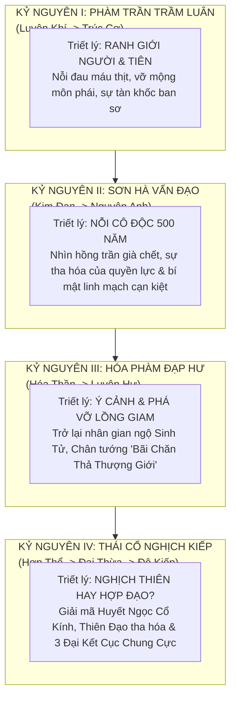
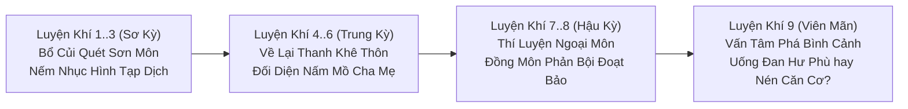
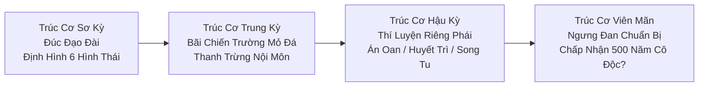
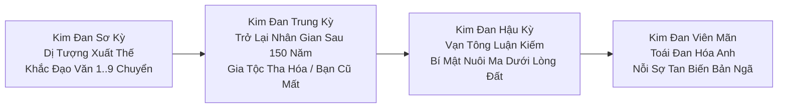
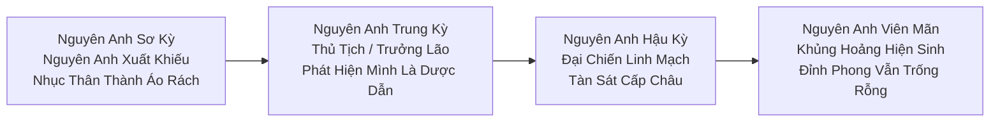
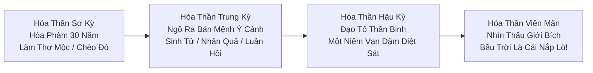
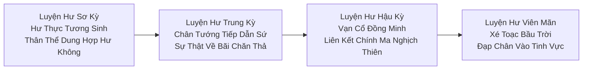
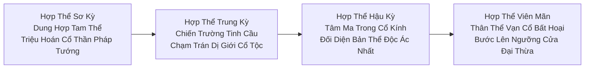
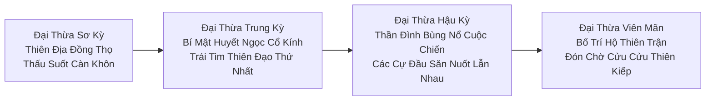
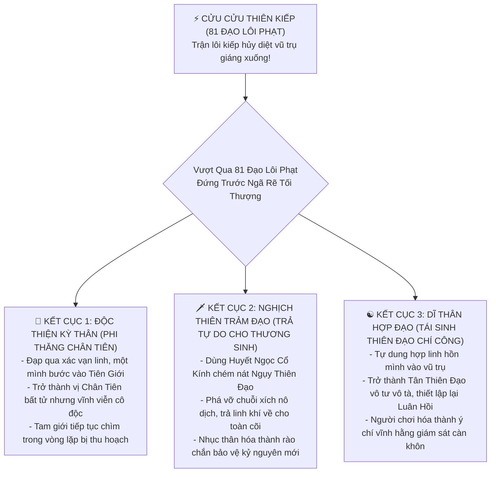

# [19] ĐẠI BIÊN NIÊN SỬ CỐT TRUYỆN: 36 TIỂU CẢNH GIỚI & 9 ĐẠI CẢNH GIỚI CHIỀU SÂU


> ⬅️ **[Bài Trước: Doc 18 - Săn Boss Thế Giới & Xã Hội Multiplayer](file:///c:/Users/newre/OneDrive/Máy%20tính/code%20tutien/docs/18_BOSS_THE_GIOI_VA_MULTIPLAYER.md)** | 📖 **[Mục Lục Toàn Cảnh](file:///c:/Users/newre/OneDrive/Máy%20tính/code%20tutien/README.md)** | ➡️ **[Bài Kế: Doc 20 - Cân Bằng Toàn Cục & Móc Nối Đại Hệ Thống](file:///c:/Users/newre/OneDrive/Máy%20tính/code%20tutien/docs/20_CAN_BANG_TOAN_CUC_VA_DIEU_CHINH_THONG_SO.md)**

> *"Tu chân đâu chỉ là gom góp linh khí, cắn thuốc đúc đan? Đó là cuộc bóc tách từng lớp mặt nạ của trần gian, là nỗi cô độc gặm nhấm ngàn năm khi nhìn người thân hóa thành cát bụi, là sự kinh hoàng khi nhận ra bầu trời trên đầu chỉ là một cái nắp lò đan! Đạo là gì? Người thuận theo Đạo là kẻ nô lệ của Thiên Đạo; kẻ nghịch Đạo là ma đầu bị trời tru đất diệt. Đi tiếp hay dừng lại? Một bước bước qua, vạn kiếp không thể quay đầu!"*

Tài liệu này là **Khung Kịch Bản & Cốt Truyện Toàn Thư (Master Narrative Architecture)** định hình chiều sâu tâm lý, triết học tu chân, các biến cố vấn tâm và hệ quả nhân quả cánh bướm xuyên suốt **4 Đại Kỷ Nguyên, 9 Đại Cảnh Giới và 36 Tiểu Cảnh Giới** trong Tu Chân Giới Online.

---

## 🏛️ TỔNG QUAN 4 ĐẠI KỶ NGUYÊN LỊCH SỬ



---

# 📜 KỶ NGUYÊN I: PHÀM TRẦN TRẦM LUÂN (LUYỆN KHÍ $\rightarrow$ TRÚC CƠ)

---

## ⚔️ CHƯƠNG 1: LUYỆN KHÍ KỲ — VỠ MỘNG TIÊN GIA & CÁI GIÁ CỦA HƠI THỞ LINH KHÍ

* **Chủ đề triết học**: *Khởi đầu của lòng tham và sự bất bình đẳng thiên bẩm*.
* **Khủng hoảng Đạo Tâm**: Thấy rõ sự tàn nhẫn khi sinh mạng phàm nhân bị coi như cỏ rác dưới chân tu sĩ; bản thân phải cúi đầu trước kẻ mạnh hơn để đổi lấy một mẩu linh thạch vụn.



### 1.1. Luyện Khí Tầng 1 - 3 (Sơ Kỳ): Hơi Thở Đầu Tiên & Bùn Lầy Tạp Dịch
* **Biến cố**: Người chơi gia nhập môn phái (hoặc làm tán tu đào vong). Không có hào quang lấp lánh như tưởng tượng; công việc hàng ngày là gánh nước tưới dược điền, chịu sự ức hiếp của quản sự.
* **Tình huống Vấn Tâm**: Bạn bắt gặp một lão tạp dịch 70 tuổi cả đời kẹt ở Luyện Khí Tầng 1, sắp chết đói vì bị cướp mất phần linh mễ.
  * **[Lựa chọn A - Cứu Giúp]**: Nhường nửa bát cơm linh thảo. Lão cảm kích tặng bạn mảnh da thú rách — sau này hé lộ là bản đồ khoáng mạch ngầm!
  * **[Lựa chọn B - Bỏ Mặc / Cướp Nốt]**: Giữ lại sức mình để tu luyện. Đạo tâm sắt đá tăng sát thương $+3\%$, nhưng mang vết gợn ích kỷ ban đầu.

### 1.2. Luyện Khí Tầng 4 - 6 (Trung Kỳ): Cố Hương Hóa Tro Tàn (Đối Diện Nơi Khởi Nguyên)
* **Biến cố**: Đạt cấp độ xuất sư ngoại môn, được cấp phép trở về thăm lại chốn xưa nơi khởi nguyên của mình:
  - *Nhân Tộc*: Thăm lại phế tích Thanh Khê Thôn bên nấm mồ cha mẹ đã phủ rêu xanh.
  - *Tiên Tộc*: Nhìn lên vách đá Côn Lôn Đỉnh Tuyết nơi thân xác rơi từ Tru Tiên Đài xuống.
  - *Ma Tộc*: Trở lại miệng vực Cửu U Huyết Trì nơi hàng vạn xác ma thai đồng loại còn nằm đó.
  - *Yêu Tộc*: Quay về hang đá Thập Vạn Đại Sơn trơ trọi sau khi cha mẹ thú bị phường thợ săn lột da.
  - *Minh Tộc*: Từ dương thế nhìn về cánh đồng Bỉ Ngạn Hoa u tối bên bờ sông Vong Xuyên.
* **Xung đột**: Chốn cũ hoang tàn, người quen cũ (người bạn thuở nhỏ / kẻ sống sót / đồng loại) nay đã già yếu tàn phế, run rẩy quỳ lạy gọi bạn là *"Tiên nhân đại gia / Ma tôn đại gia"*.
* **Nút thắt tâm lý**: Khoảnh khắc nhận ra khoảng cách sinh tử giữa kẻ bước chân vào đạo và chốn phàm trần / u linh quá khứ. Một khi bước vào tu đạo, bạn không còn thuộc về thế giới trước kia nữa.
  * **[Ban Phát Bạc Vàng & Cắt Đứt Tình Xưa]**: Trút bỏ gánh nặng trần thế, tốc độ thiền định tăng $+5\%$.
  * **[Để Lại Linh Dược Chữa Trị & Nhận Lời Cầu Xin]**: Gieo hạt giống ân tình; sau này con cháu người bạn/đồng loại đó sẽ trở thành đệ tử trung thành bảo vệ sơn trang của bạn.

### 1.3. Luyện Khí Tầng 7 - 8 (Hậu Kỳ): Ám Toán Ngoại Môn & Sự Thật Chính Tà
* **Biến cố**: Tham gia cuộc săn bắt yêu thú tại Luyện Khí Sơn Cốc. Người sư huynh luôn miệng gọi bạn là "sư đệ thân thiết" bỗng nhiên đẩy bạn vào miệng con Xích Luyện Xà để độc chiếm đóa sen tuyết.
* **Khảo nghiệm**: Sinh tồn trong hang rắn độc, dùng **Huyết Ngọc Cổ Kính** hấp thu nọc độc sống sót trở về.
* **Quyết định phân nhánh**:
  * **[Công Khai Môn Quy Tố Cáo]**: Trưởng Lão xử phạt qua loa vì sư huynh kia là cháu của Chấp Pháp Quản Sự. Bạn hiểu ra: *Môn quy chỉ là công cụ bảo vệ kẻ có chỗ dựa!*
  * **[Lén Lút Phục Kích Diệt Khẩu Trong Rừng Sâu]**: Ra tay tàn nhẫn cướp lại toàn bộ tài nguyên. Đạo tâm chuyển sang phong cách tàn nhẫn, mở khóa dòng chỉ số Sát Khí.

### 1.4. Luyện Khí Tầng 9 (Viên Mãn / Bình Cảnh): Đứng Trước Ngưỡng Cửa Trúc Cơ
* **Khủng hoảng**: Bình cảnh Trúc Cơ xuất hiện. Kinh mạch phồng rát, đan điền như vạc dầu sôi sục.
* **Vấn Tâm Đột Phá**:
  * Cắn thuốc cấp tốc để thăng cấp ngay $\rightarrow$ **Căn Cơ Hư Phù** (Phàm Phẩm Trúc Cơ), sau này kẹt ở Kim Đan.
  * Nhẫn nại nén exp vào Tụ Linh Đỉnh, chịu đựng đau đớn gọt giũa kinh mạch $\rightarrow$ Đúc nên **Thiên Đạo Đạo Cơ**, nhận vĩnh viễn danh xưng *Vô Hà Đạo Thể*.

---

## 🏛️ CHƯƠNG 2: TRÚC CƠ KỲ — ĐÚC NÊN ĐẠO ĐÀI & BÙN NHƠ ĐỒNG MÔN

* **Chủ đề triết học**: *Bản chất của Đạo Cơ: Bạn xây dựng nền móng cuộc đời bằng lý tưởng hay bằng sự thỏa hiệp tanh máu?*
* **Khủng hoảng Đạo Tâm**: Nhận ra tông môn nuôi dưỡng đệ tử không phải vì từ bi, mà mỗi đệ tử là một "vật tư tiêu hao" để duy trì đại trận và tranh đoạt linh mạch.



### 2.1. Trúc Cơ Sơ Kỳ: Định Hình Đạo Đài (Forming the Foundation)
* **Biến cố**: Bước qua lôi kiếp Trúc Cơ đầu đời. Cơ thể lột xác, xương tủy kêu răng rắc. Người chơi lựa chọn 1 trong 6 **Hình Thái Đạo Đài** (Kiếm Tủy, Huyết Liên, Ngũ Hành Luân Hồi, Thiên Đạo Vô Hà, U Minh Quỷ Tháp, Bách Dược Thần Lô).
* **Cái giá phải trả**: Mỗi loại Đạo Đài mang theo một xiềng xích: Kiếm Tủy thì sát khí ăn mòn cảm xúc; Huyết Liên thì thèm khát tinh huyết; Thiên Đạo Vô Hà thì chịu thiên kiếp nặng gấp đôi.

### 2.2. Trúc Cơ Trung Kỳ: Tranh Đoạt Linh Mạch & Máu Nhuộm Mỏ Đá
* **Biến cố**: Tông môn phát động chiến tranh cục bộ chiếm mỏ Linh Thạch với phái lân cận. Bạn được cử làm tiểu đội trưởng dẫn 5 đệ tử ngoại môn đi trấn giữ cửa hang.
* **Xung đột**: Địch tấn công áp đảo, 4 đệ tử dưới quyền quỳ xin bạn rút lui. Nhưng lệnh truyền tin từ Chưởng Môn là: *"Tử thủ đến giọt máu cuối cùng, kẻ lui một bước trảm diệt cả họ!"*
* **Lựa chọn phân nhánh**:
  * **[Tử Thủ Vì Tông Môn]**: Cả đội chết gần hết, bạn thoi thóp giữ được mỏ đá. Được thưởng ban chức Nội Môn Đệ Tử, nhưng hàng đêm bị ám ảnh bởi ánh mắt của những thiếu niên chết oan.
  * **[Cùng Huynh Đệ Phá Vòng Vây Bỏ Trốn]**: Cứu sống đồng đội, trở thành đào binh bị tông môn truy lùng. Cả nhóm trôi dạt vào Bất Dạ Thiên Tửu Lầu làm việc hoặc gia nhập Tán Tu Minh.

### 2.3. Trúc Cơ Hậu Kỳ: Biến Cố Riêng Của Lục Đại Môn Phái (Theo Doc 03)
* Mỗi phái đối mặt với khúc quanh vận mệnh:
  * **Thanh Vân**: Án Oan Kiếm Trũng — Rút Ma Kiếm hay Chấp Pháp chính trực?
  * **Vạn Ma**: Huyết Trì 10 sống 1 — Trảm bạn thân đoạt sống hay phá kết giới cùng đào tẩu?
  * **Đan Hà**: Bí mật Cốc Chủ dùng máu trẻ con luyện đan — Tố giác cứu người hay nuốt Dị Hỏa thăng tiến?
  * **U Minh**: Vong Xuyên Vỡ Đê — Cưỡng ép hồi sinh cha mẹ thành quỷ thi hay siêu độ luân hồi?
  * **Thái Hư**: Lôi Kiếp Linh Thú — Dùng thân đỡ lôi cứu thú hay hiến tế thú giữ sơn môn?
  * **Hợp Hoan**: Song Tu Độ Kiếp — Chân ái cộng hưởng hay Thái bổ hút cạn sinh mệnh đối phương?
  * **Tán Tu**: Lục Đại Phái vây quét — Đứng lên lập minh chống trả hay luồn cúi làm gian thương hai mang?

### 2.4. Trúc Cơ Viên Mãn (Bình Cảnh Kết Đan): Lời Từ Biệt 500 Năm
* **Khảo nghiệm Vấn Tâm**: Tuổi thọ Trúc Cơ chỉ 200 năm, nhưng một khi Kết Đan thành công sẽ thọ **500 năm**.
* **Ảo ảnh Đạo Tâm**: Thiên Ma hiện về hỏi bạn: *"Ngươi có biết 500 năm nghĩa là gì không? Là ngươi sẽ tự tay chôn cất tất cả sư huynh đệ, sư muội, đệ tử và người ngươi từng yêu. Ngươi sẽ trơ trọi như một tảng đá giữa dòng sông thời gian. Ngươi tu tiên để trường sinh hay để chịu cực hình cô độc?"*
* **Đột phá**: Phải giữ vững Đạo Tâm, dùng ý chí vượt qua ảo ảnh để bước lên **Đài Độ Kiếp Kim Đan**.

---

# 🏔️ KỶ NGUYÊN II: SƠN HÀ VẤN ĐẠO (KIM ĐAN $\rightarrow$ NGUYÊN ANH)

---

## 🟡 CHƯƠNG 3: KIM ĐAN KỲ — 500 NĂM CÔ ĐỘC & TRO TÀN HỒNG TRẦN

* **Chủ đề triết học**: *Sự tàn nhẫn của Thời Gian và sự hoán đổi vị trí kẻ áp bức*.
* **Khủng hoảng Đạo Tâm**: Từng là kẻ yếu bị ức hiếp, nay trở thành "Kim Đan Thần Tiên" được vạn người quỳ lạy, bạn bắt đầu thấy bản thân lạnh lùng, vô cảm và coi sinh mạng phàm nhân như sâu kiến giống hệt những kẻ bạn từng căm ghét.



### 3.1. Kim Đan Sơ Kỳ: Cửu Chuyển Đạo Văn & Dị Tượng Toàn Cõi
* **Biến cố**: Độ kiếp thành công, Kim Đan kết tụ trong đan điền. Hệ thống kích hoạt **Thiên Địa Dị Tượng** rung chuyển toàn cõi (*Tử Khí Đông Lai, Vạn Kiếm Triều Quy hoặc Ma Thần Hàng Thế*).
* **Đãi ngộ**: Bước lên hàng **Chân Truyền Đệ Tử**, sở hữu riêng một ngọn núi (Độc Lập Đỉnh). Hàng trăm đệ tử ngoại môn quỳ gối dưới chân xưng tụng bạn là *"Sư thúc"* hoặc *"Lão tổ"*.
* **Cám dỗ quyền lực**: Môn phái giao cho bạn quyền trừng phạt sinh tử các đệ tử cấp dưới. Bạn bắt đầu cảm nhận khoái cảm của kẻ nắm giữ quyền sinh sát.

### 3.2. Kim Đan Trung Kỳ: Trở Lại Nhân Gian Sau 150 Năm
* **Biến cố**: Xuất quan sau một giấc bế quan dài hơn một trăm năm. Bạn cưỡi phi kiếm bay về quê cũ.
* **Hiện thực phũ phàng**:
  * Những người cùng thế hệ với bạn đã chết từ trăm năm trước, mồ mả thất lạc.
  * Hậu duệ của gia tộc bạn (hoặc những người từng nhận ân huệ của bạn) nay ỷ thế có "Tổ tiên là Kim Đan Tiên Nhân" mà làm mưa làm gió, cướp đất cướp bạc, bức hại dân lành trong vùng.
* **Tình huống Vấn Tâm**:
  * **[Dung Túng Gia Tộc]**: *"Huyết mạch tương liên, người phàm chết có sá gì?"* $\rightarrow$ Tăng Ma Tính, nhận cống nạp Linh Thạch khổng lồ từ gia tộc nhưng tích tụ Nghiệp Báo.
  * **[Đại Nghĩa Diệt Thân]**: Tự tay trảm sát tên tộc trưởng gian ác, tước bỏ hào quang của gia tộc, đưa họ trở lại làm phàm nhân cày cấy $\rightarrow$ Tăng Đạo Tâm Thuần Khiết, nhận danh hiệu *Thiên Đạo Vô Tư*.

### 3.3. Kim Đan Hậu Kỳ: Đại Hội Luận Kiếm & Lễ Huyết Tế Của Các Lão Tổ
* **Biến cố**: Tham gia Vạn Tông Luận Võ tại Côn Lôn Đỉnh. Bạn lọt vào hàng ngũ thiên kiêu hàng đầu.
* **Chân tướng kinh hoàng**: Bạn vô tình phát hiện ra mục đích thực sự của Đại Hội Luận Võ: Không phải để tìm nhân tài, mà những tu sĩ bị đánh bại trên lôi đài đều bị hút chân huyết vào đại trận dưới lòng đất để duy trì thọ mệnh cho các **Nguyên Anh Lão Quái** đã sống hơn 1,000 năm!
* **Quyết định phân nhánh**:
  * **[Thỏa Hiệp Giữ Miệng]**: Nhận một viên Thượng Phẩm Ngưng Anh Đan từ Chưởng Môn để đổi lấy sự im lặng.
  * **[Tìm Cách Giải Cứu Kẻ Bị Hại]**: Bị các đại lão liệt vào danh sách phản nghịch, bắt đầu chuỗi ngày đào vong khắp Cửu Châu.

### 3.4. Kim Đan Viên Mãn (Bình Cảnh Toái Đan): Sự Tan Biến Của Bản Ngã
* **Khủng hoảng**: Để ngưng kết Nguyên Anh, tu sĩ phải tự tay dùng linh hỏa **ĐẬP NÁT KIM ĐAN CỦA CHÍNH MÌNH** để thai nghén ra Nguyên Anh bé nhỏ.
* **Nỗi sợ hãi tột cùng**: Nếu đập nát Kim Đan mà không ngưng kết được Nguyên Anh $\rightarrow$ Tu vi mất sạch, trở thành phế nhân tàn tật. Nhiều tu sĩ Kim Đan viên mãn thà sống an nhàn 500 năm chứ không dám bước qua cửa ải sinh tử này.
* **Nghi thức Vấn Tâm**: Dùng Huyết Ngọc Cổ Kính chiếu rọi đạo tâm, tìm ra lý do sinh tồn chân chính nhất để ngưng tụ linh hồn hóa thành **Nguyên Anh Ấu Thể**.

---

## 🔮 CHƯƠNG 4: NGUYÊN ANH KỲ — THOÁT XÁC ĐOẠT XÁ & LINH MẠCH MẠT THẾ

* **Chủ đề triết học**: *Sinh mệnh vô thường: Khi nhục thân chỉ là chiếc áo rách, con người ta có còn giữ được nhân tính?*
* **Khủng hoảng Đạo Tâm**: Thấu suốt bản chất linh khí trời đất đang cạn kiệt; các đại tông môn đang tranh giành từng giọt linh dịch cuối cùng như bầy linh cẩu đói khát.



### 4.1. Nguyên Anh Sơ Kỳ: Nguyên Anh Xuất Khiếu & Đoạt Xá
* **Quyền năng mới**: Thần thức phóng xuất ngàn dặm. Kể cả khi nhục thân bị chém nát, Nguyên Anh nhỏ bằng bàn tay vẫn có thể bay vút lên trời trốn thoát và **Đoạt Xá** chiếm thân xác kẻ khác để sống lại!
* **Biến cố**: Một vị hảo hữu tri kỷ của bạn bị hủy hoại nhục thân trong bí cảnh, quỳ lạy van xin bạn cho phép hắn đoạt xá thân xác của một tiểu đệ tử tư chất tốt trong môn phái.
* **Vấn Tâm**:
  * Đồng ý hy sinh một đệ tử vô tội để cứu sống bạn mình?
  * Hay kiên quyết bảo vệ đạo lý, để bạn mình tiêu tán theo luân hồi?

### 4.2. Nguyên Anh Trung Kỳ: Vị Trí Thủ Tịch & Chân Tướng "Dược Dẫn"
* **Biến cố**: Thăng tiến lên làm **Thủ Tịch Đại Sư Huynh** (hoặc Đại Trưởng Lão). Bạn được Chưởng Môn truyền thụ bộ công pháp tối cao của môn phái.
* **Cú lừa thế kỷ**: Khi nghiên cứu sâu vào tầng cuối của công pháp, bạn bàng hoàng nhận ra: Bộ công pháp này có một lỗ hổng chí mạng được cài cắm từ đầu. Khi bạn đạt tới đỉnh cao, Sư Tôn của bạn sẽ kích hoạt cấm chế để **Thôn Phệ toàn bộ Nguyên Anh của bạn** làm thuốc dẫn giúp lão đột phá Hóa Thần!
* **Đối sách**: Bạn phải âm thầm liên kết với Ma Tu hoặc Tán Tu, tương kế tựu kế phản sát Sư Tôn ngay trong ngày đại lễ truyền thừa.

### 4.3. Nguyên Anh Hậu Kỳ: Cuộc Chiến Linh Mạch Cạn Kiệt
* **Bối cảnh thế giới**: Linh khí toàn bộ đại lục suy giảm nghiêm trọng. Các mỏ linh thạch cạn đáy. Cây cỏ linh dược không còn mọc được nữa.
* **Hiện thực man rợ**: Các đại phái không còn giữ bộ mặt thanh cao. Họ bắt đầu xua quân đi tàn sát các môn phái nhỏ hơn để cướp bóc linh thạch. Tu sĩ cấp thấp bị xua vào các lò luyện để tinh chiết lấy linh khí thừa.
* **Chiến dịch quy mô lớn**: Người chơi tham gia vào các trận công thành chiến cấp đại lục, đứng trước sự lựa chọn: Cướp của kẻ khác để mình sống, hay chia sẻ tài nguyên để cùng nhau chết đói?

### 4.4. Nguyên Anh Viên Mãn: Khủng Hoảng Đỉnh Phong Của Quyền Lực
* **Tâm lý nhân vật**: Đạt tới đỉnh phong của một cõi, dưới một người trên vạn người, thọ mệnh ngàn năm. Nhưng bạn nhận thấy tu vi không thể nhích thêm một phân nào nữa bằng cách cắn thuốc hay chém giết.
* **Gông xiềng Thiên Đạo**: Muốn bước vào Hóa Thần, không thể tu luyện trong hang động nữa. Thiên Đạo yêu cầu người tu sĩ phải **buông bỏ toàn bộ pháp lực, quay trở lại làm người phàm** để ngộ ra Ý Cảnh!

---

# 🌌 KỶ NGUYÊN III: HÓA PHÀM ĐẠP HƯ (HÓA THẦN $\rightarrow$ LUYỆN HƯ)

---

## 🌊 CHƯƠNG 5: HÓA THẦN KỲ — HÓA PHÀM NHẬP THẾ & LĨNH NGỘ Ý CẢNH

* **Chủ đề triết học**: *Vạn pháp quy phàm: Chỉ khi hiểu trọn vẹn cái chết và nỗi đau của kẻ yếu đuối nhất, mới nắm được sức mạnh của thần thánh*.
* **Khủng hoảng Đạo Tâm**: Toàn bộ tu vi ngàn năm bị phong ấn, biến thành một phàm nhân yếu ớt trải qua đói rét, bệnh tật, chứng kiến người thân thương chết đi trong bất lực.



### 5.1. Hóa Thần Sơ Kỳ: 30 Năm Hóa Phàm Làm Lão Thợ Mộc
* **Cơ chế Hóa Phàm (Đặc sắc Tiên Hiệp)**:
  * Người chơi tự phong ấn toàn bộ tu vi Nguyên Anh, gửi lại túi Càn Khôn trên núi.
  * Bước xuống một trấn nhỏ phàm trần hẻo lánh, mở một tiệm mộc nhỏ (hoặc tiệm rèn, quán trà ven sông).
  * Hàng ngày cầm cưa, cầm búa, đẽo từng bức tượng gỗ, nếm trải vị cay của rượu phàm, vị mặn của mồ hôi và những cơn ho khan khi gió mùa về.

### 5.2. Hóa Thần Trung Kỳ: Sinh Lão Bệnh Tử & Đêm Ngộ Ý Cảnh
* **Biến cố Hóa Phàm**:
  * Bạn kết bạn với một đứa bé hàng xóm thường sang xem bạn đẽo tượng gỗ.
  * Ba mươi năm trôi qua trong nháy mắt. Đứa bé ngày nào lớn lên, lấy vợ, sinh con, rồi già đi, và cuối cùng nằm trên giường bệnh hấp hối vì tuổi già.
  * Đứa bé năm xưa nay râu tóc bạc phơ, nắm lấy bàn tay vẫn trẻ trung của bạn thều thào: *"Bác Mộc... Cháu sắp đi rồi... Bác sống mãi như thế... Có cô đơn không?"*
* **Bừng tỉnh Đạo Cảnh**: Nhìn bàn tay phàm nhân buông thõng, chiếc lá vàng rơi xuống thềm nhà. Trong khoảnh khắc đó, linh hồn bạn nổ tung! Toàn bộ phong ấn tan vỡ!
  * **Lĩnh Ngộ Ý Cảnh Sinh Tử**: *Sống là bắt đầu của cái chết, Chết là hạt mầm của sự tái sinh*.
  * **Lĩnh Ngộ Ý Cảnh Nhân Quả**: *Mỗi sợi tơ nhân duyên đều có điểm khởi đầu và kết thúc*.
  * **Lĩnh Ngộ Ý Cảnh Luân Hồi**: *Vạn vật xoay vần trong hư vô*.
  * **Lĩnh Ngộ Ý Cảnh Tịch Diệt**: *Tất cả rồi sẽ về với cát bụi*.

### 5.3. Hóa Thần Hậu Kỳ: Đạo Tố Thần Binh & Một Niệm Định Sinh Tử
* **Sức mạnh Hóa Thần**: Ý Cảnh không còn là chiêu thức vật lý đơn thuần, mà là **Quy Tắc Vũ Trụ**.
* **Đấu pháp cấp Hóa Thần**: Không cần rút kiếm. Chỉ cần một ánh mắt mang Ý Cảnh Sinh Tử: Đối thủ Nguyên Anh đối diện lập tức thọ mệnh cạn kiệt, da dẻ nhăn nheo, tóc rụng trắng xóa và hóa thành tro bụi trong 3 hiệp đấu!

### 5.4. Hóa Thần Viên Mãn: Ánh Mắt Xuyên Qua Giới Bích
* **Chân tướng vũ trụ rúng động**: Khi Thần Thức đạt tới cảnh giới cực hạn Hóa Thần ($5,000 \text{ dặm}$), bạn ngẩng đầu nhìn lên bầu trời sao ban đêm.
* **Cảnh tượng kinh hoàng**: Bầu trời xanh biếc và trăng sao không phải là vũ trụ tự nhiên, mà là một **Lớp Màng Phong Ấn Cổ Đại** khổng lồ đang bao bọc toàn bộ thế giới của bạn. Thế giới Hạ Giới này thực chất chỉ là một **Chiếc Bình Nuôi Cấy (Lò Nuôi Dược Liệu)** trôi nổi giữa hư không vô tận!

---

## 🌌 CHƯƠNG 6: LUYỆN HƯ KỲ — ĐẠP VỠ KHÔNG GIAN & CHÂN TƯỚNG "BÃI CHĂN THẢ"

* **Chủ đề triết học**: *Vượt ngục vĩ đại: Kẻ tù nhân nhận ra nhà tù của mình và dám xé toạc bầu trời để nhìn ra biển lớn*.
* **Khủng hoảng Đạo Tâm**: Thấy được các Tiên Nhân Thượng Giới mà chúng sinh thờ phụng bấy lâu thực chất coi toàn bộ tu sĩ Hạ Giới như đàn cừu béo chờ ngày làm thịt.



### 6.1. Luyện Hư Sơ Kỳ: Hư Thực Biến Ảo
* **Năng lực**: Nhục thân có thể tùy ý phân rã thành vô số hạt phân tử hư không và tái tạo tức thì ở một vị trí khác. Nắm giữ sức mạnh xé rách không gian tạo thành các vết nứt Hư Vực Nuốt Chửng kẻ thù.

### 6.2. Luyện Hư Trung Kỳ: Sự Xuất Hiện Của "Tiếp Dẫn Sứ Giả"
* **Sự kiện chấn động**: Một vết rách khổng lồ xuất hiện trên bầu trời. Một cỗ Tiên Xa dát vàng lộng lẫy từ Thượng Giới giáng lâm. Một vị **Tiếp Dẫn Sứ Giả** tỏa hào quang vạn trượng bước ra, mang theo chiếu chỉ của "Tiên Cung":
  * Yêu cầu các đại tông môn cống nạp $10,000$ tu sĩ Kim Đan và $500$ tu sĩ Nguyên Anh lên "Tiên Giới" để hưởng phúc trường sinh.
* **Chân tướng đằng sau bức màn**:
  * Nhờ mảnh **Huyết Ngọc Cổ Kính**, bạn nhìn thấu ảo ảnh: Cỗ Tiên Xa dát vàng thực chất là một **Cỗ Quan Tài Huyết Nhục Đen Ngòm**!
  * Những tu sĩ được đưa lên Thượng Giới không hề thành tiên, mà bị ném vào lò luyện đan của các Cổ Ma Thượng Giới để luyện thành "Thọ Nguyên Đan" duy trì mạng sống cho Tiên Hoàng!

### 6.3. Luyện Hư Hậu Kỳ: Vạn Cổ Đồng Minh — Gác Lại Ân Oán
* **Hành động**: Bạn triệu tập Thủ Lĩnh của toàn bộ 6 Đại Tông Môn và Tán Tu Liên Minh.
* **Xung đột tư tưởng**:
  * Các Chưởng Môn già nua run rẩy không dám tin: *"Đó là Tiên Giới... Ngươi dám phạm thượng chống lại Trời sao?"*
  * Bạn ném mảnh Huyết Ngọc Cổ Kính ra giữa điện, chiếu rọi sự thật tàn nhẫn khiến toàn bộ lão tổ câm lặng.
  * Lần đầu tiên trong lịch sử mười vạn năm của Hạ Giới, **Chính Đạo, Ma Đạo, Yêu Tộc, Minh Tộc và Tán Tu bắt tay nhau**, thành lập **Nghịch Thiên Quân** chuẩn bị phản kích!

### 6.4. Luyện Hư Viên Mãn: Cú Đấm Xé Rách Vòm Trời
* **Nghi thức đột phá**: Người chơi dẫn đầu liên quân công kích thẳng vào cỗ quan tài Tiên Xa, trảm sát Tiếp Dẫn Sứ Giả.
* **Đạp vỡ giới bích**: Bạn dồn toàn bộ hư không chi lực đấm thủng một lỗ hổng trên vòm trời của Hạ Giới, dẫn thân mình bước thẳng vào **Tinh Hà Giới Ngoại** mênh mông vô tận!

---

# 👑 KỶ NGUYÊN IV: THÁI CỔ NGHỊCH KIẾP (HỢP THỂ $\rightarrow$ ĐẠI THỪA $\rightarrow$ ĐỘ KIẾP)

---

## 🐉 CHƯƠNG 7: HỢP THỂ KỲ — THẦN MA PHÁP TƯỚNG & CHIẾN TRANH TINH HỆ

* **Chủ đề triết học**: *Bản ngã dung hợp: Bạn là ai khi thần tính, ma tính và nhân tính cùng cuộn trào trong một thân xác?*
* **Khủng hoảng Đạo Tâm**: Sự thức tỉnh của Thái Cổ Thần Mạch đe dọa nuốt chửng ký ức con người; nỗi sợ đánh mất chính mình để đổi lấy sức mạnh dời non lấp biển.



### 7.1. Hợp Thể Sơ Kỳ: Cổ Thần Pháp Tướng Vạn Trượng
* **Quyền năng tối thượng**: Nhục thân, Nguyên Thần và Ý Cảnh dung hợp làm một thể duy nhất. Khi chiến đấu, người chơi có thể hóa thân thành **Cổ Thần Pháp Tướng** khổng lồ cao vạn trượng, một bước đạp nát một ngọn núi, một tay thâu tóm cả vầng trăng!

### 7.2. Hợp Thể Trung Kỳ: Chiến Trường Giữa Các Tinh Cầu
* **Quy mô mở rộng**: Không còn là đánh nhau ở làng mạc hay sơn môn; chiến trường diễn ra trên các mảnh vỡ thiên thạch trôi nổi giữa vũ trụ.
* **Đối thủ mới**: Chạm trán các chủng tộc ngoài hành tinh (Cổ Ma Tộc, Cổ Thần Tộc, Cổ Yêu Tộc). Bạn nhận ra Hạ Giới của bạn chỉ là một trong ba ngàn thế giới hạt cát nằm dưới sự cai trị của Thần Đình.

### 7.3. Hợp Thể Hậu Kỳ: Đối Diện Với Bản Thể Trong Cổ Kính
* **Khảo nghiệm Vấn Tâm rùng rợn nhất**: Mảnh **Huyết Ngọc Cổ Kính** trên ngực bạn bắt đầu nứt ra, phản chiếu một bóng hình bước ra ngoài.
* **Bản thể bóng tối**: Đó chính là hiện thân của tất cả những việc ác, sự ích kỷ, máu me và lòng tham mà bạn đã tích tụ từ lúc ở Thanh Khê Thôn đến nay. Hắn cười mỉa mai bạn: *"Ngươi tự xưng là anh hùng cứu thế? Ngươi có khác gì lũ Tiên Nhân Thượng Giới đâu? Ngươi giết bao nhiêu người để leo lên được đây?"*
* **Cuộc chiến nội tâm**: Đánh bại và cảm hóa phần bóng tối của chính mình để đạt tới trạng thái **Đạo Ma Tương Dung, Thần Minh Bất Diệt**.

---

## 🏛️ CHƯƠNG 8: ĐẠI THỪA KỲ — THIÊN ĐỊA ĐỒNG THỌ & BẢN CHẤT CỦA THIÊN ĐẠO

* **Chủ đề triết học**: *Sự mục ruỗng của trật tự: Thiên Đạo có phải là công lý tối cao, hay chỉ là một cỗ máy ký sinh khổng lồ?*
* **Khủng hoảng Đạo Tâm**: Nhận ra kẻ thù cuối cùng không phải là một con người hay ma đầu cụ thể, mà chính là **Quy Tắc Vận Hành Của Vũ Trụ (Thiên Đạo)** đã bị tha hóa từ thời Hồng Hoang.



### 8.1. Đại Thừa Sơ Kỳ: Hơi Thở Cùng Nhịp Với Càn Khôn
* **Vị thế**: Trở thành **Đại Thừa Kỳ Cự Đầu**. Thọ mệnh vô cùng vô tận, cùng thọ với nhật nguyệt. Mỗi lời nói ra hóa thành pháp tắc, mỗi bước đi cỏ cây nở hoa.

### 8.2. Đại Thừa Trung Kỳ: Bí Mật Chung Cực Của Huyết Ngọc Cổ Kính
* **Giải mã nguồn gốc**: Mảnh ngọc nhặt được ở Thanh Khê Thôn ngày bạn còn là đứa trẻ phàm nhân rách rưới... rốt cuộc là gì?
* **Chân tướng vĩ đại**:
  * Vào thời Hồng Hoang viễn cổ, **Thiên Đạo Đời Thứ Nhất** là một thực thể chí công vô tư, bảo bọc vạn linh.
  * Nhưng một nhóm Tiên Đế cổ đại vì muốn trường sinh bất tử vĩnh viễn đã liên thủ **ÁM TOÁN VÀ XÉ RÁCH THIÊN ĐẠO ĐỜI THỨ NHẤT**!
  * Chúng dựng lên một **Ngụy Thiên Đạo** tha hóa để biến vạn giới thành nông trại hút linh khí nuôi sống chúng.
  * Mảnh Huyết Ngọc Cổ Kính trên tay bạn chính là **MẢNH VỠ TRÁI TIM CỦA THIÊN ĐẠO NGUYÊN BẢN**! Nó đã chờ đợi mười vạn năm để tìm thấy một người có đủ ý chí và đạo tâm mang nó trở lại đỉnh Côn Lôn phục thù!

### 8.3. Đại Thừa Hậu Kỳ: Cuộc Thanh Trừng Của Các Cự Đầu
* **Ngày tận thế**: Ngụy Thiên Đạo bắt đầu bộc phát cơn đói khát. Các Tiên Đế Thần Đình thức tỉnh, bắt đầu nuốt chửng toàn bộ các tinh cầu lân cận. Không còn nơi nào an toàn trong vũ trụ.
* **Thời khắc quyết định**: Người chơi bước lên đỉnh phong, hoàn thành các đại trận bảo vệ đồng môn, chuẩn bị bước vào cuộc đối đầu cuối cùng.

---

## ⚡ CHƯƠNG 9: ĐỘ KIẾP KỲ & 3 ĐẠI KẾT CỤC CHUNG CỰC

* **Chủ đề triết học**: *Lựa chọn tối hậu của sự tồn tại: Trường sinh ích kỷ hay Hy sinh vì vạn linh?*



### 9.1. Quá Trình Độ Kiếp Khốc Liệt Nhất Lịch Sử
* **3 Giai Đoạn Lôi Phạt**:
  1. **Tam Cửu Lôi Kiếp (27 đạo đầu)**: Sét tím xé toạc Pháp Tướng, đập nát toàn bộ trang bị hộ thể.
  2. **Lục Cửu Huyết Kiếp (27 đạo giữa)**: Lôi hỏa thiêu đốt lục phủ ngũ tạng, thử thách Đạo Cơ vững chắc.
  3. **Cửu Cửu Hỗn Độn Kiếp (27 đạo cuối)**: Thiên Đạo tự mình ngưng tụ thành hình người, mang theo kiếm quang hủy diệt bản nguyên!

---

### 9.2. Ba Đại Kết Cục Chung Cực Của Người Chơi (The 3 Ultimate Endings)

#### 👑 KẾT CỤC 1: ĐỘC THIỆN KỲ THÂN — PHI THĂNG CHÂN TIÊN (Cold Immortal)
* **Quyết định**: Bạn đồng ý thỏa hiệp với Thần Đình, tiếp nhận Tiên Tịch, bước qua Tiên Môn lộng lẫy để một mình phi thăng lên cảnh giới Chân Tiên bất hủ.
* **Hậu cảnh**:
  * Dưới chân bạn, cánh cổng Tiên Giới đóng sầm lại. Toàn bộ Hạ Giới và những người bạn từng quen biết tiếp tục bị gặt hái như cỏ rác.
  * Bạn ngồi trên ngai vàng ngọc bích, thọ mệnh triệu năm, nhưng mãi mãi không bao giờ tìm lại được nụ cười ấm áp của ngày thơ bé nơi Thanh Khê Thôn.

#### 🗡️ KẾT CỤC 2: NGHỊCH THIÊN TRẢM ĐẠO — GIẢI PHÓNG THƯƠNG SINH (The Rebel God)
* **Quyết định**: Bạn từ chối Tiên Môn. Bạn nâng mảnh Huyết Ngọc Cổ Kính lên, hét vang một tiếng rung chuyển tam giới, chém một kiếm kinh thiên động địa chém nát Ngụy Thiên Đạo và Thần Đình Tiên Cung!
* **Hậu cảnh**:
  * Toàn bộ các lồng giam không gian vỡ vụn. Linh khí Thượng Giới tuôn trào xuống cứu sống hàng vạn tinh cầu đang chết đói. Chúng sinh được tự do tự tại, không còn bị ai chăn thả hay định đoạt số phận.
  * Thân xác bạn tan rã thành hàng triệu đốm sáng lung linh, rơi xuống phủ xanh lại mảnh đất Thanh Khê Thôn hoang tàn năm xưa. Người đời sau lập đền thờ phụng bạn là: **Vạn Cổ Đệ Nhất Nghịch Thiên Thánh Nhân**!

#### ☯️ KẾT CỤC 3: DĨ THÂN HỢP ĐẠO — TÁI TẠO LUÂN HỒI (The New Cosmic Will)
* **Quyết định**: Bạn không phá hủy Thiên Đạo, cũng không hưởng lạc Tiên Giới. Bạn đem trọn vẹn ký ức, ý chí và linh hồn của mình dung hợp vào bản nguyên vũ trụ, thay thế Ngụy Thiên Đạo mục nát để trở thành **Tân Thiên Đạo Chí Công**.
* **Hậu cảnh**:
  * Thiết lập lại quy tắc công bằng: Kẻ làm thiện tích đức được phù hộ, kẻ tàn độc ắt chịu lôi kiếp trừng phạt; không còn chuyện cá lớn nuốt cá bé vô độ.
  * Tên tuổi của bạn tan biến khỏi ký ức chúng sinh, nhưng mỗi hạt mưa rơi xuống, mỗi ngọn gió thoảng qua, mỗi tia nắng sớm ấm áp trên trần gian... đều chính là hơi thở của bạn đang lặng lẽ che chở cho vạn linh.

---

## 💾 MA TRẬN NHÂN QUẢ CÁNH BƯỚM TOÀN SERVER (DATABASE LINKAGE)

Mỗi hành động của người chơi từ Luyện Khí sẽ được lưu vết vào bảng `CHARACTER_KARMA` để kích hoạt các sự kiện tương ứng ở các cảnh giới cao:

```json
{
  "characterId": "char_09",
  "karmicSeeds": {
    "thanhKheeOldManRescued": true,     // Cứu lão tạp dịch -> Mở khoáng ngầm ở Nguyên Anh
    "childhoodFriendAided": true,       // Giúp bạn phàm trần -> Có hậu duệ hộ pháp ở Kim Đan
    "sectElderSinsExposed": true,       // Vạch trần trưởng lão -> Bị truy sát nhưng mở liên minh Tán Tu
    "daoFoundationForm": "thien_dao_vo_ha", // Đạo đài -> Kháng 30% lôi kiếp chung cực
    "daoHeartOrientation": "NGHICH_THIEN", // THUAN_THIEN | NGHICH_THIEN | HOP_DAO
    "unlockedUltimateEnding": "ENDING_2_REBEL_GOD"
  }
}
```


---

> ⬅️ **[Bài Trước: Doc 18 - Săn Boss Thế Giới & Xã Hội Multiplayer](file:///c:/Users/newre/OneDrive/Máy%20tính/code%20tutien/docs/18_BOSS_THE_GIOI_VA_MULTIPLAYER.md)** | 📖 **[Mục Lục Toàn Cảnh](file:///c:/Users/newre/OneDrive/Máy%20tính/code%20tutien/README.md)** | ➡️ **[Bài Kế: Doc 20 - Cân Bằng Toàn Cục & Móc Nối Đại Hệ Thống](file:///c:/Users/newre/OneDrive/Máy%20tính/code%20tutien/docs/20_CAN_BANG_TOAN_CUC_VA_DIEU_CHINH_THONG_SO.md)**
