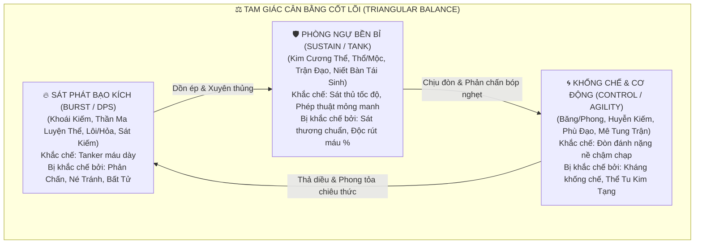
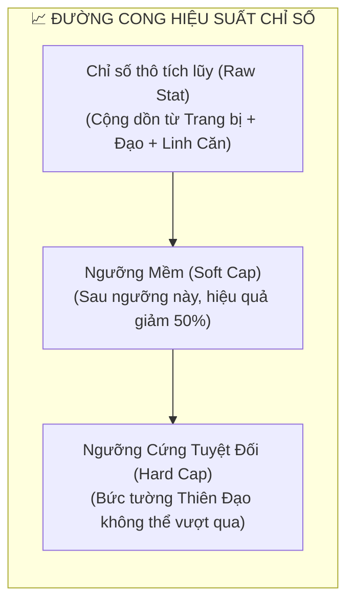
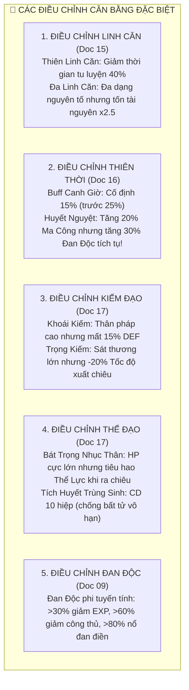
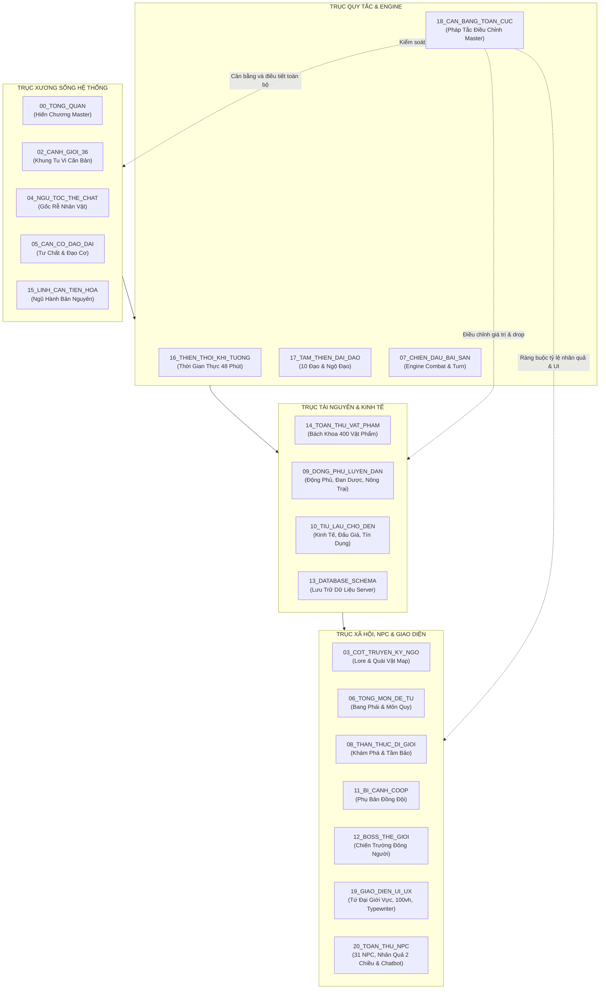

# [20] BÁCH KHOA CÂN BẰNG TOÀN CỤC, HIỆU CHỈNH THÔNG SỐ & MÓC NỐI ĐẠI HỆ THỐNG


> ⬅️ **[Bài Trước: Doc 19 - Đại Biên Niên Sử 36 Tiểu Cảnh Giới & Hóa Phàm](file:///c:/Users/newre/OneDrive/Máy%20tính/code%20tutien/docs/19_DAI_BIEN_NIEN_SU_36_CANH_GIOI.md)** | 📖 **[Mục Lục Toàn Cảnh](file:///c:/Users/newre/OneDrive/Máy%20tính/code%20tutien/README.md)** | 🏆 **[Đỉnh Cao Viên Mãn]**

> *"Thiên chi đạo, tổn hữu dư nhi bổ bất túc; nhân chi đạo, tổn bất túc dĩ phụng hữu dư.*
> *(Đạo của Trời là bớt chỗ dư thừa mà bù vào chỗ thiếu hụt; đạo của Người lại bớt chỗ thiếu hụt để cung phụng chỗ dư thừa.)*
> *Một thế giới tu chân nếu để sát thương bùng nổ vô hạn, một kiếm trảm diệt vạn giới thì thiên địa sụp đổ, trò chơi chết yểu. Bậc Thiên Đạo Chưởng Quản phải thiết lập pháp tắc cân bằng: có sinh ắt có khắc, có cực tốc ắt có phản chấn, có sát phạt ngút trời ắt phải gánh chịu nghiệp lực lôi kiếp!"*

---

## 🧭 PHẦN I: TRIẾT LÝ THIẾT KẾ & TAM GIÁC CÂN BẰNG THIÊN ĐẠO

Để toàn bộ hệ thống 36 Cảnh Giới, 10 Đại Đạo, 400 Vật Phẩm, 9 Thuộc Tính Mệnh và Chu Kỳ Thiên Thời vận hành hài hòa mà không bị **Lạm Phát Chỉ Số (Powercreep Runaway)** hay **Chiến Thuật Bất Bại Một Chiêu Chết (One-Shot Meta)**, hệ thống quy định **Tam Giác Cân Bằng Cốt Lõi**:



### 1.1. Nguyên Tắc 4 Không (Four Golden Balance Rules)
1. **Không có chỉ số nào đạt $100\%$ tuyệt đối vĩnh viễn**: Không né tránh $100\%$, không miễn thương $100\%$, không hút máu $100\%$, không khống chế vĩnh viễn (Perma-Stun).
2. **Không nhân dồn hàm mũ (Anti-Exponential Multipliers)**: Toàn bộ buff sát thương cùng loại quy về **Phép Cộng (Additive)** trước khi nhân với hệ số phòng ngự.
3. **Mọi sức mạnh nghịch thiên đều có cái giá (Risk vs Reward)**: Đòn đánh càng mạnh càng tiêu hao thọ mệnh, đan độc, chân khí hoặc tự tổn hại nhục thân.
4. **Cảnh giới cao áp chế nhưng không bất khả chiến bại**: Tu vi chênh lệch 1 đại cảnh giới vẫn có $15\% - 25\%$ cơ hội bị đả bại nếu đối phương sở hữu Đạo Cảnh vượt bậc, trang bị khắc chế và thiên thời địa lợi.

---

## 📐 PHẦN II: HỆ THỐNG GIỚI HẠN CỨNG, GIỚI HẠN MỀM & SUY GIẢM BIÊN TẾ

Nhằm ngăn chặn người chơi dồn toàn bộ trang bị và kỹ năng để tạo ra các chỉ số "bất tử" hoặc "bách phát bách trúng", hệ thống áp dụng cơ chế **Suy Giảm Biên Tế (Diminishing Returns)**:



### 2.1. Bảng Quy Chuẩn Giới Hạn Toàn Bộ Chỉ Số Chiến Đấu

| Chỉ Số Chiến Đấu | Ngưỡng Cơ Bản | Ngưỡng Mềm (Soft Cap) | Ngưỡng Cứng (Hard Cap) | Công Thức Xử Lý Khi Vượt Soft Cap |
| :--- | :--- | :--- | :--- | :--- |
| **Né Tránh (Dodge / Evasion)** | $5\%$ | **$45\%$** | **$75\%$** | Sau $45\%$: $\text{Thực Tế} = 45\% + (\text{Dư Thừa} \times 0.35)$. Luôn giữ tối thiểu $25\%$ cơ hội đánh trúng! |
| **Bạo Kích (Crit Rate)** | $5\%$ | **$50\%$** | **$80\%$** | Sau $50\%$: $\text{Thực Tế} = 50\% + (\text{Dư Thừa} \times 0.40)$. Trừ khi kích hoạt *Kiếm Vực* trong 3 hiệp. |
| **Sát Thương Bạo (Crit DMG)** | $150\%$ | **$220\%$** | **$300\%$** | Sau $220\%$: Hiệu suất cộng dồn giảm đi một nửa ($\times 0.5$). |
| **Giảm Sát Thương (DMG Reduction)** | $0\%$ | **$50\%$** | **$80\%$** | Dùng công thức Asymptotic: $\text{Giảm} = \frac{\text{DEF}}{\text{DEF} + 1200 \times \text{Tier}}$. |
| **Hút Máu (Lifesteal)** | $0\%$ | **$15\%$** | **$25\%$** | Lượng máu hồi mỗi hiệp không được vượt quá $20\%$ Max HP của bản thân. |
| **Tốc Độ Xuất Chiêu (Speed / Initiative)**| 100 | **250** | **450** | Chênh lệch tốc độ tối đa chỉ giúp đi trước 1 lượt, không cho phép đánh liên tục quá 2 lượt. |
| **Kháng Khống Chế (Tenacity)** | $0\%$ | **$40\%$** | **$70\%$** | Mỗi lần bị dính Choáng/Đóng băng, hiệp sau tự động nhận $+40\%$ Kháng Khống Chế. |
| **Phản Chấn Sát Thương (Damage Reflect)**| $0\%$ | **$20\%$** | **$35\%$** | Sát thương phản lại chịu đầy đủ giáp và kháng của đối phương, không gây sốc chết ngay. |

---

## 🧮 PHẦN III: CHUẨN HÓA CÔNG THỨC SÁT THƯƠNG TỔNG THỂ (UNIFIED COMBAT FORMULA)

Thay thế các công thức rời rạc ở từng tài liệu trước đây, toàn bộ engine chiến đấu áp dụng **Một Công Thức Chuẩn Hóa Duy Nhất**:

$$\mathbf{FinalDamage} = \mathbf{BaseDamage} \times \mathbf{AdditiveModifier} \times \mathbf{DefenseMitigation} \times \mathbf{DaoScale} \times \mathbf{CritModifier} \times \mathbf{ElementCounter}$$

### 3.1. Chi Tiết Từng Thành Phần Trong Công Thức

#### 1. Sát Thương Cơ Bản ($\mathbf{BaseDamage}$)
$$\mathbf{BaseDamage} = \text{SkillBaseValue} + \left(\text{Character ATK} \times \text{SkillScalingRatio}\right)$$

#### 2. Nhóm Gia Tăng Phép Cộng ($\mathbf{AdditiveModifier}$)
Toàn bộ buff môi trường, thiên thời, linh căn được gộp lại thành một tổng, tránh tình trạng nhân dồn phi mã:
$$\mathbf{AdditiveModifier} = 1 + \left(\Delta_{\text{DestinyElement}} + \Delta_{\text{CelestialTime}} + \Delta_{\text{Weather}} + \Delta_{\text{SynergyBonus}}\right)$$
* *Ví dụ*: Hỏa Linh Căn ($+20\%$) + Giờ Ngọ ($+15\%$) + Thời tiết Nắng Gắt ($+10\%$) + Kiếm Phù Song Tuyệt ($+15\%$) $\rightarrow \mathbf{AdditiveModifier} = 1 + (0.20 + 0.15 + 0.10 + 0.15) = \mathbf{1.60}$ (Tăng $60\%$, thay vì nhân dồn thành $1.74$).

#### 3. Hệ Số Giảm Trừ Phòng Ngự ($\mathbf{DefenseMitigation}$)
Áp dụng công thức phi tuyến tính chuẩn quốc tế, giúp chỉ số DEF luôn có giá trị ở mọi cảnh giới mà không bao giờ đạt tới mức miễn nhiễm hoàn toàn:
$$\mathbf{DefenseMitigation} = 1 - \frac{\text{Target DEF} \times (1 - \text{ArmorPenetration})}{\text{Target DEF} \times (1 - \text{ArmorPenetration}) + \left(800 + 400 \times \text{RealmTier}\right)}$$
* *Quy định*: Hệ số $\mathbf{DefenseMitigation}$ tối thiểu là $0.20$ (nghĩa là kẻ địch phòng thủ trâu bò nhất vẫn luôn nhận ít nhất $20\%$ sát thương gốc).

#### 4. Hệ Số Đạo Cảnh Suy Giảm Tự Nhiên ($\mathbf{DaoScale}$)
Đạo Cảnh từ Bậc 1 đến Bậc 7 bổ trợ sát thương theo hàm căn bậc hai (Square Root Diminishing), ngăn cản việc chênh lệch Đạo Cảnh gây ra sát thương hàng triệu điểm:
$$\mathbf{DaoScale} = 1 + 0.12 \times \sqrt{\text{DaoTier} \times 10} + \mathbf{DomainBonus}$$
* *Bậc 1 (Nhập Đạo)*: $1 + 0.12 \times \sqrt{10} \approx \mathbf{1.38}$ ($+38\%$).
* *Bậc 4 (Đạo Tâm)*: $1 + 0.12 \times \sqrt{40} \approx \mathbf{1.76}$ ($+76\%$).
* *Bậc 7 (Đạo Hóa)*: $1 + 0.12 \times \sqrt{70} \approx \mathbf{2.00}$ ($+100\%$).
* $\mathbf{DomainBonus}$: Nếu đang đứng trong Đạo Vực của bản thân, cộng thêm cố định $+0.25$.

#### 5. Hệ Số Bạo Kích ($\mathbf{CritModifier}$)
$$\mathbf{CritModifier} = \begin{cases} 1.0 & \text{nếu không bạo kích} \\ \min(\text{CritDMG}, 3.0) & \text{nếu đòn đánh kích hoạt Bạo Kích} \end{cases}$$

#### 6. Hệ Số Tương Khắc Ngũ Hành ($\mathbf{ElementCounter}$)
$$\mathbf{ElementCounter} = \begin{cases} 1.25 & \text{nếu thuộc tính Người Đánh KHẮC Người Đỡ} \\ 0.80 & \text{nếu thuộc tính Người Đánh BỊ KHẮC} \\ 1.00 & \text{nếu bình hòa hoặc vô tính} \end{cases}$$

---

## ⚡ PHẦN IV: ĐIỀU CHỈNH CÂN BẰNG CHI TIẾT TỪNG PHÂN HỆ

Sau khi rà soát toàn bộ các tài liệu từ `01` đến `17`, hệ thống ban hành bảng điều chỉnh thông số chuẩn hóa:



### 4.1. Điều Chỉnh Hệ Thống Linh Căn & Khai Mở Căn Cơ ([`docs/15`](file:///c:/Users/newre/OneDrive/Máy%20tính/code%20tutien/docs/04_THUOC_TINH_MENH_VA_TIEN_HOA_LINH_CAN.md))
* **Vấn Đề Cũ**: Song Linh Căn và Tam Linh Căn quá mạnh so với Đơn Linh Căn, khiến người chơi bỏ rơi Thiên Linh Căn truyền thống.
* **Hiệu Chỉnh Cân Bằng**:
  * **Thiên Linh Căn (Đơn Căn Thuần Nhất)**: Nhận đặc quyền **Tốc Độ Tọa Thiền Tăng $+50\%$**, tiêu hao đan dược ít hơn $30\%$, tỷ lệ đột phá tiểu cảnh giới luôn cao hơn $20\%$.
  * **Song Linh Căn**: Cung cấp khả năng combo 2 nguyên tố, nhưng **Tốc Độ Tu Luyện giảm $-15\%$** do phải phân chia chân khí nuôi 2 nhánh rễ; chi phí linh thạch đột phá tăng $\times 1.5$.
  * **Tam Linh Căn**: Cung cấp 3 nguyên tố linh hoạt vô địch, nhưng **Tốc Độ Tu Luyện giảm $-30\%$**; chi phí tài nguyên tăng $\times 2.5$. Muốn đột phá đại cảnh giới bắt buộc phải tìm được dị bảo dung hòa (*Tam Hoa Bồ Đề Quả*).

### 4.2. Điều Chỉnh Hệ Thống Thiên Thời & Chu Kỳ 48 Phút ([`docs/16`](file:///c:/Users/newre/OneDrive/Máy%20tính/code%20tutien/docs/09_THIEN_THOI_THAP_NHI_THOI_THAN_VA_KHI_TUONG.md))
* **Vấn Đề Cũ**: Buff giờ hoàng đạo $+25\%$ là quá lớn, khiến người chơi chỉ đăng nhập đúng giờ Ngọ hoặc giờ Tý để đánh Boss, bỏ hoang các khung giờ khác.
* **Hiệu Chỉnh Cân Bằng**:
  * Chuẩn hóa buff Canh Giờ về mức hợp lý: **$+12\% \rightarrow +15\%$** sát thương nguyên tố tương ứng.
  * Các khung giờ không tương sinh nhận buff đa dụng nhẹ: **$+5\%$ Tốc độ hồi phục HP/Mana** hoặc **$+5\%$ Tỷ lệ rớt đồ**.
  * **Đêm Huyết Nguyệt (Đêm 15 Âm Lịch)**: Tăng $+20\%$ Sát thương Ma Tộc & Ám Linh Căn, **NHƯNG** mọi hành vi cắn thuốc trong đêm Huyết Nguyệt bị **Tăng $+40\%$ Tích Tụ Đan Độc**, và quái vật hoang dã bạo kích tăng gấp đôi!

### 4.3. Điều Chỉnh Cân Bằng 10 Đại Đạo ([`docs/17`](file:///c:/Users/newre/OneDrive/Máy%20tính/code%20tutien/docs/16_TAM_THIEN_DAI_DAO_VA_TIEU_DAO_LUU_PHAI.md))
* **Kiếm Đạo**:
  * *Khoái Kiếm*: Tốc độ xuất chiêu cực cao nhưng bị giảm vĩnh viễn $-15\%$ DEF (dễ chết nếu bị sốc ngược).
  * *Trọng Kiếm*: Sát thương cực lớn và phá giáp, nhưng tốc độ xuất chiêu bị giảm $-20\%$; nếu đánh hụt mục tiêu né tránh sẽ bị mất lượt 1 hiệp vì quán tính kiếm nặng.
  * *Sát Kiếm*: Hút máu tối đa $20\%$; mỗi mạng hạ gục cộng dồn ATK tối đa 10 tầng ($+60\%$, thay vì vô hạn). Điểm Nghiệp Lực tích tụ làm tăng xác suất bị Thiên Lôi giáng phạt khi đi ngoài map.
* **Thể Đạo**:
  * *Kim Cương Bất Hoại*: Phản đòn tối đa $30\%$ và bị giới hạn bởi chính lượng HP tối đa của bản thân.
  * *Niết Bàn Tái Sinh / Tích Huyết Trùng Sinh*: Thêm **Thời Gian Hồi Chiêu (Cooldown) 10 Hiệp** hoặc 1 lần duy nhất mỗi trận đấu. Không còn cơ chế hồi sinh liên tục bất tử.
* **Trận Đạo**:
  * Cần 1 hiệp niệm chú để cắm cọc trận (Trận Kỳ), tạo cơ hội cho sát thủ Khoái Kiếm ngắt chiêu (Interrupt).
* **Phù Đạo**:
  * Giới hạn mỗi trận đấu chỉ được mang tối đa **8 lá bùa** trong Hộp Đựng Bùa (Talisman Pouch), ngăn chặn việc spam cả ngàn lá bùa đè bẹp đối thủ.
* **Khôi Lỗi Đạo**:
  * Số lượng khôi lỗi triệu hồi bị giới hạn chặt chẽ bởi **Chỉ Số Thần Thức**: Cứ mỗi 100 điểm Thần Thức mới điều khiển được thêm 1 con rối.
* **Đan Đạo & Đan Độc (Doc 09)**:
  * Áp dụng thang đo Đan Độc phi tuyến tính:
    * $\text{Đan Độc} \le 20\%$: Vô hại.
    * $21\% - 40\%$: Giảm $-15\%$ Tốc độ hồi phục HP/Mana.
    * $41\% - 60\%$: Giảm $-30\%$ Toàn bộ chỉ số chiến đấu, tỷ lệ đột phá giảm $50\%$.
    * $61\% - 80\%$: Mỗi hiệp đấu tự mất $3\%$ máu; nôn ra máu đen khi thi triển chiêu thức.
    * $> 80\%$: **Bạo Thể Điền Vi** (Nổ tung đan điền, tu vi rớt 1 đại cảnh giới, toàn bộ kinh mạch đứt đoạn).

---

## 🔗 PHẦN V: BẢN ĐỒ MÓC NỐI TOÀN BỘ ĐẠI HỆ THỐNG (CROSS-SYSTEM DEPENDENCY MATRIX)

Để dự án Tu Chân Giới Online vận hành như một thực thể sống thống nhất, dưới đây là **Ma Trận Móc Nối Đầu Vào - Đầu Ra (I/O Dependencies)** giữa tất cả 21 tài liệu trong hệ thống:



### 5.1. Bảng Tra Cứu Móc Nối Chi Tiết Từng Tài Liệu

| Mã File MD | Tên Tài Liệu Hệ Thống | Nhận Dữ Liệu Đầu Vào Từ (Inputs) | Cung Cấp Dữ Liệu Đầu Ra Cho (Outputs) | Quy Tắc Ràng Buộc Cân Bằng (Enforced by Doc 20) |
| :--- | :--- | :--- | :--- | :--- |
| [`00_TONG_QUAN.md`](file:///c:/Users/newre/OneDrive/Máy%20tính/code%20tutien/docs/00_TONG_QUAN.md) | **Doc 00: Bạch Bì Thư & Tầm Nhìn Dự Án** | Toàn bộ 20 file còn lại | Định hướng kiến trúc toàn dự án | Đảm bảo tính nhất quán giữa Tán Tu vs Tông Môn. |
| [`01_LO_TRINH_VA_WORKFLOW.md`](file:///c:/Users/newre/OneDrive/Máy%20tính/code%20tutien/docs/01_LO_TRINH_VA_WORKFLOW.md) | **Doc 01: Ma Trận Lộ Trình & Workflow Master** | Toàn bộ hệ thống | Quy trình thi công của DEV | Tuân thủ thứ tự: Dễ triển khai trước -> Khó triển khai sau. |
| [`02_CANH_GIOI_NGU_TOC_VA_THE_CHAT.md`](file:///c:/Users/newre/OneDrive/Máy%20tính/code%20tutien/docs/02_CANH_GIOI_NGU_TOC_VA_THE_CHAT.md) | **Doc 02: Hệ Thống Cảnh Giới, Ngũ Tộc & Lôi Kiếp** | Doc 00 | Doc 03, 04, 07, 10, 16 | Ưu thế tộc này luôn bị khắc chế bởi thuộc tính tộc khác. |
| [`03_CAN_CO_TU_CHAT_VA_DAO_DAI.md`](file:///c:/Users/newre/OneDrive/Máy%20tính/code%20tutien/docs/03_CAN_CO_TU_CHAT_VA_DAO_DAI.md) | **Doc 03: Căn Cơ, Ẩn Mạch & 6 Hình Thái Đạo Đài** | Doc 02, 04 | Doc 10, 16, 20 | Đạo Đài Cực Phẩm đòi hỏi điều kiện độ kiếp cực kỳ gắt gao. |
| [`04_THUOC_TINH_MENH_VA_TIEN_HOA_LINH_CAN.md`](file:///c:/Users/newre/OneDrive/Máy%20tính/code%20tutien/docs/04_THUOC_TINH_MENH_VA_TIEN_HOA_LINH_CAN.md) | **Doc 04: Thuộc Tính Mệnh & Tiến Hóa Linh Căn** | Doc 02, 03 | Doc 07, 10, 16 | Đa Linh Căn bị giảm tốc độ tu luyện bù đắp tính cơ động. |
| [`05_TOAN_THU_VAT_PHAM_PHAP_BAO_VA_CO_DUYEN.md`](file:///c:/Users/newre/OneDrive/Máy%20tính/code%20tutien/docs/05_TOAN_THU_VAT_PHAM_PHAP_BAO_VA_CO_DUYEN.md) | **Doc 05: Bách Khoa Toàn Thư 400 Vật Phẩm & Bảo Vật** | Doc 08, 16 | Doc 06, 07, 10, 15 | Chỉ số trang bị gắn chặt với Bậc Cảnh Giới sử dụng (ITEM_001-400). |
| [`06_DATABASE_SCHEMA_VA_API.md`](file:///c:/Users/newre/OneDrive/Máy%20tính/code%20tutien/docs/06_DATABASE_SCHEMA_VA_API.md) | **Doc 06: Kiến Trúc CSDL SQLite & Đặc Tả API** | Toàn bộ hệ thống | Server Backend Node.js | Chuẩn hóa các trường daoMastery, destinyElements, memoryLedger. |
| [`07_THIET_KE_HE_THONG_GIAO_DIEN_UI_UX.md`](file:///c:/Users/newre/OneDrive/Máy%20tính/code%20tutien/docs/07_THIET_KE_HE_THONG_GIAO_DIEN_UI_UX.md) | **Doc 07: Bạch Thư Thiết Kế Đại Hệ Thống Giao Diện (UI/UX)** | Toàn bộ logic từ 00 đến 20 | Frontend Web Single Page | Khóa cứng 100vh Zero Page Scroll, chống layout shift, Typewriter instant. |
| [`08_DONG_PHU_NONG_TRAI_LUYEN_DAN.md`](file:///c:/Users/newre/OneDrive/Máy%20tính/code%20tutien/docs/08_DONG_PHU_NONG_TRAI_LUYEN_DAN.md) | **Doc 08: Nơi Trú Ngụ, Dược Điền & Đan Đạo** | Doc 05, 09, 16 | Doc 02, 07, 10, 15 | Đan độc lũy tiến phi tuyến tính, giới hạn số đan cắn mỗi ngày. |
| [`09_THIEN_THOI_THAP_NHI_THOI_THAN_VA_KHI_TUONG.md`](file:///c:/Users/newre/OneDrive/Máy%20tính/code%20tutien/docs/09_THIEN_THOI_THAP_NHI_THOI_THAN_VA_KHI_TUONG.md) | **Doc 09: Thiên Thời, Thập Nhị Thời Thần & Khí Tượng** | Server Clock Epoch | Doc 07, 08, 10, 16 | Buff Canh Giờ chuẩn hóa về mức +12% - +15%. |
| [`10_CHIEN_DAU_VA_BAI_SAN.md`](file:///c:/Users/newre/OneDrive/Máy%20tính/code%20tutien/docs/10_CHIEN_DAU_VA_BAI_SAN.md) | **Doc 10: Chiến Đấu & 2 Phân Khu Bãi Săn** | Doc 02, 04, 05, 09, 16 | Doc 06, 07, 17, 18 | Tuân thủ tuyệt đối công thức sát thương chuẩn hóa duy nhất. |
| [`11_COT_TRUYEN_LUC_PHAI_VA_KY_NGO.md`](file:///c:/Users/newre/OneDrive/Máy%20tính/code%20tutien/docs/11_COT_TRUYEN_LUC_PHAI_VA_KY_NGO.md) | **Doc 11: Cốt Truyện Phân Nhánh Ngũ Tộc & Lục Phái** | Doc 00, 02, 12 | Doc 05, 13, 16, 17 | Tỷ lệ xuất hiện kỳ ngộ nghịch thiên bị giới hạn bởi Khí Vận. |
| [`12_TONG_MON_VA_LUC_DANG_DE_TU.md`](file:///c:/Users/newre/OneDrive/Máy%20tính/code%20tutien/docs/12_TONG_MON_VA_LUC_DANG_DE_TU.md) | **Doc 12: Tông Môn & Lục Đẳng Đồ Đệ** | Doc 11, 03 | Doc 07, 08, 13, 18 | Lương bổng tông môn cân đối với đóng góp cống hiến. |
| [`13_TOAN_THU_NPC_NHAN_VAT_COT_TRUYEN.md`](file:///c:/Users/newre/OneDrive/Máy%20tính/code%20tutien/docs/13_TOAN_THU_NPC_NHAN_VAT_COT_TRUYEN.md) | **Doc 13: Toàn Thư Danh Phả 31 NPC & Nhân Quả Hai Chiều** | Doc 11, 12, 15, 19 | Doc 06, 07, 20 | Cân bằng rủi ro và lợi ích: Hảo Cảm +100 ban phúc vs Ác Cảm -100 truy sát. |
| [`14_THAN_THUC_TAM_BAO_VA_DI_GIOI.md`](file:///c:/Users/newre/OneDrive/Máy%20tính/code%20tutien/docs/14_THAN_THUC_TAM_BAO_VA_DI_GIOI.md) | **Doc 14: Thần Thức Tầm Bảo & Sinh Tồn Dị Giới** | Doc 02, 10, 16 | Doc 05, 07, 17 | Bán kính quét thần thức bị suy giảm theo sương mù trận pháp. |
| [`15_TIU_LAU_SONG_BAC_VA_TIN_DUNG_DEN.md`](file:///c:/Users/newre/OneDrive/Máy%20tính/code%20tutien/docs/15_TIU_LAU_SONG_BAC_VA_TIN_DUNG_DEN.md) | **Doc 15: Tửu Lầu, Sòng Bạc Buckshot & Vay Nợ** | Doc 05 | Doc 06, 07, 08, 13 | Thuế giao dịch 5% và tiêu hủy linh thạch chống lạm phát. |
| [`16_TAM_THIEN_DAI_DAO_VA_TIEU_DAO_LUU_PHAI.md`](file:///c:/Users/newre/OneDrive/Máy%20tính/code%20tutien/docs/16_TAM_THIEN_DAI_DAO_VA_TIEU_DAO_LUU_PHAI.md) | **Doc 16: Tam Thiên Đại Đạo & Bách Gia Lưu Phái** | Doc 02, 05, 10 | Doc 06, 07, 17, 20 | Áp dụng hàm suy giảm Đạo Cảnh căn(Tier), giới hạn phản đòn, hút máu. |
| [`17_BI_CANH_VA_TO_DOI_REALTIME.md`](file:///c:/Users/newre/OneDrive/Máy%20tính/code%20tutien/docs/17_BI_CANH_VA_TO_DOI_REALTIME.md) | **Doc 17: Bí Cảnh & Tổ Đội Realtime (1 - 5 Người)** | Doc 05, 09, 10, 16 | Doc 02, 05, 07 | Boss bí cảnh tăng máu theo số lượng thành viên tổ đội (x N^0.8). |
| [`18_BOSS_THE_GIOI_VA_MULTIPLAYER.md`](file:///c:/Users/newre/OneDrive/Máy%20tính/code%20tutien/docs/18_BOSS_THE_GIOI_VA_MULTIPLAYER.md) | **Doc 18: Săn Boss Thế Giới & Xã Hội Multiplayer** | Doc 09, 10, 17 | Doc 05, 07, 15 | Sát thương Boss thế giới chia theo rank đóng góp, chống ks giờ chót. |
| [`19_DAI_BIEN_NIEN_SU_36_CANH_GIOI.md`](file:///c:/Users/newre/OneDrive/Máy%20tính/code%20tutien/docs/19_DAI_BIEN_NIEN_SU_36_CANH_GIOI.md) | **Doc 19: Đại Biên Niên Sử 36 Tiểu Cảnh Giới & Hóa Phàm** | Doc 02, 03, 04, 11 | Doc 07, 13, 16, 20 | Giới hạn trần chỉ số cơ bản theo từng bậc cảnh giới. |
| [`20_CAN_BANG_TOAN_CUC_VA_DIEU_CHINH_THONG_SO.md`](file:///c:/Users/newre/OneDrive/Máy%20tính/code%20tutien/docs/20_CAN_BANG_TOAN_CUC_VA_DIEU_CHINH_THONG_SO.md) | **Doc 20: Cân Bằng Toàn Cục & Móc Nối Đại Hệ Thống** | Toàn bộ 20 tài liệu | Toàn bộ 20 tài liệu | Quy chuẩn duy nhất định hình mọi con số trong trò chơi. |


---

## 🔬 PHẦN VI: BẢNG TRA CỨU HẰNG SỐ TOÀN CỤC (GLOBAL CONSTANTS REFERENCE TABLE)

Dành riêng cho việc cấu hình và đối soát logic trong toàn bộ dự án:

```javascript
// HẰNG SỐ THIÊN ĐẠO TOÀN CỤC (GLOBAL CELESTIAL CONSTANTS)
export const GLOBAL_BALANCE_CONFIG = {
  // Chu kỳ thời gian thực
  TIME: {
    DAY_DURATION_MS: 48 * 60 * 1000,       // 1 Ngày Game = 48 Phút Thực (2,880,000 ms)
    SOLAR_HOUR_DURATION_MS: 4 * 60 * 1000, // 1 Canh Giờ = 4 Phút Thực (240,000 ms)
    KE_DURATION_MS: 30 * 1000,             // 1 Khắc = 30 Giây Thực
    DAYS_PER_MONTH: 30,                    // 30 Ngày Game = 1 Tháng (24 Giờ Thực)
    BLOOD_MOON_DAY: 15                     // Đêm 15 hàng tháng là Huyết Nguyệt
  },

  // Giới hạn mềm và cứng chiến đấu
  COMBAT_LIMITS: {
    DODGE_SOFT_CAP: 0.45,
    DODGE_HARD_CAP: 0.75,
    CRIT_RATE_SOFT_CAP: 0.50,
    CRIT_RATE_HARD_CAP: 0.80,
    CRIT_DMG_HARD_CAP: 3.00,
    DMG_REDUCTION_HARD_CAP: 0.80,
    LIFESTEAL_HARD_CAP: 0.25,
    REFLECT_HARD_CAP: 0.35,
    MAX_CONSECUTIVE_TURNS: 2
  },

  // Hệ số phòng ngự phi tuyến tính
  DEFENSE_CURVE: {
    BASE_K: 800,
    SCALE_PER_TIER: 400,
    MIN_DAMAGE_ALLOWED_PERCENT: 0.20
  },

  // Cân bằng Linh Căn
  SPIRIT_ROOT: {
    HEAVEN_ROOT_EXP_BONUS: 0.50,
    DUAL_ROOT_EXP_PENALTY: -0.15,
    TRIPLE_ROOT_EXP_PENALTY: -0.30,
    PURITY_MAX: 100
  },

  // Thang đo Đan Độc
  PILL_POISON_THRESHOLDS: {
    SAFE: 20,
    SLOW_REGEN: 40,
    STAT_DEBUFF: 60,
    BLEEDING: 80,
    BODY_EXPLOSION: 100
  },

  // Cân bằng kinh tế
  ECONOMY: {
    MARKET_TAX_RATE: 0.05,
    BLACK_MARKET_TAX_RATE: 0.12,
    ITEM_DURABILITY_LOSS_PER_DEATH: 10
  }
};
```

---

## 🎯 PHẦN VII: QUY TRÌNH KIỂM SOÁT THỬ NGHIỆM CÂN BẰNG (BALANCE SIMULATION PROTOCOL)

Khi tiến hành bất kỳ chỉnh sửa nào trong tương lai, hệ thống bắt buộc phải chạy qua 3 kịch bản kiểm thử mẫu:

### Kịch Bản 1: Đối Đầu Sát Thủ Tốc Độ vs Bức Tường Phòng Ngự
* **Mô phỏng**: Kiếm Tu Khoái Kiếm (Thân Pháp cao, Bạo Kích $60\%$) đấu với Thể Tu Kim Cương (DEF cao, Kháng Bạo Kích).
* **Tiêu chí đạt chuẩn**:
  * Trận đấu phải kéo dài từ **5 đến 9 hiệp**.
  * Khoái Kiếm dồn sát thương hiệp 1-2 gây mất $40\% - 60\%$ HP của Kim Cương.
  * Kim Cương phản chấn và tung đòn chuẩn sát thương hạ gục lại Khoái Kiếm ở hiệp 6-7 nếu Khoái Kiếm không kết liễu được đối phương.
  * **Tỷ lệ thắng mong muốn**: $50\% \pm 5\%$ tùy thuộc vào trang bị và xúc xắc ngẫu nhiên.

### Kịch Bản 2: Đánh Boss Vượt Cấp (Trúc Cơ vs Kim Đan Boss)
* **Mô phỏng**: 1 Tu sĩ Trúc Cơ Viên Mãn (sở hữu Kiếm Ý Bậc 3 + Đồ Cổ Bảo) solo với Boss Kim Đan Sơ Kỳ.
* **Tiêu chí đạt chuẩn**:
  * Người chơi phải sử dụng đúng Khắc Chế Ngũ Hành + Giờ Hoàng Đạo + Bùa Chú hỗ trợ.
  * Tỷ lệ chiến thắng của người chơi tay to (kỹ năng tối ưu) nằm trong khoảng **$20\% - 35\%$**.
  * Nếu không chuẩn bị kỹ lưỡng (không canh giờ, mang sai phù, linh căn bị khắc) $\rightarrow$ **Tử trận $100\%$ trong 3 hiệp**.

### Kịch Bản 3: Chống Lạm Phát Đan Dược
* **Mô phỏng**: Người chơi giàu có cắn 100 viên đan dược cao cấp liên tục để cày cấp thần tốc trong 1 ngày.
* **Tiêu chí đạt chuẩn**:
  * Đến viên thứ 15, thanh Đan Độc chạm mốc $60\%$, kích hoạt debuff giảm toàn bộ công thủ.
  * Đến viên thứ 25, thanh Đan Độc chạm mốc $100\%$, nhân vật lập tức phát nổ đan điền, tu vi tụt lùi thảm hại hơn cả lúc chưa cắn thuốc!
  * **Kết luận**: Buộc người chơi phải kết hợp trồng thảo dược thanh lọc, tọa thiền tự nhiên và Âm Dương Song Tu để bài trừ đan độc.

---

*Tài liệu này là Bản Hiến Pháp Cân Bằng Tối Cao (Master Balancing Constitution) của Tu Chân Giới Online. Mọi hệ thống code backend, game engine, database schema và UI hiển thị bắt buộc phải tuân thủ nghiêm ngặt các công thức và ngưỡng thông số được định nghĩa tại đây.*


---

> ⬅️ **[Bài Trước: Doc 19 - Đại Biên Niên Sử 36 Tiểu Cảnh Giới & Hóa Phàm](file:///c:/Users/newre/OneDrive/Máy%20tính/code%20tutien/docs/19_DAI_BIEN_NIEN_SU_36_CANH_GIOI.md)** | 📖 **[Mục Lục Toàn Cảnh](file:///c:/Users/newre/OneDrive/Máy%20tính/code%20tutien/README.md)** | 🏆 **[Đỉnh Cao Viên Mãn]**
