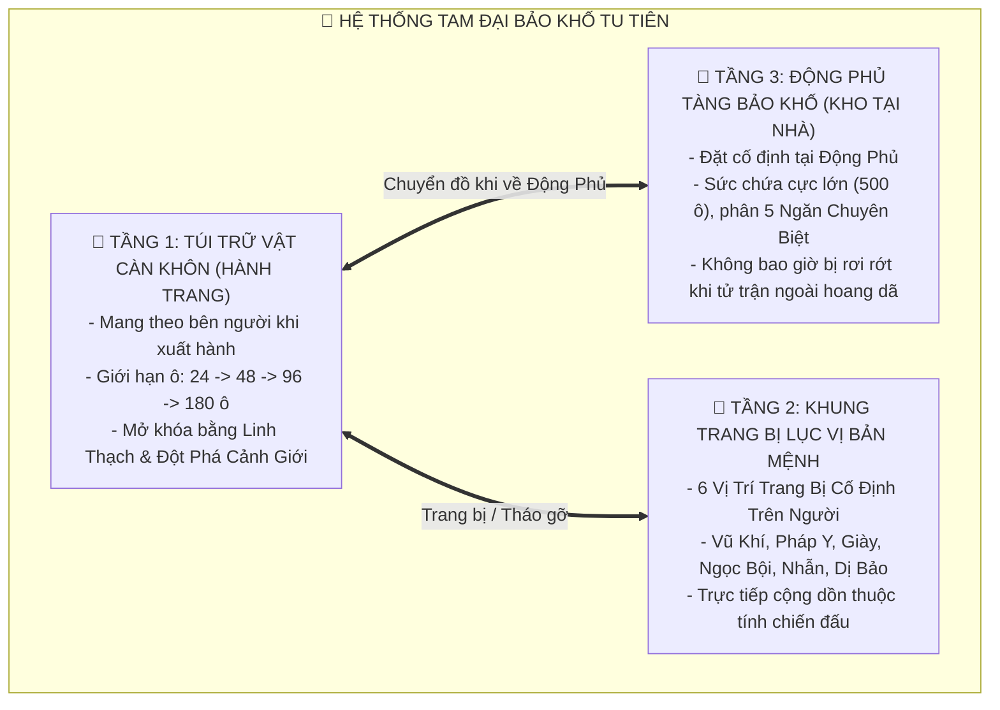
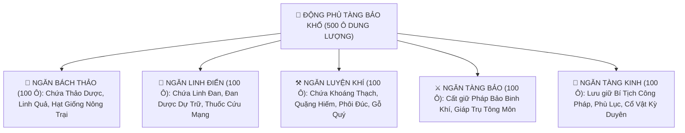

# [21] CÀN KHÔN BẢO KHỐ: HỆ THỐNG KHO ĐỒ, TÚI TRỮ VẬT & LỤC ĐẠI TRANG BỊ BẢN MỆNH

> ⬅️ **[Bài Trước: Doc 20 - Cân Bằng Toàn Cục & Điều Chỉnh Thông Số](file:///c:/Users/newre/OneDrive/Máy%20tính/code%20tutien/docs/20_CAN_BANG_TOAN_CUC_VA_DIEU_CHINH_THONG_SO.md)** | 📖 **[Mục Lục Toàn Cảnh](file:///c:/Users/newre/OneDrive/Máy%20tính/code%20tutien/README.md)** | ➡️ **[Bài Sau: Doc 22 - Toàn Thư 300 Công Pháp Bí Tịch](file:///c:/Users/newre/OneDrive/Máy%20tính/code%20tutien/docs/22_TOAN_THU_300_CONG_PHAP_BI_TICH.md)**

> *"Trong một tấc vuông nạp vạn trượng núi sông, trong chiếc nhẫn đồng chứa vạn cân linh thạch! Kẻ phàm phu gánh gồng tay xách nách mang, người tu tiên chỉ cần phất nhẹ ống tay áo, vạn quyển bí tịch cùng trăm lò đan dược liền thu vào Túi Càn Khôn. Nhưng bảo vật cõi đời chứa càng nhiều, lòng tham càng nặng, sát khí càng sâu. Chiếc nhẫn trên tay là kho báu trường sinh, cũng chính là mồi lửa dẫn lối cho họa sát thân đoạt bảo!"*

Tài liệu này đặc tả chi tiết toàn bộ kiến trúc **Hệ Thống Kho Đồ, Túi Trữ Vật Càn Khôn, Tàng Bảo Khố Động Phủ và 6 Ô Trang Bị Bản Mệnh (Inventory, Vault & Equipment Ecosystem)** đồng bộ với kho dữ liệu [400 Vật Phẩm Chuẩn Doc 05](file:///c:/Users/newre/OneDrive/Máy%20tính/code%20tutien/docs/05_TOAN_THU_VAT_PHAM_PHAP_BAO_VA_CO_DUYEN.md).

---

## 🏛️ I. TAM TẦNG KIẾN TRÚC KHO CHỨA ĐỒ (STORAGE MATRIX)

Thế giới Tu Tiên không dùng một kho đồ chung lộn xộn, mà phân định rõ ràng thành **Tam Đại Tầng Lưu Trữ**:



---

## 🥋 II. HỆ THỐNG LỤC ĐẠI TRANG BỊ BẢN MỆNH (6-SLOT EQUIPMENT PAPERDOLL)

Xung quanh chân thân nhân vật có **6 Vị Trí Trang Bị Cố Định**, mỗi vị trí đảm nhiệm một nhánh thuộc tính chiến đấu chuyên biệt:

```
                    +---------------------------------------+
                    |        HỒ SƠ TRANG BỊ TU SĨ           |
                    +---------------------------------------+
                    |                                       |
     [ 🗡️ PHÁP BẢO BINH KHÍ ]       ( AVATAR )      [ 🥋 PHÁP Y ĐẠO BÀO ]
     - Công Kích (ATK)             CHÂN THÂN        - Phòng Ngự (DEF)
     - Sát Thương Bạo Kích         TU SĨ JPG        - Khí Huyết (HP)
     - Thuộc Tính Ngũ Hành                          - Kháng Độc / Hồi Máu
                    |                                       |
     [ 🥾 HÀI THÂN PHÁP ]          PHÁP HOÀN        [ 📿 NGỌC BỘI HỘ MỆNH ]
     - Thân Pháp (Speed)          HÀO QUANG         - Kháng Lôi Kiếp (%)
     - Tỉ Lệ Né Tránh                               - Độ Vững Căn Cơ (%)
                    |                                       |
     [ 💍 TRỮ VẬT GIỚI CHỈ ]                        [ 🏺 BẢN MỆNH DỊ BẢO ]
     - Mở Thêm Ô Túi Đồ                            - Tuyệt Kỹ Kích Hoạt
     - Tăng Tốc Tọa Thiền                           - Vận Khí & Bạo Kích
                    +---------------------------------------+
```

### Chi Tiết 6 Vị Trí Trang Bị:
| Ô Trang Bị | Biểu Tượng | Nhóm Vật Phẩm Chuẩn | Thuộc Tính Cốt Lõi Tăng Trưởng | Ví Dụ Điển Hình (Doc 05) |
| :--- | :---: | :--- | :--- | :--- |
| **1. Binh Khí** | 🗡️ | Nhóm IV: Binh Khí Ngũ Hành (`ITEM_171` - `230`) | $\text{ATK}$, Bạo kích, Xuyên thấu giáp | *Thanh Vân Linh Kiếm*, *Thái Hư Phi Kiếm*, *Thôn Thiên Ma Đao* |
| **2. Pháp Y** | 🥋 | Nhóm V: Phòng Cụ & Đạo Bào (`ITEM_231` - `280`) | $\text{DEF}$, $\text{HP}$, Kháng nguyên tố | *Thanh Trúc Đạo Bào*, *Huyền Vũ Thần Giáp*, *Cửu U Huyết Y* |
| **3. Thân Pháp** | 🥾 | Nhóm V: Hài Thân Pháp (`ITEM_241` - `250`) | $\text{Speed}$, Tỉ lệ Né tránh | *Thanh Phong Tiên Hài*, *Thiên Lôi Huyễn Bộ Hài* |
| **4. Ngọc Bội** | 📿 | Nhóm VIII: Cổ Vật & Hộ Phù (`ITEM_361` - `370`) | Kháng Lôi Kiếp, Giảm đan độc, Căn cơ | *Thanh Tâm Bích Ngọc Bội*, *Hộ Mạch Thần Phù* |
| **5. Giới Chỉ** | 💍 | Nhóm VIII: Nhẫn Không Gian (`ITEM_371` - `380`) | Tăng dung lượng túi đồ, Hấp thu linh khí | *Tu Di Giới Chỉ*, *Càn Khôn Nạp Giới* |
| **6. Dị Bảo** | 🏺 | Nhóm VIII: Chí Bảo Bản Mệnh (`ITEM_391` - `400`) | Kích hoạt Passive / Thiên Đạo Nhất Chỉ | *Thần Nông Dược Đỉnh*, *Chân Tiên Tiên Cốt* |

---

## 🎒 III. TÚI TRỮ VẬT CÀN KHÔN (HÀNH TRANG CÁ NHÂN)

### 1. Phân Cấp Sức Chứa & Điều Kiện Mở Rộng:
| Cấp Bậc Túi Trữ Vật | Số Ô Khởi Đầu | Cảnh Giới Yêu Cầu | Chi Phí Mở Rộng 4 Ô | Giới Hạn Tối Đa |
| :--- | :---: | :---: | :---: | :---: |
| **Phàm Cấp (Túi Vải Bố)** | $24 \text{ ô}$ | Phàm Nhân / Luyện Khí 1 | $100 \text{ Linh Thạch}$ | $36 \text{ ô}$ |
| **Linh Cấp (Túi Gấm Trữ Vật)** | $48 \text{ ô}$ | Luyện Khí Tầng 5 | $500 \text{ Linh Thạch}$ | $72 \text{ ô}$ |
| **Huyền Cấp (Tu Di Nạp Giới)** | $96 \text{ ô}$ | Trúc Cơ Kỳ | $2,000 \text{ Linh Thạch}$ | $144 \text{ ô}$ |
| **Địa Cấp (Càn Khôn Sơn Hà Túi)**| $160 \text{ ô}$| Kim Đan Kỳ | $10,000 \text{ Linh Thạch}$| $240 \text{ ô}$ |
| **Thiên Cấp (Thái Hư Hư Không Giới)**| $300 \text{ ô}$| Nguyên Anh Kỳ trở lên| $50,000 \text{ Linh Thạch}$| $500 \text{ ô}$ |

### 2. Quy Tắc Xếp Chồng Vật Phẩm (Stacking Rules):
- **Vật Phẩm Tiêu Hao & Nguyên Liệu** (Dược liệu, Linh đan, Khoáng thạch, Phù chú, Yêu đan):
  * Xếp chồng tối đa: **$999$ cái / ô**.
  * Khi đạt mốc $999$, hệ thống tự động tràn sang ô trống kế tiếp.
- **Trang Bị, Binh Khí, Pháp Bảo & Bí Tịch Công Pháp**:
  * Độc lập: **$1$ món / ô**.
  * Mỗi trang bị sở hữu phẩm chất riêng, độ bền, và dòng ẩn ngẫu nhiên.

---

## ⚙️ IV. BỘ CÔNG CỤ THAO TÁC CỔ PHONG (UX ACTIONS)

```
+===================================================================================+
| 🎒 TÚI CÀN KHÔN (48/96 Ô)       [⚡ SẮP XẾP]  [🔒 KHÓA ĐỒ]  [♻️ PHÂN GIẢI]  [🔍 TÌM] |
+===================================================================================+
| [ BỘ LỌC ]: ( Toàn Bộ )  ( 🌿 Dược )  ( 💊 Đan )  ( ⚔️ Binh Khí )  ( 📜 Phù )    |
+-----------------------------------------------------------------------------------+
|  ┌────────┐ ┌────────┐ ┌────────┐ ┌────────┐ ┌────────┐ ┌────────┐ ┌────────┐    |
|  │ 🌿 x84 │ │ 💊 x12 │ │ 🗡️ KIM  │ │ 🥋 LINH│ │ 🐉 x05 │ │ ⚒️ x30 │ │  [+]   │    |
|  │  Phàm  │ │  Linh  │ │  Huyền │ │  Địa   │ │  Thiên │ │  Phàm  │ │ Mở Ô   │    |
|  └────────┘ └────────┘ └────────┘ └────────┘ └────────┘ └────────┘ └────────┘    |
+===================================================================================+
```

### Tứ Đại Thao Tác Nhanh:
1. **Nút [⚡ Sắp Xếp Nhanh] (Auto-Sort)**:
   - Tự động gom các ô trùng lặp.
   - Sắp xếp thứ tự ưu tiên: `Phẩm cấp cao -> thấp` (Thần $\rightarrow$ Thiên $\rightarrow$ Địa $\rightarrow$ Huyền $\rightarrow$ Linh $\rightarrow$ Phàm), sau đó phân theo 8 Đại Nhóm.
2. **Nút [♻️ Phân Giải / Thu Hồi] (Recycle / Deconstruct)**:
   - Cho phép chọn nhiều vật phẩm rác, trang bị trắng để đập tan thành **Linh Thạch** và **Huyền Thiết Tinh Sa** dùng để đúc trang bị mới.
3. **Nút [🔒 Khóa Vật Phẩm] (Item Lock)**:
   - Gắn ổ khóa ngọc bảo hộ. Vật phẩm đã khóa sẽ **không thể bán nhầm, không thể phân giải, và không thể vứt bỏ**.
4. **Cơ Chế Bấm Xem Giám Bảo (Quick Inspect)**:
   - Nhấp vào bất kỳ ô nào $\rightarrow$ Kích hoạt **Modal Giám Bảo [item-detail-modal]** hiển thị ảnh `.jpg` độ nét cao, bảng chỉ số so sánh $\pm\text{ATK}/\text{DEF}$, điển tích cổ văn và các nút bấm ngữ cảnh (*Sử dụng, Trang bị, Lĩnh ngộ, Gửi vào kho*).

---

## 🏯 V. ĐỘNG PHỦ TÀNG BẢO KHỐ (KHO TRỮ ĐỒ TẠI ĐỘNG PHỦ)

Tàng Bảo Khố là nơi an toàn tuyệt đối đặt tại Động Phủ của tu sĩ, được phân chia thành **5 Đại Ngăn Chứa**:



- **Tính năng chuyển kho 1 chạm**: Nút `[Gửi Toàn Bộ Nguyên Liệu Vào Kho]` giúp dọn sạch túi đồ chỉ sau 1 cú nhấp chuột khi tu sĩ trở về Động Phủ nghỉ ngơi.

---

## 💾 VI. DATABASE SCHEMA & DỮ LIỆU ĐỒNG BỘ REALTIME

### Cấu Trúc Dữ Liệu Trong `database.json` & SQLite:

```json
{
  "inventory": {
    "maxSlots": 48,
    "unlockedSlots": 24,
    "items": [
      { "slot": 0, "id": "ITEM_004", "count": 25, "locked": false },
      { "slot": 1, "id": "ITEM_063", "count": 5, "locked": false },
      { "slot": 2, "id": "ITEM_175", "count": 1, "locked": true, "durability": 100 }
    ]
  },
  "equipped": {
    "weapon": "ITEM_175",
    "armor": "ITEM_235",
    "boots": "ITEM_242",
    "pendant": "ITEM_362",
    "ring": "ITEM_372",
    "artifact": "ITEM_395"
  },
  "vault": {
    "unlocked": true,
    "maxCapacity": 500,
    "items": []
  }
}
```

### Các Socket Event Đồng Bộ Realtime:
- `c2s_equip_item` { slotId, itemId }: Yêu cầu trang bị vật phẩm lên người $\rightarrow$ Server kiểm tra cảnh giới/yêu cầu $\rightarrow$ Cập nhật chỉ số $\rightarrow$ Trả về `s2c_update_character`.
- `c2s_unequip_item` { slotType }: Tháo trang bị về túi Càn Khôn.
- `c2s_sort_inventory`: Yêu cầu sắp xếp gọn túi đồ.
- `c2s_recycle_items` { itemIds }: Phân giải vật phẩm thu hồi Linh Thạch.
- `c2s_transfer_to_vault` { slotId, count }: Gửi đồ vào Tàng Bảo Khố Động Phủ.

---

## 🧭 VII. KẾ HOẠCH TÍCH HỢP VÀO GIAO DIỆN (UI INTEGRATION)

1. **Nâng Cấp Tab 5 (`tab-inventory`) trong [index.html](file:///c:/Users/newre/OneDrive/Máy%20tính/code%20tutien/public/index.html)**:
   - Cột trái: Khung Lục Vị Trang Bị bao quanh Avatar nhân vật.
   - Cột phải: Lưới 24 - 96 ô Túi Càn Khôn kèm các nút Sắp Xếp, Phân Giải, Bộ Lọc nhóm.
2. **Liên kết trực tiếp với [itemEncyclopedia.js](file:///c:/Users/newre/OneDrive/Máy%20tính/code%20tutien/public/itemEncyclopedia.js)**:
   - Khi nhấp vào bất kỳ ô đồ nào, Modal Giám Bảo hiển thị hình ảnh `.jpg` 100%, chỉ số và điển tích chuẩn xác.
3. **Hiển thị tooltip so sánh chỉ số**:
   - Rê chuột vào trang bị mới trong túi đồ sẽ hiển thị so sánh xanh/đỏ: `Công Kích: +45 (+15)`, `Phòng Ngự: 20 (-5)`.
