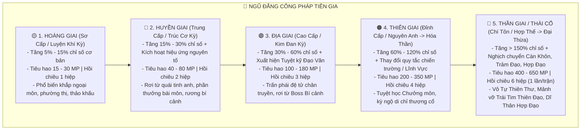
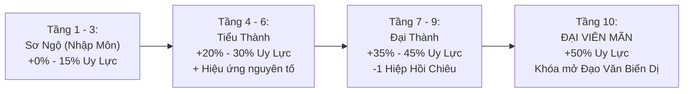

# [22] BÁCH ĐẠI KINH ĐIỂN: TOÀN THƯ 300 CÔNG PHÁP BÍ TỊCH & TUYỆT HỌC THÁI CỔ

> ⬅️ **[Bài Trước: Doc 21 - Càn Khôn Bảo Khố & Hệ Thống Kho Đồ](file:///c:/Users/newre/OneDrive/Máy%20tính/code%20tutien/docs/21_HE_THONG_KHO_DO_TUI_TRU_VAT_VA_TRANG_BI.md)** | 📖 **[Mục Lục Toàn Cảnh](file:///c:/Users/newre/OneDrive/Máy%20tính/code%20tutien/README.md)** | ➡️ **[Bài Sau: Doc 23 - Toàn Thư Vũ Khí & Pháp Khí](file:///c:/Users/newre/OneDrive/Máy%20tính/code%20tutien/docs/23_TOAN_THU_VU_KHI_PHAP_KHI_VA_PHAP_BAO.md)**

> *"Pháp bất truyền lục nhĩ, Đạo bất khinh truyền nhân! Trăm vạn năm cõi Hồng Hoang chìm nổi, vạn đại tông môn hưng suy, chỉ có những dòng chữ khắc trên ngọc giản, vách đá, mai rùa hay da rồng cổ xưa là trường tồn cùng nhật nguyệt. Kẻ đắc một bộ Hoàng Giai có thể xưng hùng một cõi phàm trần; kẻ ngộ một quyển Địa Giai có thể khai tông lập phái; còn ai hữu duyên đoạt được Thần Giai Thái Cổ, ắt một bước trảm phá hư không, ngạo thị tam thiên đại thế giới!"*

Tài liệu này là **Tổng Phổ 300 Bộ Công Pháp Bí Tịch Toàn Giới (Master Skill Encyclopedia - 300 Techniques)** được quy chuẩn hóa cho thế giới Tu Chân Giới Online, bao gồm đầy đủ **Phẩm Cấp, Hệ Ngũ Hành / Tâm Pháp, Công Dụng Thực Chiến Chi Tiết, Tác Dụng Bị Động / Chủ Động và Phương Thức Đoạt Lấy**.

---

## 🧭 I. HỆ THỐNG 5 BẬC PHẨM CẤP CÔNG PHÁP



---

## 🏛️ II. DANH MỤC CHI TIẾT 300 BỘ CÔNG PHÁP BÍ TỊCH

Hệ thống 300 bộ công pháp được chia đều thành **8 Đại Phân Hệ Lưu Phái**:
1. **Kiếm Đạo Công Pháp (Kiếm Tu — 40 Bộ: `SKILL_001` -> `SKILL_040`)**
2. **Thối Thể & Nhục Thân Thần Công (Thể Tu — 40 Bộ: `SKILL_041` -> `SKILL_080`)**
3. **Ma Đạo & Thôn Phệ Tuyệt Học (Ma Tu — 40 Bộ: `SKILL_081` -> `SKILL_120`)**
4. **Ngũ Hành & Nguyên Tố Thần Thông (Pháp Tu — 45 Bộ: `SKILL_121` -> `SKILL_165`)**
5. **Thân Pháp, Độ Độn & Thời Không (Thân Pháp Tu — 30 Bộ: `SKILL_166` -> `SKILL_195`)**
6. **Bách Gia Kỹ Nghệ (Đan, Khí, Trận, Phù — 35 Bộ: `SKILL_196` -> `SKILL_230`)**
7. **Dị Mạch Tu (Ngự Thú, Khôi Lỗi, Huyễn Thuật, Song Tu — 35 Bộ: `SKILL_231` -> `SKILL_265`)**
8. **Thái Cổ Chí Tôn & Nghịch Thiên Thần Thông (35 Bộ Tối Thượng: `SKILL_266` -> `SKILL_300`)**

---

### ⚔️ PHẦN 1: KIẾM ĐẠO CÔNG PHÁP (KIẾM TU — 40 BỘ: `SKILL_001` -> `SKILL_040`)

*Chuyên sâu sát phạt cương trực, công kích cực cao, thân pháp mau lẹ, kiếm khí xuyên giáp và kiếm ý ngút trời.*

| ID | Tên Công Pháp Bí Tịch | Phẩm | Hệ / Phái | Công Dụng & Thuộc Tính Thực Chiến | Cách Lấy & Điều Kiện Cơ Duyên |
| :---: | :--- | :---: | :---: | :--- | :--- |
| `SKILL_001` | **Thanh Phong Kiếm Pháp** | Hoàng | Phong / Tán Tu | $\text{ATK} +8\%$, Thân pháp $+3$. Chém ra ngọn gió sắc ngọt. | Mua ở Chợ Đen Thanh Khê ($150\text{ LT}$). |
| `SKILL_002` | **Thu Thủy Kiếm Quyết** | Hoàng | Thủy / Ngoại Môn | $\text{ATK} +10\%$, Hồi $1\%$ HP khi ra đòn trúng đích. | Rơi từ quái Thủy Yêu ven suối ($20\%$). |
| `SKILL_003` | **Liệt Diễm Kiếm Thức** | Hoàng | Hỏa / Tán Tu | $\text{ATK} +12\%$, Đòn đánh kèm thiêu đốt $2\%$ HP đối thủ 2 hiệp. | Rơi từ Đạo Tặc Hắc Phong Trại. |
| `SKILL_004` | **Tùng Hạc Kiếm Pháp** | Hoàng | Mộc / Tán Tu | $\text{ATK} +9\%$, Tăng $15\%$ tốc độ hồi phục HP sau trận. | Rơi từ Đạo Sĩ gác Miếu Hoang. |
| `SKILL_005` | **Bàn Thạch Kiếm Thuật** | Hoàng | Thổ / Ngoại Môn | $\text{ATK} +8\%$, $\text{DEF} +6\%$. Vững chãi như bàn thạch. | Mua ở Tiệm Tạp Hóa Thanh Khê ($120\text{ LT}$). |
| `SKILL_006` | **Du Long Kiếm Thức** | Hoàng | Phong / Tán Tu | $\text{ATK} +11\%$, Thân pháp $+4$, Tăng $5\%$ cơ hội ra đòn trước. | Rơi từ Thủy Tặc Đầu Lĩnh Bến Sông. |
| `SKILL_007` | **Xích Lôi Kiếm Pháp** | Hoàng | Lôi / Ngoại Môn | $\text{ATK} +12\%$, $5\%$ tỉ lệ làm tê liệt đối thủ 1 hiệp. | Mua tại Chợ Đen ($250\text{ LT}$). |
| `SKILL_008` | **Đoạn Thủy Kiếm Khí** | Hoàng | Thủy / Ngoại Môn | $\text{ATK} +10\%$, Giảm khả năng hồi máu của địch đi $15\%$. | Rơi từ Quái Ngư Tinh Đầm Lầy. |
| `SKILL_009` | **Thanh Vân Kiếm Quyết** | Huyền | Kim / Thanh Vân | $\text{ATK} +20\%$, $15\%$ tỉ lệ tung Kiếm Khí trảm kích x1.5 sát thương. | Tín vật nhập môn Thanh Vân Kiếm Tông. |
| `SKILL_010` | **Bát Hoang Đoạt Mệnh Kiếm** | Huyền | Sát / Ma Tu | $\text{ATK} +25\%$, Bạo kích $+5\%$, nhưng tự hao $2\%$ HP mỗi hiệp. | Quái Ma Kiếm Khôi Lỗi rơi ở Bãi săn cấp 3. |
| `SKILL_011` | **Thất Tinh Kiếm Trận Thuật**| Huyền | Lôi / Thanh Vân | $\text{ATK} +22\%$, Kháng lôi $+8\%$. Triệu hoán 7 phi kiếm hộ thể. | Đổi $500$ điểm cống hiến Thanh Vân Tông. |
| `SKILL_012` | **Băng Hồn Hàn Kiếm Kinh** | Huyền | Băng / Tán Tu | $\text{ATK} +18\%$, Giảm $10\%$ tốc độ đối thủ khi trúng đòn. | Rơi từ Boss Tuyết Lang Vương đỉnh tuyết. |
| `SKILL_013` | **Thuần Dương Kiếm Điển** | Huyền | Hỏa / Toàn Chân | $\text{ATK} +24\%$, Khí thuần dương thiêu đốt $3\%$ HP đối phương/hiệp. | Đổi $600$ điểm cống hiến Tông Môn. |
| `SKILL_014` | **Ngũ Hành Hỗn Nguyên Kiếm** | Huyền | Ngũ Hành / Tán Tu | $\text{ATK} +22\%$, Tự động chuyển đổi hệ sát thương khắc chế địch. | Đổi từ Kỳ Trân Các ($1,500\text{ LT}$). |
| `SKILL_015` | **Lạc Diệp Phi Hoa Kiếm** | Huyền | Mộc / Đan Hà | $\text{ATK} +20\%$, Đòn đánh găm phấn hoa độc duy trì 2 hiệp. | Chân truyền Đan Hà Kiếm Các. |
| `SKILL_016` | **U Minh Ảnh Kiếm** | Huyền | Ám / U Minh | $\text{ATK} +26\%$, Tàng hình né tránh 1 hiệp sau khi trảm sát quái. | Rơi từ Sát Thủ Hắc Dạ Hồi 2. |
| `SKILL_017` | **Kinh Lôi Nhất Kiếm** | Huyền | Lôi / Kiếm Các | $\text{ATK} +28\%$, Tốc độ xuất chiêu hiệp đầu $+15\%$. | Rơi từ Lôi Điểu Bãi săn Hồi 2. |
| `SKILL_018` | **Bách Bộ Phi Kiếm Quyết** | Huyền | Phi Kiếm / Tán Tu | Tầm đánh xa, tăng $15\%$ bạo kích khi tấn công cự ly xa. | Thưởng nhiệm vụ Trảm Phỉ cấp 2. |
| `SKILL_019` | **Tử Lôi Đoạt Phách Kiếm** | Địa | Lôi / Kiếm Tu | $\text{ATK} +35\%$, Bạo kích $+10\%$, Đòn đánh gây tê liệt 1 hiệp. | Vượt Bí Cảnh Lôi Trì Tầng 2. |
| `SKILL_020` | **Thái Hư Kiếm Quyết** | Địa | Kim / Thanh Vân | $\text{ATK} +40\%$, Bỏ qua $20\%$ Giáp đối phương, Né tránh $+6\%$. | Thí Luyện Trúc Cơ Chân Truyền Đệ Tử. |
| `SKILL_021` | **Vạn Kiếm Quy Tông** | Địa | Hỗn Hợp / Kiếm Tu | $\text{ATK} +45\%$. Kích hoạt Vạn Kiếm Trận quét sạch toàn bộ quái phụ. | Đánh bại Kiếm Linh Cổ Mộ Hồi 3. |
| `SKILL_022` | **Huyết Sát Ma Kiếm Điển** | Địa | Huyết / Vạn Ma | $\text{ATK} +50\%$, $12\%$ Hút máu, sát thương tăng theo máu đã mất. | Đổi $2,000$ điểm cống hiến Vạn Ma Uyên. |
| `SKILL_023` | **Vô Lượng Kiếm Hải** | Địa | Thủy / Kiếm Các | $\text{ATK} +42\%$, Sóng kiếm vỗ bờ gây sát thương diện rộng toàn sân. | Rơi từ Giao Long Đáy Biển Đông Hải. |
| `SKILL_024` | **Hỗn Nguyên Nhất Khí Kiếm** | Địa | Khí / Côn Lôn | $\text{ATK} +48\%$, Bỏ qua $25\%$ giáp và hộ thuẫn kẻ thù. | Vượt Bí Cảnh Bát Môn Độn Giáp. |
| `SKILL_025` | **Phá Hư Trảm Tiên Kiếm** | Địa | Hư Không / Kiếm Tu | $\text{ATK} +52\%$, Đòn đánh làm đối thủ Câm Lặng (Silence) 1 hiệp. | Kỳ ngộ Vách Núi Vạn Kiếm Nhai. |
| `SKILL_026` | **Thái Ất Huyền Môn Kiếm** | Địa | Quang / Tiên Gia | $\text{ATK} +45\%$, $\text{DEF} +20\%$, Tự thanh tẩy 1 debuff xấu mỗi hiệp. | Mua đấu giá Chợ Đen ($7,500\text{ LT}$). |
| `SKILL_027` | **Diệt Tuyệt Kiếm Kinh** | Địa | Sát Phạt / Tán Tu | Bạo kích $+20\%$, Khiến đối thủ bị Rách Giáp (giảm $30\%\text{ DEF}$). | Rơi từ Boss Kiếm Si Độc Hành. |
| `SKILL_028` | **Cửu Thiên Huyền Nữ Kiếm Điển**| Địa | Phong-Thủy / Dao Trì | $\text{ATK} +46\%$, Né tránh $+15\%$. Uyển chuyển như tiên nữ múa lụa. | Bí kíp Chân Truyền Đệ Tử Dao Trì. |
| `SKILL_029` | **Âm Dương Lưỡng Nghi Kiếm**| Thiên | Quang-Ám / Tiên | $\text{ATK} +70\%$, $\text{DEF} +30\%$. Luân chuyển công thủ hoàn hảo. | Kỳ ngộ Đạo Đài Vấn Tâm Hóa Thần. |
| `SKILL_030` | **Trảm Thiên Bạt Kiếm Thuật**| Thiên | Kim / Kiếm Tu | $\text{ATK} +90\%$. Chiêu đầu tiên trong trận chắc chắn bạo kích x2.5! | Rơi từ Di Chỉ Tiên Kiếm Thượng Cổ ($1\%$). |
| `SKILL_031` | **Chu Thiên Kiếm Thần Thể** | Thiên | Hư Không / Thần | $\text{ATK} +100\%$, Toàn bộ sát thương chuyển thành Sát Thương Thực. | Thọ Nguyên Thiên Tôn truyền thụ (Hảo cảm $\ge 90$). |
| `SKILL_032` | **Đại Diệt Tuyệt Tru Tiên Kiếm Quyết**| Thiên | Hủy Diệt / Kiếm Tu | $\text{ATK} +110\%$, Gây sát thương lan $50\%$ cho mục tiêu lân cận. | Kỳ ngộ Vết Nứt Hư Không Hồi 4. |
| `SKILL_033` | **Cửu Kiếm Thông Thiên Quyết**| Thiên | Độc Cô / Kiếm Các | Lĩnh hội 9 thức kiếm phá sạch Đao, Kiếm, Thương, Tiễn, Chưởng, Pháp. | Đánh bại Tàn Ảnh Kiếm Thánh. |
| `SKILL_034` | **Thái Cực Kiếm Vực Thần Điển**| Thiên | Thái Cực / Tiên Tông | Tạo Kiếm Vực giảm $50\%$ sát thương nhận, phản hồi $40\%$ kiếm khí. | Bái kiến Thái Thượng Trưởng Lão. |
| `SKILL_035` | **Tinh Thần Kiếm Phách Kinh**| Thiên | Tinh Tú / Tinh Các | Hấp thu ánh sao: Mỗi hiệp tăng $+10\%$ ATK (cộng dồn vô hạn). | Rơi từ Boss Dị Giới Tinh Không. |
| `SKILL_036` | **Tịch Diệt Hư Vô Kiếm Thể** | Thiên | Hư Vô / Kiếm Tôn | Toàn bộ kiếm khí biến thành Vô Ảnh Sát, tuyệt đối không thể bị né tránh. | Đột phá Hóa Thần Cảnh lĩnh ngộ. |
| `SKILL_037` | **Tru Tiên Tứ Kiếm Cổ Trận**| Thần | Thái Cổ / Kiếm Tu | $\text{ATK} +200\%$, Bạo kích $+35\%$. Tuyệt diệt sinh linh, trảm cả Thần Phật! | Thu thập đủ 4 Mảnh Vỡ Tru Tiên Kiếm Đồ. |
| `SKILL_038` | **Hồng Mông Khai Thiên Kiếm** | Thần | Hỗn Độn / Bàn Cổ | $\text{ATK} +220\%$, Nhát kiếm xé toạc không gian, xóa sạch mọi khiên chắn! | Đạt Cảnh Giới Đại Thừa Viên Mãn. |
| `SKILL_039` | **Vạn Đạo Quy Kiếm Chân Kinh**| Thần | Vạn Đạo / Kiếm Tổ | Tích hợp toàn bộ kiếm khí thiên hạ thành Nhất Kiếm Đoạt Mạng. | Dung hợp 10 bộ kiếm pháp Thiên Giai. |
| `SKILL_040` | **Vô Kiếm Đạo Điển** | Thần | Tối Thượng / Hóa Thần | Thảo mộc trúc thạch giai khả vi kiếm; Vô niệm vô ngã vô địch cõi trần! | Chọn Kết Cục [Hóa Kiếm Quy Hư]. |

---

### 🛡️ PHẦN 2: THỐI THỂ & NHỤC THÂN THẦN CÔNG (THỂ TU — 40 BỘ: `SKILL_041` -> `SKILL_080`)

*Chuyên sâu nhục thân bất hoại, tăng vọt HP, giáp dày, giảm sát thương, kháng Lôi Kiếp và phản đòn chấn động.*

| ID | Tên Công Pháp Bí Tịch | Phẩm | Hệ / Phái | Công Dụng & Thuộc Tính Thực Chiến | Cách Lấy & Điều Kiện Cơ Duyên |
| :---: | :--- | :---: | :---: | :--- | :--- |
| `SKILL_041` | **Thiết Bố Sam** | Hoàng | Thổ / Phàm | $\text{DEF} +10\%$, $\text{HP} +5\%$. Da thịt chai cứng như sắt. | Tiệm tạp hóa bán ($100\text{ LT}$). |
| `SKILL_042` | **Đồng Bì Thiết Cốt Công** | Hoàng | Kim / Thể Tu | $\text{DEF} +15\%$, Kháng chém $+5\%$. Giảm xây xước. | Rơi từ Dã Hùng Bìa Rừng. |
| `SKILL_043` | **Cự Viên Lực Quyết** | Hoàng | Thổ / Yêu Tộc | $\text{ATK} +10\%$, $\text{HP} +10\%$. Mang sức mạnh của vượn khổng lồ. | Săn quái Vượn Núi Thập Vạn. |
| `SKILL_044` | **Ngưu Ma Kính** | Hoàng | Lực / Ngoại Môn | $\text{ATK} +8\%$, $\text{HP} +8\%$. Đấm vỡ bia đá trăm cân. | Rơi từ Quái Ngưu Đồng Cỏ. |
| `SKILL_045` | **Thổ Giáp Quyết** | Hoàng | Thổ / Tán Tu | $\text{DEF} +12\%$. Đất đá bám vào da tạo thành lớp giáp mỏng. | Mua ở Tiệm Rèn Thôn Lạc Hà. |
| `SKILL_046` | **Tẩy Cốt Hoán Huyết Thuật** | Hoàng | Huyết / Tán Tu | $\text{HP} +12\%$, Kháng độc $+5\%$. Đào thải tạp chất kinh mạch. | Hái thuốc ngâm bồn tắm Động Phủ. |
| `SKILL_047` | **Hắc Hổ Bạt Sơn Kình** | Hoàng | Lực / Ngoại Môn | Tăng sức mang vác đồ $+20$ ô túi hành trang, $\text{ATK} +7\%$. | Rơi từ Hổ Rừng Hắc Phong Sơn. |
| `SKILL_048` | **Kim Chung Trảo** | Hoàng | Kim / Thể Tu | $\text{DEF} +14\%$, Giảm sát thương bạo kích nhận vào đi $10\%$. | Mua ở Chợ Đen ($220\text{ LT}$). |
| `SKILL_049` | **Kim Cương Bất Hoại Thân** | Huyền | Kim / Phật Môn | $\text{DEF} +25\%$, $\text{HP} +15\%$, Kháng Lôi Kiếp $+10\%$. | Rơi từ Boss Di Tích Chùa Cổ. |
| `SKILL_050` | **Ngũ Tạng Luyện Huyết Kinh**| Huyền | Huyết / Tán Tu | $\text{HP} +30\%$, Tốc độ hồi phục HP ngoài trận $+50\%$. | Bế quan ngâm thuốc 30 lần tại Động Phủ. |
| `SKILL_051` | **Man Hoang Thối Cốt Thuật** | Huyền | Thổ / Yêu Tộc | $\text{DEF} +20\%$, Phản đòn $8\%$ sát thương vật lý gánh chịu. | Yêu Tộc khởi nguyên bái sư Thần Môn. |
| `SKILL_052` | **Hắc Quy Bọc Giáp Quyết** | Huyền | Thủy / Tán Tu | $\text{DEF} +22\%$, Miễn nhiễm $15\%$ đòn chí mạng. | Bắt Rùa Ngàn Năm tại đầm lầy. |
| `SKILL_053` | **Long Tê Biến Dị Thể** | Huyền | Yêu / Tán Tu | $\text{HP} +35\%$, Lớp sừng tê giác tăng giáp theo cấp độ. | Luyện hóa Tinh Huyết Tê Giác Độc Giác. |
| `SKILL_054` | **Bách Luyện Thành Cương Công**| Huyền | Kim / Thể Tu | $\text{DEF} +30\%$, Miễn nhiễm hiệu ứng gãy xương và làm chậm. | Rèn sắt chế khí 100 lần tại Lò Rèn. |
| `SKILL_055` | **Hỏa Diễm Nhiễm Thể Quyết** | Huyền | Hỏa / Đan Hà | Kháng hỏa $+20\%$, Phản chấn thiêu đốt $3\%$ máu kẻ tấn công. | Ngồi thiền trong Dung Nham 10 phút. |
| `SKILL_056` | **Hàn Băng Thối Cốt Pháp** | Huyền | Băng / Tiên Gia | $\text{DEF} +25\%$, Khi bị đánh trúng làm chậm tốc độ kẻ địch $15\%$. | Bí kíp Động Băng Bắc Vực. |
| `SKILL_057` | **Phong Lôi Thối Thể Điển** | Huyền | Lôi / Tán Tu | Né tránh $+8\%$, Kháng Lôi Kiếp $+12\%$. | Đứng đỉnh núi bão sét lúc trời mưa. |
| `SKILL_058` | **Hóa Yêu Bách Biến Thể** | Huyền | Yêu Tộc | Chuyển hóa da thịt thành vảy yêu quái, $\text{HP} +40\%$. | Bái sư Vạn Yêu Lĩnh. |
| `SKILL_059` | **Bát Hoang Bá Thể Quyết** | Địa | Kim-Thổ / Thể Tu | $\text{HP} +60\%$, $\text{DEF} +35\%$. Không bị đẩy lùi hay choáng váng. | Thí luyện Bát Môn Độn Giáp Bí Cảnh. |
| `SKILL_060` | **Cửu Chuyển Kim Thân Kinh** | Địa | Kim / Thể Tu | $\text{DEF} +50\%$, Mỗi lần bị đánh trúng tự tăng $2\%$ Giáp (cộng dồn 10 lần). | Mua đấu giá Chợ Đen ($8,000\text{ LT}$). |
| `SKILL_061` | **Thái Cổ Long Tượng Kình** | Địa | Lực / Yêu Tộc | $\text{ATK} +35\%$, $\text{HP} +50\%$. Mang sức mạnh 1 Long 1 Tượng viễn cổ. | Luyện hóa Tinh Huyết Cự Hùng + Long Lân. |
| `SKILL_062` | **Ma Hoàng Thôn Huyết Thể** | Địa | Ma / Vạn Ma | $\text{HP} +70\%$, Khi máu $<30\%$ tự động tăng $+40\%$ Hút máu! | Bí kíp Chân Truyền Vạn Ma Uyên. |
| `SKILL_063` | **Huyền Vũ Thần Giáp Điển** | Địa | Thủy-Thổ / Bắc Minh | $\text{DEF} +65\%$, Tự tạo khiên nước hấp thụ $20\%$ HP tối đa. | Di tích Rùa Thần Bắc Cực. |
| `SKILL_064` | **Chu Tước Tẩy Tủy Quyết** | Địa | Hỏa / Dao Trì | $\text{HP} +55\%$, Mỗi hiệp tự hồi phục $4\%$ máu tối đa. | Luyện hóa Chu Tước Đan Thượng Phẩm. |
| `SKILL_065` | **Bạch Hổ Sát Thể Kinh** | Địa | Kim / Kiếm Các | $\text{DEF} +45\%$, $\text{ATK} +30\%$, Chuyển $20\%$ giáp thành sát thương chém. | Trảm sát 1,000 yêu quái tại Hoang Dã. |
| `SKILL_066` | **Thanh Long Đằng Vân Thể** | Địa | Mộc-Lôi / Tiên Gia | $\text{HP} +60\%$, Kháng toàn bộ debuff cấm chiêu và phong ấn. | Vượt Thí Luyện Long Môn Bí Cảnh. |
| `SKILL_067` | **Tu La Huyết Sát Cốt** | Địa | Sát / Vạn Ma | $\text{HP} +75\%$, Khi máu dưới $50\%$ nhận trạng thái Bất Tử trong 1 hiệp. | Đạt Chân Truyền Vạn Ma Uyên. |
| `SKILL_068` | **Vạn Trọng Thiết Bích Thần Công**| Địa | Thổ / Thể Tu | Không thể bị xuyên giáp, chặn đứng $15\%$ sát thương chuẩn. | Đào 500 quặng Huyền Thiết Ngàn Năm. |
| `SKILL_069` | **Bất Diệt Niết Bàn Thể** | Thiên | Hỏa / Thần Cảnh | $\text{HP} +120\%$, Khi chết có $30\%$ cơ hội hồi sinh lập tức với $50\%$ máu! | Kỳ ngộ Cổ Mộ Hỏa Phượng Hoàng. |
| `SKILL_070` | **Chân Long Bất Hoại Thân** | Thiên | Lôi-Kim / Yêu | $\text{DEF} +80\%$, Kháng Lôi Kiếp vĩnh viễn $+35\%$, Miễn nhiễm Đan Độc. | Đánh bại Boss Thế Giới Thái Cổ Lôi Long. |
| `SKILL_071` | **Hỗn Độn Thần Ma Thể** | Thiên | Hỗn Độn / Thể Tu | Toàn bộ thuộc tính thủ chuyển hóa thành Công Kích (Tối thượng sát thủ)! | Nhập ma cảnh giới Hóa Thần. |
| `SKILL_072` | **Cửu U Minh Vương Thể** | Thiên | Minh / U Minh | $\text{HP} +130\%$, Miễn dịch sát thương tinh thần và ám sát. | Đạt Minh Tôn Bí Kính Hồi 4. |
| `SKILL_073` | **Đại Hoang Man Thần Thể** | Thiên | Thái Cổ / Yêu | Hóa thân Cự Thần ngàn trượng: $\text{ATK} \times 2$, $\text{HP} \times 2$ trong 3 hiệp. | Kỳ ngộ Bộ Tộc Man Hoang Viễn Cổ. |
| `SKILL_074` | **Thái Hư Vô Tướng Kim Cương Thể**| Thiên | Phật / Tiên | Miễn dịch tuyệt đối trước 3 đòn công kích đầu tiên của trận đấu! | Đạt 100 điểm Công Đức tại Tiên Điện. |
| `SKILL_075` | **Hư Không Bất Diệt Nhục Thân**| Thiên | Hư Không / Đại Năng | Khi trúng đòn tử trận biến thành hư ảnh tẩu thoát về Động Phủ an toàn. | Luyện hóa Hư Không Tinh Thạch (`ITEM_388`). |
| `SKILL_076` | **Cực Dương Chân Hỏa Thánh Thể**| Thiên | Thái Dương / Thể Tu | Thiêu đốt toàn bộ không gian, gây sát thương chuẩn theo $\% \text{HP}$ đối phương. | Tắm trong Lửa Mặt Trời Vực Hóa Thần. |
| `SKILL_077` | **Bất Diệt Kiếm Thể Thái Cổ**| Thần | Chí Tôn / A Ngưu | Nhục thân chính là Thần Kiếm: Phản thương $50\%$, $\text{HP} +250\%$, Vô Địch! | A Ngưu Thúc (Kiếm Hoàng) truyền thừa Hóa Phàm. |
| `SKILL_078` | **Bàn Cổ Khai Thiên Thể** | Thần | Sơ Khai / Bàn Cổ | Nhục thân gánh vác càn khôn: Miễn dịch $60\%$ sát thương toàn diện, $\text{HP} +300\%$! | Thu thập Trái Tim Bàn Cổ Thượng Cổ. |
| `SKILL_079` | **Cửu Chuyển Bất Diệt Chân Thân**| Thần | Hỗn Độn / Thánh Nhân | 9 lần trùng sinh trong trận chiến, mỗi lần sống dậy mạnh thêm $+50\%$! | Vượt Cửu Trọng Lôi Kiếp Đạo Thứ 81. |
| `SKILL_080` | **Thần Ma Quy Nhất Đại Đạo Thể**| Thần | Chí Tôn | Dung hợp Thần tộc và Ma tộc: Không thể bị phá hoại hay phong ấn đạo cơ! | Chọn Kết Cục [Hợp Nhất Thần Ma]. |

---

### 🔥 PHẦN 3: MA ĐẠO & THÔN PHỆ TUYỆT HỌC (MA TU — 40 BỘ: `SKILL_081` -> `SKILL_120`)

*Chuyên sâu hút máu, nguyền rủa, bạo nộ cuồng sát, hiến tế sinh mệnh, triệu hồi vong linh và tước đoạt đạo cơ.*

| ID | Tên Công Pháp Bí Tịch | Phẩm | Hệ / Phái | Công Dụng & Thuộc Tính Thực Chiến | Cách Lấy & Điều Kiện Cơ Duyên |
| :---: | :--- | :---: | :---: | :--- | :--- |
| `SKILL_081` | **Huyết Sát Quyết** | Hoàng | Huyết / Ma Tu | $\text{ATK} +12\%$, Đòn đánh kèm $3\%$ Hút máu. | Nhặt ở đống xác bãi tha ma. |
| `SKILL_082` | **Luyện Thi Sơ Bộ Pháp** | Hoàng | Thi / U Minh | Triệu hồi 1 cương thi sơ cấp chia sẻ $10\%$ sát thương. | Mua ở Cửa hàng U Minh Quỷ Điện. |
| `SKILL_083` | **Phệ Hồn Tiểu Thuật** | Hoàng | Hồn / Ma Tu | Tiêu diệt quái hồi phục ngay $+5$ Thể lực. | Rơi từ Oan Hồn Sông Vong Xuyên. |
| `SKILL_084` | **Ma Âm Quán Nhĩ** | Hoàng | Âm / Ma Tu | Tiếng gào thét ma quái làm đối phương giảm $10\%$ độ chính xác. | Mua tại Chợ Đen Vạn Ma ($180\text{ LT}$). |
| `SKILL_085` | **Hóa Cốt Miên Chưởng** | Hoàng | Độc / Ma Tu | Đòn đánh ăn mòn binh khí đối thủ, giảm $8\%\text{ ATK}$ của địch. | Rơi từ Ma Đầu lang bạt ven sông. |
| `SKILL_086` | **Sát Lục Huyết Nhãn** | Hoàng | Sát / Ma Tu | Bạo kích $+5\%$, Nhìn thấu điểm yếu của mục tiêu khi máu $<30\%$. | Săn quái Bãi Tha Ma Hồi 1. |
| `SKILL_087` | **Quỷ Ảnh Bộ** | Hoàng | Ám / U Minh | Thân pháp ma quỷ biến ảo, né tránh $+6\%$. | Rơi từ Quỷ Vong Hồn U Tối. |
| `SKILL_088` | **Tụ Thi Độc Thuật** | Hoàng | Độc-Thi / Ma | Kích nổ xác quái chết gây sát thương độc diện rộng. | Học từ Cấm Thư Hầm Mộ Cổ. |
| `SKILL_089` | **Thôn Thiên Ma Công (Tàn)** | Huyền | Thôn Phệ / Vạn Ma | Săn quái nhận $+25\%$ Tu Vi, có sẵn $8\%$ Hút máu bẩm sinh. | Tín vật nhập môn Vạn Ma Uyên. |
| `SKILL_090` | **Cửu U Vạn Quỷ Khiên** | Huyền | Hồn / U Minh | Tạo lá chắn từ oan hồn chặn $500$ sát thương đầu trận. | Tín vật nhập môn U Minh Quỷ Điện. |
| `SKILL_091` | **Hóa Huyết Thần Đao Quyết** | Huyền | Huyết / Ma Tu | $\text{ATK} +28\%$, Gây vết thương sâu khiến địch không thể hồi máu. | Rơi từ Đao Khách Ma Giáo Hồi 2. |
| `SKILL_092` | **Cuồng Ma Nhiễm Huyết Công**| Huyền | Hỏa / Ma Tu | Máu tụt $10\%$ thì Công tăng $+8\%$ (càng hấp hối càng khỏe). | Rơi ở Lò Sát Sinh Cửu U. |
| `SKILL_093` | **Hấp Tinh Đại Pháp** | Huyền | Hút / Ma Tu | Hút $15\%$ Chân Nguyên (MP) của đối phương chuyển hóa cho bản thân. | Mua tại Phường Thị Ma Giới ($1,800\text{ LT}$). |
| `SKILL_094` | **Âm Sát Quỷ Vương Quyết** | Huyền | Hồn / U Minh | Triệu hồi Quỷ Vương sơ cấp gánh $15\%$ sát thương và gây hoảng sợ. | Đổi $800$ điểm cống hiến U Minh Điện. |
| `SKILL_095` | **Lục Dục Ma Chướng Điển** | Huyền | Tâm Ma / Hợp Hoan| Khiến đối phương tự đánh bản thân trong 1 hiệp ($20\%$ xác suất). | Thưởng nhiệm vụ Hợp Hoan Tông. |
| `SKILL_096` | **Ma Nhận Trảm Phách** | Huyền | Sát / Vạn Ma | Đòn đánh phá hủy $15\%$ Giáp và khóa kỹ năng chủ động của địch 1 hiệp. | Rơi từ Đao Khách Vô Danh Hồi 2. |
| `SKILL_097` | **Huyết Linh Triệu Hoán Kinh**| Huyền | Huyết / Tán Tu | Hiến tế $5\%$ máu bản thân để gọi bầy dơi hút máu trợ chiến. | Nhặt trong Huyết Trì Cổ Mộ. |
| `SKILL_098` | **Ngũ Quỷ Vận Tài Đại Thuật**| Huyền | Kỳ Môn / Ma Đạo | Tăng $30\%$ tỉ lệ rơi Linh Thạch và vật phẩm khi tiêu diệt địch. | Đoạt từ Đạo Sĩ Tà Phái. |
| `SKILL_099` | **U Minh Hóa Cốt Châm** | Địa | Độc / Ma Tu | Đòn đánh găm 3 cây kim độc làm mục tiêu mất $5\%$ HP/hiệp. | Chế tạo từ Nọc Bọ Cạp Ma Hạt. |
| `SKILL_100` | **Huyết Hải Ma Điển** | Địa | Huyết / Vạn Ma | $\text{HP} +50\%$, $\text{ATK} +40\%$, Biến chiến trường thành biển máu. | Độc Cô Diệt (Chưởng môn Vạn Ma) ban tặng. |
| `SKILL_101` | **Thiên Ma Giải Thể Đại Pháp**| Địa | Cực Hạn / Ma Tu | Tự bạo $50\%$ máu hiện tại để bộc phát đòn đánh x3.0 Sát Thương! | Tìm thấy trong Hầm Ngục Cấm Địa. |
| `SKILL_102` | **Bách Quỷ Dạ Hành Lục** | Địa | Hồn / U Minh | Gọi đàn quỷ 100 con làm mù đối phương trong 2 hiệp đấu. | Đổi $2,500$ điểm Tông môn U Minh Điện. |
| `SKILL_103` | **A Tỳ Luyện Ngục Chưởng** | Địa | Hỏa-Ma / Vạn Ma | Biến mặt đất thành nham thạch địa ngục, thiêu đốt $8\%\text{ HP}$ toàn sân. | Rơi từ Boss Hỏa Ma Địa Ngục. |
| `SKILL_104` | **Sát Lục Chi Tâm Điển** | Địa | Sát Phạt / Ma Tôn | Mỗi khi giết 1 sinh linh, vĩnh viễn tăng $+1$ điểm Sát Khí ($\text{ATK} +0.1\%$). | Trảm sát 500 tu sĩ đối nghịch. |
| `SKILL_105` | **Ma Đao Thất Sát Quyết** | Địa | Đao / Ma Tu | 7 nhát đao liên hoàn, mỗi nhát tăng $+15\%$ sát thương so với nhát trước. | Di chỉ Huyết Ma Cổ Đao. |
| `SKILL_106` | **Vạn Độc Hóa Huyết Kinh** | Địa | Độc / Miêu Cương | Độc tố thấm vào kinh mạch, biến máu địch thành chất độc tự hủy. | Bắt Cổ Trùng Hoàng Đế Vạn Độc Sơn. |
| `SKILL_107` | **Đoạt Hồn Nhiếp Phách Thần Thông**| Địa | Hồn / Minh Tộc | Đoạt linh hồn quái vật biến thành Ma Bộc cấm vệ trung thành. | Vượt Cầu Nại Hà Tầng 2. |
| `SKILL_108` | **Cửu Chuyển Huyết Thi Hoàng**| Địa | Thi / Cổ Cấm | Luyện hóa xác Boss thành Huyết Thi có chỉ số bằng $80\%$ Boss gốc. | Đào mộ cổ Cấm Địa Vạn Ma. |
| `SKILL_109` | **Thôn Thiên Ma Công (Chính)**| Thiên | Thôn Phệ / Vạn Ma | Thôn phệ Đan điền kẻ bại trận, vĩnh viễn cướp đoạt $5\%$ chỉ số của địch! | Đoạt được từ Đáy Vực Cửu U. |
| `SKILL_110` | **Vạn Ma Triều Thánh Điển** | Thiên | Ma / Vạn Ma | Uy áp ma đạo khiến yêu quái giảm $30\%$ Công và Thủ khi đối đầu. | Thức tỉnh Ma Tính $>80$ điểm. |
| `SKILL_111` | **Hoàng Tuyền Nhiếp Hồn Lục** | Thiên | Hồn / Minh Tộc | Đoạt lấy linh hồn quái vật biến thành Nô Bộc chiến đấu vĩnh viễn. | Vượt Cầu Nại Hà bí cảnh Vong Xuyên. |
| `SKILL_112` | **Huyết Ma Tái Sinh Kinh** | Thiên | Huyết / Ma Hoàng | Khi chết tan thành biển máu, hồi sinh sau 2 hiệp với đầy Chân Nguyên! | Uống Huyết Dịch Cổ Ma Tinh Hoa. |
| `SKILL_113` | **Thiên Ma Cực Nhạc Điển** | Thiên | Tâm Ma / Ma Tông | Gieo Tâm Ma vào đối thủ, khiến chúng quay sang chém lẫn nhau! | Bái nhập Ma Tôn Hóa Cực. |
| `SKILL_114` | **Cửu U Thần Ma Chưởng** | Thiên | U Minh / Ma Tôn | Bàn tay ma quỷ từ hư không giáng xuống đập nát toàn bộ khiên chắn. | Vượt Thí Luyện Cửu U Ma Đỉnh. |
| `SKILL_115` | **Diệt Thế Ma Nhãn Thần Thông**| Thiên | Diệt Thế / Viễn Cổ | Mở con mắt thứ 3 trên trán bắn tia chớp thiêu rụi đạo cơ địch. | Luyện hóa Ma Nhãn Huyết Đồng. |
| `SKILL_116` | **Thập Bát Tầng Địa Ngục Biến**| Thiên | Minh / Ma Đạo | Đày đối thủ qua 18 tầng hình phạt, giảm $40\%$ toàn chỉ số trong 3 hiệp. | Minh Hoàng truyền dạy tại Vong Xuyên. |
| `SKILL_117` | **Hồng Mông Ma Đạo Tổ Kinh** | Thần | Thái Cổ / Ma Tôn | Khởi nguyên Ma Đạo: Hút máu $40\%$, Bất Tử trong 3 hiệp nếu bị trảm sát! | Đánh bại Tàn Hồn Cổ Ma Hoàng Thái Cổ. |
| `SKILL_118` | **Thôn Phệ Vạn Giới Đại Ma Công**| Thần | Thôn Phệ / Thái Cổ | Nuốt chửng cả một tiểu thế giới để hồi phục toàn bộ sinh mệnh và mana! | Thôn phệ Tinh Hạch Vỡ Nát. |
| `SKILL_119` | **Thái Cổ Huyết Hải Thần Điển**| Thần | Minh Hà Lão Tổ | Huyết hải bất cạn, Minh Hà bất tử: Vĩnh viễn không thể bị tiêu diệt! | Thừa kế Huyết Hải Thần Đồ. |
| `SKILL_120` | **Vạn Cổ Ma Tôn Tịch Diệt Lục**| Thần | Chí Tôn Ma Đạo | Trở thành Ma Tôn tối cao, sai khiến toàn bộ ma vật thiên hạ quỳ gối xưng thần! | Chọn Kết Cục [Vạn Cổ Ma Tôn]. |

---

### 🌊 PHẦN 4: NGŨ HÀNH & NGUYÊN TỐ THẦN THÔNG (PHÁP TU — 45 BỘ: `SKILL_121` -> `SKILL_165`)

*Chuyên sâu linh lực trời đất, bộc phát sát thương diện rộng, khống chế ngũ hành Kim-Mộc-Thủy-Hỏa-Thổ, Phong-Lôi-Băng-Quang.*

| ID | Tên Công Pháp Bí Tịch | Phẩm | Hệ / Phái | Công Dụng & Thuộc Tính Thực Chiến | Cách Lấy & Điều Kiện Cơ Duyên |
| :---: | :--- | :---: | :---: | :--- | :--- |
| `SKILL_121` | **Hỏa Cầu Thuật Sơ Cơ** | Hoàng | Hỏa / Pháp Tu | Phóng cầu lửa gây sát thương Hỏa căn bản $+50$. | Tiệm sách phường thị bán ($80\text{ LT}$). |
| `SKILL_122` | **Ngưng Băng Thấu Cốt Pháp** | Hoàng | Băng / Pháp Tu | Đóng băng giọt nước làm chậm đối thủ $5\%$. | Hái hoa tuyết đỉnh núi Lạc Hà. |
| `SKILL_123` | **Dẫn Thủy Hồi Xuân Thuật** | Hoàng | Thủy / Pháp Tu | Hồi phục $150 \text{ HP}$ sau trận đấu. | Múc nước Giếng Linh Tuyền 50 lần. |
| `SKILL_124` | **Canh Kim Kiếm Khí Quyết** | Hoàng | Kim / Pháp Tu | Bắn ra 3 đạo kim khí đâm xuyên giáp nhẹ đối phương. | Tiệm sách phường thị ($90\text{ LT}$). |
| `SKILL_125` | **Dây Leo Trói Chân Thuật** | Hoàng | Mộc / Pháp Tu | Trói chân mục tiêu 1 hiệp, giảm $20\%$ tốc độ. | Nhặt tại Rừng Cây Dược Liệu. |
| `SKILL_126` | **Lạc Thạch Địa Chấn Thuật** | Hoàng | Thổ / Pháp Tu | Làm rơi đá tảng gây 80 sát thương hệ Thổ. | Rơi từ Thổ Tinh Vách Núi. |
| `SKILL_127` | **Phong Nhận Liệt Phong Thuật** | Hoàng | Phong / Pháp Tu | Phóng luỡi dao gió chém từ xa gây rách giáp nhẹ. | Mua ở Tạp hóa Thanh Khê. |
| `SKILL_128` | **Tích Lịch Lôi Điện Quyết** | Hoàng | Lôi / Pháp Tu | Sét nhỏ gây tê giật làm mất $5\%$ Chân Nguyên kẻ địch. | Bị sét đánh trượt khi trời giông. |
| `SKILL_129` | **Chiếu Minh Phù Quang Pháp**| Hoàng | Quang / Pháp Tu | Phát sáng xua tan bóng tối và tăng $10\%$ độ chính xác. | Thưởng nhiệm vụ nhập môn Ngoại Môn. |
| `SKILL_130` | **Bát Hoang Liệt Hỏa Kinh** | Huyền | Hỏa / Đan Hà | $\text{ATK} +25\%$, Tăng $30\%$ uy lực luyện đan, chiêu thức Hỏa rực cháy. | Tín vật nhập môn Đan Hà Cốc. |
| `SKILL_131` | **Cửu Thiên Dẫn Lôi Quyết** | Huyền | Lôi / Pháp Tu | Triệu hoán lôi điện giáng xuống, gây choáng $1$ hiệp. | Bị sét đánh trúng khi trời mưa lôi kiếp. |
| `SKILL_132` | **Ất Mộc Trường Sinh Thuật** | Huyền | Mộc / Đan Hà | Tăng $20\%$ tốc độ cây lớn trong Dược Điền, HP $+25\%$. | Thu hoạch Dược Điền $100$ lần. |
| `SKILL_133` | **Địa Độn Nham Thạch Thuật** | Huyền | Thổ / Pháp Tu | Lặn vào lòng đất né tránh toàn bộ sát thương hiệp 1. | Mỏ khoáng thạch sập hầm kỳ ngộ. |
| `SKILL_134` | **Canh Kim Phá Giáp Điển** | Huyền | Kim / Pháp Tu | Bỏ qua $30\%$ phòng ngự của kẻ thù có giáp dày. | Đào quặng Canh Kim ngàn năm. |
| `SKILL_135` | **Băng Phách Hàn Quang Quyết**| Huyền | Băng / Pháp Tu | Tạo cầu băng nổ tung giảm $20\%$ tốc độ diện rộng. | Săn Băng Điêu Vực Tuyết. |
| `SKILL_136` | **Huyễn Thủy Ba Đào Thuật** | Huyền | Thủy / Đan Hà | Khiên nước giải trừ toàn bộ hiệu ứng thiêu đốt và độc. | Bắt Cá Chép Lam Hồ Linh Tuyền. |
| `SKILL_137` | **Cuồng Lôi Xung Thiên Quyết**| Huyền | Lôi / Tiên Đạo | Bắn luồng sét cực mạnh làm choáng đối phương $1$ hiệp ($30\%$). | Đổi $700$ điểm cống hiến Tông Môn. |
| `SKILL_138` | **Vạn Mộc Tụ Linh Trận** | Huyền | Mộc / Tiên Tông | Tăng $25\%$ tốc độ hồi phục Chân Nguyên ngoài chiến đấu. | Thưởng nhiệm vụ Dược Nông cấp 2. |
| `SKILL_139` | **Nham Thạch Hộ Thể Thuật** | Huyền | Thổ / Pháp Tu | Tạo lớp giáp đá hấp thụ $400$ sát thương vật lý gánh chịu. | Đào khoáng sản xuất thần. |
| `SKILL_140` | **Liệt Không Phong Bạo Kinh** | Huyền | Phong / Tán Tu | Cơn lốc xoáy cuốn bay phi kiếm và bùa chú của đối thủ. | Rơi từ Ưng Vương Phong Đỉnh. |
| `SKILL_141` | **Quang Minh Tịnh Hóa Chú** | Huyền | Quang / Tiên Môn | Xóa bỏ 2 debuff xấu và hồi ngay $300\text{ HP}$ cho bản thân. | Bái sư Tiên Điện Quang Minh. |
| `SKILL_142` | **Huyền Minh Hàn Băng Trận** | Địa | Băng / Tiên Tộc | Đóng băng toàn bộ chiến trường, giảm $25\%$ công kích đối phương. | Động Băng Bắc Minh Hồi 3. |
| `SKILL_143` | **Bích Ba Vạn Khoảnh Quyết** | Địa | Thủy / Pháp Tu | Sóng thần cuộn trào dập tắt mọi bùa chú và hiệu ứng độc hại. | Đáy biển Thủy Tộc Đông Hải. |
| `SKILL_144` | **Đại Nhật Càn Khôn Chân Hỏa**| Địa | Hỏa / Đan Hà | Ngưng tụ Chân Hỏa mặt trời, thiêu rụi giáp và đạo bào đối thủ. | Trưởng lão Đan Hà Cốc chân truyền. |
| `SKILL_145` | **Thái Hư Thần Lôi Quyết** | Địa | Lôi / Tiên Gia | Lôi điện màu tím xé toạc hộ thể, sát thương lôi $\times 1.8$. | Vượt Lôi Kiếp Kim Đan 6 Đạo Lôi. |
| `SKILL_146` | **Cửu U Địa Hỏa Thần Điển** | Địa | Hỏa-Ám / Ma Pháp | Ngọn lửa âm u đốt trực tiếp vào linh hồn đối phương. | Đáy Hầm Ngục Cửu U. |
| `SKILL_147` | **Thanh Đế Trường Sinh Quyết** | Địa | Mộc / Tiên Đạo | Tự động tái sinh $5\%\text{ HP}$ mỗi hiệp đấu, miễn nhiễm độc tố. | Chân truyền Thanh Đế Tiên Phái. |
| `SKILL_148` | **Sơn Hà Xã Tắc Địa Thuật** | Địa | Thổ / Tiên Tông | Triệu hoán núi đá đè nát mục tiêu, gây choáng 2 hiệp. | Tìm thấy trong Cổ Mộ Đất Mẹ. |
| `SKILL_149` | **Vạn Kiếm Canh Kim Trận** | Địa | Kim / Pháp Tu | Ngưng tụ vạn mũi tên kim loại sắc bén bắn nát đạo bào đối thủ. | Đổi $2,200$ điểm cống hiến Tông Môn. |
| `SKILL_150` | **Bắc Cực Hàn Quang Thần Châm**| Địa | Băng / Bắc Minh | Đóng băng kinh mạch kẻ thù khiến đối phương không thể dùng mana. | Boss Băng Phách Cung Chủ rơi. |
| `SKILL_151` | **Thái Cực Âm Dương Thủy Hỏa**| Địa | Âm Dương / Đạo Gia| Kết hợp Thủy và Hỏa tạo vụ nổ bốc hơi cực đại x2 sát thương! | Ngộ đạo Đài Lưỡng Nghi. |
| `SKILL_152` | **Bão Tố Vạn Dặm Thần Điển** | Địa | Phong / Tiêu Dao | Cơn bão cấp 12 phong tỏa toàn bộ phi hành của đối thủ. | Đỉnh Phong Thần Nhai. |
| `SKILL_153` | **Tử Tiêu Thần Quang Điển** | Địa | Quang / Tiên Môn | Luồng ánh sáng tím thanh tẩy tà ma, tăng $50\%$ sát thương lên Ma Tu. | Chân truyền Tử Tiêu Cung. |
| `SKILL_154` | **Ngũ Hành Luân Hồi Quyết** | Thiên | Ngũ Hành / Tiên | Chuyển đổi linh hoạt giữa 5 hệ Kim-Mộc-Thủy-Hỏa-Thổ theo hệ của địch. | Mở khóa Song Linh Căn Trúc Cơ. |
| `SKILL_155` | **Cửu U Minh Hỏa Thần Điển** | Thiên | Hỏa-Minh / Ma | Ngọn lửa đen không tắt, đốt cháy trực tiếp Tu Vi của kẻ thù! | Đáy Vạn Ma Trì sâu ngàn trượng. |
| `SKILL_156` | **Hỗn Độn Ngũ Lôi Chánh Pháp**| Thiên | Lôi / Tiên Đạo | Lôi phạt tối cao giáng đòn x2.5 sát thương, phá tan mọi khiên chắn. | Vượt Lôi Kiếp Kim Đan 9 Đạo Lôi. |
| `SKILL_157` | **Tam Muội Chân Hỏa Thần Thông**| Thiên | Hỏa / Tiên Cảnh | Ngọn lửa không thể dập bằng nước thường, thiêu rụi cả pháp bảo! | Lò Bát Quái Cực Hạn Hóa Thần. |
| `SKILL_158` | **Huyền Thiên Băng Phách Đại Pháp**| Thiên | Băng / Thái Cổ | Đóng băng cả không-thời gian trong 1 hiệp, địch nhân bất động hoàn toàn. | Tuyệt đỉnh Bắc Cực Băng Cung. |
| `SKILL_159` | **Cửu Thiên Tức Nhưỡng Quyết**| Thiên | Thổ / Oa Hoàng | Đất thần sinh sôi bất tận, hồi sinh đạo cơ và tăng $100\%\text{ DEF}$. | Giám định Mảnh Đất Tức Nhưỡng (`ITEM_390`). |
| `SKILL_160` | **Hỗn Độn Ất Mộc Thần Điển** | Thiên | Mộc / Khởi Nguyên | Rễ cây đất trời hút cạn sinh lực kẻ địch bổ sung cho bản thân. | Cổ Thụ Ngàn Năm Thông Thiên. |
| `SKILL_161` | **Chu Thiên Tinh Thần Quang Điển**| Thiên | Quang-Tinh / Tiên | Mượn sức mạnh nhật nguyệt tinh tú trừng phạt tà ma toàn cõi. | Kỳ ngộ Tinh Đấu Thần Đài. |
| `SKILL_162` | **Thái Sơ Khởi Nguyên Thần Thông**| Thần | Hỗn Độn / Thái Cổ | Tái lập hư vô: Đưa toàn bộ chỉ số của địch về $0$ trong 1 hiệp! | Đại Cơ Duyên Độc Nhất Vô Nhị. |
| `SKILL_163` | **Ngũ Hành Khởi Nguyên Vô Cực**| Thần | Ngũ Hành Tối Cao | Nắm giữ bản nguyên 5 hành, miễn nhiễm $100\%$ mọi sát thương nguyên tố! | Dung hợp trọn vẹn Ngũ Thần Châu. |
| `SKILL_164` | **Diệt Thế Cửu Thiên Thần Lôi**| Thần | Lôi Phạt Tối Cao | 81 đạo thiên lôi giáng thế, trảm sát bất kỳ ai dám làm trái thiên ý. | Chưởng quản Lôi Trì Thiên Đạo. |
| `SKILL_165` | **Hỗn Độn Vạn Tượng Thần Thông**| Thần | Hỗn Độn / Sáng Thế | Biến hóa vạn vật tùy tâm, thay đổi quy luật thời tiết và linh khí toàn cõi! | Đạt cảnh giới Hợp Đạo Chí Tôn. |

---

### 🌪️ PHẦN 5: THÂN PHÁP, ĐỘ ĐỘN & THỜI KHÔNG (THÂN PHÁP TU — 30 BỘ: `SKILL_166` -> `SKILL_195`)

*Chuyên sâu tốc độ ra đòn trước, né tránh đòn đánh chết người, phi hành vượt cấm địa và xuyên phá không-thời gian.*

| ID | Tên Công Pháp Bí Tịch | Phẩm | Hệ / Phái | Công Dụng & Thuộc Tính Thực Chiến | Cách Lấy & Điều Kiện Cơ Duyên |
| :---: | :--- | :---: | :---: | :--- | :--- |
| `SKILL_166` | **Thảo Thượng Phi** | Hoàng | Phong / Phàm | $\text{Speed} +5$, Chạy trốn khỏi quái thành công $+20\%$. | Tiệm tạp hóa bán ($50\text{ LT}$). |
| `SKILL_167` | **Đạp Tuyết Vô Ngân** | Hoàng | Phong / Tán Tu | $\text{Speed} +8$, Né tránh $+3\%$. Không để lại dấu vết. | Săn Chim Ưng Băng Tuyết. |
| `SKILL_168` | **Phi Yến Hồi Triều** | Hoàng | Phong / Phàm | $\text{Speed} +6$, Né tránh $+3\%$. Uyển chuyển như chim én. | Tiệm sách phường thị ($60\text{ LT}$). |
| `SKILL_169` | **Thủy Thượng Phiêu** | Hoàng | Thủy / Ngoại Môn | $\text{Speed} +7$, Đi trên mặt nước suối hồ không bị chìm. | Rơi từ Ngư Phu Suối Tiên. |
| `SKILL_170` | **Miêu Hành Vô Ảnh** | Hoàng | Ám / Tán Tu | $\text{Speed} +8$, Giảm $50\%$ tỉ lệ bị quái phát hiện khi lén lút. | Rơi từ Dạ Miêu Rừng Trúc. |
| `SKILL_171` | **Lôi Đình Thiểm Bộ** | Hoàng | Lôi / Ngoại Môn | $\text{Speed} +10$, Xuất chiêu hiệp đầu nhanh như chớp giật. | Mua tại Chợ Đen ($200\text{ LT}$). |
| `SKILL_172` | **Thiên Lôi Huyễn Bộ** | Huyền | Lôi-Phong / Tiên | $\text{Speed} +15$, Né tránh $+6\%$. Di chuyển chớp giật như điện. | Tín vật bí kíp rơi bãi săn cấp 2. |
| `SKILL_173` | **Khinh Hồng Du Long Bộ** | Huyền | Thủy / Tán Tu | $\text{Speed} +18$, Né được đòn đánh đầu tiên của trận chiến. | Câu cá ngẫu nhiên tại Linh Hồ. |
| `SKILL_174` | **Ảo Ảnh Vô Hình Thân** | Huyền | Ám / U Minh | Tạo 2 phân thân ảo ảnh khiến địch đánh hụt $25\%$. | U Minh Quỷ Điện chân truyền. |
| `SKILL_175` | **Bát Quái Độn Giáp Bộ** | Huyền | Trận / Tán Tu | $\text{Speed} +20$, Tự động né chiêu thức theo quẻ Sinh Môn. | Mua đấu giá Chợ Đen ($1,200\text{ LT}$). |
| `SKILL_176` | **Hỏa Diễm Tật Phong Bộ** | Huyền | Hỏa-Phong / Đan Hà | $\text{Speed} +22$, Để lại vệt lửa thiêu đốt đối phương khi di chuyển. | Thưởng thí luyện Đan Hà Cốc. |
| `SKILL_177` | **Kim Thiền Thoát Xác Thuật**| Huyền | Thổ / Tán Tu | Thoát khỏi trận đấu chắc chắn $100\%$ thành công khi máu $<20\%$. | Rơi từ Ve Sầu Ngàn Năm Đầm Lầy. |
| `SKILL_178` | **Vụ Ảnh Mê Tung Bộ** | Huyền | Sương / U Minh | Biến thành làn sương mù, tăng $20\%$ né tránh trong 2 hiệp đầu. | Rơi từ Ma Sương Vong Xuyên. |
| `SKILL_179` | **Vân Độn Thuật** | Huyền | Phong / Tiên Tông | Đạp mây phi hành, tăng $50\%$ tốc độ di chuyển trên bản đồ thế giới. | Đổi điểm cống hiến Tông Môn. |
| `SKILL_180` | **Lăng Ba Vi Bộ Thần Thông** | Địa | Phong / Tiên Tộc | $\text{Speed} +30$, Né tránh $+12\%$. Luôn giành quyền đánh trước! | Động Tiên Lạc Hà Thành. |
| `SKILL_181` | **Ngũ Hành Đại Na Di Bộ** | Địa | Không Gian / Tán | Cho phép na di né tránh tuyệt đối $1$ đòn chí tử mỗi trận. | Rơi từ Rương Kho Báu Bí Cảnh. |
| `SKILL_182` | **Cửu Thiên Đạp Lôi Bộ** | Địa | Lôi / Tiên Gia | $\text{Speed} +35$, Mỗi bước chân giáng sét làm choáng đối thủ sau lưng. | Đạt Chân Truyền Kiếm Tông. |
| `SKILL_183` | **Huyễn Ảnh Phân Thân Thuật** | Địa | Ảo / Tiên Tộc | Tách thành 3 ảo ảnh, kẻ địch chỉ có $33\%$ cơ hội đánh trúng thật. | Động Tiên Đào Hoa Đảo. |
| `SKILL_184` | **Nguyệt Ảnh Lưu Quang Bộ** | Địa | Quang / Dao Trì | $\text{Speed} +40$, Miễn dịch hoàn toàn hiệu ứng làm chậm và trói chân. | Chân truyền Đệ Tử Dao Trì. |
| `SKILL_185` | **Huyết Độn Đại Pháp** | Địa | Huyết / Vạn Ma | Hiến tế $10\%$ máu dịch chuyển tức thời $1,000$ dặm thoát truy sát. | Bí điển Vạn Ma Uyên cấm địa. |
| `SKILL_186` | **Càn Khôn Độn Địa Thuật** | Địa | Thổ / Thể Tu | Lặn sâu vạn trượng né tránh toàn bộ sát thương diện rộng của Boss. | Đào quặng khai thác tầng sâu. |
| `SKILL_187` | **Phong Thần Dực Tuyệt Học** | Địa | Phong / Tiên Gia | Mọc ra đôi cánh gió vô hình, tăng $45\%$ tốc độ tấn công liên hoàn. | Thí Luyện Phong Thần Điện. |
| `SKILL_188` | **Côn Bằng Triển Dực Quyết** | Thiên | Phong-Lôi / Thần | Tốc độ phi hành x3, bay qua mọi cấm địa không bị quái cản đường. | Nhặt Lông Vũ Côn Bằng Hồi 4. |
| `SKILL_189` | **Hư Không Thuấn Di Điển** | Thiên | Hư Không / Đại Năng| Xuyên phá không gian: Xuất hiện sau lưng kẻ địch đâm bạo kích x2! | Đột phá Hóa Thần Kỳ lĩnh ngộ. |
| `SKILL_190` | **Bát Hoang Du Long Thần Bộ**| Thiên | Thần / Tiêu Dao | Lướt giữa các chiều không gian, né tránh $30\%$ toàn bộ đòn đánh. | Kỳ ngộ Tiêu Dao Đạo Quán. |
| `SKILL_191` | **Nhật Nguyệt Đồng Huy Bộ** | Thiên | Thời Không / Tiên | Đảo ngược thời gian 1 hiệp: Khôi phục lại lượng HP của hiệp trước! | Đoạt bảo Cổ Kính Thời Gian. |
| `SKILL_192` | **Hư Ảnh Đạp Tinh Thần Bộ** | Thiên | Tinh Không / Đại Năng| Một bước đạp lên ngàn vì sao, cướp quyền đánh trước trong mọi trận đấu. | Boss Tinh Hà Vương rơi. |
| `SKILL_193` | **Chích Xích Thiên Nhai Thần Bộ**| Thần | Thời Không / Thái Cổ| Một bước vạn dặm: Miễn nhiễm toàn bộ sát thương khống chế tốc độ. | Tịch Diệt Tinh Cầu Thượng Cổ truyền thừa. |
| `SKILL_194` | **Thời Không Nghịch Chuyển Chân Điển**| Thần | Thời Gian / Thái Cổ | Làm chậm thời gian đối phương $50\%$, bản thân ra đòn x3 lần/hiệp! | Lĩnh hội Thời Gian Chi Tâm. |
| `SKILL_195` | **Đại La Hư Không Vô Thượng Thần Độn**| Thần | Chí Tôn | Xuất hiện bất cứ nơi đâu trên tam giới chỉ trong một ý niệm suy nghĩ. | Chọn Kết Cục [Hư Không Tiêu Dao]. |

---

### 🏺 PHẦN 6: BÁCH GIA KỸ NGHỆ (ĐAN, KHÍ, TRẬN, PHÙ — 35 BỘ: `SKILL_196` -> `SKILL_230`)

*Hỗ trợ sản xuất thần đan, tôi luyện thần binh bảo khí, giăng bẫy hộ sơn đại trận và vẽ bùa chú nghịch thiên.*

| ID | Tên Công Pháp Bí Tịch | Phẩm | Hệ / Phái | Công Dụng & Thuộc Tính Thực Chiến | Cách Lấy & Điều Kiện Cơ Duyên |
| :---: | :--- | :---: | :---: | :--- | :--- |
| `SKILL_196` | **Bản Thảo Cương Mục Tiên Biên**| Hoàng | Mộc / Đan Hà | Nhận biết tất cả 60 loại thảo dược, tỉ lệ hái x2 sản lượng. | Nhập môn đệ tử Đan Hà Cốc. |
| `SKILL_197` | **Sơ Cấp Dẫn Hỏa Quyết** | Hoàng | Hỏa / Đan Hà | Giảm $10\%$ tỉ lệ cháy lò khi luyện đan sơ cấp. | Nấu thuốc thành công 20 lần. |
| `SKILL_198` | **Trừ Tà Định Thần Phù Lục** | Hoàng | Quang / Tán Tu | Chế tạo Bùa Trừ Tà phong ấn sát thương ma quái $10\%$. | Vẽ bùa tại Bàn Thư Pháp. |
| `SKILL_199` | **Sơ Cấp Đoán Khí Quyết** | Hoàng | Luyện Khí / Rèn | Giảm $10\%$ quặng tiêu hao khi đúc trang bị sơ cấp. | Rèn thành công 20 món binh khí. |
| `SKILL_200` | **Tụ Linh Tiểu Trận Đồ** | Hoàng | Trận / Tán Tu | Bố trí trận nhỏ tăng $10\%$ tốc độ tu luyện tại Động Phủ. | Mua tại Phường Thị ($100\text{ LT}$). |
| `SKILL_201` | **Khống Thảo Quyết** | Hoàng | Mộc / Nông Trang | Tăng $15\%$ sản lượng thu hoạch linh thảo tại Dược Điền. | Chăm sóc vườn thảo dược 30 lần. |
| `SKILL_202` | **Thần Hành Phù Pháp** | Hoàng | Phù / Tán Tu | Cho phép vẽ Bùa Thần Hành tăng 15 tốc độ di chuyển trong 30 phút. | Tiệm tạp hóa bán ($80\text{ LT}$). |
| `SKILL_203` | **Thần Nông Dược Điển** | Huyền | Mộc-Hỏa / Đan | Tăng $25\%$ tỉ lệ luyện đan xuất hiện Đan Dược Biến Dị Thượng Phẩm. | Đổi $1,200$ điểm Tông môn Đan Hà. |
| `SKILL_204` | **Bát Quái Tỏa Ma Trận Đồ** | Huyền | Thổ-Trận / Tán Tu | Bố trí trận địa giam cầm Boss giảm $20\%$ tốc độ trong 3 hiệp. | Mua ở Chợ Đen ($2,500\text{ LT}$). |
| `SKILL_205` | **Đại Na Di Linh Phù Lục** | Huyền | Không Gian / Tán | Cho phép vẽ bùa dịch chuyển tức thời thoát chết khi bị đồ sát. | Rơi từ Đạo Sĩ Điên Hồi 2. |
| `SKILL_206` | **Bách Luyện Thần Binh Điển**| Huyền | Luyện Khí / Kiếm Các | Tăng $20\%$ tỉ lệ đúc trang bị đạt phẩm chất Lam (Hiếm). | Đổi điểm cống hiến Kiếm Các. |
| `SKILL_207` | **Tụ Linh Hộ Sơn Trận Pháp** | Huyền | Trận / Tông Môn | Tăng $25\%$ linh khí Động Phủ, chống trộm cắp tài nguyên. | Mua ở Phường Thị ($3,000\text{ LT}$). |
| `SKILL_208` | **Ngũ Hành Tương Sinh Đan Pháp**| Huyền | Đan / Đan Hà | Luyện đan phối hợp ngũ hành không bao giờ bị nổ lò. | Trưởng Lão Đan Hà ban thưởng. |
| `SKILL_209` | **Lôi Hỏa Phong Ma Phù** | Huyền | Phù / Tiên Đạo | Vẽ bùa nổ gây 500 sát thương Lôi Hỏa diện rộng. | Đổi điểm cống hiến Tiên Môn. |
| `SKILL_210` | **Khôi Lỗi Sơ Cơ Tâm Kinh** | Huyền | Khí / Cơ Quan | Chế tạo Khôi Lỗi gỗ tự động chăm sóc nông trại và đào khoáng. | Mua từ Thợ Cơ Quan Phường Thị. |
| `SKILL_211` | **Giám Bảo Linh Đồng Thuật** | Huyền | Giám Định / Tán Tu | Nhìn thấu bảo vật phong ấn, phát hiện kho báu ẩn trên bản đồ. | Vớt được Bí Kíp khi câu cá. |
| `SKILL_212` | **Cửu Chuyển Luyện Đan Tâm Pháp**| Địa | Hỏa / Đan Hà | Giảm $50\%$ Đan Độc tích tụ khi cắn đan, đan xuất lò luôn Thượng Phẩm. | Chưởng Môn Đan Hà Cốc chân truyền. |
| `SKILL_213` | **Chu Thiên Tinh Đấu Trận Pháp**| Địa | Trận / Thái Hư | Kết nối tinh tú trời đêm tăng $40\%$ sát thương cho toàn tổ đội! | Tổ đội Bí Cảnh Bát Môn Độn Giáp. |
| `SKILL_214` | **Thái Ất Thần Binh Đoán Tạo** | Địa | Luyện Khí / Tiên Gia | Đúc Binh Khí Bản Mệnh có khả năng tự thăng cấp theo tu vi chủ nhân! | Đạt Chân Truyền Thần Binh Các. |
| `SKILL_215` | **Bát Môn Độn Giáp Trận Đồ** | Địa | Trận / Thái Hư | Phong tỏa 8 hướng chiến trường, giảm $35\%$ sát thương toàn đội gánh. | Vượt Bí Cảnh Luyện Hư Tầng 3. |
| `SKILL_216` | **Lục Đinh Lục Giáp Phù Điển**| Địa | Phù / Tiên Môn | Triệu hoán 12 thần tướng bảo hộ gánh 5,000 sát thương thay chủ. | Mua đấu giá Chợ Đen ($9,000\text{ LT}$). |
| `SKILL_217` | **Ngũ Hành Đảo Chuyển Đan Kinh**| Địa | Đan / Cổ Cấm | Cho phép chế Đan Tẩy Tủy: Tẩy điểm Linh Căn mà không phế tu vi! | Hái Thảo Dược Cấm Địa Hồi 3. |
| `SKILL_218` | **Huyền Thiên Cơ Quan Thuật** | Địa | Cơ Quan / Tiên Tộc | Chế Khôi Lỗi Kim Loại chiến đấu có sức mạnh ngang tu sĩ Kim Đan. | Di tích Tiên Tộc Cổ Đại. |
| `SKILL_219` | **Vạn Kiếm Quy Tông Trận Đồ** | Địa | Trận / Kiếm Tông | Bố trí trận sát phạt: Mỗi hiệp phóng 100 phi kiếm đâm mục tiêu. | Chân truyền Thanh Vân Kiếm Tông. |
| `SKILL_220` | **Càn Khôn Phong Ấn Phù Lục** | Địa | Phù / Tiên Gia | Niêm phong kỹ năng chủ động của Boss Thế Giới trong 2 hiệp đấu. | Rơi từ Boss Đại Trưởng Lão Di Tích. |
| `SKILL_221` | **Thái Thượng Thông Linh Phù Điển**| Thiên | Phù / Tiên Gia | Vẽ được Thần Phù Triệu Hoán Kim Giáp Lực Sĩ gánh đòn thay chủ. | Tàng Kinh Các Đệ Nhất Phù Sư. |
| `SKILL_222` | **Cửu Khiếu Thần Đan Kinh** | Thiên | Đan / Thái Thượng | Luyện Cửu Khiếu Kim Đan: Tăng $100\%$ tỉ lệ đột phá Hóa Thần an toàn! | Đan Hà Cốc Tổ Sư truyền thừa. |
| `SKILL_223` | **Tru Tiên Kiếm Trận Tàn Đồ** | Thiên | Trận / Thái Cổ | Trận đồ sát phạt đỉnh cao: Tăng $80\%\text{ ATK}$ cho toàn bộ tổ đội. | Kỳ ngộ Cổ Mộ Tru Tiên. |
| `SKILL_224` | **Thái Cực Hộ Tông Đại Trận** | Thiên | Trận / Thánh Địa | Hộ Tông Đại Trận bất hoại: Che chở toàn bộ tông môn trước diệt môn. | Đóng góp $50,000$ điểm Tông Môn. |
| `SKILL_225` | **Thái Hư Luyện Khí Chân Điển**| Thiên | Luyện Khí / Thần Thợ | Đúc Tiên Thiên Linh Bảo có Khí Linh riêng biệt tự động xuất chiêu. | Luyện hóa 100 Thần Thiết Cổ Đại. |
| `SKILL_226` | **Sinh Tử Hồi Dương Phù Lục** | Thiên | Phù / Tiên Tôn | Phù chú hồi sinh lập tức đồng đội tử trận với $80\%$ sinh mệnh! | Luyện Phù tại Tiên Đỉnh Hóa Thần. |
| `SKILL_227` | **Tạo Hóa Lô Đan Nghịch Thiên Kinh**| Thần | Đan Đạo / Thái Cổ | Luyện được Cửu Chuyển Hoàn Hồn Đan: Cứu sống người chơi chết cháy hồn! | Di chỉ Thần Nông Thượng Cổ. |
| `SKILL_228` | **Khai Thiên Thần Khí Chúc Tạo**| Thần | Luyện Khí / Bàn Cổ | Rèn đúc Thần Khí Thái Cổ phá tan càn khôn nhật nguyệt. | Đoạt Lửa Khai Thiên Bàn Cổ. |
| `SKILL_229` | **Thập Phương Hỗn Độn Đại Trận**| Thần | Trận / Sáng Thế | Đại trận hủy diệt vạn giới, xóa sổ mọi thực thể trong phạm vi tác động. | Thu thập Thập Phương Trận Kỳ. |
| `SKILL_230` | **Vô Tự Thần Phù Tối Cao Điển**| Thần | Phù Đạo Chí Tôn | Lấy trời làm giấy, lấy sấm làm mực: Cải tử hoàn sinh, biến hư thành thực! | Chọn Kết Cục [Đạo Khởi Phù Lục]. |

---

### 🐉 PHẦN 7: DỊ MẠCH TU (NGỰ THÚ, KHÔI LỖI, HUYỄN THUẬT, SONG TU — 35 BỘ: `SKILL_231` -> `SKILL_265`)

*Hợp thể cùng thần thú, sai khiến âm hồn vạn trượng, chế tạo quân đoàn khôi lỗi và song tu thăng hoa tu vi.*

| ID | Tên Công Pháp Bí Tịch | Phẩm | Hệ / Phái | Công Dụng & Thuộc Tính Thực Chiến | Cách Lấy & Điều Kiện Cơ Duyên |
| :---: | :--- | :---: | :---: | :--- | :--- |
| `SKILL_231` | **Thuần Dưỡng Linh Thú Quyết** | Hoàng | Thú / Thái Hư | Bắt thú hoang dã làm sủng vật sơ cấp. | Tín vật nhập môn Thái Hư Thần Môn. |
| `SKILL_232` | **Dẫn Hồn Nhập Thể Thuật** | Hoàng | Hồn / Minh Tộc | Tạm thời tăng $10\%$ Công Kích bằng cách mượn hồn phách. | Bắt ma tại Bãi Tha Ma. |
| `SKILL_233` | **Đào Hoa Mị Nhãn Thuật** | Hoàng | Mị / Hợp Hoan | Làm đối phương ngơ ngẩn mất lượt đánh đầu tiên ($15\%$). | Tín vật nhập môn Hợp Hoan Tông. |
| `SKILL_234` | **Ngự Phong Linh Tước Quyết** | Hoàng | Thú / Tán Tu | Bắt chim linh tước đưa tin và do thám quái vật cấm địa. | Rơi từ Chim Linh Tước Bìa Rừng. |
| `SKILL_235` | **Huyễn Ảnh Mê Hồn Pháp** | Hoàng | Huyễn / Hợp Hoan | Tạo ảo giác làm giảm $10\%$ sát thương của đối thủ. | Mua ở Cửa hàng Hợp Hoan Tông. |
| `SKILL_236` | **Đồng Tâm Song Tu Điển** | Hoàng | Song Tu / Ngoại Môn | Tăng $15\%$ exp tu luyện khi hai người ngồi thiền cạnh nhau. | Mua tại Phường Thị ($150\text{ LT}$). |
| `SKILL_237` | **Sơ Cấp Thao Túng Khôi Lỗi** | Hoàng | Khôi Lỗi / Tán Tu | Điều khiển 1 khôi lỗi gỗ chia sẻ $5\%$ sát thương cho bản thân. | Chế tạo từ Gỗ Thiết Mộc. |
| `SKILL_238` | **Thái Hư Vạn Thú Quyết** | Huyền | Thú / Thái Hư | Linh thú đồng hành chia sẻ $20\%$ sát thương cho chủ nhân. | Trưởng lão Thái Hư Thần Môn ban tặng. |
| `SKILL_239` | **Âm Dương Bổ Khuyết Kinh** | Huyền | Song Tu / Hợp Hoan| Tọa thiền cùng Đạo Lữ tăng gấp đôi $+100\%$ Tu Vi/s! | Đổi điểm cống hiến Hợp Hoan Tông. |
| `SKILL_240` | **Vạn Cổ Nhiếp Hồn Kinh** | Huyền | Hồn / U Minh | Bắt linh hồn quái tinh anh luyện thành Khí Linh bảo hộ. | Bắt Boss Dạ Xoa Hoàng Tuyền. |
| `SKILL_241` | **Cửu Vĩ Linh Hồ Mị Thuật** | Huyền | Mị / Hồ Tộc | Mị hoặc đối thủ khiến địch không thể ra đòn trong hiệp đầu ($25\%$). | Rơi từ Bạch Hồ Tuyết Sơn. |
| `SKILL_242` | **Thần Thú Huyết Mạch Kích Hoạt**| Huyền | Thú / Thái Hư | Tăng $30\%$ chỉ số chiến đấu cho linh thú xuất chiến. | Thưởng nhiệm vụ Ngự Thú Cấp 2. |
| `SKILL_243` | **Thiết Giáp Khôi Lỗi Kỹ** | Huyền | Khôi Lỗi / Tán Tu | Khôi lỗi bọc sắt tự bạo gây $800$ sát thương khi chủ nhân hấp hối. | Chế tạo từ Huyền Thiết + Yêu Đan. |
| `SKILL_244` | **Huyễn Cảnh Mê Tung Kinh** | Huyền | Huyễn / Tiêu Dao | Tạo mê cung ảo ảnh khiến đối phương đánh vào hư không 2 hiệp. | Đổi $800$ điểm Tiêu Dao Quán. |
| `SKILL_245` | **Âm Dương Giao Cảm Tâm Pháp**| Huyền | Song Tu / Đạo Lữ | Khi Đạo Lữ gặp nguy hiểm, tự động dịch chuyển đến cứu viện. | Đạt độ thân mật Đạo Lữ cấp 5. |
| `SKILL_246` | **Ngự Trùng Bí Thuật** | Huyền | Trùng / Miêu Cương | Nuôi cổ trùng gặm nhấm kinh mạch làm địch mất máu liên tục. | Rơi từ Quái Trùng Thung Lũng Độc. |
| `SKILL_247` | **Thần Thú Hợp Thể Đại Pháp**| Địa | Thú / Thái Hư | Hợp thể cùng Linh Thú: Nhân đôi toàn bộ chỉ số Công Thủ trong 5 hiệp! | Đạt Chân Truyền Thái Hư Môn. |
| `SKILL_248` | **Tố Nữ Thiên Hương Quyết** | Địa | Mị / Hợp Hoan | Hút $20\%$ Chân Nguyên kẻ địch khi bị đánh trúng; Mị hoặc diện rộng. | Liễu Như Yên truyền dạy (Hảo cảm $\ge 85$). |
| `SKILL_249` | **Hoàng Kim Cự Nhân Khôi Lỗi** | Địa | Khôi Lỗi / Tiên Tộc | Chế tạo khôi lỗi khổng lồ cao 10 trượng làm tank chính cho đội. | Di tích Tiên Gia Thượng Cổ. |
| `SKILL_250` | **Cửu Thiên Ngự Điểu Chân Kinh**| Địa | Thú / Dao Trì | Cưỡi Kim Sí Đại Bàng, miễn nhiễm hoàn toàn đòn cận chiến 2 hiệp. | Bắt Phục Đại Bàng Kim Sí. |
| `SKILL_251` | **Thiên Ma Huyễn Cảnh Thần Thông**| Địa | Huyễn / Vạn Ma | Nhốt kẻ địch vào cơn ác mộng vĩnh hằng, tước bỏ $30\%$ Chân Nguyên. | Bí kíp Độc Cô Diệt chân truyền. |
| `SKILL_252` | **Long Phượng Trình Tường Điển**| Địa | Song Tu / Tiên Gia | Cả hai đạo lữ cùng tăng $+50\%$ Công-Thủ khi xuất chiến chung tổ đội! | Nghi thức Đạo Lữ Kim Kiệu. |
| `SKILL_253` | **Vạn Cổ Phệ Hồn Trùng Điển**| Địa | Cổ Trùng / Độc Tông | Thả vạn con bọ ăn mòn đạo cơ khiến địch giảm 1 tiểu cảnh giới tạm thời. | Đạt Chân Truyền Vạn Độc Môn. |
| `SKILL_254` | **Linh Hồn Hợp Nhất Quyết** | Địa | Hồn / Minh Tộc | Hợp nhất linh hồn với Linh Thú biến thành Bán Nhân Bán Thú cực mạnh. | Vượt Cầu Nại Hà Tầng 3. |
| `SKILL_255` | **Thao Thiết Thôn Thực Bí Điển**| Địa | Thú / Thái Hư | Linh thú nuốt chửng pháp bảo đối phương, khóa pháp bảo địch 2 hiệp. | Thu phục Tàn Huyết Thao Thiết. |
| `SKILL_256` | **Cửu U Dẫn Mệnh Lục** | Thiên | Hồn / Minh Tộc | Triệu hoán Dạ Xoa Quỷ Vương từ Hoàng Tuyền trợ chiến gây tê liệt. | Đạt Chân Truyền U Minh Quỷ Điện. |
| `SKILL_257` | **Cửu Vĩ Thiên Hồ Mị Điển** | Thiên | Mị / Hồ Hoàng | Quyến rũ toàn bộ phe địch khiến chúng chuyển sang phe ta trong 2 hiệp! | Luyện Hóa Tinh Huyết Cửu Vĩ. |
| `SKILL_258` | **Vạn Thú Triều Tông Thần Điển**| Thiên | Thú / Thú Vương | Tiếng gầm chấn động vạn thú, khiến mọi quái trong 10 dặm phục tùng. | Bái Sư Vạn Thú Chi Vương. |
| `SKILL_259` | **Thái Hư Thần Khôi Lĩnh Vực**| Thiên | Khôi Lỗi / Thái Hư | Triệu hoán quân đoàn 100 khôi lỗi bọc giáp vây hãm chiến trường. | Khai mở Tàng Bảo Các Thái Hư. |
| `SKILL_260` | **Âm Dương Hỗn Nguyên Đạo Thai**| Thiên | Song Tu / Tối Thượng | Song tu sinh ra Đạo Thai Tiên Thiên, tăng vĩnh viễn 1 bậc Linh Căn! | Đạt Độ Thân Mật Đạo Lữ Cấp 10. |
| `SKILL_261` | **Đại Mộng Tâm Ma Vô Cực Điển**| Thiên | Huyễn / Ma Tôn | Biến toàn bộ chiến trường thành mộng cảnh, thao túng sự sống chết của địch. | Đột phá Hóa Thần Cảnh Ma Tộc. |
| `SKILL_262` | **Thái Cổ Ngự Long Chân Kinh** | Thần | Long / Thái Hư | Ngự Thần Long thượng cổ, khạc ra Lôi Hỏa hủy diệt vạn dặm! | Bắt phục Thái Cổ Chân Long Boss. |
| `SKILL_263` | **Vạn Thú Khởi Nguyên Thần Thông**| Thần | Thú Tổ | Thức tỉnh tổ tiên vạn thú, hóa thân thành Thần Thú Hồng Hoang vô địch! | Thu thập đủ 10 Giọt Tinh Huyết Tổ Thú. |
| `SKILL_264` | **Bát Nhã Huyễn Cảnh Sáng Thế**| Thần | Huyễn / Sáng Thế | Biến mọi điều trong ảo tưởng mộng cảnh thành thực thể ngoài đời thực! | Đạt cảnh giới Mộng Cảnh Tối Cao. |
| `SKILL_265` | **Hỗn Độn Song Tu Khởi Nguyên**| Thần | Chí Tôn Song Tu | Âm Dương hợp nhất thái cực, cùng đạo lữ phá toái hư không phi thăng! | Chọn Kết Cục [Song Tu Phi Thăng]. |

---

### 👑 PHẦN 8: THÁI CỔ CHÍ TÔN & NGHỊCH THIÊN THẦN THÔNG (35 BỘ TỐI THƯỢNG: `SKILL_266` -> `SKILL_300`)

*Mảnh vỡ Trái Tim Thiên Đạo, tuyệt kỹ cấm kỵ chấn động vạn cổ, thay trời đổi đất, trảm đạo và dĩ thân hợp đạo.*

| ID | Tên Công Pháp Bí Tịch | Phẩm | Hệ / Phái | Công Dụng & Thuộc Tính Thực Chiến | Cách Lấy & Điều Kiện Cơ Duyên |
| :---: | :--- | :---: | :---: | :--- | :--- |
| `SKILL_266` | **Thái Thượng Vong Tình Lục** | Thiên | Vong Tình / Tiên Đạo | Cắt đứt thất tình: Bạo kích $+100\%$, $\text{ATK} \times 2$, nhưng không thể nhận hồi máu. | Di chỉ Đạo Quán Thái Thượng. |
| `SKILL_267` | **Tịch Diệt Chỉ** | Thiên | Hủy Diệt / Tán Tu | Điểm ngón tay làm héo tàn sinh mệnh, giảm $50\%\text{ HP}$ tối đa của kẻ địch. | Vực Sâu Tịch Diệt Hồi 4. |
| `SKILL_268` | **Côn Lôn Tiên Đạo Điển** | Thiên | Tiên Đạo / Côn Lôn | Hóa thân Tiên Nhân: Toàn bộ đòn đánh biến thành Tiên Khí sát thương chuẩn! | Đỉnh Tuyết Côn Lôn ngộ đạo. |
| `SKILL_269` | **Hư Vô Thôn Thiên Chưởng** | Thiên | Hư Vô / Ma Hoàng | Bàn tay hư vô nuốt trọn mọi đòn đánh tầm xa và bùa chú của đối thủ. | Hố Đen Hư Vô Viễn Cổ. |
| `SKILL_270` | **Bát Hoang Tru Thần Trảo** | Thiên | Sát Thần / Thần Ma | Móng vuốt trảm thần xé toạc linh hồn, mục tiêu bị giết không thể hồi sinh. | Đánh bại Tàn Hồn Ma Thần. |
| `SKILL_271` | **Thái Ất Ngộ Đạo Kinh** | Thiên | Ngộ Đạo / Đạo Môn | Tốc độ ngộ đạo tăng x5 lần, giảm $50\%$ thời gian bế quan tu luyện. | Đạt Chân Truyền Thái Ất Cung. |
| `SKILL_272` | **Vô Thượng Bồ Đề Tâm Kinh** | Thiên | Phật / Thiền Tông | Miễn dịch mọi sát thương Tâm Ma, Nghiệp Chướng và Lôi Kiếp. | Ngồi thiền dưới Cội Bồ Đề Ngàn Năm. |
| `SKILL_273` | **Huyền Hoàng Bất Diệt Khí** | Thiên | Huyền Hoàng / Khởi Nguyên| Tích tụ Khí Huyền Hoàng hộ thể, tạo lớp giáp chặn $10,000$ sát thương đầu trận. | Hấp thu Huyền Hoàng Tinh Khí (`ITEM_395`). |
| `SKILL_274` | **Đại Đạo Triều Tịch Quyết** | Thiên | Đại Đạo / Tiêu Dao | Linh lực cuồn cuộn như thủy triều không bao giờ cạn kiệt (Vô Hạn MP). | Đạt cảnh giới Hóa Thần Viên Mãn. |
| `SKILL_275` | **Tử Khí Đông Lai Thần Điển**| Thiên | Tử Khí / Thánh Nhân | Khí tím phương Đông tràn ngập: Tăng $50\%$ may mắn và tỉ lệ rơi đồ Thần Cấp. | Đón bình minh đỉnh Thái Sơn 30 ngày. |
| `SKILL_276` | **Bàn Cổ Huyết Mạch Thức Tỉnh**| Thiên | Huyết Mạch / Bàn Cổ | Thức tỉnh $100\%$ sức mạnh dòng máu Thần Tộc Khởi Nguyên, $\text{HP} +150\%$. | Uống Giọt Máu Bàn Cổ Cổ Đại. |
| `SKILL_277` | **Chu Thiên Nghịch Mệnh Quyết**| Thiên | Nghịch Mệnh / Tán Tu | Khi bị đánh chết, lập tức đảo ngược: Kẻ ra đòn chí mạng phải chết thay! | Nghịch Thiên Cải Mệnh tại Vấn Thiên Đài. |
| `SKILL_278` | **Vạn Kiếp Bất Diệt Luân Hồi**| Thiên | Luân Hồi / Minh Tộc | Chết 100 lần không mất tu vi, mỗi lần chết vĩnh viễn tăng $+2\%$ chỉ số. | Trầm mình đáy Sông Vong Xuyên. |
| `SKILL_279` | **Thần Ma Cấm Kỵ Phong Ấn** | Thiên | Phong Ấn / Thái Cổ | Niêm phong tu vi đối thủ đưa về Phàm Nhân trong 3 hiệp đấu! | Khắc Đạo Văn Cấm Kỵ lên Đạo Đài. |
| `SKILL_280` | **Thiên Địa Đồng Thọ Chân Kinh**| Thiên | Trường Sinh / Đạo Cực | Thọ nguyên vô hạn, miễn nhiễm Thiên Nhân Ngũ Suy và suy giảm tuổi thọ. | Ăn Đào Tiên 9,000 Năm (`ITEM_060`). |
| `SKILL_281` | **Thiên Đạo Nhất Chỉ** | Thần | Thiên Đạo / Chí Tôn | Điểm một ngón tay bộc phát sát thương x3.0 xuyên thấu mọi phòng thủ! | Giám định Chân Tiên Tiên Cốt (`ITEM_400`). |
| `SKILL_282` | **Lục Đạo Luân Hồi Quyết** | Thần | Luân Hồi / Minh Tộc | Đày kẻ thù vào 6 nẻo luân hồi, tước bỏ $50\%$ thuộc tính vĩnh viễn! | Ngộ Ý Cảnh Sinh Tử bên Sông Vong Xuyên. |
| `SKILL_283` | **Thái Sơ Hỗn Độn Chân Điển** | Thần | Hỗn Độn / Khởi Nguyên| Dung hợp cả 5 Linh Căn thành Hỗn Độn Thể, Tu Vi x5 tốc độ thiền! | Luyện hóa Tam Diệp Hỗn Nguyên Thảo. |
| `SKILL_284` | **Nhất Khí Hóa Tam Thanh** | Thần | Đạo Gia / Khương Gia| Tách bản thân thành 3 Phân Thân sở hữu $100\%$ sức mạnh như người thật! | Đánh bại Khương Thái Hư Thượng Giới. |
| `SKILL_285` | **Trảm Đạo Kiến Ngã Điển** | Thần | Trảm Đạo / Tán Tu | Tự chém đứt xiềng xích Thiên Đạo: Miễn dịch $100\%$ sát thương Lôi Kiếp! | Chọn Kết Cục [Nghịch Thiên Trảm Đạo]. |
| `SKILL_286` | **Khai Thiên Tích Địa Thần Công**| Thần | Bàn Cổ / Thể Đạo | Cú chém búa phá tan Càn Khôn, xóa sổ toàn bộ hiệu ứng buff của địch! | A Ngưu Thúc truyền thừa năm thứ 30 Hóa Phàm. |
| `SKILL_287` | **Đại Mộng Thiên Thu Kinh** | Thần | Mộng Cảnh / Tiêu Dao| Một giấc ngủ nghìn năm: Tọa thiền 1 giờ nhận tu vi của 100 năm! | Ngộ Đạo Trà 1,000 Năm (`ITEM_053`). |
| `SKILL_288` | **Nhân Quả Đạo Điển** | Thần | Nhân Quả / Thiên Cơ | Nhìn thấy trước đòn đánh tiếp theo của địch; Phản hồi $100\%$ sát thương nhận! | Khí Linh Huyền Cơ thức tỉnh tầng 7. |
| `SKILL_289` | **Tịch Diệt Niết Bàn Chân Kinh**| Thần | Niết Bàn / Bất Tử | Mỗi lần tử trận hồi sinh với sức mạnh tăng gấp đôi (tối đa 3 lần/trận)! | Cửu Cửu Thiên Kiếp đạo thứ 81. |
| `SKILL_290` | **Hồng Mông Tạo Hóa Đạo Điển**| Thần | Tạo Hóa / Nữ Oa | Sáng tạo sinh linh, tạo ra phân thân Tiên Nhân độc lập trợ chiến vĩnh viễn. | Tinh Hạch Nữ Oa Vá Trời. |
| `SKILL_291` | **Vạn Giới Quy Nhất Thần Thông**| Thần | Thái Cổ / Không Gian | Gom 3,000 tiểu thế giới đè nát kẻ địch, sát thương vô hạn định! | Nhất Thể Hóa Tam Thiên Giới. |
| `SKILL_292` | **Hỗn Độn Vô Cực Thần Kiếm** | Thần | Hỗn Độn / Kiếm Tổ | Đao kiếm trời đất, nhát chém cắt đứt sợi dây sinh mệnh đối phương. | Đạt Đỉnh Cao Kiếm Đạo Tam Giới. |
| `SKILL_293` | **Chân Ngôn Cửu Tự Quyết** | Thần | Đạo Giáo Tối Cao | Lâm - Binh - Đấu - Giả - Giai - Trận - Liệt - Tiền - Hành: 9 ấn chú vô địch! | Cửu Tự Chân Ngôn Ngọc Giản. |
| `SKILL_294` | **Hóa Thân Thiên Đạo Thần Điển**| Thần | Thiên Đạo / Cấm Kỵ | Điều khiển ý chí Thiên Đạo giáng sấm sét trừng phạt toàn bộ server! | Tạm thời hợp nhất Thiên Đạo Thần Bia. |
| `SKILL_295` | **Thái Thượng Tuyên Hóa Lục** | Thần | Đạo Tổ / Tam Thanh | Lời nói ra là pháp tắc: Thay đổi quy luật chiến trường theo ý muốn. | Đạo Tổ Thượng Giới điểm hóa. |
| `SKILL_296` | **Cửu Thiên Đô Thiên Thần Sát**| Thần | Vu Tộc / Hồng Hoang | Ngưng tụ Hư Ảnh Bàn Cổ một búa chém rách toang màn trời tam giới. | Thu thập đủ 12 Tinh Huyết Tổ Vu. |
| `SKILL_297` | **Vô Tướng Vô Ngã Chân Kinh** | Thần | Vô Cực / Đạo Cực | Biến mất khỏi dòng thời gian, không có bất kỳ thứ gì chạm vào được! | Ngộ cảnh giới Vô Cực Hư Vô. |
| `SKILL_298` | **Đại Diệt Tuyệt Tịch Diệt Điển**| Thần | Diệt Thế / Thái Cổ | Đưa toàn bộ vũ trụ trở về trạng thái điểm kỳ dị ban sơ, xóa sạch sinh linh! | Khởi động Trận Đồ Tịch Diệt. |
| `SKILL_299` | **Nghịch Chuyển Càn Khôn Đảo Âm Dương**| Thần | Thần Thông Tối Cao | Đảo ngược mọi kết quả: Địch thắng hóa bại, bản thân chết sống dậy xưng vương! | Vượt Cực Hạn Luân Hồi Đài. |
| `SKILL_300` | **Vô Tự Thiên Thư (Chung Cực Tối Thượng)**| Thần | Vô Cực / Trọng Yếu | Mở khóa toàn bộ 299 công pháp còn lại, dung hợp vạn đạo quy nhất! | Chọn Kết Cục [Dĩ Thân Hợp Đạo]. |

---

## ⚙️ III. QUY CHUẨN LƯU TRỮ VÀ TÍNH TOÁN TRONG DATABASE

### 1. Cấu Trúc Trong `database.json` & SQLite:
```json
{
  "characters": {
    "hanlap": {
      "learnedSkills": [
        {
          "id": "SKILL_009",
          "name": "Thanh Vân Kiếm Quyết",
          "tier": "Huyền",
          "level": 5,
          "maxLevel": 10,
          "proficiency": 3200,
          "equipped": true,
          "slotIndex": 0
        },
        {
          "id": "SKILL_049",
          "name": "Kim Cương Bất Hoại Thân",
          "tier": "Huyền",
          "level": 3,
          "maxLevel": 10,
          "proficiency": 1500,
          "equipped": true,
          "slotIndex": 1
        },
        {
          "id": "SKILL_180",
          "name": "Lăng Ba Vi Bộ Thần Thông",
          "tier": "Địa",
          "level": 1,
          "maxLevel": 10,
          "proficiency": 200,
          "equipped": true,
          "slotIndex": 2
        }
      ],
      "maxSkillSlots": 6
    }
  }
}
```

### 2. Nguyên Tắc Lĩnh Ngộ & Trang Bị Công Pháp:
- **Số Ô Trang Bị Công Pháp (Skill Slots)**:
  * Luyện Khí Kỳ: Trang bị tối đa **2 Công Pháp**.
  * Trúc Cơ Kỳ: Mở rộng lên **4 Công Pháp**.
  * Kim Đan Kỳ trở lên: Trang bị tối đa **6 Công Pháp** (kích hoạt combo cộng hưởng tương sinh).
- **Độ Thuần Thục & Thăng Cấp (Proficiency)**:
  * Mỗi lần thi triển đòn đánh trong Bãi Săn hoặc Tọa Thiền: Tăng $+5$ Điểm Thuần Thục.
  * Đạt đủ mốc điểm: Công pháp thăng cấp từ `Tầng 1 -> Tầng 10 (Đại Viên Mãn)` tăng thêm $+50\%$ uy lực ban đầu.

---

## 🌀 IV. MA TRẬN CỘNG HƯỞNG CÔNG PHÁP (RESONANCE COMBOS)

Khi tu sĩ trang bị các bộ công pháp có quan hệ tương sinh ngũ hành hoặc tương thông tâm pháp, hệ thống sẽ kích hoạt **Hiệu Ứng Cộng Hưởng Đạo Vực**:

| Bộ Công Pháp Kết Hợp | Danh Xưng Cộng Hưởng | Hiệu Ứng Bổ Trợ Đặc Biệt |
| :--- | :--- | :--- |
| `SKILL_021` (Vạn Kiếm Quy Tông) + `SKILL_180` (Lăng Ba Vi Bộ) | **Kiếm Ảnh Huyễn Hóa** | Tăng $+25\%$ Tốc độ đánh; Đòn đánh tạo ảo kiếm trảm kích x1.5 sát thương thực. |
| `SKILL_061` (Thái Cổ Long Tượng Kình) + `SKILL_070` (Chân Long Bất Hoại Thân) | **Long Tượng Chấn Nhạc** | Phản chấn $30\%$ toàn bộ sát thương gánh chịu; Có $20\%$ tỉ lệ làm choáng đối thủ 1 hiệp. |
| `SKILL_130` (Bát Hoang Liệt Hỏa Kinh) + `SKILL_212` (Cửu Chuyển Luyện Đan) | **Lô Hỏa Thuần Thanh** | Sát thương hệ Hỏa tăng $+35\%$; Khi luyện đan tiết kiệm $20\%$ dược liệu và tăng $15\%$ xuất đan biến dị. |
| `SKILL_109` (Thôn Thiên Ma Công) + `SKILL_100` (Huyết Hải Ma Điển) | **Huyết Diễm Luyện Ngục** | Đốt cháy toàn bộ giáp và hộ thuẫn của đối thủ; Chuyển $25\%$ sát thương gây ra thành Hồi Máu cho bản thân. |
| `SKILL_131` (Cửu Thiên Dẫn Lôi Quyết) + `SKILL_019` (Tử Lôi Đoạt Phách Kiếm) | **Cửu Tiêu Lôi Đình Sát** | Toàn bộ đòn đánh biến thành Lôi Phạt; Địch nhân bị tê liệt không thể tung tuyệt kỹ trong 2 hiệp. |
| `SKILL_037` (Tru Tiên Tứ Kiếm) + `SKILL_077` (Bất Diệt Kiếm Thể) | **Nhân Kiếm Hợp Nhất Thái Cổ** | Bỏ qua $100\%$ phòng ngự đối phương; Bất tử hoàn toàn trong 2 hiệp đầu tiên khi giao chiến Boss. |
| `SKILL_284` (Nhất Khí Hóa Tam Thanh) + `SKILL_162` (Thái Sơ Khởi Nguyên) | **Hỗn Độn Tam Tôn** | Triệu hoán 3 bản thể cùng xuất chiêu; Đưa toàn bộ chỉ số của đối phương về 0 trong 1 hiệp. |

---

## ⚖️ V. CƠ CHẾ TIÊU HAO CHÂN NGUYÊN & HỒI CHIÊU (MANA & COOLDOWN)

| Phẩm Cấp | Tiêu Hao Chân Nguyên (Mana) | Thời Gian Hồi Chiêu (CD) | Tỉ Lệ Xuất Chiêu Chủ Động |
| :---: | :---: | :---: | :---: |
| **Hoàng Giai** | $15 - 30\text{ MP}$ | $1\text{ Hiệp}$ | $35\%$ |
| **Huyền Giai** | $40 - 80\text{ MP}$ | $2\text{ Hiệp}$ | $25\%$ |
| **Địa Giai** | $100 - 180\text{ MP}$ | $3\text{ Hiệp}$ | $20\%$ |
| **Thiên Giai** | $200 - 350\text{ MP}$ | $4\text{ Hiệp}$ | $15\%$ |
| **Thần Giai** | $400 - 650\text{ MP}$ | $6\text{ Hiệp}$ (hoặc 1 lần/trận) | $10\%$ (Tuyệt kỹ tối thượng) |

---

## 📈 VI. HỆ THỐNG 10 TẦNG CẢNH GIỚI CÔNG PHÁP (PROFICIENCY & BREAKTHROUGH)

Mỗi bộ công pháp khi tu sĩ lĩnh ngộ ban đầu đều ở mức `Tầng 1 (Sơ Khai)`. Quá trình lịch luyện và lĩnh ngộ chia làm 4 giai đoạn tiến hóa:



- **Điều Kiện Đột Phá Lên Tầng 10**:
  1. Tích lũy đủ $10,000$ Điểm Thuần Thục qua thực chiến hoặc bế quan.
  2. Sử dụng $1$ viên **Ngộ Đạo Đan** (`ITEM_035` hoặc `ITEM_053`).
  3. Thần thức đạt yêu cầu tối thiểu tương ứng phẩm cấp của công pháp.

---

## 🔗 VII. MÓC NỐI LOGIC VỚI GAME ENGINE & GIAO DIỆN

1. **Mã Nguồn CSDL**: Mọi bộ công pháp được định nghĩa với cấu trúc hằng số `SKILL_DATABASE` trong `server/cultivationConfig.js`.
2. **Logic Thực Chiến**: Hàm `calculateSkillDamage()` và `applySkillEffects()` trong `server/gameEngine.js` đọc trực tiếp các cờ hiệu:
   - `bleedRate`: Vết thương sâu, mất máu theo hiệp.
   - `stunChance`: Tỉ lệ làm choáng mất lượt.
   - `lifeSteal`: Hút máu theo phần trăm sát thương gây ra.
   - `ignoreDef`: Tỉ lệ bỏ qua giáp của kẻ địch.
   - `damageReduction`: Giảm trừ sát thương gánh chịu.
3. **Hiển Thị Giao Diện**:
   - Khi xem vật phẩm loại Bí Tịch trong Túi Đồ, người chơi có thể nhấn nút `[Lĩnh Ngộ]` để học vào danh sách `learnedSkills`.
   - Tại giao diện Nhân Vật / Động Phủ, có khu vực `[Bát Quái Đạo Đài]` cho phép kéo thả và trang bị tối đa 6 bộ công pháp tương sinh để kích hoạt hiệu ứng cộng hưởng.

---

> ⬅️ **[Bài Trước: Doc 21 - Càn Khôn Bảo Khố & Hệ Thống Kho Đồ](file:///c:/Users/newre/OneDrive/Máy%20tính/code%20tutien/docs/21_HE_THONG_KHO_DO_TUI_TRU_VAT_VA_TRANG_BI.md)** | 📖 **[Mục Lục Toàn Cảnh](file:///c:/Users/newre/OneDrive/Máy%20tính/code%20tutien/README.md)** | ➡️ **[Bài Sau: Doc 23 - Toàn Thư Vũ Khí & Pháp Khí](file:///c:/Users/newre/OneDrive/Máy%20tính/code%20tutien/docs/23_TOAN_THU_VU_KHI_PHAP_KHI_VA_PHAP_BAO.md)**
