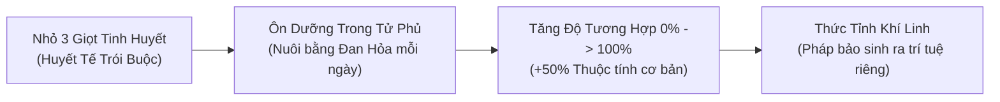

# [23] TOÀN THƯ VŨ KHÍ, PHÁP KHÍ, LINH BẢO & BẢN MỆNH THẦN BINH

> ⬅️ **[Bài Trước: Doc 22 - Bách Đại Kinh Điển: Toàn Thư 300 Công Pháp](file:///c:/Users/newre/OneDrive/Máy%20tính/code%20tutien/docs/22_TOAN_THU_300_CONG_PHAP_BI_TICH.md)** | 📖 **[Mục Lục Toàn Cảnh](file:///c:/Users/newre/OneDrive/Máy%20tính/code%20tutien/README.md)** | ➡️ **[Bài Kế: Doc 24 - Luận Đạo Lôi Đài & Tiên Minh](file:///c:/Users/newre/OneDrive/Máy%20tính/code%20tutien/docs/24_LOI_DAI_DAU_PHAP_PVP_VA_BANG_PHAI.md)**

> *"Tu sĩ không có pháp bảo hộ thân, chẳng khác nào đi chân trần trên biển lửa! Một thanh phi kiếm sắc bén có thể trảm tướng đoạt soái ngoài ngàn dặm; một chiếc đỉnh đồng cổ xưa có thể trấn áp càn khôn phong ấn ngàn dặm sông núi; một chiếc chuông bạc rung lên có thể làm tan rã hồn phách kẻ thù; còn Tiên Thiên Chí Bảo thuở sơ khai một khi xuất thế, ắt khiến nhật nguyệt lu mờ, chư thiên thần phật đều phải cúi đầu!"*

Tài liệu này là **Đại Bách Khoa Toàn Thư Vũ Khí, Pháp Khí, Linh Bảo & Bản Mệnh Thần Binh** quy chuẩn hóa cho thế giới Tu Chân Giới Online, bao gồm: **7 Cấp Bậc Pháp Khí Tiên Gia, 8 Đại Chủng Loại Bách Binh, Danh Bộ 120 Pháp Khí & Thần Binh Điển Hình, Hệ Thống Khí Linh Hóa Thần, Cơ Chế Tế Luyện Huyết Mạch Ôn Dưỡng Trong Tử Phủ và Hiểm Nguy Phản Phệ**.

---

## 🧭 I. HỆ THỐNG 7 CẤP BẬC PHÁP KHÍ & THẦN BINH TIÊN GIA

Trong cõi Tu Chân, binh khí không đơn thuần là thanh sắt sắc nhọn mà là **vật dẫn đạo pháp**, chia làm 7 tầng bậc nghiêm ngặt:

```mermaid
graph TD
    subgraph PHAN_CAP_BINH_KHI ["⚔️ THẤT ĐẲNG KHÍ GIỚI TU TIÊN"]
        C1["⚪ 1. PHÀM KHÍ / TINH CƯƠNG BINH (Luyện Khí sơ kỳ)\n- Rèn từ Bách Luyện Gang Thép, Gỗ Đào trừ tà\n- Chưa có cấm chế linh lực, dùng để chém quái nhỏ, củi mục"]
        C2["🟡 2. PHÁP KHÍ (Hạ / Trung / Thượng / Cực Phẩm) (Luyện Khí -> Trúc Cơ)\n- Dẫn dắt Chân Nguyên, phát quang linh khí\n- Khắc 1 - 9 Đạo Cấm Chế Phù Văn\n- Chém ra kiếm khí cơ bản, tăng 15% - 40% ATK"]
        C3["🔵 3. LINH BẢO / LINH KHÍ (Trúc Cơ -> Kim Đan)\n- Bắt đầu sinh ra Linh Tính Sơ Khai, có thể biến hóa to nhỏ (Như Ý Thuật)\n- Khắc 10 - 36 Tầng Cấm Chế Linh Trận\n- Có thể ngự khí phi hành trên trời, tự phát khiên hộ chủ"]
        C4["🟣 4. BẢN MỆNH PHÁP BẢO (Kim Đan -> Nguyên Anh)\n- Tế luyện bằng 3 giọt Tinh Huyết, ôn dưỡng trong Tử Phủ Đan Điền\n- Cùng thăng cấp và tiến hóa theo tu vi chủ nhân, tâm ý tương thông\n- Nếu gãy hỏng: Chủ nhân thổ huyết, nứt đạo cơ rơi cảnh giới!"]
        C5["🟠 5. THÔNG THIÊN LINH BẢO / CỔ BẢO (Nguyên Anh -> Hóa Thần)\n- Di vật thượng cổ phong ấn trong di chỉ ngàn năm, 37 - 72 Tầng Cấm Chế\n- Uy lực nghịch thiên không cần liên kết bản mệnh, ai đoạt được cũng dùng được\n- Kích hoạt Pháp Tắc Lĩnh Vực thu nhỏ"]
        C6["🔴 6. TIÊN THIÊN LINH BẢO / TIÊN KHÍ (Hóa Thần -> Đại Thừa)\n- Sinh ra từ Hỗn Độn sơ khai trước khi trời đất phân chia, 73 - 108 Tầng Cấm Chế\n- Chứa đựng một tia Đại Đạo Bản Nguyên bất hoại\n- Trảm phá hư không, xóa sổ cấm địa"]
        C7["👑 7. THÁI CỔ THẦN KHÍ / HỖN ĐỘN CHÍ BẢO (Đại Thừa -> Dĩ Thân Hợp Đạo)\n- Khai Thiên Phủ, Tru Tiên Tứ Kiếm, Đông Hoàng Chung, Thái Cực Đồ\n- Tái lập Càn Khôn, nghịch chuyển thời không, trảm diệt Thiên Đạo!"]
    end

    C1 --> C2 --> C3 --> C4 --> C5 --> C6 --> C7
```



---

## 🏛️ II. BÁCH BINH DIỆN MẠO: 8 ĐẠI CHỦNG LOẠI VŨ KHÍ & PHÁP KHÍ

Tu sĩ tùy theo công pháp và linh căn mà lựa chọn chủng loại vũ khí phù hợp:

1. **Kiếm Tu Bản Mệnh Phi Kiếm (Phi Kiếm, Trọng Kiếm, Nhuyễn Kiếm, Song Kiếm)**:
   - Sát phạt sắc bén bậc nhất, tầm xuất chiêu xa, có thể ngự kiếm phi hành vượt cấm địa.
2. **Bá Đạo Sát Phạt Trọng Binh (Bảo Đao, Chiến Phủ, Đại Thương, Thần Kích, Huyền Chùy)**:
   - Thể tu và Ma tu ưa chuộng, chém gãy khiên giáp, đập nát hư không, bộc phát sát thương chuẩn cực đại.
3. **Viễn Trình Xạ Khí & Ám Khí Bí Khí (Linh Cung, Nỏ Thần, Phi Đao, Ngũ Độc Phi Châm)**:
   - Tốc độ cực nhanh, bắn tỉa ngoài tầm nhìn, đòn đánh bạo kích xuyên thấu và kèm chất độc ăn mòn đạo cơ.
4. **Tiên Tôn Pháp Khí & Đạo Cụ (Pháp Trượng, Phất Trần, Linh Phiến/Quạt Ba Tiêu, Ngọc Như Ý)**:
   - Dẫn dắt bão tố, sấm sét, chân hỏa; tăng diện tích tác động và khuếch đại uy lực pháp thuật lên gấp bội.
5. **Trấn Áp & Phòng Ngự Trọng Bảo (Cổ Đỉnh, Pháp Chung/Chuông Đồng, Bảo Tháp, Huyền Thuẫn/Khiên, Bát Quái Kính)**:
   - Vạn pháp bất xâm, phản hồi sát thương, trấn áp số mệnh tông môn và giam cầm yêu ma vạn trượng.
6. **Vong Linh & Ma Đạo Hung Khí (Hồn Phiên/Vạn Hồn Kỳ, Huyết Ma Kiếm, Cốt Trảo, Luyện Thi Cổ Trượng)**:
   - Hút máu, cắn nuốt hồn phách kẻ tử trận, nguyền rủa làm suy sụp tinh thần và đạo tâm đối thủ.
7. **Trận Bàn, Không Gian Dị Bảo & Linh Vật (Trận Bàn Kỳ Môn, Tử Kim Hồ Lô, Càn Khôn Đại, Tụ Linh Bồn, Thần Châu)**:
   - Thao túng trận địa, dịch chuyển tức thời, phong ấn linh bảo đối phương và tích trữ linh khí vô tận.
8. **Thái Cổ Cấm Kỵ & Khởi Nguyên Thần Khí (Thập Đại Chí Bảo Hồng Hoang)**:
   - Thần khí quy tụ nguyên sơ trời đất, mang sức mạnh sáng thế và hủy diệt vạn giới.

---

## 📜 III. DANH BẠ 120 PHÁP KHÍ & THẦN BINH TIÊU BIỂU CHI TIẾT (`ARTIFACT_001` ➡️ `ARTIFACT_120`)

---

### 🗡️ NHÓM 1: PHI KIẾM & KIẾM ĐẠO BẢN MỆNH (15 BỘ: `ARTIFACT_001` -> `015`)

*Trọng tâm sát thương bạo kích, xuyên thấu giáp, ngự kiếm phi hành và kiếm ý trảm đạo.*

| Mã Khí | Tên Pháp Khí / Thần Binh | Phẩm Cấp | Hệ | Cảnh Giới | Thuộc Tính Thực Chiến | Tuyệt Kỹ Bản Mệnh (Active Skill) | Nguồn Gốc / Cách Đoạt Lấy |
| :---: | :--- | :---: | :---: | :---: | :--- | :--- | :--- |
| `ARTIFACT_001` | **Thanh Phong Tật Ảnh Kiếm** | Pháp Khí | Phong | Luyện Khí | $\text{ATK} +35$, Thân pháp $+5$. | **Phong Trảm**: Chém ra ngọn gió x1.3 sát thương. | Rèn từ Quặng Đồng + Phong Diệp ($200\text{ LT}$). |
| `ARTIFACT_002` | **Thu Thủy Nhu Hàn Kiếm** | Pháp Khí | Thủy | Luyện Khí | $\text{ATK} +38$, $\text{HP} +120$. | **Thủy Mạc**: Tạo màng nước hóa giải 1 đòn đánh. | Rơi từ Thủy Tinh Suối Thanh Khê ($15\%$). |
| `ARTIFACT_003` | **Xích Viêm Liệt Hỏa Kiếm** | Pháp Khí | Hỏa | Luyện Khí | $\text{ATK} +45$, Bạo kích $+3\%$. | **Hỏa Tinh**: Thiêu đốt $2\%$ HP địch trong 2 hiệp. | Mua ở Phường Thị Ngoại Môn ($450\text{ LT}$). |
| `ARTIFACT_004` | **Tử Đồng Lôi Quang Kiếm** | Pháp Khí | Lôi | Trúc Cơ | $\text{ATK} +75$, Kháng Lôi $+8\%$. | **Lôi Thiểm**: Đâm xuyên gây tê liệt 1 hiệp ($20\%$). | Đổi điểm cống hiến Thanh Vân Kiếm Tông. |
| `ARTIFACT_005` | **Huyền Thiết Trọng Kiếm** | Linh Bảo | Thổ | Trúc Cơ | $\text{ATK} +110$, $\text{DEF} +40$, Speed $-3$. | **Khai Sơn**: Bổ nát khiên giáp giảm $25\%$ DEF địch. | Đúc từ 50 thỏi Huyền Thiết ngàn năm. |
| `ARTIFACT_006` | **Thanh Trúc Phong Vân Kiếm** | Linh Bảo | Mộc | Kim Đan | $\text{ATK} +180$, Hồi $3\%$ HP/hiệp. | **Vạn Kiếm Quy Tông**: Phóng 72 phi kiếm tre vây sát. | Luyện từ Kim Lôi Trúc vạn năm (`ITEM_056`). |
| `ARTIFACT_007` | **Băng Hồn Phách Kiếm** | Linh Bảo | Băng | Kim Đan | $\text{ATK} +195$, Băng sát $+35$. | **Băng Phong Vạn Dặm**: Đóng băng địch mất 1 lượt. | Di tích Bắc Cực Băng Cung. |
| `ARTIFACT_008` | **Bát Hoang Cự Khuyết Kiếm** | Linh Bảo | Kim | Kim Đan | $\text{ATK} +230$, Xuyên giáp $20\%$. | **Bá Đạo Trảm**: Nhát chém diện rộng chém nát 3 mục tiêu. | Đánh bại Kiếm Linh Cổ Mộ Hồi 3. |
| `ARTIFACT_009` | **Thái Hư Du Long Kiếm** | Cổ Bảo | Hư Không | Nguyên Anh | $\text{ATK} +420$, Né tránh $+15\%$. | **Hư Không Xuyên Toái**: Biến mất rồi đâm lén x2.2 sát thương. | Thí luyện Hư Không Đạo Đài. |
| `ARTIFACT_010` | **Huyết Ma Diệt Tuyệt Kiếm** | Cổ Bảo | Huyết | Nguyên Anh | $\text{ATK} +480$, Hút máu $15\%$. | **Huyết Hải Trảm**: Sát thương tăng $50\%$ khi máu dưới $30\%$. | Độc Cô Diệt (Chưởng Môn Vạn Ma) ban tặng. |
| `ARTIFACT_011` | **Cửu Thiên Huyền Lôi Thần Kiếm**| Tiên Khí | Lôi | Hóa Thần | $\text{ATK} +850$, Bạo kích $+25\%$. | **Thiên Kiếp Phạt**: Giáng 9 tia sét phá hủy đạo cơ Boss. | Luyện hóa Lôi Hạch Thái Cổ Lôi Long. |
| `ARTIFACT_012` | **Âm Dương Lưỡng Nghi Tiên Kiếm**| Tiên Khí | Âm Dương | Hóa Thần | $\text{ATK} +920$, $\text{DEF} +350$. | **Lưỡng Nghi Hoàn Chuyển**: Đổi toàn bộ thủ thành công trong 2 hiệp. | Kỳ ngộ Cổ Kính Thái Cực Hồi 4. |
| `ARTIFACT_013` | **Chu Thiên Tinh Hà Kiếm** | Tiên Khí | Tinh Thần | Hợp Thể | $\text{ATK} +1,400$, Bỏ qua giáp $50\%$.| **Tinh Thần Sa Đọa**: Triệu hoán sao băng càn quét toàn bản đồ. | Đoạt từ Di Tích Tinh Không Vực Sâu. |
| `ARTIFACT_014` | **Trảm Đạo Tuyệt Mệnh Cổ Kiếm**| Tiên Khí | Trảm Đạo | Đại Thừa | $\text{ATK} +2,100$, Sát thương chuẩn $100\%$. | **Trảm Thiên Đoạn Mệnh**: Triệt tiêu toàn bộ hiệu ứng hồi sinh của địch. | Chọn Kết Cục [Nghịch Thiên Trảm Đạo]. |
| `ARTIFACT_015` | **Tru Tiên Kiếm (Thái Cổ Chí Tôn)**| Thần Khí | Thái Cổ | Chí Tôn | $\text{ATK} +4,500$, Bạo kích $+40\%$. | **Tru Tiên Diệt Thần**: Nhát chém tuyệt đối kết liễu kẻ địch dưới $20\%$ HP! | Dung hợp đủ 4 Mảnh Vỡ Kiếm Trận Tru Tiên. |

---

### 🪓 NHÓM 2: TRỌNG BINH SÁT PHẠT — ĐAO, THƯƠNG, PHỦ, KÍCH, CHÙY (15 BỘ: `ARTIFACT_016` -> `030`)

*Chuyên phá giáp, đập choáng, hút huyết khí và chém gãy khiên hộ thể.*

| Mã Khí | Tên Pháp Khí / Thần Binh | Phẩm Cấp | Chủng Loại | Cảnh Giới | Thuộc Tính Thực Chiến | Tuyệt Kỹ Bản Mệnh (Active Skill) | Nguồn Gốc / Cách Đoạt Lấy |
| :---: | :--- | :---: | :---: | :---: | :--- | :--- | :--- |
| `ARTIFACT_016` | **Hắc Thiết Phách Sơn Đao** | Pháp Khí | Trọng Đao | Luyện Khí | $\text{ATK} +42$, Giảm $5\%$ DEF địch. | **Liệt Địa Trảm**: Đập vỡ mặt đất gây 120 sát thương. | Rèn từ Quặng Sắt Thô làng Lạc Hà. |
| `ARTIFACT_017` | **Bạch Ngân Toái Thạch Thương**| Pháp Khí | Trường Thương | Luyện Khí | $\text{ATK} +40$, Tầm đánh xa. | **Bách Bộ Xuyên Tâm**: Tấn công xuyên thấu 2 mục tiêu thẳng hàng. | Rơi từ Đạo Tặc Đầu Lĩnh Hắc Phong Trại. |
| `ARTIFACT_018` | **Cuồng Phong Khai Sơn Phủ** | Pháp Khí | Chiến Phủ | Luyện Khí | $\text{ATK} +48$, Tốc độ $-2$. | **Toái Giáp Bổ**: Chắc chắn phá hủy $10\%$ khiên của địch. | Tiệm Rèn Thôn Lạc Hà ($350\text{ LT}$). |
| `ARTIFACT_019` | **Huyết Nha Đoạt Phách Đao** | Linh Bảo | Ma Đao | Trúc Cơ | $\text{ATK} +95$, Hút máu $6\%$. | **Khát Máu**: Càng mất máu, công kích tăng thêm $+20\%$. | Quái Ma Đồ Bãi Săn Hồi 2 rơi. |
| `ARTIFACT_020` | **Canh Kim Phá Giáp Kích** | Linh Bảo | Chiến Kích | Trúc Cơ | $\text{ATK} +105$, Bỏ qua $15\%$ giáp. | **Bát Hoang Liệt Kích**: Hất văng đối thủ làm choáng 1 hiệp. | Đúc từ Canh Kim Tinh Khoáng. |
| `ARTIFACT_021` | **Huyền Lôi Phục Ma Chùy** | Linh Bảo | Chiến Chùy | Kim Đan | $\text{ATK} +175$, Phản chấn $10\%$. | **Lôi Chấn Càn Khôn**: Gây choáng toàn bộ mục tiêu trong 1 hiệp ($35\%$). | Đánh bại Lôi Thú Bí Cảnh Lôi Trì. |
| `ARTIFACT_022` | **Long Lân Huyết Viêm Thương**| Linh Bảo | Trường Thương | Kim Đan | $\text{ATK} +190$, Thiêu đốt $4\%$ HP/hiệp. | **Long Hống Thương Đầu**: Triệu hoán hỏa long đâm xuyên giáp. | Luyện từ Vảy Rùa Lửa + Xương Long Tộc. |
| `ARTIFACT_023` | **Toái Hồn Ma Hoàng Phủ** | Cổ Bảo | Chiến Phủ | Nguyên Anh | $\text{ATK} +410$, Bạo kích $+18\%$. | **Thiên Ma Liệt Địa**: Cú chém búa tạo rãnh nứt hút Chân Nguyên địch. | Cấm Địa Vạn Ma Uyên tầng đáy. |
| `ARTIFACT_024` | **Bá Vương Phá Thiên Kích** | Cổ Bảo | Chiến Kích | Nguyên Anh | $\text{ATK} +450$, Không thể bị đỡ đòn. | **Bá Khí Trảm**: Bỏ qua toàn bộ phòng ngự vật lý của địch! | Rương Bí Cảnh Bát Môn Độn Giáp Tầng 3. |
| `ARTIFACT_025` | **Thái Cổ Long Tượng Thần Chùy**| Cổ Bảo | Trọng Chùy | Hóa Thần | $\text{ATK} +780$, $\text{HP} +1,500$. | **Long Tượng Toái Giới**: Cú đập nặng vạn cân làm đối phương câm lặng 2 hiệp. | Luyện hóa Tinh Cốt Cự Tượng Viễn Cổ. |
| `ARTIFACT_026` | **Hóa Huyết Thần Đao (Cổ)** | Tiên Khí | Ma Đao | Hóa Thần | $\text{ATK} +890$, Vết thương sâu $100\%$. | **Hóa Huyết Tiêu Hồn**: Vết thương không thể hồi máu, rút $8\%$ máu/hiệp. | Di chỉ Huyết Hải Thượng Cổ. |
| `ARTIFACT_027` | **Thanh Long Yển Nguyệt Thần Đao**| Tiên Khí | Đại Đao | Hợp Thể | $\text{ATK} +1,350$, Trảm kích x2.0. | **Thanh Long Xuất Hải**: Đòn đánh đầu tiên chắc chắn bạo kích x3.0! | Đánh bại Long Hồn Hộ Vệ Thượng Giới. |
| `ARTIFACT_028` | **Bát Hoang Diệt Tuyệt Thần Thương**| Tiên Khí | Thần Thương | Đại Thừa | $\text{ATK} +1,950$, Xuyên thấu $100\%$. | **Thương Xuất Như Long**: Đâm thẳng vào tâm mạch kẻ địch, gây tử thương. | Boss Thế Giới Tinh Hà Sa Đọa rơi. |
| `ARTIFACT_029` | **Hỗn Độn Khai Thiên Đại Phủ** | Thần Khí | Thần Phủ | Chí Tôn | $\text{ATK} +4,200$, Phá hủy $100\%$ buff. | **Khai Thiên Bích Địa**: Nhát chém xóa sạch mọi buff hộ thể và khiên chắn! | A Ngưu Thúc truyền trao năm 30 Hóa Phàm. |
| `ARTIFACT_030` | **Bàn Cổ Phủ (Thái Cổ Chí Tôn)**| Thần Khí | Khai Thiên | Chí Tôn | $\text{ATK} +5,000$, $\text{HP} +10,000$. | **Tái Lập Càn Khôn**: Nhát búa chém đứt sợi dây luân hồi, xóa sổ đối phương! | Thu thập Trái Tim Bàn Cổ + Khai Thiên Thạch. |

---

### 🏹 NHÓM 3: VIỄN TRÌNH XẠ KHÍ & ÁM KHÍ BÍ BẢO (15 BỘ: `ARTIFACT_031` -> `045`)

*Chuyên sâu xạ thuật ngoài tầm nhìn, đòn đánh phủ đầu, truy hồn đoạt phách và bôi độc ăn mòn.*

| Mã Khí | Tên Pháp Khí / Thần Binh | Phẩm Cấp | Chủng Loại | Cảnh Giới | Thuộc Tính Thực Chiến | Tuyệt Kỹ Bản Mệnh (Active Skill) | Nguồn Gốc / Cách Đoạt Lấy |
| :---: | :--- | :---: | :---: | :--- | :--- | :--- |
| `ARTIFACT_031` | **Phong Tật Linh Cung** | Pháp Khí | Trường Cung | Luyện Khí | $\text{ATK} +32$, Bắn trước 1 hiệp. | **Tật Phong Tiễn**: Tăng $30\%$ tốc độ bay mũi tên. | Đẽo từ Gỗ Phong dẻo dai bãi săn 1. |
| `ARTIFACT_032` | **Thần Tiêu Cơ Quan Nỏ** | Pháp Khí | Nỏ Ngắn | Luyện Khí | $\text{ATK} +36$, Bạo kích $+5\%$. | **Tam Tiễn Liên Xạ**: Bắn liên tiếp 3 mũi tên vào 1 mục tiêu. | Mua ở Cửa hàng Thợ Săn Lạc Hà. |
| `ARTIFACT_033` | **Ngũ Độc Toái Tâm Châm** | Pháp Khí | Phi Châm | Luyện Khí | $\text{ATK} +28$, Trúng độc mất máu. | **Độc Sa**: Rải mưa kim độc trúng độc 3 hiệp. | Nhặt trong Động Nhện Độc Vạn Quỷ. |
| `ARTIFACT_034` | **Phá Vân Xạ Nhật Cung** | Linh Bảo | Trường Cung | Trúc Cơ | $\text{ATK} +88$, Bỏ qua né tránh. | **Phá Không Tiễn**: Bỏ qua toàn bộ né tránh của đối phương. | Rương báu Bí Cảnh Tầng 1. |
| `ARTIFACT_035` | **Băng Tinh Truy Hồn Tiêu** | Linh Bảo | Phi Đao | Trúc Cơ | $\text{ATK} +92$, Giảm $15\%$ tốc độ. | **Hàn Băng Thấu Xương**: Làm chậm kẻ địch trong 2 hiệp. | Rơi từ Sát Thủ Tuyết Cốc Hồi 2. |
| `ARTIFACT_036` | **Tử Lôi Thần Nỏ** | Linh Bảo | Nỏ Cơ Quan | Kim Đan | $\text{ATK} +165$, Gây tê liệt. | **Lôi Bạo Tiễn**: Mũi nổ sét gây sát thương lan cho quái xung quanh. | Thợ Rèn Cơ Quan Nội Môn chế tạo. |
| `ARTIFACT_037` | **Lạc Nhạn Huyễn Ảnh Cung** | Linh Bảo | Tiên Cung | Kim Đan | $\text{ATK} +185$, Né tránh $+10\%$. | **Vô Ảnh Xạ**: Bắn từ trong hư không, không thể bị phản đòn. | Đổi $2,000$ điểm cống hiến Tông Môn. |
| `ARTIFACT_038` | **U Minh Đoạt Mệnh Phi Đao** | Cổ Bảo | Phi Đao | Nguyên Anh | $\text{ATK} +390$, Bạo kích $+22\%$. | **Nhất Đao Đoạt Phách**: Chắc chắn bạo kích x2.5 nếu đánh từ sau lưng. | Đạt Chân Truyền U Minh Quỷ Điện. |
| `ARTIFACT_039` | **Bách Độc Khổng Tước Linh** | Cổ Bảo | Ám Khí | Nguyên Anh | $\text{ATK} +420$, Độc tố ăn mòn giáp. | **Khổng Tước Khai Bình**: Bắn ra 360 đạo linh châm quét sạch sàn đấu. | Luyện từ Lông Đuôi Khổng Tước Thượng Cổ. |
| `ARTIFACT_040` | **Thái Ất Thần Sa Hồ Lô** | Cổ Bảo | Dị Bảo Xạ Khí| Hóa Thần | $\text{ATK} +720$, Mù lòa đối thủ. | **Cát Vàng Vùi Thây**: Bắn bão cát làm mù kẻ địch không thể tấn công. | Di chỉ Tiên Gia Sa Mạc Vô Tận. |
| `ARTIFACT_041` | **Truy Hồn Đoạt Phách Thần Cung**| Tiên Khí | Thần Cung | Hóa Thần | $\text{ATK} +860$, Tầm xa vô tận. | **Vạn Dặm Đoạt Mệnh**: Bắn trúng mục tiêu bất kể khoảng cách và bản đồ! | Rơi từ Tàn Hồn Tiên Nhân Cung Thủ. |
| `ARTIFACT_042` | **Diệt Thần Xạ Thiên Nỏ** | Tiên Khí | Thần Nỏ | Hợp Thể | $\text{ATK} +1,280$, Xuyên thấu $40\%$. | **Diệt Hồn Nỏ Tiễn**: Phá hủy vĩnh viễn 1 tầng cấm chế pháp bảo của địch. | Thí luyện Tinh Không Vực Sâu Tầng 4. |
| `ARTIFACT_043` | **Chu Thiên Băng Phách Linh Châm**| Tiên Khí | Phi Châm | Đại Thừa | $\text{ATK} +1,800$, Đóng băng kinh mạch. | **Băng Tâm Tuyệt Mệnh**: Khóa toàn bộ kỹ năng chủ động của Boss 2 hiệp! | Bắc Minh Cực Hạn Băng Phách Động. |
| `ARTIFACT_044` | **Hậu Nghệ Xạ Nhật Cung** | Thần Khí | Thần Cung | Chí Tôn | $\text{ATK} +4,100$, Sát thương Hỏa x3.0. | **Xạ Lạc Kim Ô**: Bắn rụng cả mặt trời, thiêu rụi toàn bộ sinh mệnh đối địch! | Kỳ ngộ Cây Dâu Rừng Tang Thượng Cổ. |
| `ARTIFACT_045` | **Khai Thiên Thần Xạ Đạo Tiễn**| Thần Khí | Viễn Cổ | Chí Tôn | $\text{ATK} +4,800$, Xuyên thấu hư không. | **Nhất Tiễn Khai Thiên**: Bắn thủng vách ngăn không gian, tất sát kẻ địch! | Chọn Kết Cục [Thần Xạ Nghịch Đạo]. |

---

### 🪭 NHÓM 4: TIÊN TÔN PHÁP CỤ — TRƯỢNG, PHẤT TRẦN, QUẠT, NHƯ Ý (15 BỘ: `ARTIFACT_046` -> `060`)

*Chuyên sâu khuếch đại pháp thuật, tăng Chân Nguyên tối đa, thi triển bão tố nguyên tố và giải trừ trạng thái.*

| Mã Khí | Tên Pháp Khí / Thần Binh | Phẩm Cấp | Chủng Loại | Cảnh Giới | Thuộc Tính Thực Chiến | Tuyệt Kỹ Bản Mệnh (Active Skill) | Nguồn Gốc / Cách Đoạt Lấy |
| :---: | :--- | :---: | :---: | :--- | :--- | :--- |
| `ARTIFACT_046` | **Thanh Mộc Tụ Linh Trượng** | Pháp Khí | Pháp Trượng | Luyện Khí | $\text{ATK} +25$, $\text{MP} +150$. | **Dẫn Linh**: Hồi phục $50\text{ MP}$ sau mỗi hiệp. | Đẽo từ cành Thông Già Linh Tuyền. |
| `ARTIFACT_047` | **Bạch Hạc Vũ Linh Phiến** | Pháp Khí | Quạt Lông | Luyện Khí | $\text{ATK} +30$, Né tránh $+4\%$. | **Cuồng Phong Thổi**: Đẩy lùi đối thủ làm mất lượt tấn công. | Nhặt lông Bạch Hạc đỉnh Tiên Lạc Hà. |
| `ARTIFACT_048` | **Thái Cực Đạo Gia Phất Trần** | Pháp Khí | Phất Trần | Luyện Khí | $\text{ATK} +28$, Kháng tà $+10\%$. | **Thanh Tẩy**: Hóa giải 1 trạng thái nhiễm độc sơ cấp. | Tín vật nhập môn Đạo Quán Ngoại Môn. |
| `ARTIFACT_049` | **Hỏa Long Phần Thiên Trượng**| Linh Bảo | Pháp Trượng | Trúc Cơ | $\text{ATK} +85$, Sát thương Hỏa $+20\%$. | **Hỏa Hải Cuộn Trào**: Phóng bão lửa gây sát thương diện rộng. | Luyện từ Hỏa Diễm Thạch Đan Hà Cốc. |
| `ARTIFACT_050` | **Bích Ba Nhu Thủy Như Ý** | Linh Bảo | Ngọc Như Ý | Trúc Cơ | $\text{ATK} +75$, Hồi máu $+10\%$. | **Như Ý Bình An**: Tạo khiên nước chặn $500$ sát thương cho đồng đội. | Câu cá ngẫu nhiên tại Linh Hồ. |
| `ARTIFACT_051` | **Ngũ Hỏa Thất Cầm Phiến** | Linh Bảo | Quạt Thần | Kim Đan | $\text{ATK} +170$, Gom 7 ngọn lửa chim thần. | **Phần Thiên Huyết Diễm**: Thiêu đốt thiêu rụi giáp và hộ thuẫn của địch. | Thu thập đủ lông của 7 loài linh cầm. |
| `ARTIFACT_052` | **Thái Ất Huyền Thiên Phất Trần**| Linh Bảo | Phất Trần | Kim Đan | $\text{ATK} +160$, Tăng $30\%$ uy lực phù chú. | **Vạn Tiên Triều Bái**: Quét phất trần hóa giải toàn bộ bùa chú đối phương. | Chân truyền Tử Tiêu Cung. |
| `ARTIFACT_053` | **Cửu Long Ly Hỏa Trượng** | Cổ Bảo | Pháp Trượng | Nguyên Anh | $\text{ATK} +400$, $\text{MP} +1,200$. | **Cửu Long Thổ Hỏa**: Triệu hoán 9 con rồng lửa vây hãm toàn sân đấu. | Trưởng lão Đan Hà Cốc chân truyền. |
| `ARTIFACT_054` | **Ba Tiêu Thần Phiến (Âm)** | Cổ Bảo | Quạt Ba Tiêu | Nguyên Anh | $\text{ATK} +420$, Đóng băng dập lửa. | **Hàn Phong Tịch Diệt**: Thổi một cơn gió dập tắt mọi chân hỏa và bão lôi. | Đỉnh Tuyết Côn Lôn phong ấn. |
| `ARTIFACT_055` | **Bạch Ngọc Càn Khôn Như Ý** | Cổ Bảo | Ngọc Như Ý | Hóa Thần | $\text{ATK} +710$, $\text{DEF} +300$. | **Như Ý Định Hải**: Phong tỏa không gian khiến địch không thể di chuyển. | Di chỉ Cổ Mộ Tiên Nữ Dao Trì. |
| `ARTIFACT_056` | **Thái Thượng Lão Quân Phất Trần**| Tiên Khí | Phất Trần | Hóa Thần | $\text{ATK} +840$, Miễn dịch ma đạo $50\%$.| **Nhất Khí Định Càn Khôn**: Biến mọi đòn đánh ma đạo thành hư vô! | Tàng Kinh Các Đệ Nhất Đạo Tông. |
| `ARTIFACT_057` | **Hỗn Độn Vạn Tượng Pháp Trượng**| Tiên Khí | Pháp Trượng | Hợp Thể | $\text{ATK} +1,300$, Dẫn xuất 5 hành. | **Ngũ Hành Nghịch Chuyển**: Đổi hệ kháng của kẻ địch thành hệ yếu nhất. | Dung hợp 5 loại Tinh Hạch Ngũ Hành. |
| `ARTIFACT_058` | **Ba Tiêu Thần Phiến (Dương)**| Tiên Khí | Quạt Ba Tiêu | Đại Thừa | $\text{ATK} +1,850$, Bão lửa Tam Muội. | **Liệt Diễm Tam Giới**: Cơn cuồng phong lửa thiêu rụi cả pháp bảo đối phương. | Đáy Lò Bát Quái Thượng Giới. |
| `ARTIFACT_059` | **Thất Bảo Diệu Thụ** | Thần Khí | Thần Cụ | Chí Tôn | $\text{ATK} +4,000$, Quét sạch vạn vật. | **Vạn Vật Giai Quy Hư**: Quét một cành cây tước đoạt toàn bộ vũ khí đối phương! | Cội Bồ Đề Thượng Cổ triệu hoán. |
| `ARTIFACT_060` | **Thái Sơ Khởi Nguyên Thần Trượng**| Thần Khí | Sáng Thế | Chí Tôn | $\text{ATK} +4,600$, $\text{MP}$ vô hạn. | **Sáng Thế Thần Quang**: Tái tạo lại toàn bộ sinh lực đồng đội và tiêu diệt tà ma. | Chọn Kết Cục [Khởi Nguyên Sáng Thế]. |

---

### 🛡️ NHÓM 5: PHÒNG NGỰ & TRẤN ÁP TRỌNG BẢO — ĐỈNH, CHUNG, THÁP, THUẪN (15 BỘ: `ARTIFACT_061` -> `075`)

*Chuyên sâu chịu đòn, phản chấn sát thương, giam cầm quái vật, trấn áp số mệnh và bảo hộ linh hồn.*

| Mã Khí | Tên Pháp Khí / Thần Binh | Phẩm Cấp | Chủng Loại | Cảnh Giới | Thuộc Tính Thực Chiến | Tuyệt Kỹ Bản Mệnh (Active Skill) | Nguồn Gốc / Cách Đoạt Lấy |
| :---: | :--- | :---: | :---: | :--- | :--- | :--- |
| `ARTIFACT_061` | **Huyền Thiết Quy Giáp Thuẫn** | Pháp Khí | Khiên | Luyện Khí | $\text{DEF} +35$, $\text{HP} +200$. | **Quy Giáp Hộ Thể**: Chặn $200$ sát thương vật lý hiệp 1. | Rèn từ Mai Rùa Nước + Quặng Sắt. |
| `ARTIFACT_062` | **Đồng Thanh Hộ Thân Chung** | Pháp Khí | Chuông Nhỏ | Luyện Khí | $\text{DEF} +30$, Kháng Lôi $+5\%$. | **Chung Thanh Chấn Địch**: Tiếng chuông làm đối phương giật mình mất $5\%$ ATK. | Mua ở Phường Thị Thanh Khê. |
| `ARTIFACT_063` | **Tam Túc Thanh Đồng Đỉnh** | Pháp Khí | Cổ Đỉnh | Luyện Khí | $\text{DEF} +40$, Giảm sát thương $5\%$. | **Trấn Địa**: Đặt đỉnh xuống đất tăng $10\%$ thủ toàn đội. | Đào được tại Di Tích Miếu Hoang. |
| `ARTIFACT_064` | **Bát Quái Hộ Tâm Kính** | Linh Bảo | Bảo Kính | Trúc Cơ | $\text{DEF} +90$, Phản đòn $8\%$. | **Quang Kính Phản Sát**: Bắn trả lại tia chớp ma pháp vào mặt kẻ địch. | Rơi từ Đạo Sĩ Tà Giáo Hồi 2. |
| `ARTIFACT_065` | **Tứ Tượng Huyền Vũ Thuẫn** | Linh Bảo | Huyền Thuẫn | Trúc Cơ | $\text{DEF} +120$, $\text{HP} +600$. | **Huyền Vũ Thuẫn Bích**: Giảm $30\%$ sát thương nhận vào trong 2 hiệp. | Rèn từ Vảy Rùa Thần Bắc Minh. |
| `ARTIFACT_066` | **Lạc Phách Kim Chung** | Linh Bảo | Chuông Vàng | Kim Đan | $\text{DEF} +150$, Kháng sát thương hồn. | **Lạc Phách Hồn Âm**: Tiếng chuông vang vọng làm đối thủ hôn mê 1 hiệp. | Vượt Bí Cảnh Lạc Phách Đỉnh. |
| `ARTIFACT_067` | **Thất Tinh Yêu Tháp** | Linh Bảo | Bảo Tháp | Kim Đan | $\text{DEF} +160$, Tăng $25\%$ giáp. | **Trấn Yêu**: Nhốt 1 quái vật phụ vào tháp không cho tham chiến. | Trưởng Lão Thái Hư Môn ban tặng. |
| `ARTIFACT_068` | **Sơn Hà Xã Tắc Cổ Đỉnh** | Cổ Bảo | Bảo Đỉnh | Nguyên Anh | $\text{DEF} +380$, $\text{HP} +2,500$. | **Khí Vận Trấn Áp**: Hấp thụ toàn bộ sát thương chí mạng 1 lần mỗi trận. | Tìm thấy trong Hầm Mộ Đất Mẹ. |
| `ARTIFACT_069` | **Hạo Thiên Thần Kính** | Cổ Bảo | Bảo Kính | Nguyên Anh | $\text{DEF} +410$, Phản hồi $25\%$ sát thương. | **Hạo Thiên Thần Quang**: Chiếu sáng làm kẻ địch lộ nguyên hình, tước bỏ tàng hình. | Cung Tiên Dao Trì bảo vật. |
| `ARTIFACT_070` | **Hỗn Nguyên Kim Đấu** | Cổ Bảo | Dị Bảo Trấn Áp| Hóa Thần | $\text{DEF} +750$, Cướp pháp bảo. | **Kim Đấu Thu Hút**: Tạm thời phong ấn pháp bảo cầm tay của địch 2 hiệp! | Phong Thần Di Chỉ bí mật. |
| `ARTIFACT_071` | **Thiên Địa Huyền Hoàng Linh Lung Tháp**| Tiên Khí | Bảo Tháp | Hóa Thần | $\text{DEF} +950$, Miễn dịch sát thương $30\%$.| **Vạn Pháp Bất Xâm**: Đứng dưới tháp hoàn toàn miễn nhiễm sát thương nguyên tố! | Đạt Chân Truyền Đạo Tổ Thái Thượng. |
| `ARTIFACT_072` | **Càn Khôn Tạo Hóa Đỉnh** | Tiên Khí | Thần Đỉnh | Hợp Thể | $\text{DEF} +1,400$, $\text{HP} +8,000$. | **Luyện Hóa Càn Khôn**: Nhốt đối thủ vào đỉnh thiêu đốt rút $10\%$ máu/hiệp. | Di chỉ Thần Nông Thượng Cổ. |
| `ARTIFACT_073` | **Thái Cực Đồ (Tiên Khí Chí Tôn)**| Tiên Khí | Trận Đồ | Đại Thừa | $\text{DEF} +2,200$, Hóa giải mọi công kích. | **Bình Định Phong Ba**: Dẹp tan mọi bão táp, đòn đánh kẻ địch hóa thành mây khói. | Tam Thanh Đạo Quán truyền thừa. |
| `ARTIFACT_074` | **Đông Hoàng Chung (Thái Cổ Chí Tôn)**| Thần Khí | Cổ Chung | Chí Tôn | $\text{DEF} +4,500$, $\text{HP} +15,000$. | **Đông Hoàng Phách Thế**: Tiếng chuông làm đóng băng toàn bộ thời gian của trận chiến! | Thu thập đủ 5 Mảnh Vỡ Đông Hoàng. |
| `ARTIFACT_075` | **Càn Khôn Đỉnh (Thái Cổ Khởi Nguyên)**| Thần Khí | Khởi Nguyên | Chí Tôn | $\text{DEF} +5,200$, Bất tử 3 hiệp. | **Nghịch Chuyển Hậu Thiên Thành Tiên Thiên**: Tự động phục hồi toàn bộ máu khi chết! | Chọn Kết Cục [Trấn Áp Vạn Cổ]. |

---

### 💀 NHÓM 6: VONG LINH & MA ĐẠO HUNG KHÍ — HỒN PHIÊN, HUYẾT NHẬN, CỐT TRẢO (15 BỘ: `ARTIFACT_076` -> `090`)

*Chuyên sâu hút máu, triệu hoán oan hồn, nguyền rủa làm tan vỡ đạo tâm và tế sống kẻ địch.*

| Mã Khí | Tên Pháp Khí / Thần Binh | Phẩm Cấp | Chủng Loại | Cảnh Giới | Thuộc Tính Thực Chiến | Tuyệt Kỹ Bản Mệnh (Active Skill) | Nguồn Gốc / Cách Đoạt Lấy |
| :---: | :--- | :---: | :---: | :--- | :--- |
| `ARTIFACT_076` | **Bách Quỷ Trúc Cốt Phiên** | Pháp Khí | Hồn Phiên | Luyện Khí | $\text{ATK} +32$, Triệu hồi 1 tiểu quỷ. | **Quỷ Hống**: Oan hồn gào thét giảm $8\%$ chính xác của địch. | Luyện từ Xương Người + Trúc Bãi Tha Ma. |
| `ARTIFACT_077` | **Huyết Tích Ma Nhận** | Pháp Khí | Đoản Đao | Luyện Khí | $\text{ATK} +38$, Hút máu $3\%$. | **Huyết Thiểm**: Nhát chém đẫm máu làm đối phương rách da. | Nhặt ở đống xác chiến trường Hồi 1. |
| `ARTIFACT_078` | **Bạch Cốt Tỏa Hồn Trảo** | Pháp Khí | Vuốt Xương | Luyện Khí | $\text{ATK} +35$, Đâm thủng giáp. | **Cốt Trảo Khóa Họng**: Giữ chặt mục tiêu không cho bỏ chạy. | Giết Bạch Cốt Yêu Tinh. |
| `ARTIFACT_079` | **Thiên Hồn Ma Phiên** | Linh Bảo | Hồn Phiên | Trúc Cơ | $\text{ATK} +85$, Chứa 1,000 oan hồn. | **Thiên Quỷ Phệ Thể**: Bầy quỷ cắn xé đối thủ làm mất Chân Nguyên. | Nhập môn đệ tử U Minh Quỷ Điện. |
| `ARTIFACT_080` | **Hóa Cốt U Minh Trượng** | Linh Bảo | Ma Trượng | Trúc Cơ | $\text{ATK} +90$, Ăn mòn giáp đối thủ. | **Hóa Cốt Độc Vũ**: Mưa axit ăn mòn làm hỏng binh khí kẻ địch. | Bắt Cổ Trùng Độc Ma Giáo. |
| `ARTIFACT_081` | **Ma Long Huyết Sát Kiếm** | Linh Bảo | Ma Kiếm | Kim Đan | $\text{ATK} +175$, Hút máu $10\%$. | **Ma Long Phệ Huyết**: Chuyển $40\%$ sát thương gây ra thành máu bản thân. | Luyện từ Máu Đen Rồng Ma Đáy Vực. |
| `ARTIFACT_082` | **Vạn Hồn Triều Tông Kỳ** | Linh Bảo | Hồn Kỳ | Kim Đan | $\text{ATK} +185$, Chứa 10,000 hồn. | **Vạn Hồn Xuất Lồng**: Đàn ma quỷ tràn ngập che khuất tầm nhìn sàn đấu. | Đổi $2,500$ điểm Tông Môn Vạn Ma. |
| `ARTIFACT_083` | **A Tỳ Ma Sát Đao** | Cổ Bảo | Ma Đao | Nguyên Anh | $\text{ATK} +430$, Bạo kích $+20\%$. | **A Tỳ Trảm**: Nhát chém mang theo lửa địa ngục thiêu đốt linh hồn. | Vực Sâu Cửu U Tầng 3. |
| `ARTIFACT_084` | **Hoàng Tuyền Dẫn Hồn Đăng** | Cổ Bảo | Đèn Dẫn Hồn | Nguyên Anh | $\text{ATK} +400$, Giảm kháng ma của địch. | **Đoạt Phách Câu Hồn**: Kéo linh hồn đối phương ra khỏi xác gây choáng 2 hiệp. | Vượt Cầu Nại Hà bí cảnh Vong Xuyên. |
| `ARTIFACT_085` | **Cửu U Huyết Hải Ma Luân** | Cổ Bảo | Pháp Luân | Hóa Thần | $\text{ATK} +740$, Chém lan toàn sân. | **Huyết Luân Cuồng Sát**: Vòng xoay đẫm máu cắt nát toàn bộ đội hình địch. | Độc Cô Diệt bí kíp truyền thừa. |
| `ARTIFACT_086` | **Ức Quỷ Nhiếp Hồn Thần Phiên**| Tiên Khí | Thần Phiên | Hóa Thần | $\text{ATK} +880$, Chứa 100,000 hồn. | **Ma Tôn Giáng Thế**: Triệu hoán Quỷ Vương ngàn trượng nuốt chửng quái Boss. | Thu thập đủ 100,000 linh hồn bãi săn. |
| `ARTIFACT_087` | **Thập Bát Tầng Địa Ngục Trâm**| Tiên Khí | Ám Khí Ma | Hợp Thể | $\text{ATK} +1,320$, Nguyền rủa vĩnh viễn.| **Ngũ Lôi Diệt Đạo**: Găm trâm vào kinh mạch làm đối thủ vĩnh viễn mất $20\%$ HP. | Minh Hoàng truyền dạy tại Hoàng Tuyền. |
| `ARTIFACT_088` | **Thiên Ma Tru Tiên Cổ Kiếm** | Tiên Khí | Hung Kiếm | Đại Thừa | $\text{ATK} +1,900$, Hút máu $25\%$. | **Thiên Ma Giải Thể**: Hy sinh $30\%$ HP bản thân bộc phát đòn đánh x3.5! | Di tích Tàn Hồn Ma Thần Thái Cổ. |
| `ARTIFACT_089` | **Hồng Mông Ma Đạo Tịch Diệt Luân**| Thần Khí | Cấm Kỵ | Chí Tôn | $\text{ATK} +4,300$, Bất tử ma đạo. | **Huyết Hải Trùng Sinh**: Mỗi lần giết 1 sinh linh lập tức hồi sinh đầy máu! | Đánh bại Cổ Ma Hoàng Thái Cổ. |
| `ARTIFACT_090` | **Vạn Giới Thôn Phệ Ma Hồ** | Thần Khí | Khởi Nguyên Ma| Chí Tôn | $\text{ATK} +4,700$, Nuốt chửng càn khôn. | **Thôn Thiên Phệ Địa**: Nuốt trọn đối phương vào hồ lô, biến thành linh đan! | Chọn Kết Cục [Thôn Phệ Vạn Giới]. |

---

### 🔮 NHÓM 7: TRẬN BÀN, KHÔNG GIAN DỊ BẢO & LINH VẬT (15 BỘ: `ARTIFACT_091` -> `105`)

*Thao túng không gian, dịch chuyển tức thời, khóa cấm chế, thu nạp bảo vật và gia tốc thời gian.*

| Mã Khí | Tên Pháp Khí / Thần Binh | Phẩm Cấp | Chủng Loại | Cảnh Giới | Thuộc Tính Thực Chiến | Tuyệt Kỹ Bản Mệnh (Active Skill) | Nguồn Gốc / Cách Đoạt Lấy |
| :---: | :--- | :---: | :---: | :--- | :--- |
| `ARTIFACT_091` | **Bát Quái Gỗ Trận Bàn** | Pháp Khí | Trận Bàn | Luyện Khí | $\text{DEF} +20$, Tăng $10\%$ sát thương trận. | **Bố Trận Sơ Cấp**: Tăng $10\%$ sát thương cho người đứng trong trận. | Chế tạo từ Gỗ Bách Thông + Sa Bàn. |
| `ARTIFACT_092` | **Thanh Lăng Trữ Vật Đại** | Pháp Khí | Túi Trữ Vật | Luyện Khí | Mở thêm $+30$ ô túi hành trang. | **Thu Nạp Nhanh**: Giảm $50\%$ thời gian nhặt đồ sau trận đánh. | Mua ở Cửa hàng Tạp hóa ($200\text{ LT}$). |
| `ARTIFACT_093` | **Tử Kim Linh Dược Hồ Lô** | Pháp Khí | Hồ Lô | Luyện Khí | Tăng $20\%$ hiệu quả của Đan Dược uống.| **Tàng Dược**: Tự động uống 1 viên đan hồi máu khi máu dưới $25\%$. | Hái quả bầu tiên mọc sau núi. |
| `ARTIFACT_094` | **Ngũ Hành Kỳ Môn Trận Bàn** | Linh Bảo | Trận Bàn | Trúc Cơ | $\text{DEF} +80$, Khống chế trận địa. | **Ngũ Hành Phong Tỏa**: Làm đối thủ không thể dùng kỹ năng hệ tương khắc. | Mua ở Chợ Đen ($3,500\text{ LT}$). |
| `ARTIFACT_095` | **Càn Khôn Na Di Linh Châu** | Linh Bảo | Thần Châu | Trúc Cơ | Né tránh $+12\%$. | **Thuấn Di Thoát Thân**: Dịch chuyển né tránh hoàn toàn đòn đánh chết người. | Bắt Trai Ngọc Ngàn Năm ven biển. |
| `ARTIFACT_096` | **Thần Nông Bách Thảo Lô** | Linh Bảo | Lò Luyện | Kim Đan | Giảm $30\%$ tỉ lệ cháy lò luyện đan. | **Thần Nông Chi Hỏa**: Tăng $25\%$ cơ hội xuất hiện đan dược biến dị cực phẩm. | Đổi $2,000$ điểm Đan Hà Cốc. |
| `ARTIFACT_097` | **Bát Môn Tỏa Giới Trận Đồ** | Linh Bảo | Trận Đồ | Kim Đan | $\text{DEF} +140$, Khóa chân địch. | **Bát Môn Kim Tỏa**: Giam cầm đối phương tại chỗ trong 2 hiệp đấu. | Rơi từ Boss Mê Cung Tầng 2. |
| `ARTIFACT_098` | **Tử Kim Trảm Tiên Hồ Lô** | Cổ Bảo | Hồ Lô Bảo Kiếm| Nguyên Anh | $\text{ATK} +410$, Đâm bạo kích cực hạn. | **Bảo Bối Thỉnh Xoay Người**: Khạc ra tia sáng trắng trảm thủ cấp địch! | Kỳ ngộ Cổ Mộ Tiên Nhân. |
| `ARTIFACT_099` | **Chu Thiên Tinh Đấu Trận Bàn**| Cổ Bảo | Trận Bàn | Nguyên Anh | Tăng $40\%$ ATK cho toàn tổ đội. | **Tinh Sa Trận Lạc**: Triệu hoán mưa sao băng giáng xuống toàn sàn đấu. | Vượt Bí Cảnh Luyện Hư Tầng 4. |
| `ARTIFACT_100` | **Sơn Hà Xã Tắc Đồ** | Cổ Bảo | Họa Trục | Hóa Thần | $\text{DEF} +700$, Thu nạp càn khôn. | **Họa Địa Vi Lao**: Nhốt kẻ địch vào trong bức tranh giang sơn, tiêu hao sinh lực. | Di vật Nữ Oa Nương Nương truyền lại. |
| `ARTIFACT_101` | **Càn Khôn Hỗn Độn Đại** | Tiên Khí | Túi Không Gian| Hóa Thần | Mở thêm $+100$ ô túi, không trọng lượng. | **Thu Nạp Vạn Vật**: Hút sạch toàn bộ phi kiếm của địch vào túi! | Luyện từ Da Dị Thú Hư Không. |
| `ARTIFACT_102` | **Thời Không Nghịch Chuyển Kính**| Tiên Khí | Gương Thời Gian| Hợp Thể | Đảo ngược thời gian trận đấu. | **Hồi Quang Phản Chiếu**: Khôi phục lại trạng thái HP của 2 hiệp trước! | Đoạt bảo Cổ Kính Thời Gian Hồi 4. |
| `ARTIFACT_103` | **Vạn Giới Định Hải Thần Châu** | Tiên Khí | 24 Định Hải Châu| Đại Thừa | $\text{ATK} +1,800$, Trọng lượng vạn cân. | **Hải Triều Đè Bẹp**: Ném 24 hạt ngọc tạo sức nặng ngàn ngọn núi đè nát địch. | Đáy Biển Đông Hải Long Cung. |
| `ARTIFACT_104` | **Hỗn Độn Châu (Thái Cổ Chí Bảo)**| Thần Khí | Hỗn Độn | Chí Tôn | Mang một tiểu thế giới hoàn chỉnh bên trong.| **Thế Giới Chi Lực**: Mượn sức mạnh toàn bộ thế giới tăng x3.0 thuộc tính! | Đạt cảnh giới Hợp Đạo. |
| `ARTIFACT_105` | **Thái Sơ Khởi Nguyên Trận Đồ**| Thần Khí | Trận Đồ Tối Cao| Chí Tôn | Tái lập quy luật toàn bộ server. | **Vạn Đạo Tịch Diệt**: Xóa sạch toàn bộ bùa chú, buff, trang bị của phe địch! | Chọn Kết Cục [Trận Khởi Thái Sơ]. |

---

### 👑 NHÓM 8: THÁI CỔ CẤM KỴ & HỖN ĐỘN CHÍ BẢO (15 BỘ TỐI THƯỢNG: `ARTIFACT_106` -> `120`)

*Những thần khí hình thành trước cả trời đất, uy lực vượt ra khỏi phạm vi quy tắc sinh tử của Thiên Đạo.*

| Mã Khí | Tên Pháp Khí / Thần Binh | Phẩm Cấp | Bản Nguyên Đạo Tắc | Cảnh Giới | Thuộc Tính Thực Chiến | Tuyệt Kỹ Tối Thượng Bản Mệnh | Nguồn Gốc & Điều Kiện Xuất Thế |
| :---: | :--- | :---: | :---: | :---: | :--- | :--- | :--- |
| `ARTIFACT_106` | **Định Hải Thần Châm (Như Ý Kim Cô Bổng)**| Thần Khí | Lực Đạo Bất Hoại | Chí Tôn | $\text{ATK} +4,000$, Biến hóa vạn trượng. | **Khai Sơn Toái Địa**: Một gậy đập nát toàn bộ khiên chắn hộ thể của Boss. | Đáy Vực Sâu Đông Hải Thượng Cổ. |
| `ARTIFACT_107` | **Hạo Thiên Tháp (Trấn Áp Vạn Yêu)** | Thần Khí | Trấn Áp Tam Giới | Chí Tôn | $\text{DEF} +4,200$, Hút cạn ma tính. | **Tam Giới Trấn Phục**: Đày toàn bộ yêu ma phe địch vào tháp phế bỏ tu vi. | Thiên Cung Di Chỉ Thượng Cổ. |
| `ARTIFACT_108` | **Côn Lôn Kính (Xuyên Phá Thời Không)** | Thần Khí | Thời Không Đạo | Chí Tôn | $\text{Speed} +100$, Né tránh $50\%$. | **Thời Không Xuyên Việt**: Cho phép người chơi hồi sinh và giữ nguyên toàn bộ đồ. | Đỉnh Tuyết Côn Lôn vạn năm. |
| `ARTIFACT_109` | **Nữ Oa Thạch (Cải Tử Hoàn Sinh)** | Thần Khí | Sinh Mệnh Khởi Nguyên| Chí Tôn | $\text{HP} +20,000$, Bất tử 1 hiệp. | **Niết Bàn Trùng Sinh**: Khi đồng đội tử trận, hồi sinh toàn đội với $100\%$ HP! | Tinh Hạch Nữ Oa Vá Trời Thượng Cổ. |
| `ARTIFACT_110` | **Thần Nông Đỉnh (Bách Dược Khởi Nguyên)**| Thần Khí | Đan Đạo Tối Cao | Chí Tôn | Luyện đan chắc chắn thành công $100\%$. | **Tạo Hóa Thần Đan**: Tự động sản xuất Thần Đan tăng vĩnh viễn chỉ số mỗi ngày. | Di chỉ Thần Nông Bí Cảnh. |
| `ARTIFACT_111` | **Phục Hy Cầm (Thao Túng Tâm Trí)** | Thần Khí | Hồn Phách Chi Đạo | Chí Tôn | $\text{ATK} +3,800$, Mị hoặc toàn sân. | **Thiên L籟 Ma Âm**: Tiếng đàn khiến toàn bộ phe địch quay sang đánh lẫn nhau! | Động Tiên Phục Hy truyền thừa. |
| `ARTIFACT_112` | **Luyện Yêu Hỗ (Luyện Hóa Vạn Vật)** | Thần Khí | Luyện Hóa Yêu Ma | Chí Tôn | Tăng $100\%$ tỉ lệ bắt thú cưng. | **Thôn Phệ Vạn Ma**: Biến quái tinh anh bị bắt thành Tinh Huyết Đan dược. | Bái Sư Vạn Yêu Lão Tổ. |
| `ARTIFACT_113` | **Hiên Viên Kiếm (Thánh Đạo Chi Kiếm)**| Thần Khí | Thánh Đạo Chí Tôn | Chí Tôn | $\text{ATK} +4,600$, Bạo kích $+35\%$. | **Thánh Đạo Trảm Tà**: Tăng $100\%$ sát thương khi chém Ma Tu và Yêu Tộc! | Hoàng Đế Lăng Mộ phong ấn. |
| `ARTIFACT_114` | **Thái Cực Đồ (Khai Thiên Tam Bảo)** | Thần Khí | Âm Dương Thái Cực | Chí Tôn | $\text{DEF} +5,000$, Phản đòn $50\%$. | **Cầu Nối Kim Kiều**: Biến chiến trường thành vùng đất hòa bình, miễn dịch chết. | Đạo Tổ Tam Thanh ban tặng. |
| `ARTIFACT_115` | **Bàn Cổ Phiên (Phá Toái Hư Không)** | Thần Khí | Khí Sát Phạt | Chí Tôn | $\text{ATK} +4,800$, Xé toạc không gian.| **Hỗn Độn Khí Kiếm**: Phóng ra luồng khí hỗn độn phá hủy mọi quy tắc phòng ngự. | Mở Rương Hỗn Độn Sơ Khai. |
| `ARTIFACT_116` | **Hỗn Độn Thanh Liên (Sáng Thế Thần Vật)**| Thần Khí | Sáng Thế Thanh Liên| Chí Tôn | $\text{HP} +30,000$, Tái sinh $10\%$/hiệp.| **Thanh Liên Hộ Mệnh**: Đóa sen thanh tịnh bảo bọc linh hồn bất diệt vạn kiếp. | Hồ Nước Sơ Khai Hỗn Độn. |
| `ARTIFACT_117` | **Tru Tiên Tứ Kiếm Đồ (Trọn Bộ Bốn Kiếm)**| Thần Khí | Sát Phạt Tối Cao | Chí Tôn | $\text{ATK} +6,000$, Bạo kích $+50\%$. | **Tru Tiên Tuyệt Diệt Trận**: Quét sạch toàn bộ kẻ địch trên cùng bản đồ! | Hợp nhất Tru Tiên, Lục Tiên, Hãm Tiên, Tuyệt Tiên. |
| `ARTIFACT_118` | **Tạo Hóa Ngọc Điệp (Chứa Đầy Đạo Tắc)**| Thần Khí | 3,000 Đại Đạo | Chí Tôn | Giảm $50\%$ tiêu hao Chân Nguyên toàn bộ.| **Đại Đạo Quy Nhất**: Cho phép thi triển mọi thần thông mà không cần hồi chiêu! | Mảnh vỡ Đạo Đài Thiên Đạo. |
| `ARTIFACT_119` | **Vô Tự Thiên Bia (Trấn Áp Vận Mệnh)** | Thần Khí | Thiên Mệnh Bản Vị | Chí Tôn | Miễn dịch mọi hiệu ứng khống chế vĩnh viễn.| **Nghịch Mệnh Định Số**: Viết tên kẻ địch lên bia để giảm $50\%$ chỉ số kẻ đó! | Đỉnh Thiên Mệnh Nhai. |
| `ARTIFACT_120` | **Trái Tim Thiên Đạo (Chung Cực Chí Tôn)**| Thần Khí | Thiên Đạo Tối Cao | Chí Tôn | Nắm giữ quyền điều khiển quy luật thế giới.| **Dĩ Thân Hợp Đạo**: Hóa thân thành người quản trị tối cao của Tu Chân Giới! | Chọn Kết Cục [Hợp Nhất Thiên Đạo]. |

---

## 🔥 IV. CƠ CHẾ TẾ LUYỆN HUYẾT MẠCH & ÔN DƯỠNG BẢN MỆNH

Một tu sĩ đạt tới **Kim Đan Kỳ** trở lên sẽ mở khóa tính năng **Bản Mệnh Ôn Dưỡng (Soul Attunement)** trong Tử Phủ:



### 1. Quy Trình Tế Luyện:
- **Tốn Kém**: Tiêu hao $3$ Giọt Tinh Huyết Bản Mệnh (tạm thời giảm $10\%$ HP tối đa trong 3 ngày thực tế).
- **Lợi Ích**:
  * Khi trang bị Pháp Bảo Bản Mệnh: Toàn bộ chỉ số Công/Thủ của pháp bảo tăng thêm $+50\%$.
  * Tự động bay về tay chủ nhân nếu bị kẻ thù đánh rơi hoặc cướp đoạt.
  * Tự động thăng cấp cùng tu vi (ví dụ chủ nhân đột phá Nguyên Anh, pháp bảo tự nâng phẩm từ Kim Đan lên Nguyên Anh).

### 2. Nguy Hiểm Phản Phệ Khi Pháp Bảo Bị Phá Hủy:
- Nếu Pháp Bảo Bản Mệnh bị kẻ thù đánh gãy hoặc bị ngọn lửa tà ma ăn mòn:
  * Tu sĩ lập tức **Thổ Huyết Trọng Thương**, rơi vào trạng thái `Nứt Đạo Cơ`.
  * Giảm ngay $1$ Tiểu Cảnh Giới tạm thời, toàn bộ chỉ số suy giảm $40\%$ trong 24 giờ.
  * Cần dùng **Đan Dược Bồi Bổ Bản Nguyên** (`ITEM_035` Ngộ Đạo Đan hoặc Linh Dược Cố Bản) để chữa lành.

---

## 🔮 V. HỆ THỐNG KHÍ LINH (SENTIENT WEAPON SPIRIT)

Khi pháp bảo đạt phẩm cấp **Cổ Bảo** trở lên, bên trong sẽ hình thành một linh hồn độc lập gọi là **Khí Linh**:

| Cấp Khí Linh | Trạng Thái Thức Tỉnh | Khả Năng Tự Động Hộ Chủ | Hình Dạng Hiện Thân |
| :---: | :--- | :--- | :--- |
| **Bậc 1: Sơ Linh** | Ý thức mơ hồ, biết rung chuông hoặc ngân lên khi có nguy hiểm. | Tăng $+5\%$ cơ hội né đòn ám sát bất ngờ. | Đốm sáng lập lòe quanh chuôi kiếm. |
| **Bậc 2: Hữu Thần** | Bắt đầu trò chuyện với chủ nhân qua Thần Thức. | Tự động xuất vỏ đỡ đòn chí tử gánh $30\%$ sát thương thay chủ. | Bóng mờ hình linh thú sơ khai (Lang, Hổ, Điêu). |
| **Bậc 3: Hóa Hình** | Có trí tuệ như người trưởng thành, am hiểu các trận pháp cổ. | Tự động xuất chiêu tuyệt kỹ phụ trợ khi chủ nhân bị choáng. | Hóa thân thành Đồng Tử hoặc Tiên Nữ bay bên cạnh. |
| **Bậc 4: Thần Ma Khí Linh**| Thực thể độc lập cực mạnh, thậm chí có thể tự tu luyện riêng! | Có thanh máu riêng, cùng xuất chiến như một đồng đội thứ 2! | Thần Thú Thượng Cổ (Chân Long, Phượng Hoàng, Cổ Ma). |

> ⚠️ **Cảnh Báo Khí Linh Phản Phệ**: Nếu tu sĩ có phẩm tính yếu hèn hoặc tâm ma quá nặng trong khi sử dụng Ma Đao/Hung Khí, Khí Linh Ma Tộc có $10\%$ nguy cơ **Đoạt Xá Nghịch Chuyển** — chiếm quyền điều khiển nhân vật và tự động tấn công đồng đội!

---

## ⚒️ VI. LUYỆN KHÍ ĐẠO: CÔNG THỨC ĐÚC & TÔI LUYỆN BẢO VẬT

Để chế tạo một món pháp bảo cực phẩm tại **Lò Rèn Động Phủ**, người chơi cần chuẩn bị đủ 4 thành phần:

1. **Phôi Thai Binh Khí (Cốt Khí)**: Quặng sắt, Huyền Thiết, Canh Kim, Thiên Vực Tinh Thạch (`ITEM_381` - `ITEM_390`).
2. **Linh Mộc / Yêu Cốt (Cán & Vỏ)**: Cành Kim Lôi Trúc, Xương Rồng Viễn Cổ, Gỗ Đào Ngàn Năm (`ITEM_056`, `ITEM_395`).
3. **Nguồn Lửa Luyện Khí (Chân Hỏa)**: Chân Hỏa Tam Muội, Hỏa Diễm Đan Hà Cốc, Lửa Dung Nham Đáy Vực.
4. **Trận Pháp Khắc Phù (Cấm Chế)**: Tiêu hao Phù Chú và Chân Nguyên của người đúc để khắc ấn $1 \to 36 \to 72$ tầng cấm chế.

---

## 🔗 VII. MÓC NỐI DATABASE & HỆ THỐNG TRANG BỊ

1. **Vị Trí Trang Bị**: Tương thích hoàn toàn với ô số 1 `Binh Khí` và ô số 6 `Dị Bảo Bản Mệnh` trong **[Doc 21 - Càn Khôn Bảo Khố](file:///c:/Users/newre/OneDrive/Máy%20tính/code%20tutien/docs/21_HE_THONG_KHO_DO_TUI_TRU_VAT_VA_TRANG_BI.md)**.
2. **Cấu Trúc Trong `database.json`**:
```json
{
  "characters": {
    "hanlap": {
      "equippedWeapon": {
        "id": "ARTIFACT_006",
        "name": "Thanh Trúc Phong Vân Kiếm",
        "tier": "Linh Bảo",
        "durability": 300,
        "maxDurability": 300,
        "attunement": 85,
        "isBound": true,
        "spiritLevel": 2,
        "sockets": [
          { "gemId": "ITEM_385", "stat": "ATK +30" }
        ]
      }
    }
  }
}
```
3. **Tính Toán Sát Thương Trong `server/gameEngine.js`**:
   - Khi ra đòn: `totalATK = baseATK + weaponATK * (1 + attunement / 200)`.
   - Độ bền vũ khí giảm $1$ điểm sau mỗi 10 hiệp giao chiến Boss; về $0$ điểm vũ khí mất $50\%$ uy lực cho đến khi dùng Đá Mài (`ITEM_290`) hoặc đem tới Thợ Rèn tu bổ.

---

> ⬅️ **[Bài Trước: Doc 22 - Bách Đại Kinh Điển: 300 Công Pháp](file:///c:/Users/newre/OneDrive/Máy%20tính/code%20tutien/docs/22_TOAN_THU_300_CONG_PHAP_BI_TICH.md)** | 📖 **[Mục Lục Toàn Cảnh](file:///c:/Users/newre/OneDrive/Máy%20tính/code%20tutien/README.md)** | ➡️ **[Bài Kế: Doc 24 - Luận Đạo Lôi Đài & Tiên Minh](file:///c:/Users/newre/OneDrive/Máy%20tính/code%20tutien/docs/24_LOI_DAI_DAU_PHAP_PVP_VA_BANG_PHAI.md)**
