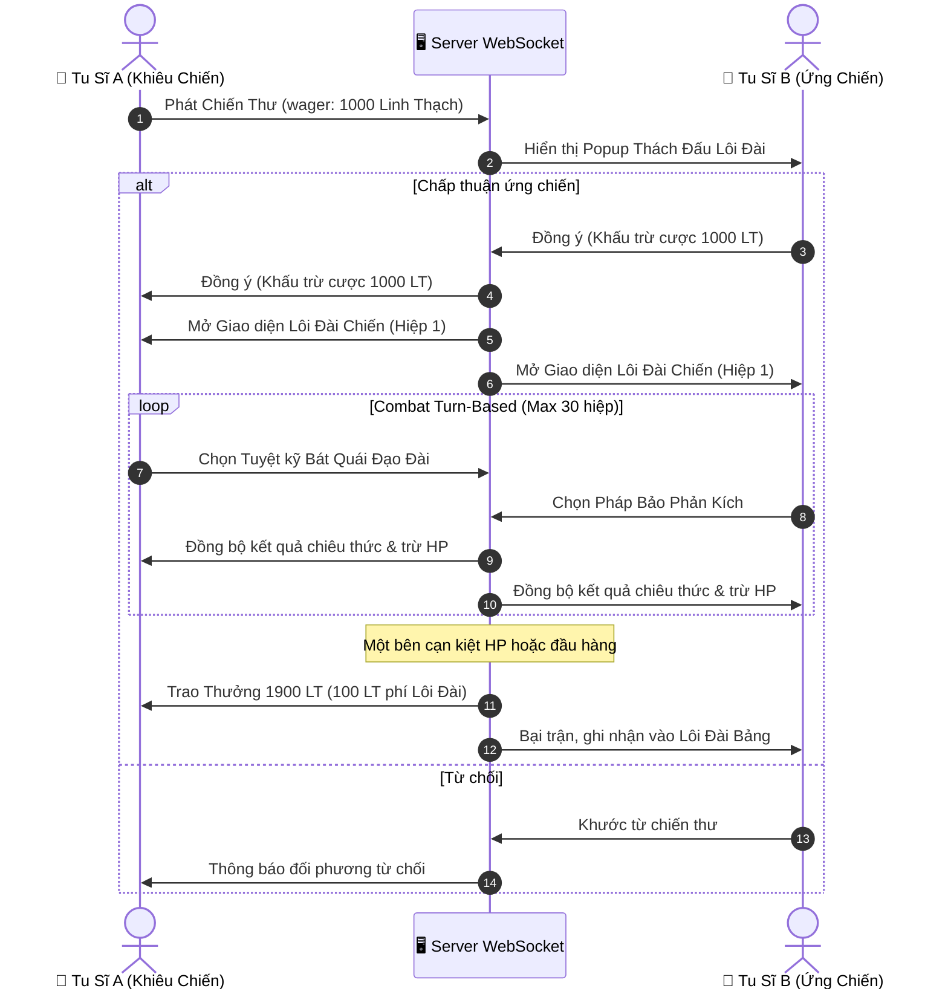

# [24] LUẬN ĐẠO LÔI ĐÀI: ĐẤU PHÁP ĐỈNH CAO (PVP 1V1) & THÀNH LẬP TIÊN MINH BANG PHÁI

> ⬅️ **[Bài Trước: Doc 23 - Toàn Thư Vũ Khí, Pháp Khí & Thần Binh](file:///c:/Users/newre/OneDrive/Máy%20tính/code%20tutien/docs/23_TOAN_THU_VU_KHI_PHAP_KHI_VA_PHAP_BAO.md)** | 📖 **[Mục Lục Toàn Cảnh](file:///c:/Users/newre/OneDrive/Máy%20tính/code%20tutien/README.md)** | ➡️ **[Bài Kế: Doc 25 - Phường Thị & Giao Dịch P2P](file:///c:/Users/newre/OneDrive/Máy%20tính/code%20tutien/docs/25_PHUONG_THI_DAU_GIA_VA_GIAO_DICH_P2P.md)**

> *"Tu Tiên Giới lấy thực lực vi tôn! Mọi lời biện bạch trước mũi kiếm đều là hư vọng. Bước chân lên Lôi Đài Luận Đạo, sinh tử hữu mệnh, bại giả tán tu vi, thắng giả đoạt thiên địa tạo hóa! Kẻ độc hành dẫu mạnh đến đâu cũng khó địch lại Tiên Minh vạn chúng đồng tâm khai sơn phá thạch!"*

Tài liệu này đặc tả chi tiết toàn bộ cơ chế **Luận Đạo Lôi Đài (PvP 1v1 Turn-based Realtime)**, hệ thống **Chiến Thư Cược Linh Thạch**, bảng phong thần **Thiên Kiêu Bảng** và kiến trúc **Tiên Minh / Bang Phái do Người Chơi Tự Lập (Guild System)**.

---

## ⚔️ I. KIẾN TRÚC LUẬN ĐẠO LÔI ĐÀI (PVP 1V1 REALTIME)

---

## 📜 II. QUY TẮC CHIẾN ĐẤU TRÊN LÔI ĐÀI

1. **Chuẩn Hóa Khí Huyết & Cảnh Giới**:
   - **Tỷ Thí Đạo Tâm (Cân Bằng Chỉ Số)**: Dành cho giao hữu bạn bè. HP, Công, Thủ được đưa về cùng một mốc tiêu chuẩn; thắng bại hoàn toàn do cách phối hợp 6 bộ công pháp Bát Quái Đạo Đài và thứ tự ra chiêu.
   - **Tử Chiến Đoạt Bảo (Giữ Nguyên Trang Bị Thực)**: Áp dụng toàn bộ thuộc tính thực tế của Lục Vị Trang Bị, Cảnh giới, Thể chất bản mệnh và Linh căn.
2. **Cơ Chế Cược Linh Thạch & Bồi Thường**:
   - Mức cược tối thiểu: `100 Linh Thạch`, tối đa: `1,000,000 Linh Thạch`.
   - Thuế lôi đài Tiên Giới: $5\%$ tổng tiền cược (thu vào quỹ Thiên Đạo tiêu hủy chống lạm phát).
3. **Hiệu Ứng Khắc Chế Ngũ Hành & Bí Tịch Thực Chiến**:
   - Nếu Người chơi A dùng *Thanh Phong Kiếm Pháp (Phong/Mộc)* đánh vào Người chơi B đang vận *Huyền Minh Chân Thủy (Thủy)* $\rightarrow$ Gia tăng $+25\%$ sát thương phản chấn do Thủy sinh Mộc bị tiết chế ngược.

---

## 🏆 III. THIÊN KIÊU BẢNG & PHONG HẦU PHONG TƯỚNG

Bảng xếp hạng PvP toàn server được phân thành 5 Bậc Danh Vị:

| Hạng | Danh Vị Lôi Đài | Điều Kiện Điểm ELO | Bổng Lộc Hàng Tuần | Đặc Quyền |
| :---: | :--- | :---: | :--- | :--- |
| **I** | **Thái Cổ Chí Tôn** | Top 1 Server | $50,000\text{ LT} + 1\text{ Hỗn Độn Đan}$ | Khắc bia đá Lôi Đài, hào quang vàng kim rực rỡ |
| **II** | **Tuyệt Thế Thiên Kiêu** | Top 2 - 10 | $20,000\text{ LT} + 3\text{ Cửu Chuyển Đan}$ | Danh hiệu đỏ độc quyền `[Tuyệt Thế Thiên Kiêu]` |
| **III** | **Tông Môn Thủ Tịch** | Top 11 - 50 | $8,000\text{ LT} + 10\text{ Tẩy Tủy Đan}$ | Danh hiệu tím `[Đỉnh Cấp Tông Sư]` |
| **IV** | **Nội Môn Tinh Anh** | Top 51 - 200 | $3,000\text{ LT}$ | Tăng $5\%$ tốc độ tích lũy exp tu vi |
| **V** | **Luyện Khí Tán Tu** | Còn lại | $500\text{ LT}$ | Được tham gia khiêu chiến không giới hạn |

---

## 🏰 IV. TIÊN MINH / BANG PHÁI DO NGƯỜI CHƠI TỰ LẬP (GUILD SYSTEM)

Khi tu sĩ đạt cảnh giới **Kim Đan Kỳ Tầng 1** trở lên, có thể tự mình khai sơn lập phái, chiêu mộ bạn bè vào Tiên Minh:

1. **Điều Kiện Sáng Lập**:
   - Tiêu hao: $10,000\text{ Linh Thạch} + 1\text{ Kiến Minh Lệnh}$ (rơi từ Boss Bí Cảnh Doc 17).
   - Đặt tên Tiên Minh, Tông Môn Khẩu Hiệu và Định hình Tông Chỉ (Chính Đạo | Ma Đạo | Trung Lập).
2. **Cơ Cấu Quản Trị Tiên Minh**:
   - **Minh Chủ (1 người)**: Toàn quyền thăng giáng chức vụ, kích hoạt Trận Pháp Hộ Tông.
   - **Phó Minh Chủ (2 người)**: Quản lý chiêu mộ, duyệt đơn gia nhập.
   - **Trưởng Lão (5 người)**: Quản lý Kho Chung Tiên Minh.
   - **Minh Chúng**: Làm nhiệm vụ cống hiến, nhận bổng lộc hàng ngày.
3. **Kiến Trúc Tiên Minh Cấp Độ 1 -> 5**:
   - **Tụ Linh Tiên Trận**: Tăng $+10\% \rightarrow +50\%$ tốc độ hấp thu tu vi cho toàn bộ thành viên.
   - **Tàng Bảo Minh Khố**: Kho đồ chung cho phép các thành viên chia sẻ đan dược và trang bị dư thừa.
   - **Trảm Ma Thần Điện**: Nơi triệu hồi Boss Độc Quyền Bang Phái mỗi tối thứ 7 để toàn bang cùng hợp lực săn báu vật.

---

> ⬅️ **[Bài Trước: Doc 23 - Toàn Thư Vũ Khí & Pháp Khí](file:///c:/Users/newre/OneDrive/Máy%20tính/code%20tutien/docs/23_TOAN_THU_VU_KHI_PHAP_KHI_VA_PHAP_BAO.md)** | 📖 **[Mục Lục Toàn Cảnh](file:///c:/Users/newre/OneDrive/Máy%20tính/code%20tutien/README.md)** | ➡️ **[Bài Kế: Doc 25 - Phường Thị & Giao Dịch P2P](file:///c:/Users/newre/OneDrive/Máy%20tính/code%20tutien/docs/25_PHUONG_THI_DAU_GIA_VA_GIAO_DICH_P2P.md)**
