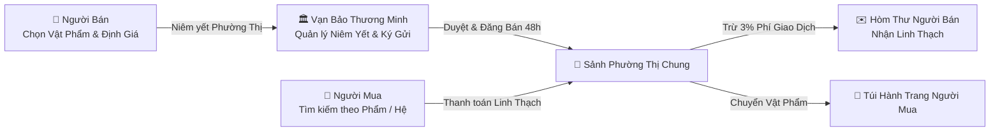
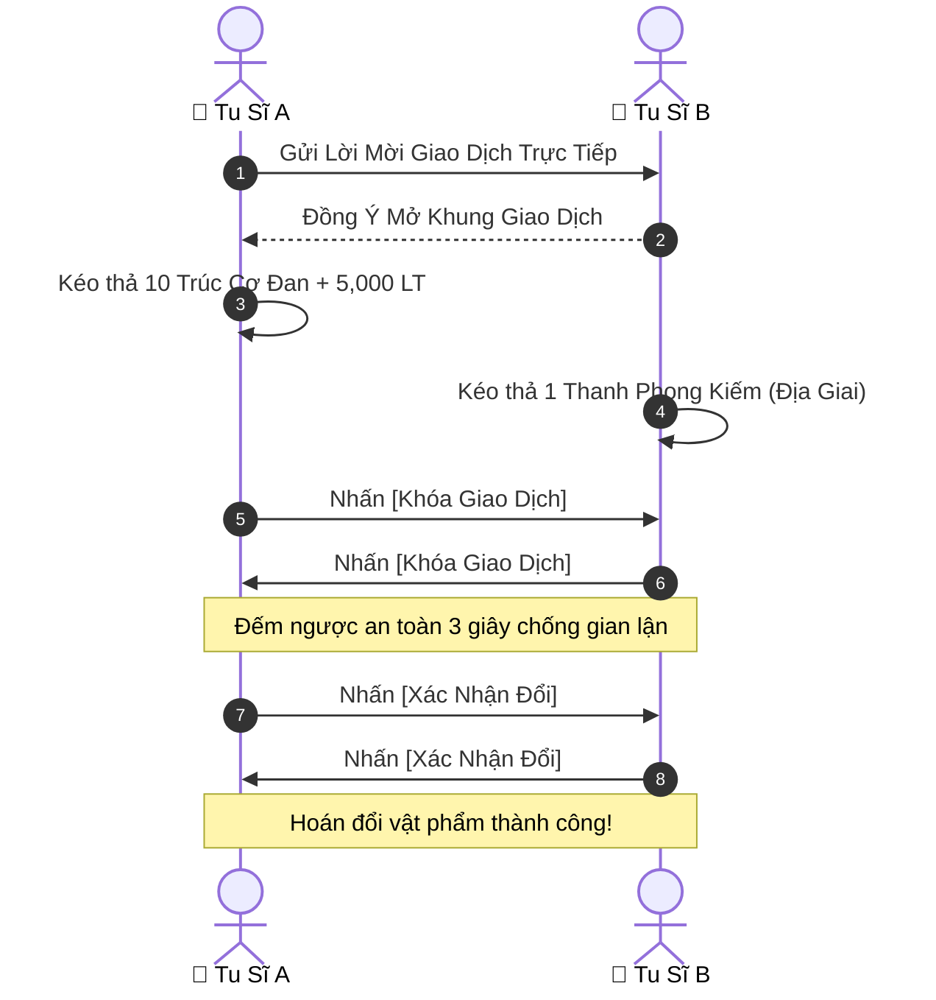

# [25] VẠN BẢO PHƯỜNG THỊ: GIAO DỊCH TỰ DO, ĐẤU GIÁ HỘI & TIÊN TÍN HÒM THƯ

> ⬅️ **[Bài Trước: Doc 24 - Luận Đạo Lôi Đài & Tiên Minh](file:///c:/Users/newre/OneDrive/Máy%20tính/code%20tutien/docs/24_LOI_DAI_DAU_PHAP_PVP_VA_BANG_PHAI.md)** | 📖 **[Mục Lục Toàn Cảnh](file:///c:/Users/newre/OneDrive/Máy%20tính/code%20tutien/README.md)** | ➡️ **[Bài Kế: Doc 26 - Đạo Lữ Song Tu, Hộ Pháp Độ Kiếp & Bounties](file:///c:/Users/newre/OneDrive/Máy%20tính/code%20tutien/docs/26_DAO_LU_SONG_TU_HO_PHAP_DO_KIEP_VA_BOUNTY.md)**

> *"Kẻ thừa đan dược đem đổi lấy kiếm tủy, người thiếu linh thạch đem bí tịch ký gửi thương minh. Chốn Phường Thị Tiên Gia muôn người qua lại, một tiếng gõ búa Đấu Giá Hội có thể định đoạt cơ đồ của cả một tông môn! Có những bức thư ngàn dặm mang theo một hạt đan tâm, cũng có những kiện hàng ẩn giấu tà khí đoạt mệnh!"*

Tài liệu này đặc tả toàn bộ nền kinh tế mở giữa người chơi trong Tu Chân Giới Online, bao gồm **Phường Thị Tự Do (Marketplace)**, **Đấu Giá Hội Vạn Bảo Các (Auction House)**, **Giao Dịch P2P Trực Tiếp (Direct Player-to-Player Trade)** và **Hệ Thống Tiên Tín (In-game Mailbox)**.

---

## 🏬 I. PHƯỜNG THỊ TỰ DO (OPEN MARKETPLACE)

### 1. Quy Trình Niêm Yết & Phí Giao Dịch
- **Thời Hạn Ký Gửi**: Mỗi món hàng được treo bán tối đa **48 giờ thực tế**. Nếu hết hạn chưa ai mua, vật phẩm tự động chuyển hoàn về Hòm Thư của chủ nhân.
- **Biểu Phí Thương Minh**:
  - Phí niêm yết ban đầu: Miễn phí (đối với đệ tử Tông môn) hoặc $10\text{ LT}$ (đối với Tán Tu).
  - Thuế giao dịch thành công: $3\%$ tổng giá trị đơn hàng (khấu trừ trực tiếp trước khi gửi tiền cho người bán).
- **Quy Cách Phân Loại Hàng Hóa**:
  - `Thảo Dược & Đan Dược`: Cho phép bán số lượng lớn theo chồng (Stackable).
  - `Pháp Khí & Thần Binh`: Hiển thị rõ độ bền, số lần tế luyện huyết mạch và phẩm chất Khí Linh.
  - `Công Pháp Bí Tịch`: Cho phép người mua bấm xem trước toàn bộ chỉ số sát thương và hiệu ứng chiêu thức.

---

## 🔨 II. ĐẤU GIÁ HỘI VẠN BẢO CÁC (AUCTION HOUSE ĐỊNH KỲ)

Cứ mỗi **Chủ Nhật hàng tuần vào lúc 20:00 - 21:00 (Giờ Server)**, hệ thống tự động mở phiên Đấu Giá Hội Toàn Cõi:

1. **Nguồn Hàng Đấu Giá**:
   - **Vật Phẩm Cực Phẩm do Server tung ra**: 1 Pháp bảo Thần Giai, 1 Trứng Thần Thú Thái Cổ, 3 Vô Tự Thiên Thư.
   - **Vật phẩm do người chơi gửi gắm**: Chỉ chấp nhận trang bị phẩm cấp **Địa Giai trở lên** hoặc Thảo dược Thiên Niên.
2. **Quy Tắc Đấu Giá Realtime**:
   - Mỗi lượt ra giá (Bid) phải cao hơn giá hiện tại tối thiểu $5\%$.
   - Mỗi khi có người trả giá trong 30 giây cuối, đồng hồ đếm ngược tự động gia hạn thêm 15 giây để tránh tình trạng "đua lệnh phút chót".
   - Sau khi búa gõ lần thứ 3 (`Thành Giao!`), vật phẩm và linh thạch tự động được gửi qua hệ thống Tiên Tín.

---

## 🤝 III. GIAO DỊCH P2P TRỰC TIẾP (DIRECT 1V1 TRADE)

Dành cho hai người chơi đứng gần nhau hoặc kết nối trong cùng một phòng chơi bạn bè:

---

## ✉️ IV. HỆ THỐNG TIÊN TÍN HÒM THƯ (IN-GAME MAILBOX)

Hòm Thư là xương sống kết nối offline và giao dịch gián tiếp của thế giới Tu Chân:

1. **Phân Loại Thư Tín**:
   - **Thiên Đạo Ban Phúc (System Mail)**: Thưởng bảo trì máy chủ, đền bù sự kiện, phần thưởng đua top Thiên Kiêu Bảng, doanh thu bán hàng Phường Thị.
   - **Đạo Hữu Phi Kiếm Truyền Thư (Player Mail)**: Người chơi gửi thư cho nhau. Cho phép đính kèm tối đa **4 ô vật phẩm** và **1,000,000 Linh Thạch** mỗi phong thư.
2. **Cơ Chế Bảo Vệ & Giới Hạn**:
   - Dung lượng hòm thư: Tối đa 50 phong thư.
   - Thời gian lưu trữ: 30 ngày đối với thư thường, 7 ngày đối với thư chưa nhận quà đính kèm.
   - Chống spam: Phí gửi thư người chơi là $50\text{ Linh Thạch}$/lần gửi.

---

> ⬅️ **[Bài Trước: Doc 24 - Luận Đạo Lôi Đài & Tiên Minh](file:///c:/Users/newre/OneDrive/Máy%20tính/code%20tutien/docs/24_LOI_DAI_DAU_PHAP_PVP_VA_BANG_PHAI.md)** | 📖 **[Mục Lục Toàn Cảnh](file:///c:/Users/newre/OneDrive/Máy%20tính/code%20tutien/README.md)** | ➡️ **[Bài Kế: Doc 26 - Đạo Lữ Song Tu, Hộ Pháp Độ Kiếp & Bounties](file:///c:/Users/newre/OneDrive/Máy%20tính/code%20tutien/docs/26_DAO_LU_SONG_TU_HO_PHAP_DO_KIEP_VA_BOUNTY.md)**
