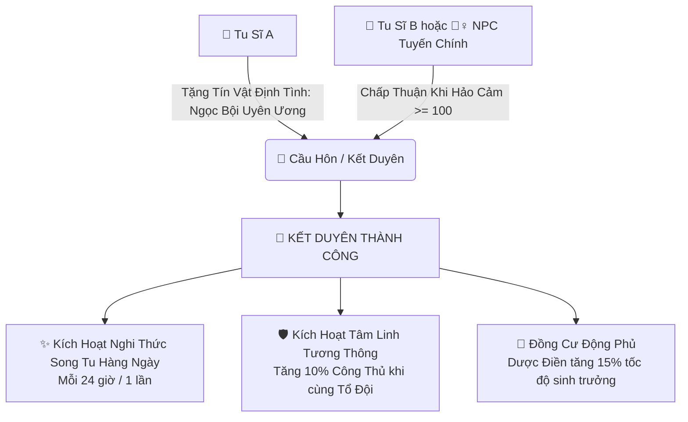
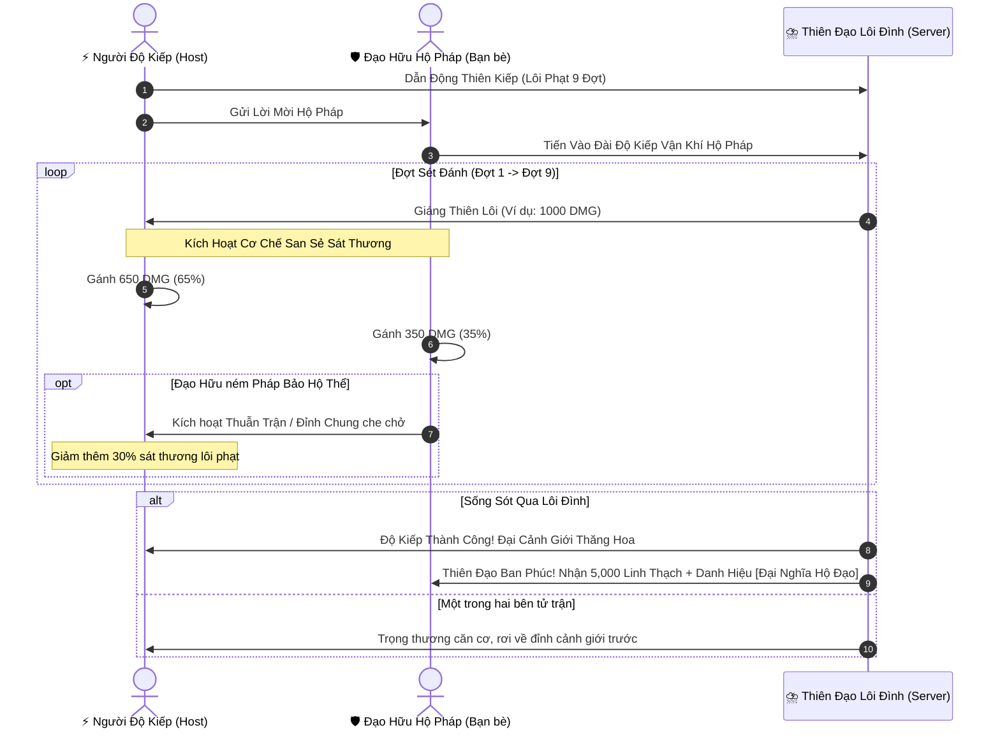

# [26] TIÊN DUYÊN ĐẠO LỮ: SONG TU BẢN MỆNH, HỘ PHÁP ĐỘ KIẾP & HUYỀN THƯỞNG BẢNG

> ⬅️ **[Bài Trước: Doc 25 - Vạn Bảo Phường Thị & Giao Dịch P2P](file:///c:/Users/newre/OneDrive/Máy%20tính/code%20tutien/docs/25_PHUONG_THI_DAU_GIA_VA_GIAO_DICH_P2P.md)** | 📖 **[Mục Lục Toàn Cảnh](file:///c:/Users/newre/OneDrive/Máy%20tính/code%20tutien/README.md)** | ➡️ **[Tổng Quan Toàn Cảnh: Doc 00](file:///c:/Users/newre/OneDrive/Máy%20tính/code%20tutien/docs/00_TONG_QUAN.md)**

> *"Vấn thế gian tình thị hà vật, trực giáo sinh tử tương hứa? Trên con đường nghịch thiên tu hành cô độc vạn năm, có một người cùng chung chí hướng, cùng chia sẻ lôi kiếp sinh tử, cùng bế quan song tu lĩnh ngộ thiên địa huyền cơ, ấy là phúc duyên lớn nhất của bậc tu sĩ! Khi lôi đình chín tầng trời giáng xuống, sau lưng có đạo hữu đứng mũi chịu sào; khi mở mắt ra khỏi động phủ, có bảng huyền thưởng treo chờ danh chấn bát hoang!"*

Tài liệu này đặc tả ba cơ chế mang đậm linh hồn tiên hiệp tương tác nhiều người chơi: **Hệ Thống Đạo Lữ & Song Tu (Companion & Dual Cultivation)**, **Cơ Chế Đồng Đội Hộ Pháp Độ Kiếp (Co-op Tribulation Assistance)** và **Huyền Thưởng Bảng Trảm Yêu Hàng Ngày (Daily Bounties & Titles)**.

---

## 🌸 I. HỆ THỐNG ĐẠO LỮ & BẾ QUAN SONG TU

Tu sĩ có thể kết duyên Đạo Lữ với **Bạn Chơi Cùng (Player-Player)** hoặc với **31 Đại NPC Danh Phả ([Doc 13](file:///c:/Users/newre/OneDrive/Máy%20tính/code%20tutien/docs/13_TOAN_THU_NPC_NHAN_VAT_COT_TRUYEN.md))**:

### 1. Điều Kiện & Nghi Thức Kết Duyên
- **Với Bạn Chơi Khác**: Hai bên đạt cảnh giới **Trúc Cơ Kỳ Tầng 1** trở lên, cùng tặng nhau tín vật `Định Tình Ngọc Bội` (mua tại Phường Thị $5,000\text{ LT}$). Cả hai bên cùng đồng ý trên giao diện tiệc cưới Tiên Giới.
- **Với NPC Tuyến Chính**: Điểm Hảo Cảm phải đạt tối đa $+100$ điểm ([Doc 13](file:///c:/Users/newre/OneDrive/Máy%20tính/code%20tutien/docs/13_TOAN_THU_NPC_NHAN_VAT_COT_TRUYEN.md)) và hoàn thành **Nhiệm Vụ Duyên Kiếp** của NPC đó.
- Mỗi tu sĩ chỉ được kết tóc se duyên với **1 Đạo Lữ Bản Mệnh duy nhất**. Nếu muốn giải trừ duyên phận (Ly Dị), phải tiêu hao $10,000\text{ LT}$ và chịu hiệu ứng *Đạo Tâm Bất Ổn* (giảm $10\%$ exp tu vi trong 7 ngày).

### 2. Lợi Ích Của Song Tu Hàng Ngày
- Mỗi 24 giờ thực tế, cặp Đạo Lữ có thể bấm nút **[Bế Quan Song Tu]** tại Động Phủ:
  - Cả hai nhận được lượng tu vi khổng lồ tương đương **3 giờ treo máy tự động**.
  - Thanh tẩy $10\%$ Đan Độc kinh mạch mà không cần dùng Thanh Tâm Đan.
  - Có tỷ lệ $5\%$ kích hoạt trạng thái **Đốn Ngộ**, nhận ngay $1$ Điểm Lĩnh Ngộ Công Pháp Bát Quái Đạo Đài.

---

## ⚡ II. CƠ CHẾ ĐỒNG ĐỘI HỘ PHÁP ĐỘ KIẾP (CO-OP TRIBULATION)

Độ kiếp thăng đại cảnh giới (Trúc Cơ $\rightarrow$ Kim Đan $\rightarrow$ Nguyên Anh...) luôn đi kèm nguy cơ tử kiếp (mất tu vi, thụ thương căn cơ). Đây là lúc tình đồng đội tỏa sáng:

---

## 📜 III. HUYỀN THƯỞNG BẢNG TRẢM YÊU (DAILY BOUNTIES)

Mỗi ngày vào lúc **00:00 (Giờ Server)**, hệ thống tự động làm mới **5 Nhiệm Vụ Huyền Thưởng** tại Phường Thị:

| Loại Nhiệm Vụ | Mục Tiêu Tiêu Biểu | Phần Thưởng |
| :--- | :--- | :--- |
| **Trảm Yêu Trừ Ma** | Tiêu diệt 10 Quái vật tại Bãi Săn Hỗn Độn ([Doc 10](file:///c:/Users/newre/OneDrive/Máy%20tính/code%20tutien/docs/10_CHIEN_DAU_VA_BAI_SAN.md)) | $2,000\text{ Exp} + 500\text{ Linh Thạch}$ |
| **Thái Dược Luyện Đan** | Thu hoạch 15 Thảo dược & Luyện thành công 3 Lò Đan ([Doc 08](file:///c:/Users/newre/OneDrive/Máy%20tính/code%20tutien/docs/08_DONG_PHU_NONG_TRAI_LUYEN_DAN.md)) | $1,500\text{ Exp} + 3\text{ Ngưng Khí Đan}$ |
| **Thần Thức Tầm Duyên** | Thực hiện 2 lần quét Thần Thức Bát Hoang ([Doc 14](file:///c:/Users/newre/OneDrive/Máy%20tính/code%20tutien/docs/14_THAN_THUC_TAM_BAO_VA_DI_GIOI.md)) | $1,000\text{ Exp} + 1\text{ Cổ Vật Hoen Rỉ}$ |
| **Luận Đạo Lôi Đài** | Hoàn thành 2 trận đấu pháp trên Lôi Đài ([Doc 24](file:///c:/Users/newre/OneDrive/Máy%20tính/code%20tutien/docs/24_LOI_DAI_DAU_PHAP_PVP_VA_BANG_PHAI.md)) | $2,500\text{ Exp} + 1,000\text{ Linh Thạch}$ |
| **Đàm Đạo NPC** | Tặng quà hoặc đối thoại cùng 1 NPC Tuyến Chính ([Doc 13](file:///c:/Users/newre/OneDrive/Máy%20tính/code%20tutien/docs/13_TOAN_THU_NPC_NHAN_VAT_COT_TRUYEN.md)) | $1,000\text{ Exp} + 20\text{ Điểm Cống Hiến Môn Phái}$ |

*Khi hoàn thành đủ 5/5 nhiệm vụ trong ngày, nhận thêm **Rương Huyền Thưởng Đại Thừa** (chứa cơ hội mở ra Mảnh Bí Tịch Địa Giai & Pháp Bảo Hiếm).*

---

## 🎖️ IV. HỆ THỐNG DANH HIỆU BẢN MỆNH (TITLES SYSTEM)

Danh hiệu hiển thị rực rỡ trên đầu nhân vật, gia tăng uy thế và chỉ số thụ động:
- `[Sát Thần Bát Hoang]`: Đạt 100 lần thắng trận Lôi Đài $\rightarrow \text{ATK} +5\%$.
- `[Cửu Chuyển Đan Tôn]`: Luyện thành công đan dược Cửu Chuyển $\rightarrow$ Tăng $10\%$ tỷ lệ luyện đan không tốn thảo dược.
- `[Vạn Tộc Chi Chủ]`: Thu thập đủ 18 Thể chất hoặc đạt cảnh giới Hóa Thần $\rightarrow \text{HP} +10\%$.
- `[Đại Nghĩa Hộ Đạo]`: Hộ pháp thành công 10 lần cho bạn bè $\rightarrow \text{DEF} +8\%$.
- `[Đạo Lữ Đồng Tâm]`: Song tu liên tục 30 ngày cùng một Đạo Lữ $\rightarrow$ Tốc độ hấp thu linh khí $+15\%$.

---

> ⬅️ **[Bài Trước: Doc 25 - Vạn Bảo Phường Thị & Giao Dịch P2P](file:///c:/Users/newre/OneDrive/Máy%20tính/code%20tutien/docs/25_PHUONG_THI_DAU_GIA_VA_GIAO_DICH_P2P.md)** | 📖 **[Mục Lục Toàn Cảnh](file:///c:/Users/newre/OneDrive/Máy%20tính/code%20tutien/README.md)** | ➡️ **[Tổng Quan Toàn Cảnh: Doc 00](file:///c:/Users/newre/OneDrive/Máy%20tính/code%20tutien/docs/00_TONG_QUAN.md)**
