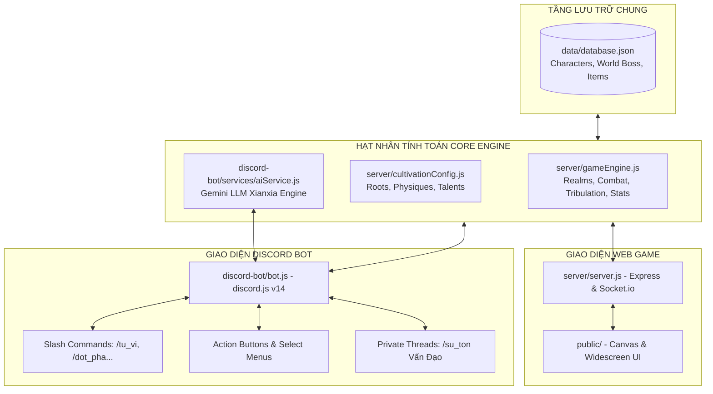

# [27] BẢN MỆNH THẦN THỨC: HOẠCH ĐỊNH & TRIỂN KHAI PHIÊN BẢN DISCORD BOT AI (DISCORD EDITION)

> ⬅️ **[Bài Trước: Doc 26 - Tiên Duyên Đạo Lữ & Song Tu](file:///d:/bai%20tap%20ki%204/code%20tutien/docs/26_DAO_LU_SONG_TU_HO_PHAP_DO_KIEP_VA_BOUNTY.md)** | 📖 **[Mục Lục Toàn Cảnh](file:///d:/bai%20tap%20ki%204/code%20tutien/README.md)** | ➡️ **[Tổng Quan Toàn Cảnh: Doc 00](file:///d:/bai%20tap%20ki%204/code%20tutien/docs/00_TONG_QUAN.md)**

> *"Tu chân chi đạo vô viễn cận, vạn lý hư không nhất niệm thông. Dẫu thân tại trần thế, chỉ cần một đạo thần thức giáng lâm Discord, liền có thể câu thông thiên đạo, bế quan đốn ngộ, tham gia đấu pháp lôi đài cùng chư vị đạo hữu, hoặc cùng Khí Linh Sư Tôn đàm đạo ngàn năm!"*

Tài liệu này đặc tả quy chuẩn kiến trúc, hệ thống tương tác và lộ trình công nghệ để xây dựng phiên bản **Tu Chân Giới - Discord AI Edition**. Phiên bản này hoạt động theo mô hình **Cross-Platform Shared Database**, cho phép người chơi sử dụng tài khoản trên Web Game hoặc trực tiếp trên ứng dụng Discord (Mobile/Desktop) mà không bị đứt đoạn tiến trình tu vi.

---

## 🏛️ I. TỔNG QUAN KIẾN TRÚC CROSS-PLATFORM

### 1. Sơ Đồ Kiến Trúc Hệ Thống (Shared Core Architecture)

Toàn bộ logic tính toán chỉ số, thăng cấp cảnh giới, công pháp và chiến đấu được tái sử dụng nguyên vẹn từ hạt nhân `server/gameEngine.js` và `server/cultivationConfig.js`.



### 2. Cơ Chế Đồng Bộ & Liên Kết Tài Khoản (Account Binding)
Mỗi nhân vật trong `data/database.json` được bổ sung thêm trường `discordId`:
```json
{
  "name": "tieu_dao_tu",
  "discordId": "489201928374829102",
  "race": "human",
  "realmId": 14,
  "exp": 45000,
  "spiritStones": 12500,
  "spiritReservoir": { "storedExp": 5000, "maxCapacity": 120000 },
  "foundation": { "purity": 85, "pillToxins": 10 }
}
```
- **Nếu đã có nhân vật trên Web**: Người chơi vào Discord gõ `/lien_ket <ten_nhan_vat> [mat_ma]`. Bot sẽ gán `discordId` của tài khoản Discord vào dữ liệu nhân vật.
- **Nếu là người chơi mới trên Discord**: Gõ `/nhap_mon` để khởi tạo nhân vật trực tiếp. Nhân vật này sau đó có thể đăng nhập trên Web bình thường.

---

## ⚡ II. HỆ THỐNG LỆNH SLASH COMMAND & GIAO DIỆN DISCORD

### 1. Bảng Danh Mục Lệnh Tu Tiên (Command Directory)

| Slash Command | Mục Đích & Hiệu Lực | Thành Phần Giao Diện (Components) |
| :--- | :--- | :--- |
| `/nhap_mon` | Khởi tạo nhân vật, trắc nghiệm Linh Căn & Thể Chất | Select Menu chọn Tộc, Modal nhập Đạo Hiệu, Embed Thiên Mệnh |
| `/lien_ket` | Liên kết Discord ID với nhân vật Web đã tạo | Input Text Tên Nhân Vật + Mật khẩu xác thực |
| `/tu_vi` | Tra cứu bảng thông số bản mệnh, căn cơ, linh căn | Rich Embed Cổ Phong + Buttons: `[🧘 Bế Quan]` `[⚡ Đột Phá]` `[🎒 Túi Đồ]` |
| `/tu_luyen` | Thu nạp linh khí thiên địa, vận công 1 chu thiên | Tăng tu vi tức thì theo hiệu suất thiền định + Text Log |
| `/dot_pha` | Dẫn động thiên lôi, phá cảnh giới vượt ải | Embed Lôi Kiếp + Modal "Ảo Cảnh Tâm Ma" (AI chấm điểm) |
| `/ky_ngo` | Thám hiểm bát hoang, tầm bảo kích duyên | AI sinh tình huống động + 3 Nút lựa chọn hành vi |
| `/san_quai` | Khiêu chiến bãi quái tự do theo phân khu cảnh giới | Embed kết quả Turn-based Combat + Rơi Yêu Đan/Bí Tịch |
| `/boss` | Khiêu chiến Trạm Lư Ma Tôn (World Boss) | Thanh máu Boss toàn server + BXH DPS đóng góp |
| `/su_ton` | Mở Private Thread đàm đạo riêng với AI Sư Tôn | Tạo Thread cá nhân, tương tác bằng trí tuệ nhân tạo |
| `/tui_do` | Mở Càn Khôn Bảo Khố, kiểm tra vật phẩm/pháp bảo | Select Menu chọn item + Buttons `[Dùng]` `[Trang bị]` |
| `/dau_phap` | Luận đạo tỉ thí PvP với tu sĩ khác trong server | Nhắc `@đối_thủ`, Embed kết quả đọ sức võ đài |

---

### 2. Thiết Kế Mẫu Giao Diện Rich Embed Cổ Phong

Giao diện hiển thị bảng nhân vật khi gõ `/tu_vi`:

```text
╔═══════════════════════════════════════════════════════════╗
║ 🌌 TU CHÂN GIỚI - BẢN MỆNH TIÊN BẢO                      ║
╠═══════════════════════════════════════════════════════════╣
║ 👤 Đạo Hiệu: Diệp Thiên Thần                              ║
║ 🧬 Chủng Tộc: Nhân Tộc (Thiên Kiêu) | Mệnh: Hỏa          ║
║ ⚡ Cảnh Giới: Kim Đan Sơ Kỳ (Cấp 14)                      ║
║ 📈 Tu Vi: 48,200 / 60,000 [████████░░] 80.3%             ║
║ ⏱️ Hiệu Suất: +50 Tu Vi / Giây (Tự Động)                 ║
╠═══════════════════════════════════════════════════════════╣
║ ⚔️ Công Kích: 2,450         🛡️ Phòng Ngự: 1,220          ║
║ ❤️ Khí Huyết: 18,200        💨 Thân Pháp: 48             ║
║ 🌿 Linh Căn: Thuần Dương Hỏa Căn (+20% Tu Vi, +8% ATK)   ║
║ 🩸 Thể Chất: Hoang Cổ Thánh Thể (Kháng Lôi +25%)          ║
║ 🧪 Đan Độc: 8% (Thanh tịnh) 🏺 Tụ Linh Đỉnh: 4,500 Điểm  ║
╠═══════════════════════════════════════════════════════════╣
║ 📜 Khí Linh Nhắn Nhủ:                                    ║
║ "Đạo hữu khí tức dồi dào, hãy mau thu thập Hỏa Linh Tinh  ║
║ để chuẩn bị độ đệ tứ trọng lôi kiếp!"                     ║
╚═══════════════════════════════════════════════════════════╝
  [ 🧘 Bế Quan ]   [ ⚡ Đột Phá ]   [ 🎒 Túi Đồ ]   [ 🔮 Sư Tôn ]
```

---

## 🧠 III. HỆ THỐNG AI TIÊN HIỆP ĐỘNG (XIANXIA AI ENGINE)

### 1. Kiến Trúc AI Service (`aiService.js`)
Sử dụng **Google Gemini API** (Gemini 2.0 Flash / 1.5 Flash) với ưu điểm:
- Tốc độ phản hồi cực nhanh ($< 1\text{ giây}$).
- Miễn phí hạn ngạch lớn ($15\text{ requests/phút}$ hoàn toàn đủ cho nhóm bạn chơi nội bộ).
- Khả năng xuất định dạng **Structured Output (JSON)** để can thiệp trực tiếp vào dữ liệu nhân vật.

### 2. Ứng Dụng AI #1: Đàm Đạo Sư Tôn Trong Thread (`/su_ton`)
- Khi người chơi gõ `/su_ton`, bot tự tạo một **Discord Thread** riêng (ví dụ: `#vấn-đạo-diệp-thiên-thần`).
- **System Prompt**: Đóng vai Sư Tôn Thái Thượng Trưởng Lão hoặc Khí Linh Thượng Cổ:
  - Văn phong cổ phong, xưng "Bản tọa / Lão phu", gọi người chơi là "Tiểu tử / Đồ nhi".
  - Nắm rõ thông tin nhân vật (cảnh giới, linh căn, môn phái, đan độc hiện tại).
  - Có thể đưa ra lời khuyên tu luyện chính xác dựa trên luật chơi của game.

### 3. Ứng Dụng AI #2: Ảo Cảnh Tâm Ma Khi Đột Phá Đại Cảnh Giới
- Khi người chơi đột phá (Trúc Cơ $\rightarrow$ Kim Đan, Kim Đan $\rightarrow$ Nguyên Anh):
  - Bot kích hoạt Discord Modal yêu cầu người chơi vượt qua **Ảo Cảnh Tâm Ma**.
  - Tình huống mẫu: *"Bản tọa thấy ngươi vì đoạt dị bảo mà diệt cả một gia tộc phàm nhân. Đạo tâm ngươi có từng hối hận?"*
  - Người chơi gõ lời đáp. AI phân tích:
    - Nếu đạo tâm kiên định $\rightarrow$ Trả về JSON `{ pass: true, bonusRate: 0.15, text: "Tâm niệm thông suốt, lôi kiếp tiêu tán!" }`.
    - Nếu do dự hoang mang $\rightarrow$ Trả về JSON `{ pass: false, penaltyDmg: 500, text: "Tâm ma quấy nhiễu, kinh mạch nghịch chuyển!" }`.

### 4. Ứng Dụng AI #3: Hệ Thống Kỳ Ngộ Sinh Tự Động (Procedural Events)
- Khi người chơi gõ `/ky_ngo`, AI sinh ngẫu nhiên một tình huống tiên hiệp độc nhất vô nhị dựa trên cảnh giới và địa điểm hiện tại:
```json
{
  "title": "Cổ Miếu Hoang Tàn",
  "story": "Ngươi vô tình lạc bước vào một phế tích cổ đại phủ đầy rêu phong. Dưới đáy giếng cạn phát ra ánh sáng lam nhạt của một gốc U Hồn Thảo, nhưng bên cạnh là một đầu Hắc Lân Mãng đang say ngủ.",
  "choices": [
    { "id": "A", "label": "Lén lút hái thảo dược (Cần Thân Pháp)" },
    { "id": "B", "label": "Rút kiếm chém rắn đoạt bảo (Chiến Đấu)" },
    { "id": "C", "label": "Rời đi tránh rủi ro (An Toàn)" }
  ]
}
```
Bot render ra 3 Button `[Lựa chọn A]`, `[Lựa chọn B]`, `[Lựa chọn C]`. Người chơi bấm chọn để nhận thưởng hoặc chịu phạt tương ứng.

---

## 💬 IV. BỐ CỤC KÊNH DISCORD CHUẨN MỰC (SERVER CHANNEL LAYOUT)

Để máy chủ Discord trở thành một Tiên Giới sống động, khuyến nghị cấu trúc danh mục kênh như sau:

```text
🏛️ TU CHÂN GIỚI (DANH MỤC)
├── 📜-nhập-môn-quy-tắc     (Xem luật chơi, hướng dẫn lệnh /nhap_mon, /lien_ket)
├── 📢-thiên-đạo-thông-báo  (Bot tự động ping khi có người phi thăng, mở Boss)
├── 🧘-tàng-kinh-các        (Kênh tra cứu công pháp, vật phẩm, bí tịch)
├── ⚔️-luận-đạo-lôi-đài     (Kênh gõ lệnh /tu_vi, /san_quai, /dau_phap PvP)
├── 👹-trảm-ma-chiến-trường (Kênh đánh Boss Thế Giới /boss, đồng bộ thanh máu)
└── 🏮-bất-dạ-tửu-lầu       (Kênh thảo luận tự do, đàm đạo giữa các đạo hữu)
```

---

## 🛠️ V. CẤU TRÚC THƯ MỤC DỰ ÁN MẪU (`discord-bot/`)

Thư mục `discord-bot/` được tổ chức tách biệt nhưng đặt cùng repo để dễ dàng import core logic:

```text
d:\bai tap ki 4\code tutien\
├── data/
│   └── database.json              <-- Dùng chung 100% dữ liệu
├── server/
│   ├── gameEngine.js              <-- Import trực tiếp logic cảnh giới, combat
│   ├── cultivationConfig.js       <-- Import trực tiếp chỉ số linh căn, thể chất
│   └── server.js                  <-- Web Server Express + Socket.io
├── public/                        <-- Frontend Web Game
└── discord-bot/                   <-- MODULE BOT DISCORD MỚI
    ├── package.json               <-- discord.js, @google/genai, dotenv
    ├── .env.example               <-- BOT_TOKEN, CLIENT_ID, GEMINI_API_KEY
    ├── config.js                  <-- Cấu hình màu sắc Embed, Emoji, Channels
    ├── bot.js                     <-- Entry point khởi động bot và load commands
    ├── deploy-commands.js         <-- Script đăng ký Slash Commands lên Discord
    ├── embeds/
    │   └── embedBuilder.js        <-- Tạo Rich Embeds cổ phong chuẩn mực
    ├── services/
    │   └── aiService.js           <-- Module kết nối Gemini API (Sư tôn, Kỳ ngộ)
    └── commands/                  <-- Danh sách Slash Commands
        ├── nhapmon.js             <-- Khởi tạo nhân vật mới
        ├── lienket.js             <-- Liên kết tài khoản Web
        ├── tuvi.js                <-- Xem thông số nhân vật + Action Buttons
        ├── tuluyen.js             <-- Vận công tu luyện
        ├── dotpha.js              <-- Độ kiếp + Ảo cảnh tâm ma
        ├── kyngo.js               <-- Kỳ ngộ động AI
        ├── sanquai.js             <-- Đánh quái tự do
        ├── boss.js                <-- Đánh World Boss
        └── suton.js               <-- Đàm đạo AI trong Thread
```

---

## 🚀 VI. LỘ TRÌNH TRIỂN KHAI THEO GIAI ĐOẠN

```mermaid
gantt
    title Lộ Trình Phát Triển Discord Bot Tu Tiên
    dateFormat  YYYY-MM-DD
    section Giai Đoạn 1
    Khởi tạo thư mục discord-bot & dependencies :done, d1, 2026-10-16, 1d
    Đăng ký Bot trên Discord Developer Portal   :active, d2, 2026-10-17, 1d
    section Giai Đoạn 2
    Viết Core Commands: /nhap_mon, /lien_ket, /tu_vi : d3, 2026-10-18, 2d
    Viết Lệnh /tu_luyen, /dot_pha, /san_quai       : d4, 2026-10-20, 2d
    section Giai Đoạn 3
    Tích hợp Gemini AI: aiService.js              : d5, 2026-10-22, 2d
    Phát triển lệnh /su_ton & Kỳ Ngộ AI           : d6, 2026-10-24, 2d
    section Giai Đoạn 4
    Đồng bộ Boss Thế Giới & Đấu Pháp PvP          : d7, 2026-10-26, 2d
    Thử nghiệm nội bộ và đóng gói tài liệu        : d8, 2026-10-28, 1d
```

---

## 📝 VII. HƯỚNG DẪN THIẾT LẬP NHANH (QUICK SETUP GUIDE)

1. **Tạo Discord Bot trên Portal**:
   - Truy cập [Discord Developer Portal](https://discord.com/developers/applications).
   - Bấm **New Application** $\rightarrow$ Đặt tên `Tu Chân Giới Bot`.
   - Vào mục **Bot** $\rightarrow$ Bật các **Privileged Gateway Intents** (Message Content, Server Members).
   - Lấy `TOKEN` và `CLIENT_ID`.
2. **Cài đặt thư viện**:
   ```bash
   cd "d:\bai tap ki 4\code tutien\discord-bot"
   npm install discord.js @google/genai dotenv
   ```
3. **Cấu hình `.env`**:
   ```env
   DISCORD_TOKEN=your_bot_token_here
   CLIENT_ID=your_client_id_here
   GUILD_ID=your_discord_server_id_here
   GEMINI_API_KEY=your_gemini_api_key_here
   ```
4. **Khởi chạy Bot**:
   ```bash
   node deploy-commands.js
   node bot.js
   ```
